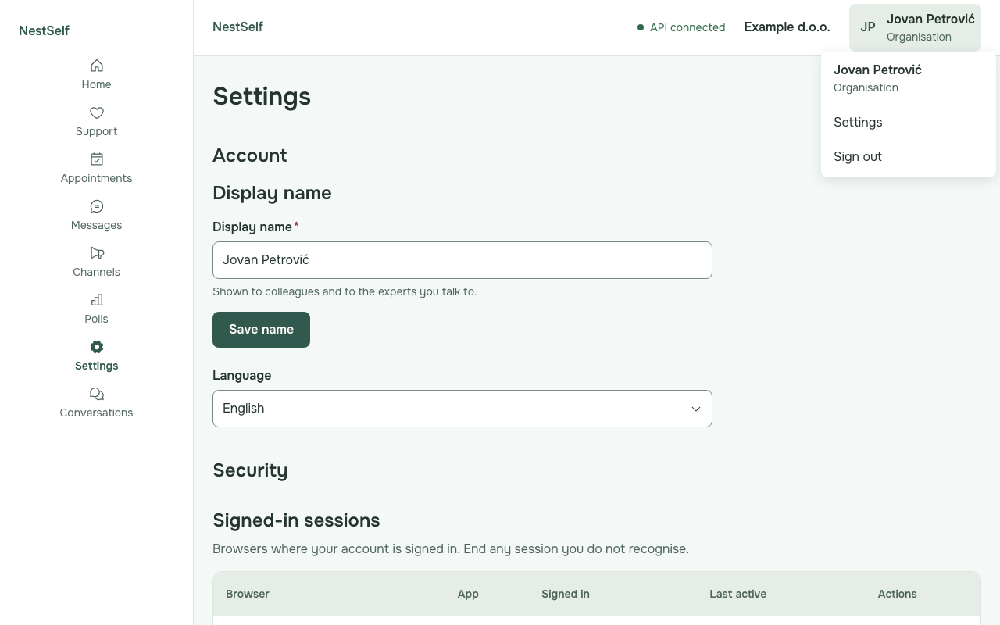
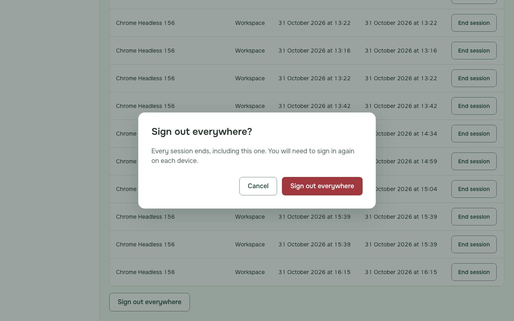

# Employee guide

Who this is for: employees whose organisation uses NestSelf. The pictures show fictional sample people.

---

## Sign in with a code

1. Open NestSelf, type your work email address and press **Continue**.

   

2. Type the code from the email NestSelf sent you and press **Verify**.

   

   **If it fails:** "The code you entered is not valid." Type the code from the newest email again, or press **Resend code**.

## Sign in through your organisation

1. Type your work email address on the same sign-in page and press **Continue**.
2. Sign in on your organisation's own sign-in page when NestSelf takes you there; you return to NestSelf signed in.

   

   **If it fails:** "Your organisation has not enabled your account yet. Ask your HR administrator." Ask HR to invite you.

## Confirm your email when asked

1. When **Confirm your email address** appears, type the code NestSelf emailed you and press **Confirm**.

   

   **If it fails:** "This confirmation link has expired. Sign in again." Press **Back to sign-in** and sign in again.

## Change your name and language

1. Open the menu with your name at the top right and choose **Settings**.

   

2. Type your name under **Display name** and press **Save name**.
3. Choose your language under **Language**.

## End sessions and sign out everywhere

1. In **Settings**, under **Signed-in sessions**, press **End session** next to a browser you do not recognise, then **End session** again.

   

2. To sign out on every device, press **Sign out everywhere**, then **Sign out everywhere** again.

   

## Sign out

1. Open the menu with your name at the top right and choose **Sign out**.
