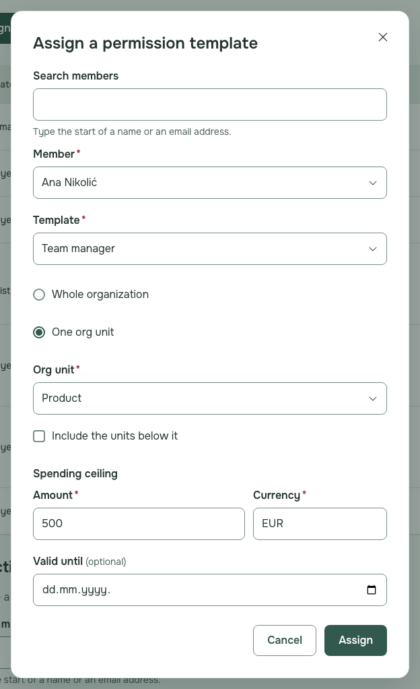
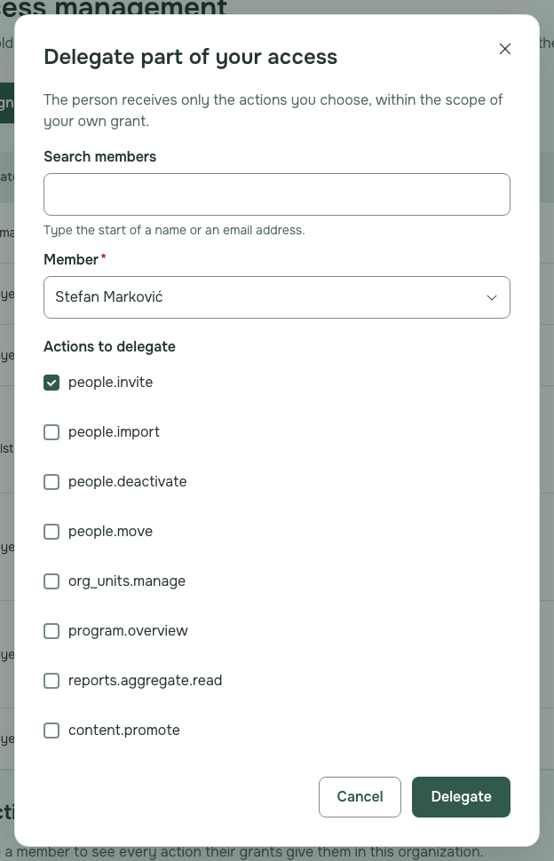
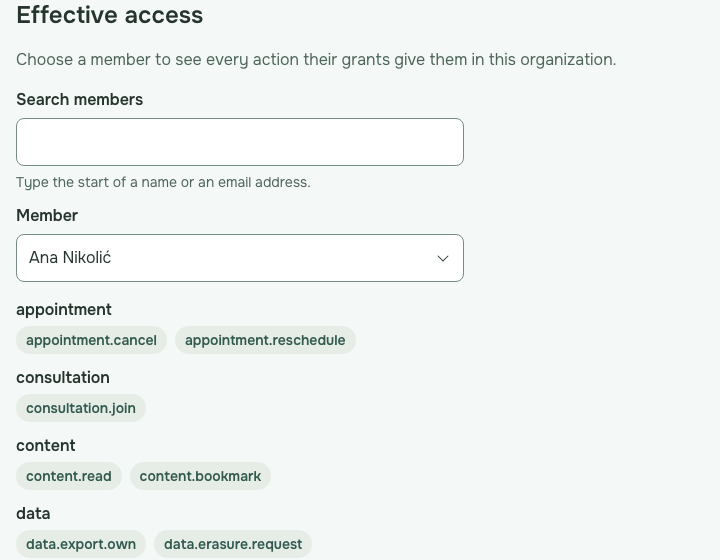
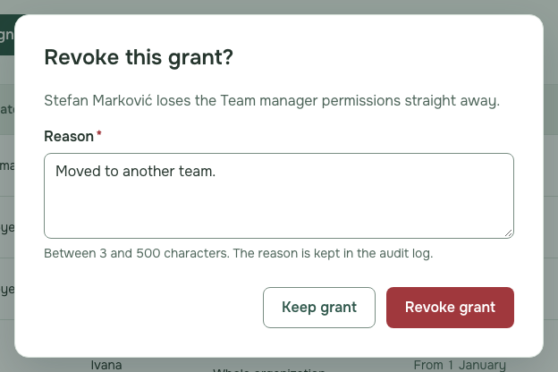
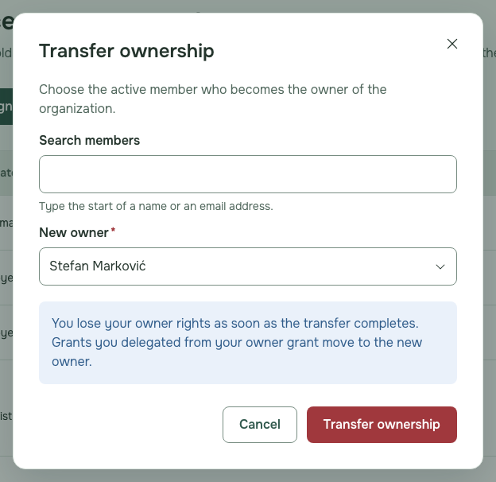
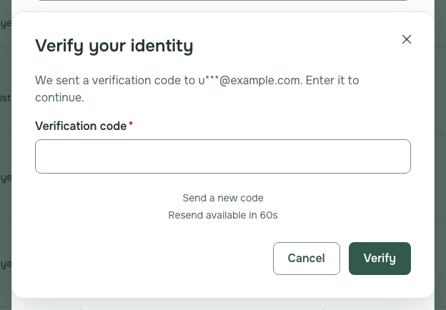

# Employer owner guide

Who this is for: the one person who owns their organisation in NestSelf and decides who may do what. The pictures show fictional sample people.

---

## Open Access

1. Sign in and choose **Access** in the menu on the left.

   

## Assign a template

1. Press **Assign template**.
2. Choose the **Member**, the **Template** and where it applies, fill in what the template asks for, and press **Assign**.

   

   **If it fails:** "This template needs every required condition filled in." Fill in the missing fields, such as the spending ceiling, and press **Assign** again.

## Delegate part of your access

1. Press **Delegate** next to one of your own grants.
2. Choose the **Member**, tick the actions to hand over and press **Delegate**.

   

   **If it fails:** "You can only delegate actions and scope that you hold yourself." Assign a template to the person instead.

## Preview someone's access

1. Under **Effective access**, choose the **Member** to see every action they hold.

   

## Revoke a grant

1. Press **Revoke** on the grant's row, type the reason and press **Revoke grant**.

   

## Transfer ownership

1. Press **Transfer ownership**, choose the **New owner** and press **Transfer ownership**; you stop being the owner at once.

   

## Verify your identity

1. When **Verify your identity** opens as you assign, delegate, revoke or transfer more than 30 minutes after signing in, type the code NestSelf emailed you and press **Verify**.

   

   **If it fails:** "The code you entered is not valid." Type the code from the newest email, or press **Send a new code**.

2. Press **Cancel** instead to leave the change undone.
