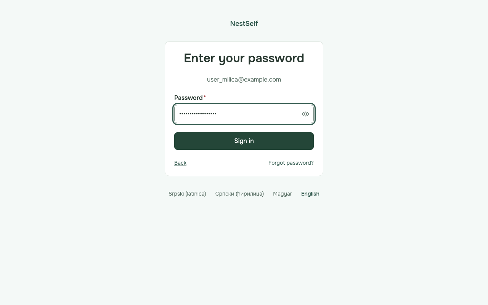
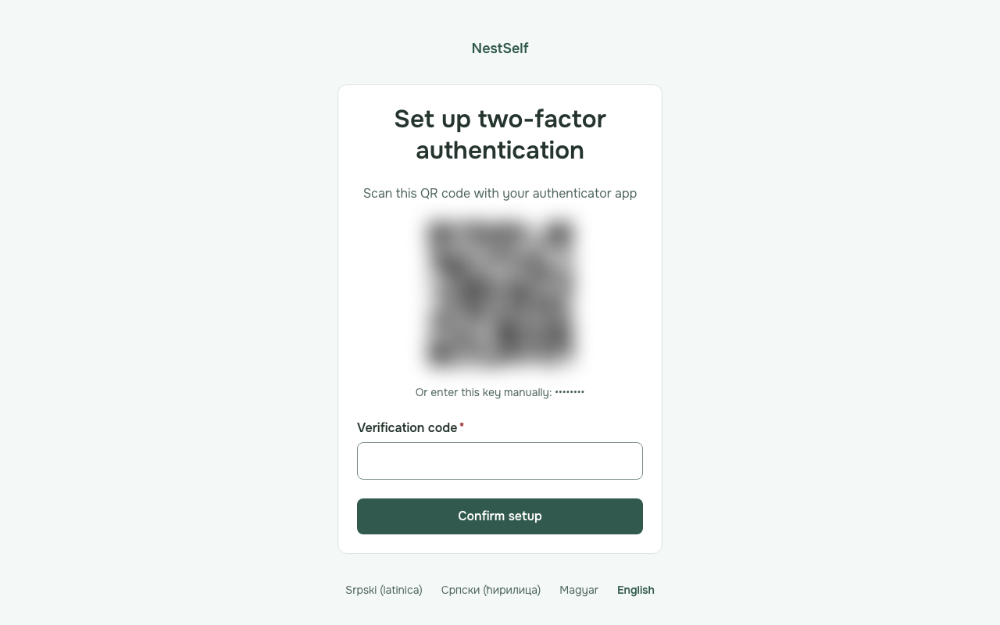
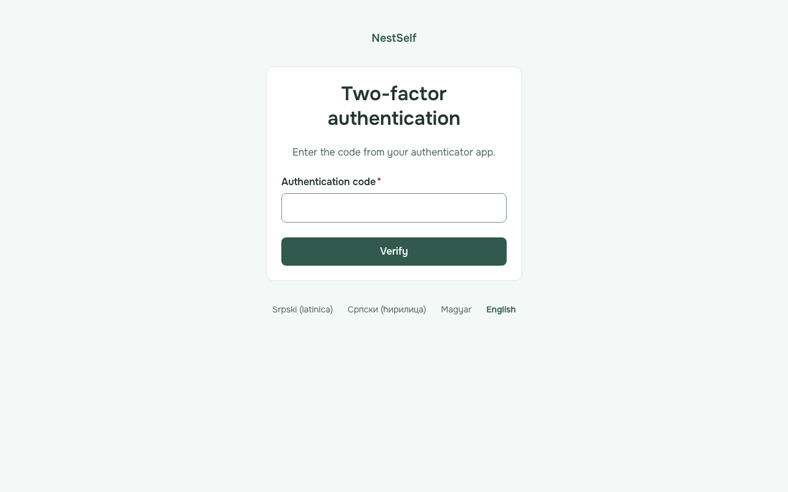
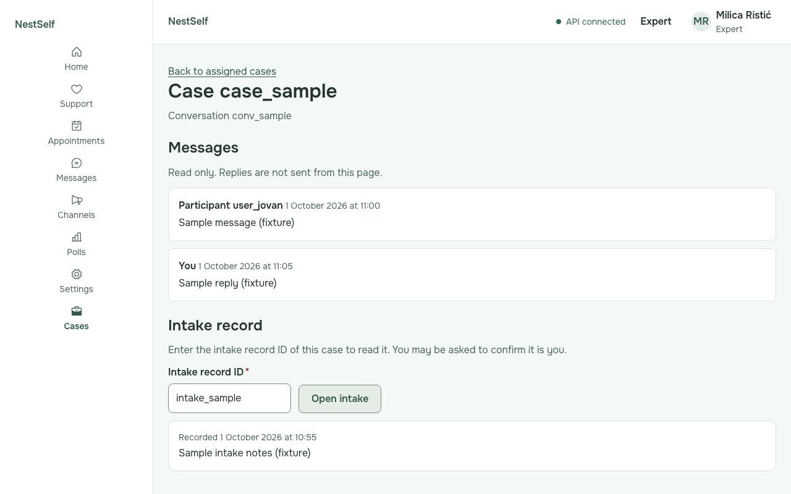
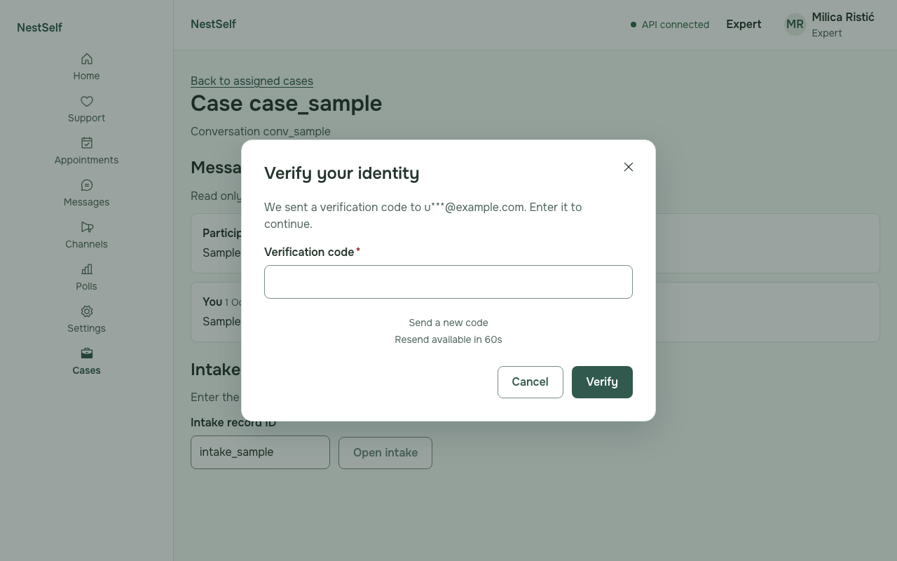

# Expert guide

Who this is for: experts who read the conversations of the cases assigned to them in NestSelf. The pictures show fictional sample people.

---

## Sign in with your password and authenticator

1. Open NestSelf, type your email address and press **Continue**.
2. Type your password and press **Sign in**.

   

   **If it fails:** "The email or password is not correct." Type the password again, or press **Forgot password?**.

3. The first time, scan the QR code with your authenticator app, type the code it shows and press **Confirm setup**.

    _The QR code and the key are hidden in this picture._

4. Every other time, type the code from your authenticator app and press **Verify**.

   

   **If it fails:** "The code you entered is not valid." Wait for the next code in the app and type it.

## Open a case

1. Choose **Cases** in the menu on the left.

   

2. Press **Open** next to the case to read its messages.

   

## Read the intake record

1. Type the intake record ID of the case under **Intake record** and press **Open intake**.

   

   **If it fails:** "This record does not exist or is no longer available." Check the ID, and whether the case is still assigned to you.

## Verify your identity

1. When **Verify your identity** opens as you open a case or an intake record more than 15 minutes after signing in, type the code NestSelf emailed you and press **Verify**.

   

   **If it fails:** "The code you entered is not valid." Type the code from the newest email, or press **Send a new code**.

## What you cannot see

The **Cases** list shows only the cases assigned to you, and any other case opens with "This record does not exist or is no longer available." Messages and intake records are read-only here: you cannot reply or change them. The organisation's people, org units and access pages are not in your menu.
