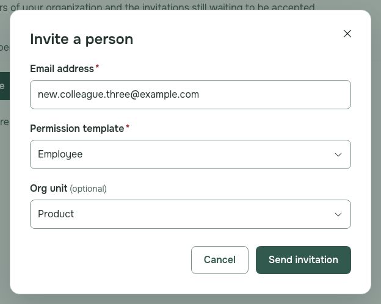
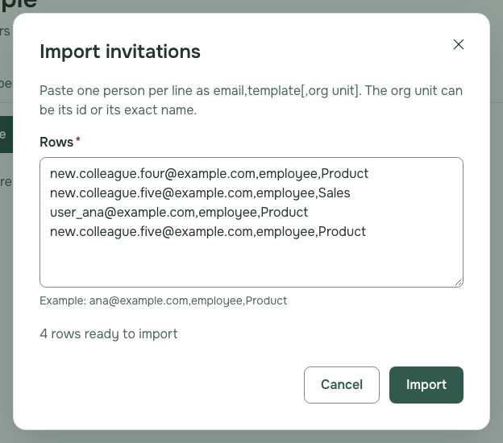
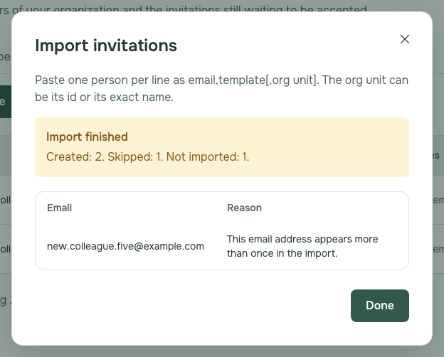
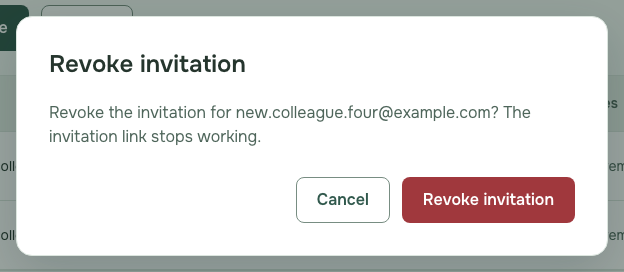
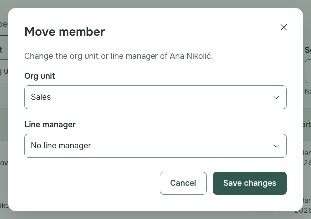
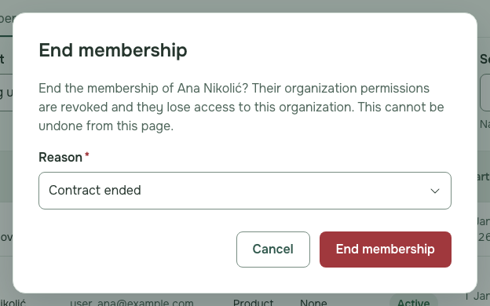
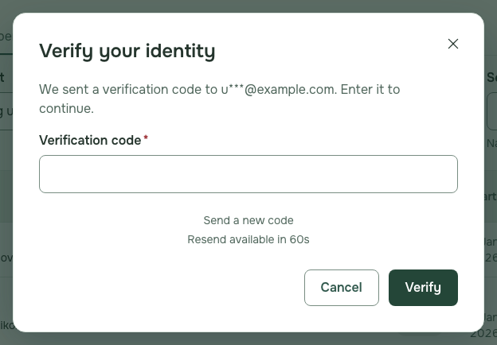
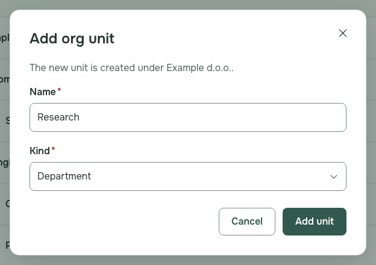
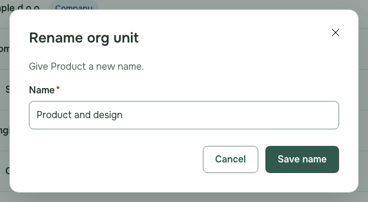
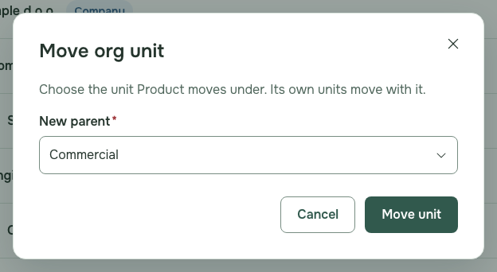

# HR administrator guide

Who this is for: HR administrators who manage their organisation's people and org units in NestSelf. The pictures show fictional sample people.

---

## See your people

1. Sign in and choose **People** in the menu on the left.

   

2. Narrow the list with **Org unit**, **Status** or **Search**.

## Invite one person

1. Open **Invitations** and press **Invite**.
2. Type the email address, choose the **Permission template** and the **Org unit**, and press **Send invitation**; the person gets an email with a link to join.

   

   **If it fails:** "A pending invitation already exists for this email address." Revoke that invitation first if it needs to change.

## Import a list

1. Open **Invitations** and press **Import**.
2. Paste one person per line, such as `ana@example.com,employee,Product`, and press **Import**.

   

   **If it fails:** "Fix the rows listed below, then import again." Correct the listed lines and press **Import** again.

3. Read the result: **Created** rows are invited, **Skipped** rows were already invited or members, and **Not imported** rows are listed with the reason.

   

4. Press **Done**, then correct the rows listed under **Not imported** and import them again.

## Revoke an invitation

1. Open **Invitations** and press **Revoke** next to the address.

   

2. Press **Revoke invitation** to confirm.

   

## Move a person

1. In **Members**, press **Move** next to the person, choose the new **Org unit** or **Line manager** and press **Save changes**.

   

## End a membership

1. In **Members**, press **End membership** next to the person, choose the **Reason** and press **End membership**.

   

2. If **Verify your identity** opens, type the code NestSelf emailed you and press **Verify**.

   

   **If it fails:** "The code you entered is not valid." Type the code from the newest email, or press **Send a new code**.

## Add, rename and move org units

1. Choose **Org units** in the menu on the left.

   

2. To add a unit, press **Add child** on the unit it belongs under, type the **Name**, choose the **Kind** and press **Add unit**.

   

3. To rename a unit, press **Rename**, type the new name and press **Save name**.

   

4. To move a unit, press **Move**, choose the **New parent** and press **Move unit**.

   

