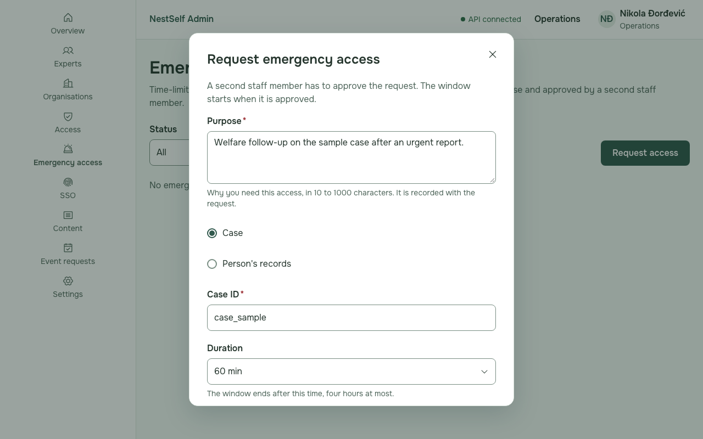
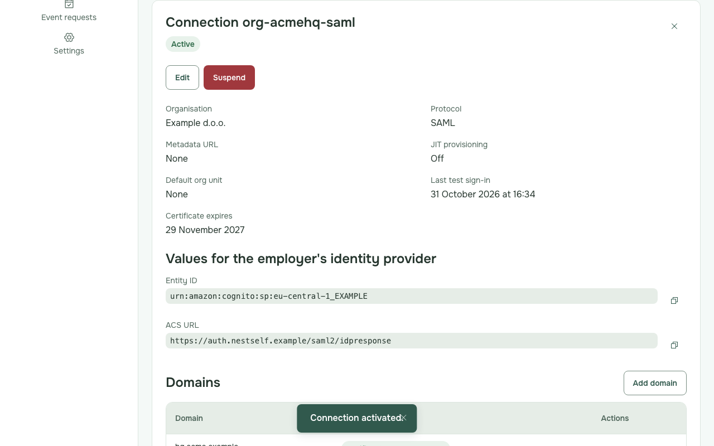

# Platform staff guide

Who this is for: NestSelf staff who work in NestSelf Admin. The pictures show fictional sample people.

---

## Sign in

1. Open NestSelf Admin, type your work email address and press **Continue**, then type your password and press **Sign in**.
2. The first time, scan the QR code with your authenticator app, type the code it shows and press **Confirm setup**.

    _The QR code and the key are hidden in this picture._

3. Every other time, type the code from your authenticator app and press **Verify**.

   **If it fails:** "The code you entered is not valid." Wait for the next code in the app and type it.

## Clients and users

1. Choose **Organisations**, open the client, and use **People** to see or end memberships and **Access** to assign or revoke templates and transfer ownership.

   

2. To check a user, choose **Access** in the menu, type the user ID under **User access** and press **Look up**.
3. To suspend that user, press **Suspend user**, type the reason and press **Suspend user**; **Reinstate user** lifts it.

## Emergency access

1. Choose **Emergency access**, press **Request access**, write the purpose, choose **Case** or **Person's records** and type its ID, choose the **Duration** and press **Send request**.

   

2. If **Verify your identity** opens, type the code NestSelf emailed you and press **Verify**.
3. Ask another staff member to press **Approve** on your request and confirm.
4. When your request shows **Active**, press **Open record**, type the record ID and press **Read record**.

   

## Single sign-on for a client

1. Choose **SSO**, press **New connection**, find the organisation, choose the protocol, type a slug, fill in the provider details from the client and press **Create connection**.

   

   **If it fails:** "Another organisation already uses this slug for its SSO connection. Choose a different slug."

2. Press **Details**, press **Add domain**, type the client's email domain and press **Add domain**.

   **If it fails:** "Public email domains such as gmail.com cannot be used for SSO. Use the employer's own domain."

3. Send the client the **Record name** and **Record value** to publish in their DNS, and the **Entity ID** and **ACS URL** for their identity provider.

    _The record value is hidden in this picture._

4. When the client has published the record, press **Verify** next to the domain.

   **If it fails:** "The DNS TXT record was not found or does not match. Check the record name and value, or wait for DNS to update, and try again."

5. Press **Test sign-in**, then open the link in a new tab or send it to the client's tester, an invited person with an address on the verified domain.

    _Part of the link is hidden in this picture._

6. When the test sign-in has finished, press **Activate**.

   

   **If it fails:** "Complete a test sign-in on a verified domain before activating the connection." Run the test sign-in again.

7. Press **Suspend** and confirm to stop sign-in through the client's provider; **Reactivate** restarts it.
8. Press **Reset to draft** and confirm to start a connection in testing over.

**What to tell the client about `email_verified`.** Ask whether their OIDC sign-in sends `email_verified` (Entra ID does not by default). If it does not, leave **Require a verified email claim from the provider** on: each employee then confirms their address once with a code NestSelf sends them. Turn it off (**Edit**) only after the client confirms in writing that the email their sign-in sends is their directory's verified address.
