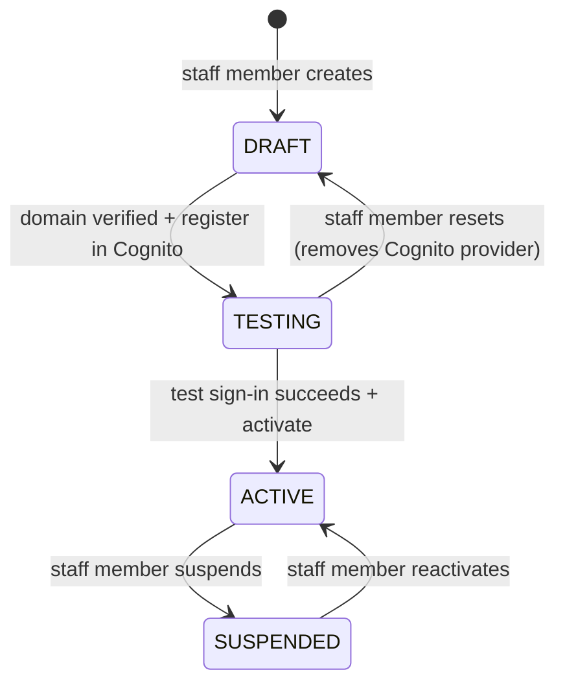
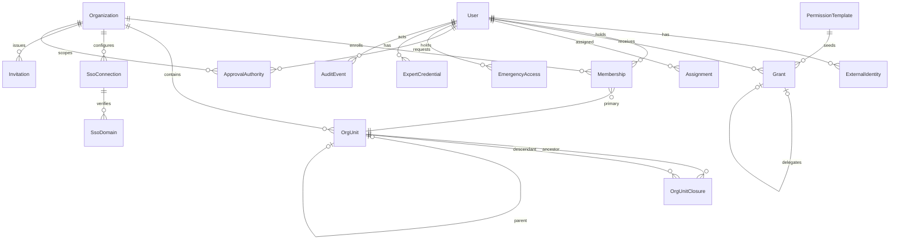
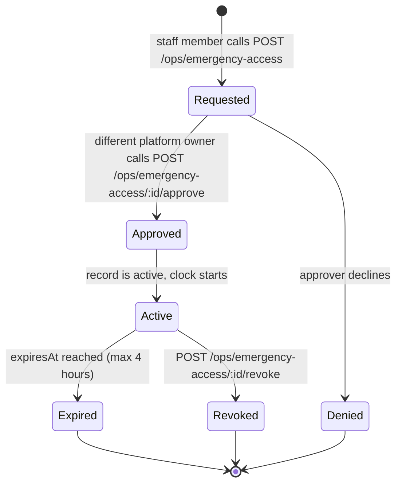
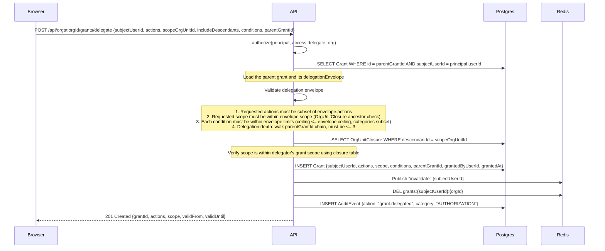

# NestSelf authentication, authorization and infrastructure strategy

## Table of contents

- [0 Front matter](#0-front-matter)
  - [Audience](#audience)
  - [How to read the document](#how-to-read-the-document)
  - [Relation to the product flows document](#relation-to-the-product-flows-document)
  - [Legal disclaimer](#legal-disclaimer)
  - [Glossary](#glossary)
- [1 Decisions at a glance](#1-decisions-at-a-glance)
  - [Changing decisions](#changing-decisions)
- [2 Context and constraints](#2-context-and-constraints)
  - [2.1 Populations and workspaces](#21-populations-and-workspaces)
  - [2.2 Product rules that bind the design](#22-product-rules-that-bind-the-design)
  - [2.3 Current code and what changes](#23-current-code-and-what-changes)
  - [2.4 Markets, data protection and hosting constraints](#24-markets-data-protection-and-hosting-constraints)
- [3 Identity architecture](#3-identity-architecture)
  - [3.1 Identity provider choice and alternatives considered](#31-identity-provider-choice-and-alternatives-considered)
  - [3.2 User pool design](#32-user-pool-design)
  - [3.3 Identity model](#33-identity-model)
  - [3.4 Enterprise SSO](#34-enterprise-sso)
  - [3.5 Sign-in UI ownership and localisation](#35-sign-in-ui-ownership-and-localisation)
  - [3.6 Sessions](#36-sessions)
  - [3.7 Identity lifecycle](#37-identity-lifecycle)
- [4 Authorization architecture](#4-authorization-architecture)
  - [4.1 Principles](#41-principles)
  - [4.2 Domain model](#42-domain-model)
  - [4.3 Action catalogue](#43-action-catalogue)
  - [4.4 Templates to grants](#44-templates-to-grants)
  - [4.5 Decision engine](#45-decision-engine)
  - [4.6 Enforcement](#46-enforcement)
  - [4.7 Confidential domains](#47-confidential-domains)
  - [4.8 Effective-access preview and audit](#48-effective-access-preview-and-audit)
  - [4.9 Privacy-safe reporting hooks](#49-privacy-safe-reporting-hooks)
- [5 API surface](#5-api-surface)
  - [5.1 Sign-in endpoints](#51-sign-in-endpoints)
  - [5.2 Session endpoints](#52-session-endpoints)
  - [5.3 Organization administration endpoints](#53-organization-administration-endpoints)
  - [5.4 Operations endpoints (staff)](#54-operations-endpoints-staff)
  - [5.5 Push registration, scheduling and reserved endpoints](#55-push-registration-scheduling-and-reserved-endpoints)
  - [5.6 Audit query details](#56-audit-query-details)
  - [5.7 The Principal shape](#57-the-principal-shape)
  - [5.8 Changes to `packages/contracts`](#58-changes-to-packagescontracts)
  - [5.9 Error semantics](#59-error-semantics)
  - [5.10 Idempotency keys](#510-idempotency-keys)
  - [5.11 Throttle summary](#511-throttle-summary)
  - [5.12 Names introduced by this section](#512-names-introduced-by-this-section)
- [6 Client integration](#6-client-integration)
  - [6.1 Workspace and admin SPAs](#61-workspace-and-admin-spas)
  - [6.2 Mobile app](#62-mobile-app)
  - [6.3 Marketing site](#63-marketing-site)
  - [6.4 api-client changes](#64-api-client-changes)
  - [6.5 Sample mode](#65-sample-mode)
  - [6.6 Internationalization](#66-internationalization)
  - [6.7 Accessibility of sign-in screens](#67-accessibility-of-sign-in-screens)
- [7 AWS infrastructure plan](#7-aws-infrastructure-plan)
  - [7.1 Accounts](#71-accounts)
  - [7.2 Region](#72-region)
  - [7.3 Network](#73-network)
  - [7.4 Compute](#74-compute)
  - [7.5 Data](#75-data)
  - [7.6 Cache and queue](#76-cache-and-queue)
  - [7.7 Storage](#77-storage)
  - [7.8 Edge and domains](#78-edge-and-domains)
  - [7.9 Secrets, configuration and messaging](#79-secrets-configuration-and-messaging)
  - [7.10 Observability](#710-observability)
  - [7.11 Infrastructure as code](#711-infrastructure-as-code)
  - [7.12 CI/CD](#712-cicd)
  - [7.13 Environments](#713-environments)
  - [7.14 Backup and disaster recovery](#714-backup-and-disaster-recovery)
  - [7.15 Security baseline](#715-security-baseline)
  - [7.16 Cost model](#716-cost-model)
- [8 Security and compliance mapping](#8-security-and-compliance-mapping)
  - [8.1 Threat model summary](#81-threat-model-summary)
  - [8.2 Design requirements traceability](#82-design-requirements-traceability)
  - [8.3 Data protection](#83-data-protection)
  - [8.4 Logging and retention](#84-logging-and-retention)
  - [8.5 Sub-processor register](#85-sub-processor-register)
  - [8.6 Client contract and security questionnaire notes](#86-client-contract-and-security-questionnaire-notes)
- [9 Implementation plan](#9-implementation-plan)
  - [9.1 Cross-cutting requirements](#91-cross-cutting-requirements)
  - [9.2 Spikes](#92-spikes)
  - [9.3 Phase 0: Foundations (2 weeks)](#93-phase-0-foundations-2-weeks)
  - [9.4 Phase 1: Identity and sessions (6 weeks)](#94-phase-1-identity-and-sessions-6-weeks)
  - [9.5 Phase 2: Authorization administration (4 weeks)](#95-phase-2-authorization-administration-4-weeks)
  - [9.6 Phase 3: Enterprise SSO (3 weeks)](#96-phase-3-enterprise-sso-3-weeks)
  - [9.7 Phase 4: Hardening and scale (ongoing)](#97-phase-4-hardening-and-scale-ongoing)
  - [9.8 Test strategy](#98-test-strategy)
  - [9.9 Migration from the stub](#99-migration-from-the-stub)
  - [9.10 Compliance track](#910-compliance-track)
  - [9.11 New dependencies](#911-new-dependencies)
- [10 Runbooks](#10-runbooks)
  - [10.1 SSO onboarding for a client](#101-sso-onboarding-for-a-client)
  - [10.2 IdP certificate and metadata rotation](#102-idp-certificate-and-metadata-rotation)
  - [10.3 Incident response](#103-incident-response)
  - [10.4 Access reviews](#104-access-reviews)
  - [10.5 Emergency access procedure](#105-emergency-access-procedure)
  - [10.6 Key and secret rotation](#106-key-and-secret-rotation)
  - [10.7 Backup restore drill](#107-backup-restore-drill)
  - [10.8 Offboarding](#108-offboarding)
  - [10.9 Data subject requests](#109-data-subject-requests)
  - [10.10 Identity provider outage posture](#1010-identity-provider-outage-posture)
- [11 Open decisions and assumptions](#11-open-decisions-and-assumptions)
  - [11.1 Founder decisions](#111-founder-decisions)
  - [11.2 Questions for legal counsel](#112-questions-for-legal-counsel)
  - [11.3 Technical spikes](#113-technical-spikes)
  - [11.4 Unverified facts](#114-unverified-facts)
  - [11.5 Assumptions](#115-assumptions)
- [Appendix A Prisma schema draft](#appendix-a-prisma-schema-draft)
  - [A.1 Schema fragment](#a1-schema-fragment)
  - [A.2 Changes from the existing schema](#a2-changes-from-the-existing-schema)
  - [A.3 Migration plan](#a3-migration-plan)
- [Appendix B Cognito configuration (IaC)](#appendix-b-cognito-configuration-iac)
  - [B.1 Stack skeleton](#b1-stack-skeleton)
  - [B.2 User pool](#b2-user-pool)
  - [B.3 Custom domain and us-east-1 certificate](#b3-custom-domain-and-us-east-1-certificate)
  - [B.4 App clients](#b4-app-clients)
  - [B.5 Example SAML identity provider](#b5-example-saml-identity-provider)
  - [B.6 WAF association](#b6-waf-association)
  - [B.7 Lambda triggers](#b7-lambda-triggers)
  - [B.8 SES identity and DKIM](#b8-ses-identity-and-dkim)
  - [B.9 Secrets Manager entries](#b9-secrets-manager-entries)
  - [B.10 Log delivery](#b10-log-delivery)
  - [B.11 Stack outputs](#b11-stack-outputs)
  - [B.12 Managed login branding](#b12-managed-login-branding)
  - [B.13 CDK property verification checklist](#b13-cdk-property-verification-checklist)
- [Appendix C Decision tables](#appendix-c-decision-tables)
  - [C.1 F1: Publish content](#c1-f1-publish-content)
  - [C.2 F2: Financial advice (direct booking)](#c2-f2-financial-advice-direct-booking)
  - [C.3 F3: Request and match](#c3-f3-request-and-match)
  - [C.4 F4: Approval](#c4-f4-approval)
  - [C.5 F5: Therapy (employer fund)](#c5-f5-therapy-employer-fund)
  - [C.6 F6: Therapy (insurer authorization)](#c6-f6-therapy-insurer-authorization)
  - [C.7 F7: Team workshop or team building](#c7-f7-team-workshop-or-team-building)
  - [C.8 F8: Shared webinar](#c8-f8-shared-webinar)
  - [C.9 F9: Changes, cancellations and provider failure](#c9-f9-changes-cancellations-and-provider-failure)
  - [C.10 F10: Join, team move and leave](#c10-f10-join-team-move-and-leave)
  - [C.11 Visibility matrix with enforcement mechanisms](#c11-visibility-matrix-with-enforcement-mechanisms)
- [Appendix D Sequence diagrams](#appendix-d-sequence-diagrams)
  - [D.1 SSO employee sign-in (web)](#d1-sso-employee-sign-in-web)
  - [D.2 Email OTP sign-in (web)](#d2-email-otp-sign-in-web)
  - [D.3 Expert password and TOTP sign-in (web)](#d3-expert-password-and-totp-sign-in-web)
  - [D.4 Mobile SSO sign-in (standard PKCE)](#d4-mobile-sso-sign-in-standard-pkce)
  - [D.5 Step-up re-authentication](#d5-step-up-re-authentication)
  - [D.6 Invitation activation](#d6-invitation-activation)
  - [D.7 Membership end with revocation fan-out](#d7-membership-end-with-revocation-fan-out)
  - [D.8 Grant delegation check](#d8-grant-delegation-check)
  - [D.9 Emergency access grant and use](#d9-emergency-access-grant-and-use)
  - [D.10 Websocket ticket and subscription check](#d10-websocket-ticket-and-subscription-check)
  - [D.11 File download with presigned URL](#d11-file-download-with-presigned-url)
- [Appendix E Environment variables](#appendix-e-environment-variables)
  - [E.1 API (`apps/api`)](#e1-api-appsapi)
  - [E.2 Workspace and admin (`apps/workspace`, `apps/admin`)](#e2-workspace-and-admin-appsworkspace-appsadmin)
  - [E.3 Mobile (`apps/mobile`)](#e3-mobile-appsmobile)
  - [E.4 Marketing (`apps/marketing`)](#e4-marketing-appsmarketing)
  - [E.5 CDK and CI (`infra/cdk`, GitHub Actions)](#e5-cdk-and-ci-infracdk-github-actions)
- [Appendix F Checklists](#appendix-f-checklists)
  - [F.1 Pre-pilot compliance checklist](#f1-pre-pilot-compliance-checklist)
  - [F.2 Security baseline checklist](#f2-security-baseline-checklist)
  - [F.3 Go-live checklist](#f3-go-live-checklist)
  - [F.4 SSO onboarding checklist](#f4-sso-onboarding-checklist)
  - [F.5 Release checklist](#f5-release-checklist)
- [Appendix G Sources](#appendix-g-sources)
- [Appendix H Traceability](#appendix-h-traceability)
  - [H.1 Story catalog to requirements](#h1-story-catalog-to-requirements)
  - [H.2 Design requirements to requirements](#h2-design-requirements-to-requirements)
  - [H.3 Templates to section 4.4 rows and actions](#h3-templates-to-section-44-rows-and-actions)
  - [H.4 Decisions to implementing sections](#h4-decisions-to-implementing-sections)
  - [H.5 Gaps](#h5-gaps)
- [Appendix I Decision record](#appendix-i-decision-record)
  - [Part A. Decisions](#part-a-decisions)
  - [Part B. Canonical names (binding; report anything else in namesIntroduced)](#part-b-canonical-names-binding-report-anything-else-in-namesintroduced)
  - [Part C. Mechanisms and numbers the writers must preserve](#part-c-mechanisms-and-numbers-the-writers-must-preserve)
  - [Part D. Founder decisions, legal questions, spikes, assumptions](#part-d-founder-decisions-legal-questions-spikes-assumptions)

## 0 Front matter

This document is the engineering reference for authentication, authorization and AWS infrastructure in the NestSelf platform. It specifies the identity provider, session model, authorization engine, API surface, client integration, infrastructure topology, security controls and delivery plan. Every section is precise enough to implement from.

**Status:** Draft for founder review.
**Date:** 2026-10-21.
**Revision:** 1.

### Audience

This document serves two audiences:

1. **Engineers** building the NestSelf platform. They read the sections relevant to their current phase and use the requirements, data model and API definitions as their specification.
2. **AI agents** that receive sections of this document as implementation instructions. Each section is self-contained enough to act on without the surrounding conversation.

### How to read the document

The document follows the delivery phases defined in decision D-35. An implementer working on a specific phase needs these sections:

| Phase | Title | Sections to read |
|---|---|---|
| 0 | Foundations | 0, 1, 2, 4.1-4.5, 7.1-7.3, 7.7, 7.9, 7.11, 9 (phase 0 tasks), 11, Appendix A |
| 1 | Identity and sessions | 0, 1, 2, 3 (all), 4.6, 5, 6, 7.4-7.10, 7.12-7.14, 9 (phase 1 tasks), 11, Appendices A-F |
| 2 | Authorization administration | 0, 1, 4 (all), 5 (grant and audit endpoints), 6 (context switch, effective-access preview), 7.15, 8, 9 (phase 2 tasks), 11 |
| 3 | Enterprise SSO | 0, 1, 3.4, 3.7, 5 (SSO endpoints), 10 (SSO onboarding runbook), 9 (phase 3 tasks), 11 |
| 4 | Hardening | 0, 1, 3.6 (passkeys), 4.8, 7.16, 8, 9 (phase 4 tasks), 11 |

Requirements are numbered by section prefix: `CTX-R-nn` (section 2), `AUTH-R-nn`, `SSO-R-nn`, `SESS-R-nn`, `AUTHZ-R-nn`, `CONF-R-nn`, `AUDIT-R-nn`, `API-R-nn`, `CLIENT-R-nn`, `INFRA-R-nn`, `OPS-R-nn`, `SEC-R-nn`, `PLAN-R-nn`, `RUN-R-nn`. "Must", "must not" and "should" carry their standard force.

Cross-references use section numbers and titles: "see 4.5 Decision engine". Sources from the research corpus are cited as [S-nn]; the full list is in Appendix G. Appendix I is the decision record (Appendix I) the document was written from; sections cite its decisions as D-nn and its canonical names (Part B) are binding for every identifier in this document.

### Relation to the product flows document

The product specification [S-01] defines the workspaces, populations, permission templates, grant model, visibility rules, story catalog and implementation boundaries. Sections 1, 2, 7, 8 and 10 of that document bind the design decisions in this strategy. Story identifiers from the specification appear in brackets after the requirements they motivate.

This document does not repeat the product specification. It translates the product rules into authentication, authorization and infrastructure decisions and adds the technical detail the specification intentionally omits.

### Legal disclaimer

This document contains engineering background on data protection, retention and compliance controls. It is not legal advice. Sections that reference Serbian, Hungarian or EU law summarize the research corpus for design purposes. Legal counsel must review and approve the Data Protection Impact Assessment (DPIA), privacy notices, Data Processing Agreement (DPA) template, retention periods and lawful-basis determinations before the first real employee signs in. See 8 Security and compliance mapping and 11.2 Questions for legal counsel.

### Glossary

| Term | Meaning | Do not use instead |
|---|---|---|
| user | A person with an identity on the platform. One identity for life, across employers. Prisma model `User`. | person record, account holder |
| identity | The authentication identity of a user in Cognito (the `sub` claim) and the linked external identities. | login, account |
| external identity | A link from a user to an identity provider subject (Cognito native, or an employer IdP). Prisma model `ExternalIdentity`. | identity link, federation record |
| organization | An employer client company. Prisma model `Organization`. Short form in prose: organization; in code: `org`. | company (except when quoting the spec), tenant (use only when discussing isolation) |
| org unit | A node of an organization's tree: company root, department or team. Prisma model `OrgUnit`. | team (unless the unit is a team), group, department (unless the unit is a department) |
| membership | A user's eligibility in an organization with effective dates, primary org unit, cost center and optional line manager. Prisma model `Membership`. | affiliation, employment record, seat |
| context | The workspace a user is acting in: personal (employee) or an organization's management context. Stored on the session as `activeContext`. | mode, tenant switch |
| surface | A client application: workspace web, admin web, mobile app, marketing site, supplier portal (later). | frontend, app (when ambiguous) |
| population | A trust group of users: employees, employer admins, experts, NestSelf staff, external facilitators. | user type, persona (reserve "persona" for product discussions) |
| employer admin | Any user acting under an organization's management template: owner, HR administrator, team or budget manager, approver, employer finance, reporting user. | client admin, HR user (unless specifically HR) |
| staff | NestSelf's own employees: platform owner, client operations, content author, content reviewer, service coordinator, support operator, NestSelf finance. | operators (as a collective), admins |
| expert | An independent professional delivering services (psychologist, lawyer, financial adviser); expert lead is an expert with practice-group responsibilities. | provider (unless quoting the spec), therapist (only when the service is therapy) |
| template | A permission template: a named starting set of actions, scope type and boundaries, from which grants are created. Prisma model `PermissionTemplate`. | role (except for the legacy enums), profile |
| grant | An explicit, inspectable permission: subject, actions, scope, conditions, validity, delegation boundary, grantor. Prisma model `Grant`. | permission, privilege, role assignment |
| action | A dotted capability name such as `content.publish` or `spend.approve`. The catalogue is in 4.3. | permission string, operation |
| scope | Where a grant applies: platform, organization, org unit (with or without descendants), assigned clients, assigned queues, assigned cases, own. | realm, boundary (reserve "boundary" for delegation) |
| condition | A structured limit on a grant: spending ceiling, permitted categories, confidential approver, and similar. | constraint, rule |
| delegation envelope | The maximum scope, actions and conditions a grantor may delegate; a delegated grant never exceeds it. | delegation boundary (only when naming the `delegationBoundary` field), authority limit |
| assignment | A link between a user and a work item that confers access: expert to case, coordinator to queue, client operations to organization. Prisma model `Assignment`. | allocation, ownership |
| approval authority | A user's authority to decide requests within scope, categories and an amount ceiling, with validity and an alternate. Prisma model `ApprovalAuthority`. | approver role |
| emergency access | A separately approved, time-limited, logged grant to restricted professional content. Prisma model `EmergencyAccess`. | break-glass (may appear once as a synonym in runbooks), override |
| confidential domain | Private intake text, conversations between an employee and an expert, professional notes, consultation content. Reachable only through assignment or emergency access. | sensitive data (too broad), case content (acceptable when quoting the spec) |
| restricted content | Any item inside the confidential domain. | private data |
| principal | The resolved caller inside the API: user id, display name, memberships with effective status, staff templates, active context, authentication strength and time. Type `Principal` in `@nestself/contracts`. | AuthUser (legacy type name, mention once in 2.3), current user |
| session | The API-held session record in Redis that a surface references by cookie or bearer token. | login session, web session |
| Cognito tokens | The access, ID and refresh tokens Cognito issues to the API as its confidential client; held server-side only. | JWTs (unless the sentence is about verification), user tokens |
| sign-in | The act and the page. Verb: sign in. Noun and adjective: sign-in. Sign-out likewise. | login, log in, logon, logout |
| invitation | A revocable, expiring token that lets an invited person activate a membership. Prisma model `Invitation`. | invite (noun), onboarding link |
| activation | The first sign-in that binds an invitation to an identity and starts the membership. | registration, sign-up (Cognito self sign-up is disabled) |
| SSO connection | An organization's identity provider configuration registered in Cognito and mapped to email domains. Prisma model `SsoConnection`. | IdP config, federation |
| home-realm discovery | Deciding from the entered email which sign-in method and SSO connection apply. | domain routing, IdP discovery |
| step-up | Re-authentication required before a sensitive action when the session's last authentication is older than the action's limit. | re-auth, elevated mode |
| audit event | An append-only record of a consequential action: actor, context, action, record, safe details. Prisma model `AuditEvent`. | log line (reserve for application logs), audit log entry |
| decision | The result of `authorize()`: allowed or denied, matching grant ids, denial reason, explanation. | verdict, outcome |
| environment | dev (local, Docker Compose), staging, production. | stage, tier (reserve "tier" for Cognito feature plans) |
| Cognito feature plan | Lite, Essentials or Plus. Write "the Essentials plan". | tier (Cognito calls them plans in the console; the corpus says tier; be consistent: plan) |

---

## 1 Decisions at a glance

Thirty-six decisions govern this strategy. The table below summarizes every decision; the full entry with conditions and dissent is in Appendix I Decision record, and the rationale lives in the section that implements it.

Confidence levels:

- **settled** means unanimous and evidence-backed.
- **recommended** means best-supported with dissent recorded.
- **founder** means only the founder can decide and the document assumes the stated default.

Acronyms used in the table: SSO (single sign-on), IdP (identity provider), OTP (one-time password), TOTP (time-based OTP), PKCE (Proof Key for Code Exchange), MAU (monthly active user), ALB (Application Load Balancer), CDK (Cloud Development Kit), KMS (Key Management Service), DPIA (Data Protection Impact Assessment), ACR/AMR (Authentication Context Class Reference / Authentication Methods References).

| ID | Decision | Choice | Why | Confidence | Phase |
|---|---|---|---|---|---|
| D-01 | Identity provider | Amazon Cognito, Essentials plan, one user pool per environment, eu-central-1 | Essentials provides email OTP, passkeys, refresh rotation and the branding editor; free to 10,000 MAU; lower operational burden than self-hosted alternatives [S-03] | settled | 0 |
| D-02 | Pool topology and token claims | One pool for every population; no authorization data in tokens | Identity is separate from eligibility; grants are too volatile for token claims; removing the pre-token trigger removes a Lambda from the sign-in path [S-14] | settled | 0 |
| D-03 | Provisioning model | Invitation-first; no self sign-up; JIT only per SSO connection on verified domains | HR is the gate for eligibility [ORG-02, F10]; self sign-up bypasses HR control | settled | 1, 3 |
| D-04 | Identity linking | Application database linking, not Cognito `AdminLinkProviderForUser` | Avoids the 128-character linking limit, `email_verified` reset and PreSignUp failure; the application database is the source of truth [S-17] | recommended | 1, 3 |
| D-05 | Sign-in methods per population | Email OTP for employees; password plus TOTP for experts and staff; employer IdP MFA for SSO employees | Email OTP removes passwords for the largest population; TOTP is free and offline; SMS is expensive in Serbia and Hungary [S-29] | settled | 1, 4 |
| D-06 | Web session model | Backend-for-Frontend with opaque Redis sessions | RFC 10017 names BFF the strongest browser architecture; tokens never reach JavaScript; revocation is deleting a key [S-114] | settled | 1 |
| D-07 | Mobile token model | Standard public-client PKCE against Cognito | RFC 8252 pattern; all three design judges rejected the custom completion-code handoff [S-121] | settled | 1 |
| D-08 | Same-origin edge | One CloudFront distribution per surface; `/api/*` routes to the ALB | `__Host-` cookies need one origin; no CORS; per-surface cookies limit blast radius | settled | 1 |
| D-09 | Cognito app clients | Confidential web client, public mobile client, reserved M2M client | Confidential client holds the secret for the authorization-code flow; public client uses PKCE only [S-122] | settled | 0 |
| D-10 | Cognito Lambda triggers | `CustomMessage` for localized templates; `PreSignUp` for external-provider auto-confirm | No database work in the sign-in path; everything stateful happens in the API [S-25] | settled | 1 |
| D-11 | Sign-in UI | NestSelf-owned, identifier-first, four locales | Managed login lacks Serbian and Hungarian; localized sign-in is required from day one [S-05] | settled | 1 |
| D-12 | Enterprise SSO | Per-employer SAML/OIDC connection; verified domains; SP-initiated; abstraction interface early | 300 providers per pool suffice for years; direct federation costs nothing at pilot [S-118] | settled | 3 |
| D-13 | Session lifetimes | Per-population idle and absolute limits; access tokens 15 minutes everywhere | Security judge's shorter values adopted; configurable per environment | recommended | 1 |
| D-14 | Step-up re-authentication | Application-side with `authMethod`, `authTime`, `lastStepUpAt`; action classes define max age | ACR/AMR is in staged rollout and cannot be relied on for launch [S-35] | settled | 2, 4 |
| D-15 | Authorization engine | Hand-built grants with a pure `authorize()` decision function | Scored 75 against at most 53 for Cedar and other engines; delegation, ceilings and previews are native | settled | 0, 2 |
| D-16 | Organization tree | Closure table (`OrgUnit` + `OrgUnitClosure`) | Prisma 7 compatibility with ltree is unverified; trees are shallow and small; closure tables are plain Prisma | settled | 0 |
| D-17 | Grant model | Zod-validated conditions, delegation envelopes, depth limit 3, self-approval prevention | Seventeen templates seeded from the specification; nightly reconciliation of expired grants [S-01] | settled | 2 |
| D-18 | Principal resolution and caching | Redis cache with 30-second and 60-second TTLs, jitter, explicit invalidation, circuit breaker | A cache miss always queries the database; a stale entry is never served after an invalidation | settled | 1 |
| D-19 | Enforcement pattern | Global `AuthenticationGuard` and `AuthorizationGuard`; CI default-deny test; Prisma scoping extension | Routes without `@Authorize` or `@Public` fail CI; BullMQ jobs re-run `authorize()` at execution | settled | 1, 2 |
| D-20 | Confidential domain and emergency access | Restricted data in its own controllers, bucket and KMS key; emergency access is time-limited and logged | Platform, organization and org-unit scoped grants cannot reach restricted actions; every emergency read is audited [PLAT-05, SYS-06] | settled | 2 |
| D-21 | Audit log | Append-only `AuditEvent` with retention tiers; no UPDATE or DELETE on the table | Safe details only; `ipHash` and `userAgentFamily` instead of raw values; pino redaction in application logs [PLAT-04] | settled | 1 |
| D-22 | Professional notes and video | No professional notes stored at pilot; video via Amazon Chime SDK in eu-central-1 | Storing notes triggers health documentation laws in Serbia and Hungary; Chime SDK is $0.0017 per attendee-minute [S-191] | founder (F-02) | 2 |
| D-23 | AWS accounts and network | AWS Organizations with staging and production accounts; one VPC per account, two AZs, private subnets | Dev stays local on Docker Compose; managed NAT in production, fck-nat in staging | recommended | 0-2 |
| D-24 | Compute | ECS Fargate: `api`, `worker`, `marketing` services; `migrate` one-off task | Express Mode lacks stickiness for Socket.IO; App Runner is closed to new customers [S-50] | settled | 1 |
| D-25 | Database | RDS PostgreSQL 17, `db.t4g.small`, Multi-AZ in production; Aurora Serverless v2 in staging | 35-day backups with cross-region copies to eu-west-1; Single-AZ only if the founder accepts the failover risk [S-63] | founder (F-05) | 1 |
| D-26 | Cache and queue | ElastiCache for Valkey, node-based `cache.t4g.micro`, `maxmemory-policy=noeviction` | BullMQ is incompatible with ElastiCache Serverless; one instance at pilot with key prefixes [S-66, S-280] | settled | 1 |
| D-27 | Storage, keys and secrets | S3 buckets per environment; KMS CMKs `nestself-platform` and `nestself-professional`; Secrets Manager | Separate key for professional content; annual rotation; multi-Region replicas in eu-west-1 for backup decryption | settled | 0, 1 |
| D-28 | Edge, WAF and domains | Route 53; CloudFront distributions for workspace, admin and marketing; WAF web ACLs | Rate-based rule on `/api/auth/*` at 10 requests per minute per IP [S-71] | settled | 1 |
| D-29 | Messaging | SES in eu-central-1; Expo push for mobile; no SMS at launch | SMS is expensive and operationally split between Serbia and Hungary; TOTP plus email OTP suffice [S-29, S-228] | settled | 1 |
| D-30 | Infrastructure as code and CI/CD | AWS CDK in TypeScript; GitHub Actions with OIDC; `cdk-nag` AwsSolutions pack | CDKTF deprecated December 2025; no long-lived keys; migrations never run from a developer machine against production [S-75] | settled | 0, 1 |
| D-31 | Observability and security baseline | pino JSON logs with redaction; CloudWatch alarms; CloudTrail; GuardDuty from phase 1 | Alarm on emergency access activation, failed sign-ins above 50 per minute per IP, principal cache hit rate below 90 percent | settled | 1, 2 |
| D-32 | Backup and disaster recovery | RPO 1 hour, RTO 4 hours; cross-region copies to eu-west-1; weekly Cognito user export | Restore drill quarterly after the first paying client; every service pinned to eu-central-1 | settled | 1 |
| D-33 | Compliance controls | DPIA, DPO, DPA template, privacy notices, breach procedure before the first real employee signs in | `RetentionPolicy` table seeded with periods pending counsel; design for GDPR-grade compliance [S-96] | settled (counsel pending) | 0-2 |
| D-34 | Cost reference | Pilot about $235 to $280 per month (Multi-AZ, managed NAT); about $150 to $170 with Single-AZ | Cognito $0 at pilot; video about $51 per month for 500 half-hour sessions; all Frankfurt prices unverified | recommended | all |
| D-35 | Delivery phases | Phase 0 (2 weeks), 1 (6 weeks), 2 (4 weeks), 3 (3 weeks), 4 (ongoing) | Compliance items run in parallel from phase 0; phase exits are defined | recommended | all |
| D-36 | Migration from the stub | `AUTH_MODE=stub\|cognito`; stub refused when `NODE_ENV=production` | Sample mode keeps `SAMPLE_SESSIONS` and the `?role=` switcher; `JWT_SECRET` removed after cutover | settled | 1 |

### Changing decisions

Decisions are changed through a new revision of the decision record (Appendix I), never through silent edits to individual sections of this document. A revision states which decision changed, the new choice, the rationale and the date. Sections that implement the changed decision are updated to match the new revision. The decision record carries a version number and the document references a specific version.


## 2 Context and constraints

NestSelf serves four authenticated workspaces, a public marketing site and five populations of users with different trust levels and sign-in methods. The product specification binds the authorization design to a set of explicit rules: default deny, server-side enforcement, identity separate from eligibility, confidential domains and neutral notifications. The current codebase has a stub authentication layer and a role-based guard that must be replaced by grants and a principal model. Serbia and Hungary impose data-protection requirements that constrain hosting, retention and lawful basis; section 8 Security and compliance mapping covers these in detail.

### 2.1 Populations and workspaces

NestSelf has four authenticated workspaces and a public website [S-01].

| Workspace | Purpose | Sign-in required |
|---|---|---|
| Employee (`employee`) | Content, benefits, support requests, consultations, events, messaging | Yes |
| Organization (`organization`) | People management, teams, delegated authority, budgets, activities, aggregate reporting | Yes |
| Expert (`expert`) | Availability, assigned requests, private conversations, service delivery, earnings | Yes |
| NestSelf operations (`operations`) | Client configuration, content publishing, event coordination, request routing, funding reconciliation, access and audit | Yes |
| Public website | Offering pages, employer information, expert profiles, resources, contact and demo forms | No |

An employer manager is also an employee. The personal and organization workspaces share the same surface (`app.<domain>`) with an explicit context switch [S-01, EMP-01]. Switching from the personal context to the organization context changes the active membership and the grants that `authorize()` evaluates; it does not start a new session. The organization context requires a second factor for native users (D-05).

#### Five populations

The platform groups users into five populations. Each population determines the default sign-in method, session lifetime, multi-factor authentication (MFA) policy and available templates.

| Population | Description |
|---|---|
| `employee` | Eligible employees of employer clients. Largest group. Own data only. |
| `employer_admin` | Users acting under an organization's management templates: owner, HR administrator, team/budget manager, approver, employer finance, reporting user. |
| `expert` | Independent professionals delivering services (psychologists, lawyers, financial advisers). Expert leads have practice-group responsibilities. |
| `staff` | NestSelf's own employees: platform owner, client operations, content author, content reviewer, service coordinator, support operator, NestSelf finance. |
| `external` | Event facilitators and suppliers with minimal, time-limited access (optional, later). |

A user may belong to more than one population. A person with a staff identity who also has an employee membership in a pilot client is a staff member and an employee. The two sets of grants are resolved independently per context.

#### Actor table

The table below lists the 18 actors identified in the product analysis. The trust level reflects the damage an actor could cause if compromised. The sign-in method is the likely default at pilot; see 3.2 User pool design for the full method matrix.

| # | Actor | Workspace | Population | Trust level | Likely sign-in method |
|---|---|---|---|---|---|
| 1 | Platform owner | Operations | `staff` | Highest | Password + time-based one-time password (TOTP); staff single sign-on (SSO) later |
| 2 | Client operations | Operations | `staff` | High (scoped to assigned clients) | Password + TOTP; staff SSO later |
| 3 | Content author | Operations | `staff` | Medium | Password + TOTP |
| 4 | Content reviewer / publisher | Operations | `staff` | Medium-high | Password + TOTP |
| 5 | Service coordinator | Operations | `staff` | Medium | Password + TOTP |
| 6 | Support operator | Operations | `staff` | Restricted | Password + TOTP |
| 7 | NestSelf finance | Operations | `staff` | High (financial records) | Password + TOTP |
| 8 | Expert | Expert | `expert` | Medium (scoped to own assignments) | Password + TOTP |
| 9 | Expert lead | Expert | `expert` | Medium-high (assigned practice group) | Password + TOTP |
| 10 | Employer owner | Organization | `employer_admin` | High (within own organization) | Enterprise SSO or email one-time password (OTP) |
| 11 | HR administrator | Organization | `employer_admin` | Medium-high (own org or delegated units) | Enterprise SSO or email OTP |
| 12 | Team / budget manager | Organization | `employer_admin` | Medium (explicit team scope) | Enterprise SSO or email OTP |
| 13 | Approver | Organization | `employer_admin` | Scoped (routed items only) | Enterprise SSO or email OTP |
| 14 | Employer finance | Organization | `employer_admin` | Medium-high (assigned cost centers) | Enterprise SSO or email OTP |
| 15 | Reporting user | Organization | `employer_admin` | Read-only with privacy filters | Enterprise SSO or email OTP |
| 16 | Employee | Employee | `employee` | Standard (own data only) | Enterprise SSO or email OTP |
| 17 | Event facilitator / supplier | External portal | `external` | Minimal (assigned activity only) | Time-limited scoped token (later) |
| 18 | Prospect / public visitor | Public website | None | None (unauthenticated) | No authentication |

Actors 10 through 16 are all employer-side users. A team manager (actor 12) is also an employee (actor 16) with an explicit context switch between the personal and organization workspaces [S-01]. No management privilege exposes the manager's colleagues' private support activity [SYS-06].

Actor 17 (event facilitator / supplier) has no canonical workspace at pilot. The `external` population is defined in the `Population` type for future use, but no corresponding workspace exists in the `Workspace` type.

#### Context switch

The `ActiveContext` type on the principal determines which workspace the user is acting in:

- `{ kind: 'personal' }`: the employee workspace, own data, own grants.
- `{ kind: 'organization', orgId }`: the organization workspace for one employer. The API resolves grants scoped to that organization and its org units. The organization context requires a second factor for native users (D-05).
- `{ kind: 'expert' }`: the expert workspace. Grants are scoped to assignments and approved service categories.
- `{ kind: 'operations' }`: the NestSelf operations workspace. Staff templates and platform-scoped or client-scoped grants apply.

A user switches context through `POST /api/auth/context`. The API validates that the user has an active membership or capability for the requested context and updates the session record. It does not issue new Cognito tokens. The principal loader re-resolves grants for the new context from the cache or database.

### 2.2 Product rules that bind the design

The product specification (sections 1, 2, 7, 8 and 10) establishes rules that the authentication and authorization design must satisfy. Each rule below is paraphrased from the specification with the story identifiers that motivate it.

> **Note.** The CTX prefix marks cross-cutting context constraints that bind the authentication and authorization design but do not belong to a single implementation section.

**CTX-R-01 Default deny.** "Default deny; explicit, inspectable grants; changes are audited." Every API endpoint, background job, export, file delivery and real-time subscription must require an explicit grant or assignment. Routes without authorization metadata must be denied, not open. [SYS-01, PLAT-02, PLAT-04]

**CTX-R-02 Server-side scope resolution.** "Resolve scope server-side from membership and grants, not from a client-supplied organization identifier." The API must compute the caller's effective scope from the principal, not trust a client-sent `orgId`. Hiding a menu item is not authorization. [SYS-01]

**CTX-R-03 Identity separate from eligibility.** "Personal identity is separate from employer eligibility." A user has one platform identity for life. Memberships, grants and assignments are per-organization and have effective dates. An employee who leaves one employer and joins another retains the same `User` and `ExternalIdentity` records. [ORG-02, ORG-04, EMP-01]

**CTX-R-04 Context switch between personal and organization workspaces.** "The personal and organization workspaces have an explicit context switch." A manager remains an employee. No management privilege exposes the manager's colleagues' private support activity. The system must maintain both contexts and allow an explicit switch between them. [EMP-01, SYS-06]

**CTX-R-05 Confidential domains.** "Private case bodies are absent from employer views, general search, analytics events, notifications and ordinary diagnostic logs." Private intake text, conversations between an employee and an expert, professional notes and consultation content form a restricted data domain. Access paths are limited to the participant, the assigned expert, explicit clinical-supervision grants and separately governed emergency access. No platform, organization or administrative grant may reach restricted data. [SYS-06, PLAT-05, EXP-06, COORD-05]

**CTX-R-06 Neutral notifications.** "Notify users without exposing a support category on a lock screen. Templates are neutral, preferences honored and links authenticated." Calendar exports use a neutral title by default. Push notifications must not reveal the service category. [SYS-03, EMP-09]

**CTX-R-07 Enforcement everywhere.** "Enforce authorization in the API, background jobs, exports, file delivery and real-time channels." Authorization is not limited to HTTP request guards. BullMQ jobs must carry the principal and re-run `authorize()` at execution time. Exports must authorize then stream. Files must be delivered through presigned URLs issued after `authorize()`. Websocket subscriptions must check authorization on subscribe and disconnect on grant revocation. [SYS-01, CMS-04]

**CTX-R-08 Delegation envelope.** "Administrative grants cannot cross company boundaries or exceed the grantor's delegation envelope." A delegated grant's actions, scope and every condition must be within the delegator's effective access. Delegation depth is limited to three levels. [ORG-01, MGR-07]

**CTX-R-09 Self-approval prevention.** "Self-approval is disabled unless explicitly allowed by a documented company policy. An alternate approver must exist." The `selfApprovalAllowed` flag on `Organization` controls this. The approval router must always find an alternate. [MGR-04]

**CTX-R-10 Emergency access.** "Emergency access to restricted professional records, if required at all, is separate, time-limited and logged. Routine support uses redacted operational views." Emergency access is approved by a different platform owner, expires after at most 4 hours, is read-only and requires step-up authentication. Every read under emergency access is audited. [PLAT-05]

**CTX-R-11 Visibility rules (section 7).** The specification defines a visibility matrix for eight data categories across four actor groups [SYS-06, ORG-08]. The authorization engine must enforce these rules. See section 7 of the product specification for the normative wording.

| Information | Employee | Assigned expert | NestSelf operations | Employer / manager |
|---|---|---|---|---|
| Membership, eligibility and team | Own | Minimum needed for delivery/coverage | Assigned-client people operations | Authorized roster administrators within scope |
| Private intake and conversation | Own | Assigned case and explicit access | Only explicitly authorized professional intake function when required; not general client success | Unavailable |
| Professional notes, if stored | Defined patient-facing access | Responsible professional and explicitly authorized clinical supervision | Separate professional access controls | Unavailable |
| Appointment logistics | Own | Own assignments | Assigned scheduling personnel | No named private-consultation roster |
| Payer authorization and billing reference | Own coverage summary | Minimum delivery/coverage fields | Designated finance/coverage staff | Employer's permitted financial view only |
| Personal consultation usage and costs | Own | Own delivery/payment records | Necessary operational and financial scope | Privacy-safe aggregates; identifiable funding exception only when explicitly disclosed |
| Team event invitations and logistics | Own invited activity | Assigned facilitation details | Assigned event coordinators | Authorized organizer for that event |
| Content consumption and personal feedback | Own | Only if intentionally shared | Restricted operational aggregate or follow-up access | Aggregate, with suppression; no sensitive named reading history |

Employer reports use a minimum cohort rule (default k = 10, a product and DPO decision) with safeguards against identifying people through small groups, complementary totals, repeated filters or narrow dates [ORG-08]. Until the reporting design is ready, the system shows broad company-level metrics rather than detailed team-level breakdowns.

**CTX-R-12 Manager relationship is not automatic authorization.** A manager relationship does not itself grant access to all reports, spending or descendant units. These require explicit grants with defined scope. [ORG-01, MGR-01, ORG-08]

**CTX-R-13 Scope re-evaluation on transfer and employment end.** A transfer to another team and loss of employment trigger entitlement and scope re-evaluation. Existing clinical continuity and billing obligations are resolved under a separate contract policy. [ORG-04, SYS-10]

### 2.3 Current code and what changes

The current codebase uses a stub authentication layer with HS256 JWTs and an enum-based role guard. The table below lists the 18 findings confirmed by reading the source files [S-02]. The "Changes in" column references the section of this document that defines the replacement.

| # | File | Finding | Changes in |
|---|---|---|---|
| 1 | `apps/api/src/auth/roles.guard.ts` (lines 37-39) | Platform roles bypass org scope. If `user.platformRole` matches any required role, access is granted regardless of `orgId`. An `operations` user gets `hr_admin`-gated access to any organization. | 4.6 Enforcement |
| 2 | `apps/api/src/auth/roles.guard.ts` (lines 22-24) | No roles metadata means no restriction. Any authenticated user can access any endpoint that lacks a `@Roles` decorator. | 4.1 Principles, 4.6 Enforcement |
| 3 | `packages/contracts/src/roles.ts` (lines 13-22, `SessionSchema`) | Session has a single `orgId` and `orgRole`. No grants, no assignments, no effective dates, no delegation information. | 3.6 Sessions, 4.2 Domain model |
| 4 | `apps/api/src/auth/types.ts` (lines 7-12, `AuthUser`) | `AuthUser` has memberships as `{orgId, role}[]` but no grants, assignments or effective dates. `platformRole` is a single enum value. | 3.3 Identity model, 4.2 Domain model |
| 5 | `apps/api/prisma/schema.prisma` (lines 88-100, `Membership`) | `Membership` has no effective dates (`startDate`, `endDate`), no cost center, no line-manager reference. Role is a three-value `OrgRole` enum. | 4.2 Domain model |
| 6 | `apps/api/prisma/schema.prisma` (lines 10-14, `OrgRole` enum) | `OrgRole` has only `EMPLOYEE`, `MANAGER`, `HR_ADMIN`. The six employer-side permission templates are not represented. | 4.4 Templates |
| 7 | `apps/api/prisma/schema.prisma` (lines 16-20, `PlatformRole` enum) | `PlatformRole` has only `EXPERT`, `OPERATIONS`, `ADMIN`. The seven staff-side permission templates are not represented. | 4.4 Templates |
| 8 | `apps/api/prisma/schema.prisma` (entire schema) | Missing tables: `Grant`, `AuditEvent`, `Invitation`, `OrgUnit` (tree), `OrgUnitClosure`, `Assignment`, `ApprovalAuthority`, `EmergencyAccess`, `ExternalIdentity`, `ExpertCredential`, `SsoConnection`, `SsoDomain`, `RetentionPolicy`. | 4.2 Domain model |
| 9 | `apps/api/src/auth/auth.guard.ts` (lines 37-40) | JSON Web Token (JWT) verification uses HMAC-SHA256 (HS256) with a shared `JWT_SECRET`. No audience, no issuer, no key rotation, no asymmetric signing. The JWT payload is cast directly to `AuthUser`. | 3.1 Identity provider, 3.6 Sessions |
| 10 | `apps/api/src/app.module.ts` (lines 33-42) | `JwtModule` uses a static `JWT_SECRET`. No sign-in endpoints, no token refresh, no session management. | 3.6 Sessions |
| 11 | `apps/api/src/config/env.ts` (lines 9-10) | `env.ts` requires `JWT_SECRET` and `JWT_EXPIRES_IN`. No Cognito-related environment variables. | 3.2 User pool design, Appendix E |
| 12 | `apps/workspace/src/session.tsx` | `SessionProvider` is a stub. Reads `SAMPLE_SESSIONS` by `OrgRole` from a `?role=` query parameter. No authentication flow, no token management. | 6 Client integration |
| 13 | `apps/admin/src/session.tsx` | Admin session stub identical to workspace but defaults to the `admin` platform role. No authentication. | 6 Client integration |
| 14 | `apps/mobile/src/providers/session.tsx` | Mobile session is hardcoded to `SAMPLE_SESSIONS.employee`. No role switching, no authentication. | 6 Client integration |
| 15 | `packages/api-client/src/client.ts` (lines 29-35) | The API client accepts a `getToken` callback and sets `Authorization: Bearer`, but no token provider is implemented. | 6 Client integration |
| 16 | `packages/contracts/src/roles.ts` (lines 24-28, `canAccessHr`, `canManageTeam`) | Authorization helpers check only `orgRole` for UI gating. No grant-based checks. Used in route files for showing/hiding navigation items. | 4.6 Enforcement, 6 Client integration |
| 17 | `apps/api/prisma/schema.prisma` (lines 46-58, `Organization`) | `Organization` has no contract dates, no timezone, no subscription capabilities, no owner reference. | 4.2 Domain model |
| 18 | `apps/api/prisma/schema.prisma` (lines 60-70, `Team`) | `Team` is a flat list under `Organization` with no parent reference and no tree structure. | 4.2 Domain model (replaces `Team` with `OrgUnit` and `OrgUnitClosure`) |

**Migration path.** The `AUTH_MODE` flag (D-36) controls the transition. In `stub` mode the HS256 guard remains for local sample-mode development. In `cognito` mode the session and bearer guards replace it. The legacy `Session` contract, `AuthUser` interface, `OrgRole` enum, `PlatformRole` enum, `canAccessHr` and `canManageTeam` helpers are replaced by the `Principal` type and the `can()` client-side hint. `JWT_SECRET` and `JWT_EXPIRES_IN` are removed after cutover. The `Team` model is replaced by `OrgUnit` with a `parentId` and an `OrgUnitClosure` table. `platformRole` is removed from `User` in phase 2 when templates and grants are fully operational.

### 2.4 Markets, data protection and hosting constraints

NestSelf operates in Serbia and Hungary. Both jurisdictions impose data-protection obligations that constrain the infrastructure and application design. This subsection summarizes the constraints; section 8 Security and compliance mapping provides the full treatment with legal references.

**Jurisdictions.** Serbia's Law on Personal Data Protection (ZZPL, Official Gazette 87/2018) is modelled on the General Data Protection Regulation (GDPR) [S-96]. Hungary is subject to the GDPR directly, supplemented by Act CXII of 2011 (Infotv.) and enforced by the National Authority for Data Protection and Freedom of Information (NAIH) [S-99]. A replacement Serbian data-protection bill was published for consultation on 30 July 2026 and would raise penalties to GDPR levels [S-97]. The design targets GDPR-grade compliance in both markets.

**Controller and processor roles.** NestSelf is controller for platform identity, authentication, expert management and professional content. NestSelf is processor for employer-commissioned programme data: eligibility, benefit usage, team activities and aggregate reporting [S-98].

**Lawful basis.** Employee consent is not freely given in the employment context [S-103, S-104]. The platform uses the employment contract as the basis for the direct employee service, employer legitimate interest for aggregate reporting, and explicit consent only for voluntary self-assessment health data [S-98].

**Health data.** Serbia's ZZPL Art. 17 treats health data as a special category [S-98]. Storing professional therapy notes would trigger Serbia's health documentation law (92/2023, 15-year retention) [S-110] and Hungary's Eueak (30-year retention, potential EESZT reporting) [S-100]. Professional notes are not stored on the platform at pilot (D-22). Classification as healthcare activity needs counsel (L-02, L-03).

**Hosting.** Every service is pinned to eu-central-1 (Frankfurt). Data processed by AWS stays within the EU [S-105, S-106]. Germany is on Serbia's adequacy list under ZZPL Art. 64 [S-101]. If NestSelf is a Serbian entity, the Hungarian employer to NestSelf leg requires EU Standard Contractual Clauses (SCCs) module two [S-102]. The incorporation jurisdiction is a founder decision (F-01). Pinpoint analytics are disabled; the service reaches end of support on 2026-10-30 [S-77].

**Retention.** Retention periods are seeded in the `RetentionPolicy` table and enforced by a nightly BullMQ sweeper. The periods are pending counsel (L-02, L-03); see section 8 for the per-domain table.

**Pre-pilot compliance checklist.** Before the first real employee signs in: Data Protection Impact Assessment (DPIA), Data Protection Officer (DPO) appointment, Data Processing Agreement (DPA) template with SCCs, privacy notices in sr-Latn, hu and en (sr-Cyrl generated), breach procedure, data-subject-rights workflow, audit logging, MFA for privileged users, encryption, cohort threshold, professional notes excluded, cookie consent on the marketing site, Records of Processing Activities (ROPA) and a sub-processor register (D-33). These items are engineering background, not legal advice.


## 3 Identity architecture

Section 3 decides who authenticates NestSelf users and how. Amazon Cognito on the Essentials plan is the identity provider for every population (3.1 and 3.2); the application database, not Cognito, owns the link between identities and people, memberships and grants (3.3); employers connect their own identity providers through verified email domains (3.4); NestSelf owns every sign-in screen in four languages (3.5); the API holds all Cognito tokens behind opaque sessions for the web while the mobile app follows the standard native flow (3.6); and every lifecycle event, from invitation to leaving an employer, has a defined effect on sessions and grants (3.7). Decisions D-01 to D-14 bind this section.

### 3.1 Identity provider choice and alternatives considered

Amazon Cognito user pools on the Essentials feature plan in eu-central-1 authenticate every NestSelf population. One pool per environment (staging, production) keeps identity data in Frankfurt at zero pilot cost, trading password lock-in for a managed service that removes identity operations from a two-person team.

#### 3.1.1 Comparison

The table evaluates five candidates on corpus facts, including single sign-on (SSO) and System for Cross-domain Identity Management (SCIM). Costs are monthly at pilot scale.

| Criterion | Cognito Essentials | Auth0 B2B Essentials | Keycloak (self-hosted ECS) | Zitadel Cloud Pro | WorkOS (broker) |
|---|---|---|---|---|---|
| Pilot cost | $0 (within 10,000 free MAU) [S-03] | $150 base for 500 MAU, +$100 per SSO connection [S-43] | $210 to $760 (2 Fargate tasks, RDS, ALB) [S-48] | $100 flat for up to 25,000 DAU [S-45] | $125 per SSO connection [S-42] |
| Cost at 10,000 MAU (500 federated) | $6.75 [S-03] | $150+ base, enterprise tier likely | $210 to $760 (unchanged) | $100 flat | $125 per connection |
| Serbian and Hungarian localization | Not in managed login (8 languages) [S-05]. Custom sign-in UI required | Customizable sign-in pages | Full control | Customizable | Customizable |
| Email OTP passwordless | Yes (USER_AUTH flow) [S-10] | Yes | Plugin | Yes | N/A (broker) |
| Passkeys | Yes (Essentials+) [S-10] | Yes | Plugin (26.6+) [S-48] | Yes | N/A |
| Refresh token rotation | Yes (April 2025) [S-12] | Yes | Manual | Yes | N/A |
| SAML/OIDC federation | 300 providers per pool [S-04] | 3 included, then $100 each [S-43] | Unlimited | Included | Core product |
| Operations burden | Managed | Managed | Two Fargate tasks, RDS, upgrades, monitoring | Managed | Managed (broker only) |
| SCIM | None. Build or buy WorkOS Directory Sync [S-40] | Included at higher tiers | Yes | Yes [S-45] | Included |
| EU data residency | eu-central-1 confirmed [S-20] | EU available | Self-controlled | EU region selectable [S-45] | US primary |
| WAF integration | Native since 2022 [S-30] | N/A | Self-managed | N/A | N/A |

Cognito Essentials wins on cost, federation inclusion and operational overhead [D-01]. WorkOS becomes relevant above roughly 15 connections [D-12]. The Plus plan is an upgrade trigger, not a launch item [D-01].

#### 3.1.2 Lock-in and exit path

Cognito passwords cannot be exported [D-32]. The mitigation is passwordless-first: only experts and staff hold passwords [D-05]. A weekly attribute-only export provides a recovery baseline [D-32]. If Cognito is replaced, passwordless users re-enroll and password users reset once. The `IdentityProviderService` interface [D-12] wraps all Cognito SDK calls in one module (see 3.4 Enterprise SSO for the full method list).

**AUTH-R-01** The pool must be created on the Essentials feature plan in eu-central-1. The Plus plan upgrade trigger is a penetration-test finding about credential stuffing or a client contract requiring adaptive authentication. [D-01]

---

### 3.2 User pool design

The pool hosts every population in a single namespace, configured through `NestSelfAuthStack` in AWS Cloud Development Kit (CDK). All settings below use CDK property or Cognito parameter names.

#### 3.2.1 Feature plan

Essentials provides email one-time-code sign-in (`USER_AUTH` flow), passkeys, refresh token rotation and the branding editor [S-03, S-10, S-12]. NestSelf does not use the pre-token-generation trigger (see 3.3 Identity model). Essentials is required for email OTP, passkeys and rotation [D-01, D-05].

#### 3.2.2 Region and residency

The pool is in eu-central-1 (Frankfurt). Pool data stays in its creation region [S-20, S-105]. Simple Email Service (SES) sends from the same region. `SnsRegion` is set to `eu-central-1` so future SMS stays in the EU. Pinpoint analytics are disabled because Pinpoint routes data to us-east-1 and reaches end of support on 2026-10-30 [S-77, D-01].

**AUTH-R-02** Pinpoint analytics must not be configured: omit `AnalyticsConfiguration` on every app client. `SnsRegion` must be `eu-central-1`. [D-01, S-105]

`UserPoolAddOns.AdvancedSecurityMode` is a Plus-plan feature for threat protection, unrelated to Pinpoint. It is not configured on the Essentials plan.

#### 3.2.3 Custom domain

`auth.<domain>` is a custom domain with an ACM certificate in us-east-1 (CloudFront requirement) [S-07, D-09]. It serves OAuth 2.0 endpoints and managed-login pages during the SSO redirect hop. Branding uses Forest and Mint for this hop and as a fallback only [D-09].

#### 3.2.4 App clients

All OAuth grants use Proof Key for Code Exchange (PKCE).

| Property | `nestself-web-{env}` | `nestself-mobile-{env}` | `nestself-m2m-{env}` |
|---|---|---|---|
| Type | Confidential (secret in Secrets Manager) | Public | Client credentials |
| Secret rotation | Yearly, dual acceptance | None | Not used at pilot |
| Allowed flows | `ALLOW_ADMIN_USER_PASSWORD_AUTH`, `ALLOW_USER_AUTH`, `ALLOW_REFRESH_TOKEN_AUTH` | `ALLOW_USER_SRP_AUTH`, `ALLOW_USER_AUTH`, `ALLOW_REFRESH_TOKEN_AUTH` | Client credentials |
| OAuth grant | Authorization code with PKCE | Authorization code with PKCE | Client credentials |
| Scopes | `openid email profile` | `openid email profile` | Reserved |
| Callback URLs | `https://app.<domain>/api/auth/sso/callback`, `https://admin.<domain>/api/auth/sso/callback` | `nestself://auth/callback` (plus universal link later) | None |
| Sign-out URLs | Workspace and admin surfaces | None | None |
| Access / ID token validity | 15 minutes | 15 minutes | 15 minutes |
| Refresh token validity | 30 days (ceiling). Population policy enforced by session service | 90 days (with rotation) | N/A |
| Refresh rotation | On, 10-second grace period | On, 10-second grace period | N/A |
| Prevent user existence errors | On | On | N/A |
| `USER_PASSWORD_AUTH` | Disabled | Disabled | N/A |
| Implicit grant | Disabled | Disabled | N/A |

[D-09]

**AUTH-R-03** `USER_PASSWORD_AUTH` and the implicit grant must be disabled on every app client. The web client secret must be stored in Secrets Manager and rotated yearly with a dual-acceptance window. [D-01, D-09, DR-05]

#### 3.2.5 Attributes

Standard attributes: `email` (required, unique alias), `given_name`, `family_name`, `email_verified`. One custom attribute: `custom:locale` (mutable, values `sr-Latn`, `sr-Cyrl`, `hu`, `en`). No other custom attributes. The 50-attribute hard limit [S-04] is preserved. All application data lives in the database [D-02].

**AUTH-R-04** `custom:locale` is the only custom Cognito attribute. No Cognito groups are used for authorization. [D-02]

#### 3.2.6 Sign-in options per population

| Population | Primary sign-in | Identity creation | Notes |
|---|---|---|---|
| Employees with SSO | Employer IdP via SAML/OIDC connection | Cognito creates federated user at first sign-in. API binds to invitation [D-04] | IdP's own multi-factor authentication (MFA) applies [S-18] |
| Employees without IdP | Email one-time code (USER_AUTH, EMAIL_OTP) | `AdminCreateUser` at activation with `MessageAction: SUPPRESS`, `email_verified: true` [D-03] | No password. Passwordless-first [D-05] |
| Employees without work email | Email one-time code to personal email | `AdminCreateUser` at activation with `MessageAction: SUPPRESS`, `email_verified: true`. HR invites to personal address | Personal email verified by invitation token [D-03] |
| Experts | Password plus TOTP | `AdminCreateUser` at onboarding. TOTP enrolled at activation [D-05] | `ADMIN_USER_PASSWORD_AUTH` on web client |
| Staff | Password plus TOTP | `AdminCreateUser` by platform owner | NestSelf workspace IdP as a pool-level OIDC provider is a later addition [D-05] |
| Facilitators / suppliers (later) | Email one-time code or employer IdP | Invitation-based, phase 4+ | Scoped to assigned activity [S-01] |

**AUTH-R-05** Self sign-up must be disabled. Every Cognito user is created through `AdminCreateUser` or a federated first sign-in bound to an invitation. [D-01, D-03, DR-04, ORG-02]

#### 3.2.7 MFA policy per population

Cognito does not add MFA to federated sign-ins [S-18]. For SSO employees, MFA is the IdP's responsibility [D-12]. Native users are configured as follows.

| Population | Required MFA | Method | Enrollment |
|---|---|---|---|
| Employees (native) | Not required (email OTP itself is single-factor passwordless) | N/A | N/A |
| Experts | Required | TOTP (authenticator app) | At activation [D-05] |
| Staff | Required | TOTP (authenticator app) | At activation [D-05] |
| Organization context (employer admin) | Required. TOTP for native users. IdP MFA for federated | TOTP or IdP | Checked at context switch |

No SMS at launch. Hungarian long codes cost $60 per month [S-29, D-29]. A `CustomSMSSender` trigger routes by country prefix if needed [D-29].

#### 3.2.8 Passwordless and passkeys

Email OTP (`USER_AUTH` with `PREFERRED_CHALLENGE: EMAIL_OTP`) is the primary employee sign-in. SPIKE-01 must confirm this works outside managed login [D-05]. The fallback is a `CUSTOM_AUTH` Lambda sending codes through SES. Passkeys are phase 4, counting as MFA with user verification [D-05].

#### 3.2.9 Token settings and refresh rotation

Access and ID tokens expire after 15 minutes on both clients. Refresh uses `GetTokensFromRefreshToken` with rotation and a 10-second grace period [D-09, S-12]. The web 30-day and mobile 90-day refresh ceilings are Cognito-side maximums. The session service enforces population lifetimes (see 3.6 Sessions) and revokes the refresh token when a session ends [D-13].

**AUTH-R-06** Refresh must use `GetTokensFromRefreshToken`, not the `REFRESH_TOKEN_AUTH` flow. A failed refresh (`NotAuthorizedException`, `UserNotFoundException`) must destroy the session. [D-06, D-09, DR-09]

#### 3.2.10 Lambda triggers

| Trigger | Name | Present | Purpose |
|---|---|---|---|
| CustomMessage | `nestself-{env}-cognito-custom-message` | Yes | Localized email templates (sr-Latn, sr-Cyrl, hu, en) chosen from `custom:locale` or client metadata [D-10] |
| PreSignUp | `nestself-{env}-cognito-pre-sign-up` | Yes | External-provider branch: auto-confirm the user and carry `email_verified` from the assertion. Native branch: never reached because self sign-up is disabled [D-10] |
| PreTokenGeneration | n/a | Absent | No authorization data in tokens [D-02, D-10] |
| PostConfirmation | n/a | Absent | All stateful work happens in the API callback [D-04, D-10] |
| PostAuthentication | n/a | Absent | Same reasoning [D-10] |
| DefineAuthChallenge | n/a | Absent unless SPIKE-01 fallback | Only created if CUSTOM_AUTH is the email OTP fallback [D-10] |
| CustomSMSSender | n/a | Absent at launch | Added only if SMS is needed. Routes +381 to a regional provider and +36 to AWS End User Messaging [D-29] |

**AUTH-R-07** The sign-in path must contain no Lambda that calls the application database. The `PreSignUp` trigger must not perform identity resolution. That logic belongs in the API callback (see 3.4 Enterprise SSO). [D-04, D-10]

#### 3.2.11 Threat protection, deletion protection, Web Application Firewall (WAF)

Threat protection (Plus plan) is not enabled at launch. Compensating controls: WAF rate rules on `/api/auth/*` at 10 per minute per IP, admin-side password flows, MFA for privileged users and short tokens [D-01]. Deletion protection is on (`deletionProtection: true`). It defaults to off for API-created pools [S-32]. A WAF web ACL (core rule set, known bad inputs, rate-based rules) is associated with the pool [D-01, D-28]. CloudTrail records every Cognito API call [S-31].

**AUTH-R-08** Deletion protection, WAF and CloudTrail must be enabled from pool creation. [D-01]

#### 3.2.12 Quotas that matter

| Quota | Default | Adjustable | Action |
|---|---|---|---|
| Identity providers per pool | 300 | Yes (to 1,000) [S-04] | Sufficient for years |
| Custom attributes | 50 | No [S-04] | Conserve. Only `custom:locale` |
| UserFederation RPS | 25 | Yes [S-04] | Raise before any client above 500 employees goes live [D-12] |
| UserAuthentication RPS | 120 | Yes [S-04] | Monitor. Self-service provisioned rate limits available since July 2026 |
| Domain requests | 500 RPS total | No [S-04] | Monitor |
| JWKS requests | 50,000 RPS per account per region | No [S-04] | No action needed |

#### 3.2.13 What managed login is used for

Managed login is never the primary sign-in surface [D-11]. It is configured with NestSelf branding (Forest and Mint palette) for the SSO redirect hop and as a fallback. Its supported languages do not include Serbian or Hungarian [S-05].

---

### 3.3 Identity model

One Cognito user corresponds to one platform user. The `sub` claim is the sole link between Cognito and the application database. Tokens carry no authorization data. The API resolves the principal from the database on every request, cached in Redis with explicit invalidation.

#### 3.3.1 One Cognito user, one platform user

A person's platform identity is the `User` row. Every Cognito user belonging to them is an `ExternalIdentity` row: `provider` is `cognito` for pool-native users or `cognito:<providerName>` for federated users, `subject` is the Cognito `sub` [D-04]. A person may have two Cognito users (one native, one federated) resolving to one `User`. `AdminLinkProviderForUser` is not used, avoiding the 128-character linking limit, the `email_verified` reset and the PreSignUp linking failure [S-17, D-04].

**AUTH-R-09** The `ExternalIdentity` table must enforce a unique constraint on (`provider`, `subject`). The `sub` claim is the only key used to resolve a Cognito user to a platform user. [D-04, D-02]

#### 3.3.2 No authorization data in tokens

Cognito tokens carry only standard claims (`sub`, `token_use`, `scope`, `exp`, `iss`, `client_id`) and `custom:locale`. There is no pre-token-generation trigger [D-02, D-10]. Three reasons support this decision.

1. SYS-01 requires current identity, scope and assignment [S-01]. Token-embedded claims go stale for up to 15 minutes. The Redis-cached principal reflects changes within 30 seconds worst case (sub-second with a healthy invalidation channel) [D-18].
2. Grants are too rich and too volatile for token claims. A grant carries actions, scope, conditions, a delegation envelope and a validity window, exceeding practical claim sizes for users with multiple memberships [D-02].
3. Removing the pre-token-generation trigger removes a Lambda with a 5-second timeout [S-25] from the sign-in path. Cold-start database queries risk authentication failures under load [D-10].

**AUTH-R-10** No authorization, membership or grant data may be placed in Cognito tokens or custom attributes (except `custom:locale`). The API must resolve authorization state from the database or cache on every request. [D-02, SYS-01]

#### 3.3.3 Principal resolution and caching

After cookie or bearer validation, the `PrincipalLoader` builds the `Principal` (type in `@nestself/contracts`) from three cached sources. For bearer tokens, the guard verifies the JSON Web Token (JWT) signature, extracts `sub` and queries `ExternalIdentity` (unique on `provider`, `subject`) to obtain the `userId`. This runs once per request before the cache read.

| Redis key | Content | TTL | Invalidation |
|---|---|---|---|
| `principal:{userId}` | User state, display name, locale, memberships with status computed from dates, staff templates, expert capability | 30 seconds (jitter +/-5 s) | On membership, user-state or template changes |
| `grants:{userId}:{orgId}` | Active grants for the user in the resolved organization context | 60 seconds (jitter +/-10 s) | On grant create, revoke or expiry |
| `assignments:{userId}` | Active assignments (case, queue, client, practice group, collection, support case, supervision) | 60 seconds | On assignment changes |

Writes to memberships, users, grants, assignments and emergency access publish on the `invalidate` channel. Every API task drops affected keys. A cache miss always queries the database. Stale entries are never served after invalidation [D-18].

For bearer tokens the guard also checks `revoked_family:{originJti}` after verification and updates `mobile_family:{originJti}` with a last-seen timestamp [D-07].

A circuit breaker falls back to PostgreSQL with an in-memory LRU (100 entries, 10-second TTL) when Redis is unreachable [D-18].

**AUTH-R-11** The principal cache must use the exact keys and TTLs in the principal resolution table in 3.3.3 Principal resolution and caching. Every write that changes a user's memberships, grants, assignments or status must publish on the `invalidate` channel, and every API task must subscribe and drop affected keys. [D-18, SYS-01]

**AUTH-R-12** A cache miss must query the database. A stale entry must never be served after an invalidation event. Emergency access expiry must be evaluated from the record's `expiresAt` inside `authorize()`, never only by the sweeper. [D-18, D-20]

#### 3.3.4 Deactivation and suspension propagation

Two paths apply depending on whether all access ends or only a single membership.

**User suspension, deactivation, or sign-out-everywhere.**

1. Update the user row in PostgreSQL (`suspendedAt` or `deactivatedAt` set).
2. Publish `invalidate` for `principal:{userId}` and all `grants:{userId}:*` keys.
3. Call `AdminUserGlobalSignOut` for every `ExternalIdentity` of the user [D-07].
4. Iterate `user_sessions:{userId}`, delete each session and revoke each refresh token with `RevokeToken` [D-06].
5. Publish `invalidate` with the user id to disconnect all websockets [D-19].

**Single membership end (user retains other memberships).**

1. Update the membership row in PostgreSQL (`status` to `ENDED`).
2. Publish `invalidate` for `principal:{userId}` and `grants:{userId}:{orgId}`.
3. Delete sessions in `user_sessions:{userId}` whose `context.orgId` matches the ended organization. Revoke their Cognito refresh tokens with `RevokeToken`.
4. Disconnect websockets whose context matches the ended organization.

`AdminUserGlobalSignOut` is not called because it would revoke tokens across all organizations.

A revoked access token still passes JWKS verification until expiry (up to 15 minutes) [S-13]. The principal check compensates: `PrincipalLoader` reads the status from the invalidated cache and rejects before `authorize()` runs.

**AUTH-R-13** Session destruction, `AdminUserGlobalSignOut` and `invalidate`-channel publish must execute within 1 second of the HR action [DR-15]. `PrincipalLoader` must reject deactivated or suspended users regardless of token state. The 30-second TTL is a safety net, not the designed target. [D-07, D-18, DR-15, ORG-04]

**AUTH-R-14** Global sign-out must revoke tokens of every `ExternalIdentity` of the person. [D-04, D-07]


### 3.4 Enterprise SSO

Each employer organization may connect its own identity provider (IdP) so employees sign in with corporate credentials. NestSelf registers one Cognito pool-level IdP per connection, maps verified email domains to it for home-realm discovery, and resolves the federated identity to an invited membership. The design supports Security Assertion Markup Language (SAML) 2.0 and OpenID Connect (OIDC), defaults to Service Provider-initiated (SP-initiated) sign-in, delegates multi-factor authentication (MFA) to the IdP, and defers System for Cross-domain Identity Management (SCIM) provisioning to post-pilot.

#### 3.4.1 SsoConnection model and lifecycle

All Single Sign-On (SSO) connection management operations require the `sso.manage` action.

`SsoConnection` holds one employer's IdP configuration: `protocol`, `cognitoProviderName` (unique, `org-<slug>-saml` or `org-<slug>-oidc`, 20 characters or fewer), `status`, metadata fields, `attributeMapping` (JSON), `idpInitiatedAllowed` (default `false`), `jitProvisioning` (default `false`), `defaultOrgUnitId`, `certificateExpiresAt` and `lastTestedAt`. See 4.2 Domain model for the full field list. Associated email domains live in `SsoDomain` rows: `connectionId`, `domain` (unique, lowercase), `verificationToken` and `verifiedAt`.

A connection moves through four statuses:

| Status | Meaning | Entry condition |
|---|---|---|
| `DRAFT` | IdP metadata entered, not yet verified | Created via `POST /ops/sso-connections`. Also re-entered when a staff member resets a `TESTING` connection via `PATCH /ops/sso-connections/:id` with status `DRAFT`; the Cognito provider is removed. |
| `TESTING` | At least one domain verified; the connection is registered in Cognito but not used by home-realm discovery | At least one `SsoDomain` has a non-null `verifiedAt`; staff member calls `POST /ops/sso-connections/:id/test` which registers the Cognito provider |
| `ACTIVE` | Home-realm discovery routes matching emails to this connection | A test sign-in has bound correctly (the API recorded a successful `identity.linked` audit event and set `lastTestedAt`); the SSO onboarding checklist is complete (SSO-R-16); staff member calls `POST /ops/sso-connections/:id/activate` |
| `SUSPENDED` | Connection disabled; matching emails fall back to the native sign-in method | Staff member patches the connection's status; the Cognito provider remains registered but home-realm discovery skips it |

**Reactivation from `SUSPENDED`.** A `SUSPENDED` connection may return to `ACTIVE` via `PATCH /ops/sso-connections/:id` with status `ACTIVE`. No new test sign-in is required because the connection was previously tested (`lastTestedAt` remains set). The SSO onboarding checklist is re-confirmed if `lastTestedAt` is older than 90 days.



The Cognito provider is created during the `DRAFT` to `TESTING` transition. It is removed when the connection resets to `DRAFT` or when the connection is deleted. Suspension removes the connection from the discovery lookup but keeps the Cognito provider [D-12].

**SSO-R-01** The API must reject a transition to `ACTIVE` unless `lastTestedAt` is non-null and at least one `SsoDomain` row is verified. [DR-07, PLAT-02]

**SSO-R-02** Every status change must produce an `sso_connection.changed` audit event recording the actor, the previous status and the new status. [PLAT-04]

#### 3.4.2 SAML 2.0 and OIDC support

Both protocols are supported. SAML 2.0 is the default because most enterprise IdPs expose a SAML application first. OIDC is offered for IdPs that provide it natively.

| Protocol | When to use | Cognito provider type | Metadata source |
|---|---|---|---|
| SAML 2.0 | Entra ID, Google Workspace, Okta SAML apps, ADFS, OneLogin, PingFederate | `SAML` | `metadataUrl` (preferred) or `metadataXml` |
| OIDC | Okta OIDC apps, other OIDC-native IdPs | `OIDC` | `oidcIssuer` and `oidcClientId` |

Google Workspace also exposes an OIDC endpoint, but the Cognito integration through a SAML app is the documented and tested path [S-39]. Use the SAML app type, not the Google social provider.

For SAML, the SP entity ID is `urn:amazon:cognito:sp:<poolId>` and the Assertion Consumer Service (ACS) URL is `https://auth.<domain>/saml2/idpresponse` [S-17]. For OIDC, the issuer URL must support `.well-known/openid-configuration`. The OIDC client secret is stored in the Cognito provider configuration, not in `SsoConnection`.

**SSO-R-03** The `protocol` field must be immutable after the connection enters `TESTING`. Changing protocol requires resetting the connection to `DRAFT`. [D-12]

#### 3.4.3 Home-realm discovery

Home-realm discovery (HRD) determines the sign-in method from the email address entered on the identifier-first screen. See 3.5 Sign-in UI ownership and localization. The API's `POST /api/auth/discover` endpoint executes the following algorithm:

1. **Normalize the email.** Lowercase and trim the input. Extract the domain part after the `@` character.

2. **Check the public-email-domain blocklist.** If the domain appears in the `PUBLIC_EMAIL_DOMAINS` blocklist (defined in `apps/api/src/auth/constants.ts`), skip to step 6. The initial set is `gmail.com`, `yahoo.com`, `hotmail.com`, `outlook.com`, `live.com`, `icloud.com`, `aol.com`, `protonmail.com`, `mail.com`, `yandex.com`, `zoho.com`, `gmx.com` and `fastmail.com`. The list is extensible by adding entries to the array in `apps/api/src/auth/constants.ts` and redeploying. Public email domains never map to an SSO connection [DR-07].

3. **Look up the domain.** Query `SsoDomain` for a row where `domain` equals the normalized domain and `verifiedAt` is non-null. If no row exists, skip to step 6.

4. **Check the connection status.** Load the `SsoConnection` for the matched domain. If its status is not `ACTIVE`, skip to step 6.

5. **Return SSO.** Respond with `{ method: 'sso', connectionId, startUrl }` where `startUrl` is `GET /api/auth/sso/start?connection=<cognitoProviderName>`. The client redirects the user to this URL, which initiates the SP-initiated flow. See the SP-initiated flow in 3.6 Sessions.

6. **Fall back to the native method.** If the email belongs to a user with a password credential (experts, staff), respond with `{ method: 'password' }`. Otherwise respond with `{ method: 'email_otp' }`. Unknown emails receive `email_otp` with identical shape and timing to prevent enumeration [D-11].

**Multiple memberships.** After identity resolution (see 3.4.5), the surface shows an organization picker if the user has memberships in several organizations. The picker is part of the session, not part of HRD.

**SSO-R-04** `POST /api/auth/discover` must return the same response shape, the same HTTP status and take the same wall-clock time (within 50 ms) for all inputs regardless of whether the email is known, unknown or SSO-routed. [DR-07, D-11]

**SSO-R-05** The blocklist must be enforced at domain verification time and at discovery time. A blocklisted domain must never be attached to an `SsoDomain` row. [DR-07]

#### 3.4.4 Domain verification

Before a domain can route employees to a connection, the organization must prove ownership through a DNS TXT record.

1. A staff member adds a domain via `POST /ops/sso-connections/:id/domains`. The API first checks the `PUBLIC_EMAIL_DOMAINS` blocklist (see SSO-R-05). If the domain is blocklisted, the request is rejected with a 422 status. Otherwise, the API generates a random `verificationToken` (32 hex characters) and returns the expected DNS TXT record value. The expected record is a TXT record on `_nestself-verify.<domain>` with value `nestself-domain-verification=<verificationToken>`.

2. The client's IT team publishes the record. A staff member calls `POST /ops/sso-connections/:id/domains/:domainId/verify`. The API queries DNS and compares with a timing-safe check.

3. On success, `verifiedAt` is set and an `sso_domain.verified` audit event is recorded.

**SSO-R-06** DNS verification must use a timing-safe comparison and must query an authoritative resolver, not a local cache. [DR-07]

**SSO-R-07** A domain that is already verified for another connection must be rejected. The `domain` column on `SsoDomain` has a unique constraint. [DR-07]

#### 3.4.5 Provisioning and identity linking

Identity linking follows the application-database model (D-04). `AdminLinkProviderForUser` is not used [D-04]. The provisioning flow for an SSO employee:

1. **HR invites.** The API creates an `Invitation` and sends a neutral invitation email through NestSelf, not Cognito [D-03]. No Cognito user is pre-staged for SSO employees. Cognito creates the federated user at first sign-in (step 2).

2. **Employee signs in through the IdP.** Cognito creates a federated user on first sign-in. The PreSignUp trigger auto-confirms it and carries `email_verified` through from the assertion [D-04, D-10]. When the IdP omits this attribute, the trigger leaves it absent or `false`. The trigger does no database work [D-04].

3. **The API callback resolves the identity.** On `GET /api/auth/sso/callback` (see the SP-initiated flow in 3.6 Sessions), the API verifies the ID token and applies the email-verified inference (SSO-R-08). If `email_verified` is absent or `false` in the token, the callback checks whether the protocol is SAML, the NameID format is persistent and the email domain is verified for the issuing connection (by querying `SsoDomain`). If all three hold, the callback treats the email as verified for binding purposes. Otherwise the email is unverified and the flow continues to step 4.

   The callback then checks `ExternalIdentity`:
   - **Existing external identity:** Load the `User` row, create a session.
   - **No external identity, verified email matches a pending invitation:** Compare the token's email (lowercased, trimmed, timing-safe) against pending invitations for the organization whose connection issued the assertion. On match, create an `ExternalIdentity` row, activate the membership, create a session, record `identity.linked`.
   - **No external identity, JIT enabled:** If `jitProvisioning: true` and the email domain is verified for this connection, create a `User` (if none exists), a `Membership` (status `ACTIVE`, in `defaultOrgUnitId`) and an `ExternalIdentity`.
   - **No match and no JIT:** Show a neutral "ask your HR administrator" screen, delete the orphan Cognito user with `AdminDeleteUser`, record `identity.denied`.

4. **Unverified email.** If the assertion email is unverified, the API does not bind. An email is unverified when the IdP omits `email_verified`, when the IdP sets it to `false`, or when the SAML inference conditions of SSO-R-08 are not met. The user is redirected to an email OTP flow to prove mailbox control. Binding proceeds only after verification [D-04, DR-08].

**SSO-R-08** The API must never bind a federated identity to an invitation unless the assertion email is verified. The PreSignUp trigger carries `email_verified` through from the assertion exactly as received and does no database work [D-04, D-10]. In the API callback (`GET /api/auth/sso/callback`), the inference rule applies: if `email_verified` is absent or `false`, the protocol is SAML, the NameID format is persistent and the email domain is verified for the issuing connection (queried from `SsoDomain`), the callback treats the email as verified for binding purposes. If the SAML inference conditions are not met, the email remains unverified and the user must prove mailbox control via email OTP before binding proceeds. For SAML assertions where `email_verified` is present and `false`, the trigger must carry the `false` value through; the callback must not bind unless the inference conditions are met. For OIDC, the `email_verified` claim must be present and `true`. [D-04, DR-08]

**SSO-R-09** Email comparison during identity resolution must be lowercased, trimmed and timing-safe. [D-04]

**SSO-R-10** When identity resolution denies binding, the API must delete the orphan Cognito user with `AdminDeleteUser`. The screen must be neutral and must not reveal whether the email exists. [D-04, DR-08]

**The 128-character limit.** Because `AdminLinkProviderForUser` is not used, the 128-character combined limit does not apply [S-17, D-04].

**The `email_verified` reset.** Cognito resets `email_verified` to `false` on federated sign-in by default [S-17]. The PreSignUp trigger re-sets it from the assertion. Identity resolution happens in the API callback, so the Cognito-level value is informational [D-04].

#### 3.4.6 Attribute mapping

The `attributeMapping` JSON field maps IdP claims to NestSelf attributes. Required:

| NestSelf attribute | Purpose | Required |
|---|---|---|
| `email` | Identity resolution and user profile | Yes |
| `email_verified` | Trust gate for identity binding | Yes for OIDC; SAML uses NameID rules (see SSO-R-08) |
| `given_name` | Display name | Yes |
| `family_name` | Display name | Yes |
| NameID (SAML) | Persistent subject identifier | Yes; must be persistent format, never email |

IdP group claims are ignored; NestSelf does not use them for authorization [D-02, S-49].

**Microsoft Entra ID (SAML)**

| Entra ID claim | Cognito attribute | Notes |
|---|---|---|
| `http://schemas.xmlsoap.org/ws/2005/05/identity/claims/emailaddress` | `email` | |
| `http://schemas.xmlsoap.org/ws/2005/05/identity/claims/givenname` | `given_name` | Rename in the Entra enterprise app claims |
| `http://schemas.xmlsoap.org/ws/2005/05/identity/claims/surname` | `family_name` | Rename in claims |
| NameID | Persistent; set to `user.objectid` or `user.userprincipalname` | Never use transient NameID |

(Unverified: Entra ID SAML does not appear to emit `email_verified`; verify per connection during onboarding.) The API callback inference rule (SSO-R-08) applies. Entra group claims are capped at 150 for SAML tokens and must not be mapped [S-49].

**Google Workspace (SAML)**

| Google claim | Cognito attribute | Notes |
|---|---|---|
| `email` (default attribute) | `email` | |
| `first_name` | `given_name` | Configure in the SAML app |
| `last_name` | `family_name` | |
| NameID | Persistent; configure a stable opaque identifier such as directory user ID instead of the default primary email | Default is primary email; the SSO onboarding runbook must instruct the client to override this to a persistent identifier per D-12 |

(Unverified: Google Workspace SAML does not appear to emit `email_verified`; verify per connection during onboarding.) The same API callback inference rule (SSO-R-08) applies. Where a client cannot provide a persistent NameID (Google Workspace without a custom attribute), the primary email is accepted as NameID because the domain is DNS-verified and identities are keyed on the Cognito `sub`; an email change at the IdP then surfaces as a new federated identity, and the identity merge runbook (see 10 Runbooks) re-links it to the existing user.

**Okta (SAML or OIDC)**

| Okta claim (SAML) | Cognito attribute | Notes |
|---|---|---|
| `user.email` | `email` | |
| `user.firstName` | `given_name` | |
| `user.lastName` | `family_name` | |
| NameID | Persistent; set to `user.id` | |

For Okta OIDC, the standard claims `email`, `email_verified`, `given_name` and `family_name` map directly.

**SSO-R-11** The SSO onboarding runbook (see 10 Runbooks) must include claim-mapping instructions for Entra ID, Google Workspace and Okta, stating that NameID must be persistent and group claims must not be mapped. [S-49, DR-08]

#### 3.4.7 SP-initiated and IdP-initiated sign-in

SP-initiated sign-in is the default. The user starts on the identifier-first screen, the API discovers the connection, and the client redirects to the IdP through Cognito's `/oauth2/authorize?identity_provider=<cognitoProviderName>` [DR-06, S-16]. IdP-initiated sign-in is disabled by default (`idpInitiatedAllowed: false`). It may be enabled per connection only when all conditions are met:

1. The employer requests it in writing with documented risk acceptance.
2. The IdP signs the SAML assertion (required for all connections).
3. The IdP encrypts the SAML assertion (required for IdP-initiated only).
4. The assertion validity window is five minutes or shorter.
5. The API maintains an assertion-ID replay cache: `saml_assertion:{assertionId}` in Redis with a 10-minute TTL and `GETDEL` semantics. A replayed assertion ID is rejected [D-12].

**SSO-R-12** IdP-initiated sign-in must be disabled by default. Enabling it requires signed risk acceptance and all five conditions above. [DR-06]

**SSO-R-13** The assertion-ID replay cache must use `GETDEL` so each assertion ID is accepted at most once. [D-12, DR-06]

#### 3.4.8 Metadata refresh and certificate rotation

Cognito caches IdP metadata for up to six hours when a `metadataUrl` is configured [S-17].

1. **Certificate expiry tracking.** `certificateExpiresAt` is populated at creation or update. A nightly BullMQ job checks `certificateExpiresAt` on every `ACTIVE` connection and, when any certificate expires within 30 days, creates an `sso_connection.changed` audit event with category `ADMIN` and sends an email notification to addresses configured in `SES_OPS_ALERT_EMAIL`.

2. **Rotation procedure.** The client's IT team adds the new certificate alongside the old one (overlap window). Cognito picks up the update within six hours. A staff member verifies with a test sign-in, then the client removes the old certificate.

3. **Metadata refresh.** Connections using `metadataUrl` refresh automatically. Connections using `metadataXml` require uploading new XML via `PATCH /ops/sso-connections/:id`.

**SSO-R-14** The API must store `certificateExpiresAt` and a nightly job must alert operations when any active connection's certificate expires within 30 days. [D-12]

**SSO-R-15** The onboarding runbook must document the certificate rotation overlap procedure and state that Cognito caches metadata for up to six hours. [D-12]

#### 3.4.9 MFA delegation

Cognito does not add its own MFA challenge to federated sign-ins [S-18]. The session records `auth.method: 'sso'` and `auth.secondFactor: true` because the onboarding checklist requires IdP-enforced MFA [D-05].

Step-up re-authentication applies for sensitive actions in the organization context. See 3.6 Sessions. For a federated user, step-up initiates a fresh IdP round trip with `prompt=login` and `max_age=0`. If the IdP ignores these, the API falls back to email OTP [D-14].

**SSO-R-16** The SSO onboarding checklist must confirm IdP-enforced MFA. The checklist is a prerequisite for `TESTING` to `ACTIVE`. [D-05, DR-10]

**SSO-R-17** Step-up for federated users must attempt a fresh IdP round trip first and fall back to email OTP if the IdP ignores `prompt=login` or `max_age=0`. [D-14]

#### 3.4.10 Deprovisioning

When a membership ends (`POST /orgs/:orgId/members/:membershipId/end`), the API sets status to `ENDED`, calls `AdminUserGlobalSignOut`, destroys Redis sessions, terminates websocket connections and revokes delegated grants. The `ExternalIdentity` row and the Cognito user are not deleted. The person's identity persists across employers (F10 [S-01]) [D-12, DR-15].

A nightly reconciliation job compares active Cognito users against active memberships and signs out mismatches [DR-15].

**SSO-R-18** Membership end must call `AdminUserGlobalSignOut`, delete the user's Redis sessions, terminate WebSocket connections and revoke delegated grants within 1 second of the HR action [DR-15]. The principal cache key is invalidated via the Redis `invalidate` channel in the same transaction. In-flight requests that loaded before the invalidation may see stale state for up to 30 seconds (the cache TTL per D-18). The Cognito user and `ExternalIdentity` must not be deleted [F10].

#### 3.4.11 SCIM provisioning (post-pilot)

Cognito has no native SCIM support [S-40]. A SCIM 2.0 Users endpoint is planned post-pilot at `/scim/v2/*` [D-12].

| SCIM operation | NestSelf behavior |
|---|---|
| `POST /scim/v2/Users` | Match a pending `Invitation` by email; pre-stage the Cognito user if matched. No match with `jitProvisioning: true` creates a pending invitation. Never grants immediate access. |
| `PATCH /scim/v2/Users/:id` | Update attributes on `Membership` and `User`. |
| `PUT /scim/v2/Users/:id` (deactivate) | End the membership. Do not delete the Cognito user. |
| `GET /scim/v2/ServiceProviderConfig` | Supported features (patch, filter). |
| `GET /scim/v2/Schemas` | User schema. |

Authentication uses a bearer token scoped to the organization. Entra ID quarantines endpoints with sustained failures; all error codes must be handled [S-40]. If SCIM is needed sooner, WorkOS Directory Sync ($125 per connection per month) is the buy option [S-42, D-12].

**SSO-R-19** The SCIM endpoint must never create an `ACTIVE` membership directly. SCIM creates match against invitations; access requires completing the sign-in flow. [D-03, ORG-02]

#### 3.4.12 Broker evaluation

Direct Cognito federation is the right choice at pilot scale. Cognito supports 300 identity providers per pool, adjustable to 1,000 [S-04]. A broker evaluation triggers at 15 or more active connections or after three onboarding incidents [D-12].

The primary candidate is WorkOS (self-service admin portal, built-in SCIM, SAML/OIDC normalization), which federates to Cognito as a single OIDC provider at $125 per connection per month [S-42]. Zitadel Cloud Pro ($100 per month, 25,000 daily active users, SAML plus SCIM, EU residency) is an alternative [S-45].

**SSO-R-20** The `IdentityProviderService` interface (phase 1, thin Cognito implementation) must abstract provider management and authentication so a broker can replace Cognito. Methods: `authenticate`, `refresh`, `revoke`, `globalSignOut`, `createUser`, `deleteUser`, `createProvider`, `updateProvider`, `listProviders` [D-12].

#### 3.4.13 `UserFederation` rate limit

Cognito's `UserFederation` category defaults to 25 RPS [S-04]. Before any employer with more than 500 employees goes live, the limit must be raised via a service quota request.

**SSO-R-21** Operations must request a `UserFederation` rate-limit increase before activating a connection for an organization with more than 500 active memberships. [D-12]


### 3.5 Sign-in UI ownership and localisation

NestSelf owns the sign-in page on every surface. Cognito managed login is never the primary screen a user sees; it is configured as a branded fallback for direct URL hits and as the invisible orchestration layer for SSO redirects. Each surface renders an identifier-first flow in the user's locale (sr-Latn, sr-Cyrl, hu, en), and the API resolves the sign-in method without revealing whether an address exists. This decision exists because managed login supports none of NestSelf's primary languages [S-05] and its strings cannot be overridden [S-06].

#### 3.5.1 Identifier-first flow

Every surface collects the user's email address first. The API endpoint `POST /api/auth/discover` normalises the address, looks up verified `SsoDomain` rows for an ACTIVE `SsoConnection`, and returns one of three outcomes: `sso` (with a start URL carrying the `identity_provider` parameter), `email_otp` (employees without an SSO connection), or `password` (experts and staff who hold a password credential). Unknown addresses receive `email_otp`; a code is sent only if an invitation or user exists. The response shape, timing and HTTP status are identical regardless of whether the address is known, satisfying the prevent-user-existence-errors policy [DR-04, S-10].

The mobile app renders the same identifier-first flow natively but talks to Cognito directly for the authentication step (D-07). It calls `POST /api/auth/discover` only to determine the sign-in method and SSO connection name.

#### 3.5.2 Screens and states

The sign-in UI across web surfaces consists of the following screens. Each is a distinct view rendered by the surface's router; there are no full-page redirects except for the SSO hop.

| Screen | Purpose | Transitions |
|---|---|---|
| Identifier | Email input, locale picker | Success: method screen or SSO redirect. Error: inline validation. |
| Email OTP challenge | Six-digit code input, resend link, timer | Success: session created, redirect to the surface. Error: incorrect code, expired code, lockout. |
| Password | Password input, "Forgot password?" link | Success: TOTP challenge or session created. Error: incorrect credentials, lockout. |
| TOTP challenge | Six-digit authenticator code input | Success: session created. Error: incorrect code. |
| TOTP enrolment | QR code and manual-entry secret, confirmation code | Shown on first sign-in for experts and staff. Success: TOTP confirmed, session created. |
| New password | New-password input meeting policy, confirmation | Shown when Cognito returns `NEW_PASSWORD_REQUIRED`. Success: TOTP enrolment or session. |
| SSO redirect | Invisible; the API redirects the browser to `auth.<domain>/oauth2/authorize?identity_provider=...` | The user sees only their employer's IdP page. Cognito callback returns to the API. |
| Step-up | Re-authentication screen for a sensitive action; method depends on the user's credential type | Success: `lastStepUpAt` updated. Error: lockout or cancel. |
| Error | Lockout, connection failure, invitation required | Back to identifier. |
| Invitation required | Neutral "ask your HR administrator" screen for denied federated sign-ins without an invitation or JIT | No retry path; no indication of whether the email is known. |

**SESS-R-01** Every sign-in screen must be keyboard-operable, have visible focus indicators, associate inputs with labels, and present errors as an accessible summary linked to the offending field. [SYS-01, DR-04]

**SESS-R-02** The sign-in UI must render correctly at phone width (320 px logical) through desktop, using semantic tokens from `packages/tokens`. No hex color literal appears in sign-in components. [CLAUDE.md color rule]

#### 3.5.3 Cognito API operations per flow

Each flow names the Cognito API operation the server or client invokes.

**Email OTP (web, employees)**

1. `POST /api/auth/email-otp/start`: the API calls `AdminInitiateAuth` with `AuthFlow: USER_AUTH` and `AuthParameters: { USERNAME, PREFERRED_CHALLENGE: EMAIL_OTP }` on the confidential web client. Cognito returns a `session` and an `EMAIL_OTP` challenge [S-10, S-33].
2. The API stores `challenge:{challengeToken}` in Redis (5 minutes) containing the Cognito session string and the surface.
3. The surface shows the code input screen.
4. `POST /api/auth/email-otp/verify`: the API calls `RespondToAuthChallenge` with `ChallengeName: EMAIL_OTP`, the user's code and the Cognito session. On success Cognito returns tokens. The API creates a session record (3.6 Sessions) and sets the cookie.

**SESS-R-03** SPIKE-01 must confirm that `AdminInitiateAuth` with `USER_AUTH` and `EMAIL_OTP` succeeds from a Node.js script against the Essentials-tier pool without managed login interaction. If the spike fails, the fallback is CUSTOM_AUTH with a DefineAuthChallenge/CreateAuthChallenge/VerifyAuthChallenge trigger triplet that sends NestSelf's own code through SES, or password plus TOTP for all populations. [D-05]

**Password + TOTP (web, experts and staff)**

1. `POST /api/auth/password`: the API calls `AdminInitiateAuth` with `AuthFlow: ADMIN_USER_PASSWORD_AUTH` and the user's credentials. Cognito returns one of:
   - `SOFTWARE_TOKEN_MFA` challenge: proceed to TOTP.
   - `NEW_PASSWORD_REQUIRED` challenge: redirect to the new-password screen; after the user submits, `RespondToAuthChallenge` with `NEW_PASSWORD` returns either tokens or `MFA_SETUP`.
   - `MFA_SETUP` challenge: redirect to the TOTP enrolment screen.
2. `POST /api/auth/challenge` (TOTP): the API calls `RespondToAuthChallenge` with `ChallengeName: SOFTWARE_TOKEN_MFA` and the six-digit code. On success Cognito returns tokens.
3. `POST /api/auth/totp/enrol`: the API calls `AssociateSoftwareToken` with the session string returned from the preceding challenge response. For users who are already authenticated and enrolling TOTP later, the access token path applies instead. Cognito returns a `SecretCode`. The surface displays the QR code.
4. `POST /api/auth/totp/confirm`: the API calls `VerifySoftwareTokenCommand` with the user's confirmation code. On success the MFA is registered.

**Passkeys (phase 4)**

1. Registration: `StartWebAuthnRegistration` (access-token-based) returns the WebAuthn creation options. The surface calls `navigator.credentials.create()`. `CompleteWebAuthnRegistration` stores the credential. Up to 20 passkeys per user [S-10, S-36].
2. Authentication: managed login handles the passkey ceremony during the `USER_AUTH` flow and returns tokens. Custom-UI passkey authentication (avoiding managed login) requires SPIKE-05 to confirm the SDK path. Until SPIKE-05 passes, passkey authentication falls back to managed login, which is the one case where users see the Cognito-rendered page.

**SSO redirect (web, federated employees)**

1. `GET /api/auth/sso/start?connection=<cognitoProviderName>&surface=<workspace|admin>`: the API generates a PKCE code verifier and challenge, stores `pkce:{state}` in Redis (10 minutes) with the verifier, surface and return path, and returns a 302 redirect to `https://auth.<domain>/oauth2/authorize?identity_provider=<name>&response_type=code&code_challenge=<challenge>&code_challenge_method=S256&client_id=<web client>&redirect_uri=<callback>&scope=openid+email+profile&state=<state>` [S-09].
2. The user authenticates at their employer's IdP. Cognito's `PreSignUp` trigger auto-confirms the federated user and carries through `email_verified` (D-10).
3. `GET /api/auth/sso/callback?code=<code>&state=<state>`: the API retrieves the PKCE verifier from `pkce:{state}`, exchanges the code at `https://auth.<domain>/oauth2/token` with the verifier and the web client secret, verifies the ID token with `aws-jwt-verify` (`tokenUse: 'id'`, the web client id), runs identity resolution (D-04), creates a session, and redirects 302 to the originating surface [S-120].

**Email OTP (mobile, employees)**

The Expo app calls Cognito directly using the Cognito SDK: `InitiateAuth` with `AuthFlow: USER_AUTH`, `AuthParameters: { USERNAME, PREFERRED_CHALLENGE: EMAIL_OTP }` and the public mobile client id. `RespondToAuthChallenge` completes the flow. Tokens are stored in expo-secure-store [S-121, D-07].

**SSO (mobile, federated employees)**

expo-auth-session opens the system browser against the Cognito discovery document with `extraParams: { identity_provider: <name> }`, PKCE S256, and redirect `nestself://auth/callback`. On callback, `exchangeCodeAsync` obtains tokens [S-121, D-07].

#### 3.5.4 Message localisation

The `CustomMessage` Lambda trigger (`nestself-{env}-cognito-custom-message`) selects the template language from `custom:locale` on the Cognito user, falling back to `clientMetadata.locale` passed by the API, falling back to `en`. Four locales are supported: sr-Latn, sr-Cyrl, hu, en. Templates cover verification codes, password-reset codes, email-OTP codes and invitation messages. The trigger reads templates from a bundled JSON file deployed with the Lambda package. Serbian Cyrillic templates are generated by transliteration from the Latin source and must not be edited by hand (CLAUDE.md Serbian Cyrillic rule) [D-10].

The `auth` i18n namespace in `packages/i18n/locales/` carries all sign-in UI strings (approximately 60 to 80 keys). The workspace, admin and mobile surfaces consume this namespace through the existing i18n infrastructure. `sr-Cyrl/auth.json` is generated.

**SESS-R-04** Every user-visible string in the sign-in flow, including error messages, MFA prompts and lockout text, must come from the `auth` i18n namespace. No English string may be hard-coded in sign-in components. [D-11, S-05]

**SESS-R-05** The `CustomMessage` trigger must be deployed with templates for all four locales before the first real user signs in. [D-10]

#### 3.5.5 Accessibility

**SESS-R-06** The sign-in screens must satisfy WCAG 2.2 level AA for keyboard operation, focus management, color contrast (4.5:1 for text), error identification and input purpose. The email input has `autocomplete="email"`; the password input has `autocomplete="current-password"`; the TOTP input has `autocomplete="one-time-code"` and `inputmode="numeric"`. Error summaries appear above the form and link to the offending field. [D-11]

#### 3.5.6 Managed login as branded fallback

Cognito managed login is configured on `auth.<domain>` with NestSelf branding (Forest and Mint palette, logo, dark mode) through the branding editor on the Essentials plan. It serves two purposes: the invisible OAuth 2.0 orchestration layer for the SSO redirect (the user never sees a Cognito-rendered page because `identity_provider` triggers a silent redirect [S-09]), and a professional fallback if a user reaches the Cognito domain directly through a bookmark or a misconfigured IdP error redirect [D-09, S-06].

**SESS-R-08** Managed login branding must be configured before any SSO connection goes live. The configuration must include the NestSelf logo, the Forest and Mint color tokens, and the custom domain `auth.<domain>` with an ACM certificate in us-east-1. [D-09, S-07]

#### 3.5.7 Spikes

Two spikes are go/no-go gates for the sign-in UI:

| Spike | Question | Fallback |
|---|---|---|
| SPIKE-01 | Does `AdminInitiateAuth` / `InitiateAuth` with `USER_AUTH` and `EMAIL_OTP` work from a Node.js script and from a device without managed login interaction? | CUSTOM_AUTH challenge that sends NestSelf's own code through SES, or password plus TOTP for every population. |
| SPIKE-02 | Does the custom Redis session service work under NestJS 12 on Express 5 (cookie parsing, middleware order, `enableCsrfProtection`)? | Adapt the session service to Fastify or fall back to express-session with connect-redis 9. |

Both spikes run in phase 0. Their outcomes gate phase 1 implementation.

---

### 3.6 Sessions

The API manages two session models: a Redis-backed opaque session for the web surfaces and standard PKCE-issued Cognito tokens for mobile. Web sessions store Cognito tokens server-side so the browser never sees them (D-06); mobile tokens live in device secure storage (D-07). Both models resolve to the same `Principal` on every request. Revocation is instant for web (delete the Redis key) and bounded by access-token lifetime for mobile with compensating controls.

#### 3.6.1 Session record

Each web session is stored in Redis as a JSON document at `session:{sessionId}`. The session id is a random 256-bit value, base64url-encoded. The Redis key is the SHA-256 hash of the session id; the raw id appears only in the cookie. Record size is approximately 1 KB.

| Field | Type | Description |
|---|---|---|
| `sessionId` | string | Random 256-bit identifier (the value in the cookie). |
| `userId` | string | The `User.id` of the authenticated person. |
| `surface` | `'workspace' \| 'admin'` | Which web surface created the session. |
| `population` | `Population` | The population of the user at sign-in time. |
| `context` | `ActiveContext` | The current workspace context (personal, organization, expert, operations). |
| `cognito.username` | string | The Cognito username (equals the `sub` for native users). |
| `cognito.accessToken` | string | The current Cognito access token (AES-256-GCM with `SESSION_ENCRYPTION_KEY`). |
| `cognito.idToken` | string | The current Cognito ID token (AES-256-GCM with `SESSION_ENCRYPTION_KEY`). |
| `cognito.refreshToken` | string | The current Cognito refresh token (AES-256-GCM with `SESSION_ENCRYPTION_KEY`). |
| `cognito.accessExpiresAt` | string (ISO 8601) | When the current access token expires. |
| `auth.method` | `'email_otp' \| 'password_totp' \| 'sso' \| 'passkey'` | How the user authenticated. |
| `auth.time` | string (ISO 8601) | The IdP's `auth_time` claim for federated users, or the API's authentication timestamp for native users. Used as the baseline for step-up age comparisons. |
| `auth.secondFactor` | boolean | Whether a second factor was presented. |
| `lastStepUpAt` | string (ISO 8601) or null | When the last step-up re-authentication completed. |
| `createdAt` | string (ISO 8601) | Session creation time. |
| `lastActivityAt` | string (ISO 8601) | Updated on each request that touches the session. |
| `idleExpiresAt` | string (ISO 8601) | Computed from `lastActivityAt` plus the idle timeout. |
| `absoluteExpiresAt` | string (ISO 8601) | Fixed at creation; the session cannot be extended past this time. |
| `rememberDevice` | boolean | Whether the "remember this device" option was selected. |
| `ipHash` | string | SHA-256 of the client IP; never the raw address. |
| `userAgentFamily` | string | Parsed user-agent family (browser name and major version). |
| `csrfToken` | string | The value written into the readable `__Host-nestself_csrf` cookie. |

The index set `user_sessions:{userId}` (Redis SET) tracks all active session ids for a user, enabling session listing and sign-out-everywhere.

**SESS-R-09** Cognito tokens stored in the session record must be encrypted with AES-256-GCM using `SESSION_ENCRYPTION_KEY` from Secrets Manager. The encryption key must be at least 256 bits. [D-06, D-27]

**SESS-R-10** The session id must be regenerated (new random value, new Redis key, old key deleted) at sign-in and at every step-up completion. The cookie is re-set with the new id. [D-06]

#### 3.6.2 Cookie attributes

The web session cookie has these attributes:

| Attribute | Value | Reason |
|---|---|---|
| Name | `__Host-nestself_session` | `__Host-` prefix enforces Secure, Path=/ and no Domain [S-116]. |
| Secure | true | Required by the prefix and by HSTS. |
| HttpOnly | true | Tokens never reach JavaScript [S-114]. |
| SameSite | Lax | Allows the top-level redirect back from Cognito / IdP sign-in [S-116]. |
| Path | `/` | Required by the `__Host-` prefix. |
| Max-Age | Remaining seconds until `absoluteExpiresAt` | Cookie expiry tracks the session's absolute lifetime. |

A second readable cookie `__Host-nestself_csrf` carries the CSRF token. The surface echoes it in the `X-CSRF-Token` header on every state-changing request. NestJS 12.1 `enableCsrfProtection()` validates `Sec-Fetch-Site` and `Origin`; the double-submit token is a defence-in-depth layer [D-06, S-163].

**SESS-R-11** The API on `api.<domain>` must reject any request that carries the session cookie. Only the same-origin CloudFront behaviors on `app.<domain>` and `admin.<domain>` route `/api/*` to the API, keeping the cookie within a single origin. [D-08]

#### 3.6.3 Mobile token model

The Expo app stores Cognito tokens in expo-secure-store with `keychainAccessible: WHEN_UNLOCKED_THIS_DEVICE_ONLY`. Sensitive actions use biometric-gated reads. The API validates mobile access tokens with `aws-jwt-verify` (`tokenUse: 'access'`, the mobile client id) and resolves the principal exactly as for web sessions [D-07, S-120, S-121].

The mobile app carries no session record in Redis. Compensating controls close the revocation gap:

- Access tokens are 15 minutes.
- The principal check on every request verifies user and membership status from the 30-second cache (`principal:{userId}`) that is invalidated on change.
- The `revoked_family:{originJti}` denylist is consulted after signature verification.
- `AdminUserGlobalSignOut` runs on membership end, suspension and sign-out-everywhere.
- Refresh rotation with reuse detection is enabled; a reused refresh token revokes the entire family.
- Idle 30 days is enforced by the app (discard unused tokens) and by the API (`mobile_family:{originJti}` last-seen record).
- Websocket tickets are 30-second single-use (`ws_ticket:{hash}`, GETDEL).

**SESS-R-12** The API must check `revoked_family:{originJti}` on every bearer-authenticated request after verifying the JWT signature. A match means the token family has been revoked; the API must return 401. [D-07]

#### 3.6.4 Session lifetimes

Lifetimes are enforced by the session service, not by Cognito token validity alone. Cognito refresh token validity is a ceiling per app client (web 30 days, mobile 90 days); the session service enforces the population policy and revokes the Cognito refresh token when a session ends [D-13].

| Population and context | Web idle | Web absolute | Remember device | Mobile idle | Mobile absolute | Step-up interval |
|---|---|---|---|---|---|---|
| Employee, personal context | 30 min | 12 h | 30 d | 30 d | 90 d | Per action class (3.6.9 Step-up policy) |
| Employee, organization context (manager, approver, reporting) | 1 h | 8 h | No | Not offered at pilot | n/a | 4 h |
| Employer owner, HR administrator, employer finance | 1 h | 8 h | No | Not offered | n/a | 4 h |
| Expert | 8 h | 7 d | No | Later | n/a | Per action class |
| Staff (operations, content, coordinators, support, finance) | 1 h | 8 h | No | None | n/a | 2 h |
| Platform owner | 1 h | 8 h | No | None | n/a | 1 h |

Cognito token validity:

| Setting | Web client | Mobile client |
|---|---|---|
| Access and ID token lifetime | 15 min | 15 min |
| Refresh token lifetime (ceiling) | 30 d | 90 d |
| Refresh token rotation | On, 10 s grace | On, 10 s grace |

"Remember this device" sets the idle timeout to 30 days for employees in the personal context only. The absolute lifetime remains 12 hours per session. If the session expires but the Cognito refresh token is still valid, a new session is created silently on next visit. Not offered for the organization context, experts or staff [D-13].

**SESS-R-13** Session lifetimes must be configurable per environment through environment variables or Parameter Store. The values in this table are defaults; staging may use shorter values. [D-13]

#### 3.6.5 Renewal

The session service calls `GetTokensFromRefreshToken` when the access token has fewer than two minutes of remaining validity. A per-session Redis lock (`lock:session:{sessionId}`, 5 seconds) prevents concurrent refresh races. A failed refresh (`NotAuthorizedException`, `UserNotFoundException` or any non-retryable error) destroys the session: the Redis key is deleted, the id is removed from `user_sessions:{userId}`, `RevokeToken` is called on the Cognito refresh token, and the next request receives 401. The 10-second grace period on Cognito refresh token rotation accepts a token used within 10 seconds of its replacement, covering requests that race past the lock.

**SESS-R-14** The session service must not serve a stale access token. If the lock cannot be acquired within 5 seconds, the request proceeds with the current access token only if it has more than 30 seconds of remaining validity; otherwise the request fails with 503 and a `Retry-After: 1` header. [D-06]

#### 3.6.6 Revocation paths

| Revocation path | Trigger | Session effect | Speed | Cognito action |
|---|---|---|---|---|
| Sign-out | User clicks sign out | Delete `session:{id}`, remove from `user_sessions:{userId}`, clear cookie | Immediate | `RevokeToken` on the session's refresh token |
| Sign-out everywhere | User clicks "sign out all devices" | Delete all keys in `user_sessions:{userId}`, clear cookie for the current session | Immediate | `AdminUserGlobalSignOut` (revokes all refresh tokens for the Cognito user) |
| Membership end | HR deactivates an employee or contract end date reached | Delete all sessions for the user in the affected organization's context; mobile: `AdminUserGlobalSignOut` | Immediate for web; mobile denied at its next request once the `invalidate` message lands (30-second cache TTL as the bound); the token family is revoked and expires within 15 min | `AdminUserGlobalSignOut`, publish `invalidate` |
| Suspension | Admin suspends a user | Delete all sessions; disable the Cognito user | Immediate for web; mobile at its next request (30-second cache bound) | `AdminUserGlobalSignOut`, `AdminDisableUser` |
| Staff leaver | Platform admin deactivates a staff account | Delete all sessions; disable the Cognito user | Immediate for web; mobile at its next request (30-second cache bound) | `AdminUserGlobalSignOut`, `AdminDisableUser` |
| Idle timeout | `lastActivityAt` older than the idle limit | Session expires naturally; next request returns 401 | On next request | `RevokeToken` at expiry |
| Absolute timeout | `absoluteExpiresAt` reached | Redis TTL deletes the key | Automatic | `RevokeToken` by a sweep job or at next attempted use |
| Admin session revocation | Staff revokes a specific session via `DELETE /api/auth/sessions/:sessionId` | Delete the targeted session key | Immediate | `RevokeToken` |

Ending a session always publishes on the Redis `invalidate` channel with the affected `userId`. Every API task that holds a cached `Principal` for that user drops the cache entry. Websocket connections for the user are disconnected by the `IoAdapter` middleware listening on the same channel.

**SESS-R-15** Membership end and suspension must destroy web sessions, publish the `invalidate` message and call `AdminUserGlobalSignOut` within one second of the action (AUTH-R-13). A mobile caller must be denied at its next request once the message lands; if the message is lost, the 30-second principal cache TTL bounds the delay. The mobile token family is revoked and its access token expires within 15 minutes. The `invalidate` channel message must propagate to all API tasks. [DR-15, D-13]

**SESS-R-16** A nightly reconciliation job must scan for sessions whose `absoluteExpiresAt` has passed but whose Redis key still exists (TTL drift), delete them, and revoke the associated Cognito refresh token. [D-06, D-13]

#### 3.6.7 Device and session listing

`GET /api/auth/sessions` returns all active sessions for the authenticated user by reading the `user_sessions:{userId}` set and fetching summary fields (surface, createdAt, lastActivityAt, ipHash, userAgentFamily) from each session key. The current session is flagged. Mobile token families are enumerated from the `user_mobile_families:{userId}` Redis SET, which tracks the `originJti` of each active family. An entry is added when a mobile sign-in creates a new token family and removed when the family is revoked or expires. For each listed `originJti`, the endpoint reads the `mobile_family:{originJti}` record for display fields (last-seen time, device info).

`DELETE /api/auth/sessions/:sessionId` revokes a specific session. The caller must own the session or hold the `session.revoke.any` action.

**SESS-R-17** The session listing endpoint must not return Cognito tokens, the CSRF token or the raw session id. It returns only the display fields listed above. [D-06]

#### 3.6.8 Concurrent session limits

No concurrent session limit is enforced at pilot. A user may hold multiple active web sessions (for example, one on a work laptop and one on a personal browser) and multiple mobile token families. The session listing endpoint (`GET /api/auth/sessions`) and the sign-out-everywhere flow (`POST /api/auth/sign-out-all`) allow users to manage their sessions. If a per-user or per-surface limit becomes necessary, the `user_sessions:{userId}` set and `user_mobile_families:{userId}` set provide the counts needed for enforcement.

**SESS-R-28** No maximum concurrent session count is enforced at pilot. If a limit is introduced later, it must be enforced at session creation time and must not silently destroy existing sessions. [D-06]

#### 3.6.9 Step-up policy

When an action's maximum authentication age is exceeded, the API returns 403 with `{ code: 'step_up_required', class: '<class>', maxAge: <seconds> }`. The surface then runs `POST /api/auth/step-up/start`, which selects the method based on the user's credential type and returns the challenge parameters. `POST /api/auth/step-up/verify` completes the challenge, updates `lastStepUpAt` in the session and regenerates the session id.

| Action class | Max authentication age | Example actions | Accepted methods (native) | Accepted methods (federated) |
|---|---|---|---|---|
| emergency | 5 min | `access.emergency.request`, `access.emergency.approve` | TOTP, passkey | Fresh IdP round trip (`prompt=login`, `max_age=0`); fallback: NestSelf email OTP |
| restricted | 15 min | First `conversation.read.assigned`, `notes.read.supervision`, `records.read.emergency` in a session | TOTP, email OTP, passkey | Fresh IdP round trip; fallback: NestSelf email OTP |
| export | 15 min | `report.export`, `data.export.own` above personal scope | TOTP, email OTP, passkey | Fresh IdP round trip; fallback: NestSelf email OTP |
| financial | 15 min | `spend.approve`, `funding.allocate`, `budget.allocate` above `financialStepUpThresholdMinor` | TOTP, email OTP, passkey | Fresh IdP round trip; fallback: NestSelf email OTP |
| administration | 30 min | `access.grant`, `access.revoke`, `access.delegate`, approval-authority changes, `sso.manage`, `people.deactivate`, `session.revoke.any` | TOTP, email OTP, passkey | Fresh IdP round trip; fallback: NestSelf email OTP |

For federated users, the step-up flow redirects to the IdP with `prompt=login` and `max_age=0`. If the IdP ignores these parameters (not all do), the API falls back to a NestSelf-issued email OTP sent through SES. The fallback is detected by comparing the IdP's `auth_time` claim to the `auth.time` value stored in the session record; if unchanged, the email OTP flow runs [D-14].

**SESS-R-18** The step-up flow must regenerate the session id on completion. The new `lastStepUpAt` value must be the server's current time, not a claim from the IdP. [D-14]

**SESS-R-19** The `financialStepUpThresholdMinor` is per-organization (stored on the `Organization` record). Actions below the threshold do not require financial step-up. If the threshold is null, every financial action in the class requires step-up. [D-14]

#### 3.6.10 Anti-abuse

| Control | Configuration | Mechanism |
|---|---|---|
| Sign-in rate limit per IP | 10 requests per minute on `/api/auth/*` | WAF rate-based rule on CloudFront [D-28] and application-side `throttle:{route}:{key}` in Redis. |
| Sign-in rate limit per identifier | Cognito's built-in failed-sign-in throttling per email (unverified: confirm exact lockout thresholds during SPIKE-01 or from the Cognito developer guide) | Cognito's built-in prevent-user-existence-errors and lockout [D-05]. |
| Step-up rate limit per session | 5 attempts per minute | `throttle:step_up:{sessionId}` in Redis. |
| Prevent user existence errors | On for both app clients | Cognito returns the same error shape for unknown and known users [D-09]. |
| CSRF | `Sec-Fetch-Site` + `Origin` (NestJS 12.1 built-in) plus double-submit `__Host-nestself_csrf` / `X-CSRF-Token` | State-changing requests rejected without valid CSRF [D-06, S-163]. |
| Websocket Origin | Validated in the Socket.IO `io.use` middleware | Rejects handshakes from unexpected origins [D-19]. |
| Cognito WAF | AWS managed core rule set, known bad inputs, rate-based rules | Associated with the user pool [D-01, S-30]. |
| API WAF | Same rule set on the ALB for `api.<domain>` | Protects bearer-authenticated mobile traffic [D-28]. |

**SESS-R-20** Failed sign-in attempts must produce an `auth.sign_in.failed` audit event with the `ipHash` and the normalised email (never the password or code). The audit event is category `SECURITY`. [D-21]

**SESS-R-21** The API must never return different HTTP status codes, response shapes or measurably different response times for known versus unknown email addresses on any authentication endpoint. [DR-04, D-11]

---

### 3.7 Identity lifecycle

Every consequential identity event produces records, session effects and audit entries. The following table lists each event, its trigger, the records written or changed, the session effect, the grant effect and the audit event name. Lifecycle events that span phases 1 through 3 are included because their session and grant effects must be designed together.

**SESS-R-22** Every lifecycle event in this table must produce the listed audit event. The audit writer must not omit the event if a downstream step (cache invalidation, Cognito call) fails; it must log the event first and then perform the side effects. [D-21, PLAT-04]

| # | Event | Trigger | Records written | Session effect | Grant effect | Audit event |
|---|---|---|---|---|---|---|
| 1 | Invite | HR actor with `people.invite` or `people.import` creates an `Invitation` | `Invitation` created (hashed token, 7-day expiry, target email, org, org unit, template key, invited-by user) | None; no session exists. | None; no grants until activation. | `invitation.created` |
| 2 | Activation (native) | Employee clicks invitation link and completes email OTP | `User` created or linked (if existing from another org); `ExternalIdentity` created (`provider: cognito`, `subject: <sub>`); `Membership` created (status `ACTIVE`, `startDate: now()`); `Invitation.acceptedAt` set; default `Grant` rows from the invitation's template key | First session created. | Employee template grants activated. | `invitation.accepted`, `membership.created`, `identity.linked`, `auth.sign_in.succeeded` |
| 3 | SSO first sign-in | Federated employee authenticates via employer IdP; Cognito creates a federated user; API callback binds to a matching invitation by verified email | `User` created or linked; `ExternalIdentity` created (`provider: cognito:<providerName>`, `subject: <sub>`); `Membership` created; `Invitation.acceptedAt` set; default `Grant` rows | First session created. If JIT is enabled and no invitation exists, a new `Membership` is created in the connection's default org unit. | Same as activation. | `invitation.accepted` (if invitation), `membership.created`, `identity.linked`, `auth.sign_in.succeeded` |
| 4 | Additional membership | HR in a second organization invites the same person (same email resolves to the existing `User`) | New `Invitation`; on acceptance: new `Membership` for the second org with independent grants. `User` is reused. | Existing sessions remain valid. The user can switch context to the new organization. | New org's grants are independent; do not cross organization boundaries. | `invitation.accepted`, `membership.created` |
| 5 | Team move | HR actor with `people.move` changes the employee's primary `orgUnitId` | `Membership.orgUnitId` updated; `Membership.costCenterUnitId` optionally updated; org-unit-scoped grants re-evaluated (ended if scoped to the old unit) | Active sessions continue; principal cache invalidated. | Grants scoped to the old org unit end. New unit's default grants (if any) are applied. Manager grants that included the old unit lose that scope. | `membership.moved` |
| 6 | Promotion to manager | Employer owner or HR delegates management responsibilities by assigning a template and scope | New `Grant` rows created from the manager or other template (e.g. `events.request`, `budget.read`, `spend.approve` scoped to a team) | Principal cache invalidated; next request resolves new grants. The organization context becomes available. | New grants added; employee grants remain. | `grant.created` |
| 7 | Delegation | An authorized user delegates a subset of their grants | New `Grant` created with `parentGrantId`, actions and scope within the delegator's envelope, `validFrom`/`validUntil` set | Delegate's principal cache invalidated. | Delegated grant active within validity window and envelope. Depth limit: 3. | `grant.delegated` |
| 8 | Grant revocation | Grantor revokes, admin revokes, or the nightly reconciliation ends an expired grant | `Grant.revokedAt` set; `Grant.revokedByUserId` and `Grant.revokedReason` written | Subject's principal and grant caches invalidated. If the revoked grant is the last basis for a websocket subscription, the connection is dropped. | Grant no longer allows any action. Child delegated grants are also revoked. | `grant.revoked` |
| 9 | Suspension | Platform admin or HR suspends a user | `User.suspendedAt` set | All sessions destroyed immediately. Cognito user disabled (`AdminDisableUser`). Mobile tokens invalidated via `AdminUserGlobalSignOut`. `invalidate` published. | Grants remain but `authorize()` denies all actions while `suspendedAt` is set. No new grants can be activated. | `user.suspended` |
| 10 | Membership end | HR deactivates the employee or contract `endDate` reached | `Membership.status` set to `ENDED`; `Membership.endDate` set; `Membership.endedReason` recorded | Sessions for that org context destroyed. Mobile: `AdminUserGlobalSignOut`. If the user has memberships in other orgs, those sessions and grants continue. `invalidate` published. | All grants scoped to that org ended. Approval delegations from this person within the org expire. | `membership.ended` |
| 11 | Expert onboarding | Expert lead verifies credentials via `expert.verify` | `ExpertCredential` created (status `APPROVED`, effective dates, approved service categories, reviewer) | Expert can now receive bookings for approved categories. Principal cache invalidated. | Expert template grants activated for approved categories only. | `grant.created` (expert grants) |
| 12 | Expert credential expiry | `ExpertCredential.expiresAt` reached | `ExpertCredential.status` set to `EXPIRED` by the nightly reconciliation job or evaluated at request time | Sessions continue; actions requiring the expired credential are denied. | Grants tied to the expired credential are suspended. New matching stops for affected categories. | `grant.expired` (expert credential) |
| 13 | Staff joiner | Platform admin creates a staff identity | `User` created; `ExternalIdentity` created; `Grant` rows from one or more staff templates; optional `Assignment` rows for client scope | Staff member can sign in. | Staff template grants active. | `user.created`, `grant.created` |
| 14 | Staff leaver | Platform admin deactivates a staff account | `User.deactivatedAt` set | All sessions destroyed immediately. Cognito user disabled. `invalidate` published. | All grants ended. Assigned work items must be reassigned before or at deactivation. | `user.deactivated`, `grant.revoked` |
| 15 | Email change | User requests email change | New email verified through a code; `User.email` updated; `ExternalIdentity.email` updated; Cognito `AdminUpdateUserAttributes` | Existing sessions remain valid. SSO mismatch may require re-linking on next federated sign-in. | Grants unaffected (tied to `userId`, not email). Future invitation matching uses the new email. | `user.email_changed` |
| 16 | Deletion request | User requests deletion of their account and data | `User.suspendedAt` set pending processing. Request routed to authorized operations. | Account suspended; all sessions destroyed. | All grants ended. | `data.erasure.requested` |
| 17 | Emergency access grant | Platform owner approves emergency access to restricted professional data | `EmergencyAccess` created (approved purpose, narrow scope, `expiresAt` at most 4 hours, approved by a different platform owner) | Emergency grant resolved alongside regular grants but flagged separately. Step-up required. | Read-only access to the scoped restricted records. `authorize()` evaluates `expiresAt` from the record, not only the sweeper. | `emergency_access.approved` |
| 18 | Emergency access expiry | `EmergencyAccess.expiresAt` reached or manual revocation | `EmergencyAccess.revokedAt` set (for manual); 15-minute sweeper job also catches expired records | Next request for restricted data denied. | Access removed. | `emergency_access.expired` or `emergency_access.revoked` |
| 19 | Export request | User or authorized operator requests data export | Export authorized; job enqueued with `principalId` and context | Sessions unaffected. | Export includes only data the principal is authorized to see. Professional data requires separate authorization. | `export.generated` |

**SESS-R-23** When a membership ends (row 10), the API must revoke all web sessions for that user in the affected organization's context, call `AdminUserGlobalSignOut` for the Cognito user (unconditionally, even if the user has active memberships in other organizations), publish on the `invalidate` channel, and end all grants scoped to that organization, all within a single database transaction for the grant and membership changes and a subsequent Redis pipeline for the session operations. The unconditional `AdminUserGlobalSignOut` means mobile tokens for other organizations are also revoked; the user must re-sign-in on mobile for those organizations. This tradeoff is accepted because the 30-second principal-cache window would otherwise permit access to the ended organization's data from mobile [D-07, DR-15, ORG-04, SYS-10].

**SESS-R-24** When a user is suspended (row 9), all sessions across every organization and surface must be destroyed within one second, and mobile callers must be denied at their next request. The Cognito user must be disabled. No grant may be exercised while `suspendedAt` is set. [DR-15]

**SESS-R-25** The identity merge case (the same person invited under two different email addresses to the same organization) is a post-pilot runbook item. Until the merge runbook is ready, the system treats the two `User` records as distinct people. The duplicate is detected at invitation time by normalised email within the organization. [D-04]

**SESS-R-26** Expert credential expiry (row 12) must be evaluated both by the nightly reconciliation job and by `authorize()` at request time from the `ExpertCredential.expiresAt` field. A stale cache must not allow an action after the credential has expired. [LEAD-01]

**SESS-R-27** The deletion request workflow (row 16) must not automatically delete records. Employment deactivation is distinct from record deletion. Billing and professional obligations are preserved under the retention policy (Part C of Appendix I). The workflow routes to authorized operations for manual processing. [SYS-10]


## 4 Authorization architecture

The authorization model resolves every access decision server-side from inspectable, scoped grants and a pure TypeScript decision function. Seventeen Prisma models and one Redis record form the domain. An action catalogue of 95 exact strings is the single source of capability names. Seventeen permission templates seed grants during onboarding and delegation. This section defines the principles, domain model, action catalogue and template-to-grant mapping; sections 4.5 through 4.9 cover the decision engine, enforcement, confidential domains, effective-access preview and privacy-safe reporting.

### 4.1 Principles

Eight principles govern every authorization decision in the platform. They are not aspirational; each is enforced by specific mechanisms described in the subsections that follow [D-15, D-19, D-20].

**AUTHZ-R-01 Default deny.** Every API route, background job, export, file delivery and real-time subscription denies access unless an active grant explicitly allows it. Routes without an `@Authorize` or `@Public` decorator fail a CI test. A global `AuthorizationGuard` enforces this rule on every request [SYS-01, DR-01].

**AUTHZ-R-02 Explicit grants.** Access derives from `Grant` rows that name a subject, actions, scope, conditions, validity window and delegation boundary. There are no implicit permissions from job titles, line-manager relationships or membership alone. A manager relationship does not itself grant access to reports, spending or descendant units [S-01 section 2].

**AUTHZ-R-03 Server-side scope.** The API resolves scope from the `Principal`, `Grant` and `OrgUnitClosure` tables. The client never supplies an organization identifier that the server trusts without verification. Hiding a menu item is a convenience, not authorization [SYS-01, DR-02].

**AUTHZ-R-04 Same decision function everywhere.** The function `authorize(principal, action, resource, ctx)` is the single entry point for guards, service-layer checks, BullMQ jobs, exports, presigned-URL issuance and websocket subscriptions. No alternative decision path exists [D-15].

**AUTHZ-R-05 Explainable decisions.** Every call to `authorize()` returns the grant identifiers that allowed the action, or a denial reason when access is refused. The `effectiveAccess()` query uses the same evaluator and is available to administrators for preview before a grant is applied [PLAT-02].

**AUTHZ-R-06 No authorization data in tokens.** Cognito tokens carry only standard claims and `custom:locale`. The `Principal` and its grants are resolved from the application database (cached in Redis with explicit invalidation). There is no pre-token-generation trigger for authorization claims [D-02].

**AUTHZ-R-07 Separation of management and personal contexts.** An employee who is also a manager switches between a personal context and an organization context explicitly. Management controllers and personal controllers have separate route trees and DTOs. A grant scoped to the organization context never leaks into the personal context [DR-12, S-01 section 1].

**AUTHZ-R-08 Confidential domain rule.** Private intake text, conversations, professional notes (if ever stored) and consultation content are restricted. No platform-scoped, organization-scoped, org-unit-scoped or assigned-client-scoped grant can allow access to restricted actions. Only the participant, the assigned expert, an explicit clinical-supervision grant or an `EmergencyAccess` record can reach restricted data. `authorize()` hard-codes a deny for administrative grants on restricted actions [D-20, SYS-06].

### 4.2 Domain model

The authorization domain spans seventeen Prisma models and one Redis record. Together they represent identity, organizational structure, grants, assignments, approvals, audit and emergency access. The entity table below lists each model with its purpose and key fields; the ER diagram shows their relationships; the rules that follow describe the invariants each entity enforces.

#### Entity table

| Entity | Table / key | Purpose | Key fields |
|---|---|---|---|
| `User` | `users` | A person's platform identity, one for life across employers | `email` (unique, lowercase), `displayName`, `locale`, `emailVerifiedAt`, `suspendedAt`, `deactivatedAt`, `lastSignInAt` |
| `ExternalIdentity` | `external_identities` | Links a user to a Cognito subject (native or federated) | `userId`, `provider` (`cognito` or `cognito:<providerName>`), `subject` (Cognito `sub`), `cognitoUsername`, `email`, `emailVerified`, `lastSeenAt`; unique (`provider`, `subject`) |
| `Organization` | `organizations` | An employer client company | `country` (`RS`, `HU`), `timezone`, `contractStart`, `contractEnd`, `ownerUserId`, `selfApprovalAllowed`, `financialStepUpThresholdMinor`, `status` |
| `OrgUnit` | `org_units` | A node in the organization tree: company root, department or team | `orgId`, `parentId`, `kind` (`COMPANY`, `DEPARTMENT`, `TEAM`), `name`, `costCenterCode`, `archivedAt` |
| `OrgUnitClosure` | `org_unit_closure` | Materialized ancestor-descendant pairs for scope resolution | `ancestorId`, `descendantId`, `depth`; composite primary key |
| `Membership` | `memberships` | A user's eligibility in an organization with effective dates | `userId`, `orgId`, `orgUnitId`, `costCenterUnitId`, `lineManagerUserId`, `status` (`INVITED`, `ACTIVE`, `ENDED`), `startDate`, `endDate`, `endedReason`; unique (`userId`, `orgId`, `startDate`) |
| `PermissionTemplate` | `permission_templates` | A named starting set of actions, scope type and boundaries from which grants are created | `key` (unique), `name`, `workspace`, `population`, `actions` (text[]), `scopeType`, `defaultConditions` (json), `requiresSecondFactor`, `stepUpActions` (text[]), `isActive` |
| `Grant` | `grants` | An explicit, inspectable permission: subject, actions, scope, conditions, validity, delegation boundary, grantor | `subjectUserId`, `templateKey`, `actions` (text[]), `scopeType`, `scopeOrgId`, `scopeOrgUnitId`, `includeDescendants`, `scopeRefKind`, `scopeRefId`, `conditions` (json), `validFrom`, `validUntil`, `delegationEnvelope` (json), `parentGrantId`, `grantedByUserId`, `grantedAt`, `revokedAt`, `revokedByUserId`, `revokedReason` |
| `Assignment` | `assignments` | A link between a user and a work item that confers access | `userId`, `kind` (`CASE`, `QUEUE`, `CLIENT`, `PRACTICE_GROUP`, `COLLECTION`, `SUPPORT_CASE`, `SUPERVISION`), `targetId`, `assignedByUserId`, `startAt`, `endAt`, `reason` |
| `ApprovalAuthority` | `approval_authorities` | A user's authority to decide requests within scope, categories and a ceiling | `userId`, `orgId`, `orgUnitId`, `includeDescendants`, `categories` (text[]), `maxAmountMinor`, `currency`, `validFrom`, `validUntil`, `delegatedFromId`, `alternateUserId`, `isConfidentialApprover` |
| `Invitation` | `invitations` | A revocable, expiring token that lets an invited person activate a membership | `email`, `orgId`, `orgUnitId`, `templateKey`, `tokenHash`, `expiresAt`, `revokedAt`, `acceptedAt`, `acceptedUserId`, `invitedByUserId`, `importBatchId` |
| `SsoConnection` | `sso_connections` | An organization's identity provider configuration registered in Cognito | `orgId`, `protocol` (`SAML`, `OIDC`), `cognitoProviderName` (unique), `status` (`DRAFT`, `TESTING`, `ACTIVE`, `SUSPENDED`), `metadataUrl`, `metadataXml`, `oidcIssuer`, `oidcClientId`, `attributeMapping` (json), `idpInitiatedAllowed`, `jitProvisioning`, `defaultOrgUnitId`, `certificateExpiresAt`, `lastTestedAt` |
| `SsoDomain` | `sso_domains` | A verified email domain mapped to an SSO connection for home-realm discovery | `connectionId`, `domain` (unique, lowercase), `verificationToken`, `verifiedAt` |
| `EmergencyAccess` | `emergency_access` | A separately approved, time-limited, logged grant to restricted professional content | `userId`, `approvedByUserId`, `purpose`, `scopeKind` (`CASE`, `USER_RECORDS`), `scopeId`, `grantedAt`, `expiresAt`, `revokedAt`, `revokedByUserId` |
| `AuditEvent` | `audit_events` | An append-only record of a consequential action | `occurredAt`, `actorUserId`, `actorKind` (`USER`, `SYSTEM`, `JOB`), `orgId`, `action`, `recordType`, `recordId`, `result` (`ALLOWED`, `DENIED`, `NONE`), `category` (`SECURITY`, `AUTHORIZATION`, `FINANCIAL`, `CONTENT_ACCESS`, `ADMIN`), `details` (json), `sessionId`, `ipHash`, `userAgentFamily`, `retainUntil` |
| `ExpertCredential` | `expert_credentials` | A verified professional credential that gates service-category matching | `expertId`, `serviceCategory`, `status` (`PENDING_REVIEW`, `APPROVED`, `EXPIRED`, `REVOKED`), `reviewedByUserId`, `effectiveFrom`, `expiresAt`, `notes` |
| `RetentionPolicy` | `retention_policies` | Per-domain retention periods seeded from counsel and enforced by the sweeper | `dataCategory`, `jurisdiction` (`RS`, `HU`, `DEFAULT`), `serviceType`, `minDays`, `maxDays`, `legalBasis`, `effectiveFrom` |
| Session (Redis) | `session:{sessionId}` | The API-held session record referenced by cookie or bearer token | `sessionId`, `userId`, `surface`, `population`, `context`, `cognito` (encrypted tokens), `auth` (method, time, secondFactor), `lastStepUpAt`, `rememberDevice`, `ipHash`, `userAgentFamily`, `createdAt`, `lastActivityAt`, `idleExpiresAt`, `absoluteExpiresAt`, `csrfToken`; see 3.6 Sessions for the full record |

#### ER diagram



#### Entity rules

**User.** Email is stored lowercase and trimmed. `suspendedAt` and `deactivatedAt` are evaluated by `authorize()` as hard denies before any grant check. A user may have memberships in multiple organizations. The `platformRole` field is removed in phase 2; until then it is a deprecated label only [D-02, D-36].

**ExternalIdentity.** The unique constraint on (`provider`, `subject`) prevents duplicate Cognito bindings. A user may have at most one native identity and one federated identity. Emails from unverified assertions never bind to a user [D-04].

**Organization.** `selfApprovalAllowed` defaults to false. `financialStepUpThresholdMinor` sets the amount above which financial operations require step-up re-authentication. `contractStart` and `contractEnd` bound the active period; membership activation outside these dates is rejected.

**OrgUnit and OrgUnitClosure.** `OrgUnit` forms an adjacency list with `parentId`. `OrgUnitClosure` materializes every ancestor-descendant pair with depth. Both are maintained in the same database transaction on create, move and archive. A cycle check runs before every move: the new parent must not be a descendant of the node being moved. The closure table is rebuilt for the subtree on move. Archived units (`archivedAt` set) are excluded from scope resolution but preserved for historical grant references. The cached org tree (`org_tree:{orgId}`, 5-minute TTL) is invalidated on any structural change [D-16].

**AUTHZ-R-09** The `OrgUnitClosure` table must be consistent with the `OrgUnit` adjacency list at all times. A check constraint or application-level invariant test must verify that every `OrgUnit` appears as its own ancestor at depth 0 [D-16].

**Membership.** The unique constraint on (`userId`, `orgId`, `startDate`) allows a person to rejoin an organization after leaving. Status is computed from dates: `INVITED` when `startDate` is in the future and no activation has occurred, `ACTIVE` when `startDate` is past and `endDate` is null or in the future, `ENDED` when `endDate` is past. `endedReason` records voluntary departure, HR deactivation or contract expiry [S-01 section 2, ORG-02, ORG-04].

**PermissionTemplate.** The 17 rows are seeded from the specification and are the starting point for grants. `population` identifies which user population the template targets. `requiresSecondFactor` and `stepUpActions` drive MFA and step-up enforcement. Templates are not grants: assigning a template creates one or more `Grant` rows [D-17].

**Grant.** `validFrom` and `validUntil` bound the active window; `authorize()` checks these on every evaluation. `revokedAt` is a soft delete; revoked grants are never re-activated. `parentGrantId` links delegated grants to their source; a delegated grant must not exceed the parent's `delegationEnvelope` in actions, scope or conditions. The maximum delegation depth is 3. Grant administration endpoints are rate-limited to 10 writes per minute per session. A nightly reconciliation job ends expired grants and orphaned delegations [D-17].

**AUTHZ-R-10** A grant's `actions` must be a subset of its template's `actions` unless the grant was created by a platform owner. No grant may contain an action string not present in the action catalogue (section 4.3) [D-15, D-17].

**Assignment.** The `kind` field determines the type of work relationship: expert to case (`CASE`), coordinator to queue (`QUEUE`), client operations to organization (`CLIENT`), expert lead to practice group (`PRACTICE_GROUP`), content staff to collection (`COLLECTION`), support operator to support case (`SUPPORT_CASE`), supervisor to supervisee (`SUPERVISION`). Scope types that begin with `assigned_` in a grant are resolved by checking the user's active assignments of the corresponding kind.

**ApprovalAuthority.** `alternateUserId` is required; an approval authority without an alternate cannot be saved. `isConfidentialApprover` marks the authority as eligible for disclosed funding exception decisions (CLFIN-03). Delegation depth from `delegatedFromId` is limited to 3.

**Invitation.** `tokenHash` stores a one-way hash of the invitation token; the plaintext is sent to the invitee once and never stored. Acceptance is idempotent. The preview endpoint reveals only the organization name [D-03].

**SsoConnection and SsoDomain.** A connection moves `DRAFT` to `TESTING` to `ACTIVE` only after a successful test sign-in. `SsoDomain.domain` is unique and lowercase; public email domains (gmail.com, outlook.com and similar) are blocklisted at the API. DNS TXT verification precedes activation [D-12, DR-07].

**EmergencyAccess.** `expiresAt` is required and must not exceed 4 hours from `grantedAt`. `approvedByUserId` must be a different platform owner from the requester. The expiry is evaluated inside `authorize()` on every call, not only by the sweeper. Every read under emergency access is audited individually [D-20].

**AuditEvent.** The table is append-only: the database role used by the application has no UPDATE or DELETE permission, enforced by a trigger. `retainUntil` is computed from the `category` and the `RetentionPolicy` table. Monthly partitions. Safe details only: no message bodies, intake text, professional notes, full voucher codes or tokens [D-21].

**ExpertCredential.** An expert cannot receive bookings for a service category unless they hold an `APPROVED` credential for that category with `effectiveFrom` in the past and `expiresAt` in the future or null [LEAD-01, EXP-01].

**RetentionPolicy.** Rows are seeded from counsel (pending L-02 and L-03) and drive the sweeper's deletion schedule. The `jurisdiction` field allows country-specific overrides [D-33].

**Session (Redis).** See 3.6 Sessions for the full session record specification. For authorization, the session carries `context` (the active context determining which grants apply), `auth.method`, `auth.time` and `lastStepUpAt` (consumed by step-up checks in `authorize()`).

### 4.3 Action catalogue

The action catalogue is the single source of capability names used throughout the platform. Every action is an exact dotted-lowercase string. No wildcards or patterns are used in grant evaluation; a grant allows only the literal actions it lists [D-15]. The table below groups actions by module and identifies the resource type each action targets and the templates that typically hold it.

#### Identity and access

| Action | Meaning | Resource | Templates |
|---|---|---|---|
| `access.grant` | Create or adjust a grant for a user | `Grant` | `platform_owner` |
| `access.revoke` | Revoke an active grant | `Grant` | `platform_owner` |
| `access.delegate` | Delegate a subset of one's own grants to another user | `Grant` | `employer_owner` |
| `access.preview` | View the effective-access matrix for a user | `Grant` (read) | `platform_owner`, `employer_owner` |
| `access.emergency.request` | Request time-limited access to restricted professional content | `EmergencyAccess` | `platform_owner` |
| `access.emergency.approve` | Approve an emergency access request (must be a different platform owner) | `EmergencyAccess` | `platform_owner` |
| `audit.read` | Read audit event records | `AuditEvent` | `platform_owner` |
| `session.revoke.any` | Terminate any user's active session | Session | `platform_owner` |

#### Platform and clients

| Action | Meaning | Resource | Templates |
|---|---|---|---|
| `client.create` | Create a new client organization | `Organization` | `platform_owner` |
| `client.configure` | Change an organization's contract, services or settings | `Organization` | `platform_owner`, `client_operations` |
| `service.enable` | Enable a purchased service for an organization | Service config | `platform_owner` |
| `service.configure` | Adjust service-level settings for an organization | Service config | `client_operations`, `employer_owner` |
| `policy.manage` | Create or modify benefit and approval policies | Policy | `platform_owner`, `employer_owner` |
| `platform.configure` | Change platform-wide settings | Platform config | `platform_owner` |
| `sso.manage` | Create, update or activate SSO connections and domains | `SsoConnection` | `platform_owner` |

#### People and organization

| Action | Meaning | Resource | Templates |
|---|---|---|---|
| `people.invite` | Send an invitation to join an organization | `Invitation` | `hr_admin` |
| `people.import` | Batch import a roster of invitations | `Invitation` | `hr_admin`, `client_operations` |
| `people.deactivate` | End a membership (HR deactivation) | `Membership` | `hr_admin` |
| `people.move` | Change a member's primary org unit | `Membership` | `hr_admin` |
| `people.onboard` | Assist activation during client onboarding | `Membership` | `client_operations` |
| `org_units.manage` | Create, rename, move or archive org units | `OrgUnit` | `hr_admin` |
| `org.settings` | Manage organization-level settings (approval policy, locale) | `Organization` | `employer_owner` |
| `program.overview` | View program participation and settings summary | Organization (read) | `hr_admin` |

#### Content

| Action | Meaning | Resource | Templates |
|---|---|---|---|
| `content.read` | View published content entitled to the user | Content item | `employee` |
| `content.write` | Create or edit a draft | Content item | `content_author` |
| `content.submit` | Submit a draft for review | Content item | `content_author` |
| `content.preview` | Preview a draft in the target layout | Content item | `content_author` |
| `content.review` | Approve or return a submitted item | Content item | `content_publisher` |
| `content.publish` | Publish an approved item (separate from review) | Content item | `content_publisher` |
| `content.schedule` | Schedule future publication | Content item | `content_publisher` |
| `content.archive` | Remove an item from discovery | Content item | `content_publisher` |
| `content.restrict` | Set audience restrictions on a published item | Content item | `content_publisher` |
| `content.promote` | Feature content for an organization's employees | Content item | `hr_admin` |
| `content.bookmark` | Save a content item for personal reference | Bookmark | `employee` |

#### Scheduling and services

| Action | Meaning | Resource | Templates |
|---|---|---|---|
| `request.view` | View support requests for assigned clients | Request | `client_operations` |
| `request.route` | Route a request to a queue or coordinator | Request | `client_operations`, `service_coordinator` |
| `request.assign` | Assign a request to an expert | Request | `service_coordinator` |
| `request.reassign` | Move a request to a different expert | Request | `expert_lead` |
| `request.escalate` | Escalate an unresolved request | Request | `service_coordinator` |
| `service.request` | Submit a support or service request | Request | `employee` |
| `service.book` | Book a consultation directly | Appointment | `employee` |
| `appointment.propose` | Propose a time for an appointment | Appointment | `service_coordinator`, `expert` |
| `appointment.cancel` | Cancel a confirmed appointment | Appointment | `employee` |
| `appointment.reschedule` | Reschedule an appointment | Appointment | `employee` |
| `bookings.coordinate` | View and manage scheduling across assigned clients | Appointment | `client_operations`, `service_coordinator` |
| `availability.manage` | Set and update expert availability | Availability | `expert` |
| `case.accept` | Accept an assigned case | Case | `expert` |
| `case.decline` | Decline an assigned case with a reason | Case | `expert` |
| `delivery.record` | Record service delivery status | Delivery record | `expert` |
| `consultation.join` | Enter a private video consultation room | Appointment | `expert`, `employee` |

#### Professional interaction (restricted)

These actions target the confidential domain. The hard deny in AUTHZ-R-08 ensures they cannot be reached through platform-scoped, organization-scoped, org-unit-scoped or assigned-client-scoped grants. Access comes through own-scoped grants (participants via the `employee` template), assignment-scoped grants (assigned experts via the `expert` template), clinical-supervision grants or `EmergencyAccess` [D-20].

| Action | Meaning | Resource | Constraint |
|---|---|---|---|
| `conversation.participate` | Send and receive messages in a private conversation | Conversation | `employee` template (scope `own`) or `expert` template (scope `assigned_cases`); no organization, platform or staff template scope |
| `conversation.read.assigned` | Read conversations for supervised experts' cases | Conversation | `Assignment` kind `SUPERVISION` only |
| `notes.read.supervision` | Read professional notes under clinical supervision | Professional notes | `Assignment` kind `SUPERVISION` only |
| `records.read.emergency` | Read restricted records under emergency access | Professional records | `EmergencyAccess` only |

#### Experts

| Action | Meaning | Resource | Templates |
|---|---|---|---|
| `expert.verify` | Review and approve expert credentials | `ExpertCredential` | `expert_lead` |
| `expert.assign` | Assign an expert to a case or practice group | `Assignment` | `expert_lead` |
| `expert.profile.edit` | Edit own expert profile | Expert profile | `expert` |
| `quality.review` | Review service quality metrics for a practice group | Quality record | `expert_lead` |
| `workload.manage` | Redistribute work within a practice group | Assignment | `expert_lead` |
| `earnings.read` | View own payable work and earnings | Earnings record | `expert` |

#### Money

| Action | Meaning | Resource | Templates |
|---|---|---|---|
| `budget.read` | View budget balances and transaction history | Budget | `team_manager`, `employer_finance` |
| `budget.allocate` | Transfer funds within the employer funding envelope | Budget | `team_manager`, `employer_finance` |
| `budget.topup.request` | Request additional funds from a higher authority | Budget | `team_manager` |
| `spend.approve` | Approve a spending request within authority ceiling | Approval | `team_manager` |
| `approval.decide` | Decide a routed approval item | Approval | `approver` |
| `approval.delegate` | Delegate temporary approval authority | `ApprovalAuthority` | `approver` |
| `approval.confidential` | Decide a disclosed funding exception as confidential approver | Approval | `employer_finance` |
| `funding.credit` | Credit funds to an employer account | Funding ledger | `nestself_finance` |
| `funding.reconcile` | Reconcile funding transactions | Funding ledger | `nestself_finance` |
| `funding.adjust` | Adjust a funding transaction with reversal reason | Funding ledger | `nestself_finance` |
| `funding.allocate` | Allocate employer funds to cost centers | Funding ledger | `employer_finance` |
| `funding.renew` | Renew a funding allocation for a new period | Funding ledger | `employer_finance` |
| `statement.read` | View financial statements | Statement | `employer_finance` |
| `statement.produce` | Generate a financial statement or invoice | Statement | `nestself_finance` |
| `settlement.manage` | Manage provider settlements and payouts | Settlement | `nestself_finance` |
| `claim.manage` | Manage insurer claims and adjudication | Claim | `nestself_finance` |
| `voucher.verify` | Validate an insurer authorization code | Voucher | `nestself_finance` |
| `voucher.activate` | Activate a verified voucher for own use | Voucher | `employee` |

#### Events

| Action | Meaning | Resource | Templates |
|---|---|---|---|
| `events.request` | Request a team event or workshop | Event | `team_manager` |
| `activity.request` | Request a team building activity with comparable offers | Activity | `team_manager` |
| `offer.accept` | Accept a supplier offer (subject to budget and approval) | Offer | `team_manager` |
| `event.invite` | Invite team members to an event | Event invitation | `team_manager` |
| `event.register` | Register for a shared webinar or event | Registration | `employee` |
| `event.present` | Deliver a webinar or event as presenter | Event | Per-event grant |
| `logistics.view` | View assigned activity logistics | Activity logistics | `event_supplier` |
| `delivery.confirm` | Confirm delivery completion for an activity | Activity | `event_supplier` |

#### Reporting

| Action | Meaning | Resource | Templates |
|---|---|---|---|
| `reports.aggregate.read` | View aggregate reports with cohort protections | Report | `hr_admin`, `reporting_user` |
| `report.export` | Export a report (subject to cohort and scope rules) | Report | `reporting_user` |

#### Support

| Action | Meaning | Resource | Templates |
|---|---|---|---|
| `support.troubleshoot` | Troubleshoot delivery or technical issues | Support case | `support_operator` |
| `account.help` | Assist with sign-in, video access or account problems | User account | `support_operator` |
| `diagnostic.read` | Read redacted diagnostic metadata | Diagnostic | `support_operator` |

#### Personal

These actions are data-subject rights and personal convenience actions. Like all other actions, they require a template-based grant and pass through `authorize()` [D-15]. Every template that represents a user population includes them.

| Action | Meaning | Resource | Templates |
|---|---|---|---|
| `preferences.manage` | Update personal locale, notification and display preferences | User preferences | `employee`, `expert`, `expert_lead`, and all staff templates |
| `feedback.submit` | Submit private service feedback | Feedback | `employee`, `expert`, `expert_lead`, and all staff templates |
| `data.export.own` | Request a personal data export (GDPR/ZZPL data portability) | Data export | `employee`, `expert`, `expert_lead`, and all staff templates |
| `data.erasure.request` | Request erasure of personal data (GDPR/ZZPL right to erasure) | Data erasure | `employee`, `expert`, `expert_lead`, and all staff templates |

### 4.4 Templates to grants

The 17 permission templates are the bridge between the product's persona model and the grant-based authorization engine. Each template is a seed: it defines a named set of actions, a default scope type, default conditions and boundaries. Assigning a template to a user creates one or more `Grant` rows. An administrator can then adjust the scope, tighten conditions or limit the delegation envelope. Templates do not replace grants at runtime; they are a creation-time convenience [D-17, S-01 section 2].

#### Template table

| Key | Actions | Scope type | Default conditions | Boundaries | MFA / step-up | Legacy enum |
|---|---|---|---|---|---|---|
| `platform_owner` | `client.create`, `client.configure`, `access.grant`, `access.revoke`, `access.preview`, `access.emergency.request`, `access.emergency.approve`, `policy.manage`, `service.enable`, `audit.read`, `platform.configure`, `sso.manage`, `session.revoke.any`, `preferences.manage`, `feedback.submit`, `data.export.own`, `data.erasure.request` | `platform` | None | Professional case content requires emergency access; admin label alone does not grant it [PLAT-05] | TOTP required; step-up every 1 h | `PlatformRole.ADMIN` |
| `client_operations` | `client.configure`, `people.import`, `people.onboard`, `service.configure`, `request.view`, `request.route`, `bookings.coordinate`, `preferences.manage`, `feedback.submit`, `data.export.own`, `data.erasure.request` | `assigned_clients` | None | Only assigned organizations; no private conversation bodies or professional notes [OPS-01] | TOTP required; step-up every 2 h | `PlatformRole.OPERATIONS` (partial) |
| `content_author` | `content.write`, `content.submit`, `content.preview`, `preferences.manage`, `feedback.submit`, `data.export.own`, `data.erasure.request` | `assigned_collections` | None | Cannot publish; drafts are not discoverable through unprotected URLs [CMS-01] | TOTP required; step-up every 2 h | `PlatformRole.OPERATIONS` (partial) |
| `content_publisher` | `content.review`, `content.publish`, `content.schedule`, `content.archive`, `content.restrict`, `preferences.manage`, `feedback.submit`, `data.export.own`, `data.erasure.request` | `assigned_collections` | None | Publish is separate from review; audience enforcement applies to search, direct URL and media access [CMS-03] | TOTP required; step-up every 2 h | `PlatformRole.OPERATIONS` (partial) |
| `service_coordinator` | `request.route`, `request.assign`, `request.escalate`, `bookings.coordinate`, `appointment.propose`, `preferences.manage`, `feedback.submit`, `data.export.own`, `data.erasure.request` | `assigned_queues` | None | No professional notes; sees scheduling metadata only [COORD-01] | TOTP required; step-up every 2 h | `PlatformRole.OPERATIONS` (partial) |
| `support_operator` | `support.troubleshoot`, `account.help`, `diagnostic.read`, `preferences.manage`, `feedback.submit`, `data.export.own`, `data.erasure.request` | `assigned_cases` | None | Redacted diagnostic metadata only; no conversation body, professional notes or private sessions [COORD-05] | TOTP required; step-up every 2 h | `PlatformRole.OPERATIONS` (partial) |
| `nestself_finance` | `funding.credit`, `funding.reconcile`, `funding.adjust`, `statement.produce`, `settlement.manage`, `claim.manage`, `voucher.verify`, `preferences.manage`, `feedback.submit`, `data.export.own`, `data.erasure.request` | `platform` | None | No case narrative; reversals identify reason and authority [FIN-01] | TOTP required; step-up every 2 h | `PlatformRole.OPERATIONS` (partial) |
| `expert` | `availability.manage`, `case.accept`, `case.decline`, `appointment.propose`, `conversation.participate`, `consultation.join`, `delivery.record`, `earnings.read`, `expert.profile.edit`, `preferences.manage`, `feedback.submit`, `data.export.own`, `data.erasure.request` | `assigned_cases` | `categories` (approved service categories from `ExpertCredential`) | Only assigned cases and approved categories; unapproved categories cannot receive bookings [EXP-01] | TOTP required; step-up per action class | `PlatformRole.EXPERT` |
| `expert_lead` | `expert.verify`, `expert.assign`, `quality.review`, `workload.manage`, `request.reassign`, `preferences.manage`, `feedback.submit`, `data.export.own`, `data.erasure.request` | `assigned_practice` | None | Clinical supervision access is separate from operational leadership; reassignment respects continuity [LEAD-01] | TOTP required; step-up per action class | `PlatformRole.EXPERT` (extended) |
| `employer_owner` | `access.delegate`, `access.preview`, `policy.manage`, `service.configure`, `org.settings` | `organization` | None | Company ownership does not expose private employee cases; delegation cannot exceed own authority [ORG-01] | Second factor required (IdP MFA or TOTP); step-up every 4 h | None (new) |
| `hr_admin` | `people.invite`, `people.import`, `people.deactivate`, `people.move`, `org_units.manage`, `program.overview`, `reports.aggregate.read`, `content.promote` | `organization` | None | No private support data visible; duplicate detection by normalized email; tree cycles rejected [ORG-02, ORG-03] | Second factor required; step-up every 4 h | `OrgRole.HR_ADMIN` |
| `team_manager` | `events.request`, `activity.request`, `offer.accept`, `event.invite`, `budget.read`, `budget.allocate`, `budget.topup.request`, `spend.approve` | `org_unit` | `spending_ceiling` (from the org's budget policy) | No automatic people-admin or budget-transfer access; private employee support spend not exposed [MGR-01] | Second factor required; step-up every 4 h | `OrgRole.MANAGER` |
| `approver` | `approval.decide`, `approval.delegate` | `organization` | `spending_ceiling`, `categories` | Self-approval disabled unless `Organization.selfApprovalAllowed`; alternate must exist [MGR-04, F4] | Second factor required; step-up every 4 h | None (new, carved from `OrgRole.MANAGER`) |
| `employer_finance` | `budget.allocate`, `budget.read`, `funding.allocate`, `funding.renew`, `statement.read`, `approval.confidential` | `org_unit` | `spending_ceiling` | No employee consultation narrative or private booking roster; transfers within authorized scope [CLFIN-01] | Second factor required; step-up every 4 h | None (new) |
| `reporting_user` | `reports.aggregate.read`, `report.export` | `org_unit` | None | Read-only; cohort protections apply; small-group drill-down suppressed [ORG-08, S-01 section 7] | Second factor required; step-up every 4 h | None (new) |
| `employee` | `content.read`, `content.bookmark`, `service.request`, `service.book`, `appointment.cancel`, `appointment.reschedule`, `event.register`, `consultation.join`, `conversation.participate`, `preferences.manage`, `voucher.activate`, `feedback.submit`, `data.export.own`, `data.erasure.request` | `own` | None | Personal data only; no company roster access; personal reading and bookmarks not visible to manager [EMP-01, EMP-09] | None for personal context; step-up per action class | `OrgRole.EMPLOYEE` |
| `event_supplier` | `logistics.view`, `delivery.confirm` | `assigned_cases` | `time_window` | Specific assigned activity only; no organization-wide people access [EVT-05] | None (time-limited access) | None (new, P2) |

#### How a template becomes grants

When an administrator assigns a template to a user, the system creates one or more `Grant` rows through these steps. The administrator must hold `access.grant` for the target scope [D-15, D-17].

1. **Select template.** The administrator chooses a template key (for example `team_manager`) from the active templates for the relevant workspace and population.

2. **Set scope.** The administrator selects the scope: an org unit for `team_manager`, a set of organizations for `client_operations`, a set of collections for `content_author`. The `scopeType`, `scopeOrgId`, `scopeOrgUnitId` and `includeDescendants` fields on the grant are populated accordingly.

3. **Apply default conditions.** If the template has `defaultConditions`, these are copied to the grant's `conditions` field. For `team_manager` this includes the organization's default spending ceiling. For `expert` this includes the approved service categories from the expert's credentials.

4. **Preview.** Before applying, the `effectiveAccess()` function shows what the user will be able to do with the new grant combined with their existing grants. The administrator reviews the preview [PLAT-02].

5. **Set validity.** The administrator may set `validFrom` and `validUntil`. A temporary delegation (MGR-07) always has a `validUntil` [D-17].

6. **Set delegation envelope.** For templates where delegation is expected (`employer_owner`, `team_manager`, `approver`), the administrator may set `delegationEnvelope` to define the maximum actions, scope and conditions the grantee may further delegate.

7. **Create and audit.** The `Grant` row is created with `grantedByUserId` and `grantedAt`. An `AuditEvent` with action `grant.created` is written. The Redis cache for `grants:{userId}:{orgId}` is invalidated, and an `invalidate` message is published so other API tasks drop the stale cache entry [D-18].

**AUTHZ-R-11** The grant preview must use the same `authorize()` evaluator as runtime enforcement. A grant must not be applied without a preview when the administrator has write access to the preview endpoint [PLAT-02].

#### How an administrator adjusts grants

After creation, an administrator with `access.grant` for the relevant scope can adjust a grant:

- **Narrow actions.** Remove actions from the grant's `actions` array. Actions cannot be added beyond the template's set unless the administrator holds `platform_owner`.
- **Narrow scope.** Reduce the scope to a descendant org unit or a smaller set of assignments. Scope cannot be widened beyond the administrator's own effective scope.
- **Tighten conditions.** Lower a spending ceiling, restrict categories or add a time window. Conditions cannot be loosened beyond the template's defaults or the administrator's own grants.
- **Set or shorten validity.** A `validUntil` can be set or brought forward. It cannot be extended beyond the administrator's own grant validity.

Revocation is a separate action. An administrator with `access.revoke` can revoke a grant by setting `revokedAt`, `revokedByUserId` and `revokedReason`. Revocation is immediate after cache invalidation. The nightly reconciliation catches any missed invalidation [D-17, DR-15].

**AUTHZ-R-12** Every grant adjustment must be audited with an `AuditEvent` recording the administrator, the before and after state, and the scope of the change [PLAT-04].

**AUTHZ-R-13** Delegation depth must not exceed 3. A delegated grant's actions must be a subset of the parent grant's actions. Its scope must be within the parent grant's scope (verified by the closure table). Its conditions must be at least as restrictive as the parent's. The `delegationEnvelope` on the parent grant is the ceiling; if absent, delegation from that grant is not permitted [D-17, DR-22].

**AUTHZ-R-14** Grant administration endpoints (`POST`, `PATCH` and revoke on `/orgs/:orgId/grants` and `/ops/grants`) are rate-limited to 10 writes per minute per session to prevent bulk grant manipulation [D-17].


### 4.5 Decision engine

The authorization engine is a hand-built, pure TypeScript function that evaluates grants, assignments and conditions against a resolved principal [D-15]. The function `authorize()` lives in `apps/api/src/authz/authorize.ts` with its types in `packages/contracts/src/authorization.ts`. It accepts pre-loaded inputs and performs no I/O during evaluation. Every authorization check in the platform, whether from a guard, a service method, a background job, an export handler, a file-delivery endpoint or a real-time subscription, calls this single function [SYS-01, DR-01].

#### 4.5.1 Types

The canonical types are defined in `packages/contracts/src/authorization.ts`. `Principal` is the resolved caller (see 3.6 Sessions and 4.2 Domain model). `Action` is the exact dotted string from the action catalogue in 4.3. `Resource` describes what is being accessed. `AuthorizationContext` carries the pre-loaded scope data the evaluator needs. `Decision` is the result.

```typescript
// packages/contracts/src/authorization.ts

/** A dotted action string from the catalogue in 4.3. */
export type Action = string;

/** The resource being accessed. */
export interface Resource {
  type: string;
  id?: string;
  orgId?: string;
  orgUnitId?: string;
  queueId?: string;
  practiceGroupId?: string;
  collectionId?: string;
  ownerId?: string;
  amountMinor?: number;
  currency?: string;
  category?: string;
  isConfidential?: boolean;
}

/** A single authorization request. */
export interface AuthorizationRequest {
  principal: Principal;
  action: Action;
  resource: Resource;
  ctx: AuthorizationContext;
}

/** Pre-loaded context passed into authorize(). */
export interface AuthorizationContext {
  now: Date;
  isDeactivated: boolean;
  isSuspended: boolean;
  grants: Grant[];
  assignments: Assignment[];
  ancestorIds: string[];
  orgSelfApprovalAllowed: boolean;
  organizationTimezone: string;
  requesterId?: string;
  delegatorGrants?: Grant[];
  emergencyAccess?: EmergencyAccess[];
}

/** The result of authorize(). */
export interface Decision {
  allowed: boolean;
  grantIds: string[];
  assignmentIds: string[];
  denialReason: string | null;
  explanation: string[];
}

/** The maximum scope, actions and conditions a grantor may delegate. */
export interface DelegationEnvelope {
  actions?: string[];
  scopeType?: ScopeType;
  scopeOrgUnitId?: string;
  includeDescendants?: boolean;
  conditions?: GrantCondition[];
  maxDepth?: number;
}

/** A structured condition on a grant; validated by GrantConditionSchema. */
export type GrantCondition =
  | { kind: 'spending_ceiling'; amountMinor: number; currency: string }
  | { kind: 'categories'; allowed: string[] }
  | { kind: 'confidential_approver' }
  | { kind: 'time_window'; days: number[]; from: string; to: string };

/** A row in the effective-access preview result. */
export interface EffectiveAccessEntry {
  action: Action;
  scopeType: string;
  scopeUnitName: string | null;
  conditions: GrantCondition[];
  validFrom: string | null;
  validUntil: string | null;
  grantId: string;
  isDelegated: boolean;
}
```

**AUTHZ-R-30** `authorize()` must be a pure function once its inputs are loaded. It must not read from the database, Redis, the system clock or any external service during evaluation. All grants, assignments and context data must be pre-loaded by the caller. The caller sets `ctx.now` to the current time, `ctx.isDeactivated` and `ctx.isSuspended` from the user record, and passes a fixed timestamp in tests [D-15].

**AUTHZ-R-31** `Action` values must be exact strings from the action catalogue in 4.3. Wildcards and glob patterns are not supported [D-15].

#### 4.5.2 The authorize() signature

```typescript
// apps/api/src/authz/authorize.ts

export function authorize(
  principal: Principal,
  action: Action,
  resource: Resource,
  ctx: AuthorizationContext,
): Decision;
```

The function is synchronous. It returns a `Decision` that includes the matching grant and assignment identifiers for the audit writer. The `explanation` array is empty in the `authorize()` return for performance. The `explain()` function (see 4.5.9) populates it with per-step trace strings for diagnostics and the effective-access preview.

#### 4.5.3 Evaluation order

The evaluator runs these steps in order. Early denies in steps 1 through 4 terminate immediately. A grant match in step 5 proceeds through steps 6 and 7 before the final decision in step 8.

1. **User state.** If `ctx.isDeactivated` is true, deny with reason `user_deactivated`. If `ctx.isSuspended` is true, deny with reason `user_suspended`. The caller loads these flags from the `User` record when building the context.
2. **Context validity.** The `principal.context` must be an ACTIVE membership (status `ACTIVE` and current effective dates) for an organization context, or a valid staff or expert capability for those contexts. A personal context requires at least one ACTIVE membership. If the context is invalid, deny with reason `invalid_context`.
3. **Confidential-domain hard deny.** If `resource.isConfidential` is true, only four action groups may proceed: (a) participant actions: `conversation.participate` and `conversation.read.assigned`; (b) actions requiring an assignment of kind `CASE` or `SUPERVISION`, checked in step 4; (c) supervision grants: `notes.read.supervision`; (d) emergency access: `records.read.emergency`. Any other action on a confidential resource is denied with reason `confidential_domain_denied`, regardless of grants [D-20, DR-03]. Additionally, any grant whose `scopeType` is not `assigned_cases` or `own` is excluded from the grant-matching step (step 5) for confidential resources.
   **3b. Emergency access validation.** When the action is `records.read.emergency` and `resource.isConfidential` is true, the evaluator checks `ctx.emergencyAccess` for a record whose `scopeKind` and `scopeId` cover the resource and whose `expiresAt` is after `ctx.now`. If no matching record exists, deny with reason `no_emergency_access`. If a matching record exists but `expiresAt` is before `ctx.now`, deny with reason `emergency_access_expired` [D-20, AUTHZ-R-46].
4. **Assignments.** For professional-interaction actions (those in the restricted domain), check whether `ctx.assignments` contains a matching assignment with `kind` and `targetId` covering the resource, a start date in the past and no end date or an end date in the future. Separately, for any grant whose `scopeType` is `assigned_clients`, `assigned_queues`, `assigned_cases` or `assigned_practice`, a matching assignment of the corresponding kind must exist in `ctx.assignments`. If a matching assignment exists, record its id and continue. If the action requires an assignment and none matches, deny with reason `no_matching_assignment`.
5. **Grants.** Filter `ctx.grants` to those whose `actions` array contains the requested action. For each candidate grant:
   a. **Scope resolution.** Determine whether the grant's scope covers the resource (see 4.5.4).
   b. **Conditions.** Evaluate each condition in the grant's `conditions` array (see 4.5.5).
   c. **Validity window.** If `validFrom` is after `ctx.now` or `validUntil` is before `ctx.now`, skip the grant.
   d. **Revocation.** If `revokedAt` is set, skip the grant.
6. **Self-approval rule.** If the action is an approval action (`approval.decide`, `spend.approve`) and `ctx.requesterId` equals `principal.userId`, check `ctx.orgSelfApprovalAllowed`. If false, deny with reason `self_approval_denied` and set the explanation to indicate the alternate approver path [D-17, DR-16].
7. **Delegation envelope.** If the action is `access.delegate` and the request contains a proposed delegated grant, validate the delegation envelope (see 4.5.6).
8. **Decision.** If at least one grant passed all checks, return `{ allowed: true, grantIds, assignmentIds, denialReason: null, explanation }`. If no grant matched, return `{ allowed: false, grantIds: [], assignmentIds: [], denialReason, explanation }`.

**AUTHZ-R-32** The evaluation must follow this exact order. A deactivated user must never reach the grant-matching step [D-15].

**AUTHZ-R-33** The confidential-domain hard deny in step 3 must reject any grant whose `scopeType` is `platform`, `organization`, `org_unit`, `assigned_clients`, `assigned_queues`, `assigned_practice` or `assigned_collections` when the resource is confidential. Only grants scoped to `assigned_cases` or `own` may reach the grant-matching step for confidential resources. Participant access, assignment-based access (kind `CASE` or `SUPERVISION` only), explicit clinical-supervision grants and emergency access records are the sole allowed paths [D-20, DR-03].

#### 4.5.4 Scope resolution with the closure table

The organization tree uses `OrgUnit` with `parentId` and `OrgUnitClosure(ancestorId, descendantId, depth)` maintained in the same transaction as create, move and archive operations [D-16]. The closure table stores every ancestor-descendant pair including self-references (depth 0).

**Ancestor-or-self query.** Given an org unit id, return all ancestor ids including itself. The `AuthorizationContext.ancestorIds` field is populated before `authorize()` is called.

```sql
-- Return the ancestor set for a target org unit, including itself.
SELECT ancestor_id
FROM org_unit_closure
WHERE descendant_id = $1;
```

**Descendant query.** Given a grant scoped to an org unit with `includeDescendants = true`, find all units in its subtree.

```sql
-- Return all descendants of a scope org unit, including itself.
SELECT descendant_id
FROM org_unit_closure
WHERE ancestor_id = $1;
```

**Scope matching algorithm.** For each candidate grant:

| Grant scope type | Match condition |
|---|---|
| `platform` | Always matches. |
| `organization` | `resource.orgId` equals `grant.scopeOrgId`. |
| `org_unit` without descendants | `resource.orgUnitId` equals `grant.scopeOrgUnitId`. |
| `org_unit` with descendants | `grant.scopeOrgUnitId` is in `ctx.ancestorIds` (the resource's org unit is a descendant of or equal to the grant's scope unit). |
| `assigned_clients` | An assignment of kind `CLIENT` exists in `ctx.assignments` with `targetId` matching `resource.orgId`. |
| `assigned_queues` | An assignment of kind `QUEUE` exists with `targetId` matching `resource.queueId`. |
| `assigned_cases` | An assignment of kind `CASE` exists with `targetId` matching `resource.id`. |
| `assigned_practice` | An assignment of kind `PRACTICE_GROUP` exists with `targetId` matching `resource.practiceGroupId`. |
| `assigned_collections` | An assignment of kind `COLLECTION` exists with `targetId` matching `resource.collectionId`. |
| `own` | `resource.ownerId` equals `principal.userId`. |

**AUTHZ-R-34** The ancestor set for scope resolution must be loaded from the cached org tree (`org_tree:{orgId}`, 5-minute TTL) or from the closure table before calling `authorize()`. The evaluator must never query the database [D-15, D-16].

**Transactional unit move.** When an org unit is moved to a new parent, the closure table rows must be updated atomically in a single transaction. The algorithm:

1. Delete all closure rows where `descendantId` is in the subtree of the moving unit (all rows where `ancestorId` is an ancestor of the old parent and `descendantId` is a descendant of the moving unit).
2. Insert new closure rows connecting every ancestor of the new parent (and the new parent itself) with every descendant of the moving unit (and the moving unit itself).
3. Self-reference rows (depth 0) for the moving unit and its descendants are preserved.
4. Invalidate the `org_tree:{orgId}` cache key.
5. Publish an `invalidate` message on the Redis channel for grants scoped to the affected org units.

```sql
-- Step 1: Remove old ancestor links for the subtree being moved.
-- $1 = moving unit id
DELETE FROM org_unit_closure
WHERE descendant_id IN (
  SELECT descendant_id FROM org_unit_closure WHERE ancestor_id = $1
)
AND ancestor_id IN (
  SELECT ancestor_id FROM org_unit_closure
  WHERE descendant_id = $1 AND ancestor_id != $1
);

-- Step 2: Insert new ancestor links under the new parent.
-- $1 = moving unit id, $2 = new parent id
INSERT INTO org_unit_closure (ancestor_id, descendant_id, depth)
SELECT p.ancestor_id, c.descendant_id, p.depth + c.depth + 1
FROM org_unit_closure p
CROSS JOIN org_unit_closure c
WHERE p.descendant_id = $2
  AND c.ancestor_id = $1;
```

**AUTHZ-R-35** Org unit create, move and archive operations must update the closure table in the same database transaction as the `OrgUnit` row change. A cycle check must run before a move is committed [D-16].

#### 4.5.5 Conditions

Grant conditions are stored as a JSON array in the `conditions` column of the `Grant` table, validated at write time by a zod discriminated union [D-17].

```typescript
// packages/contracts/src/authorization.ts

import { z } from 'zod';

export const GrantConditionSchema = z.discriminatedUnion('kind', [
  z.object({
    kind: z.literal('spending_ceiling'),
    amountMinor: z.number().int().nonnegative(),
    currency: z.string().length(3),
  }),
  z.object({
    kind: z.literal('categories'),
    allowed: z.array(z.string().min(1)).min(1),
  }),
  z.object({
    kind: z.literal('confidential_approver'),
  }),
  z.object({
    kind: z.literal('time_window'),
    days: z.array(z.number().int().min(0).max(6)).min(1),
    from: z.string().regex(/^\d{2}:\d{2}$/),
    to: z.string().regex(/^\d{2}:\d{2}$/),
  }),
]);
```

**Condition evaluation.** For each condition on a matching grant:

| Condition kind | Pass when |
|---|---|
| `spending_ceiling` | `resource.amountMinor` is less than or equal to `condition.amountMinor` and `resource.currency` equals `condition.currency`. If the resource carries no amount, the condition passes. The ceiling check applies at the financial action, not at read actions. |
| `categories` | `resource.category` is in `condition.allowed`. If the resource carries no category, the condition passes. |
| `confidential_approver` | The action is `approval.confidential`. This condition marks the grant as usable only for confidential approval routing. |
| `time_window` | The day of week of `ctx.now` (0 = Sunday) is in `condition.days` and the time of `ctx.now` is between `condition.from` and `condition.to` in the organization's timezone, read from `ctx.organizationTimezone`. The caller loads the timezone from `Organization.timezone` and sets `ctx.now` to the current time when building the context. |

**AUTHZ-R-36** Every grant's `conditions` field must pass `GrantConditionSchema` validation at write time. The API must reject a grant with invalid conditions [D-17].

#### 4.5.6 Delegation envelope validation

When a user delegates a grant, the delegated grant must fit within the delegator's effective access and within the parent grant's `delegationEnvelope` [D-17, DR-22]. The validation algorithm:

1. Load the delegator's active grants from `ctx.delegatorGrants` that cover the same action and scope.
2. **Actions subset.** Every action in the delegated grant must appear in at least one of the delegator's grants.
3. **Scope subset.** If the delegated grant covers an org unit with descendants, the delegator must hold a grant whose scope is an ancestor-or-self of that org unit, also with descendants. An `organization`-scoped delegator grant satisfies any `org_unit` scope within that organization.
4. **Spending ceiling.** If the delegated grant has a `spending_ceiling` condition, its `amountMinor` must be less than or equal to the minimum ceiling among the delegator's matching grants for that currency.
5. **Categories subset.** If the delegated grant has a `categories` condition, its `allowed` array must be a subset of the delegator's `categories.allowed`.
6. **Envelope check.** If the parent grant has a `delegationEnvelope`, the delegated grant's actions, scope type, scope reference and every condition must fit within that envelope. The envelope conforms to the `DelegationEnvelope` interface defined in 4.5.1 Types. Each field constrains the corresponding field on the delegated grant: `actions` limits the delegable actions, `scopeType` and `scopeOrgUnitId` limit the scope, `includeDescendants` limits descendant inclusion, `conditions` limits the conditions and `maxDepth` limits the delegation chain depth.
7. **Depth limit.** Count the delegation chain from the delegated grant back through `parentGrantId` references. If the depth exceeds 3, deny [D-17].
8. **Cross-organization check.** If the delegated grant's `scopeOrgId` differs from any of the delegator's grants' `scopeOrgId`, deny with reason `cross_org_delegation` [DR-22].

**AUTHZ-R-37** A delegated grant must never exceed the delegator's effective access or the parent grant's `delegationEnvelope`. The validation must run at grant creation time and must be enforced server-side, not by the UI alone [D-17, DR-22].

**AUTHZ-R-38** Delegation depth must not exceed 3. The API must reject a delegation request that would create a chain longer than 3 [D-17].

#### 4.5.7 Self-approval conflict and alternates

The `authorize()` function denies an approval action when the principal is the requester and the organization's `selfApprovalAllowed` flag is false [D-17, DR-16]. The denial sets `denialReason` to `self_approval_denied`.

The approval router, which runs outside `authorize()` in the `ApprovalService`, finds an alternate approver:

1. Query `ApprovalAuthority` rows for the same organization, org unit scope (including ancestors), matching categories and a ceiling at least as high as the request amount.
2. Exclude the requester and any user whose `alternateUserId` is the requester.
3. Select the authority with the narrowest matching scope.
4. If no alternate exists, escalate to the employer owner. If the employer owner is the requester, escalate to a platform owner with `client_operations` scope for that organization.

**AUTHZ-R-39** Self-approval attempts must be denied server-side when `Organization.selfApprovalAllowed` is false. The denial must be audit-logged even when the frontend hides the approve button [D-17, DR-16, MGR-04].

**AUTHZ-R-40** The approval router must always find an alternate. Silence must never mean approval [S-01, F4 step 6].

#### 4.5.8 Batch evaluation

`authorizeMany()` accepts an array of `AuthorizationRequest` objects and returns a positional array of `Decision` objects where `Decision[i]` corresponds to `requests[i]`. Each `AuthorizationRequest` carries its own `AuthorizationContext`, which the caller may populate from a single pre-loaded data set for efficiency. The function calls `authorize()` for each request in order.

```typescript
export function authorizeMany(
  requests: AuthorizationRequest[],
): Decision[];
```

Use `authorizeMany()` for screens that display multiple actionable items (the approval inbox, the grant administration table, the effective-access preview) to avoid redundant context loading.

**AUTHZ-R-41** `authorizeMany()` must produce the same result as calling `authorize()` individually for each request. Shared context must not cause a side effect between evaluations [D-15].

#### 4.5.9 explain() output

The `explain()` function wraps `authorize()` and returns the `Decision` with a populated `explanation` array suitable for the effective-access preview UI and for debugging. While `authorize()` returns an empty `explanation` array for performance, `explain()` populates it with per-step trace strings.

```typescript
export function explain(
  principal: Principal,
  action: Action,
  resource: Resource,
  ctx: AuthorizationContext,
): Decision;
```

Each entry in `explanation` is a human-readable string describing one step of the evaluation. Examples: `"Step 1: user state is active"`, `"Step 5: grant G-abc123 matches action content.publish with scope org_unit Engineering (with descendants)"`, `"Step 5c: spending_ceiling condition passed: 30000 <= 50000 EUR"`, `"Step 6: self-approval check skipped (action is not an approval action)"`.

The `explain()` output is used by the effective-access preview (see 4.5.10) and by the audit writer when a denial is logged. It must not contain secrets, token values or personally identifiable information beyond user ids and display names.

#### 4.5.10 Effective-access preview

`effectiveAccess(userId: string, orgId: string): Promise<EffectiveAccessEntry[]>` enumerates the actions and scopes a user can exercise in a given organization [D-15, PLAT-02]. It calls `authorizeMany()` with the full action catalogue against synthetic resources for each scope in the user's grants.

```sql
-- Load the raw grant and assignment data for the preview.
SELECT
  g.id AS grant_id,
  g.actions,
  g.scope_type,
  g.scope_org_unit_id,
  g.include_descendants,
  g.conditions,
  g.valid_from,
  g.valid_until,
  g.delegation_envelope,
  g.parent_grant_id,
  ou.name AS scope_unit_name
FROM grants g
LEFT JOIN org_units ou ON g.scope_org_unit_id = ou.id
WHERE g.subject_user_id = $1
  AND (g.scope_org_id = $2 OR g.scope_type = 'platform')
  AND g.revoked_at IS NULL
  AND (g.valid_from IS NULL OR g.valid_from <= NOW())
  AND (g.valid_until IS NULL OR g.valid_until > NOW())
ORDER BY g.scope_type, scope_unit_name;
```

The preview returns an `EffectiveAccessEntry[]` array (see 4.5.1 Types). The admin UI renders this as a matrix of actions by scope. The preview is read-only and does not create or modify grants.

**AUTHZ-R-42** The effective-access preview must use the same `authorize()` evaluator as runtime checks. A grant that the preview shows as active must be allowed at request time, and vice versa [D-15, PLAT-02].

#### 4.5.11 Caching and invalidation

Authorization data is cached in Redis (ElastiCache for Valkey) with explicit invalidation on writes [D-18].

| Redis key | Content | TTL | Jitter |
|---|---|---|---|
| `principal:{userId}` | Serialized `Principal` (user state, memberships, staff templates, expert capability) | 30 s | +/- 5 s |
| `grants:{userId}:{orgId}` | Serialized array of active grants for the user in the organization | 60 s | +/- 10 s |
| `assignments:{userId}` | Serialized array of active assignments for the user | 60 s | +/- 10 s (recommended) |
| `org_tree:{orgId}` | Serialized closure table for the organization (ancestor sets) | 5 min | +/- 30 s (recommended) |

**Invalidation events.** Writes to the following models publish a message on the Redis `invalidate` channel. Every API task subscribes to this channel and drops the affected cache keys immediately.

| Write event | Keys invalidated |
|---|---|
| Membership created, updated or ended | `principal:{userId}` |
| User suspended or deactivated | `principal:{userId}` |
| Grant created, adjusted, delegated or revoked | `grants:{userId}:{orgId}` |
| Grant expired (nightly reconciliation) | `grants:{userId}:{orgId}` |
| Assignment created or ended | `assignments:{userId}` |
| Org unit created, moved or archived | `org_tree:{orgId}` |
| Emergency access granted or revoked | `principal:{userId}`, `grants:{userId}:{orgId}` |

**Pub/sub pattern.** The API publishes invalidation messages as JSON: `{ keys: string[], reason: string }`. Each API task's Redis subscriber calls `DEL` on the listed keys. This ensures that all tasks in a multi-task ECS deployment see the invalidation within the same event-loop tick [D-18].

**Circuit breaker.** When Redis is unreachable, the `PrincipalLoader` falls back to a direct Postgres query with results cached in an in-memory least-recently-used (LRU) cache (100 entries, 10-second TTL). The circuit breaker opens after three consecutive Redis failures and closes after a successful probe at 5-second intervals. A cache miss always queries the database. A stale entry is never served after an invalidation event has been published [D-18].

**AUTHZ-R-43** Cache writes must include jittered TTLs to prevent thundering-herd expiry. The required jitter ranges are: `principal:{userId}` +/- 5 seconds, `grants:{userId}:{orgId}` +/- 10 seconds [D-18]. Jitter for `assignments:{userId}` (+/- 10 seconds) and `org_tree:{orgId}` (+/- 30 seconds) is recommended as best practice but is not specified in D-18.

**AUTHZ-R-44** The `invalidate` channel message must be published in the same transaction or immediately after the database write that triggers it. Every API task must subscribe to the channel at startup [D-18].

**AUTHZ-R-45** The circuit breaker must fall back to Postgres, not to stale cached data. The in-memory LRU must hold at most 100 entries with a 10-second TTL [D-18].

**AUTHZ-R-46** Emergency access expiry must be evaluated from the `EmergencyAccess.expiresAt` field inside `authorize()` at request time, not only by the 15-minute sweeper job [D-20].

#### 4.5.12 Test strategy

The authorization engine has four layers of testing [D-15].

**Unit tests.** One test per evaluation rule. Each test constructs a `Principal`, an `Action`, a `Resource` and an `AuthorizationContext` with specific grants and assignments, calls `authorize()`, and asserts the `Decision`. Cover: valid grant allows; expired grant denies; revoked grant denies; scope mismatch denies; spending ceiling exceeded denies; category not permitted denies; self-approval denies; delegation envelope exceeded denies; deactivated user denies; suspended user denies; confidential-domain hard deny; assignment-scoped allow; time-window condition pass and fail.

**Property-based invariants.** Using fast-check, generate random grant configurations and verify these invariants hold for every generated case:

1. No cross-organization allow: a grant scoped to organization A must never allow access to a resource in organization B.
2. Delegated never exceeds delegator: a delegated grant must never allow an action, scope or condition that the delegator's own grants would deny.
3. Expired never allows: a grant with `validUntil` in the past must never produce `allowed: true`.
4. Revoked denies after invalidation: a grant with `revokedAt` set must never produce `allowed: true`.
5. Confidential domain isolation: a grant with any scope type other than `assigned_cases` or `own` (that is, `platform`, `organization`, `org_unit`, `assigned_clients`, `assigned_queues`, `assigned_practice` or `assigned_collections`) must never allow a confidential-domain action.

**Golden decision table.** A JSON file of at least 100 `(principal, action, resource, ctx, expectedDecision)` tuples covering every template, every scope type, every condition kind, delegation chains, self-approval conflicts, emergency access, confidential-domain denials and edge cases. This file runs as a Vitest suite on every continuous integration (CI) build. Adding a row is the standard way to capture a new authorization requirement.

**Integration tests.** Tests against a real Postgres instance (Docker Compose) that verify the full pipeline: insert grants and assignments into the database, call the API with a session or bearer token, and assert the HTTP status code (200, 403 or 404). These tests exercise `PrincipalLoader`, the cache layer and the guard pipeline.

**AUTHZ-R-47** The golden decision table must contain at least 100 tuples and must run on every CI build. A failing tuple must fail the build [D-15].

**AUTHZ-R-48** Property-based tests must generate at least 1,000 cases per invariant per CI run [D-15].

---

### 4.6 Enforcement

Authorization enforcement is the layer that calls `authorize()` from every access point in the platform: HTTP routes, service methods, background jobs, exports, file delivery and real-time channels [D-19, SYS-01]. The enforcement pattern uses a global authentication guard, a decorator-driven authorization guard, a service-layer check method and defense-in-depth Prisma scoping. A CI test fails the build when any controller route lacks a decorator.

#### 4.6.1 NestJS guard and decorator pattern

The API uses two global guards registered in order: `AuthenticationGuard` followed by `AuthorizationGuard` [D-19].

**AuthenticationGuard.** Validates the caller's identity from the session cookie (web surfaces) or the bearer token (mobile). For session cookies, the guard looks up the session in Redis and attaches the resolved `Principal` via `PrincipalLoader`. For bearer tokens, the guard performs `aws-jwt-verify` signature and claims validation (`tokenUse: 'access'`, the mobile client id), then checks `revoked_family:{originJti}` in Redis where `originJti` is the `jti` of the first access token in the refresh family. If the key exists, the request is rejected with 401 [D-07]. The guard then updates the `mobile_family:{originJti}` key with the current timestamp (30-day TTL). A nightly reconciliation job revokes refresh tokens whose `mobile_family` last-seen exceeds 30 days [D-07]. Routes decorated with `@Public()` bypass the guard entirely. Routes without `@Public()` or `@Authorize()` are caught by the default-deny test (see 4.6.9 Default-deny CI test).

**AUTHZ-R-63** The `AuthenticationGuard` must check `revoked_family:{originJti}` in Redis after bearer-token signature verification. A request carrying a token whose refresh family has been revoked must receive 401 [D-07].

**AUTHZ-R-64** The `AuthenticationGuard` must update `mobile_family:{originJti}` with the current timestamp on every bearer-token request. The key has a 30-day TTL. A nightly job must revoke refresh tokens whose last-seen exceeds 30 days [D-07].

**@Public() decorator.** Marks a route as accessible without authentication. Applied to: `POST /auth/discover`, `POST /auth/email-otp/start`, `POST /auth/email-otp/verify`, `POST /auth/password`, `POST /auth/challenge`, `GET /auth/sso/start`, `GET /auth/sso/callback`, `POST /invitations/accept`, `GET /invitations/:token/preview`, health check.

**@Authorize(action, resourceResolver) decorator.** Sets metadata on a route handler with the required `Action` and a `ResourceResolver` function that extracts the `Resource` from the request.

```typescript
// apps/api/src/authz/authorize.decorator.ts

export type ResourceResolver = (
  req: Request,
  principal: Principal,
) => Resource | Promise<Resource>;

export function Authorize(
  action: Action,
  resolver: ResourceResolver,
): MethodDecorator;
```

Example usage:

```typescript
@Post()
@Authorize('people.invite', (_req, principal) => {
  // Derive orgId from the verified context, not from req.params (DR-02).
  if (principal.context.kind !== 'organization') {
    throw new ForbiddenException();
  }
  return { type: 'organization', orgId: principal.context.orgId };
})
async inviteEmployee(
  @Param('orgId') orgId: string,
  @Body() dto: InviteDto,
) {
  return this.invitationService.create(orgId, dto, principal);
}
```

**AuthorizationGuard.** Reads the `@Authorize` metadata from the route handler. Loads grants from `grants:{userId}:{orgId}`, assignments from `assignments:{userId}` and the ancestor set from `org_tree:{orgId}` (all from cache or database). For actions in the confidential domain, loads active `EmergencyAccess` records for the user from the database (not cached, to honour AUTHZ-R-46's real-time expiry requirement) and includes them in `ctx.emergencyAccess`. Sets `ctx.now` to the current time, `ctx.isDeactivated` and `ctx.isSuspended` from the cached principal's user state. Builds the `AuthorizationContext` and calls `authorize()`. If the decision is denied, throws a `ForbiddenException` (403) or a `NotFoundException` (404) based on the non-disclosure rule (see 4.6.8 Non-disclosure semantics). Logs the decision as an audit event.

**AuthorizationService.require().** For service-layer checks where the guard is insufficient (conditional logic, multi-step operations, checks within a loop), `AuthorizationService.require(principal, action, resource)` loads the context and calls `authorize()`. It throws `ForbiddenException` on denial. The returned `Decision` is always allowed; a denied decision is thrown as `ForbiddenException` before reaching the caller.

```typescript
// apps/api/src/authz/authorization.service.ts

@Injectable()
export class AuthorizationService {
  require(
    principal: Principal,
    action: Action,
    resource: Resource,
  ): Promise<Decision>;
}
```

**AUTHZ-R-49** Every controller route must carry either `@Public()` or `@Authorize(action, resolver)`. A route with neither must fail the default-deny CI test [D-19, DR-01].

**AUTHZ-R-50** The `ResourceResolver` must derive the organization scope from the principal's memberships or from a database lookup of the resource's owning organization. It must never trust a client-supplied `orgId` in the request body for scoping decisions [DR-02].

#### 4.6.2 Controller separation

Management controllers and personal-context controllers are separate classes with separate Data Transfer Objects (DTOs) [D-19, DR-12]. The management controllers live under `/orgs/:orgId/` and require organization-context grants. The personal controllers live under routes without an `:orgId` prefix and scope to `principal.userId`.

| Controller group | Route prefix | Context | Example actions |
|---|---|---|---|
| Organization administration | `/orgs/:orgId/` | Organization | `people.invite`, `org_units.manage`, `budget.allocate` |
| Personal workspace | `/me/`, `/support/`, `/appointments/` | Personal | `service.book`, `conversation.participate`, `preferences.manage` |
| Expert workspace | `/expert/` | Expert | `case.accept`, `availability.manage`, `delivery.record` |
| Operations | `/ops/` | Operations | `client.configure`, `sso.manage`, `access.emergency.approve` |
| Professional interaction | `/consultations/`, `/conversations/` | Assignment-scoped | `consultation.join`, `conversation.read.assigned` |

No management controller may import or query models from the professional-interaction module. The professional-interaction module has its own controllers, its own Prisma models, its own S3 bucket (`PROFESSIONAL_CONTENT_BUCKET`) and its own KMS key (`KMS_PROFESSIONAL_KEY_ARN`) [D-20, DR-03].

**AUTHZ-R-51** Management controllers under `/orgs/:orgId/` must never return support-request content, conversation bodies, appointment details for other users, or professional notes [DR-12].

#### 4.6.3 Prisma scoping helpers

A Prisma client extension adds organization scoping to tenant-aware models as defense in depth [D-19, SPIKE-04]. The extension intercepts `findMany`, `findFirst`, `findUnique`, `count`, `update` and `delete` on models that carry an `orgId` column and appends a `WHERE org_id = $activeOrgId` clause.

The active organization id is set per request from the principal's context. If the context is `personal`, the extension scopes to the user's ACTIVE memberships' organization ids. If the context is `organization`, it scopes to that single organization.

The extension is defense in depth. It does not replace `authorize()`. A query that passes the Prisma extension but fails `authorize()` is still denied.

**AUTHZ-R-52** The Prisma scoping extension must be confirmed by SPIKE-04. If the spike fails, the scoping must be applied as explicit `WHERE` clauses in every repository method [D-19].

#### 4.6.4 Background jobs

Every BullMQ job payload carries `principalId` (the user id of the actor who enqueued the job) and `context` (the `ActiveContext` at enqueue time) [D-19]. At execution time, the worker:

1. Loads the principal from `principal:{userId}` (cache or database).
2. Calls `authorize(principal, action, resource, ctx)` with the job's action and resource.
3. If the principal is no longer active or the grant has been revoked since enqueue, the job completes with status `skipped`, not `failed`. A skipped job does not retry.
4. Logs an audit event with `actorKind: 'JOB'`.

**AUTHZ-R-53** A background job must re-authorize at execution time using the current principal state, not the state at enqueue time. A denied job must complete as skipped [D-19, SYS-01].

**AUTHZ-R-54** Job payloads must never contain Cognito tokens, session cookies or full grant objects. They carry only `principalId` and `context` [D-19].

#### 4.6.5 Exports

Export endpoints (actions `report.export`, `data.export.own`) call `authorize()` before generating the export. The export stream applies the same cohort rules as the on-screen report: cells below the minimum cohort threshold (k = 10 by default) are suppressed [DR-11, ORG-08]. The generated file is written to the `EXPORTS_BUCKET` with a lifecycle rule of 7 days. The download URL is an S3 presigned URL valid for 5 to 15 minutes, issued only after `authorize()` confirms the caller still has the export action [D-19].

**AUTHZ-R-55** Exports must apply the same authorization and cohort-suppression rules as the API. No hidden columns, embedded metadata or unsuppressed small-cohort rows may appear in the exported file [DR-11].

**AUTHZ-R-56** Export presigned URLs must expire within 15 minutes. The `authorize()` check must run at URL-generation time, not only at export-generation time [D-19].

#### 4.6.6 File delivery

Files stored in S3 (media assets, professional content, exported reports) are delivered through presigned URLs generated after `authorize()` confirms access [D-19]. The URL expiry depends on the content type:

| Content type | Bucket | Presigned URL expiry |
|---|---|---|
| Media assets (articles, videos) | `MEDIA_BUCKET` | 15 minutes |
| Professional content (case attachments) | `PROFESSIONAL_CONTENT_BUCKET` | 5 minutes |
| Exports | `EXPORTS_BUCKET` | 15 minutes |

The API endpoint that issues the presigned URL calls `authorize()` with the file's owning resource. For professional content, the `resource.isConfidential` flag is true, which triggers the confidential-domain hard deny in step 3 of the evaluation.

**AUTHZ-R-57** Presigned URLs for professional content must expire within 5 minutes. Presigned URLs for other content must expire within 15 minutes [D-19, D-20].

#### 4.6.7 Real-time enforcement

Socket.IO runs under `/api/ws` through a custom `IoAdapter` [D-19, D-08]. Authentication and authorization are enforced at three points:

**Handshake.** The `IoAdapter` registers an `io.use` middleware that runs before connection acceptance.

- **Web clients (same-origin).** The session cookie (`__Host-nestself_session`) rides on the handshake request. The middleware validates the session against Redis, attaches the principal and checks the Origin header against the allowed origins (`WORKSPACE_URL`, `ADMIN_URL`).
- **Mobile clients.** The handshake `auth` object carries a single-use ticket. The middleware hashes the ticket, performs a `GETDEL` on `ws_ticket:{hash}` (30-second TTL, single use), and attaches the principal [D-07, S-123].

**Per-subscription check.** When a client subscribes to a room or event channel, the adapter calls `authorize()` with the subscription's action and resource. A denied subscription emits an error event to the client and does not join the room.

**Disconnect on change.** The adapter subscribes to the Redis `invalidate` channel. When an invalidation message arrives for a connected user's principal or grants, the adapter re-runs `authorize()` for each of the user's active subscriptions. If any subscription is no longer authorized, the adapter removes the client from that room. If the user's principal is deactivated or suspended, the adapter disconnects the socket [D-19, DR-15].

**AUTHZ-R-58** The Socket.IO handshake must validate the session cookie (web) or the single-use ticket (mobile) before accepting the connection. An unauthenticated handshake must be rejected [D-19, S-123].

**AUTHZ-R-59** The adapter must re-run `authorize()` on every subscription when an invalidation message affects the connected user. A deactivated or suspended user must be disconnected within 1 second of the invalidation event [DR-15]. The pub/sub subscription is the primary mechanism; the 30-second principal cache TTL is a fallback safety net, not the target latency [D-19].

**AUTHZ-R-60** Mobile websocket tickets must be single-use (GETDEL), stored as hashed values in `ws_ticket:{hash}` with a 30-second TTL [D-07].

#### 4.6.8 Non-disclosure semantics: 404 versus 403

The API uses 404 when the caller may not know a record exists and 403 when the record is legitimately visible but the action is denied [D-19].

| Situation | HTTP status | Example |
|---|---|---|
| Caller has no grant that covers the resource's organization | 404 | An employee in Org A requests `/orgs/{orgBId}/members`. |
| Caller has a grant in the organization but not for the action | 403 | An HR admin in Org A requests `/orgs/{orgAId}/grants` but has no `access.grant` action. |
| Resource does not exist | 404 | Any user requests `/appointments/{nonexistentId}`. |
| Caller is not assigned to a professional case | 404 | A support operator requests `/consultations/{caseId}` for a case they are not assigned to. |

**AUTHZ-R-61** When the caller cannot prove awareness of a resource's existence through their grants or assignments, the API must return 404, not 403. Returning 403 for a cross-organization request would confirm the resource exists [D-19].

#### 4.6.9 Default-deny CI test

A Vitest test scans every controller class registered in the NestJS application. For each route handler method, it checks that the method or its class carries either `@Public()` or `@Authorize()` metadata. A method with neither fails the test.

The test uses `Reflector` to read the metadata from the compiled module. It does not rely on string matching in source files. The test also scans every class decorated with `@WebSocketGateway`. For each method decorated with `@SubscribeMessage`, it checks that the gateway class or the method carries `@Authorize()` metadata. A websocket handler without it fails the test.

**AUTHZ-R-62** The default-deny test must run on every CI build. A new route without `@Public()` or `@Authorize()` must fail the build. The test must cover every HTTP method handler and every websocket event handler [D-15, D-19, DR-01].


### 4.7 Confidential domains

Every record belongs to one of four data classes. Restricted content (professional interactions) is reachable only through four enumerated paths. Emergency access follows a lifecycle of request, independent approval, time-limited read-only use and automatic expiry, with every read audited. Support operators see redacted diagnostics only [PLAT-05, COORD-05, DR-03].

#### 4.7.1 Data classification

Every record stored on the platform belongs to exactly one class. Each class maps to a KMS customer-managed key (CMK) that encrypts the corresponding S3 buckets. For restricted data the CMK acts as a second gate: a caller that passes `authorize()` but lacks the key grant in IAM still cannot decrypt the ciphertext.

| Class | Examples | KMS key alias | Who may access |
|---|---|---|---|
| Public | Published articles, webinar landing pages, marketing content | `alias/nestself-platform` | Unauthenticated readers; no grant required |
| Internal | Organization tree, membership records, expert profiles, content drafts, event logistics | `alias/nestself-platform` | Authenticated users with a matching grant or assignment |
| Confidential | Support request metadata, appointment logistics, approval items, funding ledger, insurer authorizations (masked codes) | `alias/nestself-platform` | Authenticated users with a matching grant; employers see aggregate or redacted views only |
| Restricted | Private intake text, employee-expert conversations, consultation content, professional notes (if stored) | `alias/nestself-professional` | Only the four access paths below; no administrative grant reaches this class |

**CONF-R-01** Every S3 object in `professional-content` must be encrypted with the `alias/nestself-professional` CMK. The key policy must deny `kms:Decrypt` to every principal except the API ECS task role. [DR-23, SYS-06]

**CONF-R-02** `RetentionPolicy` must carry distinct periods per class and jurisdiction. Restricted default: 5 years. If Serbian counsel classifies the service as healthcare: 15 years. If Hungarian counsel does so: 30 years. See 8 Security and compliance mapping. [SYS-10, S-98, S-100]

#### 4.7.2 Professional-interaction module boundary

The professional-interaction module owns all restricted data: separate NestJS module, controllers, Prisma models, S3 bucket and KMS key. No import from other modules may reference a restricted model directly [DR-03, DR-12].

| Element | Professional-interaction module | Other modules |
|---|---|---|
| Controllers | `ProfessionalConversationController`, `ProfessionalIntakeController` | Organization, scheduling, funding, content |
| Prisma models | Conversation, IntakeRecord, ProfessionalNote (future) | Membership, Grant, Appointment, FundTransaction |
| S3 bucket | `professional-content` | `media`, `exports` |
| KMS key | `alias/nestself-professional` | `alias/nestself-platform` |
| Foreign keys | Appointment id links the two domains; no FK from management into restricted | References appointment and user ids only |

**CONF-R-03** The module must have its own NestJS module file and route prefix. No outside controller may import a service returning restricted content. [DR-03, DR-12]

**CONF-R-04** The CI default-deny test (see 4.6 Enforcement) must verify that every `@Authorize` in this module specifies only restricted actions (`conversation.participate`, `conversation.read.assigned`, `notes.read.supervision`, `records.read.emergency`). A golden-table test must assert that `authorize()` denies any `platform`, `organization`, `org_unit` or `assigned_clients` grant on these actions. [DR-03]

#### 4.7.3 Access paths to restricted content

Exactly four access paths can reach restricted content. `authorize()` evaluates them in this order after the hard deny in 4.7.4 Hard-coded deny list in authorize().

| Path | Who | Mechanism | Actions permitted |
|---|---|---|---|
| Participant | The employee whose record it is | `ScopeType.own` on the restricted action | `conversation.participate` |
| Assigned expert | Expert assigned to the case | `Assignment` with `kind = 'CASE'`, matching `targetId` | `conversation.read.assigned` |
| Clinical supervision | Expert lead with a supervision grant | `Assignment` with `kind = 'SUPERVISION'`, scoped to practice group | `notes.read.supervision` |
| Emergency access | Staff with an approved `EmergencyAccess` record | `EmergencyAccess` row; `authorize()` checks `expiresAt > now()`, `revokedAt IS NULL` and that the resource matches `scopeKind`/`scopeId` | `records.read.emergency` |

**CONF-R-05** `authorize()` must return `{ allowed: false }` for any restricted action when none of the four paths matches. No grant whose `scopeType` is `platform`, `organization`, `org_unit` or `assigned_clients` may allow restricted actions. [DR-03, T13, T14]

#### 4.7.4 Hard-coded deny list in authorize()

Step 3 of `authorize()` (see 4.5 Decision engine) is a hard deny for the confidential domain. Before grants or assignments are consulted, the function checks whether the action is restricted:

- `conversation.participate`
- `conversation.read.assigned`
- `notes.read.supervision`
- `records.read.emergency`

If the action is restricted and the caller holds a grant whose `scopeType` is `platform`, `organization`, `org_unit` or `assigned_clients`, that grant is skipped. Only participant, assignment, supervision and emergency access paths proceed to step 4 and beyond. This deny is unconditional. No template, delegation or condition can override it.

**CONF-R-06** The hard deny must be a compile-time constant list, not database-driven. A golden-table test must assert that a `platform_owner` grant on a restricted action produces `{ allowed: false }`. [DR-03, T14]

#### 4.7.5 Support operator redacted diagnostics

A support operator holding `support.troubleshoot` or `diagnostic.read` sees a redacted view of operational metadata. The view comes from a dedicated scheduling-module endpoint, not from the professional-interaction module.

Visible: appointment id, start/end, status, video provider, room id; join/leave timestamps; connection quality metrics (bitrate, packet loss, reconnect count); video provider error codes; last activity timestamp on the thread (not content); delivery status (completed, canceled, disputed).

Never visible: conversation body, intake text, professional notes; reason for seeking support; service category beyond the scheduling label; expert assessment; any restricted-domain attachment.

**CONF-R-07** The support diagnostic endpoint must return only the visible fields above. A serialization test must verify the DTO contains no field from `Conversation`, `IntakeRecord` or `ProfessionalNote`. [COORD-05, T13, DR-03]

#### 4.7.6 Emergency access lifecycle

Emergency access (D-20) lets a platform owner inspect restricted content for a safety concern or regulatory request [PLAT-05].



The `EmergencyAccess` model has no `status` field. A denied request is deleted. The Denied state in the diagram represents deletion, not a persisted value.

Lifecycle rules:

1. **Request.** Staff calls `POST /ops/emergency-access` with a written `purpose`, a `scopeKind` (`CASE` or `USER_RECORDS`) and the `scopeId`. Requires the `access.emergency.request` action and a step-up within 5 minutes.
2. **Approval.** A different platform owner approves. While staff are fewer than four, one approver suffices with a mandatory review log entry. Requires `access.emergency.approve` and a step-up within 5 minutes.
3. **Active window.** Maximum expiry is 4 hours from approval. Read-only: no bulk queries, no exports, single-record access only. Every read produces an `emergency_access.used` audit event.
4. **Monitoring.** A CloudWatch alarm fires on every activation (pattern in 7.10 Observability).
5. **Sweeper.** A BullMQ job runs every 15 minutes. It queries `EmergencyAccess` rows where `expiresAt < now()` and `revokedAt IS NULL`, sets `revokedAt` and publishes on the Redis `invalidate` channel. `authorize()` also checks `expiresAt` on every request, so the sweeper is secondary enforcement.
6. **Employee notification.** Founder decision F-09 (default: yes, after the fact, unless counsel objects).

**CONF-R-08** Emergency access must be approved by a platform owner who is not the requester. The API must reject `approvedByUserId = userId`. [PLAT-05, T29]

**CONF-R-09** During emergency access the API must return 403 for any export, bulk-query or list of restricted records, with a reason indicating read-only single-record scope. Only single-record reads scoped to the `scopeId` are permitted. [T29, DR-03]

**CONF-R-10** Every restricted-record read during emergency access must produce an `emergency_access.used` audit event with the `EmergencyAccess` id, record type and record id. [PLAT-04, DR-17]

**CONF-R-11** The sweeper must run at least every 15 minutes (interval must not exceed 15 minutes). Expired rows must be revoked and cache invalidated on the Redis `invalidate` channel. [D-20]

#### 4.7.7 Video room join authorization

Video consultations use Amazon Chime SDK in eu-central-1 behind a `VideoProvider` adapter (D-22) [S-189, S-190]. The only entry point is `POST /api/appointments/:id/join`, which checks:

1. **Participant check.** The caller must be the employee or the assigned expert. `authorize()` evaluates `consultation.join` with the appointment as the resource.
2. **Time window check.** The current time must fall within scheduled start minus 15 minutes and scheduled end plus 10 minutes.

Recording is off by default. No media pipeline is attached unless both participants consent (D-22) [EXP-06]. Support operators can retrieve diagnostics through 4.7.5 Support operator redacted diagnostics but cannot generate join credentials.

**CONF-R-12** `/api/appointments/:id/join` must verify participant status and time window. A non-participant must receive 404 (non-disclosure per D-19). A participant outside the time window must receive 403. [EXP-06, DR-03]

**CONF-R-13** No recording pipeline may attach unless both participants consent. Default recording on every new room must be `false`. [D-22, EXP-06]

---

### 4.8 Effective-access preview and audit

The platform provides an effective-access preview endpoint that enumerates every action a user can perform. An audit log records every consequential action. The audit table is append-only and partitioned by month. It is exported nightly to S3 with Object Lock and redacted to exclude message bodies, professional notes and full voucher codes [PLAT-02, PLAT-04, DR-17].

#### 4.8.1 Effective-access preview

`effectiveAccess(userId, orgId)` (see 4.5 Decision engine) runs the same `authorize()` evaluator against every action for the given user and organization. The result is exposed through `GET /ops/users/:userId/access` for staff with the `access.preview` action. The endpoint returns:

- Actions the user is allowed, with matching grant ids, assignment ids and scope.
- Actions explicitly denied, with denial reasons.
- Active memberships with effective-date statuses and current context.
- The step-up class per allowed action, if any.

`GET /orgs/:orgId/grants/preview` lets an employer administrator preview the effect of a grant adjustment before applying it [PLAT-02].

**AUDIT-R-01** The preview must use the same `authorize()` that guards API requests. No separate permission logic may exist. [D-15]

**AUDIT-R-02** The preview must require `access.preview`. Restricted-domain actions must not appear unless the caller holds emergency access or a supervision grant for the target user. [DR-03]

#### 4.8.2 Audit event catalogue

The `AuditEvent` model (see 4.2 Domain model) records every consequential action. Fields: `occurredAt`, `actorUserId`, `actorKind`, `orgId`, `action`, `recordType`, `recordId`, `result`, `category`, `details` (JSON), `sessionId`, `ipHash`, `userAgentFamily`, `retainUntil`.

| Event name | Trigger | Actor | Safe details | Retention |
|---|---|---|---|---|
| `auth.sign_in.succeeded` | Successful sign-in | USER | method, surface, population | SECURITY, 3 y |
| `auth.sign_in.failed` | Failed sign-in | USER | method, surface, reason code | SECURITY, 3 y |
| `auth.sign_out` | Sign-out | USER | surface | SECURITY, 3 y |
| `auth.sign_out_all` | Sign-out-all | USER | revoked count | SECURITY, 3 y |
| `auth.step_up.succeeded` | Step-up succeeds | USER | method, action class | SECURITY, 3 y |
| `auth.step_up.failed` | Step-up fails | USER | method, reason code | SECURITY, 3 y |
| `auth.session.revoked` | Admin revokes session | USER | target session id | SECURITY, 3 y |
| `auth.totp.enrolled` | TOTP enrollment complete | USER | none | SECURITY, 3 y |
| `identity.linked` | Identity bound | SYSTEM | provider, subject hash | SECURITY, 3 y |
| `identity.denied` | Binding denied | SYSTEM | provider, reason | SECURITY, 3 y |
| `invitation.created` | Invitation created | USER | email hash, org id, template key | AUTHZ, 10 y |
| `invitation.revoked` | Invitation revoked | USER | invitation id | AUTHZ, 10 y |
| `invitation.accepted` | Membership activated | USER | membership id | AUTHZ, 10 y |
| `membership.created` | Membership active | SYSTEM | org id, org unit id | AUTHZ, 10 y |
| `membership.moved` | Member moves org unit | USER | old unit id, new unit id | AUTHZ, 10 y |
| `membership.ended` | Membership deactivated | USER | reason, end date | AUTHZ, 10 y |
| `membership.suspended` | Membership suspended | USER | reason | AUTHZ, 10 y |
| `grant.created` | Grant issued | USER | template key, scope, actions count | AUTHZ, 10 y |
| `grant.adjusted` | Grant conditions changed | USER | changed fields | AUTHZ, 10 y |
| `grant.delegated` | Grant delegated | USER | parent grant id, depth | AUTHZ, 10 y |
| `grant.revoked` | Grant revoked | USER | reason | AUTHZ, 10 y |
| `grant.expired` | Grant validity expires | JOB | grant id | AUTHZ, 10 y |
| `approval_authority.changed` | Authority changed | USER | changed fields | AUTHZ, 10 y |
| `access.denied` | `authorize()` denies | USER | action, resource type, reason | SECURITY, 3 y |
| `emergency_access.requested` | Emergency requested | USER | purpose (500 chars max), scope kind, scope id | ADMIN, 10 y |
| `emergency_access.approved` | Emergency approved | USER | emergency access id, expiry | ADMIN, 10 y |
| `emergency_access.used` | Restricted record read | USER | emergency access id, record type, record id | ADMIN, 10 y |
| `emergency_access.expired` | Sweeper expires access | JOB | emergency access id | ADMIN, 10 y |
| `emergency_access.revoked` | Emergency revoked | USER | emergency access id | ADMIN, 10 y |
| `export.generated` | Export produced | USER | export type, row count, scope | FINANCIAL, 10 y |
| `sso_connection.changed` | Connection changed | USER | connection id, status change | ADMIN, 10 y |
| `sso_domain.verified` | Domain verified | SYSTEM | domain, connection id | ADMIN, 10 y |
| `user.suspended` | User suspended | USER | target user id | SECURITY, 3 y |
| `user.deactivated` | User deactivated | USER | target user id | SECURITY, 3 y |
| `data.erasure.requested` | Erasure requested | USER | scope | ADMIN, 10 y |

Retention key: SECURITY 3 years, AUTHORIZATION (AUTHZ) 10 years, FINANCIAL 10 years, ADMIN 10 years, CONTENT_ACCESS 1 year.

**AUDIT-R-03** Every event in the table must produce an `AuditEvent` row when triggered. A CI test must fail if a controller route produces a side effect without emitting the corresponding event. [PLAT-04, DR-17]

**AUDIT-R-04** The `details` JSON must never contain message bodies, intake text, professional notes, full voucher codes or raw tokens. Safe fields: ids, hashes, counts, status strings, purpose text (500 chars max), scope identifiers, template keys, reason codes. [SYS-06, DR-18]

#### 4.8.3 Append-only enforcement

The `AuditEvent` table is append-only at the database level.

1. **Database role.** The application role has `INSERT` and `SELECT` on `audit_events` but not `UPDATE` or `DELETE`. The migration role (`prisma migrate deploy`) retains full DDL privileges.
2. **Trigger.** A `BEFORE UPDATE OR DELETE` trigger raises `RAISE EXCEPTION 'audit_events is append-only'`, guarding against bugs that bypass the role restriction.
3. **Partitioning.** Monthly partitions on `occurredAt`. A partition-management job creates new ones. Old partitions are detached (not dropped) after the nightly export confirms success.
4. **Nightly export.** A BullMQ job exports the previous day's events to `audit-archive` with S3 Object Lock in Governance mode [D-21, D-27]. The object's retention period is at least as long as the maximum `retainUntil` value in the batch. The job logs its completion as an `AuditEvent` with `actorKind = 'JOB'`.

**AUDIT-R-05** The API database role must not have `UPDATE` or `DELETE` on `audit_events`. A CI test must connect with that role and verify that both statements raise an error. [DR-17]

**AUDIT-R-06** The nightly export must write to `audit-archive` with S3 Object Lock Governance mode. Retention on each object must be at least the maximum `retainUntil` in the batch. [D-21, D-27]

#### 4.8.4 Redaction rules

Application logs and audit event details follow the same redaction policy.

- **pino redaction paths.** `authorization`, `cookie`, `password`, `code`, `token`, `refreshToken`, `accessToken`, `idToken`, `intakeText`, `conversationBody`, `professionalNote`, `voucherCode`, `email`, `emailAddress` [S-01 section 2, DR-18]. D-31 omits email addresses. DR-18 requires them redacted. This section follows DR-18. See 11 Open decisions for reconciliation.
- **Audit details.** IP addresses stored as `ipHash` (SHA-256 with daily rotating salt). User agents stored as `userAgentFamily` (family and major version only).
- **CI check.** A test scans pino output from the integration suite for forbidden field names and fails on any match [DR-18].

**AUDIT-R-07** pino must redact the paths listed above. A CI test must scan test log output and fail on any forbidden field name. [DR-18, SYS-06]

---

### 4.9 Privacy-safe reporting hooks

The authorization layer provides the reporting module with a cohort-enforcement interface that prevents employer-facing aggregates from identifying individuals. Minimum threshold: 10 (F-03, pending DPO sign-off, L-08). Enforcement is server-side. Client-side suppression is a convenience, not a control [DR-11, S-98, S-111].

#### 4.9.1 Cohort threshold enforcement

Every employer-visible aggregate query passes through a reporting authorization check before results are returned.

1. The reporting module calls `authorize()` with the `reports.aggregate.read` or `report.export` action and the caller's scope.
2. The reporting module passes each result cell through a cohort filter. If distinct individuals in a cell fall below the threshold (default 10), the cell is suppressed with an insufficient-data marker.
3. The threshold is read from `Organization.cohortThreshold` (if set) or the platform default (F-03). The minimum is 10 [ORG-08, T08, DR-11].

**AUDIT-R-08** The cohort filter must run server-side after the query and before serialization. A direct API request must receive the same suppression as the frontend. [DR-11, T08]

#### 4.9.2 Complementary total suppression

When a parent group's total minus a visible child group's total would reveal the suppressed child, the parent total is also suppressed. Example: a company has 12 employees and one department has 3. Showing the company total of 2 therapy sessions alongside the department's suppressed value would let the viewer deduce that the 3-person department accounts for the difference [T08].

**AUDIT-R-09** When any child cell is suppressed, the parent total must also be suppressed if (parent total minus sum of visible children) represents fewer than threshold individuals. [DR-11, T08]

#### 4.9.3 Filter narrowing detection

The reporting module tracks filter operations per user per organization within a rolling time window. If successive queries narrow filters and the cohort approaches the threshold, the module rejects the query with a neutral error.

**AUDIT-R-10** The reporting module must maintain a per-user filter history within a rolling time window (default 1 hour), keyed by `userId:orgId` (e.g. a Redis sorted set with query timestamps as scores). When three or more queries within the window each reduce at least one filter dimension (smaller org unit subtree, shorter date range or fewer service categories) compared to the immediately preceding query, and the resulting cohort size falls below 2 * threshold, the query must be rejected. The rejection must not reveal the exact cohort size. [DR-11, T08]

#### 4.9.4 Authorization layer interface to reporting

The authorization layer provides the reporting module with:

- **Allowed scope.** Org unit ids (including descendants where granted) and action (`reports.aggregate.read` or `report.export`). The reporting module never queries outside this scope.
- **Cohort threshold.** The organization's threshold or the platform default.
- **Export flag.** Whether the caller holds `report.export`. Exports apply the same cohort and complementary-total rules as on-screen reports [DR-11].
- **Date floor.** Monthly period buckets are the minimum granularity. Daily or weekly breakdowns are not offered in employer-facing views [T08].

**AUDIT-R-11** No employer-facing aggregate may use a date range narrower than one calendar month. [T08, DR-11]

**AUDIT-R-12** Every export must produce an `export.generated` audit event with caller, scope, row count and export type. [PLAT-04, DR-17]


## 5 API surface

Every authenticated surface talks to the API through JSON endpoints under the `/api` prefix. Web clients (workspace and admin) use opaque cookie sessions managed by the Backend-for-Frontend (BFF) layer. The mobile client sends a Cognito bearer token directly to `api.<domain>` [S-114]. This section lists every endpoint by area and specifies who may call it. It defines request and response shapes as zod schemas in `packages/contracts`, documents error semantics and throttle rules, and describes the changes the contracts package must undergo. Requirements are prefixed API-R.

### 5.1 Sign-in endpoints

These endpoints drive the identifier-first sign-in flow on the two web surfaces (D-11). Mobile talks to Cognito directly (D-07) and has no sign-in endpoints on the API. All sign-in endpoints are public (no session or bearer token required). The `POST /auth/discover` response never reveals whether an email address exists [D-11, SYS-01].

| Method | Path | Caller | Purpose | Throttle |
|--------|------|--------|---------|----------|
| `POST` | `/auth/discover` | public | Accept an email, return the next sign-in step | 10 req/min per IP |
| `POST` | `/auth/email-otp/start` | public | Begin the email one-time code flow via Cognito `USER_AUTH` with `EMAIL_OTP` | 10 req/min per IP |
| `POST` | `/auth/email-otp/verify` | public | Submit the code, exchange for Cognito tokens, create the session | 5 req/min per IP per identifier |
| `POST` | `/auth/password` | public | Submit email and password via `ADMIN_USER_PASSWORD_AUTH`; returns a `challengeToken` when Time-based One-Time Password (TOTP) or new-password is required | 10 req/min per IP |
| `POST` | `/auth/challenge` | public | Submit the TOTP code, new password or TOTP enrolment confirmation against a `challengeToken` | 5 req/min per IP per `challengeToken` |
| `GET` | `/auth/sso/start` | public | Begin SP-initiated Single Sign-On (SSO): store Proof Key for Code Exchange (PKCE) state in `pkce:{state}`, redirect to Cognito authorize with `identity_provider` | 10 req/min per IP |
| `GET` | `/auth/sso/callback` | public | Cognito redirects here after Identity Provider (IdP) authentication; exchange code for tokens, resolve identity (D-04), create session, redirect to the surface | 10 req/min per IP |
| `POST` | `/invitations/accept` | public | Accept an invitation token and activate the membership; runs the email OTP or SSO flow as part of activation | 10 req/min per IP |
| `GET` | `/invitations/:token/preview` | public | Return the organization name for a valid invitation token; reveal nothing else | 10 req/min per IP |
| `POST` | `/auth/password-reset/start` | public | Begin password reset; call Cognito `ForgotPassword`; return a neutral 200 regardless of whether the email exists | 10 req/min per IP |
| `POST` | `/auth/password-reset/confirm` | public | Complete password reset with the emailed code and a new password; call Cognito `ConfirmForgotPassword` | 5 req/min per IP per identifier |

**API-R-01** `POST /auth/discover` must return an identical response shape and take identical time for known and unknown emails. For a known email with an SSO connection, the response includes a `connection` identifier and the SSO start URL. For a known email without SSO, the response indicates `email_otp` or `password`. For an unknown email, the response indicates `email_otp` and a code is sent only if a user or invitation exists. [SYS-01, D-11]

**API-R-02** `POST /auth/email-otp/start` must call Cognito `AdminInitiateAuth` with `USER_AUTH` and `PREFERRED_CHALLENGE: EMAIL_OTP`. If SPIKE-01 confirms that `InitiateAuth` works from a custom UI, it may use `InitiateAuth` instead. The response carries a `challengeToken`. The token is opaque. The API stores it in `challenge:{challengeToken}` with a 5-minute TTL. The code is sent via the Cognito `CustomMessage` trigger using the user's `custom:locale`. When no Cognito user or matching invitation exists for the email, the endpoint must still return 200 with `{ challengeToken, codeDeliveryMedium: 'EMAIL' }` and store a dummy `challenge:{challengeToken}` record with the same TTL but no Cognito session. Timing must match the success path. The API must add a constant delay or run the Cognito call first and discard the error so that the response latency is indistinguishable. [D-05, D-10, D-11, SYS-01]

**API-R-03** `POST /auth/email-otp/verify` must call `RespondToAuthChallenge` with the code, exchange for tokens, create a Redis session per 3.6 Sessions, set the session cookie and return the `Principal`. A wrong code returns 401 with `invalid_code`. Five consecutive failures per identifier within 15 minutes return 429 with `too_many_attempts`. [D-06]

**API-R-04** `POST /auth/password` must call `AdminInitiateAuth` with `ADMIN_USER_PASSWORD_AUTH`. If Cognito returns `SOFTWARE_TOKEN_MFA`, `NEW_PASSWORD_REQUIRED` or `MFA_SETUP`, the endpoint stores the Cognito session in `challenge:{challengeToken}` and returns 200 with `{ step: 'totp' | 'new_password' | 'totp_enrol', challengeToken }`. If authentication succeeds directly without a challenge, the session is created and the `Principal` returned. A wrong password returns 401 with `invalid_credentials`. [D-05]

**API-R-05** `POST /auth/challenge` must accept `{ challengeToken, response }` where `response` is the TOTP code, the new password or the TOTP enrolment verification code. It calls `RespondToAuthChallenge` or `VerifySoftwareToken` accordingly. On success it creates the session and returns the `Principal`. On failure it returns 401 with `invalid_challenge`. The `challenge:{challengeToken}` key is deleted after use. The challenge is single-use. [D-05]

**API-R-06** `GET /auth/sso/start` must accept `?connection=<cognitoProviderName>&surface=workspace|admin&returnPath=<path>`. The `returnPath` must be a relative path starting with `/` and containing no authority component. The API must reject absolute URLs, protocol-relative URLs and paths containing `//`. It generates a PKCE code verifier and challenge, stores `{ verifier, surface, returnPath }` in `pkce:{state}` with a 10-minute TTL, and redirects to `https://auth.<domain>/oauth2/authorize?identity_provider=<connection>&response_type=code&client_id=<webClientId>&redirect_uri=<callbackUrl>&scope=openid+email+profile&state=<state>&code_challenge=<challenge>&code_challenge_method=S256`. [D-09, D-12, DR-05]

**API-R-07** `GET /auth/sso/callback` must retrieve and delete the `pkce:{state}` record, exchange the authorization code at Cognito's `/oauth2/token` endpoint with the client secret and verifier, and verify the ID token with `aws-jwt-verify` using `tokenUse: 'id'` and the web client id [S-120]. Identity resolution follows D-04: an existing `ExternalIdentity` binds to the known user; a verified-email match against a pending invitation binds and activates; JIT provisioning creates a membership if the connection enables it; otherwise the sign-in is denied with a neutral screen. The endpoint creates the session and redirects to the stored surface origin plus the validated `returnPath`. On failure it redirects to the surface's error path. [D-04, D-06, D-09]

**API-R-08** `POST /invitations/accept` must validate the `tokenHash`, check the invitation is not expired or revoked, check for email match using lowercased and timing-safe comparison, and begin the activation flow. For employees without SSO, it creates the Cognito user via `AdminCreateUser` with `MessageAction: SUPPRESS` and `email_verified: true`, then runs the email OTP challenge. For SSO employees, the endpoint returns `{ method: 'sso', ssoStartUrl: '<sso-start-url-with-connection>', challengeToken: null, step: null }` and the client navigates to `ssoStartUrl`. For experts and staff, the invitation's `templateKey` determines the population. The Cognito user is created with a temporary password and the response returns `{ method: 'password', challengeToken, ssoStartUrl: null, step: 'new_password' }` so the client renders the new-password screen followed by TOTP enrolment. The invitation is idempotent: accepting it a second time returns the existing membership. [D-03, D-05, ORG-02]

**API-R-09** `GET /invitations/:token/preview` must hash the token and look up the invitation. If valid, return `{ organizationName }`. If invalid, expired or revoked, return 404. Never reveal the invited email, the inviter or any other detail. [D-03]

**API-R-37** `POST /auth/password-reset/start` must accept `{ email }`, normalize it to lowercase and trimmed, and call Cognito `ForgotPassword` with the email. If the Cognito user exists and has a password credential, Cognito sends a verification code via the `CustomMessage` trigger using `custom:locale`. If the email does not match any Cognito user, the endpoint must still return 200 with `{ codeDeliveryMedium: 'EMAIL' }`. Timing must match the success path so the response does not reveal whether the email exists. The endpoint is public and does not require a session or bearer token. [D-05, D-11, SYS-01, DR-13]

**API-R-38** `POST /auth/password-reset/confirm` must accept `{ email, code, newPassword }`, normalize the email, and call Cognito `ConfirmForgotPassword`. On success it returns 200 with `{ reset: true }`. The client then navigates to the sign-in screen. On failure it returns 401 with `expired_code` if the code has expired (Cognito `ExpiredCodeException`) or `invalid_code` if the code is wrong (Cognito `CodeMismatchException`). Five consecutive failures per email within 15 minutes return 429 with `too_many_attempts`. The endpoint must never reveal whether the email exists; a non-existent email receives the same `invalid_code` response as a wrong code. [D-05, DR-13]

#### Sign-in request and response schemas

```typescript
// packages/contracts/src/auth.ts

import { z } from 'zod';

// --- Discover ---
export const DiscoverRequestSchema = z.object({
  email: z.string().email().transform((e) => e.toLowerCase().trim()),
});
export type DiscoverRequest = z.infer<typeof DiscoverRequestSchema>;

export const DiscoverResponseSchema = z.object({
  method: z.enum(['email_otp', 'password', 'sso']),
  ssoStartUrl: z.string().url().nullable(),
  connection: z.string().nullable(),
});
export type DiscoverResponse = z.infer<typeof DiscoverResponseSchema>;

// --- Email OTP start ---
export const EmailOtpStartRequestSchema = z.object({
  email: z.string().email().transform((e) => e.toLowerCase().trim()),
});
export type EmailOtpStartRequest = z.infer<typeof EmailOtpStartRequestSchema>;

export const EmailOtpStartResponseSchema = z.object({
  challengeToken: z.string().min(1),
  codeDeliveryMedium: z.literal('EMAIL'),
});
export type EmailOtpStartResponse = z.infer<typeof EmailOtpStartResponseSchema>;

// --- Email OTP verify ---
export const EmailOtpVerifyRequestSchema = z.object({
  challengeToken: z.string().min(1),
  code: z.string().min(6).max(6),
});
export type EmailOtpVerifyRequest = z.infer<typeof EmailOtpVerifyRequestSchema>;

// --- Password ---
export const PasswordRequestSchema = z.object({
  email: z.string().email().transform((e) => e.toLowerCase().trim()),
  password: z.string().min(1),
});
export type PasswordRequest = z.infer<typeof PasswordRequestSchema>;

export const ChallengeRequiredResponseSchema = z.object({
  step: z.enum(['totp', 'new_password', 'totp_enrol']),
  challengeToken: z.string().min(1),
});
export type ChallengeRequiredResponse = z.infer<typeof ChallengeRequiredResponseSchema>;

// --- Challenge ---
export const ChallengeRequestSchema = z.object({
  challengeToken: z.string().min(1),
  response: z.string().min(1),
});
export type ChallengeRequest = z.infer<typeof ChallengeRequestSchema>;

// Note: response schemas for endpoints that return the Principal
// (email-otp/verify, password, challenge, context, sign-out) are
// defined after PrincipalSchema in the continued block of this file.

// --- Invitation preview ---
export const InvitationPreviewResponseSchema = z.object({
  organizationName: z.string().min(1),
});
export type InvitationPreviewResponse = z.infer<typeof InvitationPreviewResponseSchema>;

// --- Invitation accept ---
export const InvitationAcceptRequestSchema = z.object({
  token: z.string().min(1),
});
export type InvitationAcceptRequest = z.infer<typeof InvitationAcceptRequestSchema>;

export const InvitationAcceptResponseSchema = z.object({
  method: z.enum(['email_otp', 'sso', 'password']),
  challengeToken: z.string().nullable(),
  ssoStartUrl: z.string().url().nullable(),
  step: z.enum(['new_password', 'totp_enrol']).nullable(),
});
export type InvitationAcceptResponse = z.infer<typeof InvitationAcceptResponseSchema>;

// --- Password reset start ---
export const PasswordResetStartRequestSchema = z.object({
  email: z.string().email().transform((e) => e.toLowerCase().trim()),
});
export type PasswordResetStartRequest = z.infer<typeof PasswordResetStartRequestSchema>;

export const PasswordResetStartResponseSchema = z.object({
  codeDeliveryMedium: z.literal('EMAIL'),
});
export type PasswordResetStartResponse = z.infer<typeof PasswordResetStartResponseSchema>;

// --- Password reset confirm ---
export const PasswordResetConfirmRequestSchema = z.object({
  email: z.string().email().transform((e) => e.toLowerCase().trim()),
  code: z.string().min(6).max(6),
  newPassword: z.string().min(8),
});
export type PasswordResetConfirmRequest = z.infer<typeof PasswordResetConfirmRequestSchema>;

export const PasswordResetConfirmResponseSchema = z.object({
  reset: z.literal(true),
});
export type PasswordResetConfirmResponse = z.infer<typeof PasswordResetConfirmResponseSchema>;
```

### 5.2 Session endpoints

These endpoints manage the authenticated session. They require a valid session cookie (web) or bearer token (mobile, where noted). Step-up endpoints require an existing session or bearer token and re-authenticate the user for sensitive actions (D-14). Bearer callers use the `stepup:{originJti}` Redis key to persist step-up state instead of a Redis session record.

| Method | Path | Caller | Purpose | Throttle |
|--------|------|--------|---------|----------|
| `GET` | `/auth/me` | session, bearer | Return the current `Principal` | 60 req/min per session |
| `POST` | `/auth/context` | session | Switch the active context (personal, organization, expert, operations) | 10 req/min per session |
| `POST` | `/auth/step-up/start` | session, bearer | Begin step-up re-authentication; choose the method based on the user's auth method | 5 req/min per session |
| `POST` | `/auth/step-up/verify` | session, bearer | Complete step-up; update `lastStepUpAt` and regenerate the session id (web) or write `stepup:{originJti}` (mobile) | 5 req/min per session |
| `GET` | `/auth/sessions` | session, bearer | List the user's active sessions across devices | 10 req/min per session |
| `DELETE` | `/auth/sessions/:sessionId` | session, bearer | Revoke a specific session | 5 req/min per session |
| `POST` | `/auth/sign-out` | session, bearer | End the current session | 5 req/min per session |
| `POST` | `/auth/sign-out-all` | session, bearer | End all sessions for the current user; calls `AdminUserGlobalSignOut` | 5 req/min per session |
| `POST` | `/auth/ws-ticket` | session, bearer | Issue a 30-second single-use websocket ticket stored in `ws_ticket:{hash}` | 30 req/min per session |
| `POST` | `/auth/totp/enrol` | session | Begin TOTP enrolment via `AssociateSoftwareToken`; return the secret URI | 5 req/min per session |
| `POST` | `/auth/totp/confirm` | session | Confirm TOTP enrolment via `VerifySoftwareToken` | 5 req/min per session |

**API-R-10** `GET /auth/me` must resolve the `Principal` from the session or from the bearer token. For the cookie path, the session record in Redis provides the `userId` and cached Cognito tokens. For the bearer path, `aws-jwt-verify` validates the access token with `tokenUse: 'access'` and the mobile client id, then `ExternalIdentity` resolves the `userId`. In both cases, the `PrincipalLoader` builds the full `Principal` from the caches described in D-18. After resolving the principal, the endpoint calls `effectiveAccess(userId, orgId)` from the authorization engine (see 4.5 Decision engine) to compute the `effectiveActions` list for the active context. The response is a `MeResponse` containing both `principal` and `effectiveActions`. The `effectiveActions` array lists every action string permitted in the current context, enabling the client-side `can()` helper to gate routes and controls without additional API calls. Refreshing Cognito tokens happens transparently when the access token has under two minutes of remaining life (D-06). [SYS-01, D-15]

**API-R-11** `POST /auth/context` must accept `{ context: ActiveContext }`. The API validates that the requested context is reachable: for `organization`, the user must hold an ACTIVE membership in that organization; for `expert`, the user must have an expert capability; for `operations`, the user must hold at least one staff template. If the context is valid, the session is updated with the new `context` and grants are re-resolved from `grants:{userId}:{orgId}`. If invalid, the endpoint returns 403 with `invalid_context`. The session id is not regenerated on context switch. [D-13]

**API-R-12** `POST /auth/step-up/start` must determine the step-up method from the caller's `auth.method`. Native users receive a TOTP challenge or email OTP challenge. Federated users receive a fresh IdP round trip with `prompt=login` and `max_age=0`, falling back to email OTP when the IdP ignores them (D-14). The response carries `{ method: 'totp' | 'email_otp' | 'sso', challengeToken }`. For bearer callers, the API resolves the mobile token family from the `X-Token-Family` header and uses the same challenge mechanism. The `challengeToken` is stored in `challenge:{challengeToken}` as for sign-in challenges. [D-14]

**API-R-13** `POST /auth/step-up/verify` must validate the step-up response against the stored challenge. For session callers, it updates the session's `lastStepUpAt` to the current time and regenerates the session id. It deletes the old key, creates a new one, updates `user_sessions:{userId}`, and sets the new session cookie in the response. For bearer callers, the endpoint writes `stepup:{originJti}` with `{ lastStepUpAt }` and a TTL equal to the longest step-up class interval relevant to the caller's population. The `AuthorizationGuard` checks this key alongside the access token when an action requires step-up. [D-14]

**API-R-14** `GET /auth/sessions` must enumerate the user's sessions from `user_sessions:{userId}`, read each `session:{sessionId}` record, and return a `SessionListResponse`. The `ipHash` and `userAgentFamily` are stored on the session record (D-06). [D-06]

**API-R-15** `POST /auth/sign-out` must delete the `session:{sessionId}` key, remove it from `user_sessions:{userId}`, call `RevokeToken` on the Cognito refresh token, publish an `invalidate` message on the Redis channel, and clear the session cookie. For a bearer caller, the mobile client sends its `originJti` in the `X-Token-Family` header. The API writes `revoked_family:{originJti}` with a 20-minute TTL, publishes `invalidate`, and returns 204. The mobile client deletes its tokens from SecureStore independently. [D-06, D-07]

**API-R-16** `POST /auth/sign-out-all` must iterate `user_sessions:{userId}`, delete every session key, call `AdminUserGlobalSignOut` for each Cognito username the user owns (there may be two: one native, one federated per D-04), publish `invalidate`, and clear the current cookie. To revoke mobile token families, the endpoint iterates `user_mobile_families:{userId}` and writes `revoked_family:{originJti}` with a 20-minute TTL for each family. The `user_mobile_families:{userId}` key is a Redis set maintained by the bearer validation path whenever `mobile_family:{originJti}` is updated. [D-06, D-07]

**API-R-17** `POST /auth/ws-ticket` must generate 32 cryptographically random bytes and base64url-encode them as the ticket. It stores `ws_ticket:{sha256(ticket)}` with a 30-second TTL containing `{ userId, context }` and returns `{ ticket }`. The ticket is single-use. The Socket.IO middleware calls GETDEL on `ws_ticket:{hash}` to consume it. [D-19, S-123]

**API-R-18** `POST /auth/totp/enrol` must call Cognito `AssociateSoftwareToken` using the session's access token and return `{ secretUri }` containing the `otpauth://` URI. If the user already has TOTP enrolled, the endpoint returns 403 with `totp_already_enrolled`. Only session callers may enrol TOTP. Bearer callers receive 403 with `session_required`. [D-05]

**API-R-19** `POST /auth/totp/confirm` must call Cognito `VerifySoftwareToken` with the six-digit code from the request body. On success it marks the user's authentication method as `password_totp` and creates an `AuditEvent` with action `auth.totp.enrolled`. On failure it returns 401 with `invalid_code`. [D-05]

**API-R-20** `DELETE /auth/sessions/:sessionId` must verify that the caller either owns the target session or holds the `session.revoke.any` action. It deletes `session:{sessionId}`, removes it from `user_sessions:{userId}`, calls `RevokeToken` on the session's Cognito refresh token, publishes `invalidate`, and creates an `AuditEvent` with action `auth.session.revoked`. If the session does not exist, the endpoint returns 404. [D-06, D-19]

#### Session request and response schemas

```typescript
// packages/contracts/src/auth.ts (continued)

// --- Principal (the shape returned by GET /auth/me) ---
export const ActiveContextSchema = z.discriminatedUnion('kind', [
  z.object({ kind: z.literal('personal') }),
  z.object({ kind: z.literal('organization'), orgId: z.string().min(1) }),
  z.object({ kind: z.literal('expert') }),
  z.object({ kind: z.literal('operations') }),
]);
export type ActiveContext = z.infer<typeof ActiveContextSchema>;

export const PrincipalMembershipSchema = z.object({
  membershipId: z.string().min(1),
  orgId: z.string().min(1),
  orgUnitId: z.string().min(1).nullable(),
  status: z.enum(['INVITED', 'ACTIVE']),
  startDate: z.string().datetime(),
  endDate: z.string().datetime().nullable(),
});
export type PrincipalMembership = z.infer<typeof PrincipalMembershipSchema>;

export const AuthInfoSchema = z.object({
  method: z.enum(['email_otp', 'password_totp', 'sso', 'passkey']),
  time: z.string().datetime(),
  secondFactor: z.boolean(),
  lastStepUpAt: z.string().datetime().nullable(),
});
export type AuthInfo = z.infer<typeof AuthInfoSchema>;

export const PrincipalSchema = z.object({
  userId: z.string().min(1),
  displayName: z.string().min(1),
  initials: z.string().min(1).max(3),
  locale: z.string(),
  memberships: z.array(PrincipalMembershipSchema),
  staffTemplates: z.array(z.string()),
  expert: z
    .object({
      id: z.string().min(1),
      approvedCategories: z.array(z.string()),
    })
    .nullable(),
  context: ActiveContextSchema,
  auth: AuthInfoSchema,
  sessionId: z.string().nullable(),
  tokenFamily: z.string().nullable(),
});
export type Principal = z.infer<typeof PrincipalSchema>;

// --- MeResponse: the shape returned by GET /auth/me ---
// effectiveActions lists the action strings permitted in the active
// context, computed server-side by effectiveAccess() (D-15).
export const MeResponseSchema = z.object({
  principal: PrincipalSchema,
  effectiveActions: z.array(z.string()),
});
export type MeResponse = z.infer<typeof MeResponseSchema>;

// --- Response aliases for endpoints that return the Principal ---
// POST /auth/email-otp/verify, POST /auth/challenge, POST /auth/context:
// on success, each returns MeResponseSchema (principal + effectiveActions).
export const EmailOtpVerifyResponseSchema = MeResponseSchema;
export const ChallengeResponseSchema = MeResponseSchema;
export const ContextSwitchResponseSchema = MeResponseSchema;

// POST /auth/password returns either a challenge or the MeResponse.
export const PasswordResponseSchema = z.union([
  ChallengeRequiredResponseSchema,
  MeResponseSchema,
]);
export type PasswordResponse = z.infer<typeof PasswordResponseSchema>;

// POST /auth/sign-out and POST /auth/sign-out-all return 204 No Content
// with an empty body. No response schema is needed.

// --- Context switch ---
export const ContextSwitchRequestSchema = z.object({
  context: ActiveContextSchema,
});
export type ContextSwitchRequest = z.infer<typeof ContextSwitchRequestSchema>;

// --- Step-up start ---
export const StepUpStartResponseSchema = z.object({
  method: z.enum(['totp', 'email_otp', 'sso']),
  challengeToken: z.string().min(1),
  ssoStartUrl: z.string().url().nullable(),
});
export type StepUpStartResponse = z.infer<typeof StepUpStartResponseSchema>;

// --- Step-up verify ---
export const StepUpVerifyRequestSchema = z.object({
  challengeToken: z.string().min(1),
  response: z.string().min(1),
});
export type StepUpVerifyRequest = z.infer<typeof StepUpVerifyRequestSchema>;

// --- Session list ---
export const SessionListItemSchema = z.object({
  sessionId: z.string().min(1),
  surface: z.enum(['workspace', 'admin']),
  createdAt: z.string().datetime(),
  lastActivityAt: z.string().datetime(),
  ipHash: z.string(),
  userAgentFamily: z.string(),
  isCurrent: z.boolean(),
});
export type SessionListItem = z.infer<typeof SessionListItemSchema>;

export const SessionListResponseSchema = z.object({
  sessions: z.array(SessionListItemSchema),
});
export type SessionListResponse = z.infer<typeof SessionListResponseSchema>;

// --- Websocket ticket ---
export const WsTicketResponseSchema = z.object({
  ticket: z.string().min(1),
});
export type WsTicketResponse = z.infer<typeof WsTicketResponseSchema>;

// --- TOTP enrol ---
export const TotpEnrolResponseSchema = z.object({
  secretUri: z.string().min(1),
});
export type TotpEnrolResponse = z.infer<typeof TotpEnrolResponseSchema>;

// --- TOTP confirm ---
export const TotpConfirmRequestSchema = z.object({
  code: z.string().min(6).max(6),
});
export type TotpConfirmRequest = z.infer<typeof TotpConfirmRequestSchema>;
```

### 5.3 Organization administration endpoints

These endpoints manage invitations, memberships, org units, grants, and approval authorities within a single organization. All require a valid session with an active organization context. Authorization uses `@Authorize(action, resourceResolver)` metadata resolved by the `AuthorizationGuard` (D-19). Management and personal workspaces have separate controllers (DR-12).

| Method | Path | Caller | Action required | Purpose |
|--------|------|--------|-----------------|---------|
| `POST` | `/orgs/:orgId/invitations` | session | `people.invite` | Create an invitation |
| `POST` | `/orgs/:orgId/invitations/import` | session | `people.import` | Batch-import invitations from a validated roster |
| `DELETE` | `/orgs/:orgId/invitations/:invitationId` | session | `people.invite` | Revoke an invitation |
| `GET` | `/orgs/:orgId/org-units` | session | `org_units.manage` or `program.overview` | List org units in the tree |
| `POST` | `/orgs/:orgId/org-units` | session | `org_units.manage` | Create an org unit |
| `PATCH` | `/orgs/:orgId/org-units/:unitId` | session | `org_units.manage` | Rename or reparent an org unit |
| `POST` | `/orgs/:orgId/org-units/:unitId/move` | session | `org_units.manage` | Move an org unit; updates the closure table |
| `GET` | `/orgs/:orgId/members` | session | `program.overview` or scoped grant | List members with pagination and filters |
| `PATCH` | `/orgs/:orgId/members/:membershipId` | session | `people.move` | Update a membership: org unit, line manager |
| `POST` | `/orgs/:orgId/members/:membershipId/end` | session, step-up | `people.deactivate` | End a membership; step-up required, administration class, 30 min |
| `GET` | `/orgs/:orgId/grants` | session | `access.preview` | List grants in the organization |
| `POST` | `/orgs/:orgId/grants` | session, step-up | `access.grant` | Create a grant from a template; step-up required |
| `PATCH` | `/orgs/:orgId/grants/:grantId` | session, step-up | `access.grant` | Adjust a grant's conditions or validity |
| `POST` | `/orgs/:orgId/grants/:grantId/revoke` | session, step-up | `access.revoke` | Revoke a grant; step-up required |
| `POST` | `/orgs/:orgId/grants/delegate` | session, step-up | `access.delegate` | Create a delegated grant within the delegation envelope |
| `GET` | `/orgs/:orgId/grants/preview` | session | `access.preview` | Preview effective access for a user in the organization |
| `GET` | `/orgs/:orgId/approval-authorities` | session | `access.preview` | List approval authorities |
| `POST` | `/orgs/:orgId/approval-authorities` | session, step-up | `access.grant` | Create an approval authority |
| `PATCH` | `/orgs/:orgId/approval-authorities/:id` | session, step-up | `access.grant` | Update an approval authority |

All `/orgs/*` endpoints share the default authenticated throttle of 1,000 requests per 5 minutes per IP (D-28). Grant administration writes have the tighter per-session throttle described in API-R-22.

**API-R-21** Every endpoint under `/orgs/:orgId` must verify that the session's active context is `{ kind: 'organization', orgId }` matching the route parameter. A mismatch returns 403 with `context_mismatch`. The `orgId` is never taken from the client request body. [SYS-01, DR-02]

**API-R-22** Grant administration endpoints (`POST`, `PATCH`, `POST .../revoke`, `POST .../delegate`) must be throttled to 10 writes per minute per session (D-17). Each write must create an `AuditEvent` recording the actor, scope, action and affected grant. [PLAT-04]

**API-R-23** `POST /orgs/:orgId/grants/delegate` must validate that every action, the scope and every condition in the delegated grant fall within the delegator's effective access and within the parent grant's `delegationEnvelope`. The delegation depth must not exceed 3. A violation returns 403 with `delegation_exceeds_boundary`. [D-17, ORG-01, DR-22]

**API-R-24** `GET /orgs/:orgId/grants/preview` must accept `?userId=<id>` and return the effective access of that user within the organization by calling `effectiveAccess(userId, orgId)`. The caller must hold `access.preview` scoped to the organization. [D-15]

**API-R-25** `POST /orgs/:orgId/members/:membershipId/end` must end the membership, revoke all grants scoped to the organization, and end all delegated grants rooted in any of the user's grants. The endpoint must call `AdminUserGlobalSignOut` for every `ExternalIdentity` the user owns within 1 second of the membership end, regardless of whether the user holds other active memberships. This revokes all Cognito tokens across every organization. The user must re-authenticate for any remaining sessions. The endpoint must publish `invalidate` and create an `AuditEvent`. [D-15, D-07, ORG-04, DR-15]

#### Organization administration request and response schemas

```typescript
// packages/contracts/src/org-admin.ts

import { z } from 'zod';
import { ScopeTypeSchema, GrantConditionSchema } from './authorization';

// --- Invitations ---
export const InvitationCreateRequestSchema = z.object({
  email: z.string().email().transform((e) => e.toLowerCase().trim()),
  orgUnitId: z.string().min(1).optional(),
  templateKey: z.string().min(1),
});
export type InvitationCreateRequest = z.infer<typeof InvitationCreateRequestSchema>;

export const InvitationImportRequestSchema = z.object({
  invitations: z.array(
    z.object({
      email: z.string().email().transform((e) => e.toLowerCase().trim()),
      orgUnitId: z.string().min(1).optional(),
      templateKey: z.string().min(1),
    }),
  ).min(1),
});
export type InvitationImportRequest = z.infer<typeof InvitationImportRequestSchema>;

export const InvitationResponseSchema = z.object({
  id: z.string().min(1),
  email: z.string().email(),
  orgId: z.string().min(1),
  orgUnitId: z.string().min(1).nullable(),
  templateKey: z.string().min(1),
  expiresAt: z.string().datetime(),
  revokedAt: z.string().datetime().nullable(),
  acceptedAt: z.string().datetime().nullable(),
  invitedByUserId: z.string().min(1),
  createdAt: z.string().datetime(),
});
export type InvitationResponse = z.infer<typeof InvitationResponseSchema>;

export const InvitationImportResponseSchema = z.object({
  created: z.number().int().nonnegative(),
  skipped: z.number().int().nonnegative(),
  errors: z.array(
    z.object({
      email: z.string(),
      reason: z.string(),
    }),
  ),
});
export type InvitationImportResponse = z.infer<typeof InvitationImportResponseSchema>;

// --- Org units ---
export const OrgUnitCreateRequestSchema = z.object({
  parentId: z.string().min(1),
  kind: z.enum(['COMPANY', 'DEPARTMENT', 'TEAM']),
  name: z.string().min(1).max(200),
  costCenterCode: z.string().max(50).optional(),
});
export type OrgUnitCreateRequest = z.infer<typeof OrgUnitCreateRequestSchema>;

export const OrgUnitUpdateRequestSchema = z.object({
  name: z.string().min(1).max(200).optional(),
  costCenterCode: z.string().max(50).nullable().optional(),
});
export type OrgUnitUpdateRequest = z.infer<typeof OrgUnitUpdateRequestSchema>;

export const OrgUnitMoveRequestSchema = z.object({
  parentId: z.string().min(1),
});
export type OrgUnitMoveRequest = z.infer<typeof OrgUnitMoveRequestSchema>;

export const OrgUnitResponseSchema = z.object({
  id: z.string().min(1),
  orgId: z.string().min(1),
  parentId: z.string().min(1).nullable(),
  kind: z.enum(['COMPANY', 'DEPARTMENT', 'TEAM']),
  name: z.string(),
  costCenterCode: z.string().nullable(),
  archivedAt: z.string().datetime().nullable(),
});
export type OrgUnitResponse = z.infer<typeof OrgUnitResponseSchema>;

// --- Members ---
export const MemberListQuerySchema = z.object({
  cursor: z.string().optional(),
  limit: z.number().int().min(1).max(100).default(25),
  orgUnitId: z.string().min(1).optional(),
  status: z.enum(['INVITED', 'ACTIVE', 'ENDED']).optional(),
  search: z.string().max(200).optional(),
});
export type MemberListQuery = z.infer<typeof MemberListQuerySchema>;

export const MemberUpdateRequestSchema = z.object({
  orgUnitId: z.string().min(1).optional(),
  costCenterUnitId: z.string().min(1).nullable().optional(),
  lineManagerUserId: z.string().min(1).nullable().optional(),
});
export type MemberUpdateRequest = z.infer<typeof MemberUpdateRequestSchema>;

export const MemberItemSchema = z.object({
  membershipId: z.string().min(1),
  userId: z.string().min(1),
  displayName: z.string(),
  email: z.string().email(),
  orgUnitId: z.string().min(1).nullable(),
  costCenterUnitId: z.string().min(1).nullable(),
  lineManagerUserId: z.string().min(1).nullable(),
  status: z.enum(['INVITED', 'ACTIVE', 'ENDED']),
  startDate: z.string().datetime(),
  endDate: z.string().datetime().nullable(),
});
export type MemberItem = z.infer<typeof MemberItemSchema>;

export const MemberListResponseSchema = z.object({
  items: z.array(MemberItemSchema),
  nextCursor: z.string().nullable(),
});
export type MemberListResponse = z.infer<typeof MemberListResponseSchema>;

// --- Grants ---
export const GrantCreateRequestSchema = z.object({
  templateKey: z.string().min(1),
  subjectUserId: z.string().min(1),
  scopeType: ScopeTypeSchema,
  scopeOrgUnitId: z.string().min(1).optional(),
  includeDescendants: z.boolean().default(false),
  conditions: z.array(GrantConditionSchema).default([]),
  validFrom: z.string().datetime().optional(),
  validUntil: z.string().datetime().optional(),
});
export type GrantCreateRequest = z.infer<typeof GrantCreateRequestSchema>;

export const GrantUpdateRequestSchema = z.object({
  conditions: z.array(GrantConditionSchema).optional(),
  validFrom: z.string().datetime().optional(),
  validUntil: z.string().datetime().optional(),
});
export type GrantUpdateRequest = z.infer<typeof GrantUpdateRequestSchema>;

export const GrantDelegateRequestSchema = z.object({
  parentGrantId: z.string().min(1),
  subjectUserId: z.string().min(1),
  actions: z.array(z.string().min(1)).min(1),
  scopeType: ScopeTypeSchema.optional(),
  scopeOrgUnitId: z.string().min(1).optional(),
  includeDescendants: z.boolean().optional(),
  conditions: z.array(GrantConditionSchema).default([]),
});
export type GrantDelegateRequest = z.infer<typeof GrantDelegateRequestSchema>;

export const GrantPreviewQuerySchema = z.object({
  userId: z.string().min(1),
});
export type GrantPreviewQuery = z.infer<typeof GrantPreviewQuerySchema>;

export const GrantResponseSchema = z.object({
  id: z.string().min(1),
  subjectUserId: z.string().min(1),
  templateKey: z.string().min(1),
  actions: z.array(z.string()),
  scopeType: ScopeTypeSchema,
  scopeOrgId: z.string().min(1).nullable(),
  scopeOrgUnitId: z.string().min(1).nullable(),
  includeDescendants: z.boolean(),
  conditions: z.array(GrantConditionSchema),
  validFrom: z.string().datetime().nullable(),
  validUntil: z.string().datetime().nullable(),
  parentGrantId: z.string().min(1).nullable(),
  grantedByUserId: z.string().min(1),
  grantedAt: z.string().datetime(),
  revokedAt: z.string().datetime().nullable(),
});
export type GrantResponse = z.infer<typeof GrantResponseSchema>;

export const GrantPreviewResponseSchema = z.object({
  userId: z.string().min(1),
  orgId: z.string().min(1),
  actions: z.array(z.string()),
  grantIds: z.array(z.string()),
  assignmentIds: z.array(z.string()),
});
export type GrantPreviewResponse = z.infer<typeof GrantPreviewResponseSchema>;

// --- Approval authorities ---
export const ApprovalAuthorityCreateRequestSchema = z.object({
  userId: z.string().min(1),
  orgUnitId: z.string().min(1).optional(),
  includeDescendants: z.boolean().default(false),
  categories: z.array(z.string().min(1)).default([]),
  maxAmountMinor: z.number().int().nonnegative().optional(),
  currency: z.string().length(3).optional(),
  validFrom: z.string().datetime().optional(),
  validUntil: z.string().datetime().optional(),
  alternateUserId: z.string().min(1).optional(),
  isConfidentialApprover: z.boolean().default(false),
});
export type ApprovalAuthorityCreateRequest = z.infer<typeof ApprovalAuthorityCreateRequestSchema>;

export const ApprovalAuthorityUpdateRequestSchema = z.object({
  categories: z.array(z.string().min(1)).optional(),
  maxAmountMinor: z.number().int().nonnegative().optional(),
  currency: z.string().length(3).optional(),
  validFrom: z.string().datetime().optional(),
  validUntil: z.string().datetime().optional(),
  alternateUserId: z.string().min(1).nullable().optional(),
  isConfidentialApprover: z.boolean().optional(),
});
export type ApprovalAuthorityUpdateRequest = z.infer<typeof ApprovalAuthorityUpdateRequestSchema>;

export const ApprovalAuthorityResponseSchema = z.object({
  id: z.string().min(1),
  userId: z.string().min(1),
  orgId: z.string().min(1),
  orgUnitId: z.string().min(1).nullable(),
  includeDescendants: z.boolean(),
  categories: z.array(z.string()),
  maxAmountMinor: z.number().int().nullable(),
  currency: z.string().nullable(),
  validFrom: z.string().datetime().nullable(),
  validUntil: z.string().datetime().nullable(),
  delegatedFromId: z.string().min(1).nullable(),
  alternateUserId: z.string().min(1).nullable(),
  isConfidentialApprover: z.boolean(),
});
export type ApprovalAuthorityResponse = z.infer<typeof ApprovalAuthorityResponseSchema>;
```

### 5.4 Operations endpoints (staff)

These endpoints serve the NestSelf operations workspace. They require a valid session with an `operations` context and are hosted on separate controllers from organization endpoints (DR-12). Bearer tokens are rejected on `/ops/*` routes; only session cookies are accepted.

| Method | Path | Caller | Action required | Purpose |
|--------|------|--------|-----------------|---------|
| `GET` | `/ops/organizations` | session | `client.configure` | List organizations |
| `POST` | `/ops/organizations` | session, step-up | `client.create` | Create an organization |
| `PATCH` | `/ops/organizations/:orgId` | session | `client.configure` | Update an organization |
| `GET` | `/ops/grants` | session | `access.preview` | List platform-scoped grants |
| `POST` | `/ops/grants` | session, step-up | `access.grant` | Create a platform-scoped grant |
| `GET` | `/ops/sso-connections` | session | `sso.manage` | List SSO connections |
| `POST` | `/ops/sso-connections` | session, step-up | `sso.manage` | Create an SSO connection with DRAFT status |
| `PATCH` | `/ops/sso-connections/:id` | session | `sso.manage` | Update an SSO connection |
| `POST` | `/ops/sso-connections/:id/domains` | session | `sso.manage` | Add an email domain to a connection |
| `POST` | `/ops/sso-connections/:id/domains/:domainId/verify` | session | `sso.manage` | Trigger DNS TXT verification for a domain |
| `POST` | `/ops/sso-connections/:id/test` | session | `sso.manage` | Run a test sign-in against a TESTING connection |
| `POST` | `/ops/sso-connections/:id/activate` | session, step-up | `sso.manage` | Move a connection from TESTING to ACTIVE; step-up required |
| `GET` | `/ops/emergency-access` | session | `audit.read` | List emergency access records |
| `POST` | `/ops/emergency-access` | session, step-up | `access.emergency.request` | Request emergency access with purpose and scope |
| `POST` | `/ops/emergency-access/:id/approve` | session, step-up | `access.emergency.approve` | Approve emergency access; must be a different platform owner; step-up class: emergency, 5 min |
| `POST` | `/ops/emergency-access/:id/revoke` | session | `access.emergency.approve` | Revoke an active emergency access record |
| `GET` | `/ops/audit` | session | `audit.read` | Query audit events with filters |
| `GET` | `/ops/users/:userId/access` | session | `access.preview` | View a user's effective access across all contexts |
| `POST` | `/ops/users/:userId/suspend` | session, step-up | `people.deactivate` | Suspend a user; invalidates all sessions immediately |

All `/ops/*` endpoints share the default authenticated throttle of 1,000 requests per 5 minutes per IP (D-28). Grant and emergency-access writes use the per-session throttle in API-R-22.

**API-R-26** `POST /ops/emergency-access/:id/approve` must enforce that the approver is a different user from the requester. While NestSelf staff number fewer than four, a single alternate approver with a mandatory review log is sufficient (D-20). The emergency access expires after at most 4 hours and is read-only. [D-20, PLAT-05]

**API-R-27** `POST /ops/users/:userId/suspend` must set `User.suspendedAt`, iterate all the user's sessions and delete them, call `AdminUserGlobalSignOut` for every `ExternalIdentity`, publish `invalidate`, and create an `AuditEvent` with category `SECURITY`. [D-18, DR-15]

**API-R-28** All `/ops/*` endpoints must enforce that the session's active context is `{ kind: 'operations' }`. A bearer token on an `/ops/*` path returns 403 with `session_required`. [DR-12]

#### Operations request and response schemas

```typescript
// packages/contracts/src/ops-admin.ts

import { z } from 'zod';

// --- SSO connections ---
export const SsoConnectionCreateRequestSchema = z.object({
  orgId: z.string().min(1),
  protocol: z.enum(['SAML', 'OIDC']),
  metadataUrl: z.string().url().optional(),
  metadataXml: z.string().optional(),
  oidcIssuer: z.string().url().optional(),
  oidcClientId: z.string().min(1).optional(),
  attributeMapping: z.record(z.string(), z.string()).optional(),
  idpInitiatedAllowed: z.boolean().default(false),
  jitProvisioning: z.boolean().default(false),
  defaultOrgUnitId: z.string().min(1).optional(),
});
export type SsoConnectionCreateRequest = z.infer<typeof SsoConnectionCreateRequestSchema>;

export const SsoConnectionDomainRequestSchema = z.object({
  domain: z.string().min(1).transform((d) => d.toLowerCase().trim()),
});
export type SsoConnectionDomainRequest = z.infer<typeof SsoConnectionDomainRequestSchema>;

export const SsoConnectionResponseSchema = z.object({
  id: z.string().min(1),
  orgId: z.string().min(1),
  protocol: z.enum(['SAML', 'OIDC']),
  cognitoProviderName: z.string(),
  status: z.enum(['DRAFT', 'TESTING', 'ACTIVE', 'SUSPENDED']),
  metadataUrl: z.string().url().nullable(),
  oidcIssuer: z.string().url().nullable(),
  oidcClientId: z.string().nullable(),
  idpInitiatedAllowed: z.boolean(),
  jitProvisioning: z.boolean(),
  defaultOrgUnitId: z.string().nullable(),
  certificateExpiresAt: z.string().datetime().nullable(),
  lastTestedAt: z.string().datetime().nullable(),
});
export type SsoConnectionResponse = z.infer<typeof SsoConnectionResponseSchema>;

// --- Emergency access ---
export const EmergencyAccessCreateRequestSchema = z.object({
  purpose: z.string().min(10).max(1000),
  scopeKind: z.enum(['CASE', 'USER_RECORDS']),
  scopeId: z.string().min(1),
});
export type EmergencyAccessCreateRequest = z.infer<typeof EmergencyAccessCreateRequestSchema>;

export const EmergencyAccessResponseSchema = z.object({
  id: z.string().min(1),
  userId: z.string().min(1),
  approvedByUserId: z.string().min(1).nullable(),
  purpose: z.string(),
  scopeKind: z.enum(['CASE', 'USER_RECORDS']),
  scopeId: z.string(),
  grantedAt: z.string().datetime(),
  expiresAt: z.string().datetime(),
  revokedAt: z.string().datetime().nullable(),
});
export type EmergencyAccessResponse = z.infer<typeof EmergencyAccessResponseSchema>;
```

### 5.5 Push registration, scheduling and reserved endpoints

#### Push registration

Mobile clients register their Expo push token after sign-in and remove it on sign-out (D-29). These endpoints require a valid bearer token.

| Method | Path | Caller | Action required | Purpose | Throttle |
|--------|------|--------|-----------------|---------|----------|
| `POST` | `/push/register` | bearer | authenticated | Register or update an Expo push token for the current user and device | 10 req/min per session |
| `DELETE` | `/push/register` | bearer | authenticated | Remove the push token for a device | 10 req/min per session |

**API-R-39** `POST /push/register` must accept `{ platform, token, deviceId }`. `platform` is `'ios'` or `'android'`. `token` is the Expo push token string. `deviceId` is a stable device identifier. The API upserts a `push_subscription` row keyed on `(userId, deviceId)`. If a subscription with the same `deviceId` exists for a different user, the old subscription is silently replaced. The endpoint returns 200 with `{ registered: true }`. [D-29]

**API-R-40** `DELETE /push/register` must accept `{ deviceId }`. The API deletes the `push_subscription` row matching `(userId, deviceId)`. If no matching row exists, the endpoint returns 204. The endpoint returns 204 on success. [D-29]

The `push_subscription` table is introduced in phase 1 to support mobile push notifications via the Expo push service. Its schema:

```typescript
// packages/contracts/src/push.ts

import { z } from 'zod';

export const PushRegisterRequestSchema = z.object({
  platform: z.enum(['ios', 'android']),
  token: z.string().min(1),
  deviceId: z.string().min(1),
});
export type PushRegisterRequest = z.infer<typeof PushRegisterRequestSchema>;

export const PushRegisterResponseSchema = z.object({
  registered: z.literal(true),
});
export type PushRegisterResponse = z.infer<typeof PushRegisterResponseSchema>;

export const PushUnregisterRequestSchema = z.object({
  deviceId: z.string().min(1),
});
export type PushUnregisterRequest = z.infer<typeof PushUnregisterRequestSchema>;
```

#### Personal data requests

| Method | Path | Who may call | Behaviour | Throttle |
|---|---|---|---|---|
| `POST` | `/me/data-export` | session, bearer; step-up class `export` | Queue a BullMQ job that assembles the caller's own data (identity, memberships, request metadata, appointments, preferences) into an encrypted archive in the `exports` bucket; notify the caller with a neutral email when the presigned link (15 minutes) is ready | 2 req/day per user |
| `POST` | `/me/erasure-request` | session, bearer; step-up class `export` | Record a deletion request routed to NestSelf operations (SYS-10); the account is suspended pending processing only if the caller asks for it; no automatic deletion | 1 req/day per user |

**API-R-41** `POST /me/data-export` must authorize `data.export.own` for the caller's own records only, run as a job that re-authorizes at execution (see 4.6 Enforcement), exclude restricted content of other participants, and write `export.generated` to the audit log. [SYS-10, DR-17, D-19]

**API-R-42** `POST /me/erasure-request` must authorize `data.erasure.request`, create the request for operations without deleting anything, apply the retention checks in 8.4 Logging and retention before any later deletion, and write `data.erasure.requested` to the audit log. [SYS-10, D-21, D-33]

#### Scheduling

| Method | Path | Caller | Action required | Purpose |
|--------|------|--------|-----------------|---------|
| `POST` | `/appointments/:id/join` | session, bearer | participant or assigned expert | Issue video room credentials after verifying participant and time window (D-22) |

**API-R-29** `POST /appointments/:id/join` must verify that the caller is either the booked employee or the assigned expert and that the current time is within the appointment window. An unauthorized caller receives 404 for non-disclosure. [D-19, D-22, EXP-06]

**Reserved: System for Cross-domain Identity Management (SCIM)** The paths `/scim/v2/*` are reserved for a future SCIM 2.0 Users endpoint (D-12). They return 501 until implemented. The implementation creates users from matching invitations, patches attributes and deactivates memberships. It never deletes Cognito users. [D-12]

**Websocket path** `/api/ws` serves the Socket.IO namespace. Authentication happens in the `io.use` middleware: web clients present the session cookie on the same-origin handshake; mobile clients present a ticket in the handshake `auth` object. The middleware first validates the `Origin` header against the registered surface origins (`WORKSPACE_URL`, `ADMIN_URL`, `API_PUBLIC_URL`). A mismatch closes the connection immediately (D-08, DR-20). It then validates the cookie or calls GETDEL on `ws_ticket:{hash}`, attaches the principal, and re-runs `authorize()` per subscription. On an `invalidate` message from the Redis channel, the adapter disconnects the affected session. [D-08, D-19]

### 5.6 Audit query details

The `GET /ops/audit` endpoint, listed in 5.4 Operations endpoints, supports cursor-based pagination, date-range, actor, action, category and organization filters.

**API-R-30** The audit query response must use cursor-based pagination. Each item matches the `AuditEvent` model shape minus `details`. The `details` field is returned only for single-event detail requests that the UI can add later. The `details` field never contains message bodies, intake text, professional notes, full voucher codes or tokens (D-21). [PLAT-04, DR-17]

#### Audit query schemas

```typescript
// packages/contracts/src/audit.ts

import { z } from 'zod';

export const AuditQueryRequestSchema = z.object({
  cursor: z.string().optional(),
  limit: z.number().int().min(1).max(100).default(25),
  dateFrom: z.string().datetime().optional(),
  dateTo: z.string().datetime().optional(),
  actorUserId: z.string().min(1).optional(),
  action: z.string().min(1).optional(),
  category: z.enum([
    'SECURITY',
    'AUTHORIZATION',
    'FINANCIAL',
    'CONTENT_ACCESS',
    'ADMIN',
  ]).optional(),
  orgId: z.string().min(1).optional(),
});
export type AuditQueryRequest = z.infer<typeof AuditQueryRequestSchema>;

export const AuditEventItemSchema = z.object({
  id: z.string().min(1),
  occurredAt: z.string().datetime(),
  actorUserId: z.string().nullable(),
  actorKind: z.enum(['USER', 'SYSTEM', 'JOB']),
  orgId: z.string().nullable(),
  action: z.string(),
  recordType: z.string().nullable(),
  recordId: z.string().nullable(),
  result: z.enum(['ALLOWED', 'DENIED', 'NONE']),
  category: z.enum([
    'SECURITY',
    'AUTHORIZATION',
    'FINANCIAL',
    'CONTENT_ACCESS',
    'ADMIN',
  ]),
  sessionId: z.string().nullable(),
  ipHash: z.string(),
  userAgentFamily: z.string(),
});
export type AuditEventItem = z.infer<typeof AuditEventItemSchema>;

export const AuditQueryResponseSchema = z.object({
  items: z.array(AuditEventItemSchema),
  nextCursor: z.string().nullable(),
});
export type AuditQueryResponse = z.infer<typeof AuditQueryResponseSchema>;
```

### 5.7 The Principal shape

The `Principal` type, defined in the 5.2 Session endpoints schema block, replaces the legacy `Session` contract. It carries everything the client and API need for authorization hints and context switching. The `MeResponse` type wraps `Principal` with `effectiveActions`, a flat list of action strings the user is permitted in the active context. `GET /auth/me` and every sign-in completion endpoint return `MeResponse`.

| Field | Source | Notes |
|-------|--------|-------|
| `userId` | `User.id` | Stable platform identity |
| `displayName` | `User.displayName` | Display only |
| `initials` | Derived from `displayName` | 1-3 characters |
| `locale` | `User.locale` | sr-Latn, sr-Cyrl, hu, en |
| `memberships` | Active and invited `Membership` rows | Only `INVITED` and `ACTIVE` memberships are included; the `PrincipalLoader` filters out `ENDED` rows before serialization |
| `staffTemplates` | `Grant.templateKey` where scope is `platform` | Array of template key strings, e.g. `['platform_owner', 'content_author']` |
| `expert` | `ExpertCredential` with `APPROVED` status | Null if the user is not an expert |
| `context` | Session record `context` field | The active workspace |
| `auth` | Session record `auth` field | Method, time, second factor, last step-up |
| `sessionId` | Session id (web) or null (mobile) | Null for bearer-only callers |
| `tokenFamily` | `originJti` of the mobile refresh family or null | Used for revocation checks |

**API-R-31** The `Principal` must never include Cognito tokens, the session encryption key, raw IP addresses or any field from the confidential domain. It is returned over the network to the calling client. [D-06, DR-18]

### 5.8 Changes to `packages/contracts`

The contracts package must be restructured to carry the new authorization types alongside the legacy exports during the migration period (D-36). The changes are:

#### 5.8.1 `Session` replaced by `Principal` and context

The legacy `SessionSchema` with `orgId`, `orgRole` and `platformRole` remains exported as `LegacySessionSchema` until the phase 2 cutover. The new `PrincipalSchema`, `MeResponseSchema` and `ActiveContextSchema` are the primary exports. The `canAccessHr` and `canManageTeam` helpers are deprecated and replaced by `can(principal, action, resource?)`, a client-side hint that checks the `effectiveActions` list from `MeResponse` for route-level guards and falls back to context-based heuristics for resource-level checks. It is not an enforcement point.

```typescript
// packages/contracts/src/principal.ts

import type { Principal, MeResponse } from './auth';

// Re-exports PrincipalSchema, ActiveContextSchema, AuthInfoSchema,
// PrincipalMembershipSchema, MeResponseSchema from auth.ts
// (see 5.2 Session endpoints)
export {
  PrincipalSchema,
  MeResponseSchema,
  ActiveContextSchema,
  AuthInfoSchema,
  PrincipalMembershipSchema,
} from './auth';

/**
 * Client-side authorization hint. Not an enforcement point.
 *
 * At route level, `resource` is undefined and `can()` checks the flat
 * `effectiveActions` list from `MeResponse`. Component-level checks
 * may pass a `resource` for a coarser heuristic. The server remains
 * the single authority.
 */
export function can(
  principal: Principal,
  action: string,
  resource?: { orgId?: string; orgUnitId?: string },
  effectiveActions?: readonly string[],
): boolean {
  // Fast checks: user state
  if (!principal.userId) return false;

  // Route-level: check the effectiveActions list when available
  if (!resource && effectiveActions) {
    return effectiveActions.includes(action);
  }

  // Context check (fallback when effectiveActions is not provided)
  const ctx = principal.context;
  if (ctx.kind === 'personal') {
    // Personal context: only own-scoped actions
    return action.startsWith('preferences.') ||
      action.startsWith('feedback.') ||
      action.startsWith('content.read') ||
      action.startsWith('content.bookmark') ||
      action.startsWith('service.') ||
      action.startsWith('appointment.') ||
      action.startsWith('event.register') ||
      action.startsWith('conversation.participate') ||
      action.startsWith('voucher.activate') ||
      action.startsWith('data.');
  }

  if (ctx.kind === 'organization' && resource?.orgId && ctx.orgId !== resource.orgId) {
    return false;
  }

  // Staff template check
  if (ctx.kind === 'operations') {
    return principal.staffTemplates.length > 0;
  }

  // Expert check
  if (ctx.kind === 'expert') {
    return principal.expert !== null;
  }

  // Grants are not carried in the Principal; this is a broad hint
  return true;
}
```

**API-R-32** The `can()` function must never be used as an enforcement point. The server's `authorize()` is the single authority. The `can()` function exists to reduce unnecessary navigation and API calls. [SYS-01, DR-01]

#### 5.8.2 `roles.ts` and `access-model.ts` migration

The existing `orgRoles`, `OrgRoleSchema`, `platformRoles`, `PlatformRoleSchema` and `accessModel` exports remain available but are marked `@deprecated`. They are removed after the phase 2 data backfill (D-36). The new types are:

```typescript
// packages/contracts/src/authorization.ts

import { z } from 'zod';

export const WorkspaceSchema = z.enum(['employee', 'organization', 'expert', 'operations']);
export type Workspace = z.infer<typeof WorkspaceSchema>;

export const PopulationSchema = z.enum([
  'employee',
  'employer_admin',
  'expert',
  'staff',
  'external',
]);
export type Population = z.infer<typeof PopulationSchema>;

export const ScopeTypeSchema = z.enum([
  'platform',
  'organization',
  'org_unit',
  'assigned_clients',
  'assigned_queues',
  'assigned_cases',
  'assigned_practice',
  'assigned_collections',
  'own',
]);
export type ScopeType = z.infer<typeof ScopeTypeSchema>;

export const GrantConditionSchema = z.discriminatedUnion('type', [
  z.object({
    type: z.literal('spending_ceiling'),
    amountMinor: z.number().int().nonnegative(),
    currency: z.string().length(3),
  }),
  z.object({
    type: z.literal('categories'),
    allowed: z.array(z.string().min(1)),
  }),
  z.object({
    type: z.literal('confidential_approver'),
  }),
  z.object({
    type: z.literal('time_window'),
    days: z.array(z.number().int().min(0).max(6)),
    from: z.string().regex(/^\d{2}:\d{2}$/),
    to: z.string().regex(/^\d{2}:\d{2}$/),
  }),
]);
export type GrantCondition = z.infer<typeof GrantConditionSchema>;

export const ResourceSchema = z.object({
  type: z.string().min(1),
  id: z.string().min(1),
  orgId: z.string().min(1).optional(),
  orgUnitId: z.string().min(1).optional(),
});
export type Resource = z.infer<typeof ResourceSchema>;

export const AuthorizationRequestSchema = z.object({
  action: z.string().min(1),
  resource: ResourceSchema.optional(),
});
export type AuthorizationRequest = z.infer<typeof AuthorizationRequestSchema>;

export const AuthorizationContextSchema = z.object({
  orgId: z.string().min(1).optional(),
  ancestorOrgUnitIds: z.array(z.string().min(1)).default([]),
  assignments: z.array(
    z.object({
      kind: z.string().min(1),
      targetId: z.string().min(1),
    }),
  ),
});
export type AuthorizationContext = z.infer<typeof AuthorizationContextSchema>;

export const DecisionSchema = z.object({
  allowed: z.boolean(),
  grantIds: z.array(z.string()),
  assignmentIds: z.array(z.string()),
  denialReason: z.string().nullable(),
  explanation: z.array(z.string()),
});
export type Decision = z.infer<typeof DecisionSchema>;

// Re-export Action from actions.ts so all authorization types
// are importable from this module (D-15).
export type { Action } from './actions';
```

#### 5.8.3 Action catalogue as a const

The action catalogue is the single source of truth for all action strings. It is defined as a `const` object in `packages/contracts/src/actions.ts` and consumed by both the API via `authorize()` and the clients via `can()`.

```typescript
// packages/contracts/src/actions.ts

export const ACTIONS = {
  // Identity and access
  'access.grant': 'access.grant',
  'access.revoke': 'access.revoke',
  'access.delegate': 'access.delegate',
  'access.preview': 'access.preview',
  'access.emergency.request': 'access.emergency.request',
  'access.emergency.approve': 'access.emergency.approve',
  'audit.read': 'audit.read',
  'session.revoke.any': 'session.revoke.any',

  // Platform and clients
  'client.create': 'client.create',
  'client.configure': 'client.configure',
  'service.enable': 'service.enable',
  'service.configure': 'service.configure',
  'policy.manage': 'policy.manage',
  'platform.configure': 'platform.configure',
  'sso.manage': 'sso.manage',

  // People and organization
  'people.invite': 'people.invite',
  'people.import': 'people.import',
  'people.deactivate': 'people.deactivate',
  'people.move': 'people.move',
  'people.onboard': 'people.onboard',
  'org_units.manage': 'org_units.manage',
  'org.settings': 'org.settings',
  'program.overview': 'program.overview',

  // Content
  'content.read': 'content.read',
  'content.write': 'content.write',
  'content.submit': 'content.submit',
  'content.preview': 'content.preview',
  'content.review': 'content.review',
  'content.publish': 'content.publish',
  'content.schedule': 'content.schedule',
  'content.archive': 'content.archive',
  'content.restrict': 'content.restrict',
  'content.promote': 'content.promote',
  'content.bookmark': 'content.bookmark',

  // Requests, scheduling and services
  'request.view': 'request.view',
  'request.route': 'request.route',
  'request.assign': 'request.assign',
  'request.reassign': 'request.reassign',
  'request.escalate': 'request.escalate',
  'service.request': 'service.request',
  'service.book': 'service.book',
  'appointment.propose': 'appointment.propose',
  'appointment.cancel': 'appointment.cancel',
  'appointment.reschedule': 'appointment.reschedule',
  'bookings.coordinate': 'bookings.coordinate',
  'availability.manage': 'availability.manage',
  'case.accept': 'case.accept',
  'case.decline': 'case.decline',
  'delivery.record': 'delivery.record',
  'consultation.join': 'consultation.join',

  // Professional interaction (restricted)
  'conversation.participate': 'conversation.participate',
  'conversation.read.assigned': 'conversation.read.assigned',
  'notes.read.supervision': 'notes.read.supervision',
  'records.read.emergency': 'records.read.emergency',

  // Experts
  'expert.verify': 'expert.verify',
  'expert.assign': 'expert.assign',
  'expert.profile.edit': 'expert.profile.edit',
  'quality.review': 'quality.review',
  'workload.manage': 'workload.manage',
  'earnings.read': 'earnings.read',

  // Money
  'budget.read': 'budget.read',
  'budget.allocate': 'budget.allocate',
  'budget.topup.request': 'budget.topup.request',
  'spend.approve': 'spend.approve',
  'approval.decide': 'approval.decide',
  'approval.delegate': 'approval.delegate',
  'approval.confidential': 'approval.confidential',
  'funding.credit': 'funding.credit',
  'funding.reconcile': 'funding.reconcile',
  'funding.adjust': 'funding.adjust',
  'funding.allocate': 'funding.allocate',
  'funding.renew': 'funding.renew',
  'statement.read': 'statement.read',
  'statement.produce': 'statement.produce',
  'settlement.manage': 'settlement.manage',
  'claim.manage': 'claim.manage',
  'voucher.verify': 'voucher.verify',
  'voucher.activate': 'voucher.activate',

  // Events
  'events.request': 'events.request',
  'activity.request': 'activity.request',
  'offer.accept': 'offer.accept',
  'event.invite': 'event.invite',
  'event.register': 'event.register',
  'event.present': 'event.present',
  'logistics.view': 'logistics.view',
  'delivery.confirm': 'delivery.confirm',

  // Reporting
  'reports.aggregate.read': 'reports.aggregate.read',
  'report.export': 'report.export',

  // Support
  'support.troubleshoot': 'support.troubleshoot',
  'account.help': 'account.help',
  'diagnostic.read': 'diagnostic.read',

  // Personal
  'preferences.manage': 'preferences.manage',
  'feedback.submit': 'feedback.submit',
  'data.export.own': 'data.export.own',
  'data.erasure.request': 'data.erasure.request',
} as const;

export type Action = keyof typeof ACTIONS;
```

The template keys are the single source of truth for `PermissionTemplate.key` values. They live in `packages/contracts/src/templates.ts`, not `actions.ts`.

```typescript
// packages/contracts/src/templates.ts

export const TEMPLATE_KEYS = [
  'platform_owner',
  'client_operations',
  'content_author',
  'content_publisher',
  'service_coordinator',
  'support_operator',
  'nestself_finance',
  'expert',
  'expert_lead',
  'employer_owner',
  'hr_admin',
  'team_manager',
  'approver',
  'employer_finance',
  'reporting_user',
  'employee',
  'event_supplier',
] as const;

export type TemplateKey = (typeof TEMPLATE_KEYS)[number];
```

### 5.9 Error semantics

Every API error response uses a consistent JSON envelope:

```typescript
// packages/contracts/src/errors.ts

import { z } from 'zod';

export const ApiErrorResponseSchema = z.object({
  status: z.number().int(),
  code: z.string().min(1),
  message: z.string(),
  requestId: z.string().nullable(),
  details: z.record(z.string(), z.unknown()).optional(),
});
export type ApiErrorResponse = z.infer<typeof ApiErrorResponseSchema>;

/** The 403 step_up_required response carries extra fields in `details`. */
export const StepUpRequiredErrorSchema = ApiErrorResponseSchema.extend({
  code: z.literal('step_up_required'),
  details: z.object({
    stepUpClass: z.string().min(1),
    maxAge: z.number().int(),
    method: z.enum(['totp', 'email_otp', 'sso']),
  }),
});
export type StepUpRequiredError = z.infer<typeof StepUpRequiredErrorSchema>;
```

The API uses the following HTTP status codes with specific semantics:

| Status | Code | Meaning | When |
|--------|------|---------|------|
| 401 | `unauthenticated` | No valid session or bearer token | Missing or expired cookie/token |
| 401 | `invalid_credentials` | Wrong password or code | Sign-in failure |
| 401 | `invalid_code` | Wrong OTP code | Email OTP or TOTP verification failure |
| 401 | `invalid_challenge` | Wrong TOTP code or expired challenge | Challenge response failure |
| 401 | `expired_code` | Password reset code expired | Cognito `ExpiredCodeException` during `ConfirmForgotPassword` (API-R-38) |
| 401 | `session_expired` | Session no longer exists in Redis | Deleted or timed out |
| 403 | `forbidden` | Authenticated but not authorized | `authorize()` returned `{ allowed: false }` |
| 403 | `step_up_required` | Action requires step-up re-authentication | `lastStepUpAt` too old for the action class (D-14) |
| 403 | `context_mismatch` | Session context does not match the route | Wrong org context for `/orgs/:orgId` |
| 403 | `invalid_context` | Requested context is not reachable | No active membership, no expert capability, no staff template |
| 403 | `org_context_expired` | Organization context lifetime ended but personal session valid | The membership's `endDate` has passed or the organization contract has ended; the API checks context validity during principal resolution (see SESS-R in 3.6 Sessions) |
| 403 | `session_required` | Bearer token used on a session-only route | Mobile token on `/ops/*` or TOTP enrolment |
| 403 | `delegation_exceeds_boundary` | Delegated grant exceeds the delegator's envelope | Delegation validation failure (D-17) |
| 403 | `totp_already_enrolled` | TOTP is already enrolled for this user | Second TOTP enrolment attempt (API-R-18) |
| 404 | `not_found` | Resource does not exist or caller may not know it exists | Non-disclosure: the caller has no grant that covers the resource (D-19) |
| 409 | `conflict` | Idempotency key collision or state conflict | Duplicate invitation acceptance; concurrent grant update |
| 423 | `locked` | Resource temporarily locked | Session refresh lock held; concurrent sign-in attempt |
| 429 | `too_many_attempts` | Rate limit exceeded | Per-route throttle exceeded |
| 429 | `rate_limited` | General rate limit exceeded | Global throttle exceeded |

**API-R-33** When `authorize()` returns denied and the caller has no grant that would let them know the resource exists, the API must return 404 instead of 403. This prevents information disclosure about the existence of organizations, users, grants or records the caller has no legitimate access to. When the resource is legitimately visible but the action is denied, the API returns 403. [D-19, SYS-01]

**API-R-34** Every 403 with code `step_up_required` must include `{ stepUpClass, maxAge, method }` in the response body's `details` field, as defined by `StepUpRequiredErrorSchema` in this section, so the client can start the step-up flow without a second round trip. [D-14]

### 5.10 Idempotency keys

State-changing calls that create resources (invitations, grants, memberships, emergency access requests, approval authorities) accept an `Idempotency-Key` header (UUID v4). The API stores `idempotency:{key}` in Redis with a 24-hour TTL containing the response status and body. The `idempotency:{key}` record is a JSON object with the same structure as the original response. A repeated request with the same key returns the stored response without re-executing the operation. The key is scoped to the authenticated user.

**API-R-35** All `POST` endpoints under `/orgs/:orgId/invitations`, `/orgs/:orgId/grants`, `/orgs/:orgId/approval-authorities`, `/ops/emergency-access` and `/ops/grants` must support the `Idempotency-Key` header. A missing key on these endpoints is permitted but the operation is not idempotent. A key collision from a different user returns 409. [SYS-05]

```typescript
// packages/contracts/src/idempotency.ts

import { z } from 'zod';

export const IdempotencyKeyHeaderSchema = z
  .string()
  .uuid()
  .optional();
export type IdempotencyKeyHeader = z.infer<typeof IdempotencyKeyHeaderSchema>;
```

### 5.11 Throttle summary

All auth endpoints share the WAF rate-based rule of 10 requests per minute per IP on `/api/auth/*` (D-28). Application-level throttles provide finer control:

| Route pattern | Limit | Key | Notes |
|---------------|-------|-----|-------|
| `POST /auth/discover` | 10/min | IP | Same timing for all responses |
| `POST /auth/email-otp/start` | 10/min | IP | Code sent only if user/invitation exists |
| `POST /auth/email-otp/verify` | 5/min | IP + identifier | Lockout after 5 consecutive failures |
| `POST /auth/password` | 10/min | IP | Cognito also locks after 5 failures |
| `POST /auth/challenge` | 5/min | IP + `challengeToken` | Single-use challenge |
| `GET /auth/sso/start` | 10/min | IP | Redirect only |
| `GET /auth/sso/callback` | 10/min | IP | Redirect only |
| `POST /auth/password-reset/start` | 10/min | IP | Neutral response regardless of email |
| `POST /auth/password-reset/confirm` | 5/min | IP + identifier | Lockout after 5 consecutive failures |
| `POST /auth/step-up/*` | 5/min | session | Step-up flow |
| `POST /auth/ws-ticket` | 30/min | session | Ticket for websocket reconnects |
| `POST /auth/sign-out*` | 5/min | session | Prevent abuse |
| `POST /push/register`, `DELETE /push/register` | 10/min | session | Push token management |
| Grant writes (`/orgs/*/grants*`, `/ops/grants`) | 10/min | session | D-17 requirement |
| All other `/api/*` | 1000/5min | IP | WAF rule (D-28) |

Application-level throttles use the `throttle:{route}:{key}` Redis key pattern with sliding-window counters. The WAF rules are the outer defense; application throttles are the inner defense and provide per-session granularity that WAF IP-level rules cannot.

**API-R-36** Throttle responses must return 429 with a `Retry-After` header in seconds. The response body must include `{ code: 'rate_limited' | 'too_many_attempts', retryAfter }`. The throttle must not reveal whether the identifier exists. [D-11]

### 5.12 Names introduced by this section

The following Redis key patterns are introduced by this section and are registered in Part B of Appendix I.

| Key pattern | Type | TTL | Purpose |
|-------------|------|-----|---------|
| `user_mobile_families:{userId}` | Redis set | None; cleaned on user deletion | Index of mobile token families per user. Maintained by the bearer validation path whenever `mobile_family:{originJti}` is updated. Used by `POST /auth/sign-out-all` (API-R-16) to revoke all mobile families. |
| `idempotency:{key}` | JSON record | 24 hours | Stores the response status and body for idempotent `POST` endpoints (API-R-35). Scoped to the authenticated user. |
| `stepup:{originJti}` | JSON record (`{ lastStepUpAt }`) | Per step-up class: 5 to 30 minutes | Records step-up completion for bearer callers. Written by `POST /auth/step-up/verify` (API-R-13). Checked by the `AuthorizationGuard` when a step-up-requiring action is invoked with a bearer token. |

The following API routes are introduced by this section and are registered in Part B of Appendix I.

| Route | Notes |
|-------|-------|
| `POST /auth/password-reset/start` | Password reset initiation (API-R-37). Implied by D-05 ("Account recovery is email-based"). |
| `POST /auth/password-reset/confirm` | Password reset completion (API-R-38). Implied by D-05. |
| `POST /me/data-export` | Personal data export (API-R-41). Required by SYS-10 and the `data.export.own` action. |
| `POST /me/erasure-request` | Erasure request routed to operations (API-R-42). Required by SYS-10 and the `data.erasure.request` action. |
| `POST /push/register` | Push token registration (API-R-39). Required by D-29 (Expo push service for mobile notifications). |
| `DELETE /push/register` | Push token removal (API-R-40). Required by D-29. |

The following contract types are introduced by this section:

| Type | File | Notes |
|------|------|-------|
| `MeResponseSchema` / `MeResponse` | `packages/contracts/src/auth.ts` | Wraps `PrincipalSchema` with `effectiveActions: string[]`. Returned by `GET /auth/me` and sign-in completion endpoints. Referenced by CLIENT-R-06 in 6 Client integration. |
| `PasswordResetStartRequestSchema` / `PasswordResetStartResponseSchema` | `packages/contracts/src/auth.ts` | Password reset start (API-R-37). |
| `PasswordResetConfirmRequestSchema` / `PasswordResetConfirmResponseSchema` | `packages/contracts/src/auth.ts` | Password reset confirm (API-R-38). |
| `PushRegisterRequestSchema` / `PushRegisterResponseSchema` / `PushUnregisterRequestSchema` | `packages/contracts/src/push.ts` | Push token registration (API-R-39, API-R-40). |
| `push_subscription` | Prisma model (phase 1) | Keyed on `(userId, deviceId)`. Stores `platform`, `token`, `createdAt`, `updatedAt`. |


## 6 Client integration

Each surface replaces its stub `SessionProvider` with an `AuthProvider` backed by the API's session and bearer endpoints. The workspace and admin Single-Page Applications (SPAs) send same-origin requests with cookies and never see a token. The mobile app holds Cognito tokens in secure storage and sends bearer headers to `api.<domain>`. The marketing site links to the workspace sign-in page. Sample mode remains available behind `VITE_DATA_SOURCE=sample` and `EXPO_PUBLIC_DATA_SOURCE=sample`.

### 6.1 Workspace and admin SPAs

#### 6.1.1 AuthProvider and useAuth

Each SPA replaces its `SessionProvider` and `useSession` hook with an `AuthProvider` and a `useAuth` hook [S-02]. `AuthProvider` mounts at the router root. On mount it calls `GET /api/auth/me`. A 200 response returns a `MeResponse` of shape `{ principal: Principal; effectiveActions: string[] }` and the provider enters the authenticated state. A 401 means no valid session and the provider enters the unauthenticated state. `effectiveActions` is a new field listing the actions permitted in the active context, computed by the evaluator in 4.5 Decision engine. The contracts package adds `MeResponse` in `packages/contracts/src/auth.ts`.

The provider exposes `useAuth()` returning `{ principal, signOut, switchContext, stepUp, refreshPrincipal, isLoading }`. `principal` is `null` when unauthenticated. `refreshPrincipal()` calls `GET /api/auth/me` and returns the updated `Principal`. The underlying api-client method is described in 6.4 api-client changes.

- **CLIENT-R-01**: `AuthProvider` must call `GET /api/auth/me` on mount, on window focus and after any 401. A successful response updates the `Principal` in React context and TanStack Router context. [SYS-01, D-18]
- **CLIENT-R-02**: `useAuth` must expose `switchContext(context: ActiveContext)` that calls `POST /api/auth/context`, replaces the `Principal` on success and calls `router.invalidate()` to re-evaluate every active `beforeLoad` guard. [D-06, S-01 section 1]
- **CLIENT-R-03**: `useAuth` must expose `stepUp()` that calls `POST /api/auth/step-up/start`, renders the appropriate challenge screen and calls `POST /api/auth/step-up/verify` on completion. [D-14]
- **CLIENT-R-04**: In cookie mode, `signOut()` must call `POST /api/auth/sign-out`, clear the `Principal`, cancel in-flight queries via `queryClient.cancelQueries()` and navigate to `/sign-in`. In bearer mode, `signOut()` must call Cognito `RevokeToken`, clear all tokens from SecureStore and navigate to the sign-in screen. [D-06, D-07]

#### 6.1.2 Router context and beforeLoad gates

The TanStack Router context changes from `Session` to `{ queryClient, principal }` where `principal` is the `Principal` type from `@nestself/contracts`. The `_authenticated` layout's `beforeLoad` redirects to `/sign-in` when `principal` is `null`.

Role-gated layouts (`_hr.tsx`, `_manager.tsx` and their admin equivalents) replace `canAccessHr(session)` and `canManageTeam(session)` with `can(principal, action, resource)` from `@nestself/contracts` [D-36]. `can()` is a client-side hint only; the server re-evaluates with `authorize()` on every request [D-15]. The `AuthProvider` merges the `effectiveActions` array from `MeResponse` onto the `Principal` it stores in React context, so `can()` receives the enriched object. `can()` is defined in `packages/contracts/src/authorization.ts` alongside the other authorization types and exported from `@nestself/contracts`.

```typescript
// packages/contracts/src/authorization.ts

export function can(
  principal: Principal & { effectiveActions?: string[] },
  action: string,
  resource?: { orgId?: string; ownerId?: string } | null,
): boolean {
  if (!principal) return false;
  const actions = principal.effectiveActions ?? [];
  return actions.includes(action);
}
```

`can()` checks only the flat `effectiveActions` list returned by `GET /api/auth/me`. It does not re-run `authorize()`, evaluate scope or inspect conditions. The `resource` parameter exists so component code can express intent, but the client-side implementation ignores it. For route-level `beforeLoad` guards, `resource` is `null` and `can()` checks `effectiveActions` directly. Component-level visibility checks may pass a resource for readability, but the server's `authorize()` evaluates resource scope on every request. In `SampleAuthProvider`, `can()` works identically because `SAMPLE_SESSIONS` include pre-computed `effectiveActions` arrays [D-36].

- **CLIENT-R-05**: Every `beforeLoad` that gates on a permission must use `can()` with an explicit action string from the action catalogue. The action catalogue is in 4.3 Action catalogue. It must not check `platformRole` or `orgRole` directly. [D-36, DR-01]
- **CLIENT-R-06**: `can()` must accept `Principal` (enriched with `effectiveActions` by the provider), an action string and an optional `resource`, returning a boolean. At route level, `resource` is `null` and `can()` checks `effectiveActions` from `MeResponse`. `can()` is a convenience; the API rejects unauthorized requests regardless. [D-15]

#### 6.1.3 Sign-in route and screens

Each SPA adds a `/sign-in` route outside the `_authenticated` layout. It renders the identifier-first flow from D-11: an email input, then the method screen (`email_otp`, `password` with Time-based One-Time Password (TOTP) challenge, or Single Sign-On (SSO) redirect). The route calls `POST /api/auth/discover` to determine the next step. On success the API sets `__Host-nestself_session` and the SPA calls `GET /api/auth/me` to load the `Principal`.

- **CLIENT-R-07**: The sign-in route must be reachable without an active session. All other routes must redirect to `/sign-in?return=<encoded path>` when the session is absent. After sign-in the SPA navigates to the return path or the default home. [D-11]
- **CLIENT-R-08**: The TOTP enrollment screen (for experts and staff on first sign-in) must render a QR code from `POST /api/auth/totp/enrol` and confirm with `POST /api/auth/totp/confirm`. [D-05]
- **CLIENT-R-09**: Error and lockout states must display neutral copy from the `auth` i18n namespace. The sign-in screen must never reveal whether an email address is registered. [DR-13, D-11]
- **CLIENT-R-10**: The sign-in screen must include a forgot-password link for the password flow. The link navigates to a password reset screen. The reset endpoints are defined in 5 API surface. Both reset endpoints must return neutral responses regardless of whether the email exists. [D-05, DR-13]

#### 6.1.4 Context switch UX

When a user holds both a personal and an organization membership, the workspace shows a context switcher. Switching calls `POST /api/auth/context` with the target `ActiveContext`. The API updates the session record and returns an updated `Principal`. The SPA replaces its router context and navigates to the context's home route. The organization context has shorter idle and absolute lifetimes defined in 3.6 Sessions, enforced server-side [D-13].

#### 6.1.5 Error handling

- **CLIENT-R-11**: On a 401 response from any API call, the SPA must clear the local `Principal`, cancel in-flight queries and redirect to `/sign-in`. It must not retry the failed request. [D-06]
- **CLIENT-R-12**: On a 403 with `step_up_required`, the SPA must invoke `useAuth().stepUp()` and retry on success. Any other 403 renders a permission-denied `StatusBlock`. [D-14]
- **CLIENT-R-13**: On a 403 with code `org_context_expired`, the organization context's lifetime has ended while the personal session remains valid. `org_context_expired` is a new error code introduced by this section; the API returns it as the `code` field in a 403 body. The SPA must switch to the personal context and display a notification. If no personal context exists, the SPA falls back to the sign-in redirect in CLIENT-R-11. [D-13]

#### 6.1.6 Same-origin requests, Cross-Site Request Forgery (CSRF) and Content Security Policy (CSP)

CloudFront routes `/api/*` to the Application Load Balancer (ALB) on the same origin, so `fetch` calls include `credentials: 'include'` and the `__Host-nestself_session` cookie travels automatically. No `Authorization` header is set [D-08, S-114].

`app.enableCsrfProtection()` (NestJS 12.1) validates `Sec-Fetch-Site` and `Origin` [S-163]. As a defense-in-depth layer, the API sets a readable `__Host-nestself_csrf` cookie. The SPA reads it and sends the value as `X-CSRF-Token` on state-changing requests [D-06].

- **CLIENT-R-14**: The api-client in cookie mode must read the `__Host-nestself_csrf` cookie value on every state-changing request and set it as the `X-CSRF-Token` header. [D-06, DR-20]

The CSP per surface is defined in the CloudFront Response Headers Policy. Section 7.8 Edge and domains specifies the full directive list, the `img-src` directive for the media S3 origin, the 1,783-character header limit, referrer policy and HSTS [D-08, S-125].

- **CLIENT-R-15**: The SPA build must not require `unsafe-eval` in the CSP. Verify during the build pipeline that the production output contains no `eval`. The development server uses a relaxed local policy. [D-08]

#### 6.1.7 WebSocket connection

The SPA connects to `/api/ws` with `withCredentials: true` on the Socket.IO client. The session cookie authenticates the handshake. The SPA must handle server-initiated disconnects, which occur when the `invalidate` channel signals a membership end, a grant change or a session revocation [D-08, D-19, S-123].

- **CLIENT-R-16**: The Socket.IO client must set `withCredentials: true` and connect to `/api/ws`. On a server-initiated disconnect, call `refreshPrincipal()` (6.4 api-client changes) before reconnecting. If the refresh returns a 401, follow the sign-in redirect in CLIENT-R-11. [D-08, D-19]

### 6.2 Mobile app

#### 6.2.1 Sign-in screens and token storage

The mobile app replaces its stub `SessionProvider` with an `AuthProvider` that manages Cognito tokens through expo-auth-session and the Cognito SDK [D-07]. The sign-in flow is identifier-first, matching the web flow visually.

- **CLIENT-R-17**: The mobile app must call `POST /api/auth/discover` on `api.<domain>` with the entered email to determine the sign-in method (`email_otp`, `sso` with the connection name, or `password`). The discover endpoint is not a sign-in execution endpoint and is accessible without a bearer token. [D-11]

For email OTP employees, the app calls Cognito directly with `InitiateAuth` (`USER_AUTH`, `EMAIL_OTP`) and `RespondToAuthChallenge` [D-07]. For SSO employees, expo-auth-session's `useAuthRequest` opens the system browser against the Cognito authorization endpoint with `extraParams: { identity_provider }` and receives the callback on `nestself://auth/callback` [S-121].

- **CLIENT-R-18**: If `POST /api/auth/discover` returns `password`, the mobile app must display a localized message from the `auth` i18n namespace directing the user to the web surface and must not attempt a password sign-in flow. At pilot, expert and staff sign-in on mobile is not offered; see the session lifetime table in 3.6 Sessions. A mobile password and TOTP flow is a phase 4 item. [D-05, D-13]
- **CLIENT-R-19**: Tokens (access, ID, refresh) must be stored in expo-secure-store with `keychainAccessible: WHEN_UNLOCKED_THIS_DEVICE_ONLY`. The refresh token must not be readable when the device is locked. [D-07]
- **CLIENT-R-20**: Before expiry, the app must call `GetTokensFromRefreshToken` to rotate all three tokens. On a `NotAuthorizedException` response the app must clear stored tokens and show the sign-in screen. [D-07]

#### 6.2.2 Biometric lock and sensitive actions

Sensitive actions gate on a biometric prompt. The app stores the access token under a separate SecureStore key (`nestself_sensitive_token`) with `requireAuthentication: true`, requiring Face ID or fingerprint to read [D-07].

- **CLIENT-R-21**: Biometric-gated reads must fall back to the device passcode. If both fail, the app must request a fresh sign-in. [D-07]

#### 6.2.3 Push token registration

After sign-in, the app registers the Expo push token with `POST /api/push/register` (bearer-authenticated). The API stores the token scoped to the user and device. On sign-out the app calls `DELETE /api/push/register` [D-29]. The push endpoints are defined in 5 API surface.

- **CLIENT-R-22**: Push token registration must happen after a successful sign-in and token storage, not during the sign-in flow. [D-29]

#### 6.2.4 API calls, 401 handling and offline posture

All API requests go to `api.<domain>` with an `Authorization: Bearer <access token>` header. The `api.<domain>` ALB rejects requests carrying the session cookie [D-08].

- **CLIENT-R-23**: On a 401 response the app must attempt one token refresh. If the refresh fails, it clears tokens and shows the sign-in screen. [D-07]
- **CLIENT-R-24**: On a 403 with `step_up_required`, the app must present the appropriate challenge: TOTP or email OTP through Cognito for native users, or a fresh IdP round trip via expo-auth-session with `prompt=login` and `max_age=0` for federated users, falling back to a NestSelf email OTP when the IdP ignores the prompt. [D-14, D-07]

When offline, the app shows cached content and queues actions. It does not attempt sign-in or token refresh until connectivity returns. The 30-day idle timeout is enforced by the app discarding unused tokens [D-13].

- **CLIENT-R-25**: The app must store `lastApiCallAt` in SecureStore and discard all tokens on launch if the interval exceeds 30 days. [D-07]

#### 6.2.5 WebSocket authentication

Before opening a Socket.IO connection, the mobile app obtains a 30-second single-use ticket from `POST /api/auth/ws-ticket` with the bearer token. The ticket is stored in Redis as `ws_ticket:{hash}` with `GETDEL` [D-07, D-19].

- **CLIENT-R-26**: Before each Socket.IO connection, the app must call `POST /api/auth/ws-ticket` and pass the ticket in the handshake `auth` field. On rejection or drop, acquire a new ticket before reconnecting. Never reuse a ticket. [D-07, D-19]

### 6.3 Marketing site

The marketing site has no authentication logic [ASSUMPTION-06]. `proxy.ts` handles locale routing only [S-02]. The sign-in link in the header and footer points to `https://app.<domain>/sign-in`.

- **CLIENT-R-27**: `proxy.ts` must not read, set or forward any authentication cookie or header. [ASSUMPTION-06]

### 6.4 api-client changes

`createApiClient` in `@nestself/api-client` gains a `mode` option: `'cookie'` or `'bearer'` [S-02].

| Mode | Credentials | Authorization header | CSRF |
|---|---|---|---|
| `cookie` | `credentials: 'include'` on every request | Not set | `X-CSRF-Token` from `__Host-nestself_csrf` on state-changing requests |
| `bearer` | Not set | `Bearer <token>` from `getToken()` | Not needed |

- **CLIENT-R-28**: In `cookie` mode, `getToken` must not be called. In `bearer` mode, `credentials` must not be `'include'`. Mixing modes is a configuration error that the factory must reject at creation time. [D-06, D-07]

The `ApiError` class gains a `code` field carrying the structured error code from the response body (`step_up_required`, `org_context_expired`, `rate_limited`, `forbidden`, `not_found`, `validation`). Error handlers branch on this code, not on the HTTP status alone.

- **CLIENT-R-29**: `ApiError` must expose `code: string` parsed from the response body's `code` field. If the body has no `code` field, the value is the HTTP status as a string. [D-06]

In cookie mode, the client adds `refreshPrincipal()` which calls `GET /api/auth/me` and returns the updated `Principal`.

### 6.5 Sample mode

When `VITE_DATA_SOURCE=sample` or `EXPO_PUBLIC_DATA_SOURCE=sample`, the app uses a `SampleAuthProvider` that provides a `Principal` built from `SAMPLE_SESSIONS` in `@nestself/sample-data` [D-36]. No API calls are made. The `?role=` switcher remains in sample mode only, mapping legacy role values to sample `Principal` objects.

- **CLIENT-R-30**: `SampleAuthProvider` must produce a `Principal` with the same shape as the real `AuthProvider`. `can()` must work identically against sample grants. [D-36]
- **CLIENT-R-31**: The `?role=` switcher and `SampleDataBanner` must not render or execute when `VITE_DATA_SOURCE` (web) or `EXPO_PUBLIC_DATA_SOURCE` (mobile) is absent or set to any value other than `sample`. [D-36]

In real mode the SPA uses `AuthProvider` and the session cookie flow. The two providers share the `useAuth` hook interface, so components do not branch on the data source.

### 6.6 Internationalization

An `auth` namespace in `packages/i18n/locales/` covers every user-facing string on sign-in, TOTP enrollment, step-up, error and lockout screens in sr-Latn, hu, en and sr-Cyrl (generated) [D-11, S-05].

| Group | Example keys |
|---|---|
| Sign-in | `signIn.title`, `signIn.emailLabel`, `signIn.emailPlaceholder`, `signIn.submit`, `signIn.ssoRedirect` |
| Email OTP | `otp.title`, `otp.instructions`, `otp.codeLabel`, `otp.submit`, `otp.resend`, `otp.expired` |
| Password | `password.title`, `password.passwordLabel`, `password.submit`, `password.forgot` |
| TOTP | `totp.title`, `totp.instructions`, `totp.codeLabel`, `totp.submit` |
| TOTP enrollment | `totpEnrol.title`, `totpEnrol.scanQr`, `totpEnrol.manualKey`, `totpEnrol.confirm` |
| Step-up | `stepUp.title`, `stepUp.reason`, `stepUp.submit` |
| Errors | `error.invalidCode`, `error.expired`, `error.locked`, `error.network`, `error.unknown` |
| Context | `context.personal`, `context.organization`, `context.switch` |

- **CLIENT-R-32**: Every user-visible string on an authentication screen must come from the `auth` i18n namespace. No authentication string may be hardcoded in a component. [D-11]
- **CLIENT-R-33**: The sr-Cyrl `auth` namespace must be generated by `pnpm --filter @nestself/i18n build:cyrillic` and must not be edited by hand. [D-11]

### 6.7 Accessibility of sign-in screens

- **CLIENT-R-34**: Every form field must have a visible `<label>` with a matching `for`/`id` pair. Error messages must use `aria-describedby`. [D-11, EMP-01]
- **CLIENT-R-35**: On submission failure, render an error summary before the form with `role="alert"` and move focus to it. [D-11]
- **CLIENT-R-36**: The OTP input must accept paste with `autocomplete="one-time-code"`. The resend countdown must use `aria-live="polite"`. [D-11]
- **CLIENT-R-37**: All sign-in screens must be operable by keyboard alone. Tab order must follow visual order. The submit button must be reachable without tabbing through navigation. [D-11]


## 7 AWS infrastructure plan

The platform runs in AWS eu-central-1 (Frankfurt) across two isolated accounts with two Availability Zones each. Three ECS Fargate services handle the API (with Socket.IO stickiness), background jobs and the marketing site. RDS PostgreSQL 17 holds persistent data, ElastiCache for Valkey handles sessions, caches and BullMQ queues, and six S3 buckets cover content, exports, audit archives, restricted professional data and SPA bundles. CloudFront fronts every surface with WAF rate-limiting on auth endpoints. SES delivers transactional email. SMS is not used at launch. Video consultations use the Amazon Chime SDK behind a replaceable adapter.

### 7.1 Accounts

AWS Organizations manages two member accounts: `nestself-staging` and `nestself-production` [D-23]. Local development runs on Docker Compose (`docker/docker-compose.yml`) with PostgreSQL 17 and Redis 7 and never touches AWS. IAM Identity Center provides console access with MFA enforced [D-23].

**INFRA-R-01** Each account must have its own Cognito user pool, VPC, database and Valkey instance. No resource in staging may reference a production resource. [SYS-01, DR-01]

**INFRA-R-02** Service Control Policies must be applied in phase 2: deny resource creation outside eu-central-1 (allow us-east-1 for ACM and CloudFront only), deny stopping CloudTrail, deny public S3. [D-23, DR-19]

### 7.2 Region

All services are pinned to eu-central-1 (Frankfurt) [D-23, D-32]. Cognito user pool data stays in the region where the pool was created [S-20, S-105]. Two exceptions require us-east-1: ACM certificates for CloudFront and the Cognito custom domain, and CloudFront itself [D-28, S-07]. Cross-region snapshot copies for disaster recovery go to eu-west-1 (Ireland) only [D-32]. Pinpoint analytics are disabled. The service reaches end of support on 2026-10-30 [S-77].

**INFRA-R-03** No service, storage or configuration may be created outside eu-central-1 except the two documented us-east-1 exceptions and the eu-west-1 backup copies. The CDK pipeline must enforce this by stack region. [D-32]

### 7.3 Network

Each account has one VPC with two Availability Zones (eu-central-1a, eu-central-1b) [D-23]. Expand to a third AZ when traffic justifies it.

#### Subnets

| Tier | Purpose | Resources |
|---|---|---|
| Public | Load balancer, NAT | ALB, NAT Gateway or fck-nat |
| Private | Compute and data | ECS tasks (`api`, `worker`, `marketing`, `migrate`), RDS, ElastiCache |

#### NAT

Production uses a managed NAT Gateway in a single AZ at pilot [D-23]. Cost is approximately $33 per month plus $0.045 per GB in us-east-1 (unverified for eu-central-1) [S-69, S-70]. Add a second NAT Gateway when the second AZ carries production traffic. Staging uses fck-nat on a t4g.nano (approximately $3 to $4 per month) with an Auto Scaling Group for failover in up to two minutes [D-23, S-69].

**INFRA-R-04** `NestSelfNetworkStack` must deploy the NAT decision per environment: managed NAT Gateway for production, fck-nat for staging. [D-23]

#### VPC endpoints

| Endpoint | Type | Cost |
|---|---|---|
| S3 | Gateway | Free |
| ECR API | Interface | Approximately $0.01 per hour (unverified for eu-central-1) |
| ECR DKR | Interface | Approximately $0.01 per hour (unverified for eu-central-1) |
| CloudWatch Logs | Interface | Approximately $0.01 per hour (unverified for eu-central-1) |
| Secrets Manager | Interface | Approximately $0.01 per hour (unverified for eu-central-1) |
| STS | Interface | Approximately $0.01 per hour (unverified for eu-central-1) |

Interface endpoint hourly costs must be confirmed against the AWS PrivateLink pricing page for eu-central-1.

**INFRA-R-05** All six VPC endpoints must be deployed from phase 0. They reduce NAT data-processing charges [S-94, S-95]. [D-23]

#### Security groups

| Group | Inbound | Attached to |
|---|---|---|
| `sg-alb` | 443 from CloudFront managed prefix list; 443 from `0.0.0.0/0` for `api.<domain>` listener | ALB |
| `sg-api-tasks` | 4000 from `sg-alb` | API ECS tasks |
| `sg-worker-tasks` | None | Worker ECS tasks |
| `sg-marketing-tasks` | 3000 from `sg-alb` | Marketing ECS tasks |
| `sg-migrate-tasks` | None | Migrate run-task |
| `sg-rds` | 5432 from `sg-api-tasks`, `sg-worker-tasks`, `sg-marketing-tasks`, `sg-migrate-tasks` | RDS |
| `sg-valkey` | 6379 from `sg-api-tasks`, `sg-worker-tasks` | ElastiCache |

All groups allow all outbound. The ALB restricts `app.<domain>` and `admin.<domain>` listeners to CloudFront via the managed prefix list [D-08]. The `api.<domain>` listener accepts bearer-only mobile traffic and rejects requests carrying the session cookie [D-08].

**INFRA-R-06** VPC Flow Logs must be enabled in production from phase 1. See 7.10 Observability for log group configuration. [D-23]

### 7.4 Compute

One ECS cluster per account on standard Fargate (not Express Mode) [D-24]. All Fargate tasks use the X86_64 architecture. ARM64 (Graviton) is approximately 20 percent cheaper [S-54, S-55] and is a cost-optimization option because the existing Dockerfile uses `node:24-alpine`, which supports both architectures. Express Mode does not configure target-group stickiness, which the API needs for Socket.IO with multiple tasks [S-272, S-273, S-274]. The ECS deployment circuit breaker is enabled for rolling deployments. ECR image scanning on push blocks critical findings [D-24].

#### Services

| Service | vCPU | Memory | Container port | Prod min | Staging min | Autoscaling target | Health check | ALB target group |
|---|---|---|---|---|---|---|---|---|
| `api` | 0.5 | 1 GB | 4000 | 2 | 1 | CPU 70 %, memory 80 % | `GET /api/health` on port 4000 (DB + Valkey) | Stickiness: duration cookie, 1 day |
| `worker` | 0.25 | 0.5 GB | None | 1 | 1 | Queue depth (custom metric, target tracking) | BullMQ heartbeat | None |
| `marketing` | 0.25 | 0.5 GB | 3000 | 1 | 0 | CPU 70 % | `GET /health` on port 3000 | No stickiness |

The `migrate` task definition (0.25 vCPU, 0.5 GB) runs `prisma migrate deploy` as a one-off ECS `run-task` before each API deployment and exits when the migration completes [D-24].

ALB target-group stickiness uses a duration-based cookie (1 day) for the API service to support multi-task Socket.IO long-polling and upgrade [D-08]. SPIKE-03 verifies this path.

**INFRA-R-07** Autoscaling policies for CPU and memory must be defined from the first deployment. The cluster must never run with a fixed task count in production. [D-24]

**INFRA-R-23** The worker must publish a custom CloudWatch metric `nestself/BullMQQueueDepth` every 60 seconds via the AWS SDK. The autoscaling policy must use target tracking with a target value of 50 jobs, scale out when the metric exceeds that target, and scale in after a 300-second cooldown. [D-24]

**INFRA-R-08** The `api` health check endpoint `GET /api/health` must verify connectivity to both PostgreSQL and Valkey. An unhealthy response deregisters the task from the target group. [D-24]

#### Marketing hosting decision

The marketing site (Next 16.4) runs as a Fargate container using the standalone Next.js output built with `--webpack` [D-24]. The standalone Next.js container listens on port 3000 by default. The marketing Dockerfile follows the same multi-stage pattern as `apps/api/Dockerfile`. SPIKE-07 verifies that the standalone build includes the seven transpiled workspace packages. See 7.12 CI/CD for the deployment pipeline.

OpenNext on Lambda is not used at launch: the official compatibility matrix ends at Next.js 15.3.2 and active bugs exist for 16.4 [S-277, S-279]. Turbopack is unsupported. Re-evaluate when the matrix lists Next 16 or when the official AWS adapter (Next.js 16.2 Adapter API) ships [S-269]. OpenNext development targets Next 16 (requires Next 16.3.8 or later with OpenNext 4.1.9) [S-59].

**INFRA-R-09** The marketing Fargate container is the primary hosting path. If OpenNext is adopted later, it must pass a build and runtime test covering proxy.ts locale routing, image optimization (AVIF), async params and API routes before replacing the container. [D-24]

#### Compute cost (unverified for eu-central-1)

Two API tasks at 0.5 vCPU and 1 GB each cost approximately $41 per month. One worker at 0.25 vCPU and 0.5 GB costs approximately $10 per month. One marketing task at the same size costs approximately $10 per month [S-54, S-55]. Total compute is approximately $61 per month. These figures come from third-party sources for eu-central-1 and must be confirmed in the AWS Pricing Calculator [S-275, S-276].

### 7.5 Data

#### Production: RDS PostgreSQL 17

Instance `db.t4g.small` (2 vCPU, 2 GB), Multi-AZ, gp3 20 GB, encrypted with `alias/nestself-platform` [D-25]. Automated backups retained 35 days. Daily cross-region snapshot copies to eu-west-1 [D-32]. Cost is approximately $59 per month for Multi-AZ and approximately $31 for Single-AZ. Both figures are unverified for eu-central-1 [S-63, S-64]. Single-AZ is an option only if the founder accepts the documented failover risk [D-25, F-05].

**INFRA-R-10** The application database role must have no UPDATE or DELETE on the `audit_events` table. A trigger must reject both operations. See 4.8 Effective-access preview and audit for the event schema. [D-21, DR-17]

**INFRA-R-11** CloudWatch alarms must fire on RDS CPU credit balance below 20 % and active connections above 80 % of the instance limit. [D-25, D-31]

No RDS Proxy at pilot scale [D-25].

#### Staging: Aurora Serverless v2

Aurora Serverless v2 (PostgreSQL 17, which exceeds the 16.3 minimum required for auto-pause) with minimum 0 ACU and maximum 2 ACU (sufficient for staging load) [D-25, S-61, S-62]. Both staging and production run the same major version to prevent migration drift. Resume from pause takes approximately 15 to 30 seconds, acceptable for staging. Cost approaches $0 when idle.

### 7.6 Cache and queue

ElastiCache for Valkey, node-based `cache.t4g.micro`, single instance per environment [D-26]. BullMQ is incompatible with ElastiCache Serverless: Serverless enforces `volatile-lru` eviction (BullMQ requires `noeviction`) and blocks `EVAL`/`EVALSHA` inside `MULTI` transactions [S-280, S-281]. The BullMQ maintainer advises against ElastiCache Serverless [S-281].

**INFRA-R-12** A custom parameter group must set `maxmemory-policy` to `noeviction`. TLS must be enabled. The auth token must be stored in Secrets Manager. [D-26]

Two client libraries coexist in the API: `ioredis` for BullMQ (required by BullMQ), `redis` (node-redis) for sessions and caches [D-26].

#### Key namespaces

All keys in Part B of Appendix I share one Valkey instance at pilot. The prefixes (`session:`, `principal:`, `grants:`, `assignments:`, `org_tree:`, `otp:`, `challenge:`, `pkce:`, `ws_ticket:`, `saml_assertion:`, `revoked_family:`, `mobile_family:`, `user_mobile_families:`, `stepup:`, `throttle:`, `lock:`, `bull:*`) and the `invalidate` pub/sub channel are separated by convention, not by database number. `user_mobile_families:{userId}` is a Redis set with no TTL (cleaned on user deletion) that indexes mobile token families per user for sign-out-all (see 5.6 Session management endpoints, API-R-16). `stepup:{originJti}` is a JSON record with a TTL per step-up class (5 to 30 minutes) that tracks step-up completion for bearer callers (see 5.6 Session management endpoints, API-R-13). See 3.6 Sessions for TTL and invalidation semantics.

**INFRA-R-13** Split into separate Valkey instances when memory exceeds 80 % or when BullMQ queue load measurably increases session-read latency. Add a read replica before the instance reaches 80 % memory. Define the latency threshold during SPIKE-02. [D-26]

Cost: approximately $9 to $13 per month for `cache.t4g.micro` (unverified for eu-central-1) [S-67, S-68].

### 7.7 Storage

| Bucket | Purpose | KMS key | Lifecycle | Object Lock |
|---|---|---|---|---|
| `media` | Content assets (images, documents) | `alias/nestself-platform` | None | No |
| `exports` | Short-lived report and data exports | `alias/nestself-platform` | Delete after 7 days | No |
| `audit-archive` | Nightly audit event export | `alias/nestself-platform` | Per `RetentionPolicy` tier | Governance |
| `professional-content` | Restricted professional data | `alias/nestself-professional` | Per `RetentionPolicy` tier | No |
| `spa-workspace` | Workspace SPA bundle | `alias/nestself-platform` | None (versioning on) | No |
| `spa-admin` | Admin SPA bundle | `alias/nestself-platform` | None (versioning on) | No |

All buckets are private with no public access. `spa-workspace` and `spa-admin` are served through CloudFront with Origin Access Control (OAC) [D-08, D-27]. `professional-content` is reachable only from the API task role and uses a dedicated KMS key (`alias/nestself-professional`) separate from all other platform encryption [D-27, DR-23].

**INFRA-R-14** The `professional-content` bucket must not share its KMS key with any other resource. Bucket policy must restrict access to the API task execution role in the same account. [D-27, DR-03, DR-23]

**INFRA-R-15** The `audit-archive` bucket must have S3 Object Lock in Governance mode. Lifecycle rules must match the retention tiers: security 3 years, authorization and financial and admin 10 years, content access 1 year. [D-21, D-27]

KMS keys: `alias/nestself-platform` and `alias/nestself-professional`, both with annual rotation and multi-Region replicas in eu-west-1 for backup decryption [D-27].

### 7.8 Edge and domains

#### CloudFront distributions

| Distribution | Origins | Key behaviors |
|---|---|---|
| `app.<domain>` | S3 (`spa-workspace`) via OAC; ALB for `/api/*` | Default: S3, 403/404 fallback to `/index.html`. `/api/*`: caching disabled, all cookies and headers (except Host) and query strings forwarded, origin keep-alive 60 s |
| `admin.<domain>` | S3 (`spa-admin`) via OAC; ALB for `/api/*` | Same as workspace |
| `<domain>` (apex) | Marketing ECS via ALB | Dynamic content, per-page Cache-Control |

`api.<domain>` resolves to the ALB directly for bearer-only mobile traffic [D-08]. WebSocket traffic runs under `/api/ws` through CloudFront to the ALB. SPIKE-03 verifies Socket.IO polling and upgrade through CloudFront with stickiness across two API tasks [D-08].

**INFRA-R-16** The `/api/*` behavior on each SPA distribution must forward all cookies, query strings and headers (except Host) and must have caching disabled. The SPA behavior must return 403/404 errors as `/index.html` with status 200. [D-08]

#### Response Headers Policy

Each distribution carries a Response Headers Policy [D-08].

| Header | Value |
|---|---|
| Strict-Transport-Security | `max-age=63072000; includeSubDomains; preload` |
| Content-Security-Policy | Per-surface policy |
| X-Content-Type-Options | `nosniff` |
| X-Frame-Options | `DENY` (equivalent to `frame-ancestors 'none'`) |
| Referrer-Policy | `strict-origin-when-cross-origin` |

The CSP must fit within the CloudFront Response Headers Policy character limit (unverified: confirm against the CloudFront Response Headers Policy quota in the AWS documentation) or be set by a CloudFront Function.

#### WAF

A WAF web ACL on each CloudFront distribution includes the AWS managed core rule set and known bad inputs rule group [D-28]. Rate-based rules: `/api/auth/*` at 10 requests per minute per IP; `/api/*` at 1,000 requests per 5 minutes per IP [D-28]. The ALB has its own WAF web ACL for `api.<domain>` [D-28]. No geographic blocking at pilot.

**INFRA-R-17** The WAF rate-based rule on `/api/auth/*` must limit requests to 10 per IP per minute. Exceeding it returns 429. [D-28]

#### Route 53 and certificates

Route 53 hosted zone with A/AAAA alias records for `app`, `admin`, `api`, `auth` and the apex [D-28]. ACM certificates in eu-central-1 (ALB) and us-east-1 (CloudFront distributions, Cognito custom domain `auth.<domain>`) [D-09, D-28].

**INFRA-R-18** The Cognito custom domain `auth.<domain>` requires an ACM certificate in us-east-1. This certificate must be provisioned in `NestSelfAuthStack` to avoid a circular dependency with `NestSelfEdgeStack`. [D-09]

### 7.9 Secrets, configuration and messaging

#### Secrets and configuration

| Name | Store | Rotation | Consumers |
|---|---|---|---|
| `DATABASE_URL` | Secrets Manager | 30 days (RDS native) | API, worker, migrate |
| Valkey auth token | Secrets Manager | Manual (rotate and redeploy) | API, worker |
| `COGNITO_WEB_CLIENT_SECRET` | Secrets Manager | Yearly, dual acceptance | API |
| `SESSION_ENCRYPTION_KEY` | Secrets Manager | Manual | API |
| `COGNITO_REGION`, `COGNITO_USER_POOL_ID`, `COGNITO_DOMAIN` | Parameter Store Standard | N/A | API |
| `COGNITO_WEB_CLIENT_ID`, `COGNITO_MOBILE_CLIENT_ID` | Parameter Store Standard | N/A | API |
| `WORKSPACE_URL`, `ADMIN_URL`, `MARKETING_URL`, `API_PUBLIC_URL` | Parameter Store Standard | N/A | API |
| `SES_FROM_EMAIL` | Parameter Store Standard | N/A | API, worker |
| `MEDIA_BUCKET`, `EXPORTS_BUCKET`, `AUDIT_ARCHIVE_BUCKET`, `PROFESSIONAL_CONTENT_BUCKET` | Parameter Store Standard | N/A | API, worker |
| `KMS_PROFESSIONAL_KEY_ARN`, `VIDEO_PROVIDER`, `CHIME_REGION` | Parameter Store Standard | N/A | API |
| `REDIS_URL` | Secrets Manager | Rotated with the Valkey auth token | API, worker |
| `AUTH_MODE` | Parameter Store Standard | N/A | API |
| `SESSION_COOKIE_NAME` (default `__Host-nestself_session`) | Parameter Store Standard | N/A | API |
| `CSRF_COOKIE_NAME` (default `__Host-nestself_csrf`) | Parameter Store Standard | N/A | API |
| `COGNITO_ISSUER` | Parameter Store Standard | N/A | API |

`REDIS_URL` is assembled from the ElastiCache endpoint and the Valkey auth token at secret creation and is rotated whenever the auth token rotates. `AUTH_MODE` is `cognito` in staging and production, `stub` in dev. `COGNITO_ISSUER` defaults to `https://cognito-idp.{COGNITO_REGION}.amazonaws.com/{COGNITO_USER_POOL_ID}` when absent.

Secrets Manager costs $0.40 per secret per month [S-84]. Parameter Store Standard is free [S-84, S-85]. ECS task definitions reference both stores via the `secrets` block, resolved at task launch by the execution role.

**INFRA-R-19** Rotated secrets must trigger a task redeploy through EventBridge. A rotated database credential must not leave running tasks unable to connect. Use dual-acceptance rotation for `COGNITO_WEB_CLIENT_SECRET` so both old and new values are accepted during the rotation window. [D-27]

#### SES

SES in eu-central-1 with a verified sending domain, DKIM, SPF and DMARC [D-29]. Production access must be requested before pilot; sandbox limits sending to 200 emails per 24 hours to verified addresses only [S-27, S-28, S-239]. Cognito uses SES as its email sender [D-01]. The worker sends NestSelf's own notifications through SES [D-29]. Cost: approximately $0.16 per 1,000 emails on the SES Essentials tier [S-79].

**INFRA-R-20** SES production access must be granted before the first real invitation is sent. DKIM, SPF and DMARC DNS records must be in the Route 53 hosted zone. DMARC policy starts at `p=none` with reporting and moves to `p=quarantine` after confirming delivery rates. See 8 Security and compliance for GDPR context on transactional email. [D-29]

#### Push notifications

Expo push service for mobile notifications [D-29]. The service is free with a rate limit of 600 notifications per second per project [S-82]. The worker calls the Expo push API directly; no additional AWS infrastructure is needed.

#### SMS (not at launch)

No SMS at launch [D-29]. If SMS is ever needed, a `CustomSMSSender` Cognito Lambda trigger routes +381 (Serbia) to a regional provider and +36 (Hungary) to AWS End User Messaging [D-29, S-238]. Serbia SMS costs approximately $0.23 to $0.31 per message (unverified); Hungary approximately $0.065 to $0.10 [S-235, S-236]. AWS End User Messaging rates for these countries are not publicly listed [S-229].

**INFRA-R-21** The API must not reference any SMS sending service at launch. The `CustomSMSSender` trigger is a later item. [D-29]

#### Video (Chime SDK)

Amazon Chime SDK in eu-central-1 behind a `VideoProvider` adapter [D-22]. The SDK supports meeting control, meeting media, media pipelines and messaging in Frankfurt [S-190]. TURN relay is included in the per-attendee-minute price ($0.0017) [S-191]. Recordings, if ever enabled, go to the customer-owned S3 bucket in eu-central-1 [S-191].

IAM: the API task role needs `chime:CreateMeeting`, `chime:CreateAttendee`, `chime:DeleteMeeting` scoped to eu-central-1. Media pipeline permissions are added only when recording is enabled. Join is through `POST /appointments/:id/join`, which checks participant identity and the time window [D-19, D-22]. Recording is off by default [D-22].

**INFRA-R-22** `VIDEO_PROVIDER` defaults to `none`. When set to `chime`, the adapter creates meetings in eu-central-1 only. No recording pipeline may be attached without explicit consent from both participants. [D-22]

Cost: 500 half-hour sessions (30,000 attendee-minutes) cost approximately $51 per month [S-191].


Sections 7.10 through 7.16 cover the operational layer of the AWS deployment: how the platform is observed, built, deployed, protected and costed. Observability starts with structured JSON logs whose redaction rules enforce the confidential-domain boundary from the first line of output. Infrastructure as Code encodes every security control from the threat model as a cdk-nag assertion. CI/CD pipelines deploy through OIDC federation with no long-lived credentials. The cost model prices the pilot at roughly $242 to $288 per month and projects the path to 20,000 MAU.

### 7.10 Observability

Observability covers application logs, metrics, alarms, distributed tracing and dashboards. The design keeps sensitive data out of every log line, routes audit events to their own durable store and alerts on security-relevant thresholds from day one. [D-31]

#### 7.10.1 Application logging

The API and worker use pino in JSON mode. Every log entry carries `requestId`, `action`, `timestamp` and `level`. It includes `userId` when the caller is resolved and `orgId` when an organization context is active. The following pino redaction paths strip sensitive values before serialization:

```typescript
const redactionPaths = [
  'req.headers.authorization',
  'req.headers.cookie',
  'body.password',
  'body.newPassword',
  'body.code',
  'body.challengeResponse',
  'body.tokenHash',
  'body.email',
  'body.intake',
  'body.message',
  'body.notes',
  'body.voucherCode',
  'user.email',
  'cognito.accessToken',
  'cognito.refreshToken',
  'cognito.idToken',
];
```

**OPS-R-01** The pino configuration must include every path listed above. A CI check must scan test log output for the field names `authorization`, `cookie`, `password`, `email`, `code`, `intake`, `message`, `notes`, `voucherCode`, `accessToken`, `refreshToken` and `idToken`; the check must fail if any appears unredacted. [DR-18]

**OPS-R-02** Log output must use JSON format with no unstructured `console.log` calls in production code. Linting must enforce this rule. [DR-18]

#### 7.10.2 Log groups and retention

| Log group | Source | Retention (production) | Retention (staging) |
|---|---|---|---|
| `/ecs/nestself-api` | API service tasks | 30 days | 7 days |
| `/ecs/nestself-worker` | Worker service tasks | 30 days | 7 days |
| `/ecs/nestself-marketing` | Marketing service tasks | 30 days | 7 days |
| `/ecs/nestself-migrate` | Migration task runs | 30 days | 7 days |
| `/aws/cognito/nestself-{env}` | Cognito user pool | 30 days | 7 days |

The `NestSelfObservabilityStack` CDK construct sets retention explicitly. The default CloudWatch retention of "never expire" is never used. [S-86, S-87]

**OPS-R-03** Every log group must have an explicit retention policy set in CDK. No log group may use the "never expire" default. [D-31]

The audit log has its own path. The API writes audit events to the append-only `audit_events` table and exports them nightly to the `audit-archive` S3 bucket with Object Lock. The bucket uses Governance mode. CloudWatch Logs serve operational debugging. Audit events are the durable compliance record. See 4.8 Effective-access preview and audit.

#### 7.10.3 Metrics and alarms

| Alarm | Metric | Threshold | Period | Action |
|---|---|---|---|---|
| API 5xx rate | ALB `HTTPCode_Target_5XX_Count` / total | > 1% | 5 min | Simple Notification Service (SNS) topic, ops email |
| API p95 latency | ALB `TargetResponseTime` p95 | > 2 s | 5 min | SNS topic, ops email |
| Task CPU | ECS `CPUUtilization` | > 80% | 5 min | SNS topic, ops email |
| Task memory | ECS `MemoryUtilization` | > 80% | 5 min | SNS topic, ops email |
| RDS connections | RDS `DatabaseConnections` | > 80% of max | 5 min | SNS topic, ops email |
| RDS CPU credits | RDS `CPUCreditBalance` | < 115 credits | 15 min | SNS topic, ops email |
| Valkey memory | ElastiCache `DatabaseMemoryUsagePercentage` | > 80% | 5 min | SNS topic, ops email |
| Failed BullMQ jobs | Custom metric from worker | > 0 in window | 5 min | SNS topic, ops email |
| Failed sign-ins per IP | Custom metric from API | > 50 per min per IP | 1 min | SNS topic, ops email |
| Principal cache hit rate | Custom metric from API | < 90% | 15 min | SNS topic, ops email |
| Emergency access activated | Custom metric from API | > 0 | 1 min | SNS topic, ops email (always) |

The db.t4g.small earns 576 CPU credits over 24 hours (unverified: confirm from the T4g credit specification in the AWS documentation). The alarm threshold of 115 credits is 20% of that maximum.

**OPS-R-04** The emergency-access alarm must fire on every activation, regardless of count. It must notify the operations channel within one minute. [D-20]

**OPS-R-05** The API must publish the custom metrics (failed sign-ins, cache hit rate, emergency access, failed jobs) to CloudWatch using the embedded metric format in pino log lines. No additional CloudWatch agent is required at pilot scale. [D-31]

#### 7.10.4 Tracing

X-Ray tracing is not required at pilot. The API propagates `x-amzn-trace-id` from the ALB through pino's `requestId` field. Full X-Ray instrumentation is a post-pilot item when latency debugging requires distributed spans across ECS, Cognito and RDS.

#### 7.10.5 Dashboards

A single CloudWatch dashboard per environment displays: request rate, 5xx rate, p95 latency, task count, CPU and memory per service, RDS connections and credit balance, Valkey memory, BullMQ queue depth, sign-in success and failure rates. The `NestSelfObservabilityStack` defines the dashboard.

### 7.11 Infrastructure as code

AWS CDK (Cloud Development Kit) defines all AWS resources in TypeScript. The CDK project lives inside the monorepo. No resource is created manually in the console except during the initial Organization and Identity Center bootstrap. [D-30]

#### 7.11.1 Package layout

The CDK project is a workspace package at `infra/cdk`. It shares the monorepo's TypeScript configuration and linting rules. [S-75]

```
infra/cdk/
  bin/nestself.ts               # CDK app entry point; instantiates stages
  lib/
    nestself-network-stack.ts    # NestSelfNetworkStack
    nestself-data-stack.ts       # NestSelfDataStack
    nestself-auth-stack.ts       # NestSelfAuthStack
    nestself-compute-stack.ts    # NestSelfComputeStack
    nestself-edge-stack.ts       # NestSelfEdgeStack
    nestself-marketing-stack.ts  # NestSelfMarketingStack
    nestself-observability-stack.ts  # NestSelfObservabilityStack
    nestself-security-baseline-stack.ts  # NestSelfSecurityBaselineStack
    nestself-ci-stack.ts         # NestSelfCiStack
  cdk.json
  tsconfig.json
```

#### 7.11.2 Stacks and resources

| Stack | Key resources | Account |
|---|---|---|
| `NestSelfNetworkStack` | VPC, 2 AZ subnets (public, private), fck-nat or managed NAT, VPC endpoints (S3 gateway, ECR api and dkr, CloudWatch Logs, Secrets Manager, STS), VPC Flow Logs (production) | Both |
| `NestSelfDataStack` | RDS PostgreSQL 17 in production, Aurora Serverless v2 in staging; ElastiCache Valkey node, S3 buckets (`media`, `exports`, `audit-archive`, `professional-content`, `spa-workspace`, `spa-admin`), KMS keys (`alias/nestself-platform`, `alias/nestself-professional`) | Both |
| `NestSelfAuthStack` | Cognito user pool `nestself-{env}`, app clients (`nestself-web-{env}`, `nestself-mobile-{env}`, `nestself-m2m-{env}`), custom domain `auth.<domain>`, Lambda triggers (`nestself-{env}-cognito-custom-message`, `nestself-{env}-cognito-pre-sign-up`), WAF web ACL for the pool | Both |
| `NestSelfComputeStack` | ECS cluster, `api` Fargate service (0.5 vCPU, 1 GB, min 2 tasks in production), `worker` Fargate service (0.25 vCPU, 0.5 GB), `migrate` task definition, ALB with target-group stickiness, WAF web ACL for the ALB, ECR repository, autoscaling policies, security groups | Both |
| `NestSelfEdgeStack` | CloudFront distributions for workspace and admin (S3 origins with OAC), Response Headers Policies (HSTS, CSP, X-Content-Type-Options, X-Frame-Options, Referrer-Policy), WAF web ACL (core rule set, known bad inputs, rate-based rules) shared across all CloudFront distributions including marketing, Route 53 records (`app`, `admin`, `api`, `auth`), ACM certificates (eu-central-1 for ALB, us-east-1 for CloudFront and Cognito domain) | Both |
| `NestSelfMarketingStack` | Marketing Fargate service (0.25 vCPU, 0.5 GB, Next 16.4 standalone built with `--webpack`), CloudFront distribution associated with the edge WAF web ACL from `NestSelfEdgeStack`, Route 53 apex record, S3 origin for static assets [D-24] | Both |
| `NestSelfObservabilityStack` | CloudWatch log groups with retention, metric alarms, SNS topics, CloudWatch dashboard | Both |
| `NestSelfSecurityBaselineStack` | GuardDuty detector (phase 1), Security Hub (phase 2), AWS Config rules (phase 2), CloudTrail organization trail, IAM roles with least privilege, SCPs (phase 2) | Org management |
| `NestSelfCiStack` | ECR repositories, IAM OIDC provider for GitHub Actions, deploy roles per environment, S3 bucket for CDK assets | Both |

#### 7.11.3 Stages and context

The CDK app defines two stages: `staging` and `production`. Each stage targets its own AWS account. CDK context values select the configuration:

| Context key | Staging | Production |
|---|---|---|
| `CDK_STAGE` | `staging` | `production` |
| `account` | `AWS_ACCOUNT_STAGING` | `AWS_ACCOUNT_PRODUCTION` |
| `domainName` | `staging.nestself.rs` | `nestself.rs` |
| `rdsMultiAz` | `false` | `true` |
| `rdsInstanceClass` | Aurora Serverless v2 | `db.t4g.small` |
| `natType` | `fck-nat` | `managed` (single AZ at pilot) |
| `apiMinTasks` | `1` | `2` |
| `vpcFlowLogs` | `false` | `true` |
| `logRetentionDays` | `7` | `30` |

#### 7.11.4 Bootstrap

1. Create the AWS Organization manually with `nestself-staging` and `nestself-production` accounts.
2. Enable IAM Identity Center with MFA for console access. See 7.15 Security baseline.
3. Run `cdk bootstrap` in each account with the `--trust` option for cross-account deployments.
4. Create the Route 53 hosted zone for the domain and delegate from the registrar.
5. Request SES production access in eu-central-1 for the sending domain.

#### 7.11.5 cdk-nag compliance checks

The `cdk-nag` AwsSolutions pack runs as a CDK aspect on every `cdk synth`. It serves as a CI gate from phase 1. Suppressions require a comment that references the decision or threat-model requirement that justifies the exception. [DR-19]

**OPS-R-06** `cdk-nag` AwsSolutions pack must pass in CI before any deployment. Every suppression must carry a code comment citing the decision (D-nn) or design requirement (DR-nn) that justifies it. Uncommented suppressions fail code review. [DR-19]

The following checks encode threat-model requirements:

| cdk-nag rule | Encodes | Effect |
|---|---|---|
| AwsSolutions-S1 | D-27 | S3 buckets must have server access logging |
| AwsSolutions-S2 | D-23, D-27 | S3 buckets must block public access |
| AwsSolutions-RDS2 | DR-23, D-27 | RDS instances must be encrypted |
| AwsSolutions-RDS10 | D-32 | RDS must have deletion protection |
| AwsSolutions-ECS4 | D-24 | ECS tasks must use awslogs log driver |
| AwsSolutions-IAM4 | D-23 | No AWS managed policies on task roles |
| AwsSolutions-COG1 | D-01 | Cognito pool must set a password policy |
| AwsSolutions-COG2 | D-05 | Cognito pool must require MFA |
| AwsSolutions-CFR3 | D-28 | CloudFront must enable access logging |

### 7.12 CI/CD

Deployments run through GitHub Actions with OIDC federation to AWS. No long-lived AWS access keys exist. The pipeline builds images, runs migrations safely and waits for service stability before completing. [D-30, S-88]

#### 7.12.1 Workflows

Three workflow files live in `.github/workflows/`:

**ci.yml**: runs on every pull request and push to `main`.

```yaml
name: CI
on:
  pull_request:
  push:
    branches: [main]

jobs:
  lint-typecheck-test:
    runs-on: ubuntu-latest
    steps:
      - uses: actions/checkout@v4
      - uses: pnpm/action-setup@v4
      - uses: actions/setup-node@v4
        with:
          node-version-file: '.node-version'
          cache: 'pnpm'
      - run: pnpm install --frozen-lockfile
      - run: pnpm lint
      - run: pnpm typecheck
      - run: pnpm test
      - run: pnpm check
      - run: pnpm build

  cdk-synth:
    runs-on: ubuntu-latest
    needs: lint-typecheck-test
    permissions:
      id-token: write
      contents: read
    steps:
      - uses: actions/checkout@v4
      - uses: pnpm/action-setup@v4
      - uses: actions/setup-node@v4
        with:
          node-version-file: '.node-version'
          cache: 'pnpm'
      - run: pnpm install --frozen-lockfile
      - uses: aws-actions/configure-aws-credentials@v4
        with:
          role-to-assume: ${{ vars.CDK_SYNTH_ROLE_ARN }}
          aws-region: eu-central-1
      - run: pnpm --filter @nestself/cdk synth
      - run: pnpm --filter @nestself/cdk nag
```

**deploy-staging.yml**: runs after CI completes successfully on `main`. The `workflow_run` trigger ensures that lint, typecheck, test, check, cdk synth and cdk-nag all pass before the deployment begins. [D-30]

```yaml
name: Deploy Staging
on:
  workflow_run:
    workflows: [CI]
    types: [completed]
    branches: [main]
concurrency:
  group: deploy-staging
  cancel-in-progress: false

jobs:
  deploy:
    if: ${{ github.event.workflow_run.conclusion == 'success' }}
    runs-on: ubuntu-latest
    environment: staging
    permissions:
      id-token: write
      contents: read
    steps:
      - uses: actions/checkout@v4
        with:
          ref: ${{ github.event.workflow_run.head_sha }}
      - uses: pnpm/action-setup@v4
      - uses: actions/setup-node@v4
        with:
          node-version-file: '.node-version'
          cache: 'pnpm'
      - run: pnpm install --frozen-lockfile

      # 1. Assume OIDC role
      - uses: aws-actions/configure-aws-credentials@v4
        with:
          role-to-assume: ${{ vars.DEPLOY_ROLE_ARN }}
          aws-region: eu-central-1

      # 2. Build and push API image
      - uses: aws-actions/amazon-ecr-login@v2
      - run: |
          IMAGE_TAG="${{ github.event.workflow_run.head_sha }}"
          docker build -t "$ECR_REPO:$IMAGE_TAG" -f apps/api/Dockerfile .
          docker push "$ECR_REPO:$IMAGE_TAG"
        env:
          ECR_REPO: ${{ vars.ECR_REPO_URI }}

      # 2b. Check ECR scan results
      - run: |
          IMAGE_TAG="${{ github.event.workflow_run.head_sha }}"
          aws ecr wait image-scan-complete \
            --repository-name "$ECR_REPO_NAME" \
            --image-id imageTag="$IMAGE_TAG"
          CRITICAL=$(aws ecr describe-image-scan-findings \
            --repository-name "$ECR_REPO_NAME" \
            --image-id imageTag="$IMAGE_TAG" \
            --query 'imageScanFindings.findingSeverityCounts.CRITICAL' \
            --output text)
          if [ "$CRITICAL" != "None" ] && [ "$CRITICAL" != "0" ]; then
            echo "ECR scan found CRITICAL vulnerabilities"; exit 1
          fi
        env:
          ECR_REPO_NAME: ${{ vars.ECR_REPO_NAME }}

      # 3. Run migration task with the new image
      - run: |
          IMAGE_URI="${ECR_REPO}:${{ github.event.workflow_run.head_sha }}"
          TASK_ARN=$(aws ecs run-task \
            --cluster nestself-staging \
            --task-definition nestself-staging-migrate \
            --launch-type FARGATE \
            --network-configuration "$NETWORK_CONFIG" \
            --overrides '{"containerOverrides":[{"name":"migrate","image":"'"$IMAGE_URI"'"}]}' \
            --query 'tasks[0].taskArn' --output text)
          aws ecs wait tasks-stopped --cluster nestself-staging --tasks $TASK_ARN
          EXIT_CODE=$(aws ecs describe-tasks --cluster nestself-staging --tasks $TASK_ARN \
            --query 'tasks[0].containers[0].exitCode' --output text)
          if [ "$EXIT_CODE" != "0" ]; then echo "Migration failed"; exit 1; fi
        env:
          ECR_REPO: ${{ vars.ECR_REPO_URI }}
          NETWORK_CONFIG: ${{ vars.MIGRATE_NETWORK_CONFIG }}

      # 4. Register new API task definition and update the service
      - run: |
          IMAGE_URI="${ECR_REPO}:${{ github.event.workflow_run.head_sha }}"
          CURRENT_TD=$(aws ecs describe-task-definition \
            --task-definition nestself-staging-api \
            --query 'taskDefinition' --output json)
          NEW_TD=$(echo "$CURRENT_TD" | jq \
            --arg IMAGE "$IMAGE_URI" \
            '.containerDefinitions[0].image = $IMAGE |
             del(.taskDefinitionArn, .revision, .status,
                 .requiresAttributes, .compatibilities,
                 .registeredAt, .registeredBy)')
          NEW_TD_ARN=$(aws ecs register-task-definition \
            --cli-input-json "$NEW_TD" \
            --query 'taskDefinition.taskDefinitionArn' --output text)
          aws ecs update-service \
            --cluster nestself-staging \
            --service nestself-staging-api \
            --task-definition "$NEW_TD_ARN" \
            --force-new-deployment
          aws ecs wait services-stable \
            --cluster nestself-staging \
            --services nestself-staging-api
        env:
          ECR_REPO: ${{ vars.ECR_REPO_URI }}

      # 5. Register new worker task definition and update the service
      - run: |
          IMAGE_URI="${ECR_REPO}:${{ github.event.workflow_run.head_sha }}"
          CURRENT_TD=$(aws ecs describe-task-definition \
            --task-definition nestself-staging-worker \
            --query 'taskDefinition' --output json)
          NEW_TD=$(echo "$CURRENT_TD" | jq \
            --arg IMAGE "$IMAGE_URI" \
            '.containerDefinitions[0].image = $IMAGE |
             del(.taskDefinitionArn, .revision, .status,
                 .requiresAttributes, .compatibilities,
                 .registeredAt, .registeredBy)')
          NEW_TD_ARN=$(aws ecs register-task-definition \
            --cli-input-json "$NEW_TD" \
            --query 'taskDefinition.taskDefinitionArn' --output text)
          aws ecs update-service \
            --cluster nestself-staging \
            --service nestself-staging-worker \
            --task-definition "$NEW_TD_ARN" \
            --force-new-deployment
          aws ecs wait services-stable \
            --cluster nestself-staging \
            --services nestself-staging-worker
        env:
          ECR_REPO: ${{ vars.ECR_REPO_URI }}

      # 6. Sync SPAs and invalidate CloudFront
      - run: pnpm --filter @nestself/workspace build
      - run: pnpm --filter @nestself/admin build
      - run: |
          aws s3 sync apps/workspace/dist s3://$SPA_WORKSPACE_BUCKET --delete
          aws s3 sync apps/admin/dist s3://$SPA_ADMIN_BUCKET --delete
          aws cloudfront create-invalidation \
            --distribution-id $CF_WORKSPACE_ID --paths "/*"
          aws cloudfront create-invalidation \
            --distribution-id $CF_ADMIN_ID --paths "/*"
        env:
          SPA_WORKSPACE_BUCKET: ${{ vars.SPA_WORKSPACE_BUCKET }}
          SPA_ADMIN_BUCKET: ${{ vars.SPA_ADMIN_BUCKET }}
          CF_WORKSPACE_ID: ${{ vars.CF_WORKSPACE_DIST_ID }}
          CF_ADMIN_ID: ${{ vars.CF_ADMIN_DIST_ID }}

      # 7. Build and deploy marketing (uses next build --webpack; Turbopack is not supported for standalone output) [D-24]
      - run: |
          IMAGE_URI="${ECR_REPO_MARKETING}:${{ github.event.workflow_run.head_sha }}"
          docker build -t "$IMAGE_URI" -f apps/marketing/Dockerfile .
          docker push "$IMAGE_URI"
          CURRENT_TD=$(aws ecs describe-task-definition \
            --task-definition nestself-staging-marketing \
            --query 'taskDefinition' --output json)
          NEW_TD=$(echo "$CURRENT_TD" | jq \
            --arg IMAGE "$IMAGE_URI" \
            '.containerDefinitions[0].image = $IMAGE |
             del(.taskDefinitionArn, .revision, .status,
                 .requiresAttributes, .compatibilities,
                 .registeredAt, .registeredBy)')
          NEW_TD_ARN=$(aws ecs register-task-definition \
            --cli-input-json "$NEW_TD" \
            --query 'taskDefinition.taskDefinitionArn' --output text)
          aws ecs update-service \
            --cluster nestself-staging \
            --service nestself-staging-marketing \
            --task-definition "$NEW_TD_ARN" \
            --force-new-deployment
          aws ecs wait services-stable \
            --cluster nestself-staging \
            --services nestself-staging-marketing
        env:
          ECR_REPO_MARKETING: ${{ vars.ECR_REPO_MARKETING_URI }}
```

**deploy-production.yml** follows the same structure as deploy-staging.yml with the differences listed below. The `production` environment in GitHub requires manual approval before the workflow proceeds.

| Property | Staging | Production |
|---|---|---|
| Trigger | `workflow_run` after CI on `main` | `push: tags: ['v*']` |
| Environment gate | `staging` | `production` (manual approval) |
| Image tag source | Commit SHA (`github.event.workflow_run.head_sha`) | Release tag (`GITHUB_REF_NAME`) |
| Cluster and task-definition prefix | `nestself-staging` | `nestself-production` |
| ECR scan check | Same step between push and migration | Same step between push and migration |

The production workflow tags images by release tag (`GITHUB_REF_NAME`) rather than commit SHA. This deviates from D-30, which specifies commit-SHA tagging. The release tag provides traceability for production releases; the staging workflow uses commit SHA as D-30 specifies. The marketing Dockerfile uses `next build --webpack` because Turbopack is not supported for standalone output [D-24].

The following GitHub Actions repository variables must be created for each environment:

| Variable | Purpose | Staging | Production |
|---|---|---|---|
| `DEPLOY_ROLE_ARN` | IAM role ARN assumed by the deploy workflow via OIDC | Yes | Yes |
| `CDK_SYNTH_ROLE_ARN` | IAM role ARN assumed by the cdk-synth CI job via OIDC | Shared (CI) | Shared (CI) |
| `ECR_REPO_URI` | ECR repository URI for the API and worker images | Yes | Yes |
| `ECR_REPO_NAME` | ECR repository name for scan result queries | Yes | Yes |
| `ECR_REPO_MARKETING_URI` | ECR repository URI for the marketing image | Yes | Yes |
| `MIGRATE_NETWORK_CONFIG` | JSON network configuration for the migration ECS task | Yes | Yes |
| `SPA_WORKSPACE_BUCKET` | S3 bucket name for the workspace SPA bundle | Yes | Yes |
| `SPA_ADMIN_BUCKET` | S3 bucket name for the admin SPA bundle | Yes | Yes |
| `CF_WORKSPACE_DIST_ID` | CloudFront distribution ID for the workspace SPA | Yes | Yes |
| `CF_ADMIN_DIST_ID` | CloudFront distribution ID for the admin SPA | Yes | Yes |

#### 7.12.2 OIDC role trust

The IAM OIDC provider trusts `token.actions.githubusercontent.com`. The deploy role's trust policy constrains the `sub` claim:

- Staging: `repo:<GITHUB_REPOSITORY>:ref:refs/heads/main`
- Production: `repo:<GITHUB_REPOSITORY>:ref:refs/tags/v*`
- CDK synth (CI): `repo:<GITHUB_REPOSITORY>:pull_request` and `repo:<GITHUB_REPOSITORY>:ref:refs/heads/main`

**OPS-R-07** No long-lived AWS access keys may exist in GitHub Actions secrets. All AWS access must use OIDC role assumption with a trust policy constrained to the specific repository and branch or tag pattern. [S-88, S-89]

#### 7.12.3 ECR tagging

The staging workflow tags images by commit SHA. The production workflow tags images by release tag. ECR image scanning on push is enabled for every repository. A critical vulnerability in the scan blocks the deployment. [D-24]

**OPS-R-08** ECR image scanning must be enabled. A critical finding in the scan result must block the ECS service update. Both deploy workflows must check scan findings after push and before the migration task, as shown in step 2b of deploy-staging.yml. [D-24]

#### 7.12.4 Migration task

The `migrate` task definition runs `npx prisma migrate deploy` using the same container image as the API. It connects to the database using credentials from Secrets Manager. The task runs as a one-off ECS `run-task` call, not as a service. The deploy workflow waits for the task to complete and checks the exit code. A non-zero exit code aborts the deployment.

**OPS-R-09** Migrations must never run from a developer machine against the staging or production database. The only path is the `migrate` ECS task triggered by the CI/CD pipeline. [D-30]

#### 7.12.5 Mobile (EAS)

Mobile builds run on Expo Application Services (EAS). The EAS Starter plan ($19 per month) provides build capacity for the pilot. Over-the-air (OTA) updates via EAS Update are limited to JavaScript bundle changes. Native code changes go through app store review. [S-82, S-83]

**OPS-R-10** OTA updates must not change native modules. All native changes must go through a full app store submission. [D-30]

### 7.13 Environments

Three environments serve different stages of the development lifecycle. Dev runs locally on Docker Compose with sample data and stub authentication. Staging and production each occupy a dedicated AWS account in eu-central-1. [D-23, D-36]

| Property | Dev | Staging | Production |
|---|---|---|---|
| AWS account | None (local) | `nestself-staging` | `nestself-production` |
| Region | n/a | eu-central-1 | eu-central-1 |
| Cognito pool | None | `nestself-staging` | `nestself-production` |
| Database | Docker Compose PostgreSQL 17 | Aurora Serverless v2 (0 ACU pause) | RDS db.t4g.small Multi-AZ |
| Cache | Docker Compose Valkey | ElastiCache cache.t4g.micro | ElastiCache cache.t4g.micro |
| NAT | n/a | fck-nat (t4g.nano) | Managed NAT Gateway (single AZ at pilot) |
| API tasks | 1 (local) | 1 | 2 (minimum) |
| Worker tasks | 1 (local) | 1 | 1 |
| Marketing tasks | 1 (local) | 1 | 1 |
| Domain | localhost | staging.nestself.rs | nestself.rs |
| Data | Sample data only | Sample data and test data | Real data |
| `AUTH_MODE` | `stub` | `cognito` | `cognito` |
| `VITE_DATA_SOURCE` | `sample` | `sample` or real | real |
| Log retention | n/a | 7 days | 30 days |
| VPC Flow Logs | n/a | No | Yes |
| WAF | n/a | Yes (relaxed rate limits) | Yes |
| SCPs | n/a | No (phase 2) | Yes (phase 2) |

**OPS-R-11** The `AUTH_MODE=stub` value must be refused when `NODE_ENV=production`. The API must fail to start with a clear error message if this combination is detected. [D-36]

**OPS-R-12** The staging environment must never contain real employee data. Test accounts use the `@nestself-test.example` email domain. [DR-04]

### 7.14 Backup and disaster recovery

The pilot targets a Recovery Point Objective (RPO) of 1 hour and a Recovery Time Objective (RTO) of 4 hours. All backup copies stay within the EU. [D-32]

#### 7.14.1 RDS backups

- Automated backups: enabled with 35-day retention.
- Point-in-time recovery (PITR): restores to any second within the retention window. RPO is effectively seconds.
- Cross-region snapshot copies: a daily copy to eu-west-1 (Ireland) provides geographic redundancy within the EU. The copy is encrypted with a KMS key replica in eu-west-1. [D-27, DR-23]
- Deletion protection is enabled on the production RDS instance.

#### 7.14.2 S3 backups

- All buckets except `exports` have versioning enabled. The `exports` bucket has a 7-day lifecycle instead.
- The `audit-archive` bucket uses Object Lock in Governance mode. Objects cannot be deleted until the retention period expires. Governance mode allows a privileged administrator to override in an emergency.
- Cross-region replication is not configured at pilot. S3 versioning provides protection against accidental deletion.

#### 7.14.3 Cognito export job

Cognito does not support bulk password export (likely; confirm with the Cognito developer guide ImportUsers/ExportUsers documentation). [S-24] A weekly scheduled job runs `ListUsers` across the pool and writes the user attributes (email, `custom:locale`, `sub`, verified status, created date) to an encrypted JSON file in the `audit-archive` bucket. This export enables rebuilding the pool from scratch if needed. Users with passwords would need to reset them.

**OPS-R-13** A weekly Cognito user export job must run as an ECS task triggered by EventBridge Scheduler on a weekly cron schedule. The export must be encrypted with the `alias/nestself-platform` KMS key and stored in the `audit-archive` bucket. [D-32]

**OPS-R-14** After a Cognito pool recreation, all password-based users (experts, staff) must go through a password reset flow. The restore runbook must document this step. [D-32]

#### 7.14.4 Restore drill

Quarterly restore drills begin after the first paying client. Each drill exercises:

1. RDS restore from a cross-region snapshot to a temporary instance in eu-west-1.
2. Verification that the restored database is readable and contains expected data.
3. Cognito user pool recreation from the export file in a test account.
4. Verification that federated sign-in works after pool recreation.
5. The drill result is documented and any issues are tracked to resolution.

**OPS-R-15** The first restore drill must complete before the third paying client signs a contract. Subsequent drills run quarterly. [D-32]

### 7.15 Security baseline

The security baseline layers preventive, detective and responsive controls across both AWS accounts. Controls are phased: GuardDuty from phase 1, Security Hub and Config from phase 2. [D-31, D-23]

#### 7.15.1 CloudTrail

An organization trail records all management events and Cognito data events across both accounts. The trail delivers logs to a dedicated S3 bucket in the management account with Object Lock. CloudTrail is enabled from day one. [D-31]

**OPS-R-16** CloudTrail must be enabled before any Cognito pool is created. The SCP in phase 2 must deny `cloudtrail:StopLogging` and `cloudtrail:DeleteTrail`. [D-31]

#### 7.15.2 GuardDuty

The deployment enables GuardDuty in both accounts from phase 1. GuardDuty monitors CloudTrail logs, VPC Flow Logs and DNS logs for threat detection. Findings above MEDIUM severity trigger an SNS notification to the operations channel.

#### 7.15.3 Security Hub and Config

From phase 2, Security Hub uses the AWS Foundational Security Best Practices standard. AWS Config records resource configuration changes. A conformance pack validates:

- S3 buckets are not public.
- RDS instances are encrypted.
- Security groups do not allow unrestricted ingress.
- ECS task definitions do not use host networking.
- IAM policies do not use `*` as the resource for sensitive actions.

#### 7.15.4 KMS keys

| Alias | Purpose | Rotation | Region |
|---|---|---|---|
| `alias/nestself-platform` | RDS encryption, ElastiCache encryption, general S3 buckets, Cognito-related secrets in Secrets Manager | Annual automatic rotation | eu-central-1 + replica in eu-west-1 |
| `alias/nestself-professional` | `professional-content` S3 bucket, future professional-notes encryption | Annual automatic rotation | eu-central-1 + replica in eu-west-1 |

The cross-region replica in eu-west-1 enables decrypting backup snapshots restored in Ireland. [D-27, DR-23]

**OPS-R-17** The `alias/nestself-professional` key must have a separate key policy that grants decrypt only to the API task role and the emergency-access restore role. No other principal may decrypt objects in the `professional-content` bucket. [D-20]

#### 7.15.5 IAM least privilege

- ECS task execution roles have permissions only for ECR image pull, CloudWatch log creation and Secrets Manager read for the specific secrets they reference.
- ECS task roles (the application identity) have permissions scoped to the exact S3 buckets, KMS keys, Cognito pool, SES identity and CloudWatch namespace the service needs. No `*` resource grants.
- The deploy role has permissions for ECS service updates, ECR push, S3 sync, CloudFront invalidation, ECS run-task and CDK deploy. It cannot modify IAM roles or KMS key policies.
- No IAM users exist. Console access is through IAM Identity Center with MFA.

**OPS-R-18** IAM policies must follow least privilege. The CDK code must use `grant*` methods on CDK constructs rather than inline policy statements with broad resources. `cdk-nag` enforces this through AwsSolutions-IAM4 and AwsSolutions-IAM5. [DR-19]

#### 7.15.6 IAM Identity Center and console MFA

IAM Identity Center provides console access for the two engineers. MFA is required for every sign-in. Permission sets map to environment-specific roles:

- `NestSelfAdministrator`: full access to the staging and production accounts (break-glass only).
- `NestSelfDeveloper`: read access to production, broader access to staging.
- `NestSelfReadOnly`: read-only access for auditors.

**OPS-R-19** Every IAM Identity Center user must have MFA enabled. Console access without MFA is blocked by the Identity Center configuration. [D-23]

#### 7.15.7 ECR image scanning

ECR scans every image on push. Critical findings block deployment. High findings are reviewed within 48 hours. [D-24]

#### 7.15.8 Service Control Policies (SCPs) (phase 2)

SCPs applied to the Organization:

| SCP | Effect |
|---|---|
| Region deny | Deny all actions outside eu-central-1, except us-east-1 for ACM, CloudFront, IAM and STS global actions |
| CloudTrail protection | Deny `cloudtrail:StopLogging`, `cloudtrail:DeleteTrail` |
| S3 public access | Deny `s3:PutBucketPublicAccessBlock` with `BlockPublicAccess=false` |

**OPS-R-20** SCPs must be applied before the production account serves real user data. The region-deny SCP must allow us-east-1 only for ACM certificate operations, CloudFront, IAM and STS. [D-23]

### 7.16 Cost model

All prices below are for eu-central-1 unless noted. Frankfurt is approximately 15% above us-east-1. The figures marked (unverified) come from third-party sources and must be confirmed in the AWS Pricing Calculator before budget commitment. [D-34, S-54, S-55, S-63, S-64]

#### 7.16.1 Pilot cost (ASSUMPTION-01: a few hundred employees, one to three employers)

| Component | Resource | Monthly cost | Source | Verified? |
|---|---|---|---|---|
| Compute: API | 2 x Fargate 0.5 vCPU / 1 GB | ~$41 | [S-54, S-55] | No |
| Compute: worker | 1 x Fargate 0.25 vCPU / 0.5 GB | ~$10 | [S-54, S-55] | No |
| Compute: marketing | 1 x Fargate 0.25 vCPU / 0.5 GB | ~$10 | [S-54, S-55] | No |
| Database | RDS db.t4g.small Multi-AZ + 20 GB gp3 | ~$59 | [S-63, S-64] | No |
| Cache and queue | ElastiCache Valkey cache.t4g.micro | ~$9 to $13 | [S-67, S-68] | No |
| Load balancer | ALB + 2 public IPv4 addresses | ~$27 | [S-92, S-93] | No |
| NAT | Managed NAT Gateway (single AZ) | ~$33 + data | [S-69, S-70] | No |
| Edge: workspace | CloudFront (metered, low traffic) | ~$1 to $3 | [S-74] | No |
| Edge: admin | CloudFront (metered, low traffic) | ~$1 to $3 | [S-74] | No |
| Edge: marketing | CloudFront (metered, low traffic) | ~$1 to $3 | [S-74] | No |
| WAF | 3 web ACLs (shared CloudFront, Cognito pool, ALB), core rules, rate rules | ~$23 to $28 | [S-71, S-72] | No |
| Identity | Cognito Essentials, <10,000 MAU | $0 | [S-03] | Yes |
| Email | SES Essentials, ~10,000 emails/month | ~$2 | [S-79] | Yes |
| Secrets | Secrets Manager, ~5 secrets | ~$2 | [S-84] | Yes |
| Logs | CloudWatch ingestion + 30-day storage | ~$5 to $10 | [S-86, S-87] | Yes |
| DNS | Route 53, 2 hosted zones | ~$1 | Standard pricing | Yes |
| Certificates | ACM public certificates | $0 | Standard pricing | Yes |
| Mobile builds | EAS Starter | $19 | [S-83] | Yes |
| **Total (pilot, production-grade)** | | **~$242 to $288** | | |

The single CloudFront WAF web ACL in `NestSelfEdgeStack` is shared across all three CloudFront distributions (workspace, admin and marketing). The Cognito pool and ALB each have their own web ACL, giving three web ACLs in total.

D-34 states the pilot total as approximately $235 to $280. The detailed component sum above is $242 to $288, slightly higher because it includes the ALB WAF web ACL required by D-28. The difference is within the margin of unverified eu-central-1 pricing.

#### 7.16.2 Budget-conscious pilot variant

| Change | Savings | Risk |
|---|---|---|
| Single-AZ RDS instead of Multi-AZ | ~$28 per month | No automatic failover. Manual restore from snapshot takes an estimated 15 to 30 minutes (unverified: confirm with a test restore against a 20 GB database). |
| fck-nat (t4g.nano) instead of managed NAT | ~$29 per month | Failover takes up to 2 minutes. Drops TCP connections. [S-69] |
| Free EAS tier instead of Starter | $19 per month | Low-priority build queue. Wait times exceed 90 minutes. [S-83] |
| **Total savings** | **~$76 per month** | |
| **Revised total** | **~$166 to $212** | |

D-34 states the budget-conscious combination as approximately $150 to $170. The detailed component sum yields $166 to $212 because the base total is higher than D-34's estimate after adding the ALB WAF. This discrepancy must be reconciled during pricing calculator verification under OPS-R-22.

#### 7.16.3 Cognito cost scenarios

Cognito is free at pilot scale. It becomes a cost factor only as federated MAU grows. [S-03]

| Scenario | Direct MAU | Federated MAU | Monthly Cognito cost |
|---|---|---|---|
| Pilot: 3 employers, no SSO | 500 | 0 | $0 (within 10,000 free) |
| Pilot: 3 employers, 1 SSO | 450 | 50 | $0 (within 50 free federated) |
| Growth: 5 employers, 2 SSO | 2,000 | 3,000 | ~$44 (3,000 - 50 = 2,950 x $0.015) |
| Growth: 10 employers, 5 SSO | 1,000 | 9,000 | ~$134 (8,950 x $0.015) |
| Scale: mostly SSO | 10,000 | 500 | ~$6.75 (450 x $0.015) |
| Scale: all direct | 20,000 | 0 | ~$150 (10,000 x $0.015) |

The Essentials plan costs $0.015 per MAU above the 10,000 free tier for direct sign-ins. Federated (SAML/OIDC) users cost $0.015 per MAU above 50 free on every plan. The plan choice affects only direct sign-in users. Federated cost is the same on Lite, Essentials and Plus.

#### 7.16.4 Video consultation cost

Video is behind the `VideoProvider` adapter and uses Amazon Chime SDK at $0.0017 per attendee-minute. [D-22, S-191]

| Volume | Calculation | Monthly cost |
|---|---|---|
| 500 sessions x 30 min x 2 attendees | 30,000 attendee-minutes | ~$51 |
| 1,000 sessions x 30 min x 2 attendees | 60,000 attendee-minutes | ~$102 |
| 2,500 sessions x 30 min x 2 attendees | 150,000 attendee-minutes | ~$255 |

Recording (if enabled) adds $0.0125 per composited minute or $0.010 per call recording minute. At pilot scale with no recording, the cost is approximately $51 per month. [S-191]

#### 7.16.5 Projected cost at 20,000 MAU

| Component | Resource | Monthly cost (unverified) |
|---|---|---|
| Compute: API | 4 x Fargate 1 vCPU / 2 GB | ~$166 |
| Compute: worker | 2 x Fargate 0.5 vCPU / 1 GB | ~$41 |
| Compute: marketing | 2 x Fargate 0.25 vCPU / 0.5 GB | ~$20 |
| Database | RDS db.t4g.medium Multi-AZ + 100 GB gp3 | ~$130 |
| Cache and queue | ElastiCache cache.t4g.small + replica | ~$40 |
| Load balancer | ALB + LCU charges | ~$35 |
| NAT | Managed NAT Gateway (2 AZs) + data | ~$80 |
| Edge | 3 CloudFront distributions (metered) | ~$15 to $30 |
| WAF | 3 web ACLs | ~$25 to $35 |
| Identity | Cognito (scenario-dependent) | $0 to $150 |
| Email | SES, ~100,000 emails/month | ~$16 |
| Secrets | Secrets Manager | ~$3 |
| Logs | CloudWatch | ~$20 to $40 |
| **Core infrastructure subtotal** | | **~$590 to $790** |
| Video | Chime SDK, ~2,500 sessions/month | ~$255 |
| Mobile builds | EAS Production | $199 |
| **Total at 20,000 MAU (all services)** | | **~$1,045 to $1,240** |

D-34 states approximately $800 to $1,000 per month at 20,000 MAU. That estimate excluded video consultation costs and the EAS Production tier. The core infrastructure subtotal of $590 to $790 aligns with D-34 when Cognito is near the low end. The all-services total of $1,045 to $1,240 includes video and EAS.

At 200,000 MAU, Cognito becomes the largest single line item at $2,850 per month (190,000 x $0.015), and the total infrastructure cost rises to approximately $5,500 to $8,000 per month. [D-34]

#### 7.16.6 Savings options and risk

| Option | Estimated savings | Commitment | Risk |
|---|---|---|---|
| Fargate Savings Plans (1-year, no upfront) | ~20% on compute (unverified) | $0.030/vCPU-hour floor for 1 year | Locked to Fargate. Wasted if traffic drops below commitment. |
| Fargate Savings Plans (1-year, all upfront) | ~30% on compute (unverified) | Pay full year upfront | Cash outlay. Same lock-in risk. |
| RDS Reserved Instance (1-year, no upfront) | ~30% on RDS (unverified) | 1-year commitment to instance class and region | Locked to db.t4g.small. Wasted if migrating to Aurora. |
| ElastiCache Reserved Node (1-year) | ~25% on cache (unverified) | 1-year commitment | Locked to instance class. |
| Compute Savings Plans (1-year) | ~15% across Fargate and Lambda (unverified) | Flexible across compute | Lower discount than Fargate-specific. |

These percentages are approximate AWS published ranges and must be confirmed in the Pricing Calculator before commitment.

**OPS-R-21** No savings plan or reserved instance commitment should be made before three months of production traffic data confirms the baseline. The pilot runs entirely on on-demand pricing. [D-34]

**OPS-R-22** All eu-central-1 prices marked (unverified) in this section must be confirmed in the AWS Pricing Calculator before the pilot budget is approved. Expect approximately 15% above us-east-1 for most services. [D-34]


## 8 Security and compliance mapping

This section maps threats and data-protection obligations to controls defined throughout this document. Every threat from T01 to T30 has at least one implementing section. Retention periods, sub-processor commitments and breach timelines are binding engineering constraints. This entire section is engineering background, not legal advice. Every compliance decision must be reviewed by qualified counsel in Serbia and Hungary before implementation.

### 8.1 Threat model summary

The threat model identifies 15 asset classes and 30 threats. Data classes are public, internal, confidential and restricted (see 4.7 Confidential domains).

| Asset | Data class |
|---|---|
| Private support requests and conversations | Restricted |
| Appointment existence | Confidential |
| Professional notes | Restricted |
| Employer rosters | Confidential |
| Funding ledgers and approval records | Confidential |
| Insurer authorization codes | Confidential |
| Expert credentials | Confidential |
| Audit logs | Internal |
| Session tokens | Confidential |
| SSO trust configuration | Confidential |
| Notification content | Internal |
| Exports and media files | Confidential |
| Admin back office | Confidential |
| Employee personal data | Confidential |
| Aggregate reporting data | Internal |

Private support requests and conversations are restricted. They are isolated in the confidential domain described in 4.7 Confidential domains. Funding ledgers and insurer codes are confidential. They use hashed storage and step-up re-authentication. Aggregate reporting data is internal. It is protected by the cohort threshold k >= 10. The following table maps every threat to its primary control and implementing section.

| Threat | Title | Control | Section |
|---|---|---|---|
| T01 | Credential stuffing | WAF rate rules, `USER_PASSWORD_AUTH` disabled, MFA, email OTP | 3.2, 7.8 |
| T02 | Phishing via spoofed sign-in | Custom domain `auth.<domain>`, exact callback URLs, passkeys (phase 4) | 3.2, 3.5, 7.8 |
| T03 | Token theft via XSS | BFF cookie sessions, CSP, tokens never in JavaScript | 3.6, 7.8 |
| T04 | IDOR cross-tenant access | Server-side scope, Prisma scoping extension (SPIKE-04), `authorize()` | 4.5, 4.6 |
| T05 | SAML assertion replay | SP-initiated default, assertion-id replay cache `saml_assertion:{id}` | 3.4 |
| T06 | Account linking via unverified email | Self sign-up disabled, `email_verified` check, `sub`-based identity | 3.3, 3.4 |
| T07 | Email domain spoofing in HRD | DNS domain verification, public-domain blocklist | 3.4 |
| T08 | Small-cohort re-identification | Cohort threshold k >= 10, suppression, monthly windows | 4.9 |
| T09 | Manager reads private support | Separate controllers, confidential-domain hard deny | 4.6, 4.7 |
| T10 | Approver sees intake text | Minimal approval DTO, no FK to case content | 4.7 |
| T11 | Self-approval bypass | `authorize()` self-approval rule, alternate routing | 4.5 |
| T12 | Former employee retains access | `AdminUserGlobalSignOut`, membership status check, nightly reconciliation | 3.7, 4.6 |
| T13 | Support operator reads case content | Redacted diagnostic views, grant-based access (not role) | 4.7 |
| T14 | Platform admin reads case content | Confidential-domain hard deny, emergency access only | 4.7 |
| T15 | Operator exceeds client scope | Assignment-based grants, `Assignment` model | 4.4, 4.6 |
| T16 | Expert reads another expert's cases | Expert scope isolation, assignment-scoped queries | 4.6 |
| T17 | Background job leaks case content | pino redaction, scoped job context, `authorize()` at execution | 4.6, 8.4 |
| T18 | WebSocket not re-authorized | `invalidate` channel, disconnect on grant change, per-subscription checks | 4.6 |
| T19 | Export contains hidden rows | Server-side cohort enforcement, presigned URLs, audit | 4.6, 4.9 |
| T20 | Cognito misconfiguration | CDK-managed config, `cdk-nag`, implicit grant disabled, no self sign-up | 7.11, 7.15 |
| T21 | Unverified federated email trusted | PreSignUp trigger carries `email_verified`, API callback checks | 3.3, 3.4 |
| T22 | Long-lived refresh token hijack | Rotation on, 10-second grace, `revoked_family` denylist | 3.6 |
| T23 | AWS account or key compromise | IAM Identity Center with MFA, CloudTrail, SCPs, KMS CMKs | 7.1, 7.7, 7.15 |
| T24 | CSRF on state-changing endpoints | `enableCsrfProtection()`, double-submit token, `SameSite=Lax` | 3.6, 5 |
| T25 | Insurer code in logs | pino redaction paths, hashed storage, rate-limited lookup | 8.4 |
| T26 | Notification reveals support category | Neutral templates, link requires authentication | 5, 6 |
| T27 | Password reset bypasses MFA | Email-based recovery, WAF rate rules, Plus plan as upgrade trigger | 3.2, 7.8 |
| T28 | Secret leakage in CI/Docker | Secrets Manager, OIDC role assumption, no long-lived keys | 7.9, 7.12 |
| T29 | Emergency access misuse | 4-hour expiry, single-record access, sweeper, CloudWatch alarm | 4.7 |
| T30 | Backups expose case content | KMS CMKs, separate `nestself-professional` key, restricted IAM | 7.7, 7.14 |

**SEC-R-01** Every threat T01 through T30 must have its implementing control verified in the CI test suite or the deployment checklist before the first real employee signs in. [DR-01, SYS-01]

### 8.2 Design requirements traceability

Each design requirement maps to numbered requirements elsewhere in this document. The full matrix lives in Appendix H.

| DR | Title | Implementing requirements |
|---|---|---|
| DR-01 | Default deny | AUTHZ-R-01, AUTHZ-R-49, AUTHZ-R-62, INFRA-R-01 |
| DR-02 | Server-side scope | AUTHZ-R-50, API-R-21 |
| DR-03 | Professional-data domain | CONF-R-04, CONF-R-05, AUTHZ-R-33, INFRA-R-14 |
| DR-04 | Invitation-only | AUTH-R-05, SESS-R-21, OPS-R-12 |
| DR-05 | Authz code + PKCE | AUTH-R-03, API-R-06 |
| DR-06 | SP-initiated SSO | SSO-R-12, SSO-R-13 |
| DR-07 | Verified domains | SSO-R-01, SSO-R-04, SSO-R-05, SSO-R-06, SSO-R-07 |
| DR-08 | Verified email linking | SSO-R-08, SSO-R-10, SSO-R-11 |
| DR-09 | Short tokens, rotation | AUTH-R-06 |
| DR-10 | MFA privileged | SSO-R-16 |
| DR-11 | Cohort enforcement | AUDIT-R-08, AUDIT-R-09, AUDIT-R-10, AUTHZ-R-55 |
| DR-12 | Management isolation | AUTHZ-R-51, API-R-28, CONF-R-03 |
| DR-13 | Neutral notifications | CLIENT-R-09, CLIENT-R-10 |
| DR-14 | Voucher protection | SEC-R-12 |
| DR-15 | Revocation on end | AUTH-R-13, SESS-R-15, AUTHZ-R-59, SSO-R-18 |
| DR-16 | Self-approval | AUTHZ-R-39 |
| DR-17 | Append-only audit | INFRA-R-10, AUDIT-R-03, AUDIT-R-05, CONF-R-10 |
| DR-18 | Log redaction | SEC-R-10, SEC-R-11 |
| DR-19 | IaC checks | INFRA-R-02, OPS-R-06, OPS-R-18 |
| DR-20 | CSRF | CLIENT-R-14 |
| DR-21 | Expert isolation | SEC-R-15, AUTHZ-R-10 |
| DR-22 | Delegation boundary | AUTHZ-R-13, AUTHZ-R-37, API-R-23 |
| DR-23 | KMS CMKs | CONF-R-01, INFRA-R-14 |

**SEC-R-15** Expert-scoped queries must filter by the expert's own `userId`. The `authorize()` function must deny any action on a resource whose `assignedExpertId` does not match `principal.expert.id`. The `categories` condition on the `expert` template restricts access to service categories for which the expert holds an `APPROVED` `ExpertCredential` with a current validity window. No endpoint accessible to the `expert` template may return another expert's cases, availability, earnings or assignment records. The default-deny test (see AUTHZ-R-01) must include at least one tuple verifying that an expert is denied access to a case assigned to a different expert. [DR-21, D-15]

**SEC-R-02** The traceability matrix in Appendix H must link every DR to the test or CI check that verifies it. A missing link fails the review gate. [D-15, D-33]

### 8.3 Data protection

#### Roles per processing purpose

NestSelf's role is determined per processing purpose [S-98, S-218].

| Purpose | Role | Legal basis (pending counsel, L-01) |
|---|---|---|
| Platform identity and authentication | NestSelf is controller | Art. 6(1)(b) contract with the individual user |
| Employer-commissioned programme data (eligibility, benefit usage, team activities, aggregate reporting) | Employer is controller; NestSelf is processor | Employer determines; likely Art. 6(1)(f) legitimate interest |
| Professional/clinical content (intake, conversations, consultation delivery) | NestSelf is controller | Art. 6(1)(b) contract + Art. 9(2)(a) explicit consent for health data, or Art. 9(2)(h) health professional |
| Expert management (profiles, credentials, earnings) | NestSelf is controller | Art. 6(1)(b) contract with the expert |
| Aggregate reporting for employers | Employer is controller; NestSelf is processor | Employer legitimate interest; anonymized where possible |

Employee consent is not reliable. Both the National Authority for Data Protection and Freedom of Information (NAIH) and the Serbian Commissioner hold it cannot be freely given under the employer-employee power imbalance [S-103, S-104].

#### International transfer matrix

The default assumption is F-01: NestSelf is a Serbian d.o.o. The Hungarian subsidiary alternative is noted where it changes the analysis.

| Data flow | Mechanism (Serbian entity) | Mechanism (Hungarian subsidiary) |
|---|---|---|
| Hungarian employer to NestSelf | EU Standard Contractual Clauses (SCCs) Module 2 (controller to processor) | No SCCs needed (EU to EU) |
| Serbian employer to NestSelf | Domestic (no mechanism) | No mechanism needed. EU is on Serbia's adequacy list under the Law on Personal Data Protection (ZZPL) Art. 64. [S-101] |
| NestSelf to AWS Frankfurt | No Serbian mechanism needed. Germany is adequate under ZZPL Art. 64. [S-101] | AWS Data Processing Agreement (DPA) covers it (EU to EU) |
| NestSelf to AWS sub-processors | Covered by the AWS DPA chain with built-in EU SCCs [S-106] | Same |
| AWS Frankfurt to SMS sub-processors (US) | EU-US Data Privacy Framework (monitor stability) + SCCs as fallback [S-107] | Same |

**SEC-R-03** The DPA template must include EU SCCs Module 2 for Hungarian clients, with the transfer impact assessment completed, before the first Hungarian employee signs in. [D-33, L-04]

#### Data Protection Impact Assessment and Data Protection Officer

A Data Protection Impact Assessment (DPIA) is mandatory under both the General Data Protection Regulation (GDPR) Art. 35 (NAIH Art. 35(4) list) and ZZPL Art. 78 before processing real employee data [S-98, S-99].

**SEC-R-04** The DPIA must be completed and signed before the first non-sample employee record enters the system. [D-33]

**SEC-R-05** A Data Protection Officer (DPO) must be appointed or designated (ZZPL Art. 56, GDPR Art. 37) [S-98, S-99]. A single DPO may serve both jurisdictions. [D-33, L-05]

#### Breach timeline

| Elapsed | Action |
|---|---|
| T+0 | Detection (automated monitoring, user report or third-party notification) |
| T+1 h | Internal triage and classification |
| T+4 h | Notify DPO and security lead |
| T+24 h | Notify affected employer clients (contractual SLA in the DPA) [D-33] |
| T+72 h | Notify the Poverenik (Serbia) and NAIH (Hungary) if the threshold is met [S-96, S-99] |
| T+72 h | Notify affected data subjects if the breach poses high risk |
| T+30 d | Full incident report to regulators if NestSelf meets the Network and Information Security Directive 2 (NIS2) Hungary size threshold: 50 or more employees or EUR 10 million or more turnover. NestSelf is below this threshold at pilot and monitors the sole-provider rule. [S-109] |

**SEC-R-06** The breach notification procedure must be documented, with named owners for each step, and validated through a tabletop exercise before the first paying client. [D-33]

#### Data subject rights workflow

The API must support access, portability, rectification and erasure requests. Erasure is refused when a statutory retention period has not expired. The refusal cites the specific legal basis. Requests route through the `data.export.own` and `data.erasure.request` actions [SYS-10].

**SEC-R-07** Data subject rights endpoints must be functional before the pilot. An erasure request must complete or refuse with a documented reason within 30 days. [D-33, SYS-10]

#### Privacy notices

Privacy notices in sr-Latn, hu and en (sr-Cyrl generated) must disclose: controller and processor identities, DPO contact, purposes and legal basis per purpose, recipients and international transfers, retention periods, data subject rights, supervisory authority contacts (Poverenik for Serbia, NAIH for Hungary) and whether automated decision-making is used [S-98, S-99].

**SEC-R-08** Privacy notices must be published and linked from every sign-in surface before the first real employee activates. [D-33]

#### Record of Processing Activities and cookie consent

A Record of Processing Activities (ROPA) must be maintained per GDPR Art. 30 and ZZPL (article pending verification). Cookie consent is required on the marketing site before pilot [D-33].

**SEC-R-09** The ROPA must be created and maintained before the first real employee record enters the system. Cookie consent must be implemented on the marketing site before pilot. [D-33]

#### Serbian draft law watch

A replacement Serbian data protection bill (175 articles) was published for consultation on 2026-07-30 but parliament was dissolved on 2026-09-09 [S-97]. Adoption is not imminent. The draft adds a general prohibition on employee monitoring and expanded transfer mechanisms. Design for the current ZZPL (Official Gazette 87/2018) and review the legislative status quarterly.

### 8.4 Logging and retention

#### `RetentionPolicy` table

The `RetentionPolicy` model (see 4.2 Domain model) is seeded with the following periods. Every period is the longer of the statutory minimum and the litigation exposure window (Serbian general limitation: 10 years). All legal-basis entries are marked pending counsel review (L-02, L-03).

| Data category | RS | HU | DEFAULT | Legal basis (pending counsel) |
|---|---|---|---|---|
| Identity data | n/a | n/a | 10 y after last obligation | Law on Obligations (ZOO) general limitation |
| Memberships | n/a | 3 y post-employment (from 2025) | 10 y after end | HU: Act on Social Security Pensions (Tny.) s.99/A [S-254] |
| Support request metadata | n/a | n/a | 10 y after closure | ZOO general limitation |
| Conversation content | 15 y if healthcare (L-02) | 30 y if healthcare (L-03) [S-100] | 5 y after closure | ZOO damages + buffer; Law 92/2023; Act XLVII of 1997 on the Processing and Protection of Health Data (Eüak) |
| Professional notes | Not stored at pilot (D-22) | Same | Same | Same as conversation content if ever stored |
| Financial ledger | n/a | n/a | 20 y | Accounting Law 73/2019 Art. 28 |
| Insurer authorizations | n/a | n/a | 20 y (masked codes) | Financial classification |
| Audit: SECURITY | n/a | n/a | 3 y | Commission nationale de l'informatique et des libertés (CNIL) upper bound [S-257] |
| Audit: AUTHORIZATION, FINANCIAL, ADMIN | n/a | n/a | 10 y | ZOO general limitation |
| Audit: CONTENT_ACCESS | n/a | n/a | 1 y | CNIL default [S-257] |
| Marketing leads | n/a | n/a | 24 months | GDPR proportionality |
| Published content / drafts | n/a | n/a | Permanent / 2 y | Editorial archive / minimization |
| Expert credentials | n/a | n/a | 10 y after last delivery | Liability limitation |

**SEC-R-10** pino must redact the following paths in every environment: `authorization`, `cookie`, `password`, `code`, `token`, `refreshToken`, `accessToken`, `idToken`, `intakeText`, `conversationBody`, `messageBody`, `professionalNote`, `voucherCode`, `emailAddress`. The redaction list is maintained in a shared constant and must cover every field name used for message content across all modules (conversations, support threads, notification bodies). D-31 authorizes redaction of authorization headers, cookies, passwords, codes, tokens, intake text, message bodies, voucher codes and professional notes. The `emailAddress` path is an addition motivated by DR-18. [DR-18, D-21, D-31]

**SEC-R-11** A CI check must scan test log output for any of the forbidden field names listed in SEC-R-10. A match fails the pipeline. [DR-18, D-31]

#### Audit log tiers

`AuditEvent` records carry a `category` that determines their `retainUntil` (see 4.2 Domain model and D-21). The database role has no UPDATE or DELETE on the table. A trigger rejects both. Monthly partitions and a nightly export to S3 Object Lock (Governance) enable efficient purging. Details must never contain message bodies, intake text, professional notes, full voucher codes or raw tokens [D-21].

**SEC-R-12** Insurer authorization codes must be stored hashed, displayed showing only the last four characters, excluded from all pino output, rate-limited to five lookup attempts per user per hour, and absent from notification templates and error messages. [DR-14]

### 8.5 Sub-processor register

The following entities process personal data on behalf of NestSelf.

| Sub-processor | Service | Data processed | Region | Governing agreement |
|---|---|---|---|---|
| A100 ROW GmbH (AWS) | Infrastructure (Cognito, RDS, ElastiCache, S3, ECS, SES, CloudWatch, KMS) | All platform data | eu-central-1 (Frankfurt) | AWS DPA with EU SCCs [S-106] |
| Amazon Chime SDK | Video consultations (D-22) | Participant identity, session metadata | eu-central-1 | AWS DPA |
| Amazon SES | Transactional email | Recipient email, neutral message content | eu-central-1 | AWS DPA |
| Expo | Mobile push notifications | Device tokens, neutral notification payload | US | Expo Terms of Service (legal entity name to be confirmed from Expo's current terms of service before DPA execution). Push payload contains no personal data beyond the device token. |
| Expo Application Services (EAS) | Mobile app builds | Application binary (no user data) | US | Expo Terms of Service |
| GitHub (Microsoft) | CI/CD, source code hosting | Source code, CI logs (no user data in production pipelines) | US/EU | GitHub DPA |

AWS provides at least 30 days advance notice before engaging a new sub-processor [S-106]. No SMS sub-processors are listed because SMS is not used at launch (D-29). If SMS is added, the register must be updated with the per-country provider before the first message is sent.

**SEC-R-13** The sub-processor register must be reviewed quarterly and updated in the DPA within 30 days of any change. [D-33]

### 8.6 Client contract and security questionnaire notes

The DPA template for employer clients must contain: parties and roles per purpose (see 8.3 Data protection), subject matter, duration and nature of processing, categories of data subjects and personal data (including special categories), sub-processor list with 30-day change notification (see 8.5 Sub-processor register), technical and organizational measures (reference this document), data subject rights assistance, breach notification (24 hours to client, 72 hours to authority), audit rights, data return and deletion at contract end, international transfers with the applicable SCCs annex, and DPO contact details.

Encryption at rest uses AES-256 via AWS KMS customer-managed keys with a separate key for professional data [D-27]. Encryption in transit is TLS 1.2 or later on all endpoints. MFA is required for all privileged roles with email OTP for employees and passkeys planned in phase 4 [D-05]. SSO supports SAML 2.0 and OIDC per employer with SP-initiated default [D-12]. Audit logging is append-only with tiered retention and nightly encrypted export to Object Lock storage [D-21]. Data residency is eu-central-1 with Pinpoint disabled and cross-region copies to eu-west-1 only for encrypted backups [D-32]. Incident response follows the breach timeline in 8.3 Data protection. Penetration testing is scheduled post-pilot with results shared under NDA [D-35]. Post-pilot: penetration test, SOC 2 Type I readiness assessment and ISO 27001 programme initiation [D-33]. Timelines for certification milestones are to be confirmed after the pilot.

**SEC-R-14** The DPA template and standard security questionnaire responses must be reviewed by counsel and ready for client signature before the first employer contract is executed. [D-33]


## 9 Implementation plan


This section maps the five delivery phases (D-35) into concrete tasks with file paths, acceptance criteria tied to product stories, and a test strategy. Each task carries a size and suitability assessment for agent or engineer execution. Cross-cutting rules apply to every task. The stub migration (D-36) threads through phases 0 and 1 as a dual-mode period governed by the `AUTH_MODE` flag. Compliance items run in parallel from phase 0 (D-33); see 9.10 Compliance track for the task list.

### 9.1 Cross-cutting requirements

Every task in every phase must satisfy these rules.

| ID | Requirement |
|---|---|
| PLAN-R-01 | Commit frequently: one logical change per commit, passing lint, typecheck and affected tests before push. Never commit secrets, keys or tokens. [SYS-01] |
| PLAN-R-02 | No installs during parallel work. If a dependency is missing, finish the task and list it as a missing dependency (see CLAUDE.md). |
| PLAN-R-03 | Use only semantic color tokens; no hex literals outside `packages/tokens/`. Use only `@nestself/sample-data` for fictional fixtures. [Content rule, colour rule] |
| PLAN-R-04 | Every API controller route must carry `@Authorize(action, resourceResolver)` or `@Public()`. A CI test (`default-deny.test.ts`) fails on any undecorated route. [SYS-01, DR-01] |
| PLAN-R-05 | Audit every consequential action through `AuditWriter.record()`. Never log message bodies, intake text, professional notes, full voucher codes, raw IP addresses or tokens. [PLAT-04, DR-17, DR-18] |
| PLAN-R-06 | Review gates: every PR that touches `apps/api/src/auth/`, `apps/api/src/authz/`, `packages/contracts/src/authorization.ts`, CDK stacks or Prisma migrations requires engineer review. Agent PRs on other files require a passing CI and a one-line summary. |
| PLAN-R-07 | Sample mode (`VITE_DATA_SOURCE=sample`, `EXPO_PUBLIC_DATA_SOURCE=sample`) must keep working throughout. The `SampleDataBanner` and `?role=` switcher remain until phase 1 cutover, after which they stay in sample mode only. [Sample-data rule] |
| PLAN-R-08 | All sign-in screens, error states and challenge forms must be keyboard-accessible, labelled for assistive technology and localized in sr-Latn, sr-Cyrl, hu and en. sr-Cyrl catalogs are generated by transliteration. [D-11, F-04] |

### 9.2 Spikes

These are time-boxed investigations that gate later tasks.

| ID | Question | Method | Outcome | Blocks |
|---|---|---|---|---|
| SPIKE-01 | Can `InitiateAuth`/`AdminInitiateAuth` with `USER_AUTH` and `EMAIL_OTP` run from a Node script and from an Expo device without managed login? [S-10, S-33] | A disposable Cognito pool in eu-central-1 on Essentials; a Node script calling `AdminInitiateAuth` with `PREFERRED_CHALLENGE: EMAIL_OTP`; an Expo snack calling `InitiateAuth`. | Go: email OTP works headlessly. No-go fallback: `CUSTOM_AUTH` challenge that sends a code through SES, or password plus TOTP for every population. | T-1.4, T-1.5, T-1.9 |
| SPIKE-02 | Does a custom Redis session service work under NestJS 12 on Express 5 with `enableCsrfProtection()`? [S-159, S-163] | A minimal NestJS 12 app with a Redis-backed session middleware, `__Host-` cookies, double-submit CSRF token and `enableCsrfProtection()`. | Go: cookie set, CSRF validated, session persisted. No-go fallback: `express-session` with `connect-redis` and `csrf-sync`. | T-1.3 |
| SPIKE-03 | Does Socket.IO long-polling and WebSocket upgrade work through CloudFront `/api/ws` to an ALB with target-group stickiness across two ECS tasks? [D-08] | Two Fargate tasks behind an ALB with duration-based stickiness; a CloudFront behaviour for `/api/ws`; a client connecting, sending a message routed to the correct task. | Go: messages reach the correct task. No-go: serve websockets from `api.<domain>` directly (bypass CloudFront for `/api/ws`). | T-1.11 |
| SPIKE-04 | Can a Prisma 7 client extension scope tenant-aware queries by `orgId`? [D-19] | A Prisma extension that injects `WHERE org_id = ?` on `findMany`, `findFirst`, `update`, `delete` for models with an `orgId` field; unit tests with two organizations. | Go: extension intercepts correctly. No-go: manual `where` clauses with a linting rule. | T-2.3 |
| SPIKE-06 | Does the NestJS 12 `IoAdapter` support `io.use` middleware for cookie and ticket validation? [D-19] | A NestJS 12 app with a custom `IoAdapter` that calls `io.use` to validate a session cookie or a single-use ticket before the connection handshake completes. | Go: `io.use` fires and can reject connections. No-go fallback: a plain `handleConnection` guard with manual socket middleware. | T-1.11 |
| SPIKE-07 | Does the Next 16.4 standalone output build correctly with transpiled workspace packages from the monorepo? [D-24] | A Next 16.4 app in the monorepo using `output: 'standalone'` with `--webpack`, importing from `@nestself/tokens` and `@nestself/i18n`; build and run in a Docker container matching the ECS task definition. | Go: container starts and serves pages. No-go fallback: copy workspace packages into the Next app at build time or use a multi-stage Docker build with explicit transpilation. | T-1.12 |

### 9.3 Phase 0: Foundations (2 weeks)

**Goal.** Prisma schema and migrations for the identity, organization, authorization and audit domains. The `authorize()` decision function passes a golden table of at least 100 tuples. CDK project skeleton with accounts, KMS keys and Route 53. Spikes decided.

**Entry conditions.** Monorepo CI is green (`pnpm lint && pnpm typecheck && pnpm test && pnpm check`). Docker Compose runs locally with Postgres 17 and Redis 7.

**Exit criteria.** Golden decision table green in CI. All spikes decided and documented. `cdk synth` produces valid CloudFormation for the network and data stacks. [SYS-01, PLAT-02, ORG-03]

| ID | Title | Files | What to build | Acceptance criteria | Tests | Dependencies | Size | Agent? |
|---|---|---|---|---|---|---|---|---|
| T-0.1 | Prisma schema: identity, org tree, authorization, audit | `apps/api/prisma/schema.prisma`, new migration | Add `ExternalIdentity`, `OrgUnit`, `OrgUnitClosure`, `Invitation`, `PermissionTemplate`, `Grant`, `Assignment`, `ApprovalAuthority`, `EmergencyAccess`, `SsoConnection`, `SsoDomain`, `ExpertCredential`, `RetentionPolicy`, `AuditEvent`. Extend `User` (add `emailVerifiedAt`, `suspendedAt`, `deactivatedAt`, `lastSignInAt`; keep `platformRole` until phase 2). Extend `Organization` (add `country`, `timezone`, `contractStart`, `contractEnd`, `ownerUserId`, `selfApprovalAllowed`, `financialStepUpThresholdMinor`, `status`). Extend `Membership` (add `orgUnitId`, `costCenterUnitId`, `lineManagerUserId`, `status`, `startDate`, `endDate`, `endedReason`; unique on `userId, orgId, startDate`). Create `AuditEvent` with monthly partitions and a trigger that rejects UPDATE and DELETE. Seed 17 `PermissionTemplate` rows and `RetentionPolicy` rows. Replace `Team` with `OrgUnit`: create a PostgreSQL VIEW named `teams` that selects from `org_units` WHERE `kind = 'TEAM'`; export a deprecated `Team` type alias from `@nestself/contracts` pointing to `OrgUnit`; mark both with a `@deprecated` JSDoc annotation and a TODO referencing the phase 2 removal. | Migration applies cleanly on a fresh database; `prisma generate` succeeds; seed runs without error; the audit trigger rejects an UPDATE; the `teams` view returns the correct rows. | Migration test; seed test; audit trigger test (attempt UPDATE, expect rejection); `teams` view test. | None | L | Agent, engineer review |
| T-0.2 | Contracts: `Principal`, actions, templates, authorization types | `packages/contracts/src/principal.ts`, `packages/contracts/src/authorization.ts`, `packages/contracts/src/actions.ts`, `packages/contracts/src/templates.ts`, `packages/contracts/src/index.ts` | Define `Principal`, `ActiveContext`, `Population`, `Workspace`, `ScopeType` types per 4.2 Domain model. Define the `ACTIONS` object with every action string from 4.3 Action catalogue. Define `TEMPLATE_KEYS`. Define `Action`, `Resource`, `AuthorizationRequest`, `AuthorizationContext`, `Decision`, `GrantCondition`. Export `can(principal, action, resource)` as a client-side hint. Keep `SessionSchema`, `OrgRole`, `PlatformRole` as deprecated exports. | `pnpm --filter @nestself/contracts typecheck` passes; every action string is a valid `Action`; `can()` returns a boolean. | Unit tests for `can()` with sample principals; type tests asserting `Action` accepts every catalogue string. [SYS-01] | None | M | Agent |
| T-0.3 | `authorize()` decision engine | `apps/api/src/authz/authorize.ts`, `apps/api/src/authz/authorize.test.ts`, `apps/api/src/authz/authorize.property.test.ts`, `apps/api/src/authz/golden-table.test.ts`, `apps/api/src/authz/golden-table.json` | Implement `authorize(principal, action, resource, ctx)` as a pure function per D-15. Evaluation order: user state, context validity, confidential hard deny, assignments, grants (action match, scope match using closure-table ancestor set in `ctx`), conditions (ceiling, categories, confidential approver), validity window, self-approval rule, delegation envelope. Return `{ allowed, grantIds, assignmentIds, denialReason, explanation[] }`. Implement `authorizeMany()` for batch checks and `effectiveAccess(userId, orgId)`. The golden table (`golden-table.json`) is an array of tuple objects. Each tuple has the following schema (all fields required unless marked optional): `label` (string, human-readable test name), `principal` (a `Principal` object as defined in T-0.2; include at minimum `userId`, `context`, `memberships` and `auth`), `action` (an `Action` string from the 4.3 catalogue), `resource` (object with `orgId` and optional `ownerId`, `orgUnitId`, `targetId`, `dataClass`), `ctx` (object with `ancestors` as a string array of org-unit ids forming the closure-table ancestor set, and optional `amountMinor`, `currency`, `category`), and `expected` (object with `allowed` as a boolean, `denialReason` as a string or null, and optional `grantIds` and `assignmentIds` arrays). A sample tuple: `{ "label": "employee reads own check-in", "principal": { "userId": "u1", "context": { "kind": "personal" }, "memberships": [{ "membershipId": "m1", "orgId": "o1", "orgUnitId": "ou1", "status": "ACTIVE", "startDate": "2026-01-01", "endDate": null }], "auth": { "method": "email_otp", "time": "2026-10-21T10:00:00Z", "secondFactor": false, "lastStepUpAt": null }, "sessionId": "s1", "tokenFamily": null, "displayName": "Test", "initials": "T", "locale": "en", "staffTemplates": [], "expert": null }, "action": "preferences.manage", "resource": { "orgId": "o1", "ownerId": "u1" }, "ctx": { "ancestors": ["ou1", "o1-root"] }, "expected": { "allowed": true, "denialReason": null } }`. | All golden-table tuples pass. Property tests pass: no cross-organization allow, delegated never exceeds delegator, expired never allows, revoked denies after invalidation, confidential domain never allowed by administrative grants. [SYS-01, PLAT-02, ORG-01, DR-01, DR-02, DR-03, DR-22] | Unit tests per rule; fast-check property invariants; golden table (100+ tuples); `effectiveAccess` returns correct grants for a sample user. | T-0.2 | L | Agent, engineer review |
| T-0.4 | Audit writer | `apps/api/src/audit/audit-writer.ts`, `apps/api/src/audit/audit-writer.test.ts`, `apps/api/src/audit/audit.module.ts` | `AuditWriter.record(event)` inserts an `AuditEvent` with the correct `category`, `retainUntil` (computed from `RetentionPolicy`), `ipHash` (SHA-256 truncated) and `userAgentFamily` (parsed). A pino redaction config exported for the application logger. | Events insert with correct retention; forbidden fields (message body, intake text, professional notes, tokens) never appear in the record; pino redaction config covers all sensitive paths. [PLAT-04, DR-17, DR-18] | Unit test with a mock Prisma client; pino redaction test scanning output for forbidden field names. | T-0.1 | S | Agent |
| T-0.5 | CDK project skeleton | `infra/cdk/bin/app.ts`, `infra/cdk/lib/network-stack.ts`, `infra/cdk/lib/data-stack.ts`, `infra/cdk/lib/auth-stack.ts` (placeholder), `infra/cdk/lib/security-baseline-stack.ts`, `infra/cdk/package.json`, `infra/cdk/cdk.json`, `infra/cdk/tsconfig.json` | Create the CDK app `NestSelf` with stages `staging` and `production`. `NestSelfNetworkStack`: VPC, two AZs, public and private subnets, gateway endpoint for S3, interface endpoints for ECR, CloudWatch Logs, Secrets Manager, STS. `NestSelfDataStack`: RDS PostgreSQL 17 `db.t4g.small`, encrypted with `alias/nestself-platform`, automated backups 35 days, daily cross-region snapshot copies to eu-west-1 via an EventBridge rule (D-32); ElastiCache for Valkey `cache.t4g.micro` with custom parameter group `maxmemory-policy=noeviction`, TLS, auth token in Secrets Manager (D-26). `NestSelfSecurityBaselineStack`: CloudTrail organization trail, KMS keys `alias/nestself-platform` and `alias/nestself-professional`. Route 53 hosted zone. | `cdk synth` succeeds for both stages; `cdk-nag` AwsSolutions pack runs (suppressions commented with justification). [D-23, D-25, D-26, D-27, D-30, D-32] | Snapshot tests for each stack. | None | L | Agent, engineer review |
| T-0.6 | Spikes SPIKE-01 to SPIKE-04 | `infra/spikes/spike-01-email-otp/`, `infra/spikes/spike-02-redis-session/`, `infra/spikes/spike-03-socketio-cloudfront/`, `infra/spikes/spike-04-prisma-extension/` | Execute each spike per section 9.2. Document the result as a short markdown file with the decision (go or no-go) and evidence. | Each spike has a documented outcome; no-go fallbacks are specified where applicable. | Each spike directory contains a README with the go/no-go decision and evidence. The spike script runs without external dependencies beyond a disposable Cognito pool (SPIKE-01) or Docker Compose (SPIKE-02 to SPIKE-04). | None | M | Engineer |

### 9.4 Phase 1: Identity and sessions (6 weeks)

**Goal.** Cognito pool and clients deployed. BFF sessions on web, PKCE tokens on mobile. Sign-in UI in workspace and admin. Invitations and activation. Email OTP and password plus TOTP. Mobile sign-in. Principal loader with Redis cache. WebSocket authentication. Staging deployment. CI/CD. Stub auth retired behind `AUTH_MODE`.

**Entry conditions.** Phase 0 exit criteria met. SPIKE-01 through SPIKE-04 decided.

**Exit criteria.** An invited employee signs in on web and mobile in staging. A deactivated member loses access within 1 second of the HR action (DR-15). The default-deny CI test is green. `AUTH_MODE=cognito` is the default in staging. [EMP-01, ORG-02, ORG-04, SYS-01, DR-15]

| ID | Title | Files | What to build | Acceptance criteria | Tests | Deps | Size | Agent? |
|---|---|---|---|---|---|---|---|---|
| T-1.1 | Cognito pool and clients via CDK | `infra/cdk/lib/auth-stack.ts` | `NestSelfAuthStack`: Cognito user pool `nestself-{env}` on Essentials in eu-central-1 with deletion protection on, WAF web ACL, SES email, `custom:locale` attribute. App clients `nestself-web-{env}` (confidential, `ALLOW_ADMIN_USER_PASSWORD_AUTH`, `ALLOW_USER_AUTH`, `ALLOW_REFRESH_TOKEN_AUTH`, authorization code with PKCE, scopes `openid email profile`, access and ID 15 min, refresh 30 days, rotation on with 10-second grace, prevent-user-existence-errors on) and `nestself-mobile-{env}` (public, `ALLOW_USER_SRP_AUTH`, `ALLOW_USER_AUTH`, `ALLOW_REFRESH_TOKEN_AUTH`, refresh 90 days). Custom domain `auth.<domain>`. Client secret in Secrets Manager. [D-01, D-09, S-03, S-30, S-32] | Pool deploys; clients are configured per D-09; deletion protection is on; WAF is attached; `USER_PASSWORD_AUTH` is disabled. | CDK snapshot; integration test that calls `DescribeUserPool`. | T-0.5 | M | Agent, engineer review |
| T-1.2 | Cognito Lambda triggers | `infra/cdk/lib/triggers/custom-message.ts`, `infra/cdk/lib/triggers/pre-sign-up.ts` | `nestself-{env}-cognito-custom-message`: localized email templates choosing from `custom:locale` or client metadata (sr-Latn, sr-Cyrl, hu, en). `nestself-{env}-cognito-pre-sign-up`: external-provider branch auto-confirms and carries `email_verified`; native branch does nothing (self sign-up is disabled). [D-10] | CustomMessage returns the correct template for each locale; PreSignUp auto-confirms an external user and sets `email_verified`. | Unit tests with mock Cognito trigger events per locale and per provider type. | T-1.1 | M | Agent |
| T-1.3 | Session service and cookies | `apps/api/src/session/session.service.ts`, `apps/api/src/session/session.module.ts`, `apps/api/src/session/session.service.test.ts` | Custom Redis-backed session store per D-06. Random 256-bit session ids (hashed keys, JSON records). Cookie: `__Host-nestself_session`, Secure, HttpOnly, SameSite=Lax, Path=/. CSRF: `enableCsrfProtection()` plus a double-submit token in `__Host-nestself_csrf` echoed in `X-CSRF-Token`. Session record fields per 3.6 Sessions. `user_sessions:{userId}` set indexing. Session id regenerated at sign-in and step-up. Refresh with `GetTokensFromRefreshToken` under `lock:session:{sessionId}`. Failed refresh destroys the session. Cognito tokens encrypted at rest with `SESSION_ENCRYPTION_KEY`. [D-06, S-114, S-163] | Session creates, reads, refreshes and destroys correctly; CSRF rejects cross-origin mutations; session regeneration produces a new id; failed Cognito refresh destroys the session. | Unit tests with Redis test container; CSRF integration test; encryption round-trip test. | SPIKE-02, T-0.1 | L | Engineer |
| T-1.4 | BFF sign-in endpoints | `apps/api/src/auth/auth.controller.ts`, `apps/api/src/auth/auth.service.ts`, `apps/api/src/auth/discover.service.ts` | Implement the sign-in and session endpoints from 5 API surface: `POST /auth/discover` (identifier-first, same shape and timing for known and unknown emails), `POST /auth/email-otp/start`, `POST /auth/email-otp/verify`, `POST /auth/password`, `POST /auth/challenge` (TOTP, new password, TOTP enrolment), `GET /auth/sso/start`, `GET /auth/sso/callback`, `GET /auth/me`, `POST /auth/context`, `POST /auth/sign-out`, `POST /auth/sign-out-all`, `GET /auth/sessions`, `DELETE /auth/sessions/:sessionId`, `POST /auth/ws-ticket`, `POST /auth/totp/enrol`, `POST /auth/totp/confirm`. All Cognito calls go through the `IdentityProviderService` interface (T-1.15). Rate limits per D-28: 10 requests per minute per IP on `/auth/*`, 5 per minute per session on step-up. [D-05, D-06, D-11, S-33, S-34] | Discover returns `sso`, `email_otp` or `password` without leaking existence; email OTP flow produces a session; password plus TOTP flow produces a session; SSO callback exchanges a code and creates a session; sign-out destroys the session and revokes the refresh token. | Integration tests against a local Cognito mock or the SPIKE-01 pool; rate-limit tests; neutral-response tests (timing and shape). | T-1.1, T-1.3, T-1.15, SPIKE-01 | L | Engineer |
| T-1.5 | Invitation and activation | `apps/api/src/invitations/invitations.controller.ts`, `apps/api/src/invitations/invitations.service.ts`, `apps/api/src/invitations/invitations.service.test.ts` | `POST /orgs/:orgId/invitations`: create `Invitation` (hashed token, 7-day default expiry, revocable). Send a neutral email through SES. `POST /orgs/:orgId/invitations/import`: batch import with validation. `DELETE /orgs/:orgId/invitations/:invitationId`: revoke. `GET /invitations/:token/preview`: reveal only the organization name. `POST /invitations/accept`: create Cognito user through `IdentityProviderService.createUser()` (`MessageAction: SUPPRESS`, `email_verified: true`), run email OTP challenge, set membership ACTIVE. Duplicate detection by normalized email per organization. Idempotent acceptance. [D-03, ORG-02, EMP-01] | An invited employee activates and signs in; a revoked invitation is rejected; a duplicate email is detected; the preview reveals only the org name; batch import validates before applying. | Unit and integration tests for each endpoint; duplicate detection test; idempotency test. | T-1.4, T-1.15 | L | Agent, engineer review |
| T-1.6 | `AuthenticationGuard` and `AuthorizationGuard` | `apps/api/src/auth/authentication.guard.ts`, `apps/api/src/authz/authorization.guard.ts`, `apps/api/src/authz/authorize.decorator.ts`, `apps/api/src/authz/public.decorator.ts`, `apps/api/src/authz/default-deny.test.ts` | Global `AuthenticationGuard`: session cookie or bearer token; `@Public()` bypass. For bearer, validate with `aws-jwt-verify` (`tokenUse: 'access'`, mobile client id), resolve `ExternalIdentity` to `userId`, check `revoked_family:{originJti}`. Global `AuthorizationGuard`: driven by `@Authorize(action, resourceResolver)` metadata; calls `authorize()`. `AUTH_MODE` flag per D-36: `stub` keeps the HS256 guard for local sample mode; `cognito` enables the new guards. `default-deny.test.ts`: a CI test that scans every controller route and fails if any lacks `@Authorize` or `@Public`. Cognito token verification calls through `IdentityProviderService` where applicable. **Existing controller migration.** The three controllers that exist before this task must be decorated so the default-deny test passes. The migration table below maps each method to its decorator. `LeadsController` endpoints already carry `@Public()` and need no change. `HealthController.check` already carries `@Public()` and needs no change. `ProgrammeController.getProgramme` currently uses the legacy `@Roles('hr_admin', 'operations', 'admin')` decorator; replace it with `@Authorize('program.overview')` (the matching action from the 4.3 catalogue for viewing programme figures), keeping the `@OrgParam('orgId')` resource resolver. If additional existing controllers appear before this task starts, add a row per method. [D-19, D-36, SYS-01, DR-01, S-120] | Bearer token validates correctly; session cookie resolves the principal; `AUTH_MODE=stub` falls back to HS256; the default-deny test catches an undecorated route; `revoked_family` blocks a revoked token family; every existing controller route carries `@Authorize` or `@Public`. | Unit tests per guard path; default-deny CI test; stub-mode compatibility test; existing-controller migration test (verify each migrated route enforces the correct action). | T-0.3, T-1.3, T-1.15 | M | Agent, engineer review |
| T-1.7 | Principal loader and caching | `apps/api/src/auth/principal-loader.ts`, `apps/api/src/auth/principal-loader.test.ts` | `PrincipalLoader` builds the `Principal` from `principal:{userId}` (30 seconds, jitter +/-5 seconds), grants from `grants:{userId}:{orgId}` (60 seconds, jitter +/-10 seconds), assignments from `assignments:{userId}` (60 seconds). Writes to memberships, users, grants, assignments and emergency access publish on the Redis `invalidate` channel; every API task drops the affected keys. Circuit breaker falls back to Postgres with in-memory LRU (100 entries, 10 seconds) when Redis is down. [D-18] | A principal loads correctly from cache and from the database; an invalidation drops the cache key within one second; the circuit breaker falls back when Redis is down; stale entries are never served after invalidation. | Unit tests with Redis mock; circuit-breaker test; invalidation timing test. | T-0.1, T-1.3 | M | Agent |
| T-1.8 | Sign-in UI: workspace and admin | `apps/workspace/src/routes/_public/sign-in.tsx`, `apps/admin/src/routes/_public/sign-in.tsx`, `packages/i18n/locales/en/auth.json`, `packages/i18n/locales/sr-Latn/auth.json`, `packages/i18n/locales/hu/auth.json` | Identifier-first sign-in screens per D-11: email input, discover call, method screens (email OTP code entry, password and TOTP, SSO redirect), TOTP enrolment, new-password, error and lockout states. Four locales. Keyboard-accessible. `api-client` updated with auth endpoints. Router integration: `beforeLoad` redirects unauthenticated users to sign-in; context switch updates the active context via `POST /auth/context`. Sample mode retained: when `VITE_DATA_SOURCE=sample`, `SAMPLE_SESSIONS` and `?role=` switcher still work. sr-Cyrl is generated by transliteration from sr-Latn; do not create `sr-Cyrl/auth.json` manually. Run `pnpm --filter @nestself/i18n build:cyrillic` after editing sr-Latn. [D-11, EMP-01, PLAN-R-08] | A user completes sign-in with email OTP; a user completes sign-in with password plus TOTP; error states display correctly in all four locales; keyboard navigation works; sample mode still functions. | Component tests for each screen; accessibility audit (axe); locale test for all four languages. | T-1.4 | L | Agent, engineer review |
| T-1.9 | Mobile PKCE sign-in | `apps/mobile/src/auth/auth-provider.tsx`, `apps/mobile/src/auth/use-auth.ts` | Expo public client PKCE per D-07. SSO: `expo-auth-session` against Cognito `/oauth2/authorize` with `identity_provider`, PKCE S256, redirect `nestself://auth/callback`. Native email OTP: Cognito SDK `InitiateAuth` with `USER_AUTH`. Tokens in `expo-secure-store` with `keychainAccessible: WHEN_UNLOCKED_THIS_DEVICE_ONLY`. API calls with `Authorization: Bearer`. Websocket ticket via `POST /api/auth/ws-ticket`. Sample mode retained. [D-07, EMP-01, S-121] | An employee signs in with email OTP on a device; tokens persist across app restarts; a refresh failure clears tokens and shows sign-in; sample mode still works. | Unit tests for the auth provider; mock Cognito responses; secure-store round-trip test. | T-1.4, SPIKE-01 | M | Agent |
| T-1.10 | `AUTH_MODE` flag and migration wiring | `apps/api/src/config/env.ts`, `apps/api/src/auth/auth.module.ts` | Add `AUTH_MODE` (`stub` or `cognito`) to the env schema. Add all Cognito-related environment variables per Appendix E. `AUTH_MODE=stub` registers the legacy HS256 guard and refuses when `NODE_ENV=production`. `AUTH_MODE=cognito` registers the new guards. Both modes export the same `Principal`-compatible interface from `@CurrentUser()`. **`REDIS_URL` conditional requirement.** The current `env.ts` declares `REDIS_URL` as `z.string().url().optional()`. When `AUTH_MODE=cognito`, Redis is required for the BFF session store (D-06), principal cache (D-18) and BullMQ queues (D-26). The env schema must enforce this: use a zod discriminated union on `AUTH_MODE`, or a `.refine()` / `.superRefine()` that rejects a missing `REDIS_URL` when `AUTH_MODE` is `cognito`. When `AUTH_MODE=stub`, `REDIS_URL` remains optional (local development may run without Redis). [D-36, D-06] | `AUTH_MODE=stub` keeps all existing tests passing; `AUTH_MODE=cognito` uses Cognito verification; production rejects stub mode; `AUTH_MODE=cognito` without `REDIS_URL` fails env validation with a clear error message; `AUTH_MODE=stub` without `REDIS_URL` passes. | Env validation tests (including `cognito` + missing `REDIS_URL` rejection test, `stub` + missing `REDIS_URL` acceptance test); guard selection tests per mode. | T-1.6 | S | Agent |
| T-1.11 | WebSocket authentication | `apps/api/src/ws/nestself-io.adapter.ts`, `apps/api/src/ws/ws-ticket.service.ts` | Custom `IoAdapter` with `io.use` middleware per D-19. Web clients: validate the session cookie (same-origin handshake). Mobile: validate a 30-second single-use ticket (`ws_ticket:{hash}`, GETDEL). Validate Origin. Attach the principal. Re-run `authorize()` per subscription. Disconnect on `invalidate` messages targeting the user. [D-19, EMP-09, EXP-05, S-123] | A web client connects with the session cookie; a mobile client connects with a ticket; an invalid ticket is rejected; a disconnected user does not receive messages; an invalidated user is disconnected. | Integration tests with Socket.IO test client; ticket expiry test; Origin validation test. | T-1.3, T-1.7, SPIKE-03, SPIKE-06 | M | Engineer |
| T-1.12 | Compute and edge CDK stacks | `infra/cdk/lib/compute-stack.ts`, `infra/cdk/lib/edge-stack.ts`, `infra/cdk/lib/marketing-stack.ts`, `infra/cdk/lib/observability-stack.ts`, `infra/cdk/lib/ci-stack.ts` | `NestSelfComputeStack`: ECS cluster, `api` service (0.5 vCPU, 1 GB, min 2 tasks, ALB target group with stickiness), `worker` service (0.25 vCPU, 0.5 GB, no ALB), `marketing` service (0.25 vCPU, 0.5 GB), `migrate` task definition. ElastiCache Valkey is in `NestSelfDataStack` (T-0.5); the compute stack references it by imported output. `NestSelfEdgeStack`: CloudFront distributions for workspace and admin with S3 OAC, `/api/*` to ALB, response headers policy (HSTS, CSP, nosniff, frame-ancestors none). WAF web ACLs per D-28. `NestSelfMarketingStack`: marketing CloudFront and S3 (or container origin). `NestSelfObservabilityStack`: log groups, alarms per D-31. `NestSelfCiStack`: OIDC role for GitHub Actions. [D-24, D-28, D-30, D-31] | `cdk synth` succeeds; `cdk-nag` passes; all stacks deploy to staging. | CDK snapshot tests; nag assertions. | T-0.5, T-1.1, SPIKE-07 | L | Agent, engineer review |
| T-1.13 | CI/CD pipelines | `.github/workflows/ci.yml`, `.github/workflows/deploy-staging.yml`, `.github/workflows/deploy-production.yml` | `ci.yml`: lint, typecheck, test, check, build, `cdk synth`, `cdk-nag`. `deploy-staging.yml`: on push to main; build and push ECR images by commit SHA; run migrate task and wait; update services and wait for stability; sync SPAs to S3 and invalidate CloudFront. `deploy-production.yml`: on release tags with manual approval environment. OIDC role assumption, no long-lived keys. [D-30, S-88] | CI runs on a PR and blocks on failure; staging deploys automatically on merge to main; production deploys on a release tag with approval; no long-lived keys in any workflow. | Workflow syntax validation; dry-run test with act (optional). | T-1.12 | M | Agent, engineer review |
| T-1.14 | Staging deployment and smoke test | n/a | Deploy the API, worker, marketing, SPAs and Cognito resources to the staging account. Run a smoke test: create an invitation, accept it, sign in, call an authenticated endpoint, sign out, verify the session is destroyed. | The smoke test passes end to end in staging. [EMP-01, ORG-02] | Smoke test script. | T-1.1 through T-1.13 | M | Engineer |
| T-1.15 | `IdentityProviderService` interface and thin Cognito adapter | `apps/api/src/identity/identity-provider.service.ts`, `apps/api/src/identity/cognito-identity-provider.ts`, `apps/api/src/identity/identity.module.ts` | Define the `IdentityProviderService` interface per D-12: `authenticate`, `refresh`, `revoke`, `globalSignOut`, `createUser`, `deleteUser`. Implement a thin Cognito adapter that calls `AdminInitiateAuth`, `GetTokensFromRefreshToken`, `RevokeToken`, `AdminUserGlobalSignOut`, `AdminCreateUser` and `AdminDeleteUser` respectively. The interface is the abstraction that phase 3 SSO methods extend. [D-12] | Each method calls the correct Cognito API; the interface is injectable via NestJS DI; swapping the adapter does not require changes in consuming services. | Unit tests with AWS SDK mocks for each method. | T-1.1 | M | Agent |
| T-1.16 | Membership deactivation endpoint | `apps/api/src/members/members.controller.ts`, `apps/api/src/members/members.service.ts`, `apps/api/src/members/members.service.test.ts` | `POST /orgs/:orgId/members/:membershipId/end`: set membership status to `ENDED`, call `IdentityProviderService.globalSignOut()`, publish on the Redis `invalidate` channel, disconnect the user's WebSocket sessions, cascade-revoke all active delegated grants whose parent belongs to this membership. Record `membership.ended` audit event. The full chain must complete within 1 second (DR-15). [D-18, DR-15, ORG-04] | A deactivated member's sessions are destroyed; the cache key is dropped; WebSocket connections are closed; delegated grants are revoked; the audit event is recorded; the end-to-end chain completes within 1 second. | Integration test measuring revocation latency; delegation cascade test; audit event test. | T-1.7, T-1.15 | M | Agent, engineer review |
| T-1.17 | BullMQ job authorization middleware | `apps/api/src/jobs/job-auth.middleware.ts`, `apps/api/src/jobs/job-auth.middleware.test.ts` | Every BullMQ job carries `{ principalId, context }` in its payload. A shared job processor wrapper re-loads the principal and calls `authorize()` before executing the job. A denied job completes as `skipped`, not `failed`. [D-19, DR-01] | An authorized job executes; a denied job completes as skipped with an audit event; a job with an expired principal is denied. | Unit test per outcome (allowed, denied, expired principal). | T-0.3, T-1.7 | S | Agent |
| T-1.18 | User suspension endpoint | `apps/api/src/users/users.controller.ts`, `apps/api/src/users/users.service.ts`, `apps/api/src/users/users.service.test.ts` | `POST /ops/users/:userId/suspend`: set `User.suspendedAt`, call `IdentityProviderService.globalSignOut()`, publish on the Redis `invalidate` channel, disconnect WebSocket sessions. Record `user.suspended` audit event. `authorize()` evaluates user state first (D-15): a suspended user is denied on the next request. [D-15, D-18] | A suspended user is denied immediately on the next API call; sessions are destroyed; WebSocket connections are closed; the audit event is recorded. | Integration test: suspend then request, expect 403; invalidation timing test. | T-1.7, T-1.15 | S | Agent, engineer review |

### 9.5 Phase 2: Authorization administration (4 weeks)

**Goal.** Templates and grant administration in admin and organization workspaces. Effective-access preview. Approval authorities. Delegation. Confidential-domain controllers and emergency access. Step-up. Audit queries. SCPs, Security Hub, `cdk-nag` enforced. Production account live.

**Entry conditions.** Phase 1 exit criteria met. Staging is operational.

**Exit criteria.** Pilot exit criterion 4 (no employer or generic admin view reveals private content) demonstrated with tests. `platformRole`, `OrgRole`, `PlatformRole` migrated to templates and grants with data backfill. Production account deployed. [SYS-06, PLAT-02, PLAT-04, PLAT-05, ORG-01, DR-03, DR-12]

| ID | Title | Files | What to build | Acceptance criteria | Tests | Deps | Size | Agent? |
|---|---|---|---|---|---|---|---|---|
| T-2.1 | Grant administration endpoints | `apps/api/src/grants/grants.controller.ts`, `apps/api/src/grants/grants.service.ts`, `apps/api/src/grants/grants.service.test.ts` | Endpoints per 5 API surface: `GET|POST /orgs/:orgId/grants`, `PATCH /orgs/:orgId/grants/:grantId`, `POST /orgs/:orgId/grants/:grantId/revoke`, `POST /orgs/:orgId/grants/delegate`, `GET /orgs/:orgId/grants/preview`. `GET|POST|PATCH /orgs/:orgId/approval-authorities`. Rate limit: 10 writes per minute per session (D-17). Validation: delegation never exceeds the delegator's effective access or delegation envelope; depth limit 3; self-approval denied unless `Organization.selfApprovalAllowed`. Preview via `effectiveAccess()`. [D-17, ORG-01, PLAT-02] | A grant is created from a template; preview shows effective access; delegation is within bounds; self-approval is blocked; rate limit enforced. | Integration tests; delegation depth test; self-approval conflict test. | T-0.3, T-1.6 | L | Agent, engineer review |
| T-2.2 | Template and grant administration UI | `apps/admin/src/routes/orgs/:orgId/grants/`, `apps/workspace/src/routes/orgs/:orgId/grants/` | Grant listing, template assignment with scope and condition adjustment, effective-access preview. Separate controllers and DTOs for management and personal workspaces (DR-12). Audit log viewer for authorized users. [ORG-01, PLAT-02, DR-12] | An admin assigns a template, adjusts conditions, previews effective access and applies; a personal-context user cannot see management grant controls. | Component tests; separation test (personal context denied management endpoints). | T-2.1 | L | Agent |
| T-2.3 | Prisma tenant-scoping extension | `apps/api/src/prisma/org-scope.extension.ts`, `apps/api/src/prisma/org-scope.extension.test.ts` | Defence-in-depth extension per SPIKE-04. If SPIKE-04 succeeded: Prisma client extension that injects `orgId` scoping on tenant-aware models. If not: manual scoping with a linting rule. [D-19] | A query without scoping is intercepted; a cross-tenant query returns no rows. | Unit tests with two orgs and cross-org access attempts. | SPIKE-04 | M | Agent |
| T-2.4 | Confidential-domain module | `apps/api/prisma/schema.prisma` (extend with professional-domain models), `apps/api/src/professional/professional.controller.ts`, `apps/api/src/professional/professional.service.ts`, `apps/api/src/professional/professional.module.ts`, `apps/api/src/professional/professional.service.test.ts` | Separate controllers for restricted data: private intake, conversations, consultation content. The Prisma schema models for this domain are deferred to the product specification; create placeholder models (e.g. `Conversation`, `IntakeRecord`) with the minimum fields needed for access-path enforcement. Own S3 bucket (`professional-content`), KMS key (`alias/nestself-professional`). Access paths: participant, assigned expert, explicit clinical-supervision grant, `EmergencyAccess`. `authorize()` hard-denies any platform, organization, org-unit or assigned-client scoped grant on restricted actions. Support operators see redacted diagnostics only. [D-20, SYS-06, DR-03, EXP-05, EXP-06] | An assigned expert reads the conversation; a platform owner without emergency access cannot; a support operator sees only redacted content; `authorize()` hard-denies administrative grants. | Integration tests for each access path; hard-deny test for admin grants; redaction test. | T-0.3, T-1.6 | L | Engineer |
| T-2.5 | Emergency access | `apps/api/src/emergency/emergency.controller.ts`, `apps/api/src/emergency/emergency.service.ts` | `POST /ops/emergency-access`: request with purpose and scope (one case or one user's records). `POST /ops/emergency-access/:id/approve`: approved by a different platform owner (single-approver mandatory review). Expiry at most 4 hours, read-only, single-record access, exports disabled, step-up required. Sweeper every 15 minutes. CloudWatch alarm on every activation. Every read audited. [D-20, PLAT-05] | An emergency access request is approved and grants time-limited read access; a self-approver is rejected; the sweeper expires access; the CloudWatch alarm fires; every read is audited. | Unit tests for each constraint; sweeper test; alarm verification in CDK. | T-2.4 | M | Agent, engineer review |
| T-2.6 | Step-up re-authentication | `apps/api/src/auth/step-up.service.ts`, `apps/api/src/auth/step-up.service.test.ts` | `POST /auth/step-up/start`, `POST /auth/step-up/verify`. Session records `authMethod`, `authTime`, `lastStepUpAt`. Action classes per 4.5 Decision engine: emergency 5 min, restricted 15 min, export 15 min, financial 15 min, administration 30 min. Native users: TOTP, email OTP or passkey. Federated users: fresh IdP round trip with `prompt=login` and `max_age=0`, fallback to NestSelf email OTP. Session id regenerated after step-up. [D-14] | A sensitive action triggers step-up when authentication is too old; step-up succeeds and updates `lastStepUpAt`; session id is regenerated. | Unit tests per action class; federated fallback test. | T-1.4 | M | Agent |
| T-2.7 | Data backfill: roles to templates and grants | `apps/api/prisma/migrations/` (new), `apps/api/scripts/backfill-grants.ts` | Migrate `User.platformRole` and `Membership.role` to `Grant` rows based on `PermissionTemplate` mappings. Remove `platformRole` column and `OrgRole`/`PlatformRole` enums. Update contracts to remove deprecated exports. Replace `canAccessHr` and `canManageTeam` with `can()`. [D-36] | Backfill produces correct grants for every existing user; `can()` returns the same results as the old helpers for the same inputs; the deprecated columns are dropped. | Migration test on a seeded database; before-after comparison test. | T-2.1 | M | Agent, engineer review |
| T-2.8 | Security baseline: SCPs, Security Hub, production | `infra/cdk/lib/security-baseline-stack.ts` | SCPs per D-23: deny resource creation outside eu-central-1 (us-east-1 for ACM and CloudFront only), deny stopping CloudTrail, deny public S3. Enable Security Hub and AWS Config conformance pack. `cdk-nag` AwsSolutions pack enforced as a CI gate. Deploy the production account. [D-23, D-31, DR-19] | SCPs apply; Security Hub is active; `cdk-nag` passes in CI; production stacks deploy. | CDK nag assertions; SCP validation test. | T-1.12 | M | Agent, engineer review |
| T-2.9 | File delivery authorization | `apps/api/src/files/file-delivery.service.ts`, `apps/api/src/files/file-delivery.service.test.ts` | S3 presigned URLs (5 to 15 minutes) issued only after `authorize()` succeeds for the requested resource. The service takes a resource reference, runs authorization, and returns a presigned URL or a denial. Presigned URL duration depends on content type: 5 minutes for restricted professional content, 15 minutes for general media and exports. [D-19, DR-01] | An authorized user receives a presigned URL; a denied user receives 403 (or 404 per non-disclosure); the URL expires after the configured duration; restricted content uses the `nestself-professional` KMS key. | Unit test per authorization outcome; URL expiry test; presigned URL signature test. | T-1.6, T-2.4 | M | Agent |
| T-2.10 | Nightly grant reconciliation job | `apps/api/src/jobs/grant-reconciliation.job.ts`, `apps/api/src/jobs/grant-reconciliation.job.test.ts` | A BullMQ scheduled job running nightly that: ends grants with `validUntil` in the past, revokes orphaned delegations (parent grant revoked), verifies membership-grant consistency (active grants for ended memberships), and logs every action as an audit event. [D-15, D-17] | Expired grants are ended; orphaned delegations are revoked; mismatches between membership status and active grants are flagged; all actions are audited. | Unit test with seeded expired grants, orphaned delegations and mismatched memberships. | T-2.1, T-0.4 | M | Agent |
| T-2.11 | Export authorization with cohort rules | `apps/api/src/exports/export-auth.service.ts`, `apps/api/src/exports/export-auth.service.test.ts` | Exports call `authorize()` for `report.export` or `data.export.own`, then apply cohort enforcement: aggregate reports must cover at least k = 10 individuals (D-33, F-03). The service streams the export only after both checks pass. Step-up required for exports above personal scope (see 4.5 Decision engine). [D-19, DR-01] | An authorized export with a cohort above k = 10 succeeds; a cohort below k = 10 is denied with an explanation; step-up is required for non-personal exports. | Unit test per outcome; cohort boundary test at k = 9, 10, 11. | T-2.6, T-1.6 | S | Agent |
| T-2.12 | Weekly Cognito user export job | `apps/api/src/jobs/cognito-user-export.job.ts`, `apps/api/src/jobs/cognito-user-export.job.test.ts` | A BullMQ scheduled job running weekly that calls Cognito `ListUsers` (with pagination), exports user attributes (never passwords, which are not exportable) to a JSON file, encrypts the file with the platform CMK (`alias/nestself-platform`), and uploads to the audit-archive bucket with Object Lock. [D-32] | Export runs weekly; the file contains attributes and no passwords; the file is encrypted; the file is in the audit-archive bucket with Object Lock. | Unit test with mock `ListUsers` response; encryption verification test. | T-1.1, T-0.5 | S | Agent |

### 9.6 Phase 3: Enterprise SSO (3 weeks)

**Goal.** First employer SSO connection end to end. Home-realm discovery. Domain verification. SSO-provider methods added to `IdentityProviderService`.

**Entry conditions.** Phase 2 exit criteria met. At least one pilot employer ready to test SSO (ASSUMPTION-03).

**Exit criteria.** An employee of the SSO client activates through their IdP and a non-invited colleague is refused. The SSO onboarding runbook is executed with the client. [ORG-02, DR-06, DR-07, DR-08, ASSUMPTION-03]

| ID | Title | Files | What to build | Acceptance criteria | Tests | Deps | Size | Agent? |
|---|---|---|---|---|---|---|---|---|
| T-3.1 | SSO-provider methods on `IdentityProviderService` | `apps/api/src/identity/identity-provider.service.ts` (extend), `apps/api/src/identity/cognito-identity-provider.ts` (extend) | Extend the `IdentityProviderService` interface (defined in T-1.15) with SSO-provider methods: `createProvider`, `updateProvider`, `listProviders`. Implement the Cognito adapter methods: `CreateIdentityProvider`, `UpdateIdentityProvider`, `ListIdentityProviders`. Handle provider name constraints (`org-<slug>-saml` or `org-<slug>-oidc`, 20 characters or fewer), metadata validation and attribute mapping. [D-12] | Each SSO-provider method calls the correct Cognito API; provider name length is validated; attribute mapping is applied. | Unit tests with AWS SDK mocks for each SSO-provider method. | T-1.15 | M | Agent |
| T-3.2 | SSO connection management | `apps/api/src/sso/sso-connections.controller.ts`, `apps/api/src/sso/sso-connections.service.ts` | Endpoints per 5 API surface: `GET|POST|PATCH /ops/sso-connections`, `POST /ops/sso-connections/:id/domains`, `POST /ops/sso-connections/:id/domains/:domainId/verify`, `POST /ops/sso-connections/:id/test`, `POST /ops/sso-connections/:id/activate`. Connection lifecycle: DRAFT to TESTING to ACTIVE. DNS TXT verification. Provider names `org-<slug>-saml` or `org-<slug>-oidc` (20 characters or fewer). Public email domains blocked. Metadata refresh within 6 hours. Certificate expiry reminders at 30 days. [D-12, DR-07] | A connection moves through DRAFT to TESTING to ACTIVE; DNS verification succeeds; a public domain is rejected; certificate expiry fires a reminder. | Integration tests; domain blocklist test; lifecycle state-machine test. | T-3.1 | L | Agent, engineer review |
| T-3.3 | Home-realm discovery and federated sign-in | `apps/api/src/auth/discover.service.ts` (extend), `apps/api/src/auth/sso-callback.service.ts` | Extend `POST /auth/discover` to query `SsoDomain` rows. Federated identity resolution per D-04: existing `ExternalIdentity` maps to the user; otherwise match a pending invitation by verified email for the connection's org; otherwise JIT if `jitProvisioning` enabled on a verified domain; otherwise deny with a neutral screen and delete the orphan Cognito user. IdP-initiated sign-in per connection only with signed and encrypted assertions, 5-minute validity and assertion-id replay cache (`saml_assertion:{id}`, 10 minutes, GETDEL). [D-04, D-12, DR-06, DR-08] | An SSO employee signs in and binds to the invitation; a non-invited colleague on a JIT-disabled connection sees the neutral screen; the orphan Cognito user is deleted; an IdP-initiated replay is rejected. | Integration tests for each resolution path; replay cache test; neutral-screen test. | T-3.2, T-1.4 | L | Engineer |
| T-3.4 | SSO onboarding runbook execution | n/a | Execute the onboarding runbook with the first pilot employer: register their SAML or OIDC provider, verify domains, test a sign-in, activate. Document any gaps. [D-12] | An employee from the pilot employer signs in through their IdP in staging; the runbook is complete and gaps are documented. | Manual test with the employer's test account. | T-3.3 | M | Engineer |

### 9.7 Phase 4: Hardening and scale (ongoing)

**Goal.** Passkeys. Plus plan if triggered. SCIM. ACR/AMR migration. Access reviews. DR drills. Penetration test. Identity merge runbook.

**Entry conditions.** Phase 3 exit criteria met. Production carries real users.

| ID | Title | Files | What to build | Acceptance criteria | Tests | Deps | Size | Agent? |
|---|---|---|---|---|---|---|---|---|
| T-4.1 | Passkey registration and authentication | `apps/api/src/auth/passkey.controller.ts`, `apps/api/src/auth/passkey.service.ts`, `apps/api/src/auth/passkey.service.test.ts` | `StartWebAuthnRegistration` and `CompleteWebAuthnRegistration` from the custom UI. Passkeys count as MFA with user verification. Sign-in UI updated to offer passkey as a method when the user has one registered. [D-05, SPIKE-05] | A user registers a passkey and signs in with it; the passkey counts as MFA; a registration round-trip completes. | Passkey registration round-trip test; authentication test; MFA equivalence test. | T-1.4, SPIKE-05 | M | Engineer |
| T-4.2 | SCIM 2.0 Users endpoint | `apps/api/src/scim/scim-users.controller.ts`, `apps/api/src/scim/scim-users.service.ts`, `apps/api/src/scim/scim-users.service.test.ts` | `POST|PATCH|DELETE /scim/v2/Users`: create matches invitation, patch updates user attributes, deactivate ends membership. The Cognito user is never deleted by SCIM (D-12). [D-12] | Create matches an existing invitation; patch updates `displayName` and `email`; deactivate sets membership ENDED; the Cognito user is not deleted. | Integration tests per SCIM operation (create, patch, deactivate); no-delete verification. | T-3.2 | M | Agent |
| T-4.3 | ACR/AMR migration | `apps/api/src/auth/step-up.service.ts` (modify) | Replace application-side step-up with Cognito ACR/AMR claims after general availability (post 2026-11-04). Remove the application-side `authMethod` and `lastStepUpAt` logic and rely on token claims. [D-14, S-35] | Step-up decisions use Cognito ACR/AMR claims; application-side step-up logic is removed. | Integration test with ACR/AMR claims in mock tokens. | T-2.6 | S | Agent |
| T-4.4 | Threat protection upgrade | `infra/cdk/lib/auth-stack.ts` (modify) | Upgrade to Plus plan when triggered by a penetration-test finding or a contract requirement. Enable adaptive authentication and compromised-credential checks. [D-01] | Plus plan active; adaptive authentication enabled; compromised-credential checks enabled. | CDK snapshot update; `DescribeUserPool` confirms Plus features. | T-1.1 | S | Engineer |
| T-4.5 | Access reviews and identity merge | `apps/api/src/access-review/access-review.service.ts`, `apps/api/scripts/identity-merge.ts` | Periodic access review workflow that generates a report of stale grants. Identity merge runbook script for duplicate identities (same person, two email addresses): consolidates `ExternalIdentity` rows, grants and memberships. [D-04] | Access review identifies grants unused for 90 days; identity merge consolidates two users into one. | Review generation test with seeded stale grants; merge script test with two identities. | T-2.1 | M | Engineer |
| T-4.6 | DR drills and penetration test | `docs/runbooks/dr-drill.md`, `docs/runbooks/pentest-checklist.md` | Quarterly restore drills: restore RDS from a cross-region snapshot, verify data integrity, restore Cognito user export, verify attribute availability. Annual penetration test. OpenNext re-evaluation when the compatibility matrix lists Next 16. [D-32] | Restore drill completes successfully; Cognito export restores attributes; penetration test report received. | Drill script; restore verification checklist. | T-1.14 | M | Engineer |

### 9.8 Test strategy

Testing runs at four levels:

1. **Unit tests.** Colocated `*.test.ts` files. Every `authorize()` rule, every guard path, every session operation, every audit-writer path. Fast-check property tests for the five authorization invariants (D-15). The golden decision table (100+ tuples) runs in CI as a unit test. Target: every task has unit tests in its acceptance criteria.

2. **Integration tests.** Tests that start a NestJS app with a Postgres test container and a Redis test container. Cover sign-in flows, invitation acceptance, grant administration, principal caching and invalidation, and websocket authentication. Run in CI on every PR.

3. **CI compliance tests.** `default-deny.test.ts` fails on an undecorated route. A pino-redaction test scans test log output for forbidden field names. `cdk-nag` AwsSolutions pack as a gate. Token smoke test checks for hex literals. Locale parity check ensures sr-Cyrl is generated.

4. **End-to-end tests.** Playwright tests in `e2e/` covering the sign-in journey, invitation acceptance, context switch and sign-out on both workspace and admin surfaces. Run on staging after each deployment.

### 9.9 Migration from the stub

The migration runs through phases 0 and 1 with a dual-mode period (D-36).

1. **Phase 0.** The Prisma schema adds new models alongside the existing ones. `Team` is aliased to `OrgUnit`. `platformRole` and `OrgRole` remain. The `authorize()` function is tested but not yet wired into guards.

2. **Phase 1, dual mode.** `AUTH_MODE=stub` (the default locally) keeps the HS256 `AuthGuard`, `SAMPLE_SESSIONS` and `?role=` switcher. `AUTH_MODE=cognito` (the default in staging) enables the new `AuthenticationGuard` and `AuthorizationGuard`. Both modes produce the same `Principal` shape. Feature flags are not needed beyond `AUTH_MODE` and `VITE_DATA_SOURCE`. Sample mode (`VITE_DATA_SOURCE=sample`) is untouched.

3. **Phase 1, cutover.** When staging smoke tests pass with `AUTH_MODE=cognito`, it becomes the default everywhere except local development. `JWT_SECRET` and `JWT_EXPIRES_IN` are removed from the production environment and later from the code.

4. **Phase 2, role migration.** The backfill script (T-2.7) converts `platformRole` and `Membership.role` values into `Grant` rows. The `canAccessHr` and `canManageTeam` helpers are replaced by `can()`. The `platformRole` column and `OrgRole`/`PlatformRole` enums are dropped in a subsequent migration.

5. **Post-cutover.** Remove `JWT_SECRET` from `env.ts`, the legacy `AuthGuard`, the `Session` contract and the `AuthUser` interface. The `SessionSchema` export is replaced by `Principal`.

### 9.10 Compliance track

Compliance items from D-33 run in parallel with the delivery phases. Each task has an owner and a target phase. All items must complete before the first real employee signs in.

| ID | Title | Owner | Target phase | What to produce | Acceptance criteria | Deps |
|---|---|---|---|---|---|---|
| T-C.1 | Privacy notices | Agent | Phase 1 | Privacy notices in sr-Latn, hu and en; sr-Cyrl generated by transliteration (`pnpm --filter @nestself/i18n build:cyrillic`). Hosted on the marketing site. [D-33] | Notices published in all four locales; content covers identity processing, programme data, cookies and sub-processors. | T-C.7 (DPIA scope informs the notices) |
| T-C.2 | DPA template with EU SCCs | Counsel | Phase 1 | Data Processing Agreement template with EU Standard Contractual Clauses module two (controller to processor, per F-01 default). [D-33] | Template reviewed by counsel; SCCs module two attached; ready for the first client signature. | T-C.7 |
| T-C.3 | Breach procedure | Engineer | Phase 1 | Documented breach response procedure: clients notified within 24 hours, authorities within 72 hours. Notification templates in sr-Latn, hu and en. [D-33] | Procedure documented; notification templates drafted; escalation contacts listed. | None |
| T-C.4 | Data-subject-rights workflow stubs | Agent | Phase 2 | API endpoint stubs for access, rectification, erasure and portability requests. The `data.export.own` and `data.erasure.request` actions are already in the action catalogue. Workflow: request received, verified, fulfilled or refused with reason, audit event logged. [D-33] | Each right has an endpoint stub; requests are logged as audit events; fulfilment is manual at pilot. | T-1.6, T-0.4 |
| T-C.5 | Cookie consent on marketing site | Agent | Phase 1 | Cookie consent banner on `apps/marketing` that blocks analytics and tracking cookies until consent. No analytics cookies at pilot; the banner handles the marketing site's session cookie and any future additions. [D-33] | Banner displays on first visit; no cookies set before consent; consent choice persisted. | None |
| T-C.6 | ROPA and sub-processor register | Engineer | Phase 1 | Record of Processing Activities (ROPA) document listing each processing purpose, legal basis, data categories, recipients, retention period and transfers. Sub-processor register listing AWS (eu-central-1), SES, and any other processors. [D-33] | ROPA covers all processing activities identified in the DPIA scope; sub-processor register is complete. | T-C.7 |
| T-C.7 | DPIA scope document | Founder, counsel | Phase 0 to 1 | Data Protection Impact Assessment scope document identifying the processing operations, risks and mitigations. DPO appointment (required before the DPIA). [D-33, L-06] | DPIA scope signed off by the founder and DPO; DPO formally appointed. | None |

### 9.11 New dependencies

The tasks above introduce npm packages that do not exist in the current `pnpm-workspace.yaml` catalog or any workspace `package.json`. Per the CLAUDE.md rule, no worker may run `pnpm install` during parallel work. The lead must add every package below to the catalog and run `pnpm install` once before parallel task execution begins.

#### Phase 0

| Package | Workspace | Purpose | Catalog version to pin | Tasks |
|---|---|---|---|---|
| `aws-cdk-lib` | `infra/cdk` | AWS CDK constructs for all infrastructure stacks | `2.188.0` | T-0.5, T-1.1, T-1.12, T-2.8 |
| `constructs` | `infra/cdk` | CDK constructs base library (peer dependency of `aws-cdk-lib`) | `10.4.2` | T-0.5 |
| `cdk-nag` | `infra/cdk` | CDK compliance checks (AwsSolutions pack) | `2.35.0` | T-0.5, T-1.12, T-2.8 |
| `fast-check` | `apps/api` (devDependencies) | Property-based testing for authorization invariants | `4.12.0` | T-0.3 |

#### Phase 1

| Package | Workspace | Purpose | Catalog version to pin | Tasks |
|---|---|---|---|---|
| `aws-jwt-verify` | `apps/api` | Cognito JWT verification for bearer tokens [S-120] | `5.2.1` | T-1.6 |
| `@aws-sdk/client-cognito-identity-provider` | `apps/api` | Cognito admin API calls (AdminInitiateAuth, AdminCreateUser, etc.) | `3.782.0` | T-1.15, T-1.5 |
| `redis` | `apps/api` | Node-redis client for sessions and caches (connect-redis 9+ requires node-redis) [D-26, S-161] | `5.7.0` | T-1.3, T-1.7 |
| `ioredis` | `apps/api` | Redis client required by BullMQ [D-26] | `5.7.0` | T-1.17 |
| `bullmq` | `apps/api` | Job queue for background tasks (exports, reconciliation, sweepers) [D-26] | `5.52.0` | T-1.17, T-2.10, T-2.12 |
| `expo-auth-session` | `apps/mobile` | OAuth PKCE flow for mobile SSO [D-07, S-121] | `~58.0.13` | T-1.9 |
| `expo-secure-store` | `apps/mobile` | Secure token storage on device [D-07, S-121] | `~58.0.2` | T-1.9 |
| `expo-web-browser` | `apps/mobile` | System browser for SSO redirects [D-07] | `~58.0.7` | T-1.9 |
| `socket.io` | `apps/api` | WebSocket server (Socket.IO) | `4.9.0` | T-1.11 |
| `@nestjs/platform-socket.io` | `apps/api` | NestJS Socket.IO adapter | `12.1.0` | T-1.11 |
| `@nestjs/websockets` | `apps/api` | NestJS WebSocket module | `12.1.0` | T-1.11 |
| `ua-parser-js` | `apps/api` | User-agent parsing for audit events | `2.0.3` | T-0.4 |
| `@types/ua-parser-js` | `apps/api` (devDependencies) | TypeScript types for ua-parser-js | `0.7.39` | T-0.4 |

#### Phase 2 and later

| Package | Workspace | Purpose | Catalog version to pin | Tasks |
|---|---|---|---|---|
| `@aws-sdk/client-chime-sdk-meetings` | `apps/api` | Video consultation rooms (Chime SDK) [D-22] | `3.782.0` | T-2.4 (when video ships) |
| `@aws-sdk/s3-presigned-post` | `apps/api` | Presigned URL generation for file delivery | `3.782.0` | T-2.9 |
| `@aws-sdk/client-s3` | `apps/api` | S3 operations for exports and file storage [D-27] | `3.782.0` | T-2.9, T-2.12 |
| `@aws-sdk/client-ses` | `apps/api` | SES email sending for notifications [D-29] | `3.782.0` | T-1.5 |

Version numbers above reflect the latest stable releases as of 2026-10-21. Pin exact versions in the `catalog:` section of `pnpm-workspace.yaml`. AWS SDK packages should share one version across the monorepo. The `infra/cdk` workspace is new; create its `package.json` as part of T-0.5 and include it in the `pnpm-workspace.yaml` `packages` list (`- "infra/*"`).


## 10 Runbooks

This section defines repeatable procedures for identity and access operations. Each runbook lists the owner, inputs, numbered steps, verification checks and rollback path. Operators execute these procedures as written; deviations require a documented exception approved by the platform owner.

---

### 10.1 SSO onboarding for a client

**Owner:** Client operations. **Inputs:** Organization slug, identity provider (IdP) type (Security Assertion Markup Language (SAML) 2.0 or OpenID Connect (OIDC)), client IT contact, email domains, test user account in the client's IdP.

**RUN-R-01** No single sign-on (SSO) connection may reach `ACTIVE` status without a successful test sign-in that binds a test user to a membership [D-12, DR-06].

**NestSelf sends:** Service Provider (SP) Entity ID `urn:amazon:cognito:sp:<COGNITO_USER_POOL_ID>`, ACS URL `https://auth.<domain>/saml2/idpresponse`, signing certificate from `GetSigningCertificate` [S-17], and the attribute mapping: NameID persistent (never email), `email`, `email_verified` where available, `given_name`, `family_name`. IdP group claims are ignored [D-02, S-49].

**Client sends:** IdP metadata URL or XML (OIDC: issuer, client ID, secret), confirmation that the IdP enforces MFA [DR-10], email domains owned by the organization.

**IdP specifics.** Entra ID: NameID = `user.objectid`, rename claims to short names, scope group claims to avoid the 150-group cap [S-49], SHA-256 signing. Google Workspace: SAML app, directory user ID as NameID. Okta: SAML 2.0, Okta user ID as NameID.

**Steps:**

1. Create the `SsoConnection` row (`status: DRAFT`) and `SsoDomain` rows with generated `verificationToken` values.
2. Client adds DNS TXT `_nestself-verify.<domain>`. Call `POST /ops/sso-connections/:id/domains/:domainId/verify`. Public email domains are rejected [DR-07].
3. Call `IdentityProviderService.createProvider()` (see 3.4 Enterprise SSO) to register the provider in Cognito as `org-<slug>-saml` or `org-<slug>-oidc` (20 characters or fewer) [D-12].
4. Move to `TESTING`. Invite a test user. The test user signs in, the API callback creates the `ExternalIdentity`, accepts the invitation and activates the membership [D-04].
5. Verify: test user in the member list, correct `ExternalIdentity.provider` and `subject`, audit events `identity.linked` and `invitation.accepted`.
6. Move to `ACTIVE` via `POST /ops/sso-connections/:id/activate`. HR imports the remaining roster [D-03].
7. If the organization exceeds 500 employees, request a `UserFederation` rate-limit increase above the default 25 RPS before bulk activation [D-12].
8. Set a reminder for `certificateExpiresAt` minus 30 days.
9. Monitor `auth.sign_in.succeeded` and `auth.sign_in.failed` rates for the organization for the first 48 hours. Investigate if the failure rate exceeds 5 percent.

**RUN-R-02** Domain verification must use DNS TXT records [DR-07]. **RUN-R-03** IdP-initiated sign-in stays disabled unless the client provides written risk acceptance, with signed and encrypted assertions, five-minute validity and replay-cache checks (`saml_assertion:{id}`, 10 min, GETDEL) [D-12, DR-06].

**Rollback:** Suspend the connection (`status: SUSPENDED`). Do not delete `ExternalIdentity` rows for users who already signed in; suspend their memberships instead.

---

### 10.2 IdP certificate and metadata rotation

**Owner:** Client operations. **Trigger:** 30 days before `certificateExpiresAt` or client-initiated.

**RUN-R-04** Rotation must complete before the old certificate expires. Plan a 24-hour overlap; Cognito caches metadata up to six hours [S-17].

1. Client adds the new certificate alongside the old one (dual-certificate mode).
2. Update the `SsoConnection` metadata and the Cognito provider configuration.
3. Wait at least six hours for cache refresh.
4. Test user signs in. Verify success.
5. Client removes the old certificate.
6. Update `certificateExpiresAt`. Record `sso_connection.changed`.

**Rollback:** Client re-enables the old certificate. Sign-ins may fail for up to six hours during cache refresh.

---

### 10.3 Incident response

**Owner:** Platform owner (triage), Data Protection Officer (DPO) (notification assessment). The incident lead is a staff member assigned by the platform owner to coordinate the response.

**RUN-R-05** Meet the 24-hour client notification and 72-hour regulator notification deadlines [S-96, S-99, D-33]. **RUN-R-06** Document every action, communication and finding from the moment of detection. Evidence preservation takes priority over remediation.

| Deadline | Action | Owner |
|---|---|---|
| T+0 | Detection. Record timestamp, source, affected systems. | Whoever detects |
| T+1 h | Triage. Classify: personal data breach, health data, count, jurisdictions. Assign incident lead. | Platform owner |
| T+4 h | Notify DPO. DPO assesses notification threshold. | Incident lead |
| T+24 h | Notify affected clients per Data Processing Agreement (DPA) SLA. | Client operations |
| T+72 h | Notify Poverenik (Serbia) and NAIH (Hungary) if threshold met. Notify data subjects if high risk [S-96, S-99]. | DPO |
| T+30 d | Full incident report to regulators (NIS2 Hungary requirement) [S-109]. | DPO |

**Communication templates:**

**RUN-R-07** Client notification (T+24 h). Template fields: date of detection, nature of incident (categories of data affected, whether health data is involved), number of affected records or individuals if known, remediation steps taken and planned, NestSelf contact (DPO email and incident lead). Deliver to the client's designated security contact per the DPA.

**RUN-R-08** Regulator notification (T+72 h). For Poverenik (Serbia) or NAIH (Hungary). Template fields per GDPR Art. 33(3) and ZZPL Art. 52: nature of the breach, categories and approximate number of data subjects, categories and approximate number of records, name and contact of the DPO, likely consequences, measures taken or proposed [S-96, S-99]. Submit through the authority's prescribed form.

**Evidence preservation:** Capture CloudTrail, VPC Flow Logs, application logs and audit events. Snapshot RDS if database compromise is suspected. Tag the current ECR image (commit SHA tag) with `incident-preserve` to prevent lifecycle-policy deletion. Record the task definition revision. Store all evidence in the audit-archive bucket with Object Lock [D-27].

**Post-incident:** Blameless post-mortem within five business days. Update the threat model. Update this runbook.

---

### 10.4 Access reviews

**Owner:** Platform owner (staff and emergency), client operations (SSO), HR administrator (grants). **Trigger:** Quarterly after first paying client; additionally after any security incident.

**RUN-R-09** Each review must be documented with reviewer, date and outcome per item [D-33].

1. **Grants.** Platform owner reviews effective access for each staff member. HR administrator reviews each user with an active employer-template grant against their current position. Revoke grants that no longer match.
2. **Staff.** Verify template assignments, check for incompatible dual holdings (for example `platform_owner` and `nestself_finance` without documented justification), review `session.revoke.any` usage.
3. **Emergency access.** Query all `EmergencyAccess` records since last review. Verify purpose, scope, duration (at most 4 hours) and audit trail for each [D-20].
4. **SSO connections.** Verify each `ACTIVE` connection's contract is current, `certificateExpiresAt` exceeds 30 days and `lastTestedAt` is within 90 days.

---

### 10.5 Emergency access procedure

**Owner:** Requesting staff member (request), different platform owner (approval).

**RUN-R-10** Approval must come from a platform owner who is not the requester [D-20]. **RUN-R-11** Access expires after at most 4 hours, is read-only, limited to single-record access, with exports disabled, and logs every record accessed [D-20, DR-03].

1. Requester calls `POST /ops/emergency-access` with `purpose`, `scopeKind` (`CASE` or `USER_RECORDS`) and `scopeId`. Step-up required (5-minute authentication age) [D-14].
2. A different platform owner approves via `POST /ops/emergency-access/:id/approve`. `expiresAt` set to at most 4 hours.
3. CloudWatch alarm fires on `emergency_access.approved` [D-31].
4. Requester accesses records. Every read audited as `emergency_access.used` [D-21]. Bulk export and bulk query disabled [D-20].
5. On expiry, `authorize()` denies further access. The 15-minute sweeper revokes overdue records [D-20].
6. **RUN-R-12** On expiry or revocation, a review summary listing every accessed record (record IDs, timestamps, actor) must be generated from the `emergency_access.used` audit events and sent to the approving platform owner by email.

**RUN-R-13** If employees are informed of emergency access to their records (F-09 default: yes), the notification uses neutral language [DR-13].

**Rollback:** `POST /ops/emergency-access/:id/revoke` publishes `invalidate`; access ends immediately.

---

### 10.6 Key and secret rotation

**Owner:** Platform owner (initiates), engineering (executes).

**RUN-R-14** Every secret must rotate on schedule. A missed rotation must be remediated within 7 days.

| Secret | Schedule | Method |
|---|---|---|
| Cognito web client secret | Yearly | Dual acceptance |
| `SESSION_ENCRYPTION_KEY` | Yearly | Dual acceptance |
| Database credentials | 30 days | Secrets Manager auto-rotation [D-27] |
| Valkey auth token | 30 days (operational default; not specified in D-27) | Secrets Manager auto-rotation |
| Key Management Service (KMS) keys | Annual | KMS managed rotation [D-27] |
| GitHub OIDC trust | Review yearly | Update `sub` claim constraint if repo changes [S-88, D-30] |

**Dual acceptance procedure:** Store the new value as `AWSPENDING` in Secrets Manager. Deploy the API with support for both values (for `SESSION_ENCRYPTION_KEY`: decrypt with both, encrypt new sessions with pending). Wait for old sessions to expire or force a refresh. Promote to `AWSCURRENT`. Redeploy. EventBridge triggers the task redeploy on rotation completion [D-27].

**GitHub OIDC trust review:** Verify the IAM role trust policy constrains `token.actions.githubusercontent.com:sub` to `repo:<GITHUB_REPOSITORY>:*` [S-88, D-30]. Confirm no additional repositories have been added. If the repository has been renamed or moved, update the constraint and redeploy the CI stack.

**RUN-R-15** The API must accept valid sessions throughout a rotation window. No user sign-out from a scheduled rotation.

**Unscheduled rotation (compromise):** Rotate affected secrets immediately. If session keys are compromised, delete all Valkey session records (all users signed out). Follow the incident response runbook (10.3 Incident response) in parallel.

---

### 10.7 Backup restore drill

**Owner:** Engineering. **Trigger:** Quarterly after first paying client [D-32].

**RUN-R-16** The drill must verify RPO under 1 hour and RTO under 4 hours [D-32].

1. Record drill start time.
2. Restore the most recent RDS point-in-time recovery (PITR) target to a new instance in staging. Verify encryption with `alias/nestself-platform` [D-27, DR-23].
3. Verify data integrity: count users, memberships, grants and audit events against production at the restore point.
4. Verify `professional-content` bucket objects decrypt with `alias/nestself-professional` [D-27].
5. Verify the eu-west-1 cross-region snapshot is less than 24 hours old [D-32].
6. Verify the Cognito weekly user export exists and is decryptable. Passwords are not exportable [D-32].
7. Record drill end time. Calculate actual RPO and RTO. Delete temporary resources. File the report.

---

### 10.8 Offboarding

#### 10.8.1 HR membership end

**Owner:** HR administrator. **Trigger:** `POST /orgs/:orgId/members/:membershipId/end`.

**RUN-R-17** Revocation steps 1 through 5 must complete within 1 second of the HR action [DR-15, DR-09]. The 30-second principal cache TTL (see 3.6 Sessions) and nightly reconciliation job (see below) are defense-in-depth fallbacks, not the deadline [D-18].

**Revocation checklist:**

1. Set `Membership.status` to `ENDED`, set `endDate` [F10].
2. Revoke all grants scoped to this organization for this user. Revoke delegations from those grants [D-17].
3. Revoke `ApprovalAuthority` rows for this user in this organization.
4. For each `ExternalIdentity` row of this user, call `AdminUserGlobalSignOut` with the corresponding `cognitoUsername` [DR-15, D-04].
5. Publish `invalidate` on the Redis channel. Websocket connections disconnect [D-18, D-19].
6. Delete session records from Valkey; call `RevokeToken` on each stored refresh token [D-06].
7. End assignments scoped to this organization. Cancel future bookings that fall after `endDate`; reassign or close affected cases per the cancellation policy in 3.7 Identity lifecycle [F10, SYS-10].
8. Record `membership.ended`.
9. A nightly reconciliation job verifies that no active session or unexpired grant exists for any `ENDED` membership. Mismatches are resolved automatically and recorded as audit events [DR-15, D-17].

**RUN-R-18** Membership end must not delete professional records or erase settlement obligations [F10, SYS-10]. Personal identity persists.

#### 10.8.2 Staff leaver

**Owner:** Platform owner.

1. Revoke all grants and delegations. Reassign assignments.
2. For each `ExternalIdentity` row of this user, call `AdminUserGlobalSignOut` with the corresponding `cognitoUsername` [DR-15, D-04]. Delete sessions.
3. Set `User.deactivatedAt` [D-15].
4. If the staff member had production infrastructure access: rotate relevant secrets (see 10.6 Key and secret rotation), remove IAM Identity Center access.
5. Record `user.deactivated`.

#### 10.8.3 Expert exit

**Owner:** Service coordinator or platform owner.

1. End assignments. Reassign or close affected cases.
2. Revoke all grants. Set `ExpertCredential.status` to `EXPIRED` or `REVOKED`.
3. For each `ExternalIdentity` row of this user, call `AdminUserGlobalSignOut` with the corresponding `cognitoUsername` [DR-15, D-04]. Delete sessions.
4. Suspend (`User.suspendedAt`) or deactivate (`User.deactivatedAt`) depending on whether re-engagement is expected.
5. Do not delete `ExternalIdentity` rows, delivery records or settlement records [SYS-10].
6. Record `user.suspended` or `user.deactivated`.

**RUN-R-19** No offboarding procedure may delete the Cognito user [D-12, F10].

---

### 10.9 Data subject requests

**Owner:** Client operations (routing), DPO (refusal advice).

**RUN-R-20** Fulfill or refuse within 30 calendar days [S-96, S-99]. Acknowledge within 5 business days as an internal service-level target.

#### 10.9.1 Export

1. Verify identity through the authenticated session or step-up.
2. The export job runs in the BullMQ worker, calls `authorize()` at execution [D-19]. Step-up class `export` (15 min) for above-personal scope [D-14].
3. Deliver via presigned S3 URL (15 min) from the `exports` bucket [D-27]. If the export includes employer-facing aggregate data, apply cohort rules [DR-11].
4. Record `export.generated`.

#### 10.9.2 Erasure

1. Verify identity. Check `RetentionPolicy` for every data category. Retained categories: financial ledger (20 years), audit events (per tier), insurer authorizations (20 years), professional records if stored [D-33].
2. For eligible data: set `User.email` to a hash, clear `User.displayName`, set `User.deactivatedAt`. Remove `ExternalIdentity` rows for this user. Retain `User.id` as an internal reference for retained records.
3. For retained data: restrict access; only the retention sweeper and authorized operations can read it.
4. `AdminUserGlobalSignOut`. If no retention obligation requires the Cognito identity, call `AdminDeleteUser` [D-04].
5. Delete sessions. Record `data.erasure.requested` with categories erased and categories retained with legal basis.

**RUN-R-21** Erasure must not delete data under a retention obligation. The response must list retained categories and legal basis [D-33, SYS-10].

#### 10.9.3 Refusal

DPO documents the reason. Response includes the legal basis and instructions for complaint to the supervisory authority (Poverenik or NAIH) [S-96, S-99]. Record the refusal in the audit log.

---

### 10.10 Identity provider outage posture

**Owner:** Client operations (communication), engineering (monitoring).

**RUN-R-22** Communication to affected users must begin within 1 hour of detection.

#### Client IdP outage

| Capability | Status | Reason |
|---|---|---|
| Existing sessions and tokens (unexpired) | Works | Validated from Valkey and local JWKS cache [D-06, D-07] |
| Session and token refresh | Works | Cognito refresh does not contact the IdP |
| Non-SSO sign-in (email OTP, password plus time-based one-time password (TOTP)) | Works | Cognito native flows unaffected [D-05] |
| New SSO sign-in | Fails | IdP unreachable |
| Step-up for federated users | Degraded | IdP round trip fails. If the user has a native `ExternalIdentity`, email OTP fallback is available [D-14]. Otherwise fails. |
| Activation of new SSO employees | Fails | First sign-in requires the IdP |

#### Cognito outage

| Capability | Status | Reason |
|---|---|---|
| Existing sessions (access token valid) | Works | No Cognito call on request-level auth [D-06] |
| Existing mobile tokens (not expired) | Works | JWKS cached locally [D-07] |
| All new sign-ins | Fail | Cognito is the authentication system of record [D-01] |
| Session or token refresh | Fails | `GetTokensFromRefreshToken` calls Cognito |

**RUN-R-23** The API must not call Cognito for per-request authentication. It validates tokens locally and reads sessions from Valkey [D-06, D-07].

#### Client IdP outage response

Detect via health checks or elevated `auth.sign_in.failed` rates for the affected organization. Notify the client within 1 hour using neutral language [DR-13]. If the outage exceeds the configured fallback threshold (default: 4 hours) and the affected user has a native `ExternalIdentity`, offer email OTP sign-in as a temporary path. Notify the user and log the fallback. When the IdP recovers, verify with a test sign-in before notifying the client that service is restored.

#### Cognito outage response

No sign-in, token refresh or new session creation is possible until Cognito recovers [D-01]. Existing sessions with unexpired access tokens continue to work. Focus on monitoring Cognito's health dashboard and communicating status to affected clients within 1 hour using neutral language [DR-13]. Do not attempt email OTP or any other sign-in fallback; all sign-in paths depend on Cognito.


## 11 Open decisions and assumptions

Nine decisions await the founder (11.1) and eight questions need legal counsel (11.2) before implementation can proceed. Four technical spikes must run in phase 0 to confirm or reject design choices (11.3). Five unverified facts (11.4) and six assumptions (11.5) are also tracked. This section collects them so no open item is buried in prose.

### 11.1 Founder decisions

Each item below states the default the document assumes. The founder may accept the default, choose the alternative or defer. A deferred item blocks the work that depends on it.

| ID | Decision | Default assumed | Alternative | Blocks |
|---|---|---|---|---|
| F-01 | Incorporation jurisdiction and contracting entity for Hungarian clients | Serbian d.o.o. with EU SCCs module two in the DPA | Hungarian subsidiary as processor, removing the SCC requirement | 8 Security and compliance mapping; DPA template; L-04 |
| F-02 | Professional notes on the platform | Not stored at pilot; experts keep their own records [S-110, S-248] | Store in the `nestself-professional` bucket; triggers health documentation retention laws | 4.7 Confidential domains; D-22 |
| F-03 | Minimum reporting cohort threshold | k = 10 per cell | A different threshold, signed off with the DPO | 4.9 Privacy-safe reporting; L-08 |
| F-04 | English-only sign-in for a pilot client | No; four locales (sr-Latn, sr-Cyrl, hu, en) from day one | English-only managed login with written client agreement; custom sign-in deferred | 3.5 Sign-in UI ownership and localisation; D-11 |
| F-05 | Pilot budget posture | Production-grade: Multi-AZ RDS, managed NAT (about $235 to $280 per month) | Single-AZ and fck-nat (about $150 to $170 per month) with documented failover risk | 7.5 Data; D-25; D-34 |
| F-06 | Mobile token model | Standard public-client PKCE (D-07, panel verdict) | Opaque API session token for mobile (rejected by the panel) | 3.6 Sessions; D-07 |
| F-07 | Domain names | Placeholders: `nestself.rs`, `app.`, `admin.`, `api.`, `auth.` | Any registered domain; CDK and Cognito configuration change | 7.8 Edge and domains; D-28 |
| F-08 | Staff identity provider | Cognito native with TOTP at pilot | A workspace IdP as a pool-level OIDC provider | 3.2 User pool design; D-05 |
| F-09 | Emergency access notification to employees | Yes, after the fact, unless counsel objects | No notification, or notification before access begins | 4.7 Confidential domains; D-20 |

### 11.2 Questions for legal counsel

These questions must be answered before the compliance controls in section 8 and the retention periods in the `RetentionPolicy` table can be finalized.

| ID | Question | Owner | Blocks |
|---|---|---|---|
| L-01 | Lawful basis per processing purpose in Hungary (NAIH guidance) and Serbia (ZZPL) [S-98, S-103] | Counsel | 8 Security and compliance mapping; privacy notices |
| L-02 | Whether NestSelf's counselling constitutes healthcare activity in Serbia (Law on Health Documentation and Records, OG 92/2023), triggering 15-year retention [S-244] | Counsel | Retention periods for conversation content; F-02 |
| L-03 | Whether Eüak (Act XLVII of 1997) and EESZT (Electronic Health Service Space) duties apply in Hungary if the service is classified as healthcare activity [S-282, S-283] | Counsel | Retention periods; potential EESZT reporting obligation |
| L-04 | Transfer mechanism per F-01: whether EU SCCs module two suffice for a Serbian d.o.o. processing Hungarian employer data [S-101, S-216] | Counsel | DPA template; 8 Security and compliance mapping |
| L-05 | Whether NestSelf must appoint a DPO under ZZPL Art. 56 and GDPR Art. 37 [S-223] | Counsel | Pre-pilot compliance checklist |
| L-06 | DPIA scope: which activities fall within NAIH's mandatory list and ZZPL Art. 78 [S-222] | Counsel | DPIA document; pre-pilot checklist |
| L-07 | Sender-ID registration rules for SMS in Serbia (RATEL requirements unconfirmed) [S-241] | Counsel | D-29; relevant only if SMS is added |
| L-08 | Cohort threshold sign-off with the DPO: whether k = 10 is sufficient for aggregate reporting given the population sizes at pilot [S-01 section 7] | DPO and counsel | F-03; section 4.9 |

### 11.3 Technical spikes

Each spike runs in phase 0 and produces a go or no-go result. A no-go triggers the stated fallback. All four must complete before phase 1 begins.

| ID | Question | Method | Go/no-go for | Fallback |
|---|---|---|---|---|
| SPIKE-01 | Can email OTP work through `InitiateAuth`/`AdminInitiateAuth` with `USER_AUTH` and `EMAIL_OTP` from a custom UI? [S-10, S-33] | Node script and Expo device against a test pool; verify OTP arrives and tokens are returned | D-05; D-11 | CUSTOM_AUTH with SES, or password plus TOTP for all populations |
| SPIKE-02 | Does a custom Redis session service work under NestJS 12 on Express 5 with `enableCsrfProtection()`? [S-159, S-163] | Minimal NestJS 12 app with `node-redis`, `__Host-` cookie and CSRF double-submit; verify create, read, destroy and CSRF rejection | D-06 | `express-session` with `connect-redis` under Express 5 |
| SPIKE-03 | Does Socket.IO long-polling and upgrade work through CloudFront `/api/ws` to an ALB with stickiness across two tasks? [S-53] | Two Fargate tasks behind ALB with duration-based stickiness; CloudFront routing; verify polling, upgrade and message delivery | D-08; D-19 | Route websocket traffic directly to the ALB, bypassing CloudFront |
| SPIKE-04 | Can a Prisma 7 client extension scope tenant-aware queries by adding an `orgId` filter? | Extension against PostgreSQL 17 with a multi-tenant test schema; verify no cross-organization leakage through relations | D-19 | Manual `where` clauses only; accept the loss of defense-in-depth scoping |

Later spikes (not phase 0 gates):

| ID | Question | Phase | Unblocks |
|---|---|---|---|
| SPIKE-05 | Passkey registration from the custom sign-in UI using `StartWebAuthnRegistration` and `CompleteWebAuthnRegistration` | 4 | D-05 passkeys |
| SPIKE-06 | NestJS 12 custom `IoAdapter` with `io.use` middleware for session and ticket validation | 1 | D-19 websocket authentication |
| SPIKE-07 | Next 16.4 standalone container build with transpiled workspace packages | 1 | D-24 marketing service |
| SPIKE-08 | Amazon Chime SDK latency from Belgrade and Budapest | Before video ships | D-22 video consultations |

### 11.4 Unverified facts

The document carries these facts from the research corpus with confidence below "verified." Each states what would verify or invalidate it.

| Fact | Carried from | Verification method |
|---|---|---|
| Fargate eu-central-1 pricing ($0.04656/vCPU-hour, $0.00511/GB-hour) | D-34, research [S-54, S-275] | Confirm in the AWS Pricing Calculator before finalizing the cost model |
| CloudFront Pro flat-rate plan scope (per distribution or per account) | D-28, research [S-73] | Open a support case or check the pricing page at provisioning time |
| OpenNext compatibility with Next 16.4 | D-24, research [S-277] | SPIKE-07 containerized build is the fallback; re-evaluate when the OpenNext compatibility matrix lists Next 16 |
| RATEL sender-ID registration for A2P SMS in Serbia | D-29, research [S-241] | Counsel or direct inquiry with RATEL; relevant only if SMS is added |
| Serbian draft data protection law raising fines to GDPR levels | Section 8, research [S-97] | Monitor the legislative process; design for GDPR-grade compliance regardless |

### 11.5 Assumptions

These assumptions underpin the delivery plan, cost model and design choices. If any proves false, the affected decisions must be revisited.

| ID | Assumption | Affected decisions | What would invalidate it |
|---|---|---|---|
| ASSUMPTION-01 | Pilot scale is a few hundred employees across one to three employers | D-34 cost model; D-23 network (single NAT); D-26 single Valkey instance | A pilot contract for more than 1,000 employees or more than five employers |
| ASSUMPTION-02 | The team is two engineers plus AI agents | D-35 delivery phases; D-15 hand-built engine (agent implementability was a factor) | A third engineer joins or the AI agent tooling proves unusable for authorization work |
| ASSUMPTION-03 | At least one pilot employer uses Microsoft Entra ID or Google Workspace for SSO | D-12 enterprise SSO; D-03 JIT provisioning | No pilot employer uses an identity provider; phase 3 is deferred |
| ASSUMPTION-04 | Experts and staff accept TOTP enrolment at activation | D-05 sign-in methods | Experts refuse TOTP; fallback is email OTP for experts (less secure for the confidential domain) |
| ASSUMPTION-05 | No payments or employee self-pay at pilot | D-34 cost model; section 8 financial compliance | A pilot contract requires employee co-pay; a payment provider integration must be added |
| ASSUMPTION-06 | The marketing site remains public-only with no authenticated features | D-08 edge topology; D-24 compute | Marketing needs authenticated previews or gated content; the marketing distribution needs cookie forwarding or a separate auth flow |


## Appendix A Prisma schema draft

This appendix contains a complete Prisma 7 schema fragment for every identity, organization, authorization, audit and retention model the decision record (Appendix I) names. The fragment reflects the state after phase 0 migrations. Legacy enums (`OrgRole`, `PlatformRole`) and the `Team` model remain but are deprecated; phase 2 removes them after data backfill [D-36]. Sessions live in Redis (see 3.6 Sessions), not in Prisma [D-06]. The schema replaces the existing `apps/api/prisma/schema.prisma` in full and passes `prisma validate` as written [S-02].

### A.1 Schema fragment

```prisma
datasource db {
  provider = "postgresql"
}

generator client {
  provider = "prisma-client"
  output   = "../src/generated/prisma"
}

// ─── New enums ───────────────────────────────────────────────────────

/// Org-unit node type [D-16].
enum OrgUnitKind {
  COMPANY
  DEPARTMENT
  TEAM
}

/// Membership lifecycle state [D-03].
enum MembershipStatus {
  INVITED
  ACTIVE
  ENDED
}

/// SSO identity-provider protocol [D-12].
enum SsoProtocol {
  SAML
  OIDC
}

/// SSO connection lifecycle state [D-12].
enum SsoConnectionStatus {
  DRAFT
  TESTING
  ACTIVE
  SUSPENDED
}

/// Assignment target type [D-15, D-19].
enum AssignmentKind {
  CASE
  QUEUE
  CLIENT
  PRACTICE_GROUP
  COLLECTION
  SUPPORT_CASE
  SUPERVISION
  /// Event or team activity assigned to an external facilitator or supplier (phase 4, EVT-05).
  ACTIVITY
}

/// Audit-event category; determines the retention tier [D-21].
enum AuditCategory {
  SECURITY
  AUTHORIZATION
  FINANCIAL
  CONTENT_ACCESS
  ADMIN
}

/// Audit-event authorization outcome [D-21].
enum AuditResult {
  ALLOWED
  DENIED
  NONE
}

/// Audit-event actor type [D-21].
enum ActorKind {
  USER
  SYSTEM
  JOB
}

/// Emergency-access scope type [D-20].
enum EmergencyScopeKind {
  CASE
  USER_RECORDS
}

/// Expert-credential review lifecycle [LEAD-01].
enum ExpertCredentialStatus {
  PENDING_REVIEW
  APPROVED
  EXPIRED
  REVOKED
}

// ─── Legacy enums (deprecated; removed in phase 2) ──────────────────

/// @deprecated Use PermissionTemplate and Grant [D-36].
enum OrgRole {
  EMPLOYEE
  MANAGER
  HR_ADMIN
}

/// @deprecated Use PermissionTemplate and Grant [D-36].
enum PlatformRole {
  EXPERT
  OPERATIONS
  ADMIN
}

// ─── Retained enums (unchanged) ─────────────────────────────────────

enum SupportArea {
  PSYCHOLOGICAL
  LEGAL
  FINANCIAL
}

enum ChannelScope {
  ORGANIZATION
  TEAM
}

enum ContentKind {
  ARTICLE
  FAQ
  VIDEO
}

enum LeadKind {
  DEMO_REQUEST
  CONTACT
  WEBINAR_REGISTRATION
}

enum EventRequestStatus {
  REQUESTED
  OFFERS_READY
  SELECTED
  CLOSED
}

// ═════════════════════════════════════════════════════════════════════
// IDENTITY MODELS - Phase 0: User extended, ExternalIdentity created
// ═════════════════════════════════════════════════════════════════════

// Phase 0: existing model, extended with new fields in migration 001.
/// A person with an identity on the platform. One row per natural
/// person, independent of employers [D-02, D-04, SYS-01].
model User {
  id              String       @id @default(cuid())
  /// Unique, stored lowercase; normalisation enforced at the application layer.
  email           String       @unique
  displayName     String       @map("display_name")
  /// Default locale synced to Cognito custom:locale [D-02].
  locale          String       @default("sr-Latn")
  /// Set when the email is verified through invitation acceptance or identity binding.
  emailVerifiedAt DateTime?    @map("email_verified_at")
  /// Non-null suspends all sessions within the cache window [D-18].
  suspendedAt     DateTime?    @map("suspended_at")
  /// Soft deletion; row retained per RetentionPolicy [SYS-10].
  deactivatedAt   DateTime?    @map("deactivated_at")
  /// Updated on each successful sign-in.
  lastSignInAt    DateTime?    @map("last_sign_in_at")
  createdAt       DateTime     @default(now()) @map("created_at")
  updatedAt       DateTime     @updatedAt @map("updated_at")

  /// @deprecated Removed in phase 2; use templates and grants [D-36].
  platformRole PlatformRole? @map("platform_role")

  // ── inverse relations ──
  externalIdentities       ExternalIdentity[]
  memberships              Membership[]          @relation("MembershipUser")
  managedMemberships       Membership[]          @relation("MembershipManager")
  ownedOrganizations       Organization[]        @relation("OrgOwner")
  grants                   Grant[]               @relation("GrantSubject")
  grantsGiven              Grant[]               @relation("GrantGrantor")
  grantsRevoked            Grant[]               @relation("GrantRevoker")
  assignments              Assignment[]          @relation("AssignmentUser")
  assignmentsGiven         Assignment[]          @relation("AssignmentAssigner")
  approvalAuthorities      ApprovalAuthority[]   @relation("ApprovalUser")
  approvalAlternates       ApprovalAuthority[]   @relation("ApprovalAlternate")
  invitationsAccepted      Invitation[]          @relation("InvitationAccepted")
  invitationsSent          Invitation[]          @relation("InvitationSender")
  emergencyAccess          EmergencyAccess[]     @relation("EmergencyUser")
  emergencyApprovals       EmergencyAccess[]     @relation("EmergencyApprover")
  emergencyRevocations     EmergencyAccess[]     @relation("EmergencyRevoker")
  auditEvents              AuditEvent[]
  expertCredentialReviews  ExpertCredential[]    @relation("CredentialReviewer")
  posts                    Post[]
  pollVotes                PollVote[]
  expert                   Expert?

  @@map("users")
}

// Phase 0: new table created in migration 001.
/// Link from a User to an identity-provider subject [D-02, D-04].
/// Provider is "cognito" for pool-native users or "cognito:<providerName>"
/// for federated users (e.g. "cognito:org-acme-saml"). Subject is the
/// Cognito sub claim; globally unique per provider [D-02, D-04].
model ExternalIdentity {
  id              String    @id @default(cuid())
  userId          String    @map("user_id")
  /// "cognito" for pool-native or "cognito:<providerName>" for federated [D-04].
  provider        String
  /// Cognito sub claim; globally unique per provider.
  subject         String
  /// Cognito Username field (may differ from sub for federated users).
  cognitoUsername String    @map("cognito_username")
  /// Email from the identity provider at the most recent sign-in.
  email           String
  /// Whether the IdP asserted email ownership [D-04].
  emailVerified   Boolean   @default(false) @map("email_verified")
  /// Updated on each sign-in through this identity.
  lastSeenAt      DateTime? @map("last_seen_at")
  createdAt       DateTime  @default(now()) @map("created_at")

  user User @relation(fields: [userId], references: [id])

  @@unique([provider, subject])
  @@index([userId])
  @@map("external_identities")
}

// ═════════════════════════════════════════════════════════════════════
// ORGANIZATION MODELS - Phase 0: Organization extended, OrgUnit and
// OrgUnitClosure created in migration 001
// ═════════════════════════════════════════════════════════════════════

// Phase 0: existing model, extended with new fields in migration 001.
/// An employer client company [D-02, PLAT-01].
model Organization {
  id                            String    @id @default(cuid())
  name                          String
  slug                          String    @unique
  /// ISO 3166-1 alpha-2: "RS" or "HU" [D-33].
  country                       String    @default("RS")
  /// IANA timezone identifier [PLAT-01].
  timezone                      String    @default("Europe/Belgrade")
  /// Start of the employer contract [PLAT-01].
  contractStart                 DateTime? @map("contract_start")
  /// End of the employer contract.
  contractEnd                   DateTime? @map("contract_end")
  /// Initial owner User assigned at creation [PLAT-01].
  ownerUserId                   String?   @map("owner_user_id")
  /// Organization policy flag; authorize() denies self-approval when false [D-17].
  selfApprovalAllowed           Boolean   @default(false) @map("self_approval_allowed")
  /// Amount in currency minor units above which financial step-up applies [D-14].
  financialStepUpThresholdMinor Int?      @map("financial_step_up_threshold_minor")
  /// Per-organization reporting cohort threshold; null falls back to platform default (F-03). Minimum 10 [DR-11, ORG-08, T08].
  cohortThreshold               Int?      @map("cohort_threshold")
  /// Lifecycle state: ONBOARDING, ACTIVE, SUSPENDED, ENDED. Kept as a string with a check constraint in migration 001.
  status                        String    @default("ACTIVE")
  createdAt                     DateTime  @default(now()) @map("created_at")
  updatedAt                     DateTime  @updatedAt @map("updated_at")

  owner               User?               @relation("OrgOwner", fields: [ownerUserId], references: [id])
  orgUnits             OrgUnit[]
  memberships          Membership[]
  grants               Grant[]
  approvalAuthorities  ApprovalAuthority[]
  invitations          Invitation[]
  ssoConnections       SsoConnection[]
  auditEvents          AuditEvent[]
  eventRequests        EventRequest[]
  channels             Channel[]
  /// @deprecated Replaced by OrgUnit in phase 2 [D-16, D-36].
  teams                Team[]

  @@map("organizations")
}

// Phase 0: new table created in migration 001.
/// A node in an organization's tree: company root, department or team.
/// Replaces the flat Team model [D-16]. Trees are shallow (three to five
/// levels) and small (under 1,000 units per client at pilot) [S-01].
model OrgUnit {
  id             String      @id @default(cuid())
  orgId          String      @map("org_id")
  /// Null for the company-root node.
  parentId       String?     @map("parent_id")
  kind           OrgUnitKind @default(DEPARTMENT)
  name           String
  /// Optional cost-center identifier for charging.
  costCenterCode String?     @map("cost_center_code")
  /// Non-null hides the unit from active queries.
  archivedAt     DateTime?   @map("archived_at")
  createdAt      DateTime    @default(now()) @map("created_at")

  org      Organization @relation(fields: [orgId], references: [id])
  parent   OrgUnit?     @relation("OrgUnitTree", fields: [parentId], references: [id])
  children OrgUnit[]    @relation("OrgUnitTree")

  closureAncestors      OrgUnitClosure[]  @relation("ClosureDescendant")
  closureDescendants    OrgUnitClosure[]  @relation("ClosureAncestor")

  memberships           Membership[]      @relation("MembershipOrgUnit")
  costCenterMembers     Membership[]      @relation("MembershipCostCenter")
  grants                Grant[]
  approvalAuthorities   ApprovalAuthority[]
  invitations           Invitation[]
  defaultForConnections SsoConnection[]   @relation("SsoDefaultOrgUnit")

  @@index([orgId, kind])
  @@map("org_units")
}

// Phase 0: new table created in migration 001.
/// Closure table for efficient ancestor and descendant queries on
/// OrgUnit [D-16]. Maintained in the same transaction as create, move
/// and archive. Every node has a self-referencing entry at depth 0.
/// Cycle prevention is enforced at the service layer before insert.
model OrgUnitClosure {
  ancestorId   String @map("ancestor_id")
  descendantId String @map("descendant_id")
  /// 0 = self, 1 = direct parent, 2 = grandparent, and so on.
  depth        Int

  ancestor   OrgUnit @relation("ClosureAncestor", fields: [ancestorId], references: [id])
  descendant OrgUnit @relation("ClosureDescendant", fields: [descendantId], references: [id])

  @@id([ancestorId, descendantId])
  @@index([descendantId])
  @@map("org_unit_closure")
}

// ═════════════════════════════════════════════════════════════════════
// MEMBERSHIP - Phase 0: existing model extended in migration 001
// ═════════════════════════════════════════════════════════════════════

// Phase 0: existing model, extended with new fields in migration 001.
/// A user's eligibility in an organization with effective dates
/// [D-03, ORG-02, ORG-04, F10].
model Membership {
  id                String           @id @default(cuid())
  userId            String           @map("user_id")
  orgId             String           @map("org_id")
  /// Primary team or department.
  orgUnitId         String?          @map("org_unit_id")
  /// Cost-center org unit for charging (may differ from orgUnitId).
  costCenterUnitId  String?          @map("cost_center_unit_id")
  /// Line-manager User reference.
  lineManagerUserId String?          @map("line_manager_user_id")
  status            MembershipStatus @default(INVITED)
  /// Effective start; set at activation [ORG-02].
  startDate         DateTime         @map("start_date")
  /// Effective end; set on deactivation [ORG-04].
  endDate           DateTime?        @map("end_date")
  /// Controlled vocabulary: LEFT, CONTRACT_ENDED, DEACTIVATED_BY_HR, SUSPENDED_BY_PLATFORM, MERGED. Check constraint in migration 001.
  endedReason       String?          @map("ended_reason")
  createdAt         DateTime         @default(now()) @map("created_at")
  updatedAt         DateTime         @updatedAt @map("updated_at")

  /// @deprecated Replaced by templates and grants in phase 2 [D-36].
  role OrgRole @default(EMPLOYEE)

  /// @deprecated Replaced by orgUnitId; removed in phase 2 [D-36].
  teamId String? @map("team_id")

  user           User         @relation("MembershipUser", fields: [userId], references: [id])
  org            Organization @relation(fields: [orgId], references: [id])
  orgUnit        OrgUnit?     @relation("MembershipOrgUnit", fields: [orgUnitId], references: [id])
  costCenterUnit OrgUnit?     @relation("MembershipCostCenter", fields: [costCenterUnitId], references: [id])
  lineManager    User?        @relation("MembershipManager", fields: [lineManagerUserId], references: [id])
  team           Team?        @relation(fields: [teamId], references: [id])

  @@unique([userId, orgId, startDate])
  @@index([orgId, status])
  @@map("memberships")
}

// ═════════════════════════════════════════════════════════════════════
// AUTHORIZATION MODELS - Phase 0: tables created in migration 001;
// populated and enforced from phase 2
// ═════════════════════════════════════════════════════════════════════

// Phase 0: new table created in migration 001; seeded in phase 0.
/// A named starting set of actions, scope type and boundaries from
/// which grants are created [D-17]. Seventeen rows seeded from the
/// specification; an admin assigns a template, sets scope, adjusts
/// conditions, previews and applies.
model PermissionTemplate {
  id                   String   @id @default(cuid())
  /// Human-readable unique key, e.g. "platform_owner", "hr_admin".
  key                  String   @unique
  /// Display name shown in the admin UI.
  name                 String
  /// Target workspace: employee, organization, expert, operations.
  workspace            String
  /// Target population: employee, employer_admin, expert, staff, external.
  population           String
  /// Default action strings from the catalogue (see 4.3).
  actions              String[]
  /// Default ScopeType value from contracts.
  scopeType            String   @map("scope_type")
  /// Default conditions (zod-validated at runtime) [D-17].
  defaultConditions    Json?    @map("default_conditions")
  /// Whether grants sourced from this template require a second factor.
  requiresSecondFactor Boolean  @default(false) @map("requires_second_factor")
  /// Actions that require step-up re-authentication when exercised [D-14].
  stepUpActions        String[] @map("step_up_actions")
  /// Inactive templates cannot source new grants.
  isActive             Boolean  @default(true) @map("is_active")
  createdAt            DateTime @default(now()) @map("created_at")

  grants Grant[]

  @@map("permission_templates")
}

// Phase 0: new table created in migration 001; populated from phase 2.
/// An explicit, inspectable permission: subject, actions, scope,
/// conditions, validity, delegation boundary and grantor [D-15, D-17].
model Grant {
  id                 String    @id @default(cuid())
  /// The user who holds this grant.
  subjectUserId      String    @map("subject_user_id")
  /// PermissionTemplate.key that sourced this grant; null for ad-hoc grants.
  templateKey        String?   @map("template_key")
  /// Dotted action strings; no wildcards [D-15].
  actions            String[]
  /// ScopeType value from contracts (platform, organization, org_unit, etc.).
  scopeType          String    @map("scope_type")
  /// Organization scope; null for platform-wide or own scopes.
  scopeOrgId         String?   @map("scope_org_id")
  /// Org-unit scope; null when the scope is broader than a unit.
  scopeOrgUnitId     String?   @map("scope_org_unit_id")
  /// Whether the grant covers descendant org units [D-16].
  includeDescendants Boolean   @default(false) @map("include_descendants")
  /// Polymorphic resource kind for assignment-based scopes.
  scopeRefKind       String?   @map("scope_ref_kind")
  /// Polymorphic resource id for assignment-based scopes.
  scopeRefId         String?   @map("scope_ref_id")
  /// Zod discriminated union: spending_ceiling, categories, confidential_approver, time_window [D-17].
  conditions         Json?
  /// Start of the validity window.
  validFrom          DateTime  @map("valid_from")
  /// End of the validity window; null means indefinite.
  validUntil         DateTime? @map("valid_until")
  /// Maximum scope, actions and conditions this grant may delegate [D-17].
  delegationEnvelope Json?     @map("delegation_envelope")
  /// Non-null for delegated grants; depth limit 3 [D-17].
  parentGrantId      String?   @map("parent_grant_id")
  /// The user who created this grant.
  grantedByUserId    String    @map("granted_by_user_id")
  grantedAt          DateTime  @default(now()) @map("granted_at")
  /// Non-null means the grant is revoked.
  revokedAt          DateTime? @map("revoked_at")
  /// The user who revoked this grant.
  revokedByUserId    String?   @map("revoked_by_user_id")
  /// Free-text reason for revocation.
  revokedReason      String?   @map("revoked_reason")

  subject      User                @relation("GrantSubject", fields: [subjectUserId], references: [id])
  grantedBy    User                @relation("GrantGrantor", fields: [grantedByUserId], references: [id])
  revokedBy    User?               @relation("GrantRevoker", fields: [revokedByUserId], references: [id])
  template     PermissionTemplate? @relation(fields: [templateKey], references: [key])
  scopeOrg     Organization?       @relation(fields: [scopeOrgId], references: [id])
  scopeOrgUnit OrgUnit?            @relation(fields: [scopeOrgUnitId], references: [id])
  parentGrant  Grant?              @relation("GrantDelegation", fields: [parentGrantId], references: [id])
  children     Grant[]             @relation("GrantDelegation")

  @@index([subjectUserId, scopeOrgId])
  @@index([scopeOrgId])
  @@index([templateKey])
  @@map("grants")
}

// Phase 0: new table created in migration 001; populated from phase 2.
/// A link between a user and a work item that confers access [D-15, D-19].
/// Used by authorize() for assignment-based scopes: "Is this expert
/// assigned to this case?" [EXP-03].
model Assignment {
  id               String         @id @default(cuid())
  /// The assigned user (expert, coordinator, client operations, etc.).
  userId           String         @map("user_id")
  /// Type of target resource.
  kind             AssignmentKind
  /// Polymorphic id of the assigned resource (case, queue, org, etc.).
  targetId         String         @map("target_id")
  assignedByUserId String         @map("assigned_by_user_id")
  startAt          DateTime       @map("start_at")
  endAt            DateTime?      @map("end_at")
  /// Reason for the assignment or reassignment.
  reason           String?

  user       User @relation("AssignmentUser", fields: [userId], references: [id])
  assignedBy User @relation("AssignmentAssigner", fields: [assignedByUserId], references: [id])

  @@index([userId, kind])
  @@index([targetId, kind])
  @@map("assignments")
}

// Phase 0: new table created in migration 001; populated from phase 2.
/// A user's authority to decide requests within scope, categories and
/// an amount ceiling, with validity and an alternate [D-17, MGR-04].
model ApprovalAuthority {
  id                     String    @id @default(cuid())
  userId                 String    @map("user_id")
  orgId                  String    @map("org_id")
  orgUnitId              String?   @map("org_unit_id")
  /// Whether the authority extends to descendant org units.
  includeDescendants     Boolean   @default(false) @map("include_descendants")
  /// Service categories this authority covers.
  categories             String[]
  /// Ceiling in currency minor units; null means no cap.
  maxAmountMinor         Int?      @map("max_amount_minor")
  currency               String?   @default("EUR")
  validFrom              DateTime  @map("valid_from")
  validUntil             DateTime? @map("valid_until")
  /// Self-reference: the authority this was delegated from.
  delegatedFromId        String?   @map("delegated_from_id")
  /// Alternate approver when this user is absent.
  alternateUserId        String?   @map("alternate_user_id")
  /// Whether this authority can approve confidential items [D-20].
  isConfidentialApprover Boolean   @default(false) @map("is_confidential_approver")
  createdAt              DateTime  @default(now()) @map("created_at")

  user          User                @relation("ApprovalUser", fields: [userId], references: [id])
  org           Organization        @relation(fields: [orgId], references: [id])
  orgUnit       OrgUnit?            @relation(fields: [orgUnitId], references: [id])
  alternate     User?               @relation("ApprovalAlternate", fields: [alternateUserId], references: [id])
  delegatedFrom ApprovalAuthority?  @relation("ApprovalDelegation", fields: [delegatedFromId], references: [id])
  delegations   ApprovalAuthority[] @relation("ApprovalDelegation")

  @@index([orgId, orgUnitId])
  @@map("approval_authorities")
}

// ═════════════════════════════════════════════════════════════════════
// INVITATION AND SSO - Phase 0: tables created in migration 001;
// Invitation used from phase 1, SsoConnection from phase 3
// ═════════════════════════════════════════════════════════════════════

// Phase 0: new table created in migration 001; used from phase 1.
/// A revocable, expiring token that lets an invited person activate a
/// membership [D-03, ORG-02]. The raw token is never stored; only
/// tokenHash (SHA-256) is persisted.
model Invitation {
  id              String    @id @default(cuid())
  /// Normalised lowercase email of the invitee.
  email           String
  orgId           String    @map("org_id")
  /// Target org unit for the new membership.
  orgUnitId       String?   @map("org_unit_id")
  /// PermissionTemplate key for the initial grant.
  templateKey     String?   @map("template_key")
  /// SHA-256 of the invitation token [D-03].
  tokenHash       String    @unique @map("token_hash")
  /// Default 7 days from creation [D-03].
  expiresAt       DateTime  @map("expires_at")
  revokedAt       DateTime? @map("revoked_at")
  acceptedAt      DateTime? @map("accepted_at")
  /// User who activated this invitation.
  acceptedUserId  String?   @map("accepted_user_id")
  invitedByUserId String    @map("invited_by_user_id")
  /// Correlation id for bulk HR imports.
  importBatchId   String?   @map("import_batch_id")
  createdAt       DateTime  @default(now()) @map("created_at")

  org          Organization @relation(fields: [orgId], references: [id])
  orgUnit      OrgUnit?     @relation(fields: [orgUnitId], references: [id])
  acceptedUser User?        @relation("InvitationAccepted", fields: [acceptedUserId], references: [id])
  invitedBy    User         @relation("InvitationSender", fields: [invitedByUserId], references: [id])

  @@index([email, orgId])
  @@map("invitations")
}

// Phase 0: new table created in migration 001; used from phase 3.
/// An organization's identity-provider configuration registered in
/// Cognito and mapped to email domains [D-12].
model SsoConnection {
  id                   String              @id @default(cuid())
  orgId                String              @map("org_id")
  protocol             SsoProtocol
  /// Cognito pool-level provider name, e.g. "org-acme-saml"; max 20 characters [D-12].
  cognitoProviderName  String              @unique @map("cognito_provider_name")
  status               SsoConnectionStatus @default(DRAFT)
  /// SAML metadata endpoint URL.
  metadataUrl          String?             @map("metadata_url")
  /// Cached SAML metadata XML.
  metadataXml          String?             @map("metadata_xml")
  /// OIDC issuer URL.
  oidcIssuer           String?             @map("oidc_issuer")
  /// OIDC client id at the IdP.
  oidcClientId         String?             @map("oidc_client_id")
  /// IdP attribute to NestSelf field mapping [D-12].
  attributeMapping     Json?               @map("attribute_mapping")
  /// Requires written risk acceptance [D-12, DR-06].
  idpInitiatedAllowed  Boolean             @default(false) @map("idp_initiated_allowed")
  /// Auto-create ACTIVE memberships for verified-domain sign-ins without an invitation [D-03].
  jitProvisioning      Boolean             @default(false) @map("jit_provisioning")
  /// Default org unit for JIT-provisioned members.
  defaultOrgUnitId     String?             @map("default_org_unit_id")
  /// IdP signing certificate expiry; reminders at 30 days [D-12].
  certificateExpiresAt DateTime?           @map("certificate_expires_at")
  lastTestedAt         DateTime?           @map("last_tested_at")
  createdAt            DateTime            @default(now()) @map("created_at")

  org            Organization @relation(fields: [orgId], references: [id])
  defaultOrgUnit OrgUnit?     @relation("SsoDefaultOrgUnit", fields: [defaultOrgUnitId], references: [id])
  domains        SsoDomain[]

  @@index([orgId])
  @@map("sso_connections")
}

// Phase 0: new table created in migration 001; used from phase 3.
/// A verified email domain bound to an SSO connection for home-realm
/// discovery [D-12]. Public email domains are blocklisted at the API.
model SsoDomain {
  id                String    @id @default(cuid())
  connectionId      String    @map("connection_id")
  /// Lowercase; public email domains rejected by the API [D-12, DR-07].
  domain            String    @unique
  /// DNS TXT record value for domain ownership proof.
  verificationToken String    @map("verification_token")
  /// Non-null means the DNS TXT check passed.
  verifiedAt        DateTime? @map("verified_at")

  connection SsoConnection @relation(fields: [connectionId], references: [id])

  @@map("sso_domains")
}

// ═════════════════════════════════════════════════════════════════════
// CONFIDENTIAL DOMAIN - Phase 0: table created in migration 001;
// used from phase 2
// ═════════════════════════════════════════════════════════════════════

// Phase 0: new table created in migration 001; used from phase 2.
/// Separately approved, time-limited, logged access to restricted
/// professional content [D-20, PLAT-05]. Approved by a different
/// platform owner (single-approver with mandatory review log while
/// staff are fewer than four).
model EmergencyAccess {
  id               String             @id @default(cuid())
  /// The user who receives emergency access.
  userId           String             @map("user_id")
  /// A different platform owner who approved the request [D-20].
  approvedByUserId String             @map("approved_by_user_id")
  /// Written justification.
  purpose          String
  /// CASE or USER_RECORDS [D-20].
  scopeKind        EmergencyScopeKind @map("scope_kind")
  /// Id of the specific case or user whose records.
  scopeId          String             @map("scope_id")
  grantedAt        DateTime           @default(now()) @map("granted_at")
  /// At most 4 hours from grantedAt; sweeper runs every 15 minutes [D-20].
  expiresAt        DateTime           @map("expires_at")
  revokedAt        DateTime?          @map("revoked_at")
  revokedByUserId  String?            @map("revoked_by_user_id")

  user       User  @relation("EmergencyUser", fields: [userId], references: [id])
  approvedBy User  @relation("EmergencyApprover", fields: [approvedByUserId], references: [id])
  revokedBy  User? @relation("EmergencyRevoker", fields: [revokedByUserId], references: [id])

  @@index([userId, expiresAt])
  @@map("emergency_access")
}

// ═════════════════════════════════════════════════════════════════════
// AUDIT AND COMPLIANCE - Phase 0: tables created in migration 001
// ═════════════════════════════════════════════════════════════════════

// Phase 0: new table created in migration 001; used from phase 1.
/// Append-only record of a consequential action [D-21, PLAT-04].
/// The table is partitioned by occurred_at (monthly) in raw SQL.
/// The application database role has no UPDATE or DELETE; a trigger
/// rejects both as defence in depth. Safe details only: never message
/// bodies, intake text, professional notes, full voucher codes or
/// tokens [D-21].
model AuditEvent {
  id              String        @default(uuid())
  /// Event timestamp; partition key for monthly partitions.
  occurredAt      DateTime      @map("occurred_at")
  /// Null for SYSTEM and some JOB events.
  actorUserId     String?       @map("actor_user_id")
  actorKind       ActorKind     @map("actor_kind")
  /// Organization context; null for platform-level events.
  orgId           String?       @map("org_id")
  /// Dotted event name from the audit catalogue (Part C of Appendix I).
  action          String
  /// Affected model name, e.g. "Grant", "Membership".
  recordType      String        @map("record_type")
  /// Id of the affected record.
  recordId        String        @map("record_id")
  result          AuditResult
  /// Determines the retention tier (SECURITY 3 y, AUTHORIZATION/FINANCIAL/ADMIN 10 y, CONTENT_ACCESS 1 y) [D-21].
  category        AuditCategory
  /// Safe change details in JSON; never raw tokens or restricted content.
  details         Json
  /// Redis session id, if applicable.
  sessionId       String?       @map("session_id")
  /// SHA-256 of the client IP; never the raw IP address [D-21].
  ipHash          String?       @map("ip_hash")
  /// Parsed user-agent family; never the raw UA string [D-21].
  userAgentFamily String?       @map("user_agent_family")
  /// Computed from category and RetentionPolicy at insert time.
  retainUntil     DateTime      @map("retain_until")

  actor User?         @relation(fields: [actorUserId], references: [id])
  org   Organization? @relation(fields: [orgId], references: [id])

  /// Composite PK required for monthly range partitioning on occurred_at.
  @@id([id, occurredAt])
  @@index([actorUserId, occurredAt])
  @@index([orgId, action, occurredAt])
  @@index([recordType, recordId])
  @@index([category, retainUntil])
  @@map("audit_events")
}

// Phase 0: new table created in migration 001; populated from phase 1.
/// Expert credential verification record [LEAD-01].
/// Pending or expired status blocks new expert matching for affected
/// service categories.
model ExpertCredential {
  id               String                @id @default(cuid())
  expertId         String                @map("expert_id")
  /// Aligns with SupportArea values (psychological, legal, financial).
  serviceCategory  String                @map("service_category")
  status           ExpertCredentialStatus @default(PENDING_REVIEW)
  reviewedByUserId String?               @map("reviewed_by_user_id")
  /// When the credential becomes valid.
  effectiveFrom    DateTime?             @map("effective_from")
  /// When the credential expires; triggers re-review [LEAD-01].
  expiresAt        DateTime?             @map("expires_at")
  /// Internal review notes.
  notes            String?

  expert     Expert @relation(fields: [expertId], references: [id])
  reviewedBy User?  @relation("CredentialReviewer", fields: [reviewedByUserId], references: [id])

  @@index([expertId, status])
  @@map("expert_credentials")
}

// Phase 0: new table created in migration 001; seeded in phase 0.
/// Per-domain data retention periods, pending counsel [D-33, L-02, L-03, SYS-10].
/// Seeded with the periods in Part C of Appendix I.
model RetentionPolicy {
  id            String   @id @default(cuid())
  /// e.g. "identity", "membership", "audit_security", "financial_ledger".
  dataCategory  String   @map("data_category")
  /// "RS", "HU" or "DEFAULT" [D-33].
  jurisdiction  String   @default("DEFAULT")
  /// Optional service-type qualifier (e.g. "counselling", "legal_advisory").
  serviceType   String?  @map("service_type")
  /// Minimum retention in days.
  minDays       Int      @map("min_days")
  /// Maximum retention in days; null means no upper bound.
  maxDays       Int?     @map("max_days")
  /// Citation of the applicable law or policy.
  legalBasis    String   @map("legal_basis")
  /// When this policy takes effect.
  effectiveFrom DateTime @map("effective_from")

  @@unique([dataCategory, jurisdiction, serviceType])
  @@map("retention_policies")
}

// ═════════════════════════════════════════════════════════════════════
// LEGACY MODEL - existing; deprecated in phase 0, removed in phase 2
// ═════════════════════════════════════════════════════════════════════

// Phase 2: removed by migration 004. Retained during phase 0-1 for
// backward compatibility.
/// @deprecated Replaced by OrgUnit [D-16, D-36].
/// Retained during phase 0-1 for backward compatibility with Channel,
/// Poll and existing Membership.teamId references.
model Team {
  id          String       @id @default(cuid())
  name        String
  orgId       String       @map("org_id")
  org         Organization @relation(fields: [orgId], references: [id])
  memberships Membership[]
  channels    Channel[]
  polls       Poll[]

  @@map("teams")
}

// ═════════════════════════════════════════════════════════════════════
// RETAINED MODELS - existing; no structural migration required.
// Expert.area is kept as a legacy field; see A.2 and A.3.1 for the
// data migration into ExpertCredential.
// ═════════════════════════════════════════════════════════════════════

// Existing model; no schema migration. Expert.area retained as a
// legacy field during phase 0-1; see A.2 for the backfill procedure
// into ExpertCredential.
/// An independent professional delivering services.
/// Relation to ExpertCredential added. The `area` field is retained as
/// a legacy field during phase 0-1; migration 001 creates one
/// ExpertCredential per existing Expert row from this value (see A.2).
/// The PrincipalLoader derives `approvedCategories` from
/// ExpertCredential rows with status APPROVED, not from `area`.
/// `area` is dropped in phase 2 after verification.
model Expert {
  id          String             @id @default(cuid())
  userId      String             @unique @map("user_id")
  /// @deprecated Replaced by ExpertCredential.serviceCategory; see A.2
  /// for the backfill procedure. Kept during phase 0-1. Dropped in
  /// phase 2 after verification that all ExpertCredential rows exist.
  area        SupportArea
  languages   String[]
  bio         String?
  user        User               @relation(fields: [userId], references: [id])
  contents    ContentItem[]
  credentials ExpertCredential[]

  @@map("experts")
}

model ContentItem {
  id        String      @id @default(cuid())
  title     String
  summary   String
  body      String
  kind      ContentKind
  area      SupportArea
  locale    String      @default("en")
  expertId  String?     @map("expert_id")
  expert    Expert?     @relation(fields: [expertId], references: [id])
  createdAt DateTime    @default(now()) @map("created_at")
  updatedAt DateTime    @updatedAt @map("updated_at")

  @@map("content_items")
}

model Channel {
  id      String       @id @default(cuid())
  name    String
  scope   ChannelScope
  orgId   String       @map("org_id")
  teamId  String?      @map("team_id")
  org     Organization @relation(fields: [orgId], references: [id])
  team    Team?        @relation(fields: [teamId], references: [id])
  posts   Post[]

  @@map("channels")
}

model Post {
  id        String   @id @default(cuid())
  body      String
  channelId String   @map("channel_id")
  authorId  String   @map("author_id")
  createdAt DateTime @default(now()) @map("created_at")
  channel   Channel  @relation(fields: [channelId], references: [id])
  author    User     @relation(fields: [authorId], references: [id])

  @@map("posts")
}

model Poll {
  id        String       @id @default(cuid())
  question  String
  teamId    String       @map("team_id")
  closesAt  DateTime?    @map("closes_at")
  createdAt DateTime     @default(now()) @map("created_at")
  team      Team         @relation(fields: [teamId], references: [id])
  options   PollOption[]

  @@map("polls")
}

model PollOption {
  id     String     @id @default(cuid())
  label  String
  pollId String     @map("poll_id")
  poll   Poll       @relation(fields: [pollId], references: [id])
  votes  PollVote[]

  @@map("poll_options")
}

model PollVote {
  id       String     @id @default(cuid())
  optionId String     @map("option_id")
  userId   String     @map("user_id")
  option   PollOption @relation(fields: [optionId], references: [id])
  user     User       @relation(fields: [userId], references: [id])

  @@unique([optionId, userId])
  @@map("poll_votes")
}

model Lead {
  id        String   @id @default(cuid())
  kind      LeadKind
  email     String
  locale    String
  source    String?
  payload   Json
  createdAt DateTime @default(now()) @map("created_at")

  @@index([kind, createdAt])
  @@map("leads")
}

model EventRequest {
  id           String             @id @default(cuid())
  orgId        String             @map("org_id")
  participants Int
  location     String
  dateRange    String             @map("date_range")
  budget       String
  purpose      String
  options      String[]
  status       EventRequestStatus @default(REQUESTED)
  createdAt    DateTime           @default(now()) @map("created_at")
  org          Organization       @relation(fields: [orgId], references: [id])

  @@map("event_requests")
}
```

### A.2 Changes from the existing schema

The table below lists every model, enum and field in the existing `apps/api/prisma/schema.prisma` that is removed, renamed or structurally changed [S-02, D-36].

| Item | Change | Phase | Backfill procedure |
|---|---|---|---|
| `Team` model | Replaced by `OrgUnit` | Phase 2 | For each Team row, create an OrgUnit with `kind = TEAM`, same `orgId` and `name`. Insert the corresponding `OrgUnitClosure` self-entry (depth 0) and parent entries (the company-root OrgUnit as ancestor). Update `Membership.orgUnitId` to point to the new OrgUnit where `teamId` matched. Update `Channel.teamId` and `Poll.teamId` to reference OrgUnit (requires a schema change in those models). Drop Team after all references are migrated. |
| `OrgRole` enum | Replaced by `PermissionTemplate` and `Grant` | Phase 2 | For each Membership, create a Grant from the corresponding template: `EMPLOYEE` maps to `employee`, `MANAGER` maps to `team_manager`, `HR_ADMIN` maps to `hr_admin`. Scope each grant to the membership's organization. Set `validFrom` to the membership's `startDate`. Drop the enum and the `Membership.role` column after verification. |
| `PlatformRole` enum | Replaced by `PermissionTemplate` and `Grant` | Phase 2 | For each User with `platformRole`, create a Grant from the corresponding template: `EXPERT` maps to `expert`, `OPERATIONS` maps to `client_operations`, `ADMIN` maps to `platform_owner`. Scope platform-wide. Drop the enum and `User.platformRole` after verification. |
| `Membership.role` | Removed (deprecated in phase 0) | Phase 2 | Backfilled into grants as described above. Column is non-null with a default during the transition. |
| `Membership.teamId` | Removed (deprecated in phase 0) | Phase 2 | Backfilled into `Membership.orgUnitId` from the Team-to-OrgUnit mapping above. |
| `Membership` unique constraint | Changes from `[userId, orgId]` to `[userId, orgId, startDate]` | Phase 0 | Existing rows receive `startDate = now()` (no production data exists; see A.3.1 for rationale). The old constraint is dropped and the new one is added in the same migration. |
| `User.platformRole` | Removed (deprecated in phase 0) | Phase 2 | Backfilled into grants as described above. Column is nullable during the transition. |
| `Expert.area` | Deprecated (replaced by `ExpertCredential.serviceCategory`) | Phase 0 backfill, phase 2 drop | For each existing `Expert` row, create one `ExpertCredential` with `serviceCategory` set to the lowercase string of `Expert.area` (e.g. `PSYCHOLOGICAL` becomes `"psychological"`), `status = APPROVED`, `effectiveFrom = now()`. The `PrincipalLoader` derives `approvedCategories` from `ExpertCredential` rows with `status = APPROVED`, not from `Expert.area`. The seed script produces `SAMPLE_EXPERT_CREDENTIALS` that match this transformation. `Expert.area` is retained as a non-null legacy field during phase 0-1 and dropped in phase 2 migration `004_remove_legacy` after verification that every `Expert` has at least one `APPROVED` `ExpertCredential`. |
| `User.locale` default | Changed from `"en"` to `"sr-Latn"` | Phase 0 | Existing user rows retain their current locale value; new users default to sr-Latn per [D-11] and [F-04]. |
| `JWT_SECRET`, `JWT_EXPIRES_IN` | Removed from env | Phase 1 | Replaced by `COGNITO_*` variables and `SESSION_ENCRYPTION_KEY` [D-36]. Delete after the `AUTH_MODE=cognito` cutover. |

### A.3 Migration plan

#### A.3.1 Ordered migrations

All migrations run through `prisma migrate deploy` as a one-off ECS task before each API deployment [D-30]. Custom SQL steps use `prisma migrate dev --create-only` followed by manual edits to the generated SQL file.

**Phase 0 (weeks 1-2)**

| # | Migration name | Content | Dependencies |
|---|---|---|---|
| 1 | `001_identity_org_auth_audit` | All new enums. New fields on `User` (`emailVerifiedAt`, `suspendedAt`, `deactivatedAt`, `lastSignInAt`). New fields on `Organization` (`country`, `timezone`, `contractStart`, `contractEnd`, `ownerUserId`, `selfApprovalAllowed`, `financialStepUpThresholdMinor`, `cohortThreshold`, `status`). New fields on `Membership` (`orgUnitId`, `costCenterUnitId`, `lineManagerUserId`, `status`, `startDate`, `endDate`, `endedReason`). Backfill existing memberships: `startDate = now()`, `status = 'ACTIVE'` (the production database has no existing memberships because nothing is deployed yet; the only data comes from the seed script, which supplies explicit `startDate` values; `now()` is a safe default for the migration and for any local development data). Drop unique constraint `memberships_user_id_org_id_key`. Add unique constraint `memberships_user_id_org_id_start_date_key`. Create tables: `external_identities`, `org_units`, `org_unit_closure`, `permission_templates`, `grants`, `assignments`, `approval_authorities`, `invitations`, `sso_connections`, `sso_domains`, `emergency_access`, `audit_events`, `expert_credentials`, `retention_policies`. All indexes. Backfill `expert_credentials` from existing `experts` rows: for each Expert, insert one `ExpertCredential` with `serviceCategory` equal to the lowercase string of `Expert.area`, `status = 'APPROVED'`, `effectiveFrom = now()` (no production data exists; the seed script supplies `SAMPLE_EXPERT_CREDENTIALS` explicitly; this backfill covers any local development data). `Expert.area` is not dropped in this migration; it remains as a legacy field (see A.2). | None (first migration). |
| 2 | `002_audit_immutable_and_partitions` | Raw SQL only. Created with `--create-only`. See A.3.2. | Migration 001. |

**Phase 2 (weeks 9-12)**

| # | Migration name | Content | Dependencies |
|---|---|---|---|
| 3 | `003_backfill_org_units_and_grants` | Data migration script (TypeScript, run as an ECS task): create OrgUnit rows from Team rows, insert closure entries, update `Membership.orgUnitId`, create Grant rows from `Membership.role` and `User.platformRole`. | Phase 1 complete. |
| 4 | `004_remove_legacy` | Drop `Team` model, `OrgRole` enum, `PlatformRole` enum, `Membership.role`, `Membership.teamId`, `User.platformRole`, `Expert.area`. Update `Channel` and `Poll` to reference `OrgUnit` instead of `Team`. Verify that every `Expert` row has at least one `ExpertCredential` with `status = 'APPROVED'` before dropping `Expert.area`. | Migration 003 verified. |

#### A.3.2 Raw SQL that Prisma cannot express

The following SQL statements go into migration `002_audit_immutable_and_partitions`, created with `prisma migrate dev --create-only` and edited before applying [D-21, D-16, D-15].

**Audit table monthly partitioning**

Prisma creates `audit_events` as a regular table. Convert it to a range-partitioned table before any data is inserted. Run this immediately after migration 001. Column types use the PostgreSQL enum types that migration 001 creates (`"ActorKind"`, `"AuditResult"`, `"AuditCategory"`) so the database schema stays consistent with the Prisma model. Foreign key constraints on `actor_user_id` and `org_id` are preserved; PostgreSQL 12 and later support foreign keys from partitioned tables to regular tables.

```sql
-- Step 1: Drop the regular table and recreate as partitioned.
-- This is safe because no data exists yet (phase 0, before the API starts).
DROP TABLE IF EXISTS audit_events;

CREATE TABLE audit_events (
  id               TEXT           NOT NULL DEFAULT gen_random_uuid()::TEXT,
  occurred_at      TIMESTAMPTZ    NOT NULL,
  actor_user_id    TEXT,
  actor_kind       "ActorKind"    NOT NULL,
  org_id           TEXT,
  action           TEXT           NOT NULL,
  record_type      TEXT           NOT NULL,
  record_id        TEXT           NOT NULL,
  result           "AuditResult"  NOT NULL,
  category         "AuditCategory" NOT NULL,
  details          JSONB          NOT NULL,
  session_id       TEXT,
  ip_hash          TEXT,
  user_agent_family TEXT,
  retain_until     TIMESTAMPTZ    NOT NULL,
  PRIMARY KEY (id, occurred_at),
  CONSTRAINT fk_audit_actor FOREIGN KEY (actor_user_id) REFERENCES users(id),
  CONSTRAINT fk_audit_org FOREIGN KEY (org_id) REFERENCES organizations(id)
) PARTITION BY RANGE (occurred_at);

-- Step 2: Create initial monthly partitions.
CREATE TABLE audit_events_y2026m10 PARTITION OF audit_events
  FOR VALUES FROM ('2026-10-01') TO ('2026-11-01');
CREATE TABLE audit_events_y2026m11 PARTITION OF audit_events
  FOR VALUES FROM ('2026-11-01') TO ('2026-12-01');
CREATE TABLE audit_events_y2026m12 PARTITION OF audit_events
  FOR VALUES FROM ('2026-12-01') TO ('2027-01-01');
CREATE TABLE audit_events_y2027m01 PARTITION OF audit_events
  FOR VALUES FROM ('2027-01-01') TO ('2027-02-01');
CREATE TABLE audit_events_y2027m02 PARTITION OF audit_events
  FOR VALUES FROM ('2027-02-01') TO ('2027-03-01');
CREATE TABLE audit_events_y2027m03 PARTITION OF audit_events
  FOR VALUES FROM ('2027-03-01') TO ('2027-04-01');

-- Step 3: Recreate indexes on the partitioned table.
CREATE INDEX idx_audit_actor_time ON audit_events (actor_user_id, occurred_at);
CREATE INDEX idx_audit_org_action_time ON audit_events (org_id, action, occurred_at);
CREATE INDEX idx_audit_record ON audit_events (record_type, record_id);
CREATE INDEX idx_audit_retention ON audit_events (category, retain_until);

-- Step 4: A scheduled job (or BullMQ task) must create new partitions monthly.
-- Example for a helper function:
CREATE OR REPLACE FUNCTION create_audit_partition(partition_date DATE)
RETURNS VOID AS $$
DECLARE
  partition_name TEXT;
  start_date DATE;
  end_date DATE;
BEGIN
  start_date := date_trunc('month', partition_date);
  end_date := start_date + INTERVAL '1 month';
  partition_name := 'audit_events_y' || to_char(start_date, 'YYYY') || 'm' || to_char(start_date, 'MM');
  EXECUTE format(
    'CREATE TABLE IF NOT EXISTS %I PARTITION OF audit_events FOR VALUES FROM (%L) TO (%L)',
    partition_name, start_date, end_date
  );
END;
$$ LANGUAGE plpgsql;
```

**Append-only audit enforcement**

These statements run after the partitioned table exists. Triggers created on the partitioned parent propagate to all current and future child partitions. The `GRANT` applies to the parent and is inherited by partitions.

```sql
-- 1. Restricted database role for the application.
-- The application connects as nestself_app, which has SELECT and INSERT
-- only on audit_events. UPDATE and DELETE are explicitly revoked.
DO $$
BEGIN
  IF NOT EXISTS (SELECT 1 FROM pg_roles WHERE rolname = 'nestself_app') THEN
    CREATE ROLE nestself_app;
  END IF;
END
$$;

GRANT SELECT, INSERT ON audit_events TO nestself_app;
-- Explicitly revoke UPDATE and DELETE so the restriction holds even if a
-- broader GRANT (e.g. CDK data stack running GRANT ALL ON ALL TABLES)
-- adds privileges to the role later. REVOKE overrides any prior GRANT.
REVOKE UPDATE, DELETE ON audit_events FROM nestself_app;

-- NOTE: The CDK data stack or database bootstrap script must grant
-- nestself_app its permissions on all other tables separately. The
-- REVOKE above ensures that any broad GRANT does not compromise the
-- append-only invariant on audit_events.

-- 2. Defence-in-depth trigger that rejects UPDATE and DELETE.
CREATE OR REPLACE FUNCTION audit_events_immutable()
RETURNS TRIGGER AS $$
BEGIN
  RAISE EXCEPTION 'audit_events is append-only: % is not allowed', TG_OP;
  RETURN NULL;
END;
$$ LANGUAGE plpgsql;

CREATE TRIGGER trg_audit_events_no_update
  BEFORE UPDATE ON audit_events
  FOR EACH ROW
  EXECUTE FUNCTION audit_events_immutable();

CREATE TRIGGER trg_audit_events_no_delete
  BEFORE DELETE ON audit_events
  FOR EACH ROW
  EXECUTE FUNCTION audit_events_immutable();
```

**Partial indexes**

Prisma `@@index` cannot express WHERE clauses. These partial indexes accelerate the most frequent authorization and administration queries [D-15, D-18].

PostgreSQL unique constraints treat NULL values as distinct, so the Prisma-level `@@unique` on `RetentionPolicy` does not prevent duplicate rows when `serviceType` is NULL. The partial unique index `idx_retention_policy_no_service` below closes this gap.

```sql
-- Active grants: not revoked and either indefinite or still valid.
CREATE INDEX idx_grants_active
  ON grants (subject_user_id, scope_org_id)
  WHERE revoked_at IS NULL;

-- One active membership per user per organization [D-03, ORG-02, D-15].
-- A UNIQUE partial index prevents concurrent invitation-acceptance or
-- JIT-provisioning races from creating duplicate ACTIVE rows.
CREATE UNIQUE INDEX idx_memberships_one_active
  ON memberships (user_id, org_id)
  WHERE status = 'ACTIVE';

-- Org-level active-member queries (e.g. headcount, listing).
CREATE INDEX idx_memberships_active_org
  ON memberships (org_id)
  WHERE status = 'ACTIVE';

-- Active emergency access: not revoked and not expired.
CREATE INDEX idx_emergency_active
  ON emergency_access (user_id)
  WHERE revoked_at IS NULL;

-- Pending invitations: not revoked, not accepted, not yet expired.
CREATE INDEX idx_invitations_pending
  ON invitations (email, org_id)
  WHERE revoked_at IS NULL AND accepted_at IS NULL;

-- RetentionPolicy: PostgreSQL unique constraints treat NULL values as distinct,
-- so the Prisma-level @@unique on RetentionPolicy does not prevent duplicate
-- rows when serviceType is NULL. The partial unique index below closes this gap.
CREATE UNIQUE INDEX idx_retention_policy_no_service
  ON retention_policies (data_category, jurisdiction)
  WHERE service_type IS NULL;
```

**Closure table maintenance**

The decision record (Appendix I) prescribes service-level maintenance of `OrgUnitClosure` in the same Prisma transaction as create, move and archive operations [D-16]. Database-level functions are an alternative but are not required at pilot scale. The service-layer approach is recommended because Prisma manages the transaction boundary.

Service-layer pseudocode (implemented in `OrgUnitService`):

```typescript
import { PrismaClient } from '@nestself/api/generated/prisma';

type PrismaTransaction = Parameters<Parameters<PrismaClient['$transaction']>[0]>[0];

/** Insert closure rows when a new org unit is created. */
async function insertOrgUnitClosure(
  tx: PrismaTransaction,
  unitId: string,
  parentId: string | null,
): Promise<void> {
  // 1. Self-entry (ancestor = self, descendant = self, depth = 0).
  const selfEntry = { ancestorId: unitId, descendantId: unitId, depth: 0 };

  if (!parentId) {
    await tx.orgUnitClosure.create({ data: selfEntry });
    return;
  }

  // 2. For each ancestor of the parent, insert (ancestor, newUnit, parentDepth + 1).
  const parentAncestors = await tx.orgUnitClosure.findMany({
    where: { descendantId: parentId },
  });
  const entries = parentAncestors.map((row) => ({
    ancestorId: row.ancestorId,
    descendantId: unitId,
    depth: row.depth + 1,
  }));
  entries.push(selfEntry);

  await tx.orgUnitClosure.createMany({ data: entries });
}

/** Move an org unit to a new parent, updating closure rows. */
async function moveOrgUnit(
  tx: PrismaTransaction,
  unitId: string,
  newParentId: string,
): Promise<void> {
  // 1. Cycle check: reject if newParentId is a descendant of unitId.
  const cycle = await tx.orgUnitClosure.findUnique({
    where: { ancestorId_descendantId: { ancestorId: unitId, descendantId: newParentId } },
  });
  if (cycle) {
    throw new Error('Moving this unit would create a cycle in the org tree.');
  }

  // 2. Collect the subtree (all descendants of the moved unit, including itself).
  const subtree = await tx.orgUnitClosure.findMany({
    where: { ancestorId: unitId },
    select: { descendantId: true },
  });
  const subtreeIds = subtree.map((r) => r.descendantId);

  // 3. Delete closure rows that link the subtree to ancestors outside the subtree.
  await tx.orgUnitClosure.deleteMany({
    where: {
      descendantId: { in: subtreeIds },
      ancestorId: { notIn: subtreeIds },
    },
  });

  // 4. Insert new rows connecting the subtree to the new parent's ancestors.
  const newAncestors = await tx.orgUnitClosure.findMany({
    where: { descendantId: newParentId },
  });
  const newEntries: { ancestorId: string; descendantId: string; depth: number }[] = [];
  for (const ancestor of newAncestors) {
    for (const desc of subtree) {
      const innerDepth = await tx.orgUnitClosure.findUnique({
        where: {
          ancestorId_descendantId: { ancestorId: unitId, descendantId: desc.descendantId },
        },
      });
      if (innerDepth) {
        newEntries.push({
          ancestorId: ancestor.ancestorId,
          descendantId: desc.descendantId,
          depth: ancestor.depth + 1 + innerDepth.depth,
        });
      }
    }
  }
  await tx.orgUnitClosure.createMany({ data: newEntries });
}

// On org-unit archive: no closure changes. The archivedAt flag filters active
// queries. Closure rows remain for historical grant scope resolution.
```

If a database-function approach is preferred later, the create and move operations can be wrapped in PL/pgSQL functions called from the service layer. This is deferred to avoid coupling Prisma migrations to procedural SQL at this stage.

#### A.3.3 Seed changes

Fixtures remain in `packages/sample-data` [CLAUDE.md sample-data rule]. The seed file `apps/api/prisma/seed.ts` requires the following changes.

**New exports required from `packages/sample-data`:**

| Export | Content |
|---|---|
| `SAMPLE_ORG_UNITS` | One company-root OrgUnit, two to three department OrgUnits and the existing teams as OrgUnit rows under their departments, all linked to `SAMPLE_ORG`. |
| `SAMPLE_ORG_UNIT_CLOSURES` | Closure entries for the sample tree (self-entries at depth 0, parent entries at depth 1, grandparent entries at depth 2). |
| `SAMPLE_PERMISSION_TEMPLATES` | All 17 `PermissionTemplate` rows with keys from Part B of Appendix I: `platform_owner`, `client_operations`, `content_author`, `content_publisher`, `service_coordinator`, `support_operator`, `nestself_finance`, `expert`, `expert_lead`, `employer_owner`, `hr_admin`, `team_manager`, `approver`, `employer_finance`, `reporting_user`, `employee`, `event_supplier`. Each row carries its actions, scopeType, defaultConditions and stepUpActions from the action catalogue (see 4.3 and 4.4). |
| `SAMPLE_GRANTS` | Grant rows derived from the existing `SAMPLE_PEOPLE` roles: each person's `platformRole` or `orgRole` maps to the corresponding template key and grant. |
| `SAMPLE_INVITATIONS` | One or two sample invitations (one pending, one accepted) for demonstration. |
| `SAMPLE_RETENTION_POLICIES` | Rows matching the retention periods in Part C of Appendix I, pending counsel [L-02, L-03]. |
| `SAMPLE_EXTERNAL_IDENTITIES` | One pool-native ExternalIdentity per sample user with `provider = "cognito"`, a placeholder `subject` (e.g. `"00000000-0000-0000-0000-000000000001"`), and the user's email. Required for identity resolution testing [D-04]. |
| `SAMPLE_ASSIGNMENTS` | One `CASE` assignment per sample expert and one `QUEUE` assignment per sample coordinator, linked to placeholder target IDs. Required for the golden decision table in CI [D-15, D-19]. |
| `SAMPLE_EXPERT_CREDENTIALS` | One credential per sample expert with `APPROVED` status. |

**Seed script changes:**

1. Import the new exports above.
2. After upserting `Organization`, upsert the new Organization fields (`country`, `timezone`, `status`).
3. Upsert `OrgUnit` rows from `SAMPLE_ORG_UNITS` before memberships (OrgUnit is a FK target).
4. Upsert `OrgUnitClosure` rows from `SAMPLE_ORG_UNIT_CLOSURES`.
5. Extend the `Membership` upsert to set `orgUnitId` (pointing to the OrgUnit equivalent of the team), `status: 'ACTIVE'`, `startDate` (a fixed sample date) and `role` (kept for phase 0-1 compatibility).
6. Upsert `ExternalIdentity` rows from `SAMPLE_EXTERNAL_IDENTITIES` (after users, since `userId` is a foreign key).
7. Upsert `PermissionTemplate` rows from `SAMPLE_PERMISSION_TEMPLATES`.
8. Upsert `Grant` rows from `SAMPLE_GRANTS`.
9. Upsert `Assignment` rows from `SAMPLE_ASSIGNMENTS` (after users).
10. Upsert `ExpertCredential` rows from `SAMPLE_EXPERT_CREDENTIALS`.
11. Upsert `RetentionPolicy` rows from `SAMPLE_RETENTION_POLICIES`.
12. Upsert `Invitation` rows from `SAMPLE_INVITATIONS`.
13. Keep the existing Team, Channel, Post, Poll, Expert and ContentItem upserts unchanged until phase 2.
14. The seed must continue to pass `assertNotProduction(process.env)` [CLAUDE.md sample-data rule].

#### A.3.4 Validation checklist

Run each step after applying the phase 0 migrations to confirm the schema is correct.

- [ ] `pnpm --filter @nestself/api exec prisma validate` exits 0.
- [ ] `pnpm --filter @nestself/api exec prisma generate` produces the client without errors.
- [ ] `pnpm --filter @nestself/api exec prisma migrate dev --name verify` applies cleanly against a fresh local database (Docker Compose PostgreSQL 17).
- [ ] All 10 new enums exist in the generated client with the correct values.
- [ ] `OrgUnitClosure` has a composite primary key on `(ancestorId, descendantId)`.
- [ ] `AuditEvent` has a composite primary key on `(id, occurredAt)`.
- [ ] `Membership` unique constraint is `(userId, orgId, startDate)`, not the old `(userId, orgId)`.
- [ ] `PermissionTemplate.key` is unique and `Grant.templateKey` references it.
- [ ] `SsoConnection.cognitoProviderName` is unique.
- [ ] `SsoDomain.domain` is unique.
- [ ] `Invitation.tokenHash` is unique.
- [ ] The append-only triggers on `audit_events` reject an UPDATE and a DELETE (test with a raw SQL statement).
- [ ] The `nestself_app` database role has SELECT and INSERT but not UPDATE or DELETE on `audit_events` (verify with `SELECT has_table_privilege('nestself_app', 'audit_events', 'UPDATE')` returning false).
- [ ] The partial indexes exist (query `pg_indexes` for `idx_grants_active`, `idx_memberships_one_active`, `idx_memberships_active_org`, `idx_emergency_active`, `idx_invitations_pending`, `idx_retention_policy_no_service`).
- [ ] The unique partial index `idx_memberships_one_active` rejects a second ACTIVE membership for the same `(user_id, org_id)` pair (test with a raw SQL INSERT).
- [ ] The audit partition `audit_events_y2026m10` exists and accepts an INSERT with `occurred_at` in October 2026.
- [ ] The seed script (`pnpm --filter @nestself/api exec prisma db seed`) completes without errors and produces rows in all new tables.
- [ ] Legacy models (`Team`, `OrgRole`, `PlatformRole`) still exist and the existing Channel, Poll and Membership relations compile.
- [ ] `pnpm --filter @nestself/api typecheck` passes with the generated Prisma client.


## Appendix B Cognito configuration (IaC)

`NestSelfAuthStack` provisions the Cognito user pool, app clients, custom domain, Lambda triggers, WAF (Web Application Firewall) association, SES (Simple Email Service) sending identity, Secrets Manager entries and all supporting resources the API needs to authenticate users. The stack lives in `infra/cdk/lib/auth-stack.ts` and depends on `NestSelfNetworkStack` for the hosted zone and on `NestSelfDataStack` for the `alias/nestself-platform` KMS (Key Management Service) key. Every CDK property name marked with **(verify)** must be checked against the installed `aws-cdk-lib` version before use. Several CDK L2 properties used below are marked **(verify)** because the L2 surface may not yet expose them; each must be checked against the installed `aws-cdk-lib` version.

All code below is TypeScript targeting `aws-cdk-lib` 2.x. Identifiers follow the canonical names in Part B of Appendix I. Environment-specific values come from `CDK_STAGE` and the stage configuration object.

---

### B.1 Stack skeleton

```typescript
import * as cdk from 'aws-cdk-lib';
import * as cognito from 'aws-cdk-lib/aws-cognito';
import * as lambda from 'aws-cdk-lib/aws-lambda';
import * as lambdaNode from 'aws-cdk-lib/aws-lambda-nodejs';
import * as iam from 'aws-cdk-lib/aws-iam';
import * as ses from 'aws-cdk-lib/aws-ses';
import * as route53 from 'aws-cdk-lib/aws-route53';
import * as acm from 'aws-cdk-lib/aws-certificatemanager';
import * as wafv2 from 'aws-cdk-lib/aws-wafv2';
import * as secretsmanager from 'aws-cdk-lib/aws-secretsmanager';
import * as logs from 'aws-cdk-lib/aws-logs';
import * as kms from 'aws-cdk-lib/aws-kms';
import { Construct } from 'constructs';

export interface AuthStackProps extends cdk.StackProps {
  stage: 'staging' | 'production';
  domainName: string;            // e.g. "nestself.rs"
  hostedZone: route53.IHostedZone;
  platformKey: kms.IKey;         // alias/nestself-platform from NestSelfDataStack
  sesFromEmail: string;          // e.g. "no-reply@nestself.rs"
  workspaceUrl: string;          // e.g. "https://app.nestself.rs"
  adminUrl: string;              // e.g. "https://admin.nestself.rs"
  mobileCallbackUrl: string;     // "nestself://auth/callback"
  vpc: cdk.aws_ec2.IVpc;
  cognitoDomainCertificateArn: string; // ACM certificate ARN in us-east-1 for auth.<domain>, from NestSelfEdgeStack
}

export class NestSelfAuthStack extends cdk.Stack {
  public readonly userPool: cognito.UserPool;
  public readonly webClient: cognito.UserPoolClient;
  public readonly mobileClient: cognito.UserPoolClient;
  public readonly m2mClient: cognito.UserPoolClient;
  public readonly webClientSecretArn: string;

  constructor(scope: Construct, id: string, props: AuthStackProps) {
    super(scope, id, props);

    const env = props.stage; // "staging" | "production"

    // --- resources defined in the subsections below ---
  }
}
```

INFRA-R-50: The auth stack must accept the stage, domain name, hosted zone, platform KMS key, VPC and surface URLs as props. It must export the user pool ID, user pool ARN, web client ID, mobile client ID, Cognito domain, Cognito issuer, web client secret ARN, session encryption key ARN and Cognito region as CloudFormation outputs so `NestSelfComputeStack` can inject them into API task environment variables [D-09, D-30].

---

### B.2 User pool

The pool is named `nestself-{env}` and runs on the Essentials plan in eu-central-1 [D-01]. One pool per environment. Staging and production are separate AWS accounts [D-23]. Deletion protection is enabled because CDK-created pools default to off [S-32]. MFA (Multi-Factor Authentication) configuration and ACM (AWS Certificate Manager) references appear in the subsections below.

```typescript
    // --- User pool -----------------------------------------------------------
    const userPool = new cognito.UserPool(this, 'UserPool', {
      userPoolName: `nestself-${env}`,
      signInAliases: { email: true },           // email is the sign-in alias
      autoVerify: { email: true },
      selfSignUpEnabled: false,                  // admin-created users only [D-03]
      accountRecovery: cognito.AccountRecovery.EMAIL_ONLY,
      standardAttributes: {
        email: { required: true, mutable: true },
        givenName: { required: false, mutable: true },
        familyName: { required: false, mutable: true },
        // The standard OIDC (OpenID Connect) locale attribute is not used; the app reads custom:locale.
      },
      customAttributes: {
        locale: new cognito.StringAttribute({ mutable: true }),
        // custom:locale carries the user's preferred locale (sr-Latn, sr-Cyrl, hu, en)
        // No other custom attributes at launch [D-02]
      },
      passwordPolicy: {
        minLength: 12,
        requireUppercase: true,
        requireLowercase: true,
        requireDigits: true,
        requireSymbols: true,
        tempPasswordValidity: cdk.Duration.days(7),
      },
      mfa: cognito.Mfa.OPTIONAL, // **(verify)** - OPTIONAL lets experts/staff enroll TOTP;
                                  // employees use email OTP (passwordless), not MFA [D-05]
      mfaSecondFactor: {
        sms: false,               // no SMS at launch [D-05, D-29]
        otp: true,                // TOTP via authenticator app for experts and staff
      },
      // Device tracking is NOT enabled. D-05 requires experts and staff to sign in
      // with password plus TOTP on every authentication. Cognito device tracking is
      // pool-level and cannot be restricted per population: enabling it would let
      // any user mark a device as remembered and skip MFA [S-36, DR-10].
      // The "remember this device" policy in D-13 is an application-level session
      // timeout enforced by the session service, not Cognito device tracking.
      //
      // Advanced security (threat protection) - not enabled at launch [D-01]
      // advancedSecurityMode: cognito.AdvancedSecurityMode.OFF, // **(verify)**
      removalPolicy: cdk.RemovalPolicy.RETAIN,
      deletionProtection: true,   // **(verify)** - may require CfnUserPool override [S-32]
      // Pinpoint analytics: not enabled. Pinpoint sends data to us-east-1 [D-01, S-21].
      // Leaving it unconfigured keeps it off.
    });
    this.userPool = userPool;
```

INFRA-R-51: Self sign-up must be disabled. The pool must use email as the sign-in alias, set `selfSignUpEnabled: false` and enforce `accountRecovery: EMAIL_ONLY`. The only custom attribute is `custom:locale` [D-02, D-03, DR-04].

INFRA-R-52: The password policy must require at least 12 characters with uppercase, lowercase, digit and symbol. Temporary passwords expire after 7 days [D-03].

INFRA-R-53: MFA must be OPTIONAL, with TOTP (Time-based One-Time Password) enabled and SMS disabled. Experts and staff enroll TOTP at activation. Employees use email OTP (One-Time Password) (passwordless), which is a sign-in method, not an MFA factor in Cognito's model [D-05].

INFRA-R-54: Deletion protection must be enabled explicitly. CDK-created pools default to off [S-32]. If the L2 `deletionProtection` property is not available in the installed `aws-cdk-lib` version, apply it through a `CfnUserPool` escape hatch.

#### B.2.1 Feature plan and passwordless sign-in

The Essentials plan enables email OTP, passkeys and refresh token rotation [S-03, S-10, S-12]. The plan is set at pool creation and determines which sign-in flows are available.

```typescript
    // The Essentials plan - set via CfnUserPool override if the L2 does not
    // expose it yet **(verify)**.
    const cfnPool = userPool.node.defaultChild as cognito.CfnUserPool;
    cfnPool.addPropertyOverride('UserPoolTier', 'ESSENTIALS'); // **(verify)** property name

    // Passwordless sign-in options - email OTP requires Essentials [S-10]
    // Configured per app client via AllowedOAuthFlows and AuthSessionValidity.
    // The USER_AUTH flow and EMAIL_OTP preferred challenge are set on each client.

    // Prevent-user-existence-errors is a per-client setting applied via
    // preventUserExistenceErrors: true in B.4.1 and B.4.2. It is not a
    // pool-level property. The CloudFormation path
    // UserPoolAddOns.AdvancedSecurityAdditionalFlows.CustomAuthMode
    // controls threat-protection audit mode, which D-01 excludes from launch.
```

INFRA-R-55: The pool must run on the Essentials plan. If `UserPoolTier` is not exposed as an L2 property, use `CfnUserPool.addPropertyOverride` [D-01, S-03].

INFRA-R-56: Prevent-user-existence-errors must be enabled on every app client. This ensures unknown email addresses receive the same API response shape and timing as known addresses [D-11, DR-04].

#### B.2.2 Email via SES

Cognito sends verification codes and custom messages through SES in eu-central-1. The built-in sender is capped at 50 emails per day and must not be used [S-27].

```typescript
    // SES sending identity (see B.8 for the full SES configuration)
    // The pool uses the SES-verified domain identity
    cfnPool.addPropertyOverride('EmailConfiguration', {
      EmailSendingAccount: 'DEVELOPER',
      SourceArn: `arn:aws:ses:eu-central-1:${this.account}:identity/${props.domainName}`,
      From: props.sesFromEmail,
      ReplyToEmailAddress: props.sesFromEmail,
    });
```

INFRA-R-57: The pool must use `EmailSendingAccount: 'DEVELOPER'` with the SES domain identity ARN. The `From` address must match the SES-verified domain [D-01, D-29, S-27].

---

### B.3 Custom domain and us-east-1 certificate

The custom domain `auth.<domain>` requires an ACM certificate in us-east-1 regardless of the pool's region. Cognito backs the domain with CloudFront, which requires us-east-1 certificates [S-07, D-09].

```typescript
    // ACM certificate in us-east-1 for the Cognito custom domain
    // This certificate must be created in a cross-region stack or via a
    // custom resource. The DnsValidatedCertificate construct is deprecated;
    // use a separate stack in us-east-1 or the Certificate construct with
    // DNS validation and a cross-region reference.
    //
    // Placeholder: assume props.cognitoDomainCertificateArn is passed in
    // from a us-east-1 stack (NestSelfEdgeStack creates it alongside the
    // CloudFront certificates).

    const cognitoDomainCert = acm.Certificate.fromCertificateArn(
      this, 'CognitoDomainCert', props.cognitoDomainCertificateArn
    );

    const domain = userPool.addDomain('CustomDomain', {
      customDomain: {
        domainName: `auth.${props.domainName}`,
        certificate: cognitoDomainCert,
      },
    });

    // Route 53 alias record for auth.<domain> → Cognito CloudFront distribution
    new route53.ARecord(this, 'AuthDomainAlias', {
      zone: props.hostedZone,
      recordName: `auth.${props.domainName}`,
      target: route53.RecordTarget.fromAlias({
        bind: () => ({
          dnsName: domain.cloudFrontEndpoint, // **(verify)** - may be cloudFrontDomainName
          hostedZoneId: 'Z2FDTNDATAQYW2', // CloudFront hosted zone ID (fixed)
        }),
      }),
    });
```

INFRA-R-58: The custom domain `auth.<domain>` must use an ACM certificate in us-east-1. A Route 53 alias record must point `auth.<domain>` to the Cognito CloudFront endpoint. The CloudFront hosted zone ID `Z2FDTNDATAQYW2` is a fixed AWS constant [D-09, S-07].

---

### B.4 App clients

Three app clients are created per environment, exactly as the decision record (Appendix I) names them [D-09].

#### B.4.1 Web client (`nestself-web-{env}`)

Confidential client for the BFF (Backend-for-Frontend). The API holds the client secret and exchanges authorization codes for tokens [D-06, D-09].

```typescript
    const webClient = userPool.addClient('WebClient', {
      userPoolClientName: `nestself-web-${env}`,
      generateSecret: true, // confidential client
      authFlows: {
        adminUserPassword: true,  // ALLOW_ADMIN_USER_PASSWORD_AUTH
        userAuth: true,           // ALLOW_USER_AUTH - email OTP, passkeys **(verify)**
        // ALLOW_REFRESH_TOKEN_AUTH is enabled automatically by the CDK L2
        // when other auth flows are set [D-09].
        // USER_PASSWORD_AUTH disabled [D-01]
        userPassword: false,
        userSrp: false,
        custom: false,
      },
      oAuth: {
        flows: { authorizationCodeGrant: true, implicitCodeGrant: false },
        scopes: [
          cognito.OAuthScope.OPENID,
          cognito.OAuthScope.EMAIL,
          cognito.OAuthScope.PROFILE,
        ],
        callbackUrls: [
          `${props.workspaceUrl}/api/auth/sso/callback`,
          `${props.adminUrl}/api/auth/sso/callback`,
        ],
        logoutUrls: [props.workspaceUrl, props.adminUrl],
      },
      accessTokenValidity: cdk.Duration.minutes(15),
      idTokenValidity: cdk.Duration.minutes(15),
      refreshTokenValidity: cdk.Duration.days(30),  // ceiling; session service enforces population policy [D-13]
      enableTokenRevocation: true,
      preventUserExistenceErrors: true,
      // Refresh token rotation - Essentials plan, 10-second grace period
      // **(verify)** - may require CfnUserPoolClient override
    });
    this.webClient = webClient;

    // Apply refresh token rotation via L1 override
    const cfnWebClient = webClient.node.defaultChild as cognito.CfnUserPoolClient;
    cfnWebClient.addPropertyOverride('TokenValidityUnits', {
      AccessToken: 'minutes',
      IdToken: 'minutes',
      RefreshToken: 'days',
    });
    cfnWebClient.addPropertyOverride('AuthSessionValidity', 5); // minutes, for multi-step auth
    cfnWebClient.addPropertyOverride('EnablePropagateAdditionalUserContextData', true); // **(verify)**
    // Refresh token rotation
    cfnWebClient.addPropertyOverride('RefreshTokenRotation', {
      Feature: 'ENABLED',           // **(verify)** exact property path
      GracePeriodInSeconds: 10,
    }); // [D-09, S-12]
```

INFRA-R-59: The web client must be confidential (`generateSecret: true`), with flows `ALLOW_ADMIN_USER_PASSWORD_AUTH`, `ALLOW_USER_AUTH` and `ALLOW_REFRESH_TOKEN_AUTH`. `USER_PASSWORD_AUTH` and implicit grant must be disabled. OAuth scopes are `openid email profile`. Access and ID token validity is 15 minutes. Refresh token validity is 30 days with rotation enabled and a 10-second grace period [D-01, D-09].

INFRA-R-60: Callback URLs must include both `https://app.<domain>/api/auth/sso/callback` and `https://admin.<domain>/api/auth/sso/callback`. Sign-out URLs must include the workspace and admin surface roots [D-09].

#### B.4.2 Mobile client (`nestself-mobile-{env}`)

Public client for the Expo app. No client secret. Standard PKCE (Proof Key for Code Exchange) against Cognito [D-07, D-09].

```typescript
    const mobileClient = userPool.addClient('MobileClient', {
      userPoolClientName: `nestself-mobile-${env}`,
      generateSecret: false, // public client
      authFlows: {
        userSrp: true,          // ALLOW_USER_SRP_AUTH
        userAuth: true,         // ALLOW_USER_AUTH - email OTP **(verify)**
        // ALLOW_REFRESH_TOKEN_AUTH is enabled automatically by the CDK L2
        // when other auth flows are set [D-09].
        userPassword: false,
        adminUserPassword: false,
        custom: false,
      },
      oAuth: {
        flows: { authorizationCodeGrant: true, implicitCodeGrant: false },
        scopes: [
          cognito.OAuthScope.OPENID,
          cognito.OAuthScope.EMAIL,
          cognito.OAuthScope.PROFILE,
        ],
        callbackUrls: [props.mobileCallbackUrl],
        // Universal link added later: "https://app.<domain>/auth/callback"
        logoutUrls: [props.mobileCallbackUrl],
      },
      accessTokenValidity: cdk.Duration.minutes(15),
      idTokenValidity: cdk.Duration.minutes(15),
      refreshTokenValidity: cdk.Duration.days(90),
      enableTokenRevocation: true,
      preventUserExistenceErrors: true,
    });
    this.mobileClient = mobileClient;

    const cfnMobileClient = mobileClient.node.defaultChild as cognito.CfnUserPoolClient;
    cfnMobileClient.addPropertyOverride('TokenValidityUnits', {
      AccessToken: 'minutes',
      IdToken: 'minutes',
      RefreshToken: 'days',
    });
    cfnMobileClient.addPropertyOverride('AuthSessionValidity', 5);
    cfnMobileClient.addPropertyOverride('RefreshTokenRotation', {
      Feature: 'ENABLED',
      GracePeriodInSeconds: 10,
    }); // **(verify)** [D-09, S-12]
```

INFRA-R-61: The mobile client must be public (`generateSecret: false`), with flows `ALLOW_USER_SRP_AUTH`, `ALLOW_USER_AUTH` and `ALLOW_REFRESH_TOKEN_AUTH`. Access tokens 15 minutes, refresh tokens 90 days with rotation. The callback URL is `nestself://auth/callback` [D-07, D-09].

#### B.4.3 M2M client (`nestself-m2m-{env}`)

Reserved for service-to-service integrations. Not used at pilot [D-09].

```typescript
    const m2mClient = userPool.addClient('M2MClient', {
      userPoolClientName: `nestself-m2m-${env}`,
      generateSecret: true,
      authFlows: {
        userPassword: false,
        userSrp: false,
        adminUserPassword: false,
        custom: false,
      },
      oAuth: {
        flows: { clientCredentials: true, authorizationCodeGrant: false },
        scopes: [], // resource server scopes added when M2M is activated
      },
      enableTokenRevocation: true,
    });
    this.m2mClient = m2mClient;
```

INFRA-R-62: The M2M client must use `client_credentials` flow only. It carries a secret and is not activated for pilot traffic [D-09].

---

### B.5 Example SAML identity provider

Each employer with SSO (Single Sign-On) gets a pool-level identity provider named `org-<slug>-saml` or `org-<slug>-oidc`, registered by the operations team through the SSO onboarding runbook (see 10 Runbooks). The CDK stack does not create providers for individual employers; it provides a helper construct and the API's `IdentityProviderService` creates them at runtime via the Cognito SDK. The example below shows the shape for a SAML (Security Assertion Markup Language) provider [D-12, S-16, S-17].

```typescript
    // --- Example SAML identity provider (illustrative, not deployed by default) ---
    // Created at runtime by IdentityProviderService.createProvider()
    // Shown here to document the required attribute mapping and settings.

    /*
    new cognito.UserPoolIdentityProviderSaml(this, 'ExampleSamlProvider', {
      userPool,
      name: 'org-acme-saml',             // 20 characters or fewer [D-12]
      metadata: cognito.UserPoolIdentityProviderSamlMetadata.url(
        'https://login.microsoftonline.com/<tenant-id>/federationmetadata/2007-06/federationmetadata.xml'
      ),
      identifiers: ['acme.com', 'acme.rs'], // verified email domains for HRD (home-realm discovery) [D-12]
      idpSignout: true,
      attributeMapping: {
        email: cognito.ProviderAttribute.other('http://schemas.xmlsoap.org/ws/2005/05/identity/claims/emailaddress'),
        givenName: cognito.ProviderAttribute.other('http://schemas.xmlsoap.org/ws/2005/05/identity/claims/givenname'),
        familyName: cognito.ProviderAttribute.other('http://schemas.xmlsoap.org/ws/2005/05/identity/claims/surname'),
        // NameID must be persistent, never email [D-12]
        // email_verified - mapped when the IdP provides it [D-12].
        // The exact SAML claim URI varies by IdP and must be confirmed during onboarding.
        emailVerified: cognito.ProviderAttribute.other('urn:oasis:names:tc:SAML:2.0:assertion:email_verified'),
      },
    });
    */
```

INFRA-R-63: Every SAML provider must use a persistent NameID (never email). Required attributes are `email`, `given_name` and `family_name`. Identifier domains must match verified `SsoDomain` rows [D-12, S-49]. IdP-initiated sign-in is disabled by default; it requires written risk acceptance and signed, encrypted assertions with five-minute validity [D-12, DR-06].

INFRA-R-64: Provider names must be 20 characters or fewer and follow the pattern `org-<slug>-saml` or `org-<slug>-oidc`. The `IdentityProviderService` validates this constraint before calling `CreateIdentityProvider` [D-12].

INFRA-R-65: The `UserFederation` rate limit defaults to 25 RPS [S-04]. The operations team must request a provisioned increase before any employer with more than 500 employees goes live [D-12].

---

### B.6 WAF association

A WAF web ACL is associated with the user pool to protect Cognito API endpoints and the managed login domain (used only during SSO redirects) [D-01, D-28, S-30].

```typescript
    // --- WAF web ACL for Cognito ------------------------------------------
    const cognitoWaf = new wafv2.CfnWebACL(this, 'CognitoWaf', {
      name: `nestself-cognito-waf-${env}`,
      scope: 'REGIONAL',
      defaultAction: { allow: {} },
      visibilityConfig: {
        cloudWatchMetricsEnabled: true,
        metricName: `nestself-cognito-waf-${env}`,
        sampledRequestsEnabled: true,
      },
      rules: [
        {
          name: 'AWSManagedRulesCommonRuleSet',
          priority: 1,
          overrideAction: { none: {} },
          statement: {
            managedRuleGroupStatement: {
              vendorName: 'AWS',
              name: 'AWSManagedRulesCommonRuleSet',
            },
          },
          visibilityConfig: {
            cloudWatchMetricsEnabled: true,
            metricName: 'CommonRuleSet',
            sampledRequestsEnabled: true,
          },
        },
        {
          name: 'AWSManagedRulesKnownBadInputsRuleSet',
          priority: 2,
          overrideAction: { none: {} },
          statement: {
            managedRuleGroupStatement: {
              vendorName: 'AWS',
              name: 'AWSManagedRulesKnownBadInputsRuleSet',
            },
          },
          visibilityConfig: {
            cloudWatchMetricsEnabled: true,
            metricName: 'KnownBadInputs',
            sampledRequestsEnabled: true,
          },
        },
        {
          name: 'CognitoAuthRateLimit',
          priority: 3,
          action: { block: {} },
          statement: {
            rateBasedStatement: {
              limit: 50,           // **(verify)** - 10 per minute per IP = 50 per 5-minute window [D-28];
                                     // AWS WAF minimum rate-based rule limit was lowered from 100 to 10
                                     // in March 2024; confirm 50 is at or above the current minimum
              aggregateKeyType: 'IP',
              scopeDownStatement: {
                byteMatchStatement: {
                  searchString: '/oauth2/',
                  fieldToMatch: { uriPath: {} },
                  textTransformations: [{ priority: 0, type: 'LOWERCASE' }],
                  positionalConstraint: 'STARTS_WITH',
                },
              },
            },
          },
          visibilityConfig: {
            cloudWatchMetricsEnabled: true,
            metricName: 'CognitoAuthRateLimit',
            sampledRequestsEnabled: true,
          },
        },
      ],
    });

    // Associate WAF with the Cognito user pool
    new wafv2.CfnWebACLAssociation(this, 'CognitoWafAssociation', {
      webAclArn: cognitoWaf.attrArn,
      resourceArn: userPool.userPoolArn,
    });
```

INFRA-R-66: The Cognito WAF must include the AWS managed core rule set, the known bad inputs rule set and a rate-based rule on `/oauth2/` paths at 10 requests per minute per IP (50 per 5-minute evaluation window). **(verify)** that 50 meets the current AWS WAF minimum rate-based rule limit [D-01, D-28, S-30, S-71].

---

### B.7 Lambda triggers

Two Lambda triggers are deployed at launch: `CustomMessage` and `PreSignUp` [D-10]. No `PreTokenGeneration`, `PostAuthentication`, `DefineAuthChallenge` or `CustomSMSSender` triggers are created. CUSTOM_AUTH triggers exist only as the SPIKE-01 fallback [D-10].

#### B.7.1 Custom message trigger

Localizes verification codes and invitation emails into sr-Latn, sr-Cyrl, hu and en based on `custom:locale` or the `clientMetadata.locale` value [D-10, D-11].

```typescript
    // --- Lambda: custom message trigger ------------------------------------
    const customMessageFn = new lambdaNode.NodejsFunction(this, 'CustomMessageFn', {
      functionName: `nestself-${env}-cognito-custom-message`,
      entry: 'infra/cdk/triggers/custom-message.ts',
      runtime: lambda.Runtime.NODEJS_22_X,   // **(verify)** - use the latest LTS
      architecture: lambda.Architecture.ARM_64,
      memorySize: 256,
      timeout: cdk.Duration.seconds(5),       // Cognito trigger limit [S-25]
      environment: {
        STAGE: env,
      },
      bundling: {
        minify: true,
        sourceMap: true,
      },
    });

    userPool.addTrigger(
      cognito.UserPoolOperation.CUSTOM_MESSAGE,
      customMessageFn
    );
```

Skeleton for `infra/cdk/triggers/custom-message.ts`:

```typescript
import type {
  CustomMessageTriggerEvent,
  CustomMessageTriggerHandler,
} from 'aws-lambda';

/**
 * Cognito CustomMessage Lambda trigger.
 * Selects the email template locale from custom:locale or clientMetadata.locale.
 * Falls back to 'en' if neither is set.
 *
 * Trigger sources handled:
 *   CustomMessage_AdminCreateUser   - invitation (suppressed; NestSelf sends its own)
 *   CustomMessage_Authentication      - email OTP code
 *   CustomMessage_ForgotPassword      - password reset code
 *   CustomMessage_VerifyUserAttribute - email verification code
 *   CustomMessage_ResendCode          - resend verification code
 *   CustomMessage_UpdateUserAttribute - email change verification code
 *   CustomMessage_MFACode             - SMS MFA code (trigger source unused because SMS MFA is disabled [D-05]; template included for completeness)
 */

const TEMPLATES: Record<string, Record<string, { subject: string; body: string }>> = {
  'CustomMessage_Authentication': {
    'sr-Latn': {
      subject: 'NestSelf - jednokratni kod',
      body: 'Vaš kod za prijavljivanje je {####}. Važi 10 minuta.',
    },
    'sr-Cyrl': {
      subject: 'NestSelf - једнократни код',
      body: 'Ваш код за пријављивање је {####}. Важи 10 минута.',
    },
    hu: {
      subject: 'NestSelf - egyszeri kod',
      body: 'Az Ön bejelentkezesi kodja: {####}. 10 percig ervenyes.',
    },
    en: {
      subject: 'NestSelf - one-time code',
      body: 'Your sign-in code is {####}. It expires in 10 minutes.',
    },
  },
  'CustomMessage_ForgotPassword': {
    'sr-Latn': {
      subject: 'NestSelf - resetovanje lozinke',
      body: 'Vaš kod za resetovanje lozinke je {####}.',
    },
    'sr-Cyrl': {
      subject: 'NestSelf - ресетовање лозинке',
      body: 'Ваш код за ресетовање лозинке је {####}.',
    },
    hu: {
      subject: 'NestSelf - jelszo visszaallitasa',
      body: 'A jelszo-visszaallitasi kodja: {####}.',
    },
    en: {
      subject: 'NestSelf - password reset',
      body: 'Your password reset code is {####}.',
    },
  },
  'CustomMessage_VerifyUserAttribute': {
    'sr-Latn': {
      subject: 'NestSelf - potvrda adrese e-poste',
      body: 'Vaš kod za potvrdu je {####}.',
    },
    'sr-Cyrl': {
      subject: 'NestSelf - потврда адресе е-поште',
      body: 'Ваш код за потврду је {####}.',
    },
    hu: {
      subject: 'NestSelf - e-mail cim megerositese',
      body: 'Az Ön megerosito kodja: {####}.',
    },
    en: {
      subject: 'NestSelf - email verification',
      body: 'Your verification code is {####}.',
    },
  },
  'CustomMessage_ResendCode': {
    'sr-Latn': {
      subject: 'NestSelf - ponovni kod za potvrdu',
      body: 'Vaš novi kod za potvrdu je {####}.',
    },
    'sr-Cyrl': {
      subject: 'NestSelf - поновни код за потврду',
      body: 'Ваш нови код за потврду је {####}.',
    },
    hu: {
      subject: 'NestSelf - uj megerosito kod',
      body: 'Az Ön uj megerosito kodja: {####}.',
    },
    en: {
      subject: 'NestSelf - new verification code',
      body: 'Your new verification code is {####}.',
    },
  },
  'CustomMessage_UpdateUserAttribute': {
    'sr-Latn': {
      subject: 'NestSelf - potvrda promene adrese e-poste',
      body: 'Vaš kod za potvrdu promene je {####}.',
    },
    'sr-Cyrl': {
      subject: 'NestSelf - потврда промене адресе е-поште',
      body: 'Ваш код за потврду промене је {####}.',
    },
    hu: {
      subject: 'NestSelf - e-mail cim valtoztatas megerositese',
      body: 'Az e-mail cim valtoztatas megerosito kodja: {####}.',
    },
    en: {
      subject: 'NestSelf - email change verification',
      body: 'Your email change verification code is {####}.',
    },
  },
  'CustomMessage_MFACode': {
    'sr-Latn': {
      subject: 'NestSelf - MFA kod za podešavanje',
      body: 'Vaš kod za podešavanje višefaktorske autentifikacije je {####}.',
    },
    'sr-Cyrl': {
      subject: 'NestSelf - MFA код за подешавање',
      body: 'Ваш код за подешавање вишефакторске аутентификације је {####}.',
    },
    hu: {
      subject: 'NestSelf - MFA beallitasi kod',
      body: 'Az Ön MFA beallitasi kodja: {####}.',
    },
    en: {
      subject: 'NestSelf - MFA setup code',
      body: 'Your MFA setup verification code is {####}.',
    },
  },
};

function resolveLocale(event: CustomMessageTriggerEvent): string {
  const fromAttr = event.request.userAttributes?.['custom:locale'];
  const fromMeta = event.request.clientMetadata?.locale;
  const locale = fromAttr ?? fromMeta ?? 'en';
  if (['sr-Latn', 'sr-Cyrl', 'hu', 'en'].includes(locale)) {
    return locale;
  }
  return 'en';
}

export const handler: CustomMessageTriggerHandler = async (event) => {
  const locale = resolveLocale(event);
  const triggerSource = event.triggerSource;

  // AdminCreateUser messages are suppressed (MessageAction: SUPPRESS) [D-03].
  // NestSelf sends its own invitation email. If Cognito still invokes the
  // trigger, return the event unchanged.
  if (triggerSource === 'CustomMessage_AdminCreateUser') {
    return event;
  }

  const templates = TEMPLATES[triggerSource];
  if (templates) {
    const tpl = templates[locale] ?? templates['en'];
    event.response.emailSubject = tpl.subject;
    event.response.emailMessage = tpl.body;
  } else {
    // Unhandled trigger source - log a warning and fall back to English.
    // Cognito sends its built-in English-only email for unknown sources.
    console.warn(`CustomMessage: no template for triggerSource=${triggerSource}`);
  }

  return event;
};
```

INFRA-R-67: The custom message trigger must localize all Cognito-sent emails into sr-Latn, sr-Cyrl, hu and en. Handled trigger sources: `CustomMessage_Authentication`, `CustomMessage_ForgotPassword`, `CustomMessage_VerifyUserAttribute`, `CustomMessage_ResendCode`, `CustomMessage_UpdateUserAttribute` and `CustomMessage_MFACode`. The locale is read from `custom:locale` first, then `clientMetadata.locale`, then falls back to `en`. `AdminCreateUser` messages return unchanged because invitations are suppressed. Unhandled trigger sources log a warning and fall back to Cognito's built-in English email [D-10, D-11].

INFRA-R-68: The trigger function timeout must be 5 seconds (the Cognito-imposed maximum). Memory 256 MB with ARM64 to minimize cold starts [S-25, S-26].

#### B.7.2 Pre sign-up trigger

Handles two branches. For external providers (federated sign-in): auto-confirms the user and carries `email_verified` through from the IdP assertion. For native users: this branch is never reached because self sign-up is disabled; if it fires by mistake, it rejects the sign-up [D-04, D-10].

```typescript
    // --- Lambda: pre sign-up trigger ---------------------------------------
    const preSignUpFn = new lambdaNode.NodejsFunction(this, 'PreSignUpFn', {
      functionName: `nestself-${env}-cognito-pre-sign-up`,
      entry: 'infra/cdk/triggers/pre-sign-up.ts',
      runtime: lambda.Runtime.NODEJS_22_X,
      architecture: lambda.Architecture.ARM_64,
      memorySize: 256,
      timeout: cdk.Duration.seconds(5),
      environment: {
        STAGE: env,
      },
      bundling: {
        minify: true,
        sourceMap: true,
      },
    });

    userPool.addTrigger(
      cognito.UserPoolOperation.PRE_SIGN_UP,
      preSignUpFn
    );
```

Skeleton for `infra/cdk/triggers/pre-sign-up.ts`:

```typescript
import type {
  PreSignUpTriggerEvent,
  PreSignUpTriggerHandler,
} from 'aws-lambda';

/**
 * Cognito PreSignUp Lambda trigger.
 *
 * External-provider branch (triggerSource = 'PreSignUp_ExternalProvider'):
 *   Auto-confirms the user. Carries email_verified from the IdP assertion
 *   into the Cognito profile so federated sign-in does not reset it [D-04].
 *   Does NO database work; identity resolution happens in the API callback [D-04].
 *
 * Native branch (triggerSource = 'PreSignUp_SignUp'):
 *   Self sign-up is disabled at the pool level. If this branch fires
 *   (e.g. via a direct SDK call that bypasses the disabled flag), reject it [D-03].
 *
 * Admin branch (triggerSource = 'PreSignUp_AdminCreateUser'):
 *   Allow it. AdminCreateUser is the provisioning path [D-03].
 */
export const handler: PreSignUpTriggerHandler = async (event) => {
  const source = event.triggerSource;

  if (source === 'PreSignUp_ExternalProvider') {
    // Auto-confirm the federated user
    event.response.autoConfirmUser = true;

    // Carry email_verified from the IdP assertion
    // Cognito resets email_verified to false on federated sign-in by default [S-17].
    // If the IdP provides a verified email, preserve it.
    const idpEmailVerified =
      event.request.userAttributes?.['email_verified'] === 'true';
    event.response.autoVerifyEmail = idpEmailVerified;

    // Do NOT call AdminLinkProviderForUser here.
    // Identity linking happens in the API's SSO callback handler [D-04].
    return event;
  }

  if (source === 'PreSignUp_AdminCreateUser') {
    // Admin-created users are allowed (invitation provisioning path)
    return event;
  }

  // Native self sign-up - reject
  throw new Error('Self sign-up is not allowed. Please contact your HR administrator.');
};
```

INFRA-R-69: The pre sign-up trigger must auto-confirm external-provider users and set `autoVerifyEmail` to true only when the IdP assertion includes `email_verified: true`. The trigger must not call the database or `AdminLinkProviderForUser`. Native self sign-up must throw an error [D-03, D-04, D-10].

INFRA-R-70: The pre sign-up trigger must not link identities in Cognito. The decision record (Appendix I) assigns identity linking to the API's SSO callback handler, which resolves the identity against the application database [D-04].

#### B.7.3 Post-authentication hook (not a Cognito trigger)

The decision record (Appendix I) does not deploy a `PostAuthentication` Cognito trigger [D-10]. The CDK stack creates no trigger for this purpose. All identity linking runs in the API's `GET /api/auth/sso/callback` handler after the authorization code exchange. The identity resolution algorithm is specified in 3.4 Enterprise SSO. The handler lives in `apps/api/src/auth/sso-callback.service.ts` [D-04].

INFRA-R-71: The API's SSO callback handler (not a Lambda trigger) must implement the identity resolution algorithm from D-04. An unverified assertion email must never bind to an invitation. Orphan Cognito users must be deleted [D-04, DR-08].

---

### B.8 SES identity and DKIM

SES provides transactional email for Cognito (verification codes, OTP) and for NestSelf's own notifications (invitations, alerts). The sending domain is verified with DKIM (DomainKeys Identified Mail), SPF (Sender Policy Framework) and DMARC (Domain-based Message Authentication, Reporting and Conformance) [D-29].

```typescript
    // --- SES domain identity -----------------------------------------------
    const sesIdentity = new ses.EmailIdentity(this, 'SesIdentity', {
      identity: ses.Identity.publicHostedZone(props.hostedZone),
      // DKIM signing is enabled by default with Easy DKIM (three CNAME records)
    });

    // The EmailIdentity construct creates DKIM CNAME records in Route 53 automatically
    // when given the hosted zone. SPF is handled by the SES Return-Path domain.
    // DMARC: add a TXT record at _dmarc.<domain> manually or via CDK:
    new route53.TxtRecord(this, 'DmarcRecord', {
      zone: props.hostedZone,
      recordName: `_dmarc.${props.domainName}`,
      values: ['v=DMARC1; p=quarantine; rua=mailto:dmarc@' + props.domainName],
    });

    // SPF record on the sending domain - improves deliverability and satisfies
    // strict DMARC policies that check both SPF and DKIM alignment [D-29].
    new route53.TxtRecord(this, 'SpfRecord', {
      zone: props.hostedZone,
      recordName: props.domainName,
      values: ['v=spf1 include:amazonses.com ~all'],
    });
```

INFRA-R-72: The SES domain identity must be created in eu-central-1 with Easy DKIM enabled. An SPF TXT record (`v=spf1 include:amazonses.com ~all`) must be added on the sending domain. A DMARC TXT record must be added at `_dmarc.<domain>`. Production access must be requested before the pilot to exit the SES sandbox [D-29, S-27, S-28].

---

### B.9 Secrets Manager entries

The auth stack creates Secrets Manager entries for credentials that the API task consumes [D-27].

```typescript
    // --- Secrets Manager ---------------------------------------------------

    // Web client secret - Cognito generates it; store the reference
    const webClientSecret = new secretsmanager.Secret(this, 'WebClientSecret', {
      secretName: `nestself/${env}/cognito-web-client-secret`,
      description: 'Cognito web client secret for the BFF',
      encryptionKey: props.platformKey,
    });
    this.webClientSecretArn = webClientSecret.secretArn;

    // Population path: NestSelfComputeStack references
    // webClient.userPoolClientSecret directly in the ECS task definition
    // secrets block, which resolves at deploy time. The Secrets Manager
    // entry above exists for the yearly rotation workflow required by D-09:
    // an AwsCustomResource with DescribeUserPoolClient copies the generated
    // secret value into this Secrets Manager entry at deploy time.
    //
    // **(verify)** - confirm whether webClient.userPoolClientSecret resolves
    // correctly in a cross-stack reference to NestSelfComputeStack.
    const populateWebClientSecret = new cdk.custom_resources.AwsCustomResource(
      this,
      'PopulateWebClientSecret',
      {
        onCreate: {
          service: 'CognitoIdentityServiceProvider',
          action: 'describeUserPoolClient',
          parameters: {
            UserPoolId: userPool.userPoolId,
            ClientId: webClient.userPoolClientId,
          },
          physicalResourceId:
            cdk.custom_resources.PhysicalResourceId.of('PopulateWebClientSecret'),
          outputPaths: ['UserPoolClient.ClientSecret'],
        },
        onUpdate: {
          service: 'CognitoIdentityServiceProvider',
          action: 'describeUserPoolClient',
          parameters: {
            UserPoolId: userPool.userPoolId,
            ClientId: webClient.userPoolClientId,
          },
          physicalResourceId:
            cdk.custom_resources.PhysicalResourceId.of('PopulateWebClientSecret'),
          outputPaths: ['UserPoolClient.ClientSecret'],
        },
        policy: cdk.custom_resources.AwsCustomResourcePolicy.fromSdkCalls({
          resources: [userPool.userPoolArn],
        }),
      }
    ); // **(verify)** - exact SDK call shape and IAM permissions

    // Write the retrieved secret value into Secrets Manager
    // so the rotation workflow can manage dual acceptance [D-09].
    // A CfnSecret overlay cannot update an existing secret by ARN
    // (CfnSecret creates a new CloudFormation resource, not a put).
    // Use a second AwsCustomResource calling PutSecretValue instead.
    const writeWebClientSecret = new cdk.custom_resources.AwsCustomResource(
      this,
      'WriteWebClientSecret',
      {
        onCreate: {
          service: 'SecretsManager',
          action: 'putSecretValue',
          parameters: {
            SecretId: webClientSecret.secretArn,
            SecretString: populateWebClientSecret.getResponseField(
              'UserPoolClient.ClientSecret'
            ),
          },
          physicalResourceId:
            cdk.custom_resources.PhysicalResourceId.of('WriteWebClientSecret'),
        },
        onUpdate: {
          service: 'SecretsManager',
          action: 'putSecretValue',
          parameters: {
            SecretId: webClientSecret.secretArn,
            SecretString: populateWebClientSecret.getResponseField(
              'UserPoolClient.ClientSecret'
            ),
          },
          physicalResourceId:
            cdk.custom_resources.PhysicalResourceId.of('WriteWebClientSecret'),
        },
        policy: cdk.custom_resources.AwsCustomResourcePolicy.fromStatements([
          new iam.PolicyStatement({
            actions: ['secretsmanager:PutSecretValue'],
            resources: [webClientSecret.secretArn],
          }),
        ]),
      }
    ); // **(verify)** - exact SDK call shape and IAM permissions

    // Session encryption key - AES-256-GCM requires a 256-bit (32-byte) key [D-06].
    // Secrets Manager generates a 64-character base64 string. The API derives the
    // actual 256-bit key at startup with:
    //   crypto.createHash('sha256').update(secret).digest()
    // This produces a deterministic 32-byte key from the stored secret.
    const sessionEncryptionKey = new secretsmanager.Secret(
      this,
      'SessionEncryptionKey',
      {
        secretName: `nestself/${env}/session-encryption-key`,
        description:
          'AES-256-GCM key material for encrypting Cognito tokens in Redis sessions. ' +
          'The API derives the 256-bit key with SHA-256 of this value.',
        generateSecretString: {
          excludePunctuation: true,
          passwordLength: 64,
        },
        encryptionKey: props.platformKey,
      }
    );
```

INFRA-R-73: Secrets Manager must hold the Cognito web client secret and the `SESSION_ENCRYPTION_KEY`. The web client secret is populated at deploy time by an `AwsCustomResource` calling `DescribeUserPoolClient` and rotated yearly with dual acceptance [D-09]. The session encryption key is a 64-character base64 string. The API derives the AES-256-GCM 256-bit key with `crypto.createHash('sha256').update(secret).digest()`. Both secrets must be encrypted with the `alias/nestself-platform` KMS key [D-27].

INFRA-R-74: Secrets Manager entries follow the naming convention `nestself/{env}/<name>`. The API references them by ARN in the ECS task definition's `secrets` block [D-27, D-30].

---

### B.10 Log delivery

Cognito user pool activity is recorded through CloudTrail (management events). The auth stack does not create a separate CloudTrail trail; `NestSelfObservabilityStack` creates the organization trail [D-01, D-31]. Lambda trigger logs go to dedicated CloudWatch log groups with explicit retention.

```typescript
    // --- Log groups for triggers -------------------------------------------
    new logs.LogGroup(this, 'CustomMessageLogs', {
      logGroupName: `/aws/lambda/nestself-${env}-cognito-custom-message`,
      retention:
        env === 'production'
          ? logs.RetentionDays.ONE_MONTH
          : logs.RetentionDays.ONE_WEEK,
      removalPolicy: cdk.RemovalPolicy.DESTROY,
    });

    new logs.LogGroup(this, 'PreSignUpLogs', {
      logGroupName: `/aws/lambda/nestself-${env}-cognito-pre-sign-up`,
      retention:
        env === 'production'
          ? logs.RetentionDays.ONE_MONTH
          : logs.RetentionDays.ONE_WEEK,
      removalPolicy: cdk.RemovalPolicy.DESTROY,
    });
```

INFRA-R-75: Lambda trigger log groups must have explicit retention: 30 days in production, 7 days in staging. CloudTrail records every Cognito API call as a management event [D-01, D-31, S-31].

---

### B.11 Stack outputs

The auth stack exports values that `NestSelfComputeStack` injects into the API task definition as environment variables [D-30].

```typescript
    // --- Outputs -----------------------------------------------------------
    new cdk.CfnOutput(this, 'UserPoolId', {
      value: userPool.userPoolId,
      exportName: `nestself-${env}-cognito-user-pool-id`,
      description: 'COGNITO_USER_POOL_ID for the API',
    });

    new cdk.CfnOutput(this, 'UserPoolArn', {
      value: userPool.userPoolArn,
      exportName: `nestself-${env}-cognito-user-pool-arn`,
    });

    new cdk.CfnOutput(this, 'WebClientId', {
      value: webClient.userPoolClientId,
      exportName: `nestself-${env}-cognito-web-client-id`,
      description: 'COGNITO_WEB_CLIENT_ID for the API',
    });

    new cdk.CfnOutput(this, 'MobileClientId', {
      value: mobileClient.userPoolClientId,
      exportName: `nestself-${env}-cognito-mobile-client-id`,
      description: 'COGNITO_MOBILE_CLIENT_ID for the API and mobile app',
    });

    new cdk.CfnOutput(this, 'CognitoDomain', {
      value: `https://auth.${props.domainName}`,
      exportName: `nestself-${env}-cognito-domain`,
      description: 'COGNITO_DOMAIN for the API',
    });

    new cdk.CfnOutput(this, 'CognitoIssuer', {
      value: `https://cognito-idp.eu-central-1.${cdk.Aws.URL_SUFFIX}/${userPool.userPoolId}`,
      exportName: `nestself-${env}-cognito-issuer`,
      description: 'COGNITO_ISSUER for the API (derived)',
    });

    new cdk.CfnOutput(this, 'WebClientSecretArn', {
      value: webClientSecret.secretArn,
      exportName: `nestself-${env}-cognito-web-client-secret-arn`,
      description: 'COGNITO_WEB_CLIENT_SECRET Secrets Manager ARN',
    });

    new cdk.CfnOutput(this, 'SessionEncryptionKeyArn', {
      value: sessionEncryptionKey.secretArn,
      exportName: `nestself-${env}-session-encryption-key-arn`,
      description: 'SESSION_ENCRYPTION_KEY Secrets Manager ARN',
    });

    new cdk.CfnOutput(this, 'CognitoRegion', {
      value: this.region,
      exportName: `nestself-${env}-cognito-region`,
      description: 'COGNITO_REGION for the API',
    });
```

INFRA-R-76: The auth stack must export `UserPoolId`, `UserPoolArn`, `WebClientId`, `MobileClientId`, `CognitoDomain`, `CognitoIssuer`, `WebClientSecretArn`, `SessionEncryptionKeyArn` and `CognitoRegion` as CloudFormation outputs. The compute stack references these to populate `COGNITO_USER_POOL_ID`, `COGNITO_WEB_CLIENT_ID`, `COGNITO_MOBILE_CLIENT_ID`, `COGNITO_DOMAIN`, `COGNITO_ISSUER`, `COGNITO_WEB_CLIENT_SECRET`, `SESSION_ENCRYPTION_KEY` and `COGNITO_REGION` [D-09, D-30].

---

### B.12 Managed login branding

Managed login is never the primary sign-in surface [D-11]. It is visible only during the SSO redirect hop (the Cognito `/oauth2/authorize` endpoint redirects to the IdP; on error, the managed login error page may appear). The branding editor is configured with NestSelf's Forest and Mint palette as a fallback [D-09].

```typescript
    // Managed login branding - Essentials plan provides the branding editor [S-06]
    // Configure via the console or CfnManagedLoginBranding **(verify)** construct.
    // This is a cosmetic fallback; the primary sign-in UI is NestSelf-owned [D-11].
```

INFRA-R-77: Managed login branding must be configured with the NestSelf Forest and Mint palette. It serves as a fallback only; the primary sign-in UI is NestSelf-owned and renders in four locales [D-09, D-11, S-05].

---

### B.13 CDK property verification checklist

Every property marked **(verify)** in this appendix must be checked against the installed `aws-cdk-lib` version before synthesis. The table below lists them.

| Property / path | Construct | Reason |
|---|---|---|
| `UserPool.mfa: OPTIONAL` | `cognito.UserPool` | Confirm the enum value maps to Cognito OPTIONAL MFA |
| `CfnUserPool.UserPoolTier = 'ESSENTIALS'` | `cognito.CfnUserPool` | Feature plan property; exact JSON path may differ |
| `UserPool.deletionProtection` | `cognito.UserPool` | L2 property may not exist; fall back to `CfnUserPool` |
| `UserPoolClient.authFlows.userAuth` | `cognito.UserPoolClient` | USER_AUTH flow support in L2; may need L1 override |
| `CfnUserPoolClient.RefreshTokenRotation` | `cognito.CfnUserPoolClient` | Refresh rotation property path |
| `CfnUserPoolClient.EnablePropagateAdditionalUserContextData` | `cognito.CfnUserPoolClient` | Threat-protection context data forwarding |
| `UserPoolDomain.cloudFrontEndpoint` vs `cloudFrontDomainName` | `cognito.UserPoolDomain` | Property name for the CloudFront distribution domain |
| `lambda.Runtime.NODEJS_22_X` | `lambda.Runtime` | Confirm Node 22 runtime is available in `aws-cdk-lib` |
| `CfnManagedLoginBranding` | `cognito` | L1 construct for branding; may not exist in older versions |
| WAF rate-based rule `limit: 50` | `wafv2.CfnWebACL` | Confirm 50 meets the current AWS WAF minimum (was 100 until March 2024, then 10) |
| `AwsCustomResource` for `DescribeUserPoolClient` | `cdk.custom_resources` | Confirm SDK call shape, IAM policy and response path |
| `webClient.userPoolClientSecret` cross-stack | `cognito.UserPoolClient` | Confirm the CDK token resolves in a cross-stack reference to `NestSelfComputeStack` |

INFRA-R-78: Before the first `cdk synth`, every **(verify)** property must be validated against the installed `aws-cdk-lib` API reference. Unsupported properties must use `CfnUserPool` or `CfnUserPoolClient` escape hatches with `addPropertyOverride` [D-30, DR-19].


## Appendix C Decision tables

Every operating flow in the specification (F1 through F10) contains authorization decision points where the system must verify that the caller may proceed. This appendix collects those checkpoints into tables. Each row names the exact action, the data the decision engine needs, the denial behavior and the implementing section. A combined visibility matrix follows, mapping each cell of the specification's section 7 table to the enforcement mechanism that realizes it.

### C.1 F1: Publish content

| # | Step | Check | Data needed | On deny | Action | Implementing section |
|---|---|---|---|---|---|---|
| 1 | Author creates draft with audience | Does the actor hold `content.write` for the target collection? | `Principal`; `Grant` with `action=content.write`, `scopeType` matching the collection | 403; draft is not created | `content.write` | 4.5 Decision engine, 4.6 Enforcement |
| 2 | Reviewer approves sensitive material | Does the actor hold `content.review` for the subject area? | `Principal`; `Grant` with `action=content.review` scoped to the collection | 403; item stays in submitted state | `content.review` | 4.5 Decision engine, 4.6 Enforcement |
| 3 | Publisher publishes approved version | Does the actor hold `content.publish`, separate from `content.review`? | `Principal`; `Grant` with `action=content.publish`; item in approved state | 403; approved item cannot be published by this actor | `content.publish` | 4.5 Decision engine, 4.6 Enforcement |
| 4 | Eligible user or visitor accesses published item | Is the requester in the item's audience (public, platform-eligible, client-specific, org-group)? | `Principal` (if not public); active `Membership`; content audience record | 404 for non-public items the caller may not know exist; unpublished assets return 404 regardless of URL [DR-01] | `content.read` | 4.6 Enforcement (non-disclosure semantics) |

Source: specification section 5 F1 [S-01].

### C.2 F2: Financial advice (direct booking)

| # | Step | Check | Data needed | On deny | Action | Implementing section |
|---|---|---|---|---|---|---|
| 5 | Employee opens service and sees coverage | Active membership with this service enabled and a matching benefit policy? | `Membership` (active, effective dates); `Organization` subscription; benefit policy for the category | Service not shown or shown as unavailable; no booking path offered | `service.book` | 4.6 Enforcement |
| 6 | Employee selects adviser and available slot | Is the chosen provider eligible under the client's policy? Is the slot available? | `ExpertCredential` (approved categories); client policy eligibility rules; slot availability | Provider or slot not offered; race-condition selection fails with explanation | `service.book` | 4.6 Enforcement |
| 7 | Server confirms booking (recheck and reserve) | Atomic recheck: active membership, eligible benefit policy, available funding, slot not taken | `Membership`; benefit policy; funding source balance; slot lock; personal allowance | Booking fails with specific reason (eligibility changed, funds exhausted, slot taken); no orphaned holds [SYS-02] | `service.book` | 4.6 Enforcement (BullMQ job re-authorization) |
| 8 | Authorized participants enter private video room | Is the requester the booked employee or the assigned expert within the appointment window? | `Appointment` record (participants, time window); `Assignment`; actor identity | 403; unrelated staff cannot join; room access is appointment-specific and time-bounded [EXP-06] | `consultation.join` | 4.7 Confidential domains |
| 9 | Expert records delivery status | Is the actor the assigned expert for this appointment? | `Assignment` linking expert to appointment; appointment state (confirmed, not completed) | 403; only the assigned expert can record delivery | `delivery.record` | 4.6 Enforcement |
| 10 | Employer views program and financial reporting | Does the actor hold `reports.aggregate.read` for the relevant scope? Do privacy filters pass? | `Grant` with `action=reports.aggregate.read`; scope (org unit); cohort threshold (k >= 10); privacy filters | Aggregate only; identifiable data suppressed; private case narrative excluded [ORG-08] | `reports.aggregate.read` | 4.8 Effective-access preview and audit, 4.9 Privacy-safe reporting hooks |

Source: specification section 5 F2 [S-01].

### C.3 F3: Request and match

| # | Step | Check | Data needed | On deny | Action | Implementing section |
|---|---|---|---|---|---|---|
| 11 | Employee submits support request | Active membership; eligible for the service category | `Membership` (active, effective dates); benefit policy for category; personal allowance state | Request not accepted; employee told which services are available | `service.request` | 4.6 Enforcement |
| 12 | Approval routing (when policy requires it) | Is there an authorized approver for this scope, amount and category? Is self-approval disallowed? | `ApprovalAuthority` (scope, ceiling, category, validity); self-approval policy (`Organization.selfApprovalAllowed`); alternate approver | Route to alternate approver; silence never means approval; missing approver escalates [MGR-04] | `approval.decide` | 4.5 Decision engine (self-approval rule) |
| 13 | Expert or coordinator accepts or routes request | Does the actor hold `request.assign` or `case.accept` for the relevant queue? | `Grant` for assigned queues; `Assignment` record; expert eligibility and availability | 403; request stays in staffed queue for another qualified actor [EXP-03] | `request.assign` or `case.accept` | 4.6 Enforcement |
| 14 | Employee selects a proposed time (booking confirmation) | Atomic recheck: funding still valid, approval ceiling not exceeded, slot still available, eligibility confirmed | Approval record (scope, amount, validity); funding source; slot availability; `Membership` active | Proposed time marked unavailable or expired; employee prompted for alternatives [SYS-02] | `service.book` | 4.6 Enforcement |

Source: specification section 5 F3 [S-01].

### C.4 F4: Approval

| # | Step | Check | Data needed | On deny | Action | Implementing section |
|---|---|---|---|---|---|---|
| 15 | System routes request to authorized approver | Does the approver hold `approval.decide` for this scope, category and amount ceiling? | `ApprovalAuthority` (scope, category, max amount, validity, delegation); request details | Route to next approver in chain or configured alternate; never silently approve | `approval.decide` | 4.5 Decision engine |
| 16 | Approver decides (approve or reject) | Is the approver different from the requester? Is the amount within the authority ceiling? | `ApprovalAuthority`; request submitter vs approver identity; amount vs ceiling; `Organization.selfApprovalAllowed` | Self-approval conflict routes to alternate [DR-16]. Over-ceiling routes to higher authority. | `approval.decide` | 4.5 Decision engine (self-approval rule with alternate routing) |
| 17 | Employee proceeds after approval, before expiry | Is the approval still valid? Does the actual price fit within the approved ceiling? | Approval record (expiry, approved ceiling); current offer price | Price increase beyond ceiling requires fresh approval; expired approval closes the funding path | `service.book` | 4.6 Enforcement |

Source: specification section 5 F4 [S-01].

### C.5 F5: Therapy (employer fund)

| # | Step | Check | Data needed | On deny | Action | Implementing section |
|---|---|---|---|---|---|---|
| 18 | Employee selects therapy and views allowance | Active membership with therapy benefit; session allowance remaining | `Membership`; benefit policy for therapy; personal entitlement balance; employer therapy fund | Therapy shown as unavailable or allowance exhausted; exception process offered if configured | `service.book` | 4.6 Enforcement |
| 19 | Provider eligibility check at booking | Is the chosen provider eligible for therapy under this client's policy? | `ExpertCredential`; approved service categories; client policy provider rules | Provider not bookable for this service; only eligible providers shown [LEAD-01] | `service.book` | 4.6 Enforcement |
| 20 | Confirmation reserves employer funds and entitlement | Atomic: employer therapy fund has sufficient balance; entitlement not exhausted; slot available | Funding source (employer therapy fund); personal entitlement; slot availability | Booking fails with specific reason (fund exhausted, entitlement used, slot taken) [SYS-02] | `service.book` | 4.6 Enforcement |
| 21 | Company attempts to open employee appointment or conversation | Block: no employer, manager or HR actor may access private appointment details or conversation from roster | Actor identity; `Grant` scope check; appointment privacy domain; confidential domain hard deny | 404; private case content is absent from employer views, search, analytics, notifications and logs [SYS-06, DR-03] | Confidential domain hard deny | 4.7 Confidential domains |

Source: specification section 5 F5 [S-01].

### C.6 F6: Therapy (insurer authorization)

| # | Step | Check | Data needed | On deny | Action | Implementing section |
|---|---|---|---|---|---|---|
| 22 | Employee enters authorization code | Validate code against trusted source: issuer, contract, eligible person, service, validity, balance, co-pay | Insurer authorization record (issuer, contract, person linkage, service eligibility, validity, balance) | `pending_verification` or rejected; clear next action shown; no coverage promised [FIN-03] | `voucher.activate` | 4.6 Enforcement |
| 23 | Employee books session under verified authorization | Concurrent reservation check: is the final authorization unit still unreserved? | Insurer authorization balance (units minus active reservations); slot availability | Authorization exhausted or expired; booking blocked until a permitted funding route is selected [SYS-02] | `service.book` | 4.6 Enforcement |
| 24 | Authorization expires or is revoked before service date | Is the authorization still active on the service date? | Insurer authorization state (active, expired, revoked); appointment date | Booking blocked; no silent fallback to employer fund; employee must explicitly select alternative | Business rule enforcement | 4.6 Enforcement |

Source: specification section 5 F6 [S-01].

### C.7 F7: Team workshop or team building

| # | Step | Check | Data needed | On deny | Action | Implementing section |
|---|---|---|---|---|---|---|
| 25 | Manager requests activity or offers | Does the actor hold `events.request` or `activity.request` for the specified team? | `Grant` with `action=events.request` or `activity.request`; `Membership` in team; team scope (via `OrgUnitClosure`) | 403; manager can only request for teams they manage | `events.request` or `activity.request` | 4.5 Decision engine, 4.6 Enforcement |
| 26 | Manager accepts offer (budget, authority and approval check) | Does the actor hold `spend.approve` for this amount and team? Is the approval route satisfied? | `Grant` with `action=spend.approve` and amount ceiling condition; budget balance; `ApprovalAuthority`; approval route | Over-limit routes to higher approver; insufficient budget shown; acceptance blocked [MGR-04] | `spend.approve` | 4.5 Decision engine (conditions: `spending_ceiling`) |
| 27 | Fund reservation at acceptance | Atomic: team or company fund has sufficient unreserved balance for the accepted price | Funding source (team or company activity fund); accepted offer price; existing reservations | Acceptance fails; budget shortfall explained; top-up path offered [MGR-06, SYS-02] | `spend.approve` | 4.6 Enforcement |
| 28 | Organizer invites team or audience for event | Is the invite list scoped to the activity's permitted audience? Is capacity enforced? | Activity participant scope; team `Membership` list (via `OrgUnitClosure`); capacity limit | Out-of-scope invitations rejected; over-capacity invitations blocked | `event.invite` | 4.6 Enforcement |

Source: specification section 5 F7 [S-01].

### C.8 F8: Shared webinar

| # | Step | Check | Data needed | On deny | Action | Implementing section |
|---|---|---|---|---|---|---|
| 29 | Employee registers for webinar | Is the employee eligible per the webinar's access policy? Is capacity available? | `Membership`; webinar access policy (all platform, client-specific, org-group); capacity count | Registration unavailable; employee told why (not eligible, full) | `event.register` | 4.6 Enforcement |
| 30 | Authenticated join path at scheduled time | Is the requester registered and authenticated? Is the webinar currently live? | Registration record; actor identity; webinar schedule (live window) | Join link requires authentication; unregistered users cannot join [SYS-01] | `consultation.join` | 4.6 Enforcement |

Source: specification section 5 F8 [S-01].

Note: the action catalogue does not define a separate webinar-join action. `consultation.join` covers all authenticated live-session joins; see 4.3 Action catalogue.

### C.9 F9: Changes, cancellations and provider failure

| # | Step | Check | Data needed | On deny | Action | Implementing section |
|---|---|---|---|---|---|---|
| 31 | Employee or expert requests permitted change | Is the actor the booked employee or assigned expert? Is the change within the cancellation or reschedule policy window? | `Appointment` record; actor identity vs participants; cancellation policy (cutoff, fee rules); current time | Change not permitted; financial effect and cutoff explained before action | `appointment.cancel` or `appointment.reschedule` | 4.6 Enforcement |
| 32 | Rescheduling rechecks eligibility and funding | Is eligibility still active? Is funding still valid for the new date? Is the new slot available? | `Membership`; benefit policy; funding source; slot availability for new date | Reschedule blocked if eligibility or funding no longer valid; original booking kept until replacement committed [SYS-02] | `appointment.reschedule` | 4.6 Enforcement |
| 33 | Idempotency for retries and duplicate clicks | Is this a duplicate of an already-processed command? | Idempotency key or request deduplication record | Duplicate ignored; no second reservation, debit or payment created [SYS-05] | Business rule enforcement | 5 API surface (error semantics) |

Source: specification section 5 F9 [S-01].

### C.10 F10: Join, team move and leave

| # | Step | Check | Data needed | On deny | Action | Implementing section |
|---|---|---|---|---|---|---|
| 34 | HR imports or invites employees | Does the actor hold `people.invite` or `people.import` for this organization or delegated units? | `Grant` with `action=people.invite` or `people.import`; scope (org or delegated units); import validation (duplicates, invalid rows) | 403; import batch rejected or unauthorized rows flagged [ORG-02] | `people.invite` or `people.import` | 4.5 Decision engine, 4.6 Enforcement |
| 35 | Employee verifies invitation and activates identity | Is the `Invitation` token valid, unexpired and unrevoked? Does the email match? | `Invitation` record (`tokenHash`, `expiresAt`, `revokedAt`, target email); identity activation state | Invitation invalid or expired; no `Membership` created; re-invite required | Invitation token validation | 3.7 Identity lifecycle |
| 36 | Team move changes scope from effective date | Does the actor hold `people.move`? Are all active grants and management scopes re-evaluated? | `Grant` with `action=people.move`; effective date; current `Membership`; active `Grant` rows scoped to old `OrgUnit`; active reservations | Move blocked if actor lacks authority; historical transactions keep original attribution [ORG-04] | `people.move` | 4.5 Decision engine, 3.7 Identity lifecycle |
| 37 | Employment ends (HR deactivation or contract expiry) | Apply agreed termination and continuity rule: which access ends, what happens to existing appointments and reservations? | `Membership` effective end date; active appointments; active reservations; continuity policy; settlement obligations | Controlled wind-down: future access removed, existing appointments follow continuity rule, professional records preserved, HR removal does not delete records [ORG-04, DR-15] | `people.deactivate` | 3.7 Identity lifecycle, 4.6 Enforcement (revocation fan-out) |

Source: specification section 5 F10 [S-01].

### C.11 Visibility matrix with enforcement mechanisms

The table below reproduces the visibility rules from specification section 7 [S-01] and names the enforcement mechanism for each cell. "Hard deny" means `authorize()` returns denied regardless of grants (D-20). "Scope check" means `authorize()` evaluates the caller's `Grant` rows against the resource's scope through `OrgUnitClosure`. "Assignment check" means an `Assignment` record linking the actor to the work item is required.

| Information | Employee | Assigned expert | NestSelf operations | Employer / manager |
|---|---|---|---|---|
| **Employee membership, eligibility and team** | Own. Enforcement: `authorize()` with `ScopeType: 'own'` | Minimum needed for delivery and coverage. Enforcement: assignment check (`Assignment.kind = 'CASE'`) | Assigned-client people operations. Enforcement: scope check (`ScopeType: 'assigned_clients'`) with `Assignment` to the `Organization` | Authorized roster administrators within scope. Enforcement: scope check (`ScopeType: 'organization'` or `'org_unit'` with `includeDescendants`) via `OrgUnitClosure` |
| **Private intake and professional conversation** | Own. Enforcement: participant check inside `authorize()` (D-20 hard deny for non-participant grants) | Assigned case and explicit access. Enforcement: assignment check (`Assignment.kind = 'CASE'`); `authorize()` confidential domain path; `notes.read.supervision` for supervision grants | Only explicitly authorized professional intake function when required; not general client success. Enforcement: hard deny for platform, organization and org-unit scoped grants (D-20); `EmergencyAccess` path only | Unavailable. Enforcement: hard deny in `authorize()` [SYS-06, DR-03] |
| **Professional notes, if stored** | Defined patient-facing access route. Enforcement: participant check; separate `professional-content` S3 bucket with `KMS_PROFESSIONAL_KEY_ARN` (D-27) | Responsible professional and explicitly authorized clinical supervision. Enforcement: assignment check plus `notes.read.supervision` grant for supervisors | Separate professional access controls. Enforcement: hard deny; `EmergencyAccess` (read-only, max 4 hours, step-up, every read audited) [PLAT-05] | Unavailable. Enforcement: hard deny; no grant path exists [D-20] |
| **Appointment logistics** | Own. Enforcement: `authorize()` with `ScopeType: 'own'` | Own assignments. Enforcement: assignment check (`Assignment.kind = 'CASE'`) | Assigned scheduling personnel. Enforcement: scope check with `Assignment.kind = 'QUEUE'`; coordinator sees scheduling metadata only (D-20 excludes conversation content) | No named private-consultation roster. Enforcement: `authorize()` returns 404 for appointment detail; employer sees only aggregate participation [DR-03] |
| **Payer authorization and billing reference** | Own coverage summary. Enforcement: `authorize()` with `ScopeType: 'own'` | Minimum delivery and coverage fields. Enforcement: assignment check; restricted field set in the DTO | Designated finance and coverage staff. Enforcement: `Grant` with `action=funding.reconcile` or `claim.manage` scoped to platform; voucher codes masked in responses and logs (D-21) [DR-14] | Employer gets only its permitted financial view. Enforcement: scope check; insurer gets contracted billing data through a separate integration path |
| **Personal consultation usage and costs** | Own. Enforcement: `ScopeType: 'own'` | Own delivery and payment records. Enforcement: assignment check | Necessary operational and financial scope. Enforcement: `Grant` with `action=statement.produce` or `earnings.read`; no case narrative (D-20 hard deny) | Privacy-safe aggregates; identifiable funding exception only when explicitly disclosed. Enforcement: `reports.aggregate.read` with cohort threshold k >= 10; `approval.confidential` for disclosed exceptions [ORG-08] |
| **Team event invitations and logistics** | Own invited activity. Enforcement: `ScopeType: 'own'`; invitation and registration record check | Assigned facilitation details. Enforcement: assignment check (`Assignment.kind` matching the activity) | Assigned event coordinators. Enforcement: scope check with `Assignment`; `logistics.view` for suppliers | Authorized organizer for that event. Enforcement: `Grant` with `action=event.invite` scoped to the `OrgUnit`; no participant support histories visible (D-20) |
| **Content consumption and personal feedback** | Own. Enforcement: `ScopeType: 'own'`; personal reading and bookmarks not visible to manager | Only if intentionally shared. Enforcement: no grant path for expert to read employee content history | Restricted operational aggregate or follow-up access. Enforcement: `Grant` with `action=content.read`; no sensitive named reading history | Aggregate with suppression; no sensitive named reading history. Enforcement: `reports.aggregate.read` with cohort threshold; small-group drill-down suppressed [ORG-08, DR-11] |

---

## Appendix D Sequence diagrams

Each diagram below traces the message flow for one authentication or authorization scenario, with six or fewer participants. Participant names, endpoints and record names match the decision record (Appendix I) (D-01 through D-36). Where a step involves a Redis key, the exact key pattern from Part B is used. The diagrams cover sign-in (four methods: Single Sign-On (SSO), email One-Time Password (OTP), password plus Time-based One-Time Password (TOTP), and mobile with Proof Key for Code Exchange (PKCE)), step-up, invitation activation, membership end with revocation, grant delegation, emergency access, websocket authentication and file delivery.

### D.1 SSO employee sign-in (web)

An employee whose email domain maps to an active `SsoConnection` signs in through the employer's Identity Provider (IdP). The API acts as Cognito's confidential client, drives the authorization-code flow with PKCE and resolves the identity in the application database (D-04, D-06, D-08) [S-01, S-114]. Subsequent diagrams use IdP, SSO, OTP, TOTP and PKCE without expansion.

```mermaid
sequenceDiagram
    participant Browser
    participant API
    participant Redis
    participant Cognito
    participant IdP

    Browser->>API: POST /api/auth/discover {email}
    API->>API: Normalize email, lookup SsoDomain
    API-->>Browser: {method: "sso", startUrl: "/api/auth/sso/start?connection=org-acme-saml"}

    Browser->>API: GET /api/auth/sso/start?connection=org-acme-saml
    API->>API: Generate PKCE verifier + challenge, generate state
    API->>Redis: SET pkce:{state} {verifier, surface, returnPath} TTL 10 min
    API-->>Browser: 302 https://auth.<domain>/oauth2/authorize?identity_provider=org-acme-saml&response_type=code&code_challenge=...&state=...

    Browser->>Cognito: GET /oauth2/authorize
    Cognito-->>Browser: 302 to IdP sign-in
    Browser->>IdP: Authenticate (IdP's own MFA applies)
    IdP-->>Cognito: SAML assertion or OIDC tokens
    Cognito-->>Browser: 302 to /api/auth/sso/callback?code=...&state=...

    Browser->>API: GET /api/auth/sso/callback?code=...&state=...
    API->>Redis: GETDEL pkce:{state}
    Note over Redis: Atomic read-and-delete prevents TOCTOU replay of the authorization code
    API->>Cognito: POST /oauth2/token {code, client_secret, code_verifier}
    Cognito-->>API: {access_token, id_token, refresh_token}
    API->>API: Verify id_token (aws-jwt-verify, tokenUse: id, iss, aud)
    API->>API: Identity resolution (D-04): ExternalIdentity lookup by provider + sub
    alt ExternalIdentity found
        API->>API: Resolve existing User
    else No ExternalIdentity: verified email matches pending Invitation
        API->>API: Bind ExternalIdentity, activate Membership
    else No ExternalIdentity: JIT enabled on connection with verified domain
        API->>API: Create User, ExternalIdentity, Membership in default OrgUnit
    else No match and JIT disabled
        API->>Cognito: AdminDeleteUser {Username: sub} (remove orphan federated user, D-04)
        API-->>Browser: 302 to neutral "contact your HR administrator" screen (D-03)
    end
    API->>Redis: SET session:{sessionId} {userId, tokens (encrypted), auth, context} TTL per population
    API->>Redis: SADD user_sessions:{userId} sessionId
    API-->>Browser: 302 to surface; Set-Cookie: __Host-nestself_session, __Host-nestself_csrf
```

### D.2 Email OTP sign-in (web)

An employee without an SSO connection signs in with an email one-time code. The API drives the Cognito `USER_AUTH` flow with `EMAIL_OTP` as the preferred challenge server-side. The response shape is identical whether or not the email exists (D-05, D-11) [S-10, S-33].

```mermaid
sequenceDiagram
    participant Browser
    participant API
    participant Cognito
    participant SES
    participant Redis

    Browser->>API: POST /api/auth/discover {email}
    API->>API: Normalize email, no SsoDomain match, user is employee or unknown
    API-->>Browser: {method: "email_otp"}

    Browser->>API: POST /api/auth/email-otp/start {email}
    API->>Cognito: AdminInitiateAuth {AuthFlow: USER_AUTH, AuthParameters: {USERNAME: email, PREFERRED_CHALLENGE: EMAIL_OTP}}
    Cognito->>SES: Send one-time code (CustomMessage trigger localizes to custom:locale)
    Cognito-->>API: {ChallengeName: EMAIL_OTP, Session: ...}
    API-->>Browser: {challengeRequired: "email_otp"}
    Note over API,Browser: Response shape and timing identical for unknown emails

    Browser->>API: POST /api/auth/email-otp/verify {email, code}
    API->>Cognito: RespondToAuthChallenge {ChallengeName: EMAIL_OTP, ChallengeResponses: {USERNAME: email, EMAIL_OTP_CODE: code}, Session: ...}
    Cognito-->>API: {AuthenticationResult: {AccessToken, IdToken, RefreshToken}}
    API->>API: Resolve ExternalIdentity by Cognito sub, build Principal
    API->>Redis: SET session:{sessionId} {userId, tokens (encrypted), auth: {method: "email_otp", time, secondFactor: false}} TTL per population
    API->>Redis: SADD user_sessions:{userId} sessionId
    API-->>Browser: 200 {ok: true}; Set-Cookie: __Host-nestself_session, __Host-nestself_csrf
    Note over Browser: Client navigates to workspace
```

### D.3 Expert password and TOTP sign-in (web)

Experts sign in with password plus TOTP (D-05). The API drives `ADMIN_USER_PASSWORD_AUTH`, receives the `SOFTWARE_TOKEN_MFA` challenge, stores a short-lived challenge token in Redis and completes the TOTP verification in a second request [S-34].

```mermaid
sequenceDiagram
    participant Browser
    participant API
    participant Cognito
    participant Redis

    Browser->>API: POST /api/auth/discover {email}
    API->>API: Normalize email, user has password credential (expert or staff)
    API-->>Browser: {method: "password"}

    Browser->>API: POST /api/auth/password {email, password}
    API->>Cognito: AdminInitiateAuth {AuthFlow: ADMIN_USER_PASSWORD_AUTH, AuthParameters: {USERNAME: email, PASSWORD: password}}
    Cognito-->>API: {ChallengeName: SOFTWARE_TOKEN_MFA, Session: ...}
    API->>Redis: SET challenge:{challengeToken} {cognitoSession, username} TTL 5 min
    API-->>Browser: {challengeRequired: "totp", challengeToken: "..."}

    Browser->>API: POST /api/auth/challenge {challengeToken, totpCode}
    API->>Redis: GETDEL challenge:{challengeToken}
    API->>Cognito: RespondToAuthChallenge {ChallengeName: SOFTWARE_TOKEN_MFA, ChallengeResponses: {USERNAME, SOFTWARE_TOKEN_MFA_CODE: totpCode}, Session}
    Cognito-->>API: {AuthenticationResult: {AccessToken, IdToken, RefreshToken}}
    API->>API: Resolve ExternalIdentity, build Principal
    API->>Redis: SET session:{sessionId} {userId, tokens (encrypted), auth: {method: "password_totp", time, secondFactor: true}} TTL per population
    API->>Redis: SADD user_sessions:{userId} sessionId
    API-->>Browser: 200 {ok: true}; Set-Cookie: __Host-nestself_session, __Host-nestself_csrf
    Note over Browser: Client navigates to surface
```

### D.4 Mobile SSO sign-in (standard PKCE)

The mobile app is a Cognito public client (D-07). It opens a system browser for the SSO flow, receives the authorization code through the deep link and exchanges it directly with Cognito. Tokens are stored in expo-secure-store. After receiving tokens for a new SSO user, the app calls `POST /api/auth/mobile/link` to perform identity resolution (D-04), because the mobile PKCE flow has no API callback. The completion-code handoff described in the original brief was rejected by the design panel in favor of standard PKCE per RFC 8252 [S-121, S-122].

```mermaid
sequenceDiagram
    participant MobileApp
    participant SystemBrowser
    participant Cognito
    participant IdP
    participant API

    MobileApp->>MobileApp: Generate PKCE verifier + S256 challenge
    MobileApp->>SystemBrowser: Open https://auth.<domain>/oauth2/authorize?client_id=nestself-mobile-{env}&identity_provider=org-acme-saml&response_type=code&code_challenge=...&redirect_uri=nestself://auth/callback

    SystemBrowser->>Cognito: GET /oauth2/authorize
    Cognito-->>SystemBrowser: 302 to IdP
    SystemBrowser->>IdP: Authenticate (IdP MFA applies)
    IdP-->>Cognito: Assertion
    Cognito-->>SystemBrowser: 302 nestself://auth/callback?code=...

    SystemBrowser->>MobileApp: Deep link with authorization code
    MobileApp->>Cognito: POST /oauth2/token {code, code_verifier, client_id, redirect_uri}
    Cognito-->>MobileApp: {access_token, id_token, refresh_token}
    MobileApp->>MobileApp: Store tokens in expo-secure-store (WHEN_UNLOCKED_THIS_DEVICE_ONLY)

    MobileApp->>API: POST /api/auth/mobile/link (Authorization: Bearer access_token)
    API->>API: Verify access_token (aws-jwt-verify, tokenUse: access, mobile client id)
    API->>API: Identity resolution (D-04): same logic as D.1 SSO callback
    Note over API: ExternalIdentity found -> existing User; verified email matches Invitation -> bind and activate; JIT enabled -> create User, ExternalIdentity, Membership; else -> 403 neutral error
    API-->>MobileApp: 200 {ok: true}

    MobileApp->>API: GET /api/... Authorization: Bearer access_token
    API->>API: Verify access_token (aws-jwt-verify, tokenUse: access, mobile client id)
    API->>API: Resolve ExternalIdentity by sub, build Principal, check revoked_family:{originJti}
    API-->>MobileApp: Response
```

### D.5 Step-up re-authentication

When a session's `lastStepUpAt` exceeds the action class's maximum authentication age, the API returns 403 with `step_up_required`. The client runs the step-up flow appropriate to the sign-in method (D-14). Native users with `password_totp` complete a two-round-trip flow: the first request carries the password, the second carries the TOTP code. Native users with `email_otp` complete a single email OTP challenge. Federated users complete a fresh IdP round trip with `prompt=login` and `max_age=0`; if the IdP ignores these parameters (the returned `auth_time` is older than the step-up class's maximum age), the API falls back to a NestSelf email OTP challenge.

```mermaid
sequenceDiagram
    participant Browser
    participant API
    participant Cognito
    participant Redis

    Browser->>API: POST /api/orgs/:orgId/grants (sensitive action)
    API->>Redis: GET session:{sessionId}
    API->>API: AuthorizationGuard: authorize() checks lastStepUpAt vs action class max age
    Note over API: Example: access.grant requires administration class (30 min)
    API-->>Browser: 403 {error: "step_up_required", method: "totp", maxAge: 1800}

    Browser->>API: POST /api/auth/step-up/start
    API->>Redis: GET session:{sessionId} to determine auth method

    alt TOTP (native user with password_totp)
        API-->>Browser: {challengeRequired: "password_totp"}
        Note over Browser: Client prompts the user for their password (first round-trip)
        Browser->>API: POST /api/auth/step-up/verify {password}
        API->>Cognito: AdminInitiateAuth {AuthFlow: ADMIN_USER_PASSWORD_AUTH, AuthParameters: {USERNAME, PASSWORD}}
        Cognito-->>API: {ChallengeName: SOFTWARE_TOKEN_MFA, Session: ...}
        API->>Redis: SET challenge:{challengeToken} {cognitoSession, username} TTL 5 min
        API-->>Browser: {challengeRequired: "totp", challengeToken: "..."}
        Note over Browser: Client prompts the user for the TOTP code (second round-trip)
        Browser->>API: POST /api/auth/step-up/verify {challengeToken, totpCode}
        API->>Redis: GETDEL challenge:{challengeToken}
        API->>Cognito: RespondToAuthChallenge {ChallengeName: SOFTWARE_TOKEN_MFA, ChallengeResponses: {SOFTWARE_TOKEN_MFA_CODE: totpCode}, Session}
        Cognito-->>API: Success
    else Email OTP (native user with email_otp)
        API->>Cognito: AdminInitiateAuth {AuthFlow: USER_AUTH, AuthParameters: {USERNAME, PREFERRED_CHALLENGE: EMAIL_OTP}}
        Cognito-->>API: {ChallengeName: EMAIL_OTP, Session: ...}
        API->>Redis: SET challenge:{challengeToken} {cognitoSession, username} TTL 5 min
        API-->>Browser: {challengeRequired: "email_otp", challengeToken: "..."}
        Browser->>API: POST /api/auth/step-up/verify {challengeToken, code}
        API->>Redis: GETDEL challenge:{challengeToken}
        API->>Cognito: RespondToAuthChallenge {ChallengeName: EMAIL_OTP, ChallengeResponses: {EMAIL_OTP_CODE: code}, Session}
        Cognito-->>API: Success
    else Federated user (SSO)
        API-->>Browser: {challengeRequired: "sso", startUrl: "/api/auth/sso/start?connection=...&prompt=login&max_age=0"}
        Note over Browser: Fresh IdP round trip with prompt=login, max_age=0 (D-14)
        Browser->>API: GET /api/auth/sso/start (step-up mode)
        Note over Browser,Cognito: Standard SSO flow as in D.1; IdP re-authenticates the user
        API->>API: SSO callback: verify id_token, extract auth_time
        alt auth_time within step-up class max age
            API->>API: Step-up accepted; IdP honored prompt=login
        else auth_time stale (IdP ignored prompt=login and max_age=0)
            Note over API,Browser: Fallback to NestSelf email OTP (D-14)
            API->>Cognito: AdminInitiateAuth {AuthFlow: USER_AUTH, AuthParameters: {USERNAME, PREFERRED_CHALLENGE: EMAIL_OTP}}
            Cognito-->>API: {ChallengeName: EMAIL_OTP, Session: ...}
            API->>Redis: SET challenge:{challengeToken} {cognitoSession, username} TTL 5 min
            API-->>Browser: Redirect to step-up page with {challengeRequired: "email_otp", challengeToken}
            Browser->>API: POST /api/auth/step-up/verify {challengeToken, code}
            API->>Redis: GETDEL challenge:{challengeToken}
            API->>Cognito: RespondToAuthChallenge {ChallengeName: EMAIL_OTP, ChallengeResponses: {EMAIL_OTP_CODE: code}, Session}
            Cognito-->>API: Success
        end
    end

    API->>Redis: Update session:{sessionId}: lastStepUpAt = now; regenerate sessionId
    API->>Redis: Update user_sessions:{userId}
    API-->>Browser: Set-Cookie: __Host-nestself_session (new id); {stepUpComplete: true}

    Browser->>API: POST /api/orgs/:orgId/grants (retry sensitive action)
    API->>API: authorize() passes step-up check
    API-->>Browser: 201 Created
```

### D.6 Invitation activation

An invited employee activates their identity by following the invitation link. The API validates the token, creates the Cognito user (with `MessageAction: SUPPRESS` since the invitation email already proved mailbox control), runs an email OTP challenge for the first session and creates the `User` (or resolves an existing one), `ExternalIdentity`, `Membership` and default `Grant` rows (D-03, D-04) [S-01].

```mermaid
sequenceDiagram
    participant Browser
    participant API
    participant Postgres
    participant Cognito
    participant SES
    participant Redis

    Browser->>API: GET /api/invitations/:token/preview
    API->>Postgres: SELECT Invitation WHERE tokenHash = hash(token)
    API-->>Browser: {organizationName: "Acme d.o.o."}
    Note over Browser: Preview reveals only the organization name

    Browser->>API: POST /api/invitations/accept {token, locale}
    API->>Postgres: Validate Invitation (not expired, not revoked, not accepted)
    API->>Cognito: AdminCreateUser {Username: email, MessageAction: SUPPRESS, UserAttributes: [{email, email_verified: true}, {custom:locale}]}
    Cognito-->>API: User created (sub assigned)
    API->>Cognito: AdminInitiateAuth {USER_AUTH, PREFERRED_CHALLENGE: EMAIL_OTP}
    Cognito->>SES: Send code (CustomMessage trigger)
    Cognito-->>API: EMAIL_OTP challenge
    API-->>Browser: {challengeRequired: "email_otp"}

    Browser->>API: POST /api/auth/email-otp/verify {email, code}
    Note over Browser,API: Email is included for consistency with the standard email OTP flow (D.2)
    API->>Cognito: RespondToAuthChallenge {EMAIL_OTP_CODE}
    Cognito-->>API: {AccessToken, IdToken, RefreshToken}
    API->>Postgres: Upsert User {email, displayName, locale, emailVerifiedAt: now}
    Note over API,Postgres: Create User if new; resolve existing User if the email matches a prior identity (D-04)
    API->>Postgres: Create ExternalIdentity {userId, provider: "cognito", subject: sub}
    API->>Postgres: Update Invitation {acceptedAt, acceptedUserId}
    API->>Postgres: Create Membership {status: ACTIVE, startDate: now}
    API->>Postgres: Create Grant rows from default PermissionTemplate
    API->>Postgres: Insert AuditEvent {action: "invitation.accepted"}
    API->>Redis: SET session:{sessionId}; SADD user_sessions:{userId}
    API-->>Browser: 200 {ok: true}; Set-Cookie: __Host-nestself_session, __Host-nestself_csrf
    Note over Browser: Client navigates to workspace
```

### D.7 Membership end with revocation fan-out

When HR deactivates an employee or a contract end date is reached, the system ends the membership, revokes all organization-scoped grants, destroys sessions for that context, invalidates caches and performs a Cognito global sign-out. Existing appointments follow the continuity rule (D-15, D-19) [S-01, S-13].

```mermaid
sequenceDiagram
    participant Browser
    participant API
    participant Postgres
    participant Cognito
    participant Redis

    Browser->>API: POST /api/orgs/:orgId/members/:membershipId/end {endDate, reason}
    API->>API: authorize(principal, people.deactivate, membership)

    API->>Postgres: UPDATE Membership SET status = 'ENDED', endDate, endedReason
    API->>Postgres: Revoke all grants for the departing user within the organization
    Note over API,Postgres: WHERE subjectUserId = :userId AND (<br/>scopeOrgId = :orgId<br/>OR scopeOrgUnitId IN (SELECT id FROM OrgUnit WHERE orgId = :orgId)<br/>OR (scopeRefKind IN ('QUEUE','CASE','CLIENT','PRACTICE_GROUP','COLLECTION') AND scopeRefId references a resource within the org)<br/>)
    API->>Postgres: UPDATE Grant SET revokedAt = now WHERE parentGrantId IN (revoked grants)
    Note over API,Postgres: Cascading revocation: delegated grants derived from revoked grants are also revoked

    API->>Cognito: AdminUserGlobalSignOut {Username}
    Note over Cognito: Revokes all refresh tokens; access tokens valid until expiry (max 15 min)

    API->>Redis: Publish "invalidate" {userId, orgId}
    API->>Redis: Retrieve user_sessions:{userId}
    API->>Redis: DEL session:{sid} for each session in this org context
    API->>Redis: SREM user_sessions:{userId} for removed sessions
    API->>Redis: DEL principal:{userId}
    API->>Redis: DEL grants:{userId}:{orgId}
    API->>Redis: DEL assignments:{userId}
    Note over Redis: SocketIO listeners on "invalidate" disconnect affected websocket connections

    API->>Postgres: INSERT AuditEvent {action: "membership.ended", category: "AUTHORIZATION"}
    API-->>Browser: 200 OK
```

### D.8 Grant delegation check

When a user delegates a subset of their own authority, the API verifies that the requested actions, scope and conditions fall within the delegator's `delegationEnvelope` and that the delegation depth limit is not exceeded (D-17, D-15) [S-01].



### D.9 Emergency access grant and use

Emergency access is a separately approved, time-limited, audited grant to restricted professional content. A platform owner requests it, a different platform owner approves it (single-approver with mandatory review while staff are fewer than four), and every read under the grant produces an audit event and a CloudWatch alarm (D-20, D-14) [S-01].

```mermaid
sequenceDiagram
    participant Requester
    participant API
    participant Postgres
    participant Redis
    participant Approver

    Note over Requester: Step-up required (emergency class: 5 min max age)
    Requester->>API: POST /ops/emergency-access {purpose, scopeKind: "CASE", scopeId}
    API->>API: authorize(principal, access.emergency.request); verify step-up
    API->>Postgres: INSERT EmergencyAccess {userId, purpose, scopeKind, scopeId, grantedAt: null}
    API->>Postgres: INSERT AuditEvent {action: "emergency_access.requested", category: "SECURITY"}
    API-->>Requester: 201 {emergencyAccessId, status: "pending"}

    Note over Approver: Different platform owner; step-up required
    Approver->>API: POST /ops/emergency-access/:id/approve
    API->>API: authorize(approver, access.emergency.approve); verify step-up; verify approver != requester
    API->>Postgres: UPDATE EmergencyAccess SET approvedByUserId, grantedAt = now, expiresAt = now + 4h
    API->>Redis: Publish "invalidate" {requesterId}
    API->>Postgres: INSERT AuditEvent {action: "emergency_access.approved", category: "SECURITY"}
    Note over API: CloudWatch alarm fires on every activation (D-31)
    API-->>Approver: 200 {approved, expiresAt}

    Requester->>API: GET /api/restricted-record (using emergency access)
    API->>API: authorize(): user state OK, hard deny for admin grants, check EmergencyAccess {not expired, scope matches}
    API->>Postgres: SELECT restricted record (read-only; exports disabled)
    API->>Postgres: INSERT AuditEvent {action: "emergency_access.used", recordType, recordId, category: "SECURITY"}
    API-->>Requester: 200 {data}
    Note over API: 15-minute sweeper job checks for expired EmergencyAccess records
```

### D.10 Websocket ticket and subscription check

Web clients authenticate the Socket.IO handshake with the session cookie (same-origin). Mobile clients first obtain a 30-second single-use ticket from the API and pass it in the handshake `auth` object. The custom `IoAdapter` middleware validates either credential, attaches the `Principal` and re-runs `authorize()` per subscription. Connections are dropped on `invalidate` messages (D-19) [S-123].

```mermaid
sequenceDiagram
    participant Client
    participant API
    participant Redis
    participant SocketIO

    Note over Client: Mobile path: obtain ticket first
    Client->>API: POST /api/auth/ws-ticket (Authorization: Bearer access_token)
    API->>API: Authenticate bearer token; resolve Principal
    API->>API: Generate ticket (random, hash for storage)
    API->>Redis: SET ws_ticket:{hash} {userId, principal} TTL 30s
    API-->>Client: {ticket: "..."}

    Client->>SocketIO: Connect /api/ws {auth: {ticket}} or with __Host-nestself_session cookie
    SocketIO->>SocketIO: io.use middleware: validate Origin header
    alt Cookie (web)
        SocketIO->>Redis: GET session:{sessionId} from cookie
        SocketIO->>SocketIO: Verify session; build Principal
    else Ticket (mobile)
        SocketIO->>Redis: GETDEL ws_ticket:{hash}
        Note over Redis: Single use: GETDEL atomically reads and deletes
        SocketIO->>SocketIO: Verify ticket; build Principal
    end
    SocketIO->>SocketIO: Attach Principal to socket

    Client->>SocketIO: Subscribe to channel (e.g., org:{orgId}:notifications)
    SocketIO->>SocketIO: authorize(principal, action, resource) per subscription
    SocketIO-->>Client: Subscription confirmed

    Note over Redis: On "invalidate" message for this userId
    Redis-->>SocketIO: invalidate {userId}
    SocketIO->>SocketIO: Find sockets for userId; disconnect
    SocketIO-->>Client: Disconnected
```

### D.11 File download with presigned URL

Files stored in S3 are never served directly. The API authorizes the request, generates a short-lived S3 presigned URL (5 to 15 minutes depending on sensitivity) and redirects the client. Professional content uses the `professional-content` bucket with `KMS_PROFESSIONAL_KEY_ARN` (D-19, D-27) [S-01].

```mermaid
sequenceDiagram
    participant Client
    participant API
    participant Redis
    participant S3

    Client->>API: GET /api/files/:fileId/download (with session cookie or Bearer token; see 5 API surface for canonical path)
    API->>API: Authenticate (session or bearer)
    API->>Redis: GET principal:{userId} (or build from DB on miss)
    API->>API: Resolve file record: bucket, key, data classification

    alt Professional content (restricted)
        API->>API: authorize(principal, conversation.read.assigned or records.read.emergency, file)
        Note over API: Confidential domain path: requires assignment or EmergencyAccess
        API->>S3: Generate presigned URL (professional-content bucket, KMS_PROFESSIONAL_KEY_ARN, 5 min)
    else Standard content
        API->>API: authorize(principal, content.read, file)
        API->>S3: Generate presigned URL (media bucket, 15 min)
    end

    API-->>Client: 302 Location: presigned URL (or JSON {url} for API consumers)
    Client->>S3: GET presigned URL
    S3-->>Client: File content
    Note over API: AuditEvent recorded for restricted file access
```


Appendices E, F and G collect the operational reference material for deploying, verifying and citing the authentication and authorization strategy. Appendix E lists every environment variable by surface and deployment environment, marks the two variables removed from the current `apps/api/src/config/env.ts`, and states where each value is set. Appendix F provides the checklists that gate the pre-pilot compliance review, the security baseline, go-live, SSO onboarding and each release. Appendix G reproduces the numbered source list so that citations in every other section resolve by identifier.

---

## Appendix E Environment variables

Every surface reads its configuration from environment variables validated at startup. Secrets live in AWS Secrets Manager in staging and production. Non-secret configuration lives in AWS Systems Manager Parameter Store Standard (free tier) [D-27]. In the local development environment, all values live in `.env` files per workspace package. Rotated secrets trigger a task redeploy through EventBridge [D-27]. Variables marked **removed** are deleted from `env.ts` after the Cognito cutover [D-36]. Variables marked **new** do not exist in the current codebase.

### E.1 API (`apps/api`)

| Variable | Purpose | Example | Secret | Status | Dev | Staging / Production |
|---|---|---|---|---|---|---|
| `NODE_ENV` | Runtime mode; `stub` auth refuses `production` [D-36] | `development` | no | existing | `.env` | task definition |
| `PORT` | HTTP listen port | `4000` | no | existing | `.env` | task definition |
| `DATABASE_URL` | PostgreSQL connection string with credentials | `postgresql://nestself:pw@localhost:5432/nestself` | yes | existing | `.env` | Secrets Manager (30-day rotation) |
| `REDIS_URL` | Valkey connection string with auth token | `rediss://:token@host:6379` | yes | existing (becomes required) | `.env` | Secrets Manager |
| `AUTH_MODE` | `stub` or `cognito`; `stub` is refused when `NODE_ENV=production` [D-36] | `cognito` | no | new | `.env` | Parameter Store |
| `COGNITO_REGION` | AWS region of the Cognito user pool | `eu-central-1` | no | new | `.env` | Parameter Store |
| `COGNITO_USER_POOL_ID` | Pool identifier | `eu-central-1_EXAMPLE` | no | new | `.env` | Parameter Store |
| `COGNITO_DOMAIN` | Cognito custom domain URL | `https://auth.nestself.rs` | no | new | `.env` | Parameter Store |
| `COGNITO_WEB_CLIENT_ID` | Confidential web app client id | `1abc2defghijk3lmnop` | no | new | `.env` | Parameter Store |
| `COGNITO_WEB_CLIENT_SECRET` | Confidential web app client secret [D-09] | (generated) | yes | new | `.env` | Secrets Manager (yearly rotation, dual acceptance) |
| `COGNITO_MOBILE_CLIENT_ID` | Public mobile app client id | `4rst5uvwxyz6abcde` | no | new | `.env` | Parameter Store |
| `COGNITO_ISSUER` | OIDC issuer URL; derived from region and pool id when absent | `https://cognito-idp.eu-central-1.amazonaws.com/eu-central-1_EXAMPLE` | no | new | `.env` | Parameter Store (optional) |
| `SESSION_ENCRYPTION_KEY` | AES-256-GCM key for encrypting Cognito tokens at rest in the session record [D-06]; see format and rotation note below | (64-character hex string; generate with `openssl rand -hex 32`) | yes | new | `.env` | Secrets Manager |
| `SESSION_COOKIE_NAME` | Session cookie name; default `__Host-nestself_session` [D-06] | `__Host-nestself_session` | no | new | `.env` (optional) | Parameter Store (optional) |
| `CSRF_COOKIE_NAME` | CSRF double-submit cookie; default `__Host-nestself_csrf` [D-06] | `__Host-nestself_csrf` | no | new | `.env` (optional) | Parameter Store (optional) |
| `WORKSPACE_URL` | Workspace SPA origin for redirects and CORS | `http://localhost:5173` | no | existing | `.env` | Parameter Store |
| `ADMIN_URL` | Admin SPA origin | `http://localhost:5174` | no | existing | `.env` | Parameter Store |
| `MARKETING_URL` | Marketing site origin | `http://localhost:3000` | no | existing | `.env` | Parameter Store |
| `API_PUBLIC_URL` | Public API base URL for mobile bearer traffic | `https://api.nestself.rs` | no | new | `.env` | Parameter Store |
| `SES_FROM_EMAIL` | Verified SES sender address | `noreply@nestself.rs` | no | new | `.env` | Parameter Store |
| `SES_OPS_ALERT_EMAIL` | Comma-separated email addresses for SSO certificate expiry alerts [D-12] | `ops@nestself.rs` | no | new | `.env` | Parameter Store |
| `MEDIA_BUCKET` | S3 bucket for content assets [D-27] | `nestself-staging-media` | no | new | `.env` | Parameter Store |
| `EXPORTS_BUCKET` | S3 bucket for short-lived exports (7-day lifecycle) [D-27] | `nestself-staging-exports` | no | new | `.env` | Parameter Store |
| `AUDIT_ARCHIVE_BUCKET` | S3 bucket for audit archives with Object Lock [D-27] | `nestself-staging-audit-archive` | no | new | `.env` | Parameter Store |
| `PROFESSIONAL_CONTENT_BUCKET` | Restricted S3 bucket for professional interaction data [D-27] | `nestself-staging-professional-content` | no | new | `.env` | Parameter Store |
| `KMS_PROFESSIONAL_KEY_ARN` | KMS CMK ARN for the professional-content bucket and related encryption [D-27] | `arn:aws:kms:eu-central-1:123456789012:key/...` | no | new | `.env` | Parameter Store |
| `VIDEO_PROVIDER` | Video consultation adapter; `chime` or `none` [D-22] | `none` | no | new | `.env` | Parameter Store |
| `CHIME_REGION` | AWS region for Chime SDK meetings | `eu-central-1` | no | new | `.env` | Parameter Store |
| `JWT_SECRET` | HS256 signing secret for the stub guard | `change-me-to-at-least-32-characters-long-please` | yes | **removed** after cutover [D-36] | `.env` | not deployed |
| `JWT_EXPIRES_IN` | Stub token lifetime | `1h` | no | **removed** after cutover [D-36] | `.env` | not deployed |

**`SESSION_ENCRYPTION_KEY` format and rotation.** The value is a 64-character hex string encoding 32 random bytes. Generate it with `openssl rand -hex 32`. The application decodes it with `Buffer.from(key, 'hex')` to obtain the raw 256-bit key for AES-256-GCM encryption [SESS-R-09]. During rotation the API must accept both the current and the previous key. New encryptions use the current key. Decryption tries the current key first; on a GCM authentication-tag mismatch it retries with the previous key. A successful decryption with the previous key re-encrypts with the current key on the next session write. Once every active session has been touched or has expired (bounded by the longest absolute lifetime in the session lifetime table; see 3.6 Sessions), remove the previous key. The full dual-acceptance rotation procedure is in 10.6 Key and secret rotation. Rotation triggers a task redeploy through EventBridge [D-27].

### E.2 Workspace and admin (`apps/workspace`, `apps/admin`)

Both Vite SPAs share the same variable set. In production, `/api` is a same-origin route through CloudFront [D-08], so `VITE_API_URL` is `/api`.

| Variable | Purpose | Example | Secret | Status | Dev | Staging / Production |
|---|---|---|---|---|---|---|
| `VITE_API_URL` | API base URL relative to the SPA origin | `http://localhost:4000` | no | existing | `.env.local` | build-time substitution (`/api`) |
| `VITE_DATA_SOURCE` | `sample` or `api`; `sample` renders fixtures and the sample-data banner [D-36] | `sample` | no | existing | `.env.local` | build-time substitution (`api`) |

### E.3 Mobile (`apps/mobile`)

The mobile app talks to Cognito directly for sign-in [D-07] and uses bearer tokens against `api.<domain>` [D-07]. It needs the Cognito pool coordinates at build time.

| Variable | Purpose | Example | Secret | Status | Dev | Staging / Production |
|---|---|---|---|---|---|---|
| `EXPO_PUBLIC_API_URL` | API base URL for bearer requests | `http://localhost:4000` | no | existing | `.env.local` | EAS build profile |
| `EXPO_PUBLIC_DATA_SOURCE` | `sample` or `api` | `sample` | no | existing | `.env.local` | EAS build profile (`api`) |
| `EXPO_PUBLIC_COGNITO_REGION` | Cognito pool region | `eu-central-1` | no | new | `.env.local` | EAS build profile |
| `EXPO_PUBLIC_COGNITO_USER_POOL_ID` | Pool identifier | `eu-central-1_EXAMPLE` | no | new | `.env.local` | EAS build profile |
| `EXPO_PUBLIC_COGNITO_CLIENT_ID` | Public mobile app client id (`nestself-mobile-{env}`) | `4rst5uvwxyz6abcde` | no | new | `.env.local` | EAS build profile |
| `EXPO_PUBLIC_COGNITO_DOMAIN` | Cognito custom domain for the OIDC discovery document and SSO | `https://auth.nestself.rs` | no | new | `.env.local` | EAS build profile |

### E.4 Marketing (`apps/marketing`)

The marketing site is a public Next.js 16.4 standalone container [D-24]. It has no authentication surface of its own. The first four variables come from the current `.env.example` [S-02]. `NODE_ENV` and `PORT` are standard Next.js runtime variables.

| Variable | Purpose | Example | Secret | Status | Dev | Staging / Production |
|---|---|---|---|---|---|---|
| `NEXT_PUBLIC_SITE_URL` | Canonical site URL for metadata | `http://localhost:3000` | no | existing | `.env.local` | build-time substitution |
| `NEXT_PUBLIC_WORKSPACE_URL` | Link target for the "Sign in" button | `http://localhost:5173` | no | existing | `.env.local` | build-time substitution |
| `NEXT_PUBLIC_CONTACT_EMAIL` | Contact email shown on the site | `hello@nestself.example` | no | existing | `.env.local` | build-time substitution |
| `API_URL` | Server-side API URL for lead forms | `http://localhost:4000` | no | existing | `.env.local` | Parameter Store |
| `NODE_ENV` | Runtime mode | `production` | no | existing | `.env.local` | task definition |
| `PORT` | HTTP listen port for the standalone server | `3000` | no | existing | `.env.local` | task definition |

### E.5 CDK and CI (`infra/cdk`, GitHub Actions)

CDK stacks read these at synth time. CI workflows set them from GitHub Actions environments and secrets [D-30]. No long-lived AWS keys are stored. OIDC role assumption provides credentials [S-88].

| Variable | Purpose | Example | Secret | Status | Dev | Staging / Production |
|---|---|---|---|---|---|---|
| `CDK_STAGE` | Deployment stage name | `staging` | no | new | n/a | GitHub Actions env var |
| `AWS_ACCOUNT_STAGING` | AWS account id for the staging environment | `111111111111` | no | new | n/a | GitHub Actions env var |
| `AWS_ACCOUNT_PRODUCTION` | AWS account id for the production environment | `222222222222` | no | new | n/a | GitHub Actions env var |
| `DOMAIN_NAME` | Base domain for all subdomains | `nestself.rs` | no | new | n/a | GitHub Actions env var |
| `GITHUB_REPOSITORY` | Repository identifier for OIDC trust policy | `org/nestself` | no | new | n/a | automatic |

---

## Appendix F Checklists

Five checklists gate the milestones in the delivery plan (see 9 Implementation plan). Each item names the responsible owner and references the decision or design requirement it satisfies. These checklists are living documents. Review them at the start of each phase and update them when counsel or the founder resolves an open question [D-33, D-35].

### F.1 Pre-pilot compliance checklist

Every item must be complete before the first real employee signs in [D-33].

- [ ] **DPIA** completed and signed off for both Serbian (ZZPL Art. 78) and Hungarian (NAIH Art. 35(4) list) processing. Owner: DPO with engineering input. [D-33, S-98, S-222]
- [ ] **DPO appointed** (ZZPL Art. 56, GDPR Art. 37). Owner: founder. [D-33, S-223, S-224]
- [ ] **DPA template** with EU SCCs module two prepared (if NestSelf is a Serbian entity, per F-01). Owner: legal counsel. [D-33, S-216]
- [ ] **Privacy notices** published in sr-Latn, hu and en; sr-Cyrl generated from Latin source. Owner: legal counsel + engineering. [D-33, D-11]
- [ ] **Breach procedure** documented: clients within 24 hours, authorities within 72 hours. Owner: legal counsel + engineering. [D-33, S-96]
- [ ] **Data-subject-rights workflow** implemented: access, rectification, erasure request, portability and objection. Owner: engineering. [D-33]
- [ ] **Audit logging** operational with append-only protection, safe-details redaction and retention tiers. Owner: engineering. [D-21, D-33]
- [ ] **MFA enforced** for all privileged populations (experts: password + TOTP; staff: password + TOTP; employer admins in the organization context: TOTP or IdP MFA). Owner: engineering. [D-05, D-33, DR-10]
- [ ] **Encryption at rest and in transit**: TLS everywhere, RDS encrypted with `alias/nestself-platform`, professional-content bucket encrypted with `alias/nestself-professional`, session tokens encrypted with `SESSION_ENCRYPTION_KEY`, Valkey TLS and auth token. Owner: engineering. [D-27, D-33, DR-23]
- [ ] **Cohort threshold** k = 10 confirmed by the DPO and seeded in reporting configuration. Owner: DPO + engineering. [D-33, F-03]
- [ ] **Services pinned to eu-central-1**; Cognito Pinpoint analytics disabled. Owner: engineering. [D-01, D-33, S-105]
- [ ] **Professional notes excluded** from the platform at pilot; scheduling metadata only. Owner: engineering + founder. [D-22, D-33]
- [ ] **Cookie consent** on the marketing site (analytics cookies only; the session cookie is strictly necessary). Owner: engineering. [D-33]
- [ ] **ROPA** (Record of Processing Activities) drafted and filed. Owner: DPO. [D-33]
- [ ] **Sub-processor register** published listing AWS and any other sub-processors. Owner: legal counsel. [D-33, S-106]
- [ ] **Retention policies** seeded in `RetentionPolicy` table with the periods from Part C of Appendix I; marked pending counsel for L-02 and L-03. Owner: engineering + legal counsel. [D-33]

### F.2 Security baseline checklist

Items from the security and observability decisions that must be in place before staging deployment [D-31, D-33].

- [ ] **CloudTrail** organization trail enabled in every account. Owner: engineering. [D-01, D-31]
- [ ] **GuardDuty** enabled in staging and production. Owner: engineering. [D-31]
- [ ] **WAF web ACLs** attached to CloudFront distributions and the ALB: core rule set, known bad inputs, rate-based rules on `/api/auth/*` (10 requests per minute per IP) and `/api/*` (1,000 per 5 minutes per IP). Owner: engineering. [D-28, S-71]
- [ ] **WAF web ACL** attached to the Cognito user pool with the core rule set and known bad inputs. Owner: engineering. [D-01, S-30]
- [ ] **Deletion protection** enabled on the Cognito user pool. Owner: engineering. [D-01, S-32]
- [ ] **USER_PASSWORD_AUTH disabled** on every app client; implicit grant disabled. Owner: engineering. [D-01]
- [ ] **Self sign-up disabled** on the user pool. Owner: engineering. [D-03]
- [ ] **Pino redaction paths** configured for authorization headers, cookies, passwords, codes, tokens, intake text, message bodies, voucher codes and professional notes. Owner: engineering. [D-31]
- [ ] **CI redaction check** scans test log output for forbidden field names. Owner: engineering. [D-31, DR-18]
- [ ] **Default-deny CI test** fails when any controller route lacks `@Authorize` or `@Public`. Owner: engineering. [D-15, DR-01]
- [ ] **Log groups** created with explicit retention: 30 days production, 7 days staging. Owner: engineering. [D-31]
- [ ] **CloudWatch alarms** set: API 5xx above 1%, p95 latency, task CPU above 80%, RDS connections above 80%, RDS CPU credits below 20%, Valkey memory above 80%, failed BullMQ jobs, failed sign-ins above 50 per minute per IP, principal cache hit rate below 90%, emergency access activated. Owner: engineering. [D-31]
- [ ] **VPC Flow Logs** enabled in production. Owner: engineering. [D-23]
- [ ] **cdk-nag** AwsSolutions pack runs as a CI gate with documented suppressions. Owner: engineering. [D-30, DR-19]
- [ ] **SCPs deployed** (phase 2): deny resource creation outside eu-central-1 (us-east-1 allowed for ACM and CloudFront only), deny stopping CloudTrail, deny public S3. Owner: engineering. [D-23]

### F.3 Go-live checklist

Exit criteria from phase 1 that must pass before the staging environment is considered operational [D-35].

- [ ] An invited employee can sign in on the workspace web surface and on the mobile app in staging. Owner: engineering. [D-35]
- [ ] A deactivated member loses access within the cache window (30 seconds for `principal:{userId}`). Owner: engineering. [D-18, D-35]
- [ ] The default-deny CI test is green: every route is decorated with `@Authorize` or `@Public`. Owner: engineering. [D-15, D-35]
- [ ] The golden authorization decision table (at least 100 tuples) passes in CI. Owner: engineering. [D-15, D-35]
- [ ] Stub auth (`AUTH_MODE=stub`) is refused when `NODE_ENV=production`. Owner: engineering. [D-36]
- [ ] Session cookie attributes verified: `__Host-` prefix, Secure, HttpOnly, SameSite=Lax, Path=/. Owner: engineering. [D-06]
- [ ] CSRF protection operational: `enableCsrfProtection()` active, double-submit cookie and `X-CSRF-Token` header enforced on state-changing requests. Owner: engineering. [D-06, S-163]
- [ ] Websocket authentication verified: session cookie on same-origin handshake, 30-second ticket for mobile, Origin validation, per-subscription authorization, disconnect on `invalidate` messages. Owner: engineering. [D-19, SPIKE-03]
- [ ] Health check endpoint `/api/health` verifies database and Redis connectivity. Owner: engineering. [D-24]
- [ ] CI/CD pipeline deploys to staging on merge to main: build, push, migrate, register, update, stabilize, sync SPAs, invalidate CloudFront. Owner: engineering. [D-30]
- [ ] SES production access approved and verified sending domain configured with DKIM, SPF and DMARC. Owner: engineering. [D-29]
- [ ] Spikes SPIKE-01 through SPIKE-04 resolved with documented outcomes. Owner: engineering. [D-35]

### F.4 SSO onboarding checklist

One pass per employer SSO connection. The connection moves DRAFT, TESTING, ACTIVE [D-12].

- [ ] Employer provides IdP metadata URL or XML (SAML) or issuer, client id and secret (OIDC). Owner: client operations. [D-12]
- [ ] NestSelf creates the `SsoConnection` record and registers the provider in Cognito as `org-<slug>-saml` or `org-<slug>-oidc` (20 characters or fewer). Owner: engineering. [D-12]
- [ ] SP metadata shared with the employer: entity id `urn:amazon:cognito:sp:<pool-id>`, ACS URL, signing certificate. Owner: client operations. [D-12, S-17]
- [ ] Attribute mapping configured: persistent NameID (never email), `email`, `email_verified` where available, `given_name`, `family_name`. IdP group claims ignored. Owner: engineering. [D-12]
- [ ] DNS TXT domain verification completed for every email domain on the connection. Owner: client operations + employer IT. [D-12, DR-07]
- [ ] Public email domains (gmail.com, outlook.com and similar) are blocklisted in the API. Owner: engineering. [D-12]
- [ ] Connection status set to TESTING. A test sign-in by a pre-invited test user completes identity resolution and creates an ACTIVE membership. Owner: engineering + client operations. [D-12]
- [ ] If IdP-initiated sign-in is requested: written risk acceptance obtained, signed and encrypted assertions configured, five-minute validity window, assertion-id replay cache (`saml_assertion:{assertionId}`, 10 minutes, GETDEL) verified. Owner: client operations + engineering. [D-12, DR-06]
- [ ] If JIT provisioning is requested: only on verified domains, `jitProvisioning` enabled on the connection, default org unit set. Owner: client operations + engineering. [D-12]
- [ ] MFA verification: confirm the IdP enforces MFA for users who access the organization context. Document the IdP's MFA policy in the onboarding record. Owner: client operations. [D-05]
- [ ] `UserFederation` rate limit checked against the expected employee count; raise above 25 RPS before any client with more than 500 employees goes live. Owner: engineering. [D-12]
- [ ] Certificate expiry date recorded in `SsoConnection.certificateExpiresAt`; 30-day reminder configured. Owner: engineering. [D-12]
- [ ] Connection status set to ACTIVE. Owner: client operations. [D-12]

### F.5 Release checklist

Run before every deployment to staging or production [D-30].

- [ ] All CI checks pass: lint, typecheck, test, check (token smoke, locale parity, hex-literal scan), build, cdk synth and cdk-nag. Owner: engineering. [D-30]
- [ ] No critical findings from ECR image scanning on the pushed images. Owner: engineering. [D-24]
- [ ] Database migrations reviewed: `prisma migrate deploy` runs as a one-off ECS task before the API deployment, never from a developer machine against production. Owner: engineering. [D-30]
- [ ] Environment variables verified: no placeholder values, no missing secrets, rotated secrets current. Owner: engineering. [D-27]
- [ ] For production: manual approval granted in the GitHub Actions deployment environment. Owner: founder or designated approver. [D-30]
- [ ] Rolling deployment completes with the ECS deployment circuit breaker passing. Owner: engineering (automated). [D-24]
- [ ] CloudFront invalidation completes for SPA bundles. Owner: engineering (automated). [D-30]
- [ ] Health check endpoint returns healthy after deployment. Owner: engineering (automated). [D-24]
- [ ] Smoke test: a sign-in flow completes on the deployed environment. Owner: engineering. [D-35]

---

## Appendix G Sources

Every citation [S-nn] in this document resolves to an entry below. The numbering is identical to the research corpus so that cross-references between sections are stable. Sources are grouped by the research area that produced them. Confidence levels: **primary** (the product specification or the codebase), **verified** (official documentation or a primary source read by a researcher), **likely** (secondary sources agree), **uncertain** (single or third-party source).

**S-01** NestSelf Product Flows and User Stories v0.1. Local: `NestSelf_Product_Flows_and_User_Stories_v0.1.md`. Product specification; binds sections 1, 2, 7, 8, 10. **primary**

**S-02** NestSelf monorepo. Local: repository root (HEAD c48e8ab, 2026-10-21). Current codebase. **primary**

**S-03** Cognito pricing page. `https://aws.amazon.com/cognito/pricing/`. Cognito plans (Lite, Essentials, Plus), per-MAU pricing, free-plan allowances, federated-user pricing. **verified** [cited 12x]

**S-04** Cognito quotas. `https://docs.aws.amazon.com/cognito/latest/developerguide/quotas.html`. M2M token pricing, ClientAuthentication 150 RPS default, adjustable quotas. **verified** [cited 7x]

**S-05** Cognito managed login guide. `https://docs.aws.amazon.com/cognito/latest/developerguide/cognito-user-pools-managed-login.html`. Managed login supports 8 languages (no Serbian, no Hungarian). **verified** [cited 4x]

**S-06** Managed login branding. `https://docs.aws.amazon.com/cognito/latest/developerguide/managed-login-branding.html`. Branding editor (Essentials/Plus), light/dark modes, per-app-client branding. **verified** [cited 2x]

**S-07** Cognito custom domain. `https://docs.aws.amazon.com/cognito/latest/developerguide/cognito-user-pools-add-custom-domain.html`. Custom domain requires ACM certificate in us-east-1. **verified** [cited 1x]

**S-08** SAML IdP naming. `https://docs.aws.amazon.com/cognito/latest/developerguide/cognito-user-pools-managing-saml-idp-naming.html`. Email-domain routing for SAML/OIDC providers. **verified** [cited 2x]

**S-09** Authorization endpoint. `https://docs.aws.amazon.com/cognito/latest/developerguide/authorization-endpoint.html`. `identity_provider` and `idp_identifier` parameters. **verified** [cited 2x]

**S-10** Authentication flows. `https://docs.aws.amazon.com/cognito/latest/developerguide/authentication.html`. Passwordless (email OTP, SMS OTP, passkeys) requires Essentials/Plus and USER_AUTH flow. **verified** [cited 1x]

**S-11** Cognito features. `https://aws.amazon.com/cognito/features/`. Passwordless options, plan feature matrix. **verified** [cited 1x]

**S-12** Refresh token rotation announcement. `https://aws.amazon.com/about-aws/whats-new/2025/04/amazon-cognito-refresh-token-rotation`. Rotation for Essentials/Plus, grace period up to 60 seconds. **verified** [cited 1x]

**S-13** Token revocation. `https://docs.aws.amazon.com/cognito/latest/developerguide/token-revocation.html`. RevokeToken invalidates refresh and produced access tokens; revoked access still passes local JWKS verification until expiry. **verified** [cited 2x]

**S-14** Pre-token-generation trigger. `https://docs.aws.amazon.com/cognito/latest/developerguide/user-pool-lambda-pre-token-generation.html`. V1_0 (Lite), V2_0/V3_0 (Essentials/Plus) for access and ID token customization. **verified** [cited 4x]

**S-15** Resource servers. `https://docs.aws.amazon.com/cognito/latest/developerguide/cognito-user-pools-define-resource-servers.html`. 100 per pool (adjustable to 300), 100 scopes each. **verified** [cited 1x]

**S-16** IdP-initiated SSO announcement. `https://aws.amazon.com/about-aws/whats-new/2024/02/amazon-cognito-signing-encryption-identity-provider-initiated-sso/`. IdP-initiated SAML with signed requests and encrypted responses. **verified** [cited 1x]

**S-17** Identity federation user consolidation. `https://docs.aws.amazon.com/cognito/latest/developerguide/cognito-user-pools-identity-federation-consolidate-users.html`. AdminLinkProviderForUser 128-character limit, email_verified reset on federation, PreSignUp linking failure. **verified** [cited 2x]

**S-18** MFA settings. `https://docs.aws.amazon.com/cognito/latest/developerguide/user-pool-settings-mfa.html`. Federated sign-ins use IdP MFA, not Cognito MFA. **likely** [cited 1x]

**S-19** Identity federation overview. `https://docs.aws.amazon.com/cognito/latest/developerguide/cognito-user-pools-identity-federation.html`. Federation MFA delegation. **likely** [cited 1x]

**S-20** Cognito regional endpoints. `https://docs.aws.amazon.com/general/latest/gr/cognito.html`. eu-central-1 endpoint; data stays in the pool's region. **verified** [cited 1x]

**S-21** Cognito data protection. `https://docs.aws.amazon.com/cognito/latest/developerguide/data-protection.html`. Regional data residency. **verified** [cited 1x]

**S-22** Multi-Region replication announcement. `https://aws.amazon.com/about-aws/whats-new/2026/06/amazon-cognito-multi-region/`. Essentials/Plus, multi-Region KMS key, +$0.0045/MAU. **verified** [cited 3x]

**S-23** Multi-Region replication blog. `https://aws.amazon.com/blogs/aws/improve-your-application-resilience-with-amazon-cognito-multi-region-replication/`. Primary-to-secondary replication. **verified** [cited 1x]

**S-24** User migration trigger. `https://docs.aws.amazon.com/cognito/latest/developerguide/user-pool-lambda-migrate-user.html`. Fires on password-based sign-in only, not passwordless or federated. **verified** [cited 1x]

**S-25** Lambda triggers overview. `https://docs.aws.amazon.com/cognito/latest/developerguide/cognito-user-pools-working-with-lambda-triggers.html`. 5-second fixed timeout, three retries on timeout. **verified** [cited 1x]

**S-26** Lambda trigger errors. `https://repost.aws/knowledge-center/cognito-lambda-trigger-errors`. Cold starts affect the 5-second budget. **verified** [cited 1x]

**S-27** Cognito email configuration. `https://docs.aws.amazon.com/cognito/latest/developerguide/user-pool-email.html`. Built-in sender capped at 50/day; SES removes the cap. **verified** [cited 1x]

**S-28** SES quotas. `https://docs.aws.amazon.com/ses/latest/dg/quotas.html`. Sandbox: 200/day, 1/sec. **verified** [cited 1x]

**S-29** SMS country support. `https://docs.aws.amazon.com/end-user-messaging/latest/userguide/nx-supported-countries-europe.html`. Serbia: sender IDs, no long codes. Hungary: long codes only. **likely** [cited 3x]

**S-30** WAF for Cognito. `https://aws.amazon.com/about-aws/whats-new/2025/06/amazon-cognito-aws-waf-managed-login`. WAF on pool API and managed login endpoints. **verified** [cited 2x]

**S-31** CloudTrail for Cognito. `https://docs.aws.amazon.com/cognito/latest/developerguide/analyzingcteventscwinsight.html`. API calls logged as management events. **verified** [cited 1x]

**S-32** Deletion protection. `https://docs.aws.amazon.com/cognito/latest/developerguide/user-pool-settings-deletion-protection.html`. Off by default for API-created pools. **verified** [cited 1x]

**S-33** SDK authentication flows. `https://docs.aws.amazon.com/cognito/latest/developerguide/authentication-flows-selection-sdk.html`. USER_AUTH choice-based flow details. **verified** [cited 1x]

**S-34** Authentication flow methods. `https://docs.aws.amazon.com/cognito/latest/developerguide/amazon-cognito-user-pools-authentication-flow-methods.html`. Flow types: USER_AUTH, USER_SRP_AUTH, ADMIN_USER_PASSWORD_AUTH. **verified** [cited 1x]

**S-35** Step-up authentication (ACR/AMR). `https://docs.aws.amazon.com/cognito/latest/developerguide/cognito-user-pools-step-up-authentication.html`. Staged rollout from 2026-11-04; do not depend on for launch. **likely** [cited 2x]

**S-36** Device tracking. `https://docs.aws.amazon.com/cognito/latest/developerguide/amazon-cognito-user-pools-device-tracking.html`. Always-remember, user-opt-in or no-remember modes. **verified** [cited 1x]

**S-37** Terms of use on managed login. `https://aws.amazon.com/about-aws/whats-new/2025/10/amazon-cognito-terms-use-privacy-policy-documents-managed-login/`. Up to 40 terms documents per pool. **verified** [cited 1x]

**S-38** Inbound federation Lambda trigger blog. `https://aws.amazon.com/blogs/security/customize-federated-sign-in-with-new-amazon-cognito-lambda-trigger/`. Transform federated user attributes during authentication. **likely** [cited 1x]

**S-39** Multi-tenancy best practices. `https://docs.aws.amazon.com/cognito/latest/developerguide/multi-tenant-application-best-practices.html`. Five multi-tenancy models. **verified** [cited 2x]

**S-40** Cognito SCIM sample. `https://github.com/aws-samples/amazon-cognito-scim-user-management`. No native SCIM support. **verified** [cited 1x]

**S-41** Inbound federation trigger announcement. `https://aws.amazon.com/about-aws/whats-new/2026/01/amazon-cognito-inbound-federation-lambda-trigger/`. SAML/OIDC attribute rewriting. **verified** [cited 1x]

**S-42** WorkOS pricing. `https://workos.com/pricing`. $125/connection/month for SSO (1-15 connections). **likely** [cited 1x]

**S-43** Auth0 pricing. `https://auth0.com/pricing`. B2B Essentials $150/month for 500 MAU. **likely** [cited 1x]

**S-44** Clerk security. `https://clerk.com/security`. Pro $25/month with 1 enterprise connection. **likely** [cited 1x]

**S-45** Zitadel pricing. `https://zitadel.com/pricing/detail`. Cloud Pro $100/month, includes SAML and SCIM. **likely** [cited 1x]

**S-46** Ory pricing. `https://www.ory.com/pricing`. SAML and SCIM gated to Enterprise tier. **likely** [cited 1x]

**S-47** Descope pricing. `https://www.descope.com/pricing`. Free tier 7,500 MAU / 3 SSO connections. **likely** [cited 1x]

**S-48** Keycloak on ECS. `https://skycloak.io/blog/is-self-hosting-keycloak-worth-it-2026/`. Infrastructure cost $210-760/month for production HA. **likely** [cited 1x]

**S-49** Entra ID group claims. `https://learn.microsoft.com/en-us/entra/identity/hybrid/connect/how-to-connect-fed-group-claims`. SAML group claims capped at 150; overage indicator replaces the claim. **verified** [cited 1x]

**S-50** App Runner closed. `https://dev.to/parag477/aws-app-runner-is-dead-heres-what-you-should-use-instead-2026-1hp7`. Closed to new customers 2026-04-30; no WebSocket support. **verified** [cited 1x]

**S-51** App Runner roadmap. `https://github.com/aws/apprunner-roadmap/issues/13`. WebSocket support never shipped. **verified** [cited 1x]

**S-52** ECS Express Mode overview. `https://infoq.com/news/2025/12/aws-ecs-express-mode/`. Launched 2025-11; auto-provisions ALB; no stickiness configuration. **likely** [cited 1x]

**S-53** ECS Express Mode WebSocket test. `https://dev.classmethod.jp/en/articles/amazon-ecs-express-mode-websocket-app/`. WebSocket pass-through confirmed; stickiness not configurable. **likely** [cited 1x]

**S-54** Fargate eu-central-1 pricing (third party). `https://github.com/kubecost/features-bugs/issues/93`. ~$0.04656/vCPU-hour, ~$0.00511/GB-hour. **likely** [cited 1x]

**S-55** Fargate real costs. `https://fortem.dev/blog/aws-fargate-pricing-real-costs/`. eu-central-1 pricing estimates. **likely** [cited 1x]

**S-56** ECS vs EKS pricing. `https://shattered.io/ecs-vs-eks-vs-fargate-2026/`. ECS has no control plane fee. **verified** [cited 1x]

**S-57** Amplify Next.js 16 support. `https://github.com/aws-amplify/amplify-js/issues/14600`. Covers Next.js 12-15 only; 16 unconfirmed. **verified** [cited 1x]

**S-58** Amplify SSR supported features. `https://docs.aws.amazon.com/amplify/latest/userguide/ssr-supported-features.html`. Next.js 16 not listed. **verified** [cited 1x]

**S-59** OpenNext compatibility. `https://opennext.js.org/aws/compatibility`. Next.js 16 requires 16.3.8+ with OpenNext 4.1.9. **likely** [cited 3x]

**S-60** OpenNext honest guide. `https://www.buildwithmatija.com/blog/opennext-aws-honest-2026-guide`. Active bugs: streaming truncation, routing, cache lifetime. **likely** [cited 2x]

**S-61** Aurora Serverless v2 0-ACU. `https://www.usage.ai/blogs/aws/rds/aurora-serverless-v2/`. Pause on PostgreSQL 16.3+ since 2024-11. **verified** [cited 1x]

**S-62** Aurora Serverless v2 minimum cost. `https://repost.aws/questions/QUbtHMLZXiS4Kppi7KMIB5YQ/aurora-serverless-v2-minimum-cost-setup-for-development-environment`. $0.12/ACU-hour in us-east-1. **verified** [cited 1x]

**S-63** RDS db.t4g pricing. `https://www.bytebase.com/dbcost/rds/instance/db.t4g.micro/`. db.t4g.small eu-central-1 ~$31 single-AZ, ~$59 Multi-AZ. **likely** [cited 1x]

**S-64** RDS pricing explained. `https://infratally.com/articles/aws-rds-pricing-explained-2026/`. Same db.t4g pricing data. **likely** [cited 1x]

**S-65** BullMQ and ElastiCache. `https://blog.qubartech.com/aws-elasticache-with-valkey-complete-setup-guide`. BullMQ requires noeviction; Serverless incompatible. **likely** [cited 1x]

**S-66** BullMQ Serverless discussion. `https://github.com/taskforcesh/bullmq/discussions/2642`. Maintainer advises against Serverless. **likely** [cited 1x]

**S-67** ElastiCache Valkey pricing. `https://sodkiewiczm.medium.com/elasticache-serverless-valkey-review-1e3329cfbfa0`. cache.t4g.micro ~$9.34/month. **likely** [cited 1x]

**S-68** Valkey cost comparison. `https://cloudfix.com/blog/valkey-a-cheaper-elasticache-with-one-click/`. ~20% below Redis OSS pricing. **likely** [cited 1x]

**S-69** fck-nat. `https://github.com/AndrewGuenther/fck-nat`. t4g.nano ~$3-4/month; no per-GB fee. **verified** [cited 1x]

**S-70** NAT Gateway pricing guide. `https://wring.co/blog/aws-nat-gateway-pricing-guide`. $0.045/hour (~$33/month) + $0.045/GB. **verified** [cited 1x]

**S-71** WAF pricing. `https://aws.amazon.com/waf/pricing`. $5/month per web ACL + $1/month per rule + $0.60/million requests. **verified** [cited 1x]

**S-72** WAF pricing guide. `https://wring.co/blog/aws-waf-pricing-guide`. Same WAF pricing details. **verified** [cited 1x]

**S-73** CloudFront flat-rate plans. `https://aws.amazon.com/about-aws/whats-new/2025/11/aws-flat-rate-pricing-plans`. Pro $15/month per distribution, 50 TB, 10M requests. **verified** [cited 1x]

**S-74** CloudFront pricing. `https://aws.amazon.com/cloudfront/pricing/`. Flat-rate and metered options. **verified** [cited 1x]

**S-75** CDKTF deprecated. `https://ascii.co.uk/news/article/news-20251219-002e4264/cdk-for-terraform-officially-deprecated-after-five-years`. Deprecated 2025-12-10. **verified** [cited 1x]

**S-76** AWS CDK plugins. `https://github.com/awslabs/agent-plugins`. CDK is Apache 2.0, compiles to CloudFormation. **verified** [cited 1x]

**S-77** Pinpoint end of support. `https://docs.aws.amazon.com/pinpoint/latest/userguide/migrate.html`. End of support 2026-10-30; SMS/voice/push continue under End User Messaging. **verified** [cited 1x]

**S-78** Pinpoint homepage. `https://aws.amazon.com/pinpoint/`. Migration guidance. **verified** [cited 1x]

**S-79** SES pricing overhaul. `https://builder.aws.com/content/3Gubvy72jmeLSzktz28x7ZwYrEh/amazon-ses-pricing-plans-are-here-what-actually-changes-for-your-sending-architecture`. Essentials tier $0.16/1,000 emails. **verified** [cited 1x]

**S-80** Hungary SMS pricing. `https://www.sent.dm/resources/hungary-sms-pricing`. Infobip minimum EUR 175/month for Hungary. **uncertain** [cited 1x]

**S-81** Serbia SMS pricing. `https://www.sent.dm/resources/serbia-sms-pricing`. Infobip minimum EUR 115/month for Serbia. **uncertain** [cited 1x]

**S-82** Expo push FAQ. `https://docs.expo.dev/push-notifications/faq.md`. Free; 600/second/project rate limit. **verified** [cited 1x]

**S-83** Expo pricing. `https://expo.dev/pricing`. EAS Starter $19/month. **verified** [cited 1x]

**S-84** Secrets Manager pricing. `https://aws.amazon.com/secrets-manager/pricing/`. $0.40/secret/month + $0.05/10,000 API calls. **verified** [cited 1x]

**S-85** ECS sensitive data. `https://docs.aws.amazon.com/AmazonECS/latest/userguide/specifying-sensitive-data.html`. Secrets Manager integration with task definitions. **verified** [cited 1x]

**S-86** CloudWatch pricing. `https://aws.amazon.com/cloudwatch/pricing/`. Logs ingestion $0.50/GB standard, $0.25/GB infrequent. **verified** [cited 1x]

**S-87** CloudWatch pricing guide. `https://wring.co/blog/aws-cloudwatch-pricing-guide`. Storage $0.03/GB-month. **verified** [cited 1x]

**S-88** GitHub Actions OIDC with AWS. `https://docs.github.com/en/actions/how-tos/secure-your-work/security-harden-deployments/oidc-in-aws`. configure-aws-credentials@v4, id-token:write, sub claim constraints. **verified** [cited 1x]

**S-89** GitHub Actions OIDC guide. `https://oneuptime.com/blog/post/2026-01-25-github-actions-oidc-aws/markdown`. Trust policy best practices. **verified** [cited 1x]

**S-90** Prisma with RLS. `https://atlasgo.io/guides/orms/prisma/row-level-security`. Tenant isolation via set_config() in a transaction. **likely** [cited 1x]

**S-91** Multi-tenant SaaS with Prisma. `https://dev.to/usamacheema453/multi-tenant-saas-with-nextjs-prisma-postgresql-practical-guide-52lb`. RLS policy pattern. **likely** [cited 1x]

**S-92** ALB pricing. `https://cloudburn.io/blog/aws-elastic-load-balancing-pricing`. eu-central-1 ~$27/month minimum. **likely** [cited 1x]

**S-93** Load balancer pricing. `https://cloudchipr.com/blog/aws-load-balancer-pricing`. Same ALB data. **likely** [cited 1x]

**S-94** Regional NAT Gateway. `https://aws.amazon.com/about-aws/whats-new/2025/11/aws-nat-gateway-regional-availability`. Launched 2025-11; one gateway expands across AZs. **verified** [cited 1x]

**S-95** VPC endpoint savings. `https://medium.com/similarweb-engineering/reduce-nat-gateway-charges-by-identifying-missing-vpc-endpoints-fd3d4fd1d6d8`. Endpoint strategy for reducing NAT costs. **verified** [cited 1x]

**S-96** Serbian ZZPL implementation. `https://iapp.org/news/a/serbian-law-on-personal-data-protection-law-after-two-years-of-implementation-and-harmonization-with-gdpr`. ZZPL in force since 2019-08; mirrors GDPR; penalties capped at RSD 2M. **verified** [cited 2x]

**S-97** Serbian draft data protection law. `https://iapp.org/news/a/serbia-s-draft-personal-data-protection-law-what-changes-are-on-the-table`. 175-article replacement bill, consultation closed 2026-09-10, parliament dissolved. **verified** [cited 2x]

**S-98** Serbia data protection guide. `https://practiceguides.chambers.com/practice-guides/data-protection-privacy-2026/serbia`. ZZPL Art. 17 special-category data; DPIA required; DPO required. **verified** [cited 6x]

**S-99** Hungary data protection guide. `https://cms.law/en/int/expert-guides/cms-expert-guide-to-data-protection-and-cyber-security-laws/hungary`. GDPR enforced by NAIH; fines up to EUR 20M or 4%. **verified** [cited 1x]

**S-100** Hungarian health data act (Eueak). `https://net.jogtar.hu/jogszabaly?docid=99700047.tv`. Health documentation 30 years; discharge summaries 50 years. **likely** [cited 1x]

**S-101** Serbia transfer mechanisms. `https://www.dlapiperdataprotection.com/index.html?t=transfer&c=RS`. EU on Serbia's adequacy list; Serbia-to-EU straightforward. **verified** [cited 1x]

**S-102** Serbian SCCs. `https://bdkadvokati.com/serbia-gets-its-standard-contractual-clauses`. Controller-to-processor only; adopted 2020-01-16. **verified** [cited 1x]

**S-103** NAIH employee monitoring. `https://cms.law/en/hun/legal-updates/hungary-more-guidance-on-employee-monitoring`. Employee consent invalid; legitimate interest with balancing test required. **verified** [cited 1x]

**S-104** Serbia employee monitoring. `https://zuniclaw.com/en/monitoring-employee-emails-in-serbia`. Fragile consent; monitoring policy required. **likely** [cited 1x]

**S-105** Cognito regional data. `https://docs.aws.amazon.com/cognito/latest/developerguide/security-cognito-regional-data-considerations.html`. eu-central-1 data in Frankfurt; Pinpoint routes to us-east-1. **verified** [cited 2x]

**S-106** AWS sub-processors. `https://aws.amazon.com/compliance/sub-processors/`. DPA with EU SCCs automatic; eu-central-1 sub-processor is A100 ROW GmbH (Germany). **verified** [cited 2x]

**S-107** EU-US DPF status. `https://secureprivacy.ai/blog/is-the-eu-us-data-privacy-framework-at-risk-the-ftc-ruling-explained-2026`. AWS DPF certified; framework under legal pressure after Trump v. Slaughter. **verified** [cited 1x]

**S-108** Serbia Information Security Act. `https://www.kinstellar.com/news-and-insights/detail/3904/nis2-and-the-new-serbian-law-on-information-security`. In force 2025-10-31; modelled on NIS2. **verified** [cited 1x]

**S-109** Hungary NIS2 transposition. `https://cms.law/en/hun/legal-updates/hungary-introduces-new-comprehensive-laws-for-nis2-transposition`. Act LXIX of 2024; health is a named sector. **verified** [cited 1x]

**S-110** Serbian health documentation law. `https://www.paragraf.rs/propisi/zakon-o-zdravstvenoj-dokumentaciji-i-evidencijama-u-oblasti-zdravstva.html`. Health institutions retain docs 10-15 years. **likely** [cited 1x]

**S-111** Serbia data protection law overview. `https://zuniclaw.com/en/personal-data-protection-law-serbia/`. Employers must not see individual private support activity. **verified** [cited 1x]

**S-112** AWS European Sovereign Cloud. `https://press.aboutamazon.com/aws/2026/1/aws-launches-aws-european-sovereign-cloud-and-announces-expansion-across-europe`. Launched 2026-01-15; separate from standard regions. **verified** [cited 1x]

**S-113** Serbia EU accession report. `https://enlargement.ec.europa.eu/document/download/6e68ce26-b95b-48e1-921a-c60c12da8f00_en?filename=serbia-report-2025.pdf`. Adequacy decision is a 2023-2030 strategy goal. **verified** [cited 1x]

**S-114** RFC 10017. `https://www.rfc-editor.org/info/rfc10017/`. BFF is the strongest browser-app architecture. **verified** [cited 2x]

**S-115** RFC 9700. `https://www.rfc-editor.org/info/rfc9700/`. Deprecates Implicit and Password grants; mandates PKCE. **verified** [cited 1x]

**S-116** RFC 10017 cookie requirements. `https://www.rfc-editor.org/rfc/rfc10017.html`. BFF cookies: Secure, HttpOnly, SameSite, CSRF defense. **verified** [cited 1x]

**S-117** Cognito managed login launch. `https://aws.amazon.com/about-aws/whats-new/2024/11/amazon-cognito-managed-login`. Passkeys, email OTP, SMS OTP; Essentials required. **verified** [cited 1x]

**S-118** Identity providers per pool. `https://docs.aws.amazon.com/cognito/latest/developerguide/cognito-user-pools-identity-provider.html`. Up to 300 IdPs per pool (adjustable). **verified** [cited 1x]

**S-119** Cognito B2B critique. `https://www.scalekit.com/blog/enterprise-sso-to-aws-cognito`. No native Organization construct. **likely** [cited 1x]

**S-120** aws-jwt-verify. `https://github.com/awslabs/aws-jwt-verify`. v5.2.1 (2026-06); RS256, ECDSA, EdDSA; JWKS caching. **verified** [cited 1x]

**S-121** expo-auth-session. `https://docs.expo.dev/versions/latest/sdk/auth-session/`. 58.0.13; PKCE via useAutoDiscovery/useAuthRequest. **verified** [cited 1x]

**S-122** Cognito app client configuration. `https://docs.aws.amazon.com/cognito/latest/developerguide/user-pool-settings-client-apps.html`. Public clients: no secret, PKCE required. **verified** [cited 1x]

**S-123** WebSocket security cheat sheet. `https://cheatsheetseries.owasp.org/cheatsheets/WebSocket_Security_Cheat_Sheet.html`. HttpOnly cookie for same-site; single-use ticket for cross-origin. **verified** [cited 1x]

**S-124** @nestjs-cognito/auth. `https://www.npmjs.com/package/@nestjs-cognito/auth`. Community NestJS Cognito integration; maintenance uncertain. **likely** [cited 1x]

**S-125** Strict CSP. `https://web.dev/articles/strict-csp`. Nonce-based CSP with strict-dynamic for Vite SPAs behind a BFF. **verified** [cited 1x]

**S-126** Verified Permissions price cut. `https://aws.amazon.com/about-aws/whats-new/2025/06/amazon-verified-permissions-reduces-price/`. $5/million requests (down from ~$150M). **verified** [cited 1x]

**S-127** Verified Permissions pricing. `https://aws.amazon.com/verified-permissions/pricing/`. BatchIsAuthorized $0.15/million. **verified** [cited 1x]

**S-128** AVP quotas. `https://docs.aws.amazon.com/verifiedpermissions/latest/userguide/quotas.html`. 200 RPS IsAuthorized, 30 RPS Batch, 40 templates. **verified** [cited 1x]

**S-129** Cedar template slots. `https://docs.cedarpolicy.com/policies/json-format.html`. Only ?principal and ?resource; no condition slots. **verified** [cited 1x]

**S-130** Cedar language deep wiki. `https://deepwiki.com/cedar-policy/cedar/5.1-cedar-policy-language`. Same template slot limitation. **verified** [cited 1x]

**S-131** cedar-wasm npm. `https://www.npmjs.com/package/@cedar-policy/cedar-wasm`. 4.13.0 (language 4.5, 2026-04). **verified** [cited 1x]

**S-132** Cedar doc history. `https://docs.cedarpolicy.com/other/doc-history.html`. Release timeline. **verified** [cited 1x]

**S-133** Cedar performance. `https://arxiv.org/pdf/2403.04651`. Linear on policy count; 29-35x faster than Rego/OpenFGA. **likely** [cited 1x]

**S-134** Cedar product overview. `https://innfactory.de/en/cloud/aws/products/verified-permissions/`. Sub-millisecond latency. **likely** [cited 1x]

**S-135** OpenFGA overview. `https://openfga.dev/docs/fga`. Postgres datastore; conditions experimental then GA. **likely** [cited 1x]

**S-136** OpenFGA configuration. `https://openfga.dev/docs/getting-started/setup-openfga/configure-openfga`. Configuration options. **likely** [cited 1x]

**S-137** SpiceDB pricing. `https://authzed.com/pricing`. Open source Apache 2.0; enterprise features paid. **verified** [cited 1x]

**S-138** SpiceDB overview. `https://startwithidentity.com/vendors/authorization/authzed/`. Self-hosted option. **verified** [cited 1x]

**S-139** CASL repo. `https://github.com/stalniy/casl`. TypeScript-native; @casl/prisma for SQL filtering. **likely** [cited 1x]

**S-140** CASL npm. `https://www.npmjs.com/package/@casl/ability`. Version ~7.x. **likely** [cited 1x]

**S-141** Casbin NestJS adapter. `https://apache.googlesource.com/casbin-nest-authz`. nest-authz v2.17.0. **likely** [cited 1x]

**S-142** Casbin Prisma adapter. `https://apache.googlesource.com/casbin-node-casbin-prisma-adapter`. casbin-prisma-adapter v1.12.0, Prisma v7. **likely** [cited 1x]

**S-143** Oso deprecated. `https://lib.rs/crates/oso`. Deprecated 2023-12; Oso Cloud proprietary. **verified** [cited 1x]

**S-144** Oso directory. `https://idsync.com/directory/oso`. Same deprecation info. **verified** [cited 1x]

**S-145** Oso vendor page. `https://startwithidentity.com/vendors/authorization/oso/`. Open source deprecated. **verified** [cited 1x]

**S-146** ZenStack v3. `https://dev.to/zenstack/zenstack-v3-the-perfect-prisma-orm-alternative-4fa3`. Replaced Prisma with Kysely ORM; v3.9.3. **likely** [cited 1x]

**S-147** ZenStack v3 release. `https://newreleases.io/project/github/zenstackhq/zenstack/release/v3.9.3`. Latest release info. **likely** [cited 1x]

**S-148** Cerbos release. `https://docs.cerbos.dev/cerbos/latest/releases/v0.54.0`. Apache 2.0, Go-based, v0.54.0. **verified** [cited 1x]

**S-149** Cerbos NestJS. `https://cerbos.dev/ecosystem/nestjs`. Module, guard, decorators. **verified** [cited 1x]

**S-150** Cognito feature plans comparison. `https://docs.aws.amazon.com/cognito/latest/developerguide/cognito-sign-in-feature-plans.html`. Tier comparison table. **verified** [cited 2x]

**S-151** Cognito SAML/OIDC federation. `https://docs.aws.amazon.com/cognito/latest/developerguide/cognito-user-pools-saml-idp.html`. Per-pool federation; email-domain routing. **verified** [cited 1x]

**S-152** Cognito federation repost. `https://repost.aws/questions/QUV5uXSqPwRtadCFAuHfvjXg/`. Federation Q&A. **verified** [cited 1x]

**S-153** PostgreSQL ltree. `https://www.postgresql.org/docs/19/ltree.html`. GiST-indexed ancestor/descendant lookups. **verified** [cited 1x]

**S-154** Hierarchical data comparison. `https://dev.to/dowerdev/implementing-hierarchical-data-structures-in-postgresql-ltree-vs-adjacency-list-vs-closure-table-2jpb`. ltree vs adjacency list vs closure table. **verified** [cited 1x]

**S-155** RFC 10017 summary. `https://duendesoftware.com/blog/the-backend-for-frontend-pattern-is-now-official-ietf-guidance-rfc-10017-published`. BFF, TMB and in-browser ranked. **verified** [cited 1x]

**S-156** Cognito token lifetime API. `https://docs.aws.amazon.com/cdk/api/v2/docs/aws-cdk-lib.aws_cognito.UserPoolClientProps.html`. Access 5 min to 24 h; refresh 1 h to 10 y. **verified** [cited 1x]

**S-157** Token expiration customization. `https://aws.amazon.com/about-aws/whats-new/2020/08/amazon-cognito-user-pools-supports-customization-of-token-expiration`. Configurable since 2020-08. **verified** [cited 1x]

**S-158** Refresh token rotation details. `https://aws.amazon.com/about-aws/whats-new/2025/04/amazon-cognito-refresh-token-rotation/`. New refresh token on each exchange. **verified** [cited 1x]

**S-159** NestJS 12 migration. `https://dev.to/fabwaseem/nestjs-12-migration-guide-upgrading-from-v11-tested-and-benchmarked-3nd9`. Defaults to Express 5. **likely** [cited 1x]

**S-160** express-session README. `https://cdn.jsdelivr.net/npm/express-session@1.19.0/README.md`. No declared Express 5 incompatibility. **likely** [cited 1x]

**S-161** connect-redis v9 release. `https://github.com/tj/connect-redis/releases`. Dropped ioredis; node-redis v5+ only. **verified** [cited 1x]

**S-162** connect-redis v9 changelog. `https://newreleases.io/project/npm/connect-redis/release/9.0.0`. Same v9 info. **verified** [cited 1x]

**S-163** NestJS CSRF. `https://docs.nestjs.com/security/csrf`. 12.1 built-in CSRF via enableCsrfProtection(); Sec-Fetch-Site and Origin checks. **verified** [cited 2x]

**S-164** NestJS CSRF PR. `https://github.com/nestjs/nest/pull/17836`. Implementation details. **verified** [cited 1x]

**S-165** NestJS cookies. `https://docs.nestjs.com/techniques/cookies`. Built-in cookie support in 12.1+. **verified** [cited 1x]

**S-166** Amplify httpOnly cookies. `https://aws.amazon.com/about-aws/whats-new/2025/03/aws-amplify-httponly-cookies-server-rendered-next-js-applications`. For server-rendered Next.js only; not Vite SPAs. **verified** [cited 1x]

**S-167** OWASP CSRF prevention. `https://cheatsheetseries.owasp.org/cheatsheets/Cross-Site_Request_Forgery_Prevention_Cheat_Sheet.html`. SameSite=Lax insufficient alone; Origin check + double-submit needed. **verified** [cited 1x]

**S-168** csurf deprecated. `https://github.com/nestjs/docs.nestjs.com/issues/2665`. Deprecated 2022-09; NestJS 12.1 built-in replaces it. **verified** [cited 1x]

**S-169** ioredis 6.0.0. `https://www.npmjs.com/package/ioredis`. Node 20 minimum, RESP3 default, labeled deprecated by Redis. **likely** [cited 1x]

**S-170** node-redis migration. `https://redis.io/docs/latest/develop/clients/nodejs/migration/`. ioredis to node-redis migration guide. **likely** [cited 1x]

**S-171** Managed login branding editor details. `https://docs.aws.amazon.com/cognito/latest/developerguide/managed-login-brandingeditor.html`. No custom CSS or JS injection; fixed style parameters. **verified** [cited 2x]

**S-172** Login endpoint strings. `https://docs.aws.amazon.com/cognito/latest/developerguide/login-endpoint.html`. Managed login UI string labels (English-only in source). **likely** [cited 1x]

**S-173** Amplify UI Authenticator i18n. `https://ui.docs.amplify.aws/react/connected-components/authenticator/customization`. Hungarian built-in; Serbian can be added via I18n.putVocabularies(). **verified** [cited 1x]

**S-174** Amplify SAML issues. `https://github.com/aws-amplify/amplify-js/issues/14380`. SAML federation flow issues. **likely** [cited 1x]

**S-175** Amplify SAML redirect issue. `https://github.com/aws-amplify/amplify-js/issues/13332`. Post-login redirect failures. **likely** [cited 1x]

**S-176** Cognito message customization. `https://docs.aws.amazon.com/cognito/latest/developerguide/cognito-user-pool-settings-message-customizations.html`. CustomMessage trigger for localized templates. **verified** [cited 1x]

**S-177** Custom UI vs Hosted UI. `https://aws.amazon.com/blogs/security/use-the-hosted-ui-or-create-a-custom-ui-in-amazon-cognito/`. SAML federation must go through /oauth2/authorize. **verified** [cited 1x]

**S-178** Cognito 2025-2026 announcements. `https://aws.amazon.com/about-aws/whats-new/`. No new managed login languages added. **verified** [cited 1x]

**S-179** Cognito pricing overview. `https://tech-insider.org/aws-cognito-setup-2026/`. Essentials $0.015/MAU; Plus ~$0.02/MAU. **likely** [cited 1x]

**S-180** Clerk vs Cognito. `https://clerk.com/articles/clerk-vs-aws-cognito-developer-experience-vs-scale-economics-3`. 40-80 hours to build a full auth surface. **uncertain** [cited 1x]

**S-181** Cognito Lite pricing. `https://aws.amazon.com/cognito/pricing`. Lite $0.0055/MAU (10K-100K). **verified** [cited 1x]

**S-182** Refresh token handling. `https://docs.aws.amazon.com/cognito/latest/developerguide/amazon-cognito-user-pools-using-the-refresh-token.html`. Access 5 min to 24 h; refresh 60 min to 10 y. **verified** [cited 1x]

**S-183** ElastiCache latency. `https://aws.amazon.com/elasticache/faqs/`. Sub-millisecond GET; 1.8-2.3ms p99 under load. **likely** [cited 1x]

**S-184** Valkey vs Redis latency. `https://tech-insider.org/valkey-vs-redis-2026/`. Same latency data. **likely** [cited 1x]

**S-185** Lambda cold starts. `https://maxday.github.io/lambda-perf/`. 148-170ms p50, 170-230ms p99 on arm64/512MB. **likely** [cited 1x]

**S-186** Lambda cold start benchmarks. `https://www.johal.in/benchmarking-serverless-cold-start-times-for-aws-lambda-2026-runtimes`. Same cold start data. **likely** [cited 1x]

**S-187** Lambda cold start cost. `https://edgedelta.com/company/knowledge-center/aws-lambda-cold-start-cost`. Cost impact analysis. **likely** [cited 1x]

**S-188** Lambda pricing. `https://aws.amazon.com/lambda/pricing/`. Provisioned concurrency costs. **verified** [cited 1x]

**S-189** Chime SDK availability. `https://answers.chime.aws/hc/en-us/articles/45510173388443-Support-for-Amazon-Chime-is-ending-February-20-2026`. SDK remains available after Chime end-user service ends. **verified** [cited 1x]

**S-190** Chime SDK regions. `https://docs.aws.amazon.com/chime/latest/dg/sdk-available-regions.html`. eu-central-1 supports meetings, media pipelines, messaging. **verified** [cited 2x]

**S-191** Chime SDK pricing. `https://aws.amazon.com/chime/chime-sdk/pricing/`. $0.0017/attendee-minute; capture $0.0125/min. **verified** [cited 3x]

**S-192** Chime SDK React. `https://aws.amazon.com/about-aws/whats-new/2022/04/amazon-chime-sdk-javascript-react-3-0`. React component library v3.0. **likely** [cited 1x]

**S-193** Chime SDK JS. `https://cdn.jsdelivr.net/npm/amazon-chime-sdk-js@3.32.0/README.md`. JS SDK v3.32.0. **likely** [cited 1x]

**S-194** Daily.co pricing. `https://www.daily.co/pricing/video-sdk/`. 10,000 free minutes/month; $0.004/participant-min. **verified** [cited 1x]

**S-195** Daily.co React. `https://docs.daily.co/reference/daily-react`. @daily-co/daily-react hooks and components. **verified** [cited 1x]

**S-196** Daily.co installation. `https://docs.daily.co/docs/daily-react/docs/installation`. Peer dependencies. **verified** [cited 1x]

**S-197** Daily.co GDPR. `https://www.daily.co/security/gdpr-compliance/`. No EU residency mention. **verified** [cited 1x]

**S-198** Daily.co infrastructure. `https://www.daily.co/security/secure-infrastructure/`. AWS data centers; no specific region guarantee. **verified** [cited 1x]

**S-199** Daily.co EU region. `https://www.daily.co/blog/how-our-new-european-call-server-region-can-benefit-call-performance/`. Room-level geo pin to EU; signaling may leave EU. **likely** [cited 1x]

**S-200** Daily.co transcription geo. `https://docs.daily.co/reference/daily-js/instance-methods/start-transcription`. EU transcription option. **likely** [cited 1x]

**S-201** Twilio Video status. `https://www.twilio.com/en-us/changelog/-twilio-video-will-remain-a-standalone-product`. End-of-life reversed 2024-10. **verified** [cited 1x]

**S-202** Twilio Video pricing. `https://www.twilio.com/en-us/video/pricing`. Current pricing. **verified** [cited 2x]

**S-203** Twilio Video pricing changes. `https://pricingsaas.com/news/article/twilio-flips-video-pricing-back-to-1-hour-just-12-days-after-reverting-to-per-minute`. $1/active-user-hour or $150/named-user/month. **uncertain** [cited 1x]

**S-204** Vonage Video pricing. `https://www.vonage.com/communications-apis/video/pricing/`. $0.0041/participant-min; Regional Media Zones $550-1,100/month. **likely** [cited 1x]

**S-205** Vonage Regional Media Zones. `https://tokbox.com/developer/guides/regional-media-zones/`. EU zone pricing and configuration. **likely** [cited 2x]

**S-206** Vonage EU Proxy. `https://tokbox.com/developer/guides/eu-proxy/`. Additional EU Proxy for non-media traffic. **likely** [cited 1x]

**S-207** Digital Samba pricing. `https://www.digitalsamba.com/pricing`. EU-hosted; EUR 0.0026-0.004/min. **likely** [cited 1x]

**S-208** Digital Samba GDPR. `https://www.digitalsamba.com/blog/does-gdpr-require-eu-data-hosting`. All hosting on EU-owned servers. **likely** [cited 1x]

**S-209** TURN server cost. `https://www.forasoft.com/learn/video-streaming/articles-streaming/turn-bandwidth-calculator`. Self-hosted coturn on EC2 ~$158/month for 1TB relay. **likely** [cited 1x]

**S-210** TURN cost guide. `https://dev.to/alakkadshaw/turn-server-costs-a-complete-guide-1c4b`. Same cost estimate. **likely** [cited 1x]

**S-211** TURN relay rate. `https://www.forasoft.com/learn/video-streaming/glossary/terms-streaming/turn`. 10-25% of WebRTC sessions require TURN. **likely** [cited 1x]

**S-212** Serbia third-country status. `https://www.complyjet.com/blog/gdpr-countries`. No EU adequacy decision for Serbia. **verified** [cited 1x]

**S-213** Serbia adequacy list. `https://zzpl.rs/en/zzpl/v-transfer-of-personal-data-to-other-countries-and-international-organisations/`. Convention 108 parties and EU-adequate countries recognized. **verified** [cited 1x]

**S-214** Serbian SCCs detail. `https://bdkadvokati.com/serbia-gets-its-standard-contractual-clauses`. Controller-to-processor only; no controller-to-controller. **verified** [cited 1x]

**S-215** Serbian SCCs context. `https://seelegal.org/news/serbia-gets-its-standard-contractual-clauses/`. Commissioner lacks authority for C-to-C clauses. **verified** [cited 1x]

**S-216** EU SCCs modules. `https://commission.europa.eu/law/law-topic/data-protection/international-dimension-data-protection/new-standard-contractual-clauses-questions-and-answers-overview_en`. Four modules: C-to-C, C-to-P, P-to-P, P-to-C. **verified** [cited 1x]

**S-217** AWS DPA. `https://docs.aws.amazon.com/whitepapers/latest/navigating-gdpr-compliance/aws-data-processing-addendum-dpa.html`. EU SCCs incorporated in Service Terms. **verified** [cited 1x]

**S-218** GDPR workplace wellness. `https://www.vantagefit.io/en/blog/gdpr-workplace-wellness-programs-impact/`. Controller/processor determined purpose-by-purpose. **verified** [cited 1x]

**S-219** CNIL cloud guidelines. `https://sota.io/blog/cnil-cloud-guidelines-2026-paas-saas-joint-controller-vs-processor-developer-guide`. Joint controller vs processor analysis. **verified** [cited 1x]

**S-220** Hungary employee consent. `https://www.whitecase.com/insight-our-thinking/gdpr-guide-national-implementation-hungary`. Employee consent invalid for health data; power imbalance. **likely** [cited 1x]

**S-221** Hungary employee monitoring. `https://www.activemind.legal/law/hu-employees/`. NAIH position on consent. **likely** [cited 1x]

**S-222** NAIH DPIA list. `https://www.naih.hu/files/GDPR_35_4_lista_HU_mod.pdf`. Mandatory DPIA triggers for health scoring and profiling. **verified** [cited 1x]

**S-223** Serbia DPO requirement. `https://cms.law/en/int/expert-guides/cms-expert-guide-to-data-protection-and-cyber-security-laws/serbia`. ZZPL Art. 56 DPO requirement. **likely** [cited 1x]

**S-224** Serbia DPO details. `https://zuniclaw.com/en/data-protection-officer-serbia/`. Large-scale sensitive-data processing triggers DPO. **likely** [cited 1x]

**S-225** Serbia draft law details. `https://captaincompliance.com/news/serbias-draft-personal-data-protection-law-major-expansion-on-ai-surveillance-and-transfers/`. AI rules, monitoring ban, transfer expansion. **verified** [cited 1x]

**S-226** Serbia draft law analysis. `https://iapp.org/news/a/serbia-s-draft-personal-data-protection-law-what-changes-are-on-the-table`. 175-article bill. **verified** [cited 1x]

**S-227** Serbia draft law video surveillance. `https://mmd-associates.com/2026/09/14/serbias-draft-personal-data-protection-law-long-awaited-regulation-of-video-surveillance/`. Video surveillance provisions. **verified** [cited 1x]

**S-228** Hungary long code pricing. `https://aws.amazon.com/end-user-messaging/pricing/`. $60/month lease, ~1 week provisioning. **verified** [cited 2x]

**S-229** AWS SMS pricing gaps. `https://aws.amazon.com/sns/sms-pricing/`. Serbia and Hungary rates not published. **verified** [cited 1x]

**S-230** AWS Incident Manager SMS rates. `https://aws.amazon.com/systems-manager/pricing/country-rates/`. $0.09/message for both Serbia and Hungary (different service). **likely** [cited 1x]

**S-231** Twilio Serbia SMS. `https://www.twilio.com/en-us/sms/pricing/rs`. $0.4098/segment; alphanumeric sender ID free. **verified** [cited 1x]

**S-232** Twilio Hungary SMS. `https://www.twilio.com/en-us/sms/pricing/hu`. $0.091/segment; alphanumeric sender ID free. **verified** [cited 1x]

**S-233** Plivo Serbia SMS. `https://www.plivo.com/sms/pricing/rs/`. Per-carrier rates: $0.13-0.64. **verified** [cited 1x]

**S-234** Plivo Hungary SMS. `https://www.plivo.com/sms/pricing/hu/`. Per-carrier rates: $0.07-0.14. **verified** [cited 1x]

**S-235** Infobip Serbia estimate. `https://www.sent.dm/resources/sms-pricing/serbia-sms-pricing`. ~$0.31/message. **uncertain** [cited 2x]

**S-236** Infobip Hungary estimate. `https://www.sent.dm/en/resources/sms-pricing/hungary-sms-pricing`. ~$0.10/message. **uncertain** [cited 1x]

**S-237** Infobip minimum commitments. `https://www.infobip.com/pricing`. EUR 175/month Hungary. **likely** [cited 1x]

**S-238** Custom SMS Sender trigger. `https://docs.aws.amazon.com/us_en/cognito/latest/developerguide/user-pool-lambda-custom-sms-sender.html`. Routes SMS to any third-party provider. **verified** [cited 1x]

**S-239** End User Messaging sandbox. `https://docs.aws.amazon.com/sms-voice/latest/userguide/sandbox.html`. $1/month limit, 10 verified numbers. **verified** [cited 2x]

**S-240** Infobip Serbia sender registration. `https://www.infobip.com/docs/essentials/europe-registration/serbia-sender-registration-guidelines`. No documents required. **verified** [cited 1x]

**S-241** RATEL sender registration. `https://www.ratel.rs/en/blog-posts-view-all/registar-ne-zovi-pocheo-sa-radom2`. No mandatory A2P sender ID pre-registration found. **uncertain** [cited 1x]

**S-242** TOTP vs SMS NIST. `https://guptadeepak.com/ciam-compass/guides/totp-vs-sms-otp/`. NIST SP 800-63B-4 classifies SMS OTP as restricted. **likely** [cited 1x]

**S-243** Twilio Verify pricing. `https://www.twilio.com/en-us/verify/pricing`. $0.05/verification plus channel fees. **verified** [cited 1x]

**S-244** Serbian health documentation law text. `https://propisi.net/zakon-o-zdravstvenoj-dokumentaciji-i-evidencijama-u-oblasti-zdravstva/`. Official Gazette 92/2023; retention 10-15 years. **verified** [cited 2x]

**S-245** Serbia private health practice. `https://www.prlegal.rs/performing-health-care-activities-through-private-practice-in-the-republic-of-serbia/`. Healthcare activity defined broadly. **likely** [cited 1x]

**S-246** Serbia psychological activity law. `https://www.paragraf.rs/propisi/zakon_o_uslovima_za_obavljanje_psiholoske_delatnosti.html`. No psychotherapy law; counselling is a core psychological activity. **likely** [cited 1x]

**S-247** Serbian psychologist association. `https://savetnik.org.rs/`. Counselling classification details. **likely** [cited 1x]

**S-248** Hungarian Eueak text. `https://njt.jog.gov.hu/jogszabaly/1997-47-00-00`. Medical records 30 years; discharge summaries 50 years. **verified** [cited 1x]

**S-249** Eueak retention explainer. `https://www.webbeteg.hu/cikkek/jogi_esetek/29687/eddig-orzik-meg-a-klinikak-a-leleteinket`. Same retention periods. **verified** [cited 1x]

**S-250** Serbian accounting retention. `https://www.paragraf.rs/baza-znanja/knjigovodstvo/cuvanje-racunovodstvenih-isprava-finansijskih-izvestaja-poslovnih-knjiga.html`. Financial statements 20 years; ledgers 10 years. **verified** [cited 1x]

**S-251** Hungarian accounting retention. `https://accace.com/record-archiving-in-hungary/`. Accounting records 8 years. **verified** [cited 1x]

**S-252** Serbian labour records law. `https://www.paragraf.rs/propisi/zakon_o_evidencijama_u_oblasti_rada.html`. Permanent storage of employee register. **verified** [cited 1x]

**S-253** Serbian labour records guide. `https://www.paragraf.rs/baza-znanja/pravo/cuvanje-dokumentacije-evidencije-o-zaposlenima.html`. Same retention rules. **verified** [cited 1x]

**S-254** Hungarian employment retention change. `https://knowledge.dlapiper.com/dlapiperknowledge/globalemploymentlatestdevelopments/2024/Changes-to-the-retention-period-for-employment-documents-in-Hungary-`. From 2025-01-01: 3 years after employment ends. **verified** [cited 1x]

**S-255** Serbian statute of limitations. `https://www.pravniportal.com/opsti-i-posebni-rokovi-zastarelosti-prema-zakonu-o-obligacionim-odnosima/`. 10 years for ordinary claims. **likely** [cited 1x]

**S-256** Serbian limitations academic. `https://scidar.kg.ac.rs/handle/123456789/21770`. Same limitation period. **likely** [cited 1x]

**S-257** CNIL traceability recommendation. `https://iapp.org/news/a/cnil-releases-draft-recommendation-on-retention-of-traceability-data`. Access/audit logs 6 months to 1 year; up to 3 years with documented risk. **verified** [cited 1x]

**S-258** ICO storage limitation. `https://ico.org.uk/for-organisations/guide-to-data-protection/guide-to-the-general-data-protection-regulation-gdpr/principles/storage-limitation/`. GDPR storage limitation principle. **verified** [cited 1x]

**S-259** Marketing lead retention. `https://dma.org.uk/article/how-long-can-you-rely-on-consent-or-legitimate-interest`. First-party leads max 24 months. **likely** [cited 1x]

**S-260** Serbian archival law. `https://zuniclaw.com/en/law-on-archival-material-serbia/`. Internal record retention schedule required. **verified** [cited 1x]

**S-261** OpenNext v4.1.6 release. `https://github.com/opennextjs/opennextjs-aws/releases/tag/v4.1.6`. Minimum Next.js bumped to 15.5.26 and 16.3.6. **verified** [cited 1x]

**S-262** OpenNext v4.1.11 fix. `https://github.com/opennextjs/opennextjs-aws/releases/tag/v4.1.11`. Next.js 16.4 fallback:false fix. **verified** [cited 1x]

**S-263** OpenNext v4.1.12. `https://github.com/opennextjs/opennextjs-aws/releases`. Latest release 2026-10-21. **verified** [cited 1x]

**S-264** SST OpenNext default. `https://github.com/Filip-Ermenkov/Service-Calculator/pull/98`. SST 4.17.1 defaults to OpenNext 3.9.14. **verified** [cited 1x]

**S-265** OpenNext routing internals. `https://opennext.js.org/aws/inner_workings/routing`. Middleware runs on Node.js, not edge runtime. **likely** [cited 1x]

**S-266** OpenNext Cloudflare proxy.ts issues. `https://github.com/opennextjs/opennextjs-cloudflare/issues/962`. Worker module loading issues. **verified** [cited 1x]

**S-267** Amplify adapter Next.js 16. `https://dev.classmethod.jp/articles/aws-amplify-adapter-nextjs-v1-7-0-next-js-16/`. v1.7.0 supports Next.js 16. **verified** [cited 1x]

**S-268** CDK OpenNext construct. `https://github.com/berenddeboer/cdk-opennext`. Community CDK construct for Next.js 15/16. **verified** [cited 1x]

**S-269** Next.js Adapter API. `https://nextjs.org/blog/nextjs-across-platforms`. 16.2 stable Adapter API, built with OpenNext and others. **verified** [cited 1x]

**S-270** Next.js 16 on ECS. `https://oneuptime.com/blog/post/2026-02-12-deploy-nextjs-app-to-aws-with-ecs/view`. Standalone output + multi-stage Docker build. **verified** [cited 1x]

**S-271** Next.js middleware deprecation. `https://nextjs.org/docs/messages/middleware-to-proxy`. middleware.ts deprecated in 16; codemod available. **verified** [cited 1x]

**S-272** ECS Express Mode launch. `https://aws.amazon.com/about-aws/whats-new/2025/11/announcing-amazon-ecs-express-mode/`. Auto-provisions ALB; WebSocket tested. **verified** [cited 1x]

**S-273** ECS Express Mode overview. `https://docs.aws.amazon.com/AmazonECS/latest/developerguide/express-service-overview.html`. Service overview and limitations. **verified** [cited 1x]

**S-274** ECS Express Mode WebSocket demo. `https://builder.aws.com/content/3Go11sdFMobT1ywRajUOcu7vpMU/an-ai-hunter-a-websocket-and-amazon-ecs-express-mode`. WebSocket works but stickiness not configurable. **verified** [cited 1x]

**S-275** Fargate pricing verification. `https://aws.amazon.com/fargate/pricing/`. eu-central-1 pricing NOT verified from official sources. **likely** [cited 1x]

**S-276** Fargate pricing comparison. `https://dev.classmethod.jp/articles/compare-fees-for-fargat-and-ec2-2019-1`. Third-party eu-central-1 estimate. **likely** [cited 1x]

**S-277** OpenNext compatibility matrix. `https://github.com/opennextjs/opennextjs-aws/issues/1021`. Lists support only through Next.js 15.3.2. **verified** [cited 1x]

**S-278** OpenNext Next.js 16 PR. `https://github.com/opennextjs/opennextjs-aws/pull/1285`. Active development for Next.js 16. **verified** [cited 1x]

**S-279** OpenNext Next.js 16 issues. `https://github.com/opennextjs/opennextjs-aws/issues/1315`. Known issues and workarounds. **verified** [cited 1x]

**S-280** BullMQ ElastiCache Serverless. `https://docs.bullmq.io/guide/redis-tm-hosting/aws-elasticache`. Incompatible: volatile-lru and slot routing. **verified** [cited 1x]

**S-281** BullMQ Serverless issue. `https://github.com/taskforcesh/bullmq/issues/2787`. Two distinct incompatibility causes. **verified** [cited 1x]

**S-282** Hungary digital health. `https://cms.law/en/int/expert-guides/cms-expert-guide-to-digital-health-apps-and-telemedicine/hungary`. EESZT mandatory for licensed healthcare providers. **uncertain** [cited 1x]

**S-283** EESZT reporting obligations. `https://e-egeszsegugy.gov.hu/en/adatszolgaltatasi-kotelezettseg`. Reporting scope. **uncertain** [cited 1x]

**S-284** EESZT in health care. `https://e-egeszsegugy.gov.hu/en/web/eeszt-information-portal/eeszt-in-health-care`. Portal information. **uncertain** [cited 1x]

**S-285** Cognito ACR/AMR API update. `https://awsapichanges.info/archive/changes/67217e-cognito-idp.html`. API updated 2026-10-02. **likely** [cited 1x]

**S-286** Cognito ACR/AMR discussion. `https://repost.aws/questions/QUQzr0gFSVQbqkH-HT7X-dSA`. Staged rollout from 2026-11-04. **likely** [cited 1x]


## Appendix H Traceability

This appendix maps the product specification's story catalog [S-01 section 8], the threat model's design requirements (DR-01 through DR-23), the 17 permission templates and the 36 decisions to the requirements and sections that implement them. Section H.5 lists gaps where a story or design requirement has no implementing mechanism.

---

### H.1 Story catalog to requirements

Every story from the specification section 8 [S-01] that touches identity, access, sessions, audit, privacy or infrastructure appears below. The "Mechanism" column names the section and requirement ids in this document that satisfy the story. "Phase" is the delivery phase from section 9.

#### Platform owner (PLAT-01 through PLAT-05)

| Story | Priority | Summary | Mechanism (section, requirement ids) | Phase | Gap |
|---|---|---|---|---|---|
| PLAT-01 | P0 | Create a client organization and assign its initial owner | 4.2 Domain model (`Organization`, `Membership`); 5 API surface (`POST /ops/organizations`); AUTHZ-R-01, AUTHZ-R-03, API-R-18 | 2 | n/a |
| PLAT-02 | P0 | Grant an operator only the actions and client scope needed | 4.4 Templates to grants (preview, apply); 4.5 Decision engine (`authorize`, `effectiveAccess`); AUTHZ-R-10, AUTHZ-R-11, AUTHZ-R-12 | 2 | n/a |
| PLAT-03 | P0 | Enable purchased services and baseline benefit policies | 5 API surface (`POST /ops/organizations`, `service.enable`); API-R-18; CTX-R-05 | 2 | Service-policy configuration is outside this document's scope; no gap for auth. |
| PLAT-04 | P0 | Inspect consequential access and financial changes | 4.8 Effective-access preview and audit; Appendix C.11 Audit; AUDIT-R-01 through AUDIT-R-12; SEC-R-10, SEC-R-11 | 1 (audit writer), 2 (queries) | n/a |
| PLAT-05 | P1 | Manage exceptional professional-data access separately from administrative access | 4.7 Confidential domains and emergency access; CONF-R-04 through CONF-R-12; RUN-R-10 | 2 | n/a |

#### Client success and internal client operations (OPS-01 through OPS-06)

| Story | Priority | Summary | Mechanism | Phase | Gap |
|---|---|---|---|---|---|
| OPS-01 | P0 | Configure an assigned client's package and service settings | 4.4 `client_operations` template (scope `assigned_clients`); AUTHZ-R-03, API-R-18 | 2 | n/a |
| OPS-02 | P0 | Help HR onboard people from a validated roster | 3.7 Identity lifecycle (invite, activate); 5 API surface (`POST /orgs/:orgId/invitations/import`); AUTH-R-05, API-R-09 | 1 | n/a |
| OPS-03 | P0 | Enable direct booking or request-and-match for a client/service | 5 API surface (`service.configure`); CTX-R-05 | 2 | Service-mode toggle is outside auth scope. |
| OPS-04 | P0 | See unresolved operational work and a next action | 4.6 Enforcement (non-disclosure semantics, scope checks); AUTHZ-R-49 | 2 | n/a |
| OPS-05 | P1 | Prepare a safe program review for an employer | 4.9 Privacy-safe reporting hooks; AUDIT-R-08 through AUDIT-R-11; DR-11 | 2 | n/a |
| OPS-06 | P1 | Pause a service or client while resolving an operational issue | 5 API surface (organization status); API-R-18 | 2 | Pause semantics are outside this document. |

#### Content authors, reviewers and publishers (CMS-01 through CMS-06)

| Story | Priority | Summary | Mechanism | Phase | Gap |
|---|---|---|---|---|---|
| CMS-01 | P0 | Create a resource with audience; draft is not discoverable | 4.4 `content_author` template; 4.6 Enforcement (non-disclosure: 404 for undiscoverable items); AUTHZ-R-49 | 2 | n/a |
| CMS-02 | P0 | Preview and submit a draft for review | 4.4 `content_author` template (`content.submit`); AUTHZ-R-10 | 2 | n/a |
| CMS-03 | P0 | Approve or return changes and publish the approved version | 4.4 `content_publisher` template (`content.review`, `content.publish` separate); Appendix C.1 F1; AUTHZ-R-10 | 2 | n/a |
| CMS-04 | P0 | Restrict a resource to entitled audiences | 4.6 Enforcement (audience enforcement); `content.restrict` action; AUTHZ-R-49 | 2 | n/a |
| CMS-05 | P0 | Correct or archive published content | 4.4 `content_publisher` (`content.archive`); AUTHZ-R-10 | 2 | n/a |
| CMS-06 | P1 | Reuse an approved webinar replay in the content library | 4.4 `content_publisher` (`content.review`); audience enforcement | 2 | n/a |

#### Service coordinators and support (COORD-01 through COORD-05)

| Story | Priority | Summary | Mechanism | Phase | Gap |
|---|---|---|---|---|---|
| COORD-01 | P0 | Assign an unowned request to an eligible expert | 4.4 `service_coordinator` template (`request.assign`); 4.6 Enforcement | 2 | n/a |
| COORD-02 | P0 | Help an employee find another time or adviser | 4.4 `service_coordinator` (`bookings.coordinate`, `appointment.propose`); AUTHZ-R-49 | 2 | n/a |
| COORD-03 | P0 | Handle unanswered requests or expert absence | 4.4 `service_coordinator` (`request.escalate`); 4.6 Enforcement (BullMQ job re-authorization) | 2 | n/a |
| COORD-04 | P0 | Record delivery uncertainty without unauthorized charge | 4.4 `service_coordinator`; financial actions are absent from this template; AUTHZ-R-01 (default deny) | 2 | n/a |
| COORD-05 | P0 | Support operator: help with sign-in or video access | 4.4 `support_operator` template (`diagnostic.read`); CONF-R-05 (no conversation body through support access) | 2 | n/a |

#### NestSelf finance and coverage operations (FIN-01 through FIN-05)

| Story | Priority | Summary | Mechanism | Phase | Gap |
|---|---|---|---|---|---|
| FIN-01 | P0 | Record employer funding and reconcile allocations | 4.4 `nestself_finance` template (`funding.credit`, `funding.reconcile`); AUTHZ-R-01 | 2 | n/a |
| FIN-02 | P0 | Produce employer statements and expert payables | 4.4 `nestself_finance` (`statement.produce`); CONF-R-05 (no case narrative in statements) | 2 | n/a |
| FIN-03 | P0-IF | Load or verify insurer authorizations | 4.4 `nestself_finance` (`voucher.verify`); SEC-R-12 (voucher code protection) | 2 | n/a |
| FIN-04 | P0 | Resolve a cancellation or fee discrepancy | 4.4 `nestself_finance` (`funding.adjust`); AUDIT-R-01 (audit of adjustments) | 2 | n/a |
| FIN-05 | P1 | Track insurer claims and unpaid settlements | 4.4 `nestself_finance` (`claim.manage`, `settlement.manage`); AUTHZ-R-01 | 2 | n/a |

#### Experts (EXP-01 through EXP-08)

| Story | Priority | Summary | Mechanism | Phase | Gap |
|---|---|---|---|---|---|
| EXP-01 | P0 | Maintain professional profile and approved service offering | 4.4 `expert` template (`expert.profile.edit`); `categories` condition on grant; AUTHZ-R-10 | 2 | n/a |
| EXP-02 | P0 | Publish recurring availability and exceptions | 4.4 `expert` (`availability.manage`); DR-21 (expert scope isolation) | 2 | n/a |
| EXP-03 | P0 | Accept an assigned request or return it for rerouting | 4.4 `expert` (`case.accept`, `case.decline`); AUTHZ-R-49 (scope check) | 2 | n/a |
| EXP-04 | P0 | Offer suitable times to an employee | 4.4 `expert` (`appointment.propose`); 4.6 Enforcement (recheck); Appendix C.3 | 2 | n/a |
| EXP-05 | P0 | Discuss preparation through a private assigned thread | 4.7 Confidential domains (`conversation.participate`); CONF-R-04, CONF-R-05 | 2 | n/a |
| EXP-06 | P0 | Enter the private consultation room for a confirmed appointment | 5 API surface (`POST /appointments/:id/join`); CONF-R-07 (time window and participant check); D-22 | 2 | n/a |
| EXP-07 | P0 | Mark completed, canceled or missed delivery | 4.4 `expert` (`delivery.record`); AUTHZ-R-49 (assignment check) | 2 | n/a |
| EXP-08 | P1 | View expected and settled earnings | 4.4 `expert` (`earnings.read`); DR-21 (own records only) | 2 | n/a |

#### Expert lead / practice administration (LEAD-01 through LEAD-03)

| Story | Priority | Summary | Mechanism | Phase | Gap |
|---|---|---|---|---|---|
| LEAD-01 | P0 | Verify a provider's credentials and allowed service categories | 4.4 `expert_lead` template (`expert.verify`); `ExpertCredential` model; AUTHZ-R-10 | 2 | n/a |
| LEAD-02 | P1 | Distribute work within my provider group | 4.4 `expert_lead` (`expert.assign`, `workload.manage`); scope `assigned_practice` | 2 | n/a |
| LEAD-03 | P1 | Review response times and delivery quality | 4.4 `expert_lead` (`quality.review`); CONF-R-03 (clinical supervision separate from operational access) | 2 | n/a |

#### Employer owner and HR (ORG-01 through ORG-08)

| Story | Priority | Summary | Mechanism | Phase | Gap |
|---|---|---|---|---|---|
| ORG-01 | P0 | Delegate HR, budget, approval and reporting responsibilities | 4.4 `employer_owner` template (`access.delegate`); 4.5 Decision engine (delegation envelope); AUTHZ-R-13, D-17 | 2 | n/a |
| ORG-02 | P0 | Invite employees and maintain eligibility | 3.7 Identity lifecycle (invitation); 5 API surface (`POST /orgs/:orgId/invitations`); AUTH-R-05, SESS-R-21 | 1 | n/a |
| ORG-03 | P0 | Create departments/teams and maintain reporting references | 4.2 Domain model (`OrgUnit`, `OrgUnitClosure`); AUTHZ-R-04 (closure table, cycle check); D-16 | 0 | n/a |
| ORG-04 | P0 | Move or deactivate an employee | 3.7 Identity lifecycle (deactivate); 4.6 Enforcement (SESS-R-15, immediate revocation); AUTH-R-13, DR-15 | 1 (deactivation), 2 (move) | n/a |
| ORG-05 | P0 | Choose permitted funding and approval policies | 4.4 `employer_owner` (`policy.manage`, `service.configure`); CTX-R-05 | 2 | n/a |
| ORG-06 | P1 | Promote relevant content, webinars and team activities | 4.4 `hr_admin` (`content.promote`); CONF-R-05 (no private consultation exposure) | 2 | n/a |
| ORG-07 | P0 | Understand program coverage and open operational tasks | 4.4 `hr_admin` (`program.overview`); CONF-R-05 | 2 | n/a |
| ORG-08 | P1 | Review program participation and funding at allowed scope | 4.4 `reporting_user` template; 4.9 Privacy-safe reporting; AUDIT-R-08 through AUDIT-R-11; DR-11 | 2 | n/a |

#### Team managers, budget owners and approvers (MGR-01 through MGR-07)

| Story | Priority | Summary | Mechanism | Phase | Gap |
|---|---|---|---|---|---|
| MGR-01 | P0 | See the activity funds and authority available for my team | 4.4 `team_manager` template (`budget.read`); scope `org_unit`; CONF-R-05 (no named support rows) | 2 | n/a |
| MGR-02 | P0 | Request a workshop or team building offers | 4.4 `team_manager` (`events.request`, `activity.request`); Appendix C.7 F7 | 2 | n/a |
| MGR-03 | P0 | Compare versioned offers and accept an authorized option | 4.4 `team_manager` (`offer.accept`); 4.5 Decision engine (spending ceiling condition); Appendix C.7 | 2 | n/a |
| MGR-04 | P0 | Decide a request within scope and spending ceiling; no self-approval | 4.4 `approver` template; 4.5 Decision engine (self-approval rule, alternate routing); AUTHZ-R-39; DR-16 | 2 | n/a |
| MGR-05 | P0 | Invite the activity audience and see logistics | 4.4 `team_manager` (`event.invite`); 4.6 Enforcement (scope, capacity) | 2 | n/a |
| MGR-06 | P0 | Request a budget top-up | 4.4 `team_manager` (`budget.topup.request`); Appendix C.7 (approval route) | 2 | n/a |
| MGR-07 | P1 | Delegate temporary approval coverage while absent | 4.4 `approver` (`approval.delegate`); AUTHZ-R-13 (delegation depth and envelope); D-17 | 2 | n/a |

#### Employer finance (CLFIN-01 through CLFIN-04)

| Story | Priority | Summary | Mechanism | Phase | Gap |
|---|---|---|---|---|---|
| CLFIN-01 | P0 | Allocate available activity funds to permitted units | 4.4 `employer_finance` template (`budget.allocate`, `funding.allocate`); AUTHZ-R-10 (scope and ceiling conditions) | 2 | n/a |
| CLFIN-02 | P0 | Review statements and funded service totals | 4.4 `employer_finance` (`statement.read`); CONF-R-05 (no case narrative) | 2 | n/a |
| CLFIN-03 | P0 | Decide a disclosed funding exception as confidential approver | 4.4 `employer_finance` (`approval.confidential`); `confidential_approver` condition; CONF-R-03 | 2 | n/a |
| CLFIN-04 | P1 | Approve period renewals, top-ups and agreed carryover | 4.4 `employer_finance` (`funding.renew`); AUTHZ-R-10 | 2 | n/a |

#### Employees (EMP-01 through EMP-12)

| Story | Priority | Summary | Mechanism | Phase | Gap |
|---|---|---|---|---|---|
| EMP-01 | P0 | Activate my account and understand my benefits | 3.7 Identity lifecycle (activate); 4.4 `employee` template; 3.5 Sign-in UI; SESS-R-01, SESS-R-21 | 1 | n/a |
| EMP-02 | P0 | Discover and save content that my plan includes | 4.4 `employee` (`content.read`, `content.bookmark`); CONF-R-05 (bookmarks not visible to manager) | 2 | n/a |
| EMP-03 | P0 | See the coverage for a service before committing | 4.4 `employee` (`service.book`); 4.6 Enforcement (eligibility check); CTX-R-05 | 2 | n/a |
| EMP-04 | P0 | Book an eligible expert directly when the service allows it | 4.6 Enforcement (atomic recheck); Appendix C.2 F2; SYS-02 | 2 | n/a |
| EMP-05 | P0 | Request help without knowing which expert to choose | 4.4 `employee` (`service.request`); Appendix C.3 F3 | 2 | n/a |
| EMP-06 | P0 | Choose from proposed times or suggest alternatives | 4.6 Enforcement (booking confirmation recheck); Appendix C.3 | 2 | n/a |
| EMP-07 | P0-IF | Activate verified insurer coverage with a code | 4.4 `employee` (`voucher.activate`); SEC-R-12 (voucher code protection); Appendix C.6 F6 | 2 | n/a |
| EMP-08 | P0 | Understand any required approval before submitting it | 4.5 Decision engine (approval routing); Appendix C.4 F4; CONF-R-03 (private intake excluded from approval card) | 2 | n/a |
| EMP-09 | P0 | Message my assigned expert and attend a private video appointment | 4.7 Confidential domains (`conversation.participate`, `consultation.join`); CONF-R-04, CONF-R-07; D-22 | 2 | n/a |
| EMP-10 | P0 | Cancel or reschedule with an understood financial effect | 4.4 `employee` (`appointment.cancel`, `appointment.reschedule`); 4.6 Enforcement | 2 | n/a |
| EMP-11 | P0 | Register for an included webinar or invited team activity | 4.4 `employee` (`event.register`); 4.6 Enforcement (capacity check) | 2 | n/a |
| EMP-12 | P1 | Manage communication preferences and give feedback | 4.4 `employee` (`preferences.manage`, `feedback.submit`); CLIENT-R-09 (neutral notifications); DR-13 | 2 | n/a |

#### Event operators, facilitators and suppliers (EVT-01 through EVT-05)

| Story | Priority | Summary | Mechanism | Phase | Gap |
|---|---|---|---|---|---|
| EVT-01 | P0 | Publish a webinar occurrence with presenter and access policy | 4.6 Enforcement (audience, access); `event.present` action | 2 | n/a |
| EVT-02 | P0 | Turn a team request into comparable offers | 4.6 Enforcement; Appendix C.7 F7 (versioned offers); AUTHZ-R-49 | 2 | n/a |
| EVT-03 | P0 | Confirm delivery and reconcile a chosen activity | 4.6 Enforcement; AUTHZ-R-49; SYS-02 (atomic reservation) | 2 | n/a |
| EVT-04 | P1 | Deliver a webinar and submit a replay | 4.4 `content_publisher` (replay review); `event.present` action | 2 | n/a |
| EVT-05 | P2 | External facilitator views only assigned logistics | 4.4 `event_supplier` template (`logistics.view`, `delivery.confirm`); scope `assigned_cases` with `time_window` condition | 4 | n/a |

#### System and integration behavior (SYS-01 through SYS-10)

| Story | Priority | Summary | Mechanism | Phase | Gap |
|---|---|---|---|---|---|
| SYS-01 | P0 | Authorize every access using current identity, scope and assignment | 4.5 Decision engine (`authorize()`); 4.6 Enforcement (guards, decorators, default-deny CI test); CTX-R-01, AUTHZ-R-01, AUTHZ-R-49; DR-01 | 0 (interface), 1 (guards), 2 (full) | n/a |
| SYS-02 | P0 | Confirm capacity and funding consistently under concurrency | 4.6 Enforcement (BullMQ job re-authorization, atomic rechecks); Appendix C.2, C.3, C.5 | 2 | n/a |
| SYS-03 | P0 | Notify users without exposing a support category on a lock screen | 6 Client integration (neutral notification templates); CLIENT-R-09, CLIENT-R-10; DR-13 | 1 | n/a |
| SYS-04 | P0 | Expire unused holds, proposals and approvals | 4.6 Enforcement (nightly reconciliation, sweeper jobs); AUTHZ-R-59 | 2 | n/a |
| SYS-05 | P0 | Handle retries and provider failures safely | 4.6 Enforcement (BullMQ idempotent jobs); OPS-R-10 | 1 | n/a |
| SYS-06 | P0 | Preserve professional confidentiality across the application | 4.7 Confidential domains; CONF-R-01 through CONF-R-13; AUDIT-R-04 (log redaction); DR-03, DR-12 | 2 | n/a |
| SYS-07 | P0 | Apply a confirmed booking's recorded commercial rules | 4.6 Enforcement (versioned policy snapshot); outside auth scope (financial domain) | 2 | No auth gap; financial-rule versioning is outside this document. |
| SYS-08 | P1 | Reconcile external busy calendars without exposing private titles | Outside this document (calendar sync is deferred; see 11 Open decisions) | 4 | **GAP-H01**: Calendar sync deferred; availability model must allow opaque busy blocks later. |
| SYS-09 | P2 | Synchronize insurer authorizations when an integration exists | Outside this document at pilot (ASSUMPTION-05: no payments or self-pay at pilot) | 4 | n/a |
| SYS-10 | P0 | Retain and remove data per approved per-domain lifecycle | 4.8 Audit (retention tiers); 8 Security and compliance (`RetentionPolicy` table); SEC-R-07, SEC-R-08; D-33 | 1 (table seeded), 2 (sweeper) | n/a |

---

### H.2 Design requirements to requirements

Each design requirement from the threat model (research/threat-model.md) maps to one or more numbered requirements in this document. The third column names the primary sections.

| DR | Title | Implementing requirements | Primary sections |
|---|---|---|---|
| DR-01 | Default deny with explicit grants | CTX-R-01, AUTHZ-R-01, AUTHZ-R-49, AUTHZ-R-62, CLIENT-R-05, INFRA-R-01, API-R-32, SEC-R-01, PLAN-R-04 | 2, 4.1, 4.5, 4.6, 5, 6, 7.1, 8, 9 |
| DR-02 | Server-side scope resolution | CTX-R-02, AUTHZ-R-02, AUTHZ-R-03, AUTHZ-R-50, API-R-21 | 2, 4.1, 4.2, 4.5, 5 |
| DR-03 | Separate professional-data access domain | CONF-R-01 through CONF-R-13, AUTHZ-R-33, AUTHZ-R-51, AUDIT-R-02, RUN-R-10, INFRA-R-14 | 4.7, 4.6, 7.1, 8, 10 |
| DR-04 | Invitation-only account creation | AUTH-R-01, AUTH-R-05, SESS-R-01, SESS-R-21, OPS-R-12 | 3.1, 3.2, 3.7, 7.2 |
| DR-05 | Authorization code flow with PKCE only | AUTH-R-02, AUTH-R-03, API-R-06, SSO-R-02 | 3.1, 3.2, 3.4, 5 |
| DR-06 | SP-initiated SSO by default | SSO-R-02, SSO-R-12, SSO-R-13, RUN-R-01, RUN-R-02 | 3.4, 8, 10 |
| DR-07 | Email domain verification for home-realm discovery | SSO-R-01, SSO-R-04, SSO-R-05, SSO-R-06, SSO-R-07, RUN-R-02 | 3.4, 10 |
| DR-08 | Federated account linking only with verified email | AUTH-R-08, SSO-R-08, SSO-R-10, SSO-R-11 | 3.2, 3.4, 8 |
| DR-09 | Short-lived tokens with refresh rotation | AUTH-R-06, SESS-R-01, RUN-R-17 | 3.1, 3.6, 10 |
| DR-10 | MFA required for privileged roles | AUTH-R-04, SSO-R-16, SEC-R-04 | 3.1, 3.2, 3.4, 8 |
| DR-11 | Cohort-size enforcement on aggregate reports | AUDIT-R-08, AUDIT-R-09, AUDIT-R-10, AUDIT-R-11, AUDIT-R-12, AUTHZ-R-14, AUTHZ-R-55 | 4.8, 4.9 |
| DR-12 | Private-support data isolation from management context | AUTHZ-R-07, AUTHZ-R-51, CONF-R-01, CONF-R-03, API-R-28 | 4.1, 4.6, 4.7, 5 |
| DR-13 | Neutral notification templates | CLIENT-R-09, CLIENT-R-10, API-R-03, RUN-R-13 | 5, 6, 10 |
| DR-14 | Voucher code protection | SEC-R-12, CLIENT-R-04 | 6, 8 |
| DR-15 | Immediate access revocation on membership termination | AUTH-R-13, SESS-R-06, SESS-R-15, SESS-R-23, SESS-R-24, SSO-R-18, API-R-25, API-R-27, AUTHZ-R-59, RUN-R-17 | 3.1, 3.6, 5, 4.6, 10 |
| DR-16 | Self-approval prevention | AUTHZ-R-09, AUTHZ-R-39 | 4.1, 4.5, 8 |
| DR-17 | Audit trail for consequential actions | AUDIT-R-01, AUDIT-R-03, AUDIT-R-05, AUDIT-R-12, CONF-R-10, API-R-30, INFRA-R-10, PLAN-R-05 | 4.8, 5, 7.1, 9 |
| DR-18 | Sensitive field redaction in logs | AUDIT-R-02, AUDIT-R-04, AUDIT-R-07, OPS-R-01, OPS-R-02, SEC-R-10, SEC-R-11, API-R-31, PLAN-R-05 | 4.8, 5, 7.2, 8, 9 |
| DR-19 | Infrastructure-as-code security enforcement | INFRA-R-02, OPS-R-06, OPS-R-18 | 7.1, 7.2, 8 |
| DR-20 | Cross-origin and CSRF protection | SESS-R-04, CLIENT-R-14 | 3.6, 6, 8 |
| DR-21 | Expert scope isolation | SEC-R-15, AUTHZ-R-10 (categories condition on expert template); scope `assigned_cases` on `expert` template; 4.4 template table | 4.4, 4.6, 8 |
| DR-22 | Grant delegation boundary enforcement | AUTHZ-R-06, AUTHZ-R-10, AUTHZ-R-13, AUTHZ-R-37, API-R-23 | 4.1, 4.4, 4.5, 5 |
| DR-23 | Backup and data-at-rest encryption | CONF-R-01, INFRA-R-09, INFRA-R-14, SEC-R-09 | 4.7, 7.1, 8 |

---

### H.3 Templates to section 4.4 rows and actions

Each of the 17 permission templates defined in section 4.4 is listed below with its actions and scope type. This table cross-references the template table in section 4.4 and the product-analysis research.

| # | Template key | Workspace | Population | Scope type | Actions | Stories |
|---|---|---|---|---|---|---|
| 1 | `platform_owner` | operations | staff | `platform` | `client.create`, `client.configure`, `access.grant`, `access.revoke`, `access.preview`, `access.emergency.request`, `access.emergency.approve`, `policy.manage`, `service.enable`, `audit.read`, `platform.configure`, `sso.manage`, `session.revoke.any`, `preferences.manage`, `feedback.submit`, `data.export.own`, `data.erasure.request` | PLAT-01 through PLAT-05 |
| 2 | `client_operations` | operations | staff | `assigned_clients` | `client.configure`, `people.import`, `people.onboard`, `service.configure`, `request.view`, `request.route`, `bookings.coordinate`, `preferences.manage`, `feedback.submit`, `data.export.own`, `data.erasure.request` | OPS-01 through OPS-06 |
| 3 | `content_author` | operations | staff | `assigned_collections` | `content.write`, `content.submit`, `content.preview`, `preferences.manage`, `feedback.submit`, `data.export.own`, `data.erasure.request` | CMS-01, CMS-02 |
| 4 | `content_publisher` | operations | staff | `assigned_collections` | `content.review`, `content.publish`, `content.schedule`, `content.archive`, `content.restrict`, `preferences.manage`, `feedback.submit`, `data.export.own`, `data.erasure.request` | CMS-03 through CMS-06 |
| 5 | `service_coordinator` | operations | staff | `assigned_queues` | `request.route`, `request.assign`, `request.escalate`, `bookings.coordinate`, `appointment.propose`, `preferences.manage`, `feedback.submit`, `data.export.own`, `data.erasure.request` | COORD-01 through COORD-04 |
| 6 | `support_operator` | operations | staff | `assigned_cases` | `support.troubleshoot`, `account.help`, `diagnostic.read`, `preferences.manage`, `feedback.submit`, `data.export.own`, `data.erasure.request` | COORD-05 |
| 7 | `nestself_finance` | operations | staff | `platform` | `funding.credit`, `funding.reconcile`, `funding.adjust`, `statement.produce`, `settlement.manage`, `claim.manage`, `voucher.verify`, `preferences.manage`, `feedback.submit`, `data.export.own`, `data.erasure.request` | FIN-01 through FIN-05 |
| 8 | `expert` | expert | expert | `assigned_cases` | `availability.manage`, `case.accept`, `case.decline`, `appointment.propose`, `conversation.participate`, `consultation.join`, `delivery.record`, `earnings.read`, `expert.profile.edit`, `preferences.manage`, `feedback.submit`, `data.export.own`, `data.erasure.request` | EXP-01 through EXP-08 |
| 9 | `expert_lead` | expert | expert | `assigned_practice` | `expert.verify`, `expert.assign`, `quality.review`, `workload.manage`, `request.reassign`, `preferences.manage`, `feedback.submit`, `data.export.own`, `data.erasure.request` | LEAD-01 through LEAD-03 |
| 10 | `employer_owner` | organization | employer_admin | `organization` | `access.delegate`, `access.preview`, `policy.manage`, `service.configure`, `org.settings` | ORG-01, ORG-05 |
| 11 | `hr_admin` | organization | employer_admin | `organization` | `people.invite`, `people.import`, `people.deactivate`, `people.move`, `org_units.manage`, `program.overview`, `reports.aggregate.read`, `content.promote` | ORG-02 through ORG-04, ORG-06, ORG-07 |
| 12 | `team_manager` | organization | employer_admin | `org_unit` | `events.request`, `activity.request`, `offer.accept`, `event.invite`, `budget.read`, `budget.allocate`, `budget.topup.request`, `spend.approve` | MGR-01 through MGR-06 |
| 13 | `approver` | organization | employer_admin | `organization` | `approval.decide`, `approval.delegate` | MGR-04, MGR-07 |
| 14 | `employer_finance` | organization | employer_admin | `org_unit` | `budget.allocate`, `budget.read`, `funding.allocate`, `funding.renew`, `statement.read`, `approval.confidential` | CLFIN-01 through CLFIN-04 |
| 15 | `reporting_user` | organization | employer_admin | `org_unit` | `reports.aggregate.read`, `report.export` | ORG-08 |
| 16 | `employee` | employee | employee | `own` | `content.read`, `content.bookmark`, `service.request`, `service.book`, `appointment.cancel`, `appointment.reschedule`, `event.register`, `consultation.join`, `conversation.participate`, `preferences.manage`, `voucher.activate`, `feedback.submit`, `data.export.own`, `data.erasure.request` | EMP-01 through EMP-12 |
| 17 | `event_supplier` | external | external | `assigned_cases` | `logistics.view`, `delivery.confirm` | EVT-05 |

---

### H.4 Decisions to implementing sections

Each decision from the decision record (Appendix I) (D-01 through D-36) maps to the sections and appendices that implement it. The "Primary section" column names the section that carries the decision's detail. The "Also referenced in" column lists additional sections that enforce or depend on it.

| Decision | Title | Primary section | Also referenced in |
|---|---|---|---|
| D-01 | Cognito Essentials, one pool, eu-central-1 | 3.1 Identity provider choice | 0, 1, 7.1, 7.2, 8, 9, Appendix B |
| D-02 | One pool for every population, no authorization in tokens | 3.2 User pool design, 3.3 Identity model | 0, 3.4, 4.2, Appendix A |
| D-03 | Invitation-first provisioning, no self sign-up | 3.7 Identity lifecycle | 0, 3.4, 4.2, 5, 9, 10, Appendix A, B |
| D-04 | Identity linking in the application database | 3.2 User pool design, 3.4 Enterprise SSO | 0, 5, 9, Appendix A, B, C |
| D-05 | Sign-in methods and second factors per population | 3.1 Identity provider choice, 3.2 User pool design | 0, 2, 3.4, 3.6, 4.7, 5, 6, 7.2, 8, 9, 10, 11, Appendix B, E, F |
| D-06 | BFF with opaque Redis sessions | 3.6 Sessions | 0, 5, 6, 9, 10, 11, Appendix A, E |
| D-07 | Mobile standard PKCE against Cognito | 3.6 Sessions | 0, 4.6, 5, 6, 9, 11, Appendix E |
| D-08 | Same-origin CloudFront edge | 7.1 AWS platform (7.8 Edge and domains) | 0, 3.6, 5, 6, 9, 11, Appendix C, E |
| D-09 | Cognito app clients | 3.2 User pool design | 0, 5, 7.1, 8, 9, Appendix B, E |
| D-10 | Cognito Lambda triggers | 3.2 User pool design | 0, 3.4, 5, 9, Appendix B |
| D-11 | Sign-in UI, identifier-first, four locales | 3.5 Sign-in UI ownership and localisation | 0, 3.4, 5, 6, 9, 11, Appendix B, C |
| D-12 | Enterprise SSO, per-employer connection | 3.4 Enterprise SSO | 0, 3.2, 4.2, 5, 7.1, 8, 9, 10, 11, Appendix A, B, E, F |
| D-13 | Session lifetimes per population | 3.6 Sessions | 0, 5, 6, Appendix C |
| D-14 | Step-up re-authentication | 3.6 Sessions (step-up) | 0, 3.4, 4.7, 5, 6, 9, Appendix A, C |
| D-15 | Authorization engine, hand-built grants | 4.1 Principles, 4.5 Decision engine | 0, 4.2, 4.4, 4.6, 5, 8, 9, 10, 11, Appendix A |
| D-16 | Organization tree, closure table | 4.2 Domain model | 0, 4.5, Appendix A |
| D-17 | Grant model, conditions, delegation, templates | 4.4 Templates to grants | 0, 4.5, 5, 9, 10, Appendix A, C |
| D-18 | Principal resolution and caching | 4.5 Decision engine (principal loader) | 0, 3.6, 5, 6, 9, 10, Appendix E |
| D-19 | Enforcement pattern in NestJS and beyond | 4.6 Enforcement | 0, 3.1, 3.6, 4.5, 4.7, 5, 7.1, 7.2, 8, 9, 10, 11, Appendix E |
| D-20 | Confidential domain and emergency access | 4.7 Confidential domains | 0, 4.6, 5, 7.1, 7.2, 8, 9, 10, 11, Appendix A |
| D-21 | Audit log | 4.8 Audit | 0, 3.6, 4.7, 5, 7.1, 7.2, 8, 10, Appendix A, E |
| D-22 | Professional notes and video at pilot | 4.7 Confidential domains | 0, 2, 5, 7.1, 7.2, 8, 11 |
| D-23 | AWS accounts and network | 7.1 AWS platform (7.1-7.3) | 0, 7.2, 9, 11, Appendix B |
| D-24 | Compute (ECS Fargate) | 7.1 AWS platform (7.4) | 0, 7.2, 9, 11, Appendix E |
| D-25 | Database (RDS PostgreSQL 17) | 7.1 AWS platform (7.5) | 0, 7.2, 9, 11 |
| D-26 | Cache and queue (ElastiCache Valkey) | 7.1 AWS platform (7.6) | 0, 9, 11, Appendix E |
| D-27 | Storage, keys and secrets | 7.1 AWS platform (7.7, 7.9) | 0, 3.6, 4.7, 5, 7.2, 8, 10, Appendix B, E |
| D-28 | Edge, WAF and domains | 7.1 AWS platform (7.8) | 0, 3.1, 3.6, 5, 7.2, 9, 11, Appendix B, E |
| D-29 | Messaging (SES, Expo push, no SMS) | 7.1 AWS platform (7.9) | 0, 3.1, 6, 7.2, 8, 11, Appendix B, E |
| D-30 | Infrastructure as code and CI/CD | 7.1 AWS platform (7.11, 7.12) | 0, 7.2, 9, Appendix A, B, E |
| D-31 | Observability and security baseline | 7.1 AWS platform (7.10, 7.15) | 0, 4.7, 7.2, 8, 9, 10, Appendix B, E, F |
| D-32 | Backup, disaster recovery, residency | 7.1 AWS platform (7.14) | 0, 3.1, 7.2, 8, 9, 10, 11 |
| D-33 | Compliance controls before pilot | 8 Security and compliance mapping | 0, 2, 4.2, 9, 10, Appendix A, E, F |
| D-34 | Cost reference points | 7.2 Operations and cost (7.16) | 0, 7.1, 11 |
| D-35 | Delivery phases | 9 Implementation plan | 0, 8, 11, Appendix E, F |
| D-36 | Migration from the stub | 2 Context (2.3), 9 Implementation plan | 0, 4.2, 5, 6, 7.2, Appendix A, C, E |

---

### H.5 Gaps

The following items have no complete implementing mechanism in this document.

| ID | Description | Owner | Resolution path |
|---|---|---|---|
| GAP-H01 | Calendar sync (SYS-08) is deferred. The availability model must accommodate opaque busy blocks from external calendars, but no design exists in this document. | Engineering (phase 4) | Design in the scheduling module after the first paying client; the authorization model already supports time-window conditions on availability. |
| GAP-H02 | `event.present` and `event.register` actions exist in the action catalogue but the `event_supplier` template does not hold them; webinar presenter access is listed under the `content_publisher` template for replay review, but there is no dedicated presenter template. | Engineering (phase 2) | Clarify whether a separate `presenter` template is needed or whether the `expert` or `content_publisher` template suffices for webinar delivery. |
| GAP-H03 | Resolved: `POST /me/data-export` and `POST /me/erasure-request` are specified in 5.5 (API-R-41, API-R-42). | Engineering (phase 2) | Implement with T-2.11 export authorization. |
| GAP-H04 | Retention periods in the `RetentionPolicy` table are marked pending counsel (L-02, L-03). The sweeper job that enforces them is referenced in section 4.8 and 9 but has no specification. | Counsel and engineering (phase 2) | Counsel resolves L-02 and L-03; engineering specifies the sweeper in the retention-enforcement task. |
| GAP-H05 | Insurer synchronization integration (SYS-09) is deferred per ASSUMPTION-05 (no payments or self-pay at pilot). | Engineering (post-pilot) | Design the integration adapter when a contract requires it. |


## Appendix I Decision record

This is the decision record (version 1, 2026-10-21) that every section of this document was written from. It binds the sections: where a section and this appendix disagree, the section is wrong and must be corrected. Produced from the research corpus (18 agents), a design panel (three architectures, three judges, ten adversarial challenges, one synthesis) and the orchestrator's final calls. Confidence: **settled** (unanimous and evidence-backed), **recommended** (best-supported, dissent recorded), **founder** (only the founder can decide; the default below is assumed until they do). Phases: 0 foundations, 1 identity and sessions, 2 authorization administration, 3 enterprise SSO, 4 hardening and scale.

Part A lists the decisions. Part B lists the canonical names every section must use. Part C lists mechanisms and numbers the writers must not lose. Part D lists founder decisions, legal questions, spikes and assumptions.

---

### Part A. Decisions

#### D-01 Identity provider: Amazon Cognito, Essentials plan, one user pool per environment, eu-central-1 [settled; phase 0]
- Decision: Amazon Cognito user pools are the authentication system of record for every population. One pool per environment (staging, production) in eu-central-1 on the Essentials feature plan. Deletion protection on. AWS WAF web ACL associated with the pool. CloudTrail records every Cognito API call. SES in eu-central-1 is the email sender. Pinpoint analytics disabled. Plus plan (threat protection) is an upgrade trigger, not a launch item.
- Why: Essentials provides email OTP, the choice-based USER_AUTH flow, passkeys, refresh token rotation and the branding editor. Direct users are free to 10,000 MAU, then $0.015 per MAU; federated users cost $0.015 per MAU above 50 free on every plan, so the plan choice only affects direct sign-in users. Lite lacks email OTP, passkeys and rotation. Auth0 costs several times more at scale; Keycloak and Zitadel add operations the team does not have.
- Conditions: USER_PASSWORD_AUTH disabled on every app client. Implicit grant disabled. Self sign-up disabled (admin-created users only). Plus upgrade triggers: first penetration-test finding about credential stuffing, or the first client contract requiring adaptive authentication. Cognito passwords cannot be exported: keep password users to experts and staff, everyone else passwordless or federated.
- Dissent: the security maximalist wanted Plus from day one; WAF rate rules, SRP or admin-side password flows, MFA for privileged users and short tokens compensate at pilot scale.

#### D-02 One pool for every population, one Cognito user per identity, no authorization data in tokens [settled; phase 0]
- Decision: Employees, employer administrators, experts and staff share the pool. The application database owns identity-to-person mapping (`ExternalIdentity`), memberships, templates, grants and assignments. Cognito tokens carry only standard claims; there is no pre-token-generation trigger and no authorization claim. The API resolves the principal from the database (cached) on every request.
- Why: identity is separate from eligibility (specification F10); experts and staff span employers; grants are too rich and too volatile for token claims (SYS-01 demands current scope). Removing the trigger removes a Lambda with a five-second timeout from the sign-in path.
- Conditions: Cognito custom attributes limited to `custom:locale`. No Cognito groups for authorization. Multi-Region replication is a post-pilot item (EU replica only).

#### D-03 Invitation-first provisioning; no self sign-up; JIT only per SSO connection on verified domains [settled; phase 1 native, phase 3 federated]
- Decision: HR imports or invites; the API creates an `Invitation` (hashed token, 7-day expiry by default, revocable) and sends a neutral email. For employees without an identity provider the Cognito user is created at activation (`AdminCreateUser`, `MessageAction: SUPPRESS`, `email_verified: true` because the invitation token proved mailbox control), then the email OTP challenge runs and the membership becomes ACTIVE. For SSO employees, Cognito creates the federated user at first sign-in and the API binds it to the invitation (D-04). A connection may enable `jitProvisioning`: a verified-domain sign-in without an invitation creates an ACTIVE membership in the connection's default org unit; otherwise the sign-in ends on a neutral "ask your HR administrator" screen and no membership exists.
- Why: ORG-02 and F10 make HR the gate; DR-04 forbids self sign-up; JIT is a client choice that only works with verified domains (DR-07).
- Conditions: duplicate detection by normalised email per organization; batch import validation before applying; invitation acceptance is idempotent; the preview endpoint for an invitation token reveals nothing but the organization name.

#### D-04 Identity linking in the application database, not in Cognito [recommended; phase 1, phase 3]
- Decision: A person's platform identity is the `User` row. Every Cognito user that belongs to them is an `ExternalIdentity` row (`provider` = `cognito` for pool-native users, `cognito:<providerName>` for federated users; `subject` = the Cognito `sub`). A person may therefore have two Cognito users (one native, one federated) that resolve to one `User`. `AdminLinkProviderForUser` is not used. The PreSignUp trigger does no database work: for external providers it auto-confirms the user and carries `email_verified` through from the assertion. The API callback decides: existing `ExternalIdentity` → existing user; otherwise verified email matching a pending invitation for an organization whose connection issued the assertion → bind and activate; otherwise JIT if enabled; otherwise deny with a neutral screen and delete the orphan Cognito user with `AdminDeleteUser`.
- Why: it keeps the sign-in path free of Lambda-to-database calls, avoids the 128-character linking limit, the `email_verified` reset and the documented PreSignUp linking failure, and matches the rule that the application database is the source of truth. The delivery judge required exactly this path as the fallback; making it the primary removes a fragile component.
- Conditions: emails are compared lowercased and trimmed with timing-safe comparison; an unverified assertion email never binds (the user is asked to prove the mailbox with an email OTP first); global sign-out revokes tokens of every Cognito user of the person; a post-pilot merge runbook handles the case where HR invited the same person under a second email address.
- Dissent: the synthesis kept Cognito-level linking in an inbound federation trigger whose rejection capabilities the research could not verify.

#### D-05 Sign-in methods and second factors per population [settled; phase 1, passkeys phase 4]
- Decision: Employees of SSO clients sign in through their employer's identity provider (the IdP's own MFA applies). Employees without an identity provider sign in with an email one-time code; no passwords. Experts sign in with password plus TOTP (authenticator app), enrolled at activation. Staff sign in with password plus TOTP; NestSelf's own workspace IdP can be added later as a pool-level OIDC provider. The organization (management) context requires a second factor: TOTP for native users, the IdP's MFA for federated users (recorded in the SSO onboarding checklist). No SMS at launch. Passkeys (phase 4) via `StartWebAuthnRegistration` and `CompleteWebAuthnRegistration`, counting as MFA with user verification. Account recovery is email-based.
- Why: email OTP removes passwords for the largest population; TOTP is free and offline; SMS is expensive and operationally split between Serbia and Hungary; DR-10 requires MFA for privileged roles.
- Conditions: SPIKE-01 (email OTP through `InitiateAuth`/`AdminInitiateAuth` outside managed login) is a go/no-go gate in phase 0; fallback is a CUSTOM_AUTH challenge that sends NestSelf's own code through SES, or password plus TOTP for everyone. Cognito "prevent user existence errors" on.

#### D-06 Web session model: Backend-for-Frontend with opaque Redis sessions [settled; phase 1]
- Decision: The API is Cognito's confidential client for both web surfaces. It runs the authorization-code flow with PKCE for SSO and drives native flows server-side (`AdminInitiateAuth` with `ADMIN_USER_PASSWORD_AUTH` for passwords, `USER_AUTH` with `EMAIL_OTP` for codes, `RespondToAuthChallenge` for TOTP and new-password challenges, `ContextData` passed through when threat protection is enabled). Cognito tokens stay in the session record, encrypted at rest with `SESSION_ENCRYPTION_KEY`. The browser holds one cookie: `__Host-nestself_session`, Secure, HttpOnly, SameSite=Lax, Path=/, no Domain. Session store: a small custom Redis-backed service (random 256-bit ids, hashed keys, JSON records), not express-session. CSRF: NestJS 12.1 `enableCsrfProtection()` (Sec-Fetch-Site and Origin) plus a double-submit token in the readable cookie `__Host-nestself_csrf` echoed in `X-CSRF-Token` on state-changing requests.
- Why: RFC 10017 names BFF the strongest browser architecture; tokens never reach JavaScript; revocation is deleting a key; the password reaches the API in any BFF so server-side SRP adds nothing.
- Conditions: session id regenerated at sign-in and at step-up; refresh with `GetTokensFromRefreshToken` when the access token has under two minutes left, under a per-session Redis lock; a failed refresh (`NotAuthorizedException`, `UserNotFoundException`) destroys the session; session record fields in Part C.

#### D-07 Mobile token model: standard public-client PKCE against Cognito [settled; phase 1]
- Decision: The Expo app is a Cognito public client. SSO uses expo-auth-session against Cognito's `/oauth2/authorize` with `identity_provider`, PKCE S256, redirect `nestself://auth/callback`, and exchanges the code at Cognito's token endpoint. Native flows (email OTP for employees) call Cognito directly from the device through the Cognito SDK with `USER_AUTH`. Tokens live in expo-secure-store with `keychainAccessible: WHEN_UNLOCKED_THIS_DEVICE_ONLY`; sensitive actions use biometric-gated reads. The API validates access tokens with `aws-jwt-verify` (`tokenUse: 'access'`, the mobile client id) and then resolves the principal exactly as for web sessions.
- Why: all three judges rejected the custom completion-code handoff of the brief as an unproven protocol costing two to three weeks; RFC 8252 PKCE is what auditors expect; native secure storage is equivalent to httpOnly cookies against theft.
- Conditions (compensating controls for the revocation gap): access tokens 15 minutes; principal check on every request (user and membership status, from the 30-second cache that is invalidated on change); `revoked_family:{originJti}` denylist consulted after signature verification; `AdminUserGlobalSignOut` on membership end, suspension and sign-out-everywhere; refresh rotation with reuse detection; 30-second single-use websocket tickets; idle 30 days enforced by the app (discard unused tokens) and by the API (`mobile_family:{originJti}` last-seen record).

#### D-08 Same-origin edge: one CloudFront distribution per surface routing `/api/*` to the API [settled; phase 1]
- Decision: `app.<domain>` and `admin.<domain>` are CloudFront distributions serving the SPA from S3 (Origin Access Control) with behaviours: `/api/*` → ALB origin with caching disabled, all cookies, headers (except Host) and query strings forwarded, origin keep-alive 60 seconds; default → S3 with 403/404 → `/index.html` fallback evaluated after the API behaviour. Socket.IO runs under `/api/ws`. `api.<domain>` reaches the ALB directly for bearer-only mobile traffic and rejects requests carrying the session cookie. Response Headers Policy sets HSTS, CSP, nosniff, frame-ancestors none and referrer policy per surface.
- Why: `__Host-` cookies need one origin; no CORS; per-surface cookies limit blast radius; a parent-domain cookie would be exposed to any subdomain takeover.
- Conditions: ALB target-group stickiness (duration cookie, 1 day) for multi-task Socket.IO; SPIKE-03 verifies Socket.IO polling and upgrade through CloudFront with stickiness; CSP under the 1,783-character policy limit or a CloudFront Function; websocket Origin validated in the Socket.IO middleware.

#### D-09 Cognito app clients [settled; phase 0]
- `nestself-web-{env}`: confidential (secret in Secrets Manager, rotated yearly with dual acceptance), flows `ALLOW_ADMIN_USER_PASSWORD_AUTH`, `ALLOW_USER_AUTH`, `ALLOW_REFRESH_TOKEN_AUTH`; OAuth authorization code with PKCE, scopes `openid email profile`; callbacks `https://app.<domain>/api/auth/sso/callback` and `https://admin.<domain>/api/auth/sso/callback`; sign-out URLs the two surfaces; access and ID tokens 15 minutes; refresh token 30 days as a ceiling (population policy enforced by the session service); rotation on with a 10-second grace period; prevent-user-existence-errors on.
- `nestself-mobile-{env}`: public, flows `ALLOW_USER_SRP_AUTH`, `ALLOW_USER_AUTH`, `ALLOW_REFRESH_TOKEN_AUTH`; authorization code with PKCE; callback `nestself://auth/callback` (plus a universal link later); access 15 minutes; refresh 90 days with rotation.
- `nestself-m2m-{env}`: client credentials, reserved for integrations; not used at pilot.
- Custom domain `auth.<domain>` with an ACM certificate in us-east-1; managed login branding configured (Forest and Mint) for the SSO hop and as fallback only.

#### D-10 Cognito Lambda triggers [settled; phase 1]
- Decision: `CustomMessage` (localised templates for sr-Latn, sr-Cyrl, hu, en chosen from `custom:locale` or client metadata) and `PreSignUp` (external-provider branch: auto-confirm, carry `email_verified`; native branch: never reached because self sign-up is disabled). No PreTokenGeneration, PostConfirmation, PostAuthentication, DefineAuthChallenge or CustomSMSSender at launch. CUSTOM_AUTH triggers exist only as the SPIKE-01 fallback.
- Why: the sign-in path should have no Lambda that calls the database; everything stateful happens in the API.

#### D-11 Sign-in UI owned by NestSelf, identifier-first, four locales [settled; phase 1]
- Decision: Each surface renders its own sign-in: email first; the API's `POST /api/auth/discover` answers with the next step (`sso` with a start URL, `email_otp`, or `password`) without revealing whether the address exists (same shape, same timing); then the method screens, TOTP enrolment and challenge screens, step-up screens, error and lockout states. Mobile renders the same flow natively and talks to Cognito directly (D-07). Cognito managed login is never the primary surface. Email templates are localised through the CustomMessage trigger; the auth namespace lives in `packages/i18n` with sr-Cyrl generated.
- Why: managed login offers a dozen languages, none of them Serbian or Hungarian; F-04 default is localised sign-in from day one.
- Conditions: accessibility of all sign-in screens (keyboard, labels, error summaries); rate limits per IP and per identifier; neutral copy.

#### D-12 Enterprise SSO: per-employer connection, verified domains, SP-initiated, abstraction interface early [settled; phase 3]
- Decision: Each employer gets an `SsoConnection` (SAML 2.0 or OIDC) registered as a pool-level identity provider named `org-<slug>-saml` or `org-<slug>-oidc` (20 characters or fewer). Home-realm discovery maps verified `SsoDomain` rows to connections; public email domains are blocklisted at the API; DNS TXT verification precedes activation. SP-initiated sign-in is the default. IdP-initiated sign-in per connection only with written risk acceptance, signed and encrypted assertions, five-minute validity and an assertion-id replay cache (`saml_assertion:{id}`, 10 minutes, GETDEL). Required attributes: persistent NameID (never email), `email`, `email_verified` where available, `given_name`, `family_name`; IdP group claims ignored. Metadata refresh within six hours; certificate expiry reminders at 30 days. `IdentityProviderService` interface (authenticate, refresh, revoke, globalSignOut, createUser, deleteUser, createProvider, updateProvider, listProviders) defined in phase 1 with a thin Cognito implementation. Broker evaluation (WorkOS) at 15 or more connections or three onboarding incidents. SCIM 2.0 Users endpoint post-pilot (create → match invitation, patch → attributes, deactivate → end membership, never delete the Cognito user); buy WorkOS Directory Sync if a contract needs provisioning sooner.
- Why: 300 providers per pool suffice for years; direct federation costs nothing at pilot; DR-06, DR-07, DR-08.
- Conditions: SSO onboarding runbook; a connection moves DRAFT → TESTING → ACTIVE only after a test sign-in binds correctly; `UserFederation` rate limit (25 RPS default) raised before any client above 500 employees goes live.

#### D-13 Session lifetimes per population [recommended; phase 1]
See the table in Part C. Access tokens 15 minutes everywhere. Employees: web idle 30 minutes, absolute 12 hours, "remember this device" 30 days for the personal context only; mobile idle 30 days, absolute 90 days. Employer-admin context: idle 1 hour, absolute 8 hours, step-up every 4 hours. Experts: idle 8 hours, absolute 7 days. Staff: idle 1 hour, absolute 8 hours, step-up every 2 hours; platform owner step-up every hour. Cognito refresh validity is a ceiling per app client (web 30 days, mobile 90 days); the session service enforces the population policy and revokes the Cognito refresh token when a session ends. Configurable per environment.
- Dissent: the pragmatist wanted 24-hour employee refresh and 12-hour staff sessions; the security judge's shorter values were adopted.

#### D-14 Step-up re-authentication, application-side [settled; phase 2 basic, phase 4 ACR/AMR]
- Decision: The session records `authMethod`, `authTime` and `lastStepUpAt`. An action class defines the maximum authentication age; when exceeded the API returns 403 with `step_up_required` and the client runs the step-up flow (native users: TOTP, email OTP or passkey through the API; federated users: a fresh IdP round trip with `prompt=login` and `max_age=0`, falling back to a NestSelf email OTP when the IdP ignores them). Classes and defaults: emergency access creation 5 minutes; first access to restricted content in a session 15 minutes; exports 15 minutes; financial operations above the organization's threshold 15 minutes; grant, approval-authority, SSO-connection changes and membership deactivation 30 minutes. Migrate to Cognito ACR/AMR after general availability.
- Why: ACR/AMR is in staged rollout from 2026-11-04 and cannot be relied on; application-side is testable.

#### D-15 Authorization engine: hand-built grants with a pure decision function [settled; phase 0 interface, phase 2 full]
- Decision: `authorize(principal, action, resource, ctx)` in `apps/api/src/authz/authorize.ts`, types in `packages/contracts/src/authorization.ts`. Pure once inputs are loaded: no I/O inside. Evaluation order: 1 user state (deactivated, suspended → deny), 2 context validity (active context must be an ACTIVE membership or a staff or expert capability), 3 hard denies for the confidential domain (only participant, assignment, supervision grant or emergency access can allow), 4 assignments, 5 grants matching action and scope (closure-table ancestor set supplied in `ctx`), 6 conditions (ceiling, categories, confidential approver), 7 validity window, 8 self-approval rule with alternate routing, 9 delegation envelope on delegation requests. Returns `{ allowed, grantIds, assignmentIds, denialReason, explanation[] }`. `authorizeMany()` for batch checks. `effectiveAccess(userId, orgId)` enumerates with the same evaluator. Actions are exact strings; no wildcards. Tests: unit per rule, fast-check invariants (no cross-organization allow, delegated never exceeds delegator, expired never allows, revoked denies after invalidation, confidential domain never allowed by administrative grants), a golden decision table of at least 100 tuples in CI, integration tests against Postgres, and a CI test that fails when any controller route lacks `@Authorize` or `@Public`.
- Why: scored 75 against at most 53 for Cedar and others; delegation envelopes, ceilings and previews are native here; most implementable by agents.

#### D-16 Organization tree: closure table [settled; phase 0]
- Decision: `OrgUnit` with `parentId` plus `OrgUnitClosure(ancestorId, descendantId, depth)` maintained in the same transaction as create, move and archive; cycle check before move; per-organization ancestor map cached as `org_tree:{orgId}` (5 minutes, invalidated on change) and the resource's ancestor set passed into `authorize()`. ltree is not used.
- Why: Prisma 7 compatibility with ltree is unverified; trees are shallow and small; closure tables are plain Prisma.

#### D-17 Grant model, conditions, delegation, templates [settled; phase 2]
- Decision: `Grant` fields as in Part B. Conditions are a zod discriminated union: `spending_ceiling {amountMinor, currency}`, `categories {allowed[]}`, `confidential_approver {}`, `time_window {days[], from, to}`. Delegation: a delegated grant carries `parentGrantId`; actions, scope and every condition must be within the delegator's effective access and within the parent's `delegationEnvelope`; depth limit 3. Self-approval denied unless `Organization.selfApprovalAllowed`; the approval router always finds an alternate. Seventeen `PermissionTemplate` rows seeded from the specification; an admin assigns a template, sets scope, adjusts conditions, previews, applies. Grant administration endpoints limited to 10 writes per minute per session. Nightly reconciliation ends expired grants and orphaned delegations.

#### D-18 Principal resolution and caching [settled; phase 1]
- Decision: After cookie or bearer validation the `PrincipalLoader` builds the `Principal` from `principal:{userId}` (30 seconds, jitter ±5 s) and grants from `grants:{userId}:{orgId}` (60 seconds, jitter ±10 s), assignments from `assignments:{userId}` (60 seconds). Writes to memberships, users, grants, assignments and emergency access publish on the Redis `invalidate` channel; every API task drops the affected keys. A circuit breaker falls back to Postgres with an in-memory LRU (100 entries, 10 seconds) when Redis is down. A cache miss always queries the database; a stale entry is never served after an invalidation. Emergency access expiry is evaluated from the record's `expiresAt` inside `authorize()`, never only by the sweeper.

#### D-19 Enforcement pattern in NestJS and beyond [settled; phase 1 and 2]
- Decision: A global `AuthenticationGuard` (session cookie or bearer token; `@Public()` bypass) and a global `AuthorizationGuard` driven by `@Authorize(action, resourceResolver)` metadata; routes without either decorator fail the CI default-deny test. `AuthorizationService.require()` for service-layer checks. Management and personal workspaces have separate controllers and DTOs (DR-12). A Prisma client extension adds organization scoping to tenant-aware models as defence in depth (SPIKE-04). BullMQ jobs carry `{ principalId, context }` and re-run `authorize()` at execution; a denied job completes as skipped, not failed. Exports authorize then stream and apply cohort rules. Files are delivered through S3 presigned URLs (5 to 15 minutes) issued after `authorize()`. Real-time: a custom `IoAdapter` with `io.use` middleware validates the session cookie (same-origin handshake) or a 30-second single-use ticket (`ws_ticket:{hash}`, GETDEL), checks Origin, attaches the principal, re-runs `authorize()` per subscription and disconnects on `invalidate` messages. Non-disclosure: 404 when the caller may not know a record exists, 403 when the record is legitimately visible but the action is denied.

#### D-20 Confidential domain and emergency access [settled; phase 2]
- Decision: Data classes: public, internal, confidential, restricted. The professional-interaction module owns restricted data (private intake, conversations, consultation content, professional notes if ever stored) with its own controllers, Prisma models, S3 bucket and KMS key. Access paths: the participant, the assigned expert, an explicit clinical-supervision grant, or an `EmergencyAccess` record. `authorize()` hard-codes a deny for any platform, organization, org-unit or assigned-client scoped grant on restricted actions. Support operators see redacted diagnostics only. Emergency access: requested with a written purpose and a narrow scope (one case or one person's records), approved by a different platform owner (single-approver with mandatory review log while staff are fewer than four), expires after at most 4 hours, read-only, single-record access with exports disabled, requires step-up, every read audited, a CloudWatch alarm fires on every activation, a sweeper runs every 15 minutes. Video rooms: join only through `POST /api/appointments/:id/join` which checks participant and time window; recording off by default.

#### D-21 Audit log [settled; phase 1]
- Decision: `AuditEvent` is append-only: the application database role has no UPDATE or DELETE on the table and a trigger rejects both. Categories map to retention tiers (`SECURITY` 3 years, `AUTHORIZATION` 10 years, `FINANCIAL` 10 years, `CONTENT_ACCESS` 1 year, `ADMIN` 10 years) stored as `retainUntil`. Monthly partitions. Nightly export to the audit bucket with Object Lock (Governance). Safe details only: never message bodies, intake text, professional notes, full voucher codes or tokens; `ipHash` and `userAgentFamily` instead of raw values. pino redaction paths plus a CI check that scans test log output for forbidden field names.

#### D-22 Professional notes and video at pilot [founder F-02 default; phase 2]
- Decision: Professional notes are not stored on the platform at pilot (scheduling metadata only); experts keep clinical records in their own systems. Video consultations use Amazon Chime SDK in eu-central-1 behind a `VideoProvider` adapter; no recording pipeline is attached unless both participants consent through a later, separately governed feature.

#### D-23 AWS accounts and network [recommended; phase 0 to 2]
- Decision: AWS Organizations with `nestself-staging` and `nestself-production` accounts (dev stays local on Docker Compose); IAM Identity Center with MFA for console access; one VPC per account, two AZs, public subnets (ALB, NAT), private subnets (ECS, RDS, ElastiCache); gateway endpoint for S3; interface endpoints for ECR (api and dkr), CloudWatch Logs, Secrets Manager, STS; managed NAT Gateway in production (single AZ at pilot, second AZ when traffic justifies it); fck-nat in staging only; VPC Flow Logs in production; SCPs in phase 2: deny resource creation outside eu-central-1 (us-east-1 allowed for ACM and CloudFront only), deny stopping CloudTrail, deny public S3.

#### D-24 Compute [settled; phase 1]
- Decision: One ECS cluster per account; standard Fargate services: `api` (0.5 vCPU, 1 GB, minimum 2 tasks in production, Socket.IO, ALB target group with stickiness), `worker` (0.25 vCPU, 0.5 GB, BullMQ, no ALB), `marketing` (0.25 vCPU, 0.5 GB, Next 16.4 standalone output built with `--webpack`, behind its own CloudFront distribution); a one-off `migrate` task definition runs `prisma migrate deploy` before each API deployment. Autoscaling on CPU and memory defined from the start. Health check `/api/health` verifies database and Redis. Rolling deployments with the ECS deployment circuit breaker. ECR image scanning on push blocks critical findings. ECS Express Mode and OpenNext are not used at launch (Express Mode lacks stickiness configuration; Next 16 is absent from OpenNext's compatibility matrix); re-evaluate OpenNext when the matrix lists Next 16.

#### D-25 Database [founder F-05 default; phase 1]
- Decision: RDS PostgreSQL 17, `db.t4g.small`, Multi-AZ in production, gp3 20 GB, encrypted with the platform CMK, automated backups 35 days, daily cross-region snapshot copies to eu-west-1; Aurora Serverless v2 (0 ACU pause) in staging; no RDS Proxy at pilot; alarms on CPU credit balance and connections. Single-AZ (saving about $28 per month) only if the founder accepts documented failover risk for the pilot.

#### D-26 Cache and queue [settled; phase 1]
- Decision: ElastiCache for Valkey, node-based `cache.t4g.micro`, custom parameter group `maxmemory-policy=noeviction`, TLS, auth token in Secrets Manager; one instance at pilot with key prefixes (`session:`, `principal:`, `grants:`, `bull:` and the others in Part B); split into separate instances when memory exceeds 80 percent or when queue load interferes with session latency; replica for production at scale. Two client libraries: `ioredis` for BullMQ, `redis` (node-redis) for sessions and caches. ElastiCache Serverless is excluded (BullMQ incompatibility).

#### D-27 Storage, keys and secrets [settled; phase 0 and 1]
- Decision: S3 buckets per environment: `media` (content assets), `exports` (short-lived, lifecycle 7 days), `audit-archive` (Object Lock Governance, lifecycle per retention tier), `professional-content` (restricted; dedicated key; no public access; access only from the API task role), `spa-workspace` and `spa-admin` (private, OAC). KMS customer-managed keys: `nestself-platform` (RDS, ElastiCache, general S3, Cognito-related secrets) and `nestself-professional` (professional-content bucket and any future professional-notes encryption), annual rotation, multi-Region replicas in eu-west-1 for backup decryption. Secrets Manager: database credentials (rotation 30 days), Valkey auth token, Cognito web client secret, `SESSION_ENCRYPTION_KEY`; Parameter Store Standard for non-secret configuration. Rotated secrets trigger a task redeploy through EventBridge.

#### D-28 Edge, WAF and domains [settled; phase 1]
- Decision: Route 53 hosted zone; records `app`, `admin`, `api`, `auth` and the apex for marketing; ACM certificates in eu-central-1 (ALB) and us-east-1 (CloudFront, Cognito domain). CloudFront distributions for workspace, admin and marketing with Origin Access Control, Response Headers Policies and WAF web ACLs (AWS managed core rule set, known bad inputs, rate-based rule on `/api/auth/*` at 10 requests per minute per IP and on `/api/*` at 1,000 per 5 minutes per IP). The ALB has its own WAF for `api.<domain>`. No geographic blocking at pilot. CloudFront Pro flat-rate plan scope must be confirmed before adoption; metered pricing is the default assumption.

#### D-29 Messaging [settled; phase 1]
- Decision: SES in eu-central-1 with a verified sending domain, DKIM, SPF and DMARC, production access requested before pilot; Cognito uses SES; NestSelf's own notifications use SES through the worker. Expo push service for mobile notifications. No SMS at launch; if ever needed, a CustomSMSSender trigger routes +381 to a regional provider and +36 to AWS End User Messaging. All templates neutral (DR-13).

#### D-30 Infrastructure as code and CI/CD [settled; phase 0 and 1]
- Decision: AWS CDK in TypeScript as workspace package `infra/cdk` with stacks `NestSelfNetworkStack`, `NestSelfDataStack`, `NestSelfAuthStack`, `NestSelfComputeStack`, `NestSelfEdgeStack`, `NestSelfMarketingStack`, `NestSelfObservabilityStack`, `NestSelfSecurityBaselineStack`, `NestSelfCiStack`; stages `staging` and `production`; `cdk-nag` AwsSolutions pack as a CI gate from phase 1 with commented suppressions. GitHub Actions: `ci.yml` (lint, typecheck, test, check, build, cdk synth and nag), `deploy-staging.yml` on main, `deploy-production.yml` on release tags with a manual approval environment; OIDC role assumption, no long-lived keys; steps: build and push images tagged by commit SHA, run the migrate task and wait, register task definitions, update services, wait for stability, sync SPA bundles to S3 and invalidate CloudFront, EAS builds for mobile. Migrations never run from a developer machine against production.

#### D-31 Observability and security baseline [settled; phase 1 and 2]
- Decision: pino JSON logs with redaction paths for authorization headers, cookies, passwords, codes, tokens, intake text, message bodies, voucher codes and professional notes; log groups `/ecs/nestself-api`, `/ecs/nestself-worker`, `/ecs/nestself-marketing` with retention 30 days (production) and 7 days (staging); a separate audit log stream; alarms: API 5xx above 1 percent, p95 latency, task CPU above 80 percent, RDS connections above 80 percent, RDS CPU credits below 20 percent, Valkey memory above 80 percent, failed BullMQ jobs, failed sign-ins above 50 per minute per IP, principal cache hit rate below 90 percent, emergency access activated (always alert). CloudTrail organization trail from day one; GuardDuty from phase 1; Security Hub and AWS Config conformance pack from phase 2; Cognito interface VPC endpoint post-pilot.

#### D-32 Backup, disaster recovery, residency [settled; phase 1, drills post-pilot]
- Decision: RPO 1 hour, RTO 4 hours for the pilot. RDS point-in-time recovery; cross-region copies to eu-west-1 only; S3 versioning; a weekly Cognito user export job (attributes only; passwords are not exportable) encrypted to the audit bucket; restore drill quarterly after the first paying client; Cognito Multi-Region replication (EU replica) as a later DR improvement. Every service pinned to eu-central-1; no data leaves the EU except through contracted sub-processors listed in section 8.

#### D-33 Compliance controls before pilot [settled; counsel pending]
- Decision: Roles per purpose: NestSelf is controller for identity and sign-in, expert management and professional content; processor for employer programme data and aggregate reporting. Before the first real employee signs in: DPIA, DPO appointment, DPA template with EU SCCs module two (if NestSelf is a Serbian entity), privacy notices in sr-Latn, hu and en (sr-Cyrl generated), breach procedure (clients within 24 hours, authorities within 72), data-subject-rights workflow, audit logging, MFA for privileged users, encryption, cohort threshold k = 10, services pinned to Frankfurt with Pinpoint off, professional notes excluded, cookie consent on the marketing site, ROPA and a sub-processor register. The `RetentionPolicy` table is seeded with the periods in Part C and marked pending counsel. Post-pilot: penetration test, SOC 2 Type I readiness, ISO 27001 programme.

#### D-34 Cost reference points [recommended; unverified for eu-central-1]
Pilot about $235 to $280 per month (Multi-AZ RDS, two API tasks, one worker, one marketing task, Valkey node, ALB, managed NAT single AZ, three CloudFront distributions metered, WAF, EAS Starter); about $150 to $170 with Single-AZ, fck-nat and free EAS; Cognito $0 at pilot; video about $51 per month for 500 half-hour sessions; about $800 to $1,000 per month at 20,000 MAU; about $5,500 to $8,000 per month at 200,000 MAU where Cognito becomes the largest line. Every Frankfurt price must be confirmed in the AWS Pricing Calculator (expect about 15 percent above us-east-1).

#### D-35 Delivery phases [recommended]
- Phase 0, 2 weeks: Prisma schema and migrations for identity, organization, authorization and audit; contracts (`Principal`, actions, templates, authorization types); `authorize()` with unit, property and golden tests; audit writer; CDK project skeleton, accounts, KMS keys, Route 53; spikes SPIKE-01 to SPIKE-04. Exit: golden table green in CI; spikes decided.
- Phase 1, 6 weeks: Cognito pool and clients via CDK; session service and cookies; sign-in UI in workspace and admin; invitations and activation; email OTP and password plus TOTP; mobile PKCE flows; principal loader and cache; websocket authentication; staging deployment of API, worker, SPAs and marketing; CI/CD; observability baseline; stub auth retired behind the `AUTH_MODE` flag. Exit: an invited employee signs in on web and mobile in staging; a deactivated member loses access within the cache window; default-deny test green.
- Phase 2, 4 weeks: templates and grant administration UI in admin and organization workspaces; effective-access preview; approval authorities; delegation; confidential-domain controllers and emergency access; step-up; audit queries; SCPs, Security Hub, cdk-nag enforced; production account live. Exit: pilot exit criterion 4 (no employer or generic admin view reveals private content) demonstrated with tests.
- Phase 3, 3 weeks: first employer SSO connection end to end; home-realm discovery; domain verification; IdentityProviderService implementation; runbook executed with the client; replay cache. Exit: an employee of the SSO client activates through their IdP and a non-invited colleague is refused.
- Phase 4, ongoing: passkeys, Plus plan if triggered, SCIM, ACR/AMR migration, access reviews, DR drills, penetration test, identity merge runbook, OpenNext re-evaluation.
Compliance items run in parallel from phase 0.

#### D-36 Migration from the stub [settled; phase 1]
- Decision: `AUTH_MODE=stub|cognito` in the API: stub keeps the HS256 guard for local sample mode only and is refused when `NODE_ENV=production`; cognito enables the session and bearer guards. Sample mode in the clients (`VITE_DATA_SOURCE=sample`, `EXPO_PUBLIC_DATA_SOURCE=sample`) keeps `SAMPLE_SESSIONS` and the `?role=` switcher; real mode uses the auth provider. `JWT_SECRET` and `JWT_EXPIRES_IN` are removed after cutover. The legacy `Session` contract and `canAccessHr`/`canManageTeam` helpers are replaced by `Principal` and `can()`; `platformRole`, `OrgRole`, `PlatformRole` and `Team` are migrated to templates, grants and org units in phase 2 with data backfill.

---

### Part B. Canonical names (binding; report anything else in namesIntroduced)

#### Prisma models (PascalCase, `@@map` snake_case tables)
| Model | Table | Key fields |
|---|---|---|
| `User` | `users` | existing, extended: `email` (unique, lowercase), `displayName`, `locale`, `emailVerifiedAt`, `suspendedAt`, `deactivatedAt`, `lastSignInAt`, `createdAt`, `updatedAt`; `platformRole` removed in phase 2 |
| `ExternalIdentity` | `external_identities` | `userId`, `provider` (`cognito` or `cognito:<providerName>`), `subject` (Cognito `sub`), `cognitoUsername`, `email`, `emailVerified`, `lastSeenAt`; unique (`provider`, `subject`) |
| `Organization` | `organizations` | existing, extended: `country` (`RS`, `HU`), `timezone`, `contractStart`, `contractEnd`, `ownerUserId`, `selfApprovalAllowed` (false), `financialStepUpThresholdMinor`, `status` |
| `OrgUnit` | `org_units` | `orgId`, `parentId`, `kind` (`COMPANY`, `DEPARTMENT`, `TEAM`), `name`, `costCenterCode`, `archivedAt`; replaces `Team` |
| `OrgUnitClosure` | `org_unit_closure` | `ancestorId`, `descendantId`, `depth`; composite primary key |
| `Membership` | `memberships` | `userId`, `orgId`, `orgUnitId`, `costCenterUnitId`, `lineManagerUserId`, `status` (`INVITED`, `ACTIVE`, `ENDED`), `startDate`, `endDate`, `endedReason`; unique (`userId`, `orgId`, `startDate`) |
| `PermissionTemplate` | `permission_templates` | `key` (unique), `name`, `workspace`, `population`, `actions` (text[]), `scopeType`, `defaultConditions` (json), `requiresSecondFactor`, `stepUpActions` (text[]), `isActive` |
| `Grant` | `grants` | `subjectUserId`, `templateKey`, `actions` (text[]), `scopeType`, `scopeOrgId`, `scopeOrgUnitId`, `includeDescendants`, `scopeRefKind`, `scopeRefId`, `conditions` (json), `validFrom`, `validUntil`, `delegationEnvelope` (json), `parentGrantId`, `grantedByUserId`, `grantedAt`, `revokedAt`, `revokedByUserId`, `revokedReason` |
| `Assignment` | `assignments` | `userId`, `kind` (`CASE`, `QUEUE`, `CLIENT`, `PRACTICE_GROUP`, `COLLECTION`, `SUPPORT_CASE`, `SUPERVISION`), `targetId`, `assignedByUserId`, `startAt`, `endAt`, `reason` |
| `ApprovalAuthority` | `approval_authorities` | `userId`, `orgId`, `orgUnitId`, `includeDescendants`, `categories` (text[]), `maxAmountMinor`, `currency`, `validFrom`, `validUntil`, `delegatedFromId`, `alternateUserId`, `isConfidentialApprover` |
| `Invitation` | `invitations` | `email`, `orgId`, `orgUnitId`, `templateKey`, `tokenHash`, `expiresAt`, `revokedAt`, `acceptedAt`, `acceptedUserId`, `invitedByUserId`, `importBatchId` |
| `SsoConnection` | `sso_connections` | `orgId`, `protocol` (`SAML`, `OIDC`), `cognitoProviderName` (unique), `status` (`DRAFT`, `TESTING`, `ACTIVE`, `SUSPENDED`), `metadataUrl`, `metadataXml`, `oidcIssuer`, `oidcClientId`, `attributeMapping` (json), `idpInitiatedAllowed` (false), `jitProvisioning` (false), `defaultOrgUnitId`, `certificateExpiresAt`, `lastTestedAt` |
| `SsoDomain` | `sso_domains` | `connectionId`, `domain` (unique, lowercase), `verificationToken`, `verifiedAt` |
| `EmergencyAccess` | `emergency_access` | `userId`, `approvedByUserId`, `purpose`, `scopeKind` (`CASE`, `USER_RECORDS`), `scopeId`, `grantedAt`, `expiresAt`, `revokedAt`, `revokedByUserId` |
| `AuditEvent` | `audit_events` | `occurredAt`, `actorUserId`, `actorKind` (`USER`, `SYSTEM`, `JOB`), `orgId`, `action`, `recordType`, `recordId`, `result` (`ALLOWED`, `DENIED`, `NONE`), `category` (`SECURITY`, `AUTHORIZATION`, `FINANCIAL`, `CONTENT_ACCESS`, `ADMIN`), `details` (json), `sessionId`, `ipHash`, `userAgentFamily`, `retainUntil` |
| `ExpertCredential` | `expert_credentials` | `expertId`, `serviceCategory`, `status` (`PENDING_REVIEW`, `APPROVED`, `EXPIRED`, `REVOKED`), `reviewedByUserId`, `effectiveFrom`, `expiresAt`, `notes` |
| `RetentionPolicy` | `retention_policies` | `dataCategory`, `jurisdiction` (`RS`, `HU`, `DEFAULT`), `serviceType`, `minDays`, `maxDays`, `legalBasis`, `effectiveFrom` |
| Session (Redis) | `session:{sessionId}` | see Part C |

Removed or replaced: `Team` (→ `OrgUnit`), `OrgRole` and `PlatformRole` (→ templates and grants; kept as deprecated labels until the phase 2 cutover), `JWT_SECRET` tokens.

#### Contracts (`@nestself/contracts`)
- `Workspace`: `'employee' | 'organization' | 'expert' | 'operations'`
- `Population`: `'employee' | 'employer_admin' | 'expert' | 'staff' | 'external'`
- `ScopeType`: `'platform' | 'organization' | 'org_unit' | 'assigned_clients' | 'assigned_queues' | 'assigned_cases' | 'assigned_practice' | 'assigned_collections' | 'own'`
- `ActiveContext`: `{ kind: 'personal' } | { kind: 'organization'; orgId: string } | { kind: 'expert' } | { kind: 'operations' }`
- `Principal`: `{ userId, displayName, initials, locale, memberships: Array<{ membershipId, orgId, orgUnitId, status, startDate, endDate }>, staffTemplates: string[], expert: { id, approvedCategories: string[] } | null, context: ActiveContext, auth: { method: 'email_otp' | 'password_totp' | 'sso' | 'passkey', time: string, secondFactor: boolean, lastStepUpAt: string | null }, sessionId: string | null, tokenFamily: string | null }`
- Authorization types in `packages/contracts/src/authorization.ts`: `Action`, `Resource`, `AuthorizationRequest`, `AuthorizationContext`, `Decision`, `GrantCondition`.
- `ACTIONS` in `packages/contracts/src/actions.ts`; `TEMPLATE_KEYS` in `packages/contracts/src/templates.ts`; `can(principal, action, resource)` is a client-side hint only.

#### Permission template keys (17)
`platform_owner`, `client_operations`, `content_author`, `content_publisher`, `service_coordinator`, `support_operator`, `nestself_finance`, `expert`, `expert_lead`, `employer_owner`, `hr_admin`, `team_manager`, `approver`, `employer_finance`, `reporting_user`, `employee`, `event_supplier`.

#### Action catalogue (exact strings; the single source is section 4.3)
Identity and access: `access.grant`, `access.revoke`, `access.delegate`, `access.preview`, `access.emergency.request`, `access.emergency.approve`, `audit.read`, `session.revoke.any`.
Platform and clients: `client.create`, `client.configure`, `service.enable`, `service.configure`, `policy.manage`, `platform.configure`, `sso.manage`.
People and organization: `people.invite`, `people.import`, `people.deactivate`, `people.move`, `people.onboard`, `org_units.manage`, `org.settings`, `program.overview`.
Content: `content.read`, `content.write`, `content.submit`, `content.preview`, `content.review`, `content.publish`, `content.schedule`, `content.archive`, `content.restrict`, `content.promote`, `content.bookmark`.
Requests, scheduling and services: `request.view`, `request.route`, `request.assign`, `request.reassign`, `request.escalate`, `service.request`, `service.book`, `appointment.propose`, `appointment.cancel`, `appointment.reschedule`, `bookings.coordinate`, `availability.manage`, `case.accept`, `case.decline`, `delivery.record`, `consultation.join`.
Professional interaction (restricted): `conversation.participate`, `conversation.read.assigned`, `notes.read.supervision`, `records.read.emergency`.
Experts: `expert.verify`, `expert.assign`, `expert.profile.edit`, `quality.review`, `workload.manage`, `earnings.read`.
Money: `budget.read`, `budget.allocate`, `budget.topup.request`, `spend.approve`, `approval.decide`, `approval.delegate`, `approval.confidential`, `funding.credit`, `funding.reconcile`, `funding.adjust`, `funding.allocate`, `funding.renew`, `statement.read`, `statement.produce`, `settlement.manage`, `claim.manage`, `voucher.verify`, `voucher.activate`.
Events: `events.request`, `activity.request`, `offer.accept`, `event.invite`, `event.register`, `event.present`, `logistics.view`, `delivery.confirm`.
Reporting: `reports.aggregate.read`, `report.export`.
Support: `support.troubleshoot`, `account.help`, `diagnostic.read`.
Personal: `preferences.manage`, `feedback.submit`, `data.export.own`, `data.erasure.request`.

#### API routes (global prefix `/api`; written without it)
Sign-in (session surfaces): `POST /auth/discover`, `POST /auth/email-otp/start`, `POST /auth/email-otp/verify`, `POST /auth/password`, `POST /auth/challenge` (TOTP, new password, TOTP enrolment; `challengeToken`), `GET /auth/sso/start`, `GET /auth/sso/callback`, `POST /invitations/accept`, `GET /invitations/:token/preview`.
Session: `GET /auth/me`, `POST /auth/context`, `POST /auth/step-up/start`, `POST /auth/step-up/verify`, `GET /auth/sessions`, `DELETE /auth/sessions/:sessionId`, `POST /auth/sign-out`, `POST /auth/sign-out-all`, `POST /auth/ws-ticket`, `POST /auth/totp/enrol`, `POST /auth/totp/confirm`.
Organization administration: `POST /orgs/:orgId/invitations`, `POST /orgs/:orgId/invitations/import`, `DELETE /orgs/:orgId/invitations/:invitationId`, `GET|POST|PATCH /orgs/:orgId/org-units`, `POST /orgs/:orgId/org-units/:unitId/move`, `GET|PATCH /orgs/:orgId/members`, `POST /orgs/:orgId/members/:membershipId/end`, `GET|POST /orgs/:orgId/grants`, `PATCH /orgs/:orgId/grants/:grantId`, `POST /orgs/:orgId/grants/:grantId/revoke`, `POST /orgs/:orgId/grants/delegate`, `GET /orgs/:orgId/grants/preview`, `GET|POST|PATCH /orgs/:orgId/approval-authorities`.
Operations (staff): `GET|POST|PATCH /ops/organizations`, `GET|POST /ops/grants`, `GET|POST|PATCH /ops/sso-connections`, `POST /ops/sso-connections/:id/domains`, `POST /ops/sso-connections/:id/domains/:domainId/verify`, `POST /ops/sso-connections/:id/test`, `POST /ops/sso-connections/:id/activate`, `GET|POST /ops/emergency-access`, `POST /ops/emergency-access/:id/approve`, `POST /ops/emergency-access/:id/revoke`, `GET /ops/audit`, `GET /ops/users/:userId/access`, `POST /ops/users/:userId/suspend`.
Scheduling: `POST /appointments/:id/join`. Password reset: `POST /auth/password-reset/start`, `POST /auth/password-reset/confirm`. Push: `POST /push/register`, `DELETE /push/register`. Personal data: `POST /me/data-export`, `POST /me/erasure-request`. Reserved: `/scim/v2/*`. Websocket path: `/api/ws`.
Mobile talks to Cognito directly for sign-in and uses bearer tokens on `api.<domain>`; it has no sign-in endpoints on the API.

#### Environment variables
API: `AUTH_MODE` (`stub` | `cognito`), `COGNITO_REGION`, `COGNITO_USER_POOL_ID`, `COGNITO_DOMAIN` (`https://auth.<domain>`), `COGNITO_WEB_CLIENT_ID`, `COGNITO_WEB_CLIENT_SECRET`, `COGNITO_MOBILE_CLIENT_ID`, `COGNITO_ISSUER` (derived when absent), `SESSION_ENCRYPTION_KEY`, `SESSION_COOKIE_NAME` (default `__Host-nestself_session`), `CSRF_COOKIE_NAME` (default `__Host-nestself_csrf`), `REDIS_URL` (required), `WORKSPACE_URL`, `ADMIN_URL`, `MARKETING_URL`, `API_PUBLIC_URL` (`https://api.<domain>`), `SES_FROM_EMAIL`, `MEDIA_BUCKET`, `EXPORTS_BUCKET`, `AUDIT_ARCHIVE_BUCKET`, `PROFESSIONAL_CONTENT_BUCKET`, `KMS_PROFESSIONAL_KEY_ARN`, `VIDEO_PROVIDER` (`chime` | `none`), `CHIME_REGION`. Removed after cutover: `JWT_SECRET`, `JWT_EXPIRES_IN`.
Workspace and admin: `VITE_API_URL` (`/api` in production), `VITE_DATA_SOURCE`.
Mobile: `EXPO_PUBLIC_API_URL`, `EXPO_PUBLIC_DATA_SOURCE`, `EXPO_PUBLIC_COGNITO_REGION`, `EXPO_PUBLIC_COGNITO_USER_POOL_ID`, `EXPO_PUBLIC_COGNITO_CLIENT_ID`, `EXPO_PUBLIC_COGNITO_DOMAIN`.
CDK and CI: `CDK_STAGE`, `AWS_ACCOUNT_STAGING`, `AWS_ACCOUNT_PRODUCTION`, `DOMAIN_NAME`, `GITHUB_REPOSITORY`.

#### Redis keys (Valkey)
`session:{sessionId}` (JSON; TTL = remaining absolute lifetime), `user_sessions:{userId}` (set), `principal:{userId}` (30 s ± 5 s), `grants:{userId}:{orgId}` (60 s ± 10 s), `assignments:{userId}` (60 s), `org_tree:{orgId}` (5 min), `otp:{purpose}:{hash}` (10 min), `challenge:{challengeToken}` (5 min), `pkce:{state}` (10 min), `ws_ticket:{hash}` (30 s, single use), `saml_assertion:{assertionId}` (10 min, single use), `revoked_family:{originJti}` (20 min), `mobile_family:{originJti}` (30 d, last seen), `user_mobile_families:{userId}` (set), `stepup:{originJti}` (per step-up class, 5 to 30 min), `idempotency:{key}` (24 h), `throttle:{route}:{key}`, `lock:session:{sessionId}` (5 s), channel `invalidate`, `bull:*`.

#### Cognito names
Pool `nestself-{env}`; domain `auth.<domain>`; clients `nestself-web-{env}`, `nestself-mobile-{env}`, `nestself-m2m-{env}`; providers `org-<slug>-saml` or `org-<slug>-oidc`; triggers `nestself-{env}-cognito-custom-message`, `nestself-{env}-cognito-pre-sign-up`; custom attribute `custom:locale`.

#### CDK (package `infra/cdk`, app `NestSelf`)
Stacks `NestSelfNetworkStack`, `NestSelfDataStack`, `NestSelfAuthStack`, `NestSelfComputeStack`, `NestSelfEdgeStack`, `NestSelfMarketingStack`, `NestSelfObservabilityStack`, `NestSelfSecurityBaselineStack`, `NestSelfCiStack`; stages `staging`, `production`; accounts `nestself-staging`, `nestself-production`; KMS aliases `alias/nestself-platform`, `alias/nestself-professional`.

#### Identifiers in the document
Decisions `D-01`..`D-36`; requirements `<PREFIX>-R-nn` (CTX, AUTH, SSO, SESS, AUTHZ, CONF, AUDIT, API, CLIENT, INFRA, OPS, SEC, PLAN, RUN); tasks `T-<phase>.<n>`; founder decisions `F-01`..; legal questions `L-01`..; spikes `SPIKE-01`..; assumptions `ASSUMPTION-01`..; sources `S-01`.. (sources.md).

---

### Part C. Mechanisms and numbers the writers must preserve

#### Session record (`session:{sessionId}`, JSON, about 1 KB)
`{ sessionId, userId, surface: 'workspace' | 'admin', population, context, cognito: { username, accessToken, idToken, refreshToken (AES-256-GCM, SESSION_ENCRYPTION_KEY), accessExpiresAt }, auth: { method, time, secondFactor }, lastStepUpAt, createdAt, lastActivityAt, idleExpiresAt, absoluteExpiresAt, rememberDevice, ipHash, userAgentFamily, csrfToken }`. `user_sessions:{userId}` indexes a user's sessions for listing and sign-out-everywhere. Ending a session: delete the key, remove from the set, `RevokeToken` on the Cognito refresh token, publish `invalidate`.

#### Session lifetime table
| Population and context | Web idle | Web absolute | Remember device | Mobile idle | Mobile absolute | Step-up interval |
|---|---|---|---|---|---|---|
| Employee, personal context | 30 min | 12 h | 30 d | 30 d | 90 d | per action class |
| Employee, organization context (manager, approver, reporting) | 1 h | 8 h | no | not offered at pilot | | 4 h |
| Employer owner, HR administrator, employer finance | 1 h | 8 h | no | not offered | | 4 h |
| Expert | 8 h | 7 d | no | later | | per action class |
| Staff (operations, content, coordinators, support, finance) | 1 h | 8 h | no | none | | 2 h |
| Platform owner | 1 h | 8 h | no | none | | 1 h |
Cognito: access and ID tokens 15 min; refresh 30 d (web client ceiling), 90 d (mobile client); rotation on, 10 s grace.

#### Step-up classes
| Class | Max authentication age | Examples |
|---|---|---|
| emergency | 5 min | `access.emergency.request`, `access.emergency.approve` |
| restricted | 15 min | first `conversation.read.assigned`, `notes.read.supervision`, `records.read.emergency` in a session |
| export | 15 min | `report.export`, `data.export.own` above personal scope |
| financial | 15 min | `spend.approve`, `funding.allocate`, `budget.allocate` above `financialStepUpThresholdMinor` |
| administration | 30 min | `access.grant`, `access.revoke`, `access.delegate`, approval-authority changes, `sso.manage`, `people.deactivate`, `session.revoke.any` |

#### Sign-in flows the API drives (web)
1. Discover: normalise email → verified `SsoDomain` of an ACTIVE connection → `sso` (start URL with `connection`); else → `email_otp` if the user is an employee-only identity or unknown; `password` if the user has a password credential (experts, staff). Unknown emails receive `email_otp` and a code is sent only if an invitation or user exists; the response is identical either way.
2. Email OTP: `AdminInitiateAuth` or `InitiateAuth` (`USER_AUTH`, `PREFERRED_CHALLENGE: EMAIL_OTP`) → `RespondToAuthChallenge` with the code → tokens → session.
3. Password: `AdminInitiateAuth` (`ADMIN_USER_PASSWORD_AUTH`) → `SOFTWARE_TOKEN_MFA` challenge → `RespondToAuthChallenge` → tokens → session. `NEW_PASSWORD_REQUIRED` and `MFA_SETUP` challenges handled on first sign-in.
4. SSO: `GET /api/auth/sso/start?connection=` → store `pkce:{state}` (verifier, surface, return path) → 302 to `auth.<domain>/oauth2/authorize?identity_provider=...&response_type=code&code_challenge=...` → IdP → Cognito → `GET /api/auth/sso/callback?code&state` → token exchange with client secret and verifier → verify ID token (`aws-jwt-verify`, `tokenUse: 'id'`) → identity resolution (D-04) → session → 302 to the surface.
5. Step-up: `POST /api/auth/step-up/start` chooses the method; verify updates `lastStepUpAt` and regenerates the session id.

#### Mobile flows
SSO: expo-auth-session `useAuthRequest` against the Cognito discovery document with `extraParams: { identity_provider }` → system browser → `nestself://auth/callback` → `exchangeCodeAsync` → tokens in SecureStore. Email OTP: Cognito SDK `InitiateAuth` (`USER_AUTH`, `EMAIL_OTP`) from the device. Refresh: `GetTokensFromRefreshToken` before expiry; on failure clear tokens and show sign-in. API calls: `Authorization: Bearer <access token>` to `api.<domain>`. Websocket: `POST /api/auth/ws-ticket` with the bearer token, ticket in the handshake `auth` object.

#### Principal resolution
`AuthenticationGuard` → credential → `userId` (session) or `sub` → `ExternalIdentity` → `userId` (bearer, cached in `principal:`) → `PrincipalLoader` builds the `Principal` (user state, memberships with status computed from dates, staff templates, expert capability, context) → for bearer, check `revoked_family:{origin_jti}` and update `mobile_family` → `AuthorizationGuard` loads grants and assignments for the resolved context and calls `authorize()`.

#### Audit event catalogue (names)
`auth.sign_in.succeeded`, `auth.sign_in.failed`, `auth.sign_out`, `auth.sign_out_all`, `auth.step_up.succeeded`, `auth.step_up.failed`, `auth.session.revoked`, `auth.totp.enrolled`, `identity.linked`, `identity.denied`, `invitation.created`, `invitation.revoked`, `invitation.accepted`, `membership.created`, `membership.moved`, `membership.ended`, `membership.suspended`, `grant.created`, `grant.adjusted`, `grant.delegated`, `grant.revoked`, `grant.expired`, `approval_authority.changed`, `access.denied`, `emergency_access.requested`, `emergency_access.approved`, `emergency_access.used`, `emergency_access.expired`, `emergency_access.revoked`, `export.generated`, `sso_connection.changed`, `sso_domain.verified`, `user.suspended`, `user.deactivated`, `data.erasure.requested`.

#### Retention periods seeded in `RetentionPolicy` (pending counsel, L-02 and L-03)
Identity data: 10 years after the last obligation ends. Memberships: 10 years after end. Support request metadata: 10 years after closure. Conversation content: 5 years after closure (15 years in Serbia or 30 years in Hungary if the service is classified as healthcare). Professional notes: not stored at pilot; same as conversation content if ever stored. Financial ledger: 20 years. Insurer authorizations: 20 years with masked codes. Audit: security 3 years, authorization and financial and admin 10 years, content access 1 year. Marketing leads: 24 months. Published content: permanent; drafts 2 years. Expert credentials: 10 years after last delivery. Hungarian employment-related records created from 2025-01-01: 3 years after employment ends.

#### Spike list (phase 0, go/no-go)
SPIKE-01 email OTP through `InitiateAuth`/`AdminInitiateAuth` with `USER_AUTH` from a Node script and from a device without managed login; fallback CUSTOM_AUTH with SES or password plus TOTP. SPIKE-02 custom Redis session service under NestJS 12 on Express 5 (cookie parsing, middleware order, `enableCsrfProtection`). SPIKE-03 Socket.IO long-polling and upgrade through CloudFront `/api/ws` to an ALB with stickiness, across two API tasks. SPIKE-04 Prisma 7 client extension that scopes tenant-aware queries. Later: SPIKE-05 passkey registration from the custom UI (phase 4), SPIKE-06 NestJS 12 `IoAdapter` with `io.use` (phase 1), SPIKE-07 Next 16.4 standalone container build with the transpiled workspace packages (phase 1), SPIKE-08 Chime SDK latency from Belgrade and Budapest (before video ships).

#### Cost reference points
See D-34. Cognito scenarios: 500 direct + 50 federated = $0; 2,000 direct + 3,000 federated ≈ $44 per month; 10,000 direct + 500 federated ≈ $6.75; 1,000 direct + 9,000 federated ≈ $134. Component estimates: RDS db.t4g.small Multi-AZ ≈ $59 (Single-AZ ≈ $31), Fargate tasks ≈ $41 to $60, ALB ≈ $27, managed NAT single AZ ≈ $33 plus data, Valkey node ≈ $9 to $13, CloudFront metered small, WAF ≈ $8 to $20, EAS Starter $19, SES ≈ $0.16 per 1,000 emails, Chime ≈ $0.0017 per attendee-minute. All eu-central-1 figures unverified.

---

### Part D. Founder decisions, legal questions, spikes, assumptions

Founder decisions (defaults assumed): F-01 incorporation jurisdiction and contracting entity for Hungarian clients (default: Serbian d.o.o., EU SCCs module two in the DPA). F-02 professional notes on the platform (default: not at pilot). F-03 minimum reporting cohort (default: 10). F-04 English-only sign-in for a pilot client (default: no). F-05 pilot budget posture (default: production-grade: Multi-AZ RDS, managed NAT). F-06 mobile token model (default and panel verdict: standard PKCE; the opaque-session variant is documented as rejected). F-07 domain names (default placeholders `nestself.rs`, `app.`, `admin.`, `api.`, `auth.`). F-08 staff identity provider (default: Cognito native with TOTP at pilot; a workspace IdP later). F-09 whether employees are told when emergency access touched their records (default: yes, after the fact, unless counsel objects).

Legal questions: L-01 lawful basis per purpose in Hungary and Serbia; L-02 whether NestSelf's counselling is healthcare activity in Serbia (retention 15 years, documentation law); L-03 whether Eüak and EESZT duties apply in Hungary; L-04 transfer mechanism confirmation per F-01; L-05 DPO appointment; L-06 DPIA scope and sign-off; L-07 sender-ID rules if SMS is ever used; L-08 cohort threshold sign-off with the DPO.

Assumptions: ASSUMPTION-01 pilot scale of a few hundred employees across one to three employers; ASSUMPTION-02 two engineers plus AI agents; ASSUMPTION-03 at least one pilot employer uses Microsoft Entra ID or Google Workspace; ASSUMPTION-04 experts and staff accept TOTP enrolment; ASSUMPTION-05 no payments or self-pay at pilot; ASSUMPTION-06 the marketing site remains public-only.
