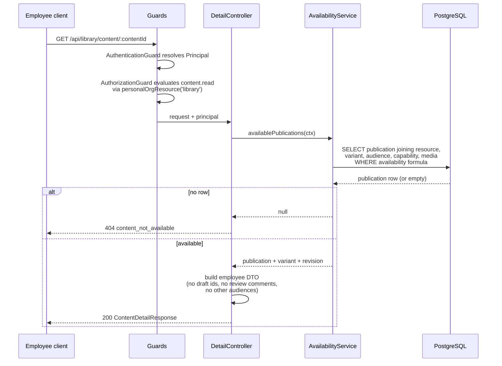
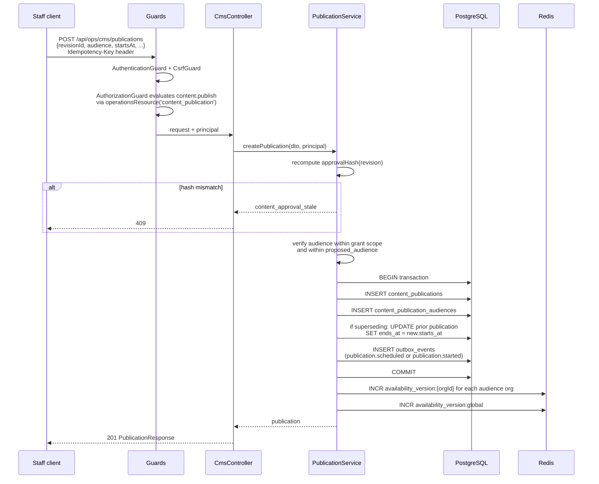
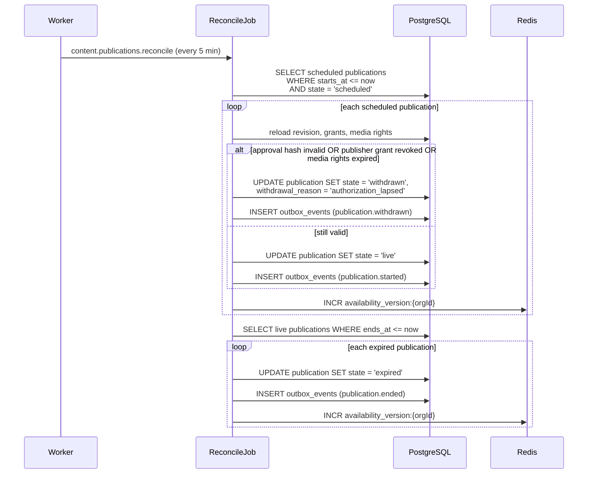
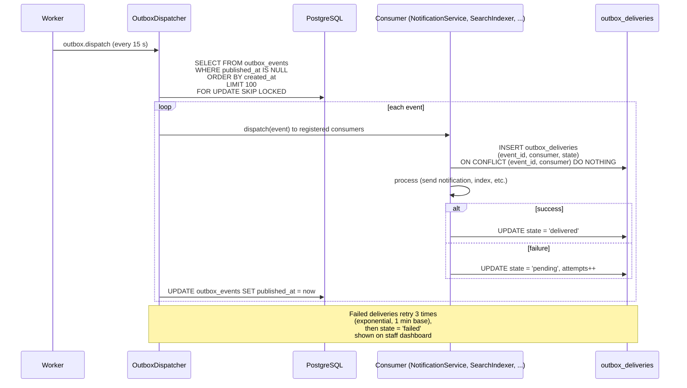

# NestSelf CMS and employee experience strategy

## Table of contents

- [0 Front matter](#0-front-matter)
  - [Audience](#audience)
  - [How to read the document](#how-to-read-the-document)
  - [Relation to the epic and the authentication strategy](#relation-to-the-epic-and-the-authentication-strategy)
  - [Glossary](#glossary)
  - [Legal disclaimer](#legal-disclaimer)
- [1 Decisions at a glance](#1-decisions-at-a-glance)
  - [Changing decisions](#changing-decisions)
- [2 Context and constraints](#2-context-and-constraints)
  - [2.1 What exists and what does not](#21-what-exists-and-what-does-not)
  - [2.2 Authentication handoff (epic 4.2)](#22-authentication-handoff-epic-42)
  - [2.3 Corrections to the epic (C-01)](#23-corrections-to-the-epic-c-01)
  - [2.4 Legacy tables and screens](#24-legacy-tables-and-screens)
  - [2.5 Product rules that bind the design](#25-product-rules-that-bind-the-design)
  - [2.6 Cross-track dependencies](#26-cross-track-dependencies)
  - [Acceptance](#acceptance)
- [3 Architecture and module boundaries](#3-architecture-and-module-boundaries)
  - [3.1 Module map and data ownership](#31-module-map-and-data-ownership)
  - [3.2 Import rules and the ESLint boundary](#32-import-rules-and-the-eslint-boundary)
  - [3.3 Request flows](#33-request-flows)
  - [3.4 Transactions and the outbox pattern](#34-transactions-and-the-outbox-pattern)
  - [3.5 The `@Idempotent()` decorator](#35-the-idempotent-decorator)
  - [3.6 Caching and `availability_version`](#36-caching-and-availabilityversion)
  - [3.7 Jobs and queues overview](#37-jobs-and-queues-overview)
  - [3.8 Configuration and storage drivers](#38-configuration-and-storage-drivers)
  - [3.9 `packages/content` layout](#39-packagescontent-layout)
  - [3.10 Membership-ended event](#310-membership-ended-event)
  - [3.11 DTO contracts](#311-dto-contracts)
  - [Acceptance](#acceptance)
- [4 Data model](#4-data-model)
  - [4.1 Enums](#41-enums)
  - [4.2 CMS tables (`apps/api/src/db/schema/cms.ts`)](#42-cms-tables-appsapisrcdbschemacmsts)
  - [4.3 Remaining tables](#43-remaining-tables)
  - [4.4 Invariant enforcement](#44-invariant-enforcement)
  - [4.5 Migrations](#45-migrations)
  - [4.6 Seed changes](#46-seed-changes)
  - [4.7 Synthetic acceptance dataset (epic 23.1)](#47-synthetic-acceptance-dataset-epic-231)
  - [Acceptance](#acceptance)
- [5 Authorization and availability](#5-authorization-and-availability)
  - [5.1 Action catalogue changes](#51-action-catalogue-changes)
  - [5.2 Template changes](#52-template-changes)
  - [5.3 Resolvers](#53-resolvers)
  - [5.4 Category assignments and review disciplines](#54-category-assignments-and-review-disciplines)
  - [5.5 Self-review rule](#55-self-review-rule)
  - [5.6 Confidential actions and `isConfidential` resources](#56-confidential-actions-and-isconfidential-resources)
  - [5.7 Personal-context `orgId` extension (C-22)](#57-personal-context-orgid-extension-c-22)
  - [5.8 Golden-table additions](#58-golden-table-additions)
  - [5.9 `AvailabilityService`](#59-availabilityservice)
  - [5.10 Availability golden table](#510-availability-golden-table)
  - [5.11 Non-disclosure: 404 versus 403](#511-non-disclosure-404-versus-403)
  - [Acceptance](#acceptance)
- [6 Content format, editor and renderer](#6-content-format-editor-and-renderer)
  - [6.1 `ContentDocument` schema](#61-contentdocument-schema)
  - [6.2 Block catalogue](#62-block-catalogue)
  - [6.3 CTA catalogue and validation](#63-cta-catalogue-and-validation)
  - [6.4 Link rules](#64-link-rules)
  - [6.5 Two-layer validation](#65-two-layer-validation)
  - [6.6 Canonicalization and `approvalHash`](#66-canonicalization-and-approvalhash)
  - [6.7 The Tiptap 3 editor](#67-the-tiptap-3-editor)
  - [6.8 `ContentRenderer` and block components](#68-contentrenderer-and-block-components)
  - [6.9 XSS and injection](#69-xss-and-injection)
  - [6.10 Schema versioning and stored-document migration](#610-schema-versioning-and-stored-document-migration)
  - [Acceptance](#acceptance)
- [7 Editorial workflow](#7-editorial-workflow)
  - [7.1 Publishing flow](#71-publishing-flow)
  - [7.2 Revision state machine](#72-revision-state-machine)
  - [7.3 Review](#73-review)
  - [7.4 Publication lifecycle](#74-publication-lifecycle)
  - [7.5 Urgent withdrawal and rollback](#75-urgent-withdrawal-and-rollback)
  - [7.6 Taxonomy management](#76-taxonomy-management)
  - [7.7 Collections](#77-collections)
  - [7.8 Home slots](#78-home-slots)
  - [7.9 Freshness and rights tasks](#79-freshness-and-rights-tasks)
  - [7.10 Content overview dashboard](#710-content-overview-dashboard)
  - [7.11 Endpoints](#711-endpoints)
  - [7.12 Screens](#712-screens)
  - [7.13 Schemas](#713-schemas)
  - [Acceptance](#acceptance)
- [8 Media](#8-media)
  - [8.1 Storage driver interface](#81-storage-driver-interface)
  - [8.2 Upload endpoint](#82-upload-endpoint)
  - [8.3 Quarantine](#83-quarantine)
  - [8.4 Processing pipeline](#84-processing-pipeline)
  - [8.5 State machine](#85-state-machine)
  - [8.6 Rights and expiry](#86-rights-and-expiry)
  - [8.7 Usage tracking](#87-usage-tracking)
  - [8.8 Delivery](#88-delivery)
  - [8.9 Captions and transcripts](#89-captions-and-transcripts)
  - [8.10 CDK media stack](#810-cdk-media-stack)
  - [8.11 Local development without AWS](#811-local-development-without-aws)
  - [8.12 Endpoints](#812-endpoints)
  - [8.13 Screens](#813-screens)
  - [8.14 Failure states](#814-failure-states)
  - [8.15 Schemas](#815-schemas)
  - [Acceptance](#acceptance)
- [9 Employee library experience](#9-employee-library-experience)
  - [9.1 First visit and interests](#91-first-visit-and-interests)
  - [9.2 Home composer](#92-home-composer)
  - [9.3 Explore and category pages](#93-explore-and-category-pages)
  - [9.4 Collection view](#94-collection-view)
  - [9.5 Search](#95-search)
  - [9.6 Content detail read model](#96-content-detail-read-model)
  - [9.7 Saved items](#97-saved-items)
  - [9.8 Content preferences and playback state](#98-content-preferences-and-playback-state)
  - [9.9 Language handling](#99-language-handling)
  - [9.10 Required states](#910-required-states)
  - [9.11 Client context switching](#911-client-context-switching)
  - [9.12 Endpoints](#912-endpoints)
  - [9.13 Screens](#913-screens)
  - [9.14 Performance](#914-performance)
  - [9.15 Schemas](#915-schemas)
  - [Acceptance](#acceptance)
- [10 Feedback and polls](#10-feedback-and-polls)
  - [10.1 Usefulness feedback](#101-usefulness-feedback)
  - [10.2 Poll definitions and instances](#102-poll-definitions-and-instances)
  - [10.3 Eligibility snapshot at opening](#103-eligibility-snapshot-at-opening)
  - [10.4 Respondent key](#104-respondent-key)
  - [10.5 Vote, change and delete with concurrency](#105-vote-change-and-delete-with-concurrency)
  - [10.6 Frequency cap and placement](#106-frequency-cap-and-placement)
  - [10.7 Closing and decision](#107-closing-and-decision)
  - [10.8 Results and suppression](#108-results-and-suppression)
  - [10.9 Privacy copy](#109-privacy-copy)
  - [10.10 Endpoints](#1010-endpoints)
  - [10.11 Screens](#1011-screens)
  - [10.12 Schemas](#1012-schemas)
  - [Acceptance](#acceptance)
- [11 Editorial requests](#11-editorial-requests)
  - [11.1 Request kinds and structured input](#111-request-kinds-and-structured-input)
  - [11.2 Free-text routing](#112-free-text-routing)
  - [11.3 State machine](#113-state-machine)
  - [11.3.1 Next action and due date](#1131-next-action-and-due-date)
  - [11.4 Owners, backup, and the editorial triage fallback queue](#114-owners-backup-and-the-editorial-triage-fallback-queue)
  - [11.5 Business clock](#115-business-clock)
  - [11.6 SLA job and reminders](#116-sla-job-and-reminders)
  - [11.7 Briefs linking several requests](#117-briefs-linking-several-requests)
  - [11.8 Employee timeline and refresh behavior](#118-employee-timeline-and-refresh-behavior)
  - [11.9 Staff queue DTO without identity](#119-staff-queue-dto-without-identity)
  - [11.10 Idempotent submission](#1110-idempotent-submission)
  - [11.11 Endpoints](#1111-endpoints)
  - [11.12 Screens](#1112-screens)
  - [11.13 Schemas](#1113-schemas)
  - [11.14 Acceptance](#1114-acceptance)
- [12 Restricted intake and general questions](#12-restricted-intake-and-general-questions)
  - [12.1 Professional module boundary](#121-professional-module-boundary)
  - [12.2 Tables](#122-tables)
  - [12.3 Access paths](#123-access-paths)
  - [12.4 Queues and claiming](#124-queues-and-claiming)
  - [12.5 Clarification rounds](#125-clarification-rounds)
  - [12.6 Reply, review, and closure](#126-reply-review-and-closure)
  - [12.7 Reassignment and stale-claim release](#127-reassignment-and-stale-claim-release)
  - [12.8 Capacity gating](#128-capacity-gating)
  - [12.9 Form copy and crisis-information block](#129-form-copy-and-crisis-information-block)
  - [12.10 Derived Q&A permission flow](#1210-derived-qa-permission-flow)
  - [12.11 Editorial-note processing into briefs](#1211-editorial-note-processing-into-briefs)
  - [12.12 Audit and logging rules](#1212-audit-and-logging-rules)
  - [12.13 Endpoints](#1213-endpoints)
  - [12.14 Screens](#1214-screens)
  - [12.15 Schemas](#1215-schemas)
  - [12.16 Acceptance](#1216-acceptance)
- [13 Notifications, telemetry and reporting](#13-notifications-telemetry-and-reporting)
  - [13.1 Outbox: in-transaction write](#131-outbox-in-transaction-write)
  - [13.2 Outbox dispatch](#132-outbox-dispatch)
  - [13.3 Consumers per event type](#133-consumers-per-event-type)
  - [13.4 In-app notifications](#134-in-app-notifications)
  - [13.5 Neutral SES email](#135-neutral-ses-email)
  - [13.6 Telemetry events](#136-telemetry-events)
  - [13.7 Metric definitions](#137-metric-definitions)
  - [13.8 SuppressionService algorithm](#138-suppressionservice-algorithm)
  - [13.9 Employer summary endpoint](#139-employer-summary-endpoint)
  - [13.10 Editorial performance views](#1310-editorial-performance-views)
  - [13.11 Failure visibility](#1311-failure-visibility)
  - [13.12 Endpoints](#1312-endpoints)
  - [13.13 Screens](#1313-screens)
  - [13.14 Schemas](#1314-schemas)
  - [13.15 Acceptance](#1315-acceptance)
- [14 Privacy and retention](#14-privacy-and-retention)
  - [14.1 Visibility matrix mapped to endpoints and DTOs](#141-visibility-matrix-mapped-to-endpoints-and-dtos)
  - [14.2 Logging redaction additions](#142-logging-redaction-additions)
  - [14.3 Retention policies and sweep job](#143-retention-policies-and-sweep-job)
  - [14.4 Sweep job behavior per table](#144-sweep-job-behavior-per-table)
  - [14.5 Deletion of private state on request](#145-deletion-of-private-state-on-request)
  - [14.6 Membership end handling](#146-membership-end-handling)
  - [14.7 Hooks into data export and erasure](#147-hooks-into-data-export-and-erasure)
  - [14.8 Privacy copy at point of use](#148-privacy-copy-at-point-of-use)
  - [14.9 Acceptance](#149-acceptance)
- [15 API surface](#15-api-surface)
  - [15.1 Conventions](#151-conventions)
  - [15.2 Endpoint index](#152-endpoint-index)
- [16 Client integration](#16-client-integration)
  - [16.1 Surfaces and route files](#161-surfaces-and-route-files)
  - [16.2 Navigation](#162-navigation)
  - [16.3 Query keys and context switching](#163-query-keys-and-context-switching)
  - [16.4 Data access, errors and translations](#164-data-access-errors-and-translations)
  - [16.5 Sample mode and fixtures](#165-sample-mode-and-fixtures)
  - [16.6 Shared components](#166-shared-components)
  - [16.7 Acceptance](#167-acceptance)
- [17 Testing and acceptance](#17-testing-and-acceptance)
  - [17.1 Test layers](#171-test-layers)
  - [17.2 Mandatory suites](#172-mandatory-suites)
  - [17.3 The acceptance scenario](#173-the-acceptance-scenario)
  - [17.4 Negative and boundary cases (epic 23.3)](#174-negative-and-boundary-cases-epic-233)
  - [17.5 Definition of done](#175-definition-of-done)
- [18 Implementation plan](#18-implementation-plan)
  - [18.1 Schedule and critical path](#181-schedule-and-critical-path)
  - [18.2 M1: first vertical slice (weeks 1 to 3)](#182-m1-first-vertical-slice-weeks-1-to-3)
  - [18.3 M2: a library people can use (weeks 4 and 5)](#183-m2-a-library-people-can-use-weeks-4-and-5)
  - [18.4 M3: feedback, polls and requests (weeks 6 and 7)](#184-m3-feedback-polls-and-requests-weeks-6-and-7)
  - [18.5 M4: restricted questions, metrics, retention, pilot (weeks 8 and 9)](#185-m4-restricted-questions-metrics-retention-pilot-weeks-8-and-9)
  - [18.6 Parallel work](#186-parallel-work)
- [19 Open decisions and assumptions](#19-open-decisions-and-assumptions)
  - [19.1 Founder decisions](#191-founder-decisions)
  - [19.2 Questions for legal counsel and the DPO](#192-questions-for-legal-counsel-and-the-dpo)
  - [19.3 Spikes](#193-spikes)
  - [19.4 Assumptions](#194-assumptions)
  - [19.5 Dependencies on the authentication track](#195-dependencies-on-the-authentication-track)
- [Appendix A Configuration and environment variables](#appendix-a-configuration-and-environment-variables)
- [Appendix B Decision record](#appendix-b-decision-record)
  - [Part A. Decisions](#part-a-decisions)
  - [Part B. Canonical names (binding; anything else must be listed under "Names introduced")](#part-b-canonical-names-binding-anything-else-must-be-listed-under-names-introduced)
  - [Part C. Mechanisms and numbers the writers must preserve](#part-c-mechanisms-and-numbers-the-writers-must-preserve)
  - [Part D. Founder questions, legal questions, spikes, assumptions, cross-track dependencies](#part-d-founder-questions-legal-questions-spikes-assumptions-cross-track-dependencies)
- [Appendix C Traceability](#appendix-c-traceability)
- [Appendix D Sources](#appendix-d-sources)

## 0 Front matter

This document is the engineering reference for epic `NS-CONTENT-01` (content, discovery and employee requests) in the NestSelf platform. It specifies the content model, the editorial workflow, media handling, the employee library, polls and feedback, editorial requests, restricted intake for general questions, notifications, reporting, privacy controls and the delivery plan, all against the code that exists on the `feat/auth-foundation` line today. Every section is precise enough to implement from.

**Status:** Draft for founder review.
**Date:** 2026-10-24.
**Revision:** 1.
**Source plan:** `docs/tasks/cms-ee/sources/cms-ee-epic-v1.0.md` (the epic, v1.0, 2026-10-22) and `docs/tasks/cms-ee/sources/product-flows-and-user-stories-v0.1.md` (product flows v0.1).

### Audience

1. **Engineers** building the epic. They read the sections for their milestone and use the requirements, data model and endpoint tables as their specification.
2. **AI agents** that receive sections of this document as implementation instructions. Each section is self-contained enough to act on without the conversation that produced it; the canonical names in Appendix B Part B are binding for every identifier.

### How to read the document

| Milestone | Delivers (epic 22.1) | Sections to read |
|---|---|---|
| M1 | Domain boundaries, grants, minimal editor, article, private asset, employee detail, bookmark | 0, 1, 2, 3, 4 (tables of migration `0006`), 5 (all), 6, 7.1 to 7.4, 8.1 to 8.8, 9.1, 9.6, 9.7, 9.10, 9.11, 15, 16, 17, 18.1 and 18.2, Appendix B |
| M2 | Full review and publishing, categories, languages, Home, collections, all formats, search | 4 (migration `0007`), 5.9 and 5.10, 7 (all), 8 (all), 9 (all), 15, 16, 18.3 |
| M3 | Feedback, polls, requests, next-action queue, notifications | 4 (migration `0008`), 10, 11, 12.1, 12.2, 12.11, 13.1 to 13.5, 13.8, 14, 15, 16, 18.4 |
| M4 | Restricted general questions, derived Q&A permission, metrics, retention, operational controls, pilot | 4 (migration `0009`), 12 (all), 13 (all), 14, 17, 18.5, 19 |

Requirements are numbered by section prefix: `CTX-R-nn` (section 2), `ARC-R-nn` (3), `DAT-R-nn` (4), `ACC-R-nn` (5), `FMT-R-nn` (6), `WRK-R-nn` (7), `MED-R-nn` (8), `LIB-R-nn` (9), `POL-R-nn` (10), `DEM-R-nn` (11), `INT-R-nn` (12), `NTF-R-nn` (13), `RET-R-nn` (14), `RTE-R-nn` (15), `CLI-R-nn` (16), `TST-R-nn` (17). "Must", "must not" and "should" carry their standard force. The epic's backlog ids (`FND-01`, `EDT-02`, `EMP-C03`, `ENG-03`, `REQ-04`, `QA-02`, `OPS-C01` and so on) appear in brackets after the requirements that satisfy them; Appendix C maps every backlog id to its requirements and tasks.

Decisions of this document are cited as `C-nn` (Appendix B). Decisions of the authentication strategy are cited as `D-nn` and its sections as `auth-strategy 4.5`. The epic is cited as `epic 9.3` (chapter and section). External sources are cited as `[X-nn]` (Appendix D). Code is cited as `path` or `path:line` relative to the repository root and only for code that exists.

### Relation to the epic and the authentication strategy

The epic is the product plan: it fixes scope, user stories, acceptance criteria, operating targets and the delivery order. This document does not repeat the epic's product reasoning. It translates the epic into tables, modules, endpoints, jobs and screens, and it corrects the epic where the code moved on after the epic was written (C-01): the data layer is Drizzle with PostgreSQL row-level security (D-37); eleven `content.*` actions and two content templates already exist; the route prefixes follow auth-strategy 4.6.2; restricted intake is the confidential-domain module the auth strategy reserves (T-2.4).

The authentication strategy (`docs/tasks/auth/auth-strategy.md`) remains the source for identity, sessions, step-up, the `authorize()` engine, the confidential domain, audit, aggregates, infrastructure and deployment. This document changes it in exactly four places, each recorded as a decision: the `content_publisher` template loses `content.review` to a new `content_reviewer` template (C-08); new actions and templates are added (C-08); the personal context names its organization (C-22); and the epic delivers the intake part of T-2.4 (C-17, X-D04).

### Glossary

| Term | Meaning | Do not use instead |
|---|---|---|
| resource | The language-independent identity of one piece of content: an article, video, audio, practical resource, Q&A or collection. Table `content_resources`. | content item (legacy table name), page, post |
| variant | One language version of a resource. Table `content_variants`; unique per resource and locale. | translation (except when describing the act of translating) |
| revision | An immutable snapshot of a variant's body and metadata once submitted; the working revision is the one draft that may still change. Table `content_revisions`. | version, draft (unless the state is `draft`) |
| approval | The reviewer's acceptance of one exact revision, bound by its `approval_hash`. | sign-off |
| publication | An approved revision made available to an audience in a time window. Table `content_publications`. | release, go-live |
| audience | The organizations or org units a publication is shown to. Table `content_publication_audiences`. | target group, segment (reserve "segment" for business segments) |
| capability | A client-level switch that enables a part of the library or a feature such as the ask-a-question form. Table `org_content_capabilities`. | entitlement (except when quoting the epic), package, benefit |
| availability | The single decision that a publication may be shown to a reader in their current context (C-10). | visibility, access (reserve "access" for authorization) |
| category | A controlled navigation group; every resource has one primary category, which is also its editorial owner (C-09). Table `categories`. | section, area (legacy `support_area` is not a category) |
| category assignment | An `Assignment` of kind `COLLECTION` whose target is a category; it gives content staff their editorial scope. | collection assignment, desk |
| collection | An employee-facing resource of type `collection`: an introduction plus an ordered sequence of other resources (`collection_entries`). | playlist, course, program |
| topic, need | Controlled vocabulary for precise relationships (topic) and for "I want to..." entry points (need). Tables `topics`, `needs`. | tag (reserve for free tags, which do not exist) |
| Home slot | A curated placement on Home: featured, quick need, collection of the month, ask a professional, shape future topics. Table `home_slots`. | banner, carousel item |
| editorial request | An employee's suggestion of a topic, format or translation, interest in an event, or a content issue report. Table `editorial_requests`. | ticket, support request (a support request is a different domain) |
| editorial brief | A sanitized description of work that one or more requests point to. Table `editorial_briefs`. | task (reserve for `editorial_tasks`) |
| editorial task | An operational action for an owner: review due, rights expiring, collection below minimum, permission withdrawn. Table `editorial_tasks`. | to-do, reminder |
| intake record | Original employee free text inside the confidential domain: a general question or the note attached to an editorial request. Table `intake_records`. | submission (except when quoting the epic), message |
| intake queue | A discipline queue of intake records that professionals with a QUEUE assignment may claim. Table `intake_queues`. | inbox, pool |
| claim | The atomic step that assigns an intake record to one professional and creates the CASE assignment that lets them read it. | pick up, take |
| respondent key | The per-poll-instance HMAC pseudonym of a participant (C-19). | anonymous id, voter id |
| actor key | The per-context HMAC pseudonym used for feedback and content events (C-19, C-26). | user hash, tracking id |
| suppression | Hiding an aggregate cell, and any total that would reveal it, when fewer than k distinct relevant participants contribute (C-24). | anonymization |
| employer summary | The monthly, suppressed program overview an organization's reporting users may read (C-24). | HR report (reserve for reports outside this epic), dashboard |
| staff | NestSelf's own employees acting in the operations context. As in the auth strategy glossary. | admins (unless naming the admin app) |
| professional | An expert who answers general questions through the intake queues. | therapist, counsellor (unless the service is therapy) |

The auth strategy glossary (auth-strategy 0) applies to every other term: user, membership, context, principal, grant, template, scope, assignment, step-up, audit event.

### Legal disclaimer

This document contains engineering background on data protection, retention and accessibility. It is not legal advice. Retention periods, the lawful basis for pseudonymous processing, privacy notices and the classification of general questions must be reviewed and approved by legal counsel and the DPO before the first real employee uses the library (19 Open decisions and assumptions, epic 15.5, auth-strategy 11.2).


## 1 Decisions at a glance

Thirty-two decisions govern this strategy. The table summarizes each one; the full entry with conditions and recorded alternatives is in Appendix B Decision record, and the detail lives in the section that implements it.

Confidence levels: **settled** follows directly from the epic, the auth strategy or verified code; **recommended** is the best-supported choice with an alternative recorded; **founder** means the founder decides and the stated default is assumed until then.

| ID | Decision | Choice | Why | Confidence | Milestone |
|---|---|---|---|---|---|
| C-01 | Scope and sequencing | Epic `NS-CONTENT-01` v1.0 as written, with code-driven corrections | The epic is the acceptance contract; the code moved on since it was written (Drizzle, existing actions, route prefixes) | settled | all |
| C-02 | CMS approach | Thin domain CMS inside `apps/api` and `apps/admin`; no headless CMS, no spike | One identity, grant and audit system; no candidate or expertise for a headless spike (epic 17.2) | settled | M1 |
| C-03 | Editor and rendering | Tiptap 3 in the admin only; validated JSON; own React renderer, no HTML | MIT core, JSON storage, DOM-free validation [X-01..X-04]; no HTML means no XSS sink | recommended | M1 |
| C-04 | Shared package | `@nestself/content` with `schema`, `editor`, `render`, `search` subpaths | One schema for editor, API validation and renderer; API never imports React | settled | M1 |
| C-05 | Blocks and CTAs | Closed block catalogue, typed CTAs, link host allowlist, size limits | Editors cannot insert HTML, scripts, fake bookings or eligibility bypasses (epic 6.3) | settled | M1 |
| C-06 | Content model | Resource, variant, revision, publication; approval hash; `If-Match` autosave | Exact-revision approval and no silent overwrite (epic 9.3, EDT-01, EDT-02) | settled | M1–M2 |
| C-07 | Tenancy | Catalog is platform data; personal and tenant state carries `org_id` with RLS | No copies per client (epic 10.2); defense in depth for personal state (D-37) | settled | M1 |
| C-08 | Authorization | Reuse eleven `content.*` actions; add sixteen; split reviewer from publisher; four new templates | No second role system (epic 15.2); review independent of publishing (epic 9.5) | settled | M1–M4 |
| C-09 | Editorial scope | A category assignment (kind `COLLECTION`) targets the primary category | The epic makes the primary category the editorial owner (epic 5.1); reuses `assigned_collections` | recommended | M1 |
| C-10 | Availability | One `availablePublications(ctx)` subquery composed by every read path | Lists, search, detail, media and Home cannot disagree (epic 18.2 invariant 2) | settled | M1 |
| C-11 | Capabilities | `org_content_capabilities` with `library`, `general_questions`, `event_interest` | Service availability comes from configuration, never from copy (epic 10.3) | recommended | M2 |
| C-12 | Audiences | `all_eligible`, `organization`, `org_unit` rows combined with OR; publisher may narrow, not broaden | Epic 10.1 formula; approval binds the proposed audience | settled | M2 |
| C-13 | Timing | Availability computed from timestamps at read time; reconcile job every 5 minutes | Publication never waits for a worker; lapsed authority stops a scheduled start (epic 9.3) | settled | M2 |
| C-14 | Media | Private storage drivers, quarantine, worker processing, API delivery with Range re-authorized per request | Epic 17.3 and D-C12; revocation stays immediate for new requests | settled | M1–M2 |
| C-15 | Search | PostgreSQL full text over a denormalized table; application folding and synonyms; trigram fallback | Serbian and Hungarian stemmers ship in PostgreSQL [X-06]; RDS cannot load synonym files [X-08] | recommended | M2 |
| C-16 | Home | Server-side deterministic composer with fixed modules and weights in code | Explainable ranking, no empty slots, no repeats (epic 7.2, 14.1) | settled | M1–M2 |
| C-17 | Restricted intake | The confidential-domain module `apps/api/src/professional/`; queue, atomic claim, CASE assignment | Same four access paths as the auth strategy (auth-strategy 4.7.3, D-20) | settled | M3–M4 |
| C-18 | Derived Q&A | Explicit permission for the exact generalized text; no link from CMS to the original | Epic 13.4 and D-C08 | settled | M4 |
| C-19 | Polls | Definitions in the CMS, votes in engagement, HMAC respondent keys, eligibility snapshot | One current response per key; no named rows (epic 11.4, 11.5) | settled | M3 |
| C-20 | Editorial requests | Identified to the sender, sanitized for editors; free text in intake; business clock | Epic 12; editors never see raw text or identity | settled | M3 |
| C-21 | Routes | `/api/library`, `/api/me`, `/api/expert/intake`, `/api/ops/cms`, `/api/orgs/:orgId` | Auth-strategy controller separation (4.6.2) | settled | all |
| C-22 | Personal context | `{ kind: 'personal', orgId }`; client clears caches on every switch | Personal state is per employer (epic 10.4); the current client keeps old queries | settled | M1 |
| C-23 | Notifications | Transactional outbox, in-app notifications, neutral email, visible failures | Retries cannot duplicate outcomes (epic 17.4, OPS-C02) | settled | M3 |
| C-24 | Aggregates | One `SuppressionService`; k = 10; complementary suppression; monthly employer view without filters | Auth-strategy 4.9; epic 15.3 | settled | M3–M4 |
| C-25 | Retention | New keys in `retention_policies`; daily `retention.sweep` | Periods stay configurable pending counsel (epic 15.5) | settled | M4 |
| C-26 | Telemetry | Pseudonymous day-granular `content_events`, server dedupe, extended log redaction | Useful metrics without timelines or raw text (epic 15.4, 19.3) | settled | M4 |
| C-27 | Surfaces | Employee and expert screens in `apps/workspace`; CMS in `apps/admin`; namespaces `library`, `cms`, `intake` | Professionals are not staff; the auth strategy places the expert workspace beside the employee one | recommended | M1–M4 |
| C-28 | Content languages | Every resource in all four locales, always in the reader's language; `sr-Latn`, `hu`, `en` authored; `sr-Cyrl` generated from `sr-Latn` at read time; publish all locales together | Founder decision: everything appears in the chosen language, as the interface already does for Cyrillic | founder (decided) | M1–M2 |
| C-29 | Tests | Availability golden table, decision golden table additions, DTO leak tests, 15-step Playwright scenario | Epic 23; business boundaries, not navigation, define done | settled | all |
| C-30 | Dependencies | One catalog change before parallel work; `ffmpeg` as a system binary | The repository forbids installs during parallel work | settled | M1 start |
| C-31 | Category-scoped lists | `operationsCategoryScope` plus `CmsScopeService.allowedCategoryIds()` via `authorizeMany()` | The guard authorizes one resource; lists must filter per category without wildcard scopes (D-15) | settled | M1 |
| C-32 | Expert routes | `expertResource` plus `IntakeResourceLoader`; claim and reassign non-confidential, read and reply confidential | Experts act in the expert context; operations staff have no intake route | settled | M4 |

### Changing decisions

Decisions change through a new revision of Appendix B, never through silent edits to individual sections. A revision states which decision changed, the new choice, the rationale and the date; the sections that implement it are then updated to match.


## 2 Context and constraints

This section establishes what exists in the codebase today that epic `NS-CONTENT-01` builds on, checks the epic's handoff conditions against reality, records the corrections the decision record makes to the epic, inventories the legacy tables and screens, and restates the product rules that bind every later section.

### 2.1 What exists and what does not

The API (`apps/api`) is a NestJS 12 application with four global guards (authentication, CSRF, authorization, throttle) registered in `AppModule` (`apps/api/src/app.module.ts:79-82`). The pure `authorize()` engine lives in `apps/api/src/authz/authorize.ts` and evaluates grants, assignments and conditions for every decorated route. A CI test (`apps/api/src/authz/default-deny.test.ts`) boots the full module and asserts that every controller handler carries `@Public()`, `@Authenticated()` or `@Authorize()`. The golden table (`apps/api/src/authz/golden-table.json`) exercises 17 templates and all scope kinds. Two resource resolvers exist: `orgResourceFromContext` and `operationsResource` (`apps/api/src/authz/resolvers.ts:21,39`).

The data layer is Drizzle ORM 0.45.4 with PostgreSQL 17. Schema files live in `apps/api/src/db/schema/`; helpers in `_shared.ts` provide `idColumn()`, `ts()`, `createdAt()`, `updatedAt()`, `textArray()` and `tenantPredicate()`. Thirteen tenant tables carry `pgPolicy` with RLS enforced through `DbService.withOrgScope(orgId, fn)` (`apps/api/src/db/db.service.ts:93-94`; standalone function at `:45`), which calls `set_config('app.current_org_id', orgId, true)` inside a transaction. The `nestself_app` database role has SELECT, INSERT, UPDATE and DELETE on all tables except `audit_events` (append-only). Three migrations exist: `0000_init.sql`, `0001_audit_partitions_rls_roles.sql` and `0002_rls_legacy_content_closure.sql` (`apps/api/drizzle/`).

Background jobs run through BullMQ on queue `nestself-maintenance` (`apps/api/src/jobs/job-scheduler.service.ts`). Three scheduled jobs exist: `audit.ensure-partitions`, `grants.reconcile` and `mobile.prune-stale-families`. The worker boots its own NestJS context without an HTTP listener (`apps/api/src/worker/main.ts`). `JobAuthorization` (`apps/api/src/jobs/job-authorization.ts`) wraps processors that act on a principal's behalf, re-running `authorize()` at execution time.

A Redis key pattern `idempotency:{key}` with a 24-hour TTL is defined in `apps/api/src/redis/redis-keys.ts:142-144`, but no middleware, interceptor or decorator consumes it. Individual services use idempotent-by-design patterns (upsert on conflict, guard clauses). The formal `@Idempotent()` decorator required by the epic must be built.

The action catalogue (`packages/contracts/src/actions.ts`) contains 95 actions. Eleven `content.*` actions already exist: `content.read`, `content.write`, `content.submit`, `content.preview`, `content.review`, `content.publish`, `content.schedule`, `content.archive`, `content.restrict`, `content.promote` and `content.bookmark`. `feedback.submit`, `preferences.manage` and `reports.aggregate.read` also exist. Two templates reference content: `content_author` (scope `assigned_collections`, actions write, submit, preview) and `content_publisher` (scope `assigned_collections`, actions review, publish, schedule, archive, restrict) (`packages/contracts/src/templates.ts:76-381`).

**Not present.** No media storage (no S3 client, no bucket, no upload route, no streaming response). No transactional outbox table or pattern. No full-text search infrastructure (no `tsvector`, no `pg_trgm`, no `unaccent`, no GIN index). No content domain tables beyond the legacy `content_items`. No notification service beyond `SesInvitationMailer`. No employee-context resolver. No query-key factory in the front-end. No rich-text editor or renderer in the dependency tree.

### 2.2 Authentication handoff (epic 4.2)

The epic requires identity and active membership, two test clients, employee and admin contexts, a server-side session, `authorize()`, basic audit and a way to assign grants. Each item is checked against the code.

| Condition | Status | Evidence |
|---|---|---|
| Identity with Cognito and fake provider | Exists | `apps/api/src/auth/` with `AUTH_MODE=stub\|cognito` (D-36) |
| Active membership per organization | Exists | `memberships` table with `membershipStatus` enum; membership status checked in `authorize()` step 2 |
| Two test clients | Exists | `SAMPLE_ORG` and a second organization in `packages/sample-data` |
| Employee, personal and operations contexts | Exist | `ActiveContextSchema` (`packages/contracts/src/auth.ts:121-127`) with four kinds |
| Server-side session in Redis | Exists | `session:{hash}` key, managed by `SessionService` |
| `authorize()` and golden table | Exist | Pure engine, golden-table test, default-deny CI |
| Basic audit | Exists | Append-only `audit_events` with partitioned monthly ranges (`apps/api/src/audit/`) |
| Grant assignment | Exists via seed | Templates seeded from contracts; grants derived from legacy roles in `apps/api/src/db/seed/seed-lib.ts`; admin UI (T-2.2) is not yet implemented |

The handoff is met. Grant assignment currently works through the seed and direct database writes; the admin UI is a phase 2 dependency (X-D02). Before the pilot, production sign-in, access revocation and the other release conditions of the auth strategy must work (auth-strategy 11.1). This epic does not bypass those conditions [epic 4.2].

### 2.3 Corrections to the epic (C-01)

The decision record identifies four corrections to the epic caused by code that exists since the epic was written.

**Drizzle, not Prisma.** The epic (17.1) references "PostgreSQL/Prisma." The repository uses Drizzle ORM with PostgreSQL row-level security (D-37). Every table definition, migration and repository in the codebase is Drizzle. All data-model work in this document uses Drizzle conventions.

**Action catalogue extends, not replaces.** The epic (15.2) proposes actions such as `content.create` and `content.edit` as new entries. Eleven `content.*` actions and two content templates already exist in `packages/contracts/src/actions.ts` and `packages/contracts/src/templates.ts`. C-08 maps the epic's proposed names to existing actions where possible (`content.write` covers both `content.create` and `content.edit`; `content.archive` covers `content.withdraw`) and adds only genuinely new actions.

**Route prefixes follow the auth strategy.** The epic's route sketches (`/api/employee/*`, `/api/admin/*`, `/api/intake/*`) are replaced by the auth strategy's prefix convention (auth-strategy 5.6, C-21): `/api/library/*` and `/api/me/*` for personal-context reads, `/api/ops/cms/*` for operations-context CMS, `/api/expert/intake/*` for expert-context intake, `/api/orgs/:orgId/*` for organization-context.

**Restricted intake is the confidential-domain module.** The auth strategy (4.7, D-20) establishes a hard boundary for restricted data in `apps/api/src/professional/`. C-17 places the epic's intake tables and controllers there, not in CMS tables. `authorize()` step 3 unconditionally denies any non-own, non-assignment, non-emergency grant when `resource.isConfidential` is true (`apps/api/src/authz/authorize.ts`).

### 2.4 Legacy tables and screens

| Table or screen | Current state | Epic disposition |
|---|---|---|
| `content_items` (`apps/api/src/db/schema/content.ts:75-87`) | Flat table: id, title, summary, body (text), kind, area, locale, expertId. No RLS, no versioning, no audience. Written by seed only. | **Retired.** Replaced by `content_resources`, `content_variants`, `content_revisions` and `content_publications`. Dropped in migration `0004` after the seed no longer writes it. |
| `channels`, `posts` (`content.ts:88-138`) | Org-scoped community tables with RLS. Written by seed only; no API route. | **Retained untouched** until auth T-2.7. Workspace screens stay under "Prototype screens" in sample mode (C-27). |
| `polls`, `poll_options`, `poll_votes` (`content.ts:141-198`) | Team-scoped via `legacy_teams`. One vote per user per option. Written by seed only. | **Retained untouched** until auth T-2.7. Replaced by `poll_definitions`, `poll_instances`, `poll_instance_eligibility` and `poll_responses` with pseudonymous keys (C-19). |
| `experts`, `expert_credentials` (`content.ts:37-68`) | Expert profile and credential verification. Read by seed, `AuthorizationRepository` and `PrincipalLoader`. | **Retained and extended.** Category conditions on expert credentials drive review-discipline checks. |
| `event_requests` (`content.ts`) | Org-scoped with RLS. Admin screen exists. | **Retained as-is.** Not part of this epic. |
| Workspace Home (`apps/workspace/src/routes/_authenticated/index.tsx`) | Shows greeting, support cards, appointment, channel posts from sample data. | **Rebuilt** per epic 7.2. Becomes the server-composed Home (C-16). |
| Workspace nav: Support, Appointments, Messages, Channels, Polls | Implemented screens and placeholders. | Support, Appointments, Messages and Channels move to "Prototype screens" in sample mode. Main nav becomes Home, Explore, Saved, My requests (C-27). |
| Admin `/content` | Basic read-only table of `SAMPLE_CONTENT` (3 flat articles). | **Replaced entirely** by CMS screens under `/cms` (C-27). The old `/content` route redirects to `/cms`. |
| Admin nav sidebar: Content, Experts, Organizations | Existing. | Content becomes CMS. Experts and Organizations stay. |

### 2.5 Product rules that bind the design

The epic establishes product boundaries that constrain every section of this document. They are restated here because they generate requirements and test cases throughout.

**No diagnosis.** Recommendations do not infer diagnoses from reading or search behaviour. Selecting "sleep" in a poll does not mean the employee has a sleep disorder. A wellbeing-pulse instrument is a separate epic with a professional methodology [epic 3.3, 11.1].

**No pressure.** No streaks, public leaderboards, employee competition or compulsory completion. Reading content is voluntary. Frequency cap: at most one interest poll per person per seven days. A skipped poll does not reappear in the same instance [epic 3.3, 11.4].

**No fake CTAs.** A CTA must reference a genuinely available capability or resource. Editors cannot create a fake booking, bypass eligibility or promise a service the platform does not deliver. `required_capability` comes from `org_content_capabilities`, not from editorial copy [epic 1.1, 6.3, 10.3].

**Privacy copy at point of use.** The employee sees who will read their question, poll response or request at the moment they provide it. The copy is specific: "Your question goes to an assigned member of the NestSelf professional team. Your employer does not receive it" [epic 13.2]. Poll copy states: "Participation is optional. Your employer cannot see your individual response. NestSelf uses responses for aggregate content planning" [epic 11.3]. No claim of complete anonymity, because pseudonymised data is personal data under GDPR Art. 4(5) and Recital 26 [X-11].

**Content never bypasses access.** A collection cannot broaden access to a child resource. A search snippet or facet count must not disclose a title the caller cannot read. An `all_eligible` audience checks the `required_capability`, not just the membership [epic 10.1, 18.2].

**Visibility matrix.** Saved items, poll choices, question text and playback state are visible only to the owning employee in the owning context. CMS authors never see saved-item lists. HR never sees individual poll responses. Restricted intake text has no path through generic CMS endpoints, reports or exports [epic 15.1, 18.2 invariant 6].

**Neutral notifications.** Subjects never contain the topic, question or service category. Deep links require sign-in and re-check access [epic 15.4, auth-strategy D-29].

**Server-side enforcement.** UI gating (hiding routes, disabling controls) is a convenience, not access control. The API enforces availability, audience, scope and step-up. The default-deny CI test covers every new route automatically [auth-strategy D-19].

**Sample mode and the content rule.** Sample content uses fixtures from `@nestself/sample-data` with the `SAMPLE_` prefix and `placeholder: true`. The `SampleDataBanner` appears on every screen in sample mode. No client logos, invented statistics, availability promises, fake bookings or named experts who are not real approved professionals.

### 2.6 Cross-track dependencies

Five dependencies on the auth strategy's phase 2 affect sequencing. Section 18 (Implementation plan) schedules around them; they are listed here so every section writer knows the constraints.

| Dependency | What | Fallback | Blocks |
|---|---|---|---|
| X-D01 T-2.0 `operationsOrgResource` | Resolver for `/api/ops/orgs/:orgId/content-capabilities` | Seed and CLI until it lands | M2 capability management |
| X-D02 T-2.1 Grant administration endpoints | Assigning editorial staff grants through an API | Seed grants in development | M4 pilot readiness |
| X-D03 T-2.6 Step-up enforcement | `restricted` class for intake reads | Epic implements the restricted-class branch of T-2.6 if the auth track has not delivered it by M4 | M4 exit |
| X-D04 T-2.4 Professional module tables | Partially delivered by this epic: `apps/api/src/professional/`, intake tables | None; this epic builds them | M3 start |
| X-D05 `ActiveContext` personal `orgId` | Session stores resolved `orgId` for personal context | Ships in M1 with tests in the auth suite | M1 start |

### Acceptance

- **CTX-A-01** A CI script lists every table in `apps/api/src/db/schema/*.ts` and asserts that the legacy tables marked "retained untouched" (`channels`, `posts`, `polls`, `poll_options`, `poll_votes`) are unchanged from their commit at the start of the `feat/cms-ee` branch.
- **CTX-A-02** The default-deny test passes with all new routes decorated.
- **CTX-A-03** `switchContext` in both web apps calls `queryClient.cancelQueries()` and `queryClient.clear()` before applying the new principal (C-22 fix), verified by a unit test.
- **CTX-A-04** Every route listed in C-21 resolves through `personalOrgResource`, `operationsResource` or `orgResourceFromContext` as specified, verified by the golden table and an API e2e test for each prefix group.
- **CTX-A-05** Sample-mode screens show the `SampleDataBanner` and render all prototype screens under a "Prototype screens" group, verified by a Playwright screenshot test.


## 3 Architecture and module boundaries

This section defines the module map, data ownership, import rules, request flows, the transactional outbox, the idempotency decorator, caching, jobs and queues, configuration, storage drivers and the `@nestself/content` package layout. It governs how the code is organized; the data model (section 4) governs what is stored; the authorization surface (section 5) governs who may do what.

### 3.1 Module map and data ownership

Every new module is a NestJS `@Module` under `apps/api/src/` following the existing pattern: module, controller, service, repository. Modules register in `AppModule`. The table below lists each module, its data ownership and the route prefix its controllers serve [C-02, Part B].

| Module path | Owns | Controllers | Route prefix |
|---|---|---|---|
| `cms/` | `content_resources`, `content_variants`, `content_revisions`, `content_revision_media`, `content_revision_reviews`, `content_publications`, `content_publication_audiences`, `collection_entries`, `categories`, `category_labels`, `topics`, `topic_labels`, `topic_redirects`, `needs`, `need_labels`, `content_resource_topics`, `content_resource_needs`, `content_resource_categories`, `home_slots`, `editorial_tasks` | `CmsController`, `TaxonomyController`, `HomeSlotController`, `CollectionController` | `/api/ops/cms/*` |
| `media/` | `media_assets`, `media_renditions` | `MediaUploadController`, `MediaManageController`, `MediaDeliveryController` | Upload and manage: `/api/ops/cms/media/*`; employee delivery: `/api/library/media/*`; staff preview: `/api/ops/cms/media/:assetId/:rendition` |
| `library/` | `saved_items`, `playback_states`, `content_preferences`, `resource_feedback`, `content_search_documents`, `search_synonyms` | `HomeController`, `DiscoveryController`, `SearchController`, `DetailController`, `SavedItemsController`, `PreferencesController`, `PlaybackController`, `FeedbackController`, `EventsController` | `/api/library/*` (reads), `/api/me/saved`, `/api/me/content-preferences`, `/api/me/playback` |
| `engagement/` | `poll_definitions`, `poll_instances`, `poll_instance_eligibility`, `poll_responses` | `PollManageController` (under cms), `PollVoteController` (under library) | Manage: `/api/ops/cms/polls/*`; vote: `/api/library/polls/*` |
| `editorial/` | `editorial_requests`, `editorial_request_events`, `editorial_briefs`, `editorial_response_templates`, `business_calendars`, `business_calendar_days` | `EditorialRequestEmployeeController`, `EditorialRequestManageController` | Employee: `/api/me/requests/*`; staff: `/api/ops/cms/demand/*` |
| `professional/` | `intake_queues`, `intake_records`, `intake_messages`, `intake_publication_permissions` | `QuestionController` (employee), `IntakeController` (expert) | Employee: `/api/me/questions/*`; expert: `/api/expert/intake/*` |
| `notifications/` | `outbox_events`, `outbox_deliveries`, `notifications` | `NotificationController` | `/api/me/notifications` |
| `reporting/` | `content_events`, `content_metrics_monthly` | `MetricsController`, `EmployerSummaryController` | `/api/ops/cms/performance/*`; `/api/orgs/:orgId/content-summary` |

**ARC-R-01** Each module owns its tables exclusively. A module's repository is the only code that reads from or writes to its tables. Cross-module data access goes through exported service methods, never through importing another module's repository or Drizzle table reference [epic 17.1, FND-01].

**ARC-R-02** Poll definitions are managed through `cms/` controllers (staff creates and configures polls as editorial content), but the `poll_definitions` and related tables are owned by `engagement/`. `CmsModule` imports `EngagementModule` and delegates to `PollDefinitionService` [C-19].

### 3.2 Import rules and the ESLint boundary

**ARC-R-03** `apps/api/src/professional/` must not import from `cms/`, `editorial/`, `reporting/` or any controller outside its own directory. No module outside `professional/` may import the professional module's Drizzle tables. An ESLint `no-restricted-imports` rule in `apps/api/.eslintrc.cjs` enforces both directions:

```ts
// apps/api/.eslintrc.cjs (excerpt)
{
  files: ['src/professional/**/*.ts'],
  rules: {
    'no-restricted-imports': ['error', {
      patterns: [
        { group: ['../cms/*', '../editorial/*', '../reporting/*'], message: 'Professional module must not import CMS, editorial or reporting.' },
      ],
    }],
  },
},
{
  files: ['src/cms/**/*.ts', 'src/editorial/**/*.ts', 'src/library/**/*.ts', 'src/engagement/**/*.ts', 'src/reporting/**/*.ts', 'src/notifications/**/*.ts'],
  rules: {
    'no-restricted-imports': ['error', {
      patterns: [
        { group: ['../professional/db/*', '../professional/repositories/*'], message: 'Only the professional module may access its tables.' },
      ],
    }],
  },
},
```

**ARC-R-04** A serialization test (`apps/api/test/dto-leak.test.ts`) proves that no CMS, editorial-demand, reporting or `/orgs/:orgId` DTO contains an `intake_records`, `intake_messages` or `intake_publication_permissions` field [C-17, FND-01].

### 3.3 Request flows

Four sequence diagrams define the primary flows. Every request begins with the four global guards (authentication, CSRF, authorization, throttle) before reaching the controller.

#### 3.3.1 Employee content read



The `AvailabilityService` subquery is the single implementation of the availability formula (C-10). It is composed into every employee read path: Home, Explore, category pages, collections, search, detail, saved items, related links, CTAs, media delivery and poll placement. There is no second implementation in TypeScript; the golden availability table tests it against Postgres (`apps/api/test/db/availability.golden.spec.ts`).

#### 3.3.2 Staff publish



**ARC-R-05** The publication, the audience rows and the outbox event are written in one database transaction. No state change emits its event outside the committing transaction [C-23, epic 18.2 invariant 10].

#### 3.3.3 Scheduled publication start (reconcile job)



**ARC-R-06** Publication timing does not depend on a worker. The availability formula evaluates `starts_at`, `ends_at` and `withdrawn_at` at read time. The reconcile job moves `state`, emits events and re-validates authorization; if it runs late, content that meets the time window is already available to readers [C-13].

#### 3.3.4 Outbox dispatch



**ARC-R-07** Consumers re-check membership, preference and target visibility at send time. A consumer that finds the target no longer eligible marks the delivery `skipped`, not `failed` [C-23, epic 19.2].

### 3.4 Transactions and the outbox pattern

**ARC-R-08** Every state change that triggers downstream work (publication, withdrawal, poll close, request transition, intake reply, feedback, media verdict) writes an `outbox_events` row in the same transaction as the domain write. The `outbox.dispatch` job reads unpublished events every 15 seconds in batches of 100 using `FOR UPDATE SKIP LOCKED`, dispatches each to its registered consumers and marks it published. Each consumer records a dedupe key `(event_id, consumer)` in `outbox_deliveries`; a duplicate dispatch is a no-op [C-23].

**ARC-R-09** Outbox event payloads carry ids and codes only, never bodies. The payload schema is `{ aggregateType, aggregateId, orgId?, data: Record<string, string | number | boolean | null> }`. No question text, answer text, poll option or request note appears in an outbox row [epic 19.2, C-26].

### 3.5 The `@Idempotent()` decorator

**ARC-R-10** The `@Idempotent(scope)` decorator (`apps/api/src/common/idempotency/idempotent.decorator.ts`) and its `IdempotencyInterceptor` (`idempotency.interceptor.ts`) enforce request-level idempotency on annotated endpoints. The decorator extracts the `Idempotency-Key` header from the request. When absent on a decorated endpoint, the request proceeds without idempotency protection (the header is recommended, not required). When present, the interceptor operates as follows [epic 17.4, 18.2 invariant 10]:

1. Compute `requestHash = SHA-256(method + path + canonicalBody)`.
2. Read Redis key `idempotency:{scope}:{key}` (24-hour TTL).
3. If the key does not exist, set it to `{ requestHash, status: 'processing' }` with `NX` and proceed. On completion, update the value to `{ requestHash, status: 'complete', statusCode, body }`.
4. If the key exists with `status: 'processing'`, return 409 `idempotency_conflict` (the original request is still in flight).
5. If the key exists with `status: 'complete'` and `requestHash` matches, replay the stored response (same status code and body).
6. If the key exists with `status: 'complete'` and `requestHash` differs, return 409 `idempotency_conflict` (the same key was used for a different request body).

The `scope` parameter (e.g. `'publication'`, `'poll_response'`, `'editorial_request'`) prefixes the Redis key to avoid collisions between unrelated endpoints. The existing `idempotencyKey()` helper in `apps/api/src/redis/redis-keys.ts` is extended to accept a scope: `idempotency:{scope}:{key}`.

### 3.6 Caching and `availability_version`

**ARC-R-11** The Home response for a given employee is cached in Redis under key `library_home:{orgId}:{membershipId}:{locale}:{availabilityVersion}` with a 60-second TTL. The `availabilityVersion` is a composite of `availability_version:{orgId}` and `availability_version:global`, both stored as Redis integers. A cache miss always computes the full Home [C-16].

**ARC-R-12** The following events increment `availability_version:{orgId}` for every affected organization: a publication is created, scheduled, started, ended or withdrawn; an audience row is added or removed; a capability is enabled or disabled; a membership becomes ACTIVE or ENDED; a media asset's rights change or expire. Global changes (a new search synonym, a taxonomy change) increment `availability_version:global`, which is part of every cache key [Part C].

**ARC-R-13** Personalized responses (`/api/library/home`, `/api/me/saved`, `/api/me/content-preferences`) never use a shared public cache. `Cache-Control: private, no-store` is the default for all `/api/library/*` and `/api/me/*` responses. Cover images on content cards may use `Cache-Control: private, max-age=300` [C-14].

### 3.7 Jobs and queues overview

Three new BullMQ queues join the existing `nestself-maintenance`:

| Queue | Concurrency | Purpose |
|---|---|---|
| `nestself-media` | 2 | Media processing: magic-byte sniffing, allowlist check, metadata stripping, rendition generation, malware verdict polling |
| `nestself-outbox` | 1 | `outbox.dispatch` repeatable (every 15 s) |
| `nestself-search` | 1 | `content.search.index` writes, `content.search.rebuild` one-off |

The `nestself-maintenance` queue gains these scheduled jobs:

| Job name | Schedule | Description |
|---|---|---|
| `content.publications.reconcile` | `*/5 * * * *` | Move scheduled to live, live to expired; re-validate authorization (3.3.3) |
| `content.freshness.scan` | `0 6 * * *` | Create `editorial_tasks` for resources with expired review dates or expiring media rights |
| `media.rights.expire` | `10 0 * * *` | Set `media_assets.state = 'expired'` where `rights_expires_at < now`; create editorial tasks; increment availability versions |
| `editorial.requests.sla` | `*/15 * * * *` (business hours) | Check overdue requests against `BusinessClock`; create reminders and auto-close per C-20 |
| `intake.release-stale` | `*/30 * * * *` | Release claims idle for two business days; end the CASE assignment |
| `poll.instances.close` | `*/5 * * * *` | Close instances past `closes_at`; emit `poll.closed` |
| `retention.sweep` | `0 3 * * *` (`Europe/Belgrade`) | Delete rows per `retention_policies`; clear `content_search_documents` and Redis caches; record counts in an `retention.swept` audit event |
| `content.metrics.aggregate` | `30 3 * * *` | Build `content_metrics_monthly` from `content_events` |

One-off system jobs: `content.search.rebuild` (reindex all live publications) and `content:capability` CLI (set `org_content_capabilities` rows in development) [Part B].

**ARC-R-14** All new jobs follow the existing conventions: `removeOnComplete: { count: 30 }`, `removeOnFail: { count: 100 }`, `attempts: 3`, `backoff: { type: 'exponential', delay: 60_000 }`, timezone from `JOBS_TIMEZONE` or `Europe/Belgrade`. Jobs that act on behalf of a principal use `JobAuthorization.wrap()` [epic 17.4].

### 3.8 Configuration and storage drivers

**ARC-R-15** New environment variables are added to `envSchema` in `apps/api/src/config/env.ts` following the existing Zod-validated pattern. The `MEDIA_STORAGE` variable follows the `AUTH_MODE` precedent: `local` for development (filesystem under `MEDIA_LOCAL_DIR`, default `apps/api/.media`), `s3` for staging and production (bucket `MEDIA_BUCKET`, KMS key `MEDIA_KMS_KEY_ARN`). `local` is refused when `NODE_ENV=production` [C-14].

The full list of new variables is in Appendix A. The critical additions are:

| Variable | Type | Default | Required in |
|---|---|---|---|
| `MEDIA_STORAGE` | `'local' \| 's3'` | `'local'` | All |
| `MEDIA_LOCAL_DIR` | string | `apps/api/.media` | `local` mode |
| `MEDIA_BUCKET` | string | none | `s3` mode |
| `MEDIA_KMS_KEY_ARN` | string | none | `s3` mode |
| `ENGAGEMENT_PSEUDONYM_KEY` | string | none | All (from Secrets Manager in production) |
| `ENGAGEMENT_PSEUDONYM_KEY_VERSION` | integer | `1` | All |
| `CONTENT_LINK_HOST_ALLOWLIST` | comma-separated | `''` | All |
| `CONTENT_K_THRESHOLD` | integer | `10` | All (must not be lower than 10 in production) |

**ARC-R-16** `MediaStorage` is an abstract class with two implementations: `LocalMediaStorage` (filesystem) and `S3MediaStorage` (`@aws-sdk/client-s3`, `@aws-sdk/lib-storage`). The provider in `MediaModule` selects the implementation based on `MEDIA_STORAGE`. Both implementations expose the same interface: `put(key, stream, metadata)`, `get(key, range?)`, `delete(key)`, `exists(key)`, `tag(key, tags)` and `headObject(key)`. The S3 implementation uses server-side encryption with the `nestself-platform` KMS key [C-14].

### 3.9 `packages/content` layout

**ARC-R-17** `packages/content` is a JIT workspace package (TypeScript source, no dist step) with four subpath exports defined in its `package.json` `exports` field [C-04]:

| Subpath | Path | Contents | Consumers |
|---|---|---|---|
| `@nestself/content/schema` | `src/schema/index.ts` | `ContentDocumentSchema` (Zod), block catalogue, CTA catalogue, `validateContentDocument()`, `canonicalize()`, `approvalHash()` | API (`apps/api`), tests |
| `@nestself/content/editor` | `src/editor/index.ts` | Tiptap extensions, `ContentEditor` component, toolbar | Admin app only |
| `@nestself/content/render` | `src/render/index.ts` | `ContentRenderer`, block components | Workspace app, admin preview |
| `@nestself/content/search` | `src/search/index.ts` | `foldForSearch(text, locale)` | API search service |

**ARC-R-18** The `schema` subpath has no React dependency and no DOM dependency. It imports only `zod` and `@nestself/contracts`. This is critical: the API imports it for server-side validation, and a React or DOM import would break the worker and test environments [C-03].

**ARC-R-19** The `editor` subpath depends on `@tiptap/core`, `@tiptap/react`, `@tiptap/pm`, `@tiptap/starter-kit`, `@tiptap/extension-placeholder` and `@nestself/ui`. It is imported only by `apps/admin`. No other app or the API may import it [C-03].

**ARC-R-20** The `render` subpath depends on `react` and `@nestself/ui`. It maps each validated node type to a React component. No `dangerouslySetInnerHTML`, no `innerHTML`, no HTML sanitizer dependency. Text is rendered as React children (escaped by React). Media nodes render a `mediaAssetId` reference; the component resolves the delivery path at render time [C-03].

**ARC-R-21** The `search` subpath exports `foldForSearch(text, locale)`. For `sr-Cyrl`, it transliterates Cyrillic to Latin using the same mapping as `packages/i18n`'s Cyrillic generation (reversed). It then lowercases the result. Diacritic folding happens in SQL through the `nestself_unaccent()` immutable wrapper so that the index and query fold identically [C-15].

### 3.10 Membership-ended event

**ARC-R-22** The `members/` module writes an `outbox_events` row with type `membership.ended` in the same transaction that ends a membership (`apps/api/src/members/`). This event is consumed by: `LibraryCleanupConsumer` (deletes `saved_items`, `playback_states`, `content_preferences` rows for the ended membership after the retention grace period), `EngagementCleanupConsumer` (marks poll eligibility stale), `EditorialRequestCleanupConsumer` (withdraws open requests for that membership), `IntakeCleanupConsumer` (applies the retention policy to intake records). The event payload carries `{ userId, orgId, membershipId }`; it comes from the auth/members module's outbox, not the CMS outbox [Part B, C-25].

### 3.11 DTO contracts

**ARC-R-23** DTO schemas for API requests and responses live in `packages/contracts/src/content/` with one file per domain: `library.ts`, `cms.ts`, `media.ts`, `engagement.ts`, `editorial.ts`, `intake.ts`, `reporting.ts`. Each file is re-exported from `packages/contracts/src/index.ts`. Admin and employee DTOs are separate schemas; the employee detail DTO contains no draft ids, review comments, other audiences, unpublished translations or restricted-submission references [epic 18.3, C-21].

**ARC-R-24** New error codes are defined in `packages/contracts/src/content/errors.ts` and re-exported as a union from the contracts index. Each code maps to translated copy in its app namespace (`library.error.*`, `cms.error.*`, `intake.error.*`) with `error.unknown` fallback. No raw API `message` is rendered to the user [Part B].

### Acceptance

- **ARC-A-01** The ESLint boundary rule for `professional/` passes: `pnpm --filter @nestself/api lint` reports no violations of the `no-restricted-imports` rules defined in 3.2.
- **ARC-A-02** The DTO-leak serialization test (`apps/api/test/dto-leak.test.ts`) passes: no CMS, editorial-demand, reporting or `/orgs/:orgId` response schema contains a field from `intake_records`, `intake_messages` or `intake_publication_permissions`.
- **ARC-A-03** `@nestself/content/schema` can be imported in a Node environment with no DOM globals, verified by a Vitest test that imports and calls `validateContentDocument()`.
- **ARC-A-04** `@nestself/content/editor` is not imported by `apps/workspace` or `apps/api`, verified by a build-time import check (e.g. `eslint-plugin-import/no-restricted-paths` or a grep in CI).
- **ARC-A-05** The `@Idempotent()` interceptor replays a stored response for a matching key and hash, returns 409 for a mismatched hash and proceeds normally without the header, verified by a unit test suite.
- **ARC-A-06** The outbox dispatch integration test writes an event in a transaction, runs the dispatcher and asserts that the consumer received exactly one delivery.
- **ARC-A-07** The availability golden table (`apps/api/test/db/availability.golden.spec.ts`) passes against Postgres with the `nestself_app` role, exercising every clause of the formula (C-10).
- **ARC-A-08** The `membership.ended` outbox event is written in the same transaction that ends a membership, and each consumer (library, engagement, editorial, professional) processes it in the integration test suite.


## 4 Data model

This section is the canonical column-level definition of every table in Part B of the decision record. It specifies columns, types, nullability, defaults, primary keys, foreign keys, unique and partial indexes, check constraints and RLS policies. Drizzle sketches follow the actual style of `apps/api/src/db/schema/*.ts`. The section also maps the ten invariants of epic 18.2 to their enforcement mechanism, specifies migrations 0006 through 0009, defines the seed changes and describes the synthetic acceptance dataset.

### 4.1 Enums

All new enums are appended to `apps/api/src/db/schema/enums.ts` following the existing convention: `pgEnum` with snake_case name and string values [Part B].

```ts
// apps/api/src/db/schema/enums.ts (additions)

export const contentType = pgEnum('content_type', [
  'article', 'video', 'audio', 'practical', 'qa', 'collection',
]);

export const contentResourceState = pgEnum('content_resource_state', [
  'active', 'archived',
]);

export const contentRevisionState = pgEnum('content_revision_state', [
  'draft', 'in_review', 'changes_requested', 'approved', 'superseded',
]);

export const contentPublicationState = pgEnum('content_publication_state', [
  'scheduled', 'live', 'expired', 'withdrawn',
]);

export const contentReviewPolicy = pgEnum('content_review_policy', [
  'professional', 'editorial',
]);

export const reviewDiscipline = pgEnum('review_discipline', [
  'psychological', 'legal', 'financial', 'health', 'nutrition', 'general',
]);

export const contentLocale = pgEnum('content_locale', [
  'sr-Latn', 'sr-Cyrl', 'hu', 'en',
]);

export const durationBand = pgEnum('duration_band', [
  'under_5', '5_to_15', 'over_15',
]);

export const contentAudienceKind = pgEnum('content_audience_kind', [
  'all_eligible', 'organization', 'org_unit',
]);

export const contentCapability = pgEnum('content_capability', [
  'library', 'general_questions', 'event_interest',
]);

export const homeModule = pgEnum('home_module', [
  'greeting_search', 'featured', 'quick_needs', 'under_five_minutes',
  'saved_continue', 'explore_topics', 'collection_of_month',
  'ask_professional', 'shape_topics', 'additional_support',
]);

export const homeSlotKind = pgEnum('home_slot_kind', [
  'featured', 'quick_need', 'collection_of_month',
  'ask_professional', 'shape_topics',
]);

export const mediaKind = pgEnum('media_kind', [
  'image', 'audio', 'video', 'captions', 'pdf',
]);

export const mediaAssetState = pgEnum('media_asset_state', [
  'uploaded', 'quarantined', 'processing', 'ready', 'rejected', 'expired',
]);

export const mediaScanStatus = pgEnum('media_scan_status', [
  'pending', 'no_threats_found', 'threats_found',
  'unsupported', 'failed', 'not_scanned_local',
]);

export const mediaLicenseKind = pgEnum('media_license_kind', [
  'owned', 'licensed', 'stock', 'generated',
]);

export const mediaUsageKind = pgEnum('media_usage_kind', [
  'cover', 'inline_image', 'body_media', 'captions', 'attachment',
]);

export const mediaRenditionKind = pgEnum('media_rendition_kind', [
  'original', 'card_webp', 'card_jpeg', 'detail_webp', 'detail_jpeg',
  'poster_webp', 'audio', 'video', 'captions_vtt', 'pdf',
]);

export const feedbackUsefulness = pgEnum('feedback_usefulness', [
  'yes', 'partly', 'no',
]);

export const feedbackReason = pgEnum('feedback_reason', [
  'too_general', 'not_relevant', 'hard_to_follow',
  'outdated', 'media_problem', 'other_predefined',
]);

export const pollPurpose = pgEnum('poll_purpose', [
  'topic_interest', 'format_preference',
]);

export const pollInstanceState = pgEnum('poll_instance_state', [
  'draft', 'open', 'closed', 'decided',
]);

export const editorialRequestKind = pgEnum('editorial_request_kind', [
  'new_topic', 'other_format', 'translation',
  'event_interest', 'content_issue',
]);

export const editorialRequestStatus = pgEnum('editorial_request_status', [
  'submitted', 'needs_information', 'triaged', 'planned',
  'in_progress', 'fulfilled', 'closed_with_reason', 'withdrawn',
]);

export const editorialOutcomeKind = pgEnum('editorial_outcome_kind', [
  'existing_resource', 'published_resource', 'response_only',
]);

export const editorialTaskKind = pgEnum('editorial_task_kind', [
  'review_due', 'rights_expiring', 'rights_expired',
  'category_below_threshold', 'collection_below_minimum',
  'permission_withdrawn', 'delivery_failed',
]);

export const editorialTaskStatus = pgEnum('editorial_task_status', [
  'open', 'resolved', 'dismissed',
]);

export const editorialBriefStatus = pgEnum('editorial_brief_status', [
  'open', 'in_progress', 'fulfilled', 'closed',
]);

export const intakeRecordKind = pgEnum('intake_record_kind', [
  'general_question', 'editorial_note',
]);

export const intakeRecordState = pgEnum('intake_record_state', [
  'submitted', 'claimed', 'awaiting_sender',
  'answered', 'closed', 'withdrawn',
]);

export const intakeMessageRole = pgEnum('intake_message_role', [
  'sender', 'professional', 'system',
]);

export const intakeDiscipline = pgEnum('intake_discipline', [
  'psychological', 'legal', 'financial', 'general', 'editorial_notes',
]);

export const intakeReviewStatus = pgEnum('intake_review_status', [
  'pending_review', 'approved', 'returned',
]);

export const intakeRetentionClass = pgEnum('intake_retention_class', [
  'general_education', 'reclassified_professional_case',
]);

export const publicationPermissionState = pgEnum('publication_permission_state', [
  'pending', 'granted', 'declined', 'withdrawn',
]);

export const notificationKind = pgEnum('notification_kind', [
  'request_update', 'question_update', 'poll_decision',
  'publication_permission_requested', 'review_ready',
  'content_approved', 'content_changes_requested', 'overdue_alert',
]);

export const outboxDeliveryState = pgEnum('outbox_delivery_state', [
  'pending', 'delivered', 'failed', 'dead',
]);

export const contentEventKind = pgEnum('content_event_kind', [
  'opened', 'meaningful_consumption', 'saved',
  'feedback_given', 'practical_step_tried',
  'search_performed', 'search_no_result',
]);
```

### 4.2 CMS tables (`apps/api/src/db/schema/cms.ts`)

#### 4.2.1 `content_resources`

**Purpose:** Language-independent identity of a content item. **Owning module:** `cms/`.

| Column | Type | Null | Default | Notes |
|---|---|---|---|---|
| `id` | text PK | no | `gen_random_uuid()::text` | |
| `type` | `content_type` | no | | Article, video, audio, practical, qa, collection |
| `state` | `content_resource_state` | no | `'active'` | |
| `primary_category_id` | text FK `categories.id` | no | | Editorial ownership unit (C-09); changing requires `content.write` on both old and new |
| `owner_user_id` | text FK `users.id` | no | | Content owner for freshness and withdrawal |
| `backup_owner_user_id` | text FK `users.id` | yes | | |
| `review_policy` | `content_review_policy` | no | `'professional'` | |
| `review_discipline` | `review_discipline` | yes | | Required when `review_policy = 'professional'` |
| `schema_version` | integer | no | `1` | Content-document schema version |
| `created_at` | timestamptz(3) | no | `now()` | |
| `updated_at` | timestamptz(3) | no | `now()` | |
| `archived_at` | timestamptz(3) | yes | | Set on archive |

**PK:** `id`. **FKs:** `primary_category_id -> categories(id) ON DELETE RESTRICT`; `owner_user_id -> users(id) ON DELETE RESTRICT`; `backup_owner_user_id -> users(id) ON DELETE SET NULL`. **Indexes:** `(type, state)`, `(primary_category_id)`, `(owner_user_id)`. **Check:** `review_discipline IS NOT NULL` when `review_policy = 'professional'`. **RLS:** None (platform data, C-07).

```ts
export const contentResources = pgTable(
  'content_resources',
  {
    id: idColumn(),
    type: contentType().notNull(),
    state: contentResourceState().notNull().default('active'),
    primaryCategoryId: text()
      .notNull()
      .references(() => categories.id, { onDelete: 'restrict' }),
    ownerUserId: text()
      .notNull()
      .references(() => users.id, { onDelete: 'restrict' }),
    backupOwnerUserId: text().references(() => users.id, { onDelete: 'set null' }),
    reviewPolicy: contentReviewPolicy().notNull().default('professional'),
    reviewDiscipline: reviewDiscipline(),
    schemaVersion: integer().notNull().default(1),
    createdAt: createdAt(),
    updatedAt: updatedAt(),
    archivedAt: ts(),
  },
  (t) => [
    index('content_resources_type_state_idx').on(t.type, t.state),
    index('content_resources_primary_category_id_idx').on(t.primaryCategoryId),
    index('content_resources_owner_user_id_idx').on(t.ownerUserId),
    check(
      'content_resources_discipline_check',
      sql`review_policy != 'professional' OR review_discipline IS NOT NULL`,
    ),
  ],
);
```

#### 4.2.2 `content_variants`

**Purpose:** One row per resource and locale. **Owning module:** `cms/`.

| Column | Type | Null | Default | Notes |
|---|---|---|---|---|
| `id` | text PK | no | uuid | |
| `content_resource_id` | text FK | no | | |
| `locale` | `content_locale` | no | | |
| `slug` | text | no | | URL-safe, unique per locale |
| `local_applicability` | text | yes | | Country or jurisdiction note |
| `created_at` | timestamptz(3) | no | `now()` | |

**PK:** `id`. **FK:** `content_resource_id -> content_resources(id) ON DELETE CASCADE`. **Unique:** `(content_resource_id, locale)`. **Index:** `(slug, locale)` unique. **RLS:** None.

```ts
export const contentVariants = pgTable(
  'content_variants',
  {
    id: idColumn(),
    contentResourceId: text()
      .notNull()
      .references(() => contentResources.id, { onDelete: 'cascade' }),
    locale: contentLocale().notNull(),
    slug: text().notNull(),
    localApplicability: text(),
    createdAt: createdAt(),
  },
  (t) => [
    uniqueIndex('content_variants_resource_locale_key').on(t.contentResourceId, t.locale),
    uniqueIndex('content_variants_slug_locale_key').on(t.slug, t.locale),
  ],
);
```

#### 4.2.3 `content_revisions`

**Purpose:** Immutable snapshot of content once submitted. Edits to a draft are in-place updates on the working revision; edits after submission create a new revision. **Owning module:** `cms/`.

| Column | Type | Null | Default | Notes |
|---|---|---|---|---|
| `id` | text PK | no | uuid | |
| `content_variant_id` | text FK | no | | |
| `revision_number` | integer | no | | Monotonically increasing per variant |
| `state` | `content_revision_state` | no | `'draft'` | |
| `body` | jsonb | no | | `ContentDocument` JSON (C-03) |
| `title` | text | no | | |
| `summary` | text | no | | |
| `outcome` | text | yes | | "What you get" |
| `duration_seconds` | integer | yes | | For audio, video |
| `duration_band` | `duration_band` | yes | | Computed from `duration_seconds` |
| `difficulty` | text | yes | | |
| `sources` | jsonb | yes | | Array of source citations |
| `proposed_audience` | jsonb | yes | | Proposed audience structure for approval hash |
| `cta` | jsonb | yes | | `{ ctaKind, targetId? }` |
| `related_resource_ids` | text[] | no | `'{}'` | At most 3 |
| `author_user_id` | text FK | no | | |
| `last_editor_user_id` | text FK | no | | |
| `lock_version` | integer | no | `1` | Optimistic concurrency (C-06) |
| `approval_hash` | text | yes | | SHA-256 set on approve |
| `submitted_at` | timestamptz(3) | yes | | |
| `approved_at` | timestamptz(3) | yes | | |
| `approved_by_user_id` | text FK | yes | | |
| `review_due_at` | timestamptz(3) | yes | | Next professional review |
| `quickly_outdated` | boolean | no | `false` | Shorter review cycle |
| `created_at` | timestamptz(3) | no | `now()` | |
| `updated_at` | timestamptz(3) | no | `now()` | |

**PK:** `id`. **FKs:** `content_variant_id -> content_variants(id) ON DELETE CASCADE`; user FKs `ON DELETE RESTRICT`. **Unique:** `(content_variant_id, revision_number)`. **Partial unique index:** at most one working revision per variant: `CREATE UNIQUE INDEX content_revisions_working_key ON content_revisions (content_variant_id) WHERE state IN ('draft', 'changes_requested')` (expressed with Drizzle's `.where()`). **Check:** `array_length(related_resource_ids, 1) IS NULL OR array_length(related_resource_ids, 1) <= 3`. **RLS:** None.

```ts
export const contentRevisions = pgTable(
  'content_revisions',
  {
    id: idColumn(),
    contentVariantId: text()
      .notNull()
      .references(() => contentVariants.id, { onDelete: 'cascade' }),
    revisionNumber: integer().notNull(),
    state: contentRevisionState().notNull().default('draft'),
    body: jsonb().notNull(),
    title: text().notNull(),
    summary: text().notNull(),
    outcome: text(),
    durationSeconds: integer(),
    durationBand: durationBand(),
    difficulty: text(),
    sources: jsonb(),
    proposedAudience: jsonb(),
    cta: jsonb(),
    relatedResourceIds: textArray(),
    authorUserId: text()
      .notNull()
      .references(() => users.id, { onDelete: 'restrict' }),
    lastEditorUserId: text()
      .notNull()
      .references(() => users.id, { onDelete: 'restrict' }),
    lockVersion: integer().notNull().default(1),
    approvalHash: text(),
    submittedAt: ts(),
    approvedAt: ts(),
    approvedByUserId: text().references(() => users.id, { onDelete: 'set null' }),
    reviewDueAt: ts(),
    quicklyOutdated: boolean().notNull().default(false),
    createdAt: createdAt(),
    updatedAt: updatedAt(),
  },
  (t) => [
    uniqueIndex('content_revisions_variant_number_key').on(t.contentVariantId, t.revisionNumber),
    index('content_revisions_variant_state_idx').on(t.contentVariantId, t.state),
    check(
      'content_revisions_related_limit',
      sql`array_length(related_resource_ids, 1) IS NULL OR array_length(related_resource_ids, 1) <= 3`,
    ),
  ],
);
```

#### 4.2.4 `content_publications`

**Purpose:** An approved revision made available to an audience in a time window. **Owning module:** `cms/`.

| Column | Type | Null | Default | Notes |
|---|---|---|---|---|
| `id` | text PK | no | uuid | |
| `content_variant_id` | text FK | no | | |
| `content_revision_id` | text FK | no | | The exact approved revision |
| `approval_hash` | text | no | | Must match the revision's hash at publish time (C-06) |
| `state` | `content_publication_state` | no | | |
| `required_capability` | `content_capability` | no | `'library'` | Every publication needs a capability; default covers all library content (C-11) |
| `starts_at` | timestamptz(3) | no | | |
| `ends_at` | timestamptz(3) | yes | | null means open-ended |
| `schedule_time_zone` | text | yes | | IANA timezone of the publisher |
| `withdrawn_at` | timestamptz(3) | yes | | |
| `withdrawn_by_user_id` | text FK | yes | | |
| `withdrawal_reason` | text | yes | | Free text or code (`authorization_lapsed`) |
| `published_by_user_id` | text FK | no | | |
| `editorial_priority` | integer | no | `0` | Higher is more prominent |
| `created_at` | timestamptz(3) | no | `now()` | |

**PK:** `id`. **FKs:** `content_variant_id -> content_variants(id) ON DELETE RESTRICT`; `content_revision_id -> content_revisions(id) ON DELETE RESTRICT`; user FKs `ON DELETE RESTRICT`. **Indexes:** `(content_variant_id, state, starts_at)` for the availability subquery; `(state)` for the reconcile job. **RLS:** None.

```ts
export const contentPublications = pgTable(
  'content_publications',
  {
    id: idColumn(),
    contentVariantId: text()
      .notNull()
      .references(() => contentVariants.id, { onDelete: 'restrict' }),
    contentRevisionId: text()
      .notNull()
      .references(() => contentRevisions.id, { onDelete: 'restrict' }),
    approvalHash: text().notNull(),
    state: contentPublicationState().notNull(),
    requiredCapability: contentCapability().notNull().default('library'),
    startsAt: ts().notNull(),
    endsAt: ts(),
    scheduleTimeZone: text(),
    withdrawnAt: ts(),
    withdrawnByUserId: text().references(() => users.id, { onDelete: 'restrict' }),
    withdrawalReason: text(),
    publishedByUserId: text()
      .notNull()
      .references(() => users.id, { onDelete: 'restrict' }),
    editorialPriority: integer().notNull().default(0),
    createdAt: createdAt(),
  },
  (t) => [
    index('content_publications_variant_state_starts_idx').on(
      t.contentVariantId, t.state, t.startsAt,
    ),
    index('content_publications_state_idx').on(t.state),
  ],
);
```

#### 4.2.5 `content_publication_audiences`

**Purpose:** Which organizations or org units a publication is available to. Rows combine with OR within a publication; all other availability checks are AND (C-12). **Owning module:** `cms/`.

| Column | Type | Null | Default | Notes |
|---|---|---|---|---|
| `id` | text PK | no | uuid | |
| `publication_id` | text FK | no | | |
| `kind` | `content_audience_kind` | no | | |
| `org_id` | text FK | yes | | Required for `organization` and `org_unit` |
| `org_unit_id` | text FK | yes | | Required for `org_unit` |
| `include_descendants` | boolean | no | `true` | For `org_unit` kind |

**PK:** `id`. **FKs:** `publication_id -> content_publications(id) ON DELETE CASCADE`; `org_id -> organizations(id) ON DELETE RESTRICT`; `org_unit_id -> org_units(id) ON DELETE RESTRICT`. **Index:** `(publication_id)`. **RLS:** None (platform data; audience rows reference organizations but are not tenant data, C-07).

```ts
export const contentPublicationAudiences = pgTable(
  'content_publication_audiences',
  {
    id: idColumn(),
    publicationId: text()
      .notNull()
      .references(() => contentPublications.id, { onDelete: 'cascade' }),
    kind: contentAudienceKind().notNull(),
    orgId: text().references(() => organizations.id, { onDelete: 'restrict' }),
    orgUnitId: text().references(() => orgUnits.id, { onDelete: 'restrict' }),
    includeDescendants: boolean().notNull().default(true),
  },
  (t) => [index('content_publication_audiences_pub_idx').on(t.publicationId)],
);
```

#### 4.2.6 `media_assets` (`apps/api/src/db/schema/media.ts`)

**Purpose:** An uploaded file with processing state, rights and renditions. **Owning module:** `media/`.

| Column | Type | Null | Default | Notes |
|---|---|---|---|---|
| `id` | text PK | no | uuid | |
| `kind` | `media_kind` | no | | |
| `state` | `media_asset_state` | no | `'uploaded'` | |
| `owner_category_id` | text FK | yes | | Category ownership for COLLECTION scope (C-09) |
| `original_filename_hash` | text | no | | SHA-256 of original filename (never store the name) |
| `checksum_sha256` | text | yes | | Computed after upload |
| `byte_size` | integer | no | | |
| `mime_type` | text | no | | Validated against allowlist |
| `duration_seconds` | integer | yes | | For audio, video |
| `width` | integer | yes | | For image, video |
| `height` | integer | yes | | For image, video |
| `scan_status` | `media_scan_status` | no | `'pending'` | |
| `license_kind` | `media_license_kind` | yes | | |
| `license_reference` | text | yes | | |
| `rights_expires_at` | timestamptz(3) | yes | | Expiry removes availability (C-10) |
| `consent_reference` | text | yes | | |
| `alt_text` | jsonb | yes | | `{ "sr-Latn": "...", "en": "..." }` per locale |
| `focal_point` | jsonb | yes | | `{ x: number, y: number }` normalized 0-1 |
| `rejection_code` | text | yes | | Reason for `rejected` state |
| `uploaded_by_user_id` | text FK | no | | |
| `created_at` | timestamptz(3) | no | `now()` | |
| `ready_at` | timestamptz(3) | yes | | Set when processing completes |

**PK:** `id`. **FKs:** `owner_category_id -> categories(id) ON DELETE SET NULL`; `uploaded_by_user_id -> users(id) ON DELETE RESTRICT`. **Indexes:** `(state)`, `(owner_category_id)`, `(rights_expires_at)` where not null. **RLS:** None.

```ts
export const mediaAssets = pgTable(
  'media_assets',
  {
    id: idColumn(),
    kind: mediaKind().notNull(),
    state: mediaAssetState().notNull().default('uploaded'),
    ownerCategoryId: text().references(() => categories.id, { onDelete: 'set null' }),
    originalFilenameHash: text().notNull(),
    checksumSha256: text(),
    byteSize: integer().notNull(),
    mimeType: text().notNull(),
    durationSeconds: integer(),
    width: integer(),
    height: integer(),
    scanStatus: mediaScanStatus().notNull().default('pending'),
    licenseKind: mediaLicenseKind(),
    licenseReference: text(),
    rightsExpiresAt: ts(),
    consentReference: text(),
    altText: jsonb().$type<Record<string, string>>(),
    focalPoint: jsonb().$type<{ x: number; y: number }>(),
    rejectionCode: text(),
    uploadedByUserId: text()
      .notNull()
      .references(() => users.id, { onDelete: 'restrict' }),
    createdAt: createdAt(),
    readyAt: ts(),
  },
  (t) => [
    index('media_assets_state_idx').on(t.state),
    index('media_assets_owner_category_idx').on(t.ownerCategoryId),
  ],
);
```

#### 4.2.7 `saved_items` (`apps/api/src/db/schema/library.ts`)

**Purpose:** An employee's bookmarked resources, scoped to a membership context. **Owning module:** `library/`. **Tenant table.**

| Column | Type | Null | Default | Notes |
|---|---|---|---|---|
| `id` | text PK | no | uuid | |
| `user_id` | text FK | no | | |
| `membership_id` | text FK | no | | |
| `org_id` | text FK | no | | RLS column |
| `content_resource_id` | text FK | no | | |
| `created_at` | timestamptz(3) | no | `now()` | |

**PK:** `id`. **Unique:** `(membership_id, content_resource_id)`. **FKs:** `user_id -> users(id) ON DELETE CASCADE`; `membership_id -> memberships(id) ON DELETE CASCADE`; `org_id -> organizations(id) ON DELETE RESTRICT`; `content_resource_id -> content_resources(id) ON DELETE CASCADE`. **RLS:** `tenantPredicate(t.orgId)`.

```ts
export const savedItems = pgTable(
  'saved_items',
  {
    id: idColumn(),
    userId: text().notNull().references(() => users.id, { onDelete: 'cascade' }),
    membershipId: text().notNull().references(() => memberships.id, { onDelete: 'cascade' }),
    orgId: text().notNull().references(() => organizations.id, { onDelete: 'restrict' }),
    contentResourceId: text()
      .notNull()
      .references(() => contentResources.id, { onDelete: 'cascade' }),
    createdAt: createdAt(),
  },
  (t) => [
    uniqueIndex('saved_items_membership_resource_key').on(t.membershipId, t.contentResourceId),
    pgPolicy('saved_items_tenant_isolation', {
      for: 'all',
      using: tenantPredicate(t.orgId),
      withCheck: tenantPredicate(t.orgId),
    }),
  ],
).enableRLS();
```

#### 4.2.8 `poll_responses` (`apps/api/src/db/schema/engagement.ts`)

**Purpose:** One vote per poll instance and respondent pseudonym. **Owning module:** `engagement/`. **Tenant table.**

| Column | Type | Null | Default | Notes |
|---|---|---|---|---|
| `id` | text PK | no | uuid | |
| `poll_instance_id` | text FK | no | | |
| `respondent_key` | text | no | | HMAC pseudonym (C-19) |
| `org_id` | text FK | no | | RLS column |
| `option_key` | text | no | | Stable option identifier |
| `key_version` | integer | no | | Pseudonym key version |
| `updated_at` | timestamptz(3) | no | `now()` | |

**PK:** `id`. **Unique:** `(poll_instance_id, respondent_key)`. **FK:** `poll_instance_id -> poll_instances(id) ON DELETE RESTRICT`; `org_id -> organizations(id) ON DELETE RESTRICT`. **RLS:** `tenantPredicate(t.orgId)`.

```ts
export const pollResponses = pgTable(
  'poll_responses',
  {
    id: idColumn(),
    pollInstanceId: text()
      .notNull()
      .references(() => pollInstances.id, { onDelete: 'restrict' }),
    respondentKey: text().notNull(),
    orgId: text().notNull().references(() => organizations.id, { onDelete: 'restrict' }),
    optionKey: text().notNull(),
    keyVersion: integer().notNull(),
    updatedAt: updatedAt(),
  },
  (t) => [
    uniqueIndex('poll_responses_instance_respondent_key').on(t.pollInstanceId, t.respondentKey),
    pgPolicy('poll_responses_tenant_isolation', {
      for: 'all',
      using: tenantPredicate(t.orgId),
      withCheck: tenantPredicate(t.orgId),
    }),
  ],
).enableRLS();
```

#### 4.2.9 `editorial_requests` (`apps/api/src/db/schema/editorial.ts`)

**Purpose:** A topic suggestion, format request, translation request, event interest or content issue from an employee. **Owning module:** `editorial/`. **Tenant table.**

| Column | Type | Null | Default | Notes |
|---|---|---|---|---|
| `id` | text PK | no | uuid | |
| `user_id` | text FK | no | | Sender |
| `membership_id` | text FK | no | | |
| `org_id` | text FK | no | | RLS column |
| `kind` | `editorial_request_kind` | no | | |
| `topic_id` | text FK | yes | | |
| `need_id` | text FK | yes | | |
| `content_resource_id` | text FK | yes | | For format, translation, issue |
| `requested_locale` | `content_locale` | yes | | |
| `requested_format` | `content_type` | yes | | |
| `issue_reason` | text | yes | | |
| `status` | `editorial_request_status` | no | `'submitted'` | |
| `owner_user_id` | text FK | yes | | |
| `fallback_queue` | text | no | `'editorial_triage'` | |
| `next_action` | text | yes | | |
| `next_action_due_at` | timestamptz(3) | yes | | |
| `last_update_at` | timestamptz(3) | no | `now()` | |
| `outcome_kind` | `editorial_outcome_kind` | yes | | |
| `outcome_content_resource_id` | text FK | yes | | |
| `closed_reason_code` | text | yes | | |
| `brief_id` | text FK | yes | | Link to `editorial_briefs` |
| `has_restricted_note` | boolean | no | `false` | Indicates free text exists in intake |
| `idempotency_key` | text | yes | | Client-supplied for deduplication |
| `created_at` | timestamptz(3) | no | `now()` | |

**PK:** `id`. **FKs:** standard references with `ON DELETE RESTRICT` for content FKs and `ON DELETE CASCADE` for membership. **Partial unique index:** `CREATE UNIQUE INDEX editorial_requests_idempotency_key ON editorial_requests (idempotency_key) WHERE idempotency_key IS NOT NULL` (hand-written in migration 0008). **Indexes:** `(org_id, status)`, `(owner_user_id, status)`, `(status, next_action_due_at)`. **RLS:** `tenantPredicate(t.orgId)`.

```ts
export const editorialRequests = pgTable(
  'editorial_requests',
  {
    id: idColumn(),
    userId: text().notNull().references(() => users.id, { onDelete: 'restrict' }),
    membershipId: text().notNull().references(() => memberships.id, { onDelete: 'cascade' }),
    orgId: text().notNull().references(() => organizations.id, { onDelete: 'restrict' }),
    kind: editorialRequestKind().notNull(),
    topicId: text(),
    needId: text(),
    contentResourceId: text().references(() => contentResources.id, { onDelete: 'set null' }),
    requestedLocale: contentLocale(),
    requestedFormat: contentType(),
    issueReason: text(),
    status: editorialRequestStatus().notNull().default('submitted'),
    ownerUserId: text().references(() => users.id, { onDelete: 'set null' }),
    fallbackQueue: text().notNull().default('editorial_triage'),
    nextAction: text(),
    nextActionDueAt: ts(),
    lastUpdateAt: ts().defaultNow().notNull(),
    outcomeKind: editorialOutcomeKind(),
    outcomeContentResourceId: text().references(() => contentResources.id, { onDelete: 'set null' }),
    closedReasonCode: text(),
    briefId: text(),
    hasRestrictedNote: boolean().notNull().default(false),
    idempotencyKey: text(),
    createdAt: createdAt(),
  },
  (t) => [
    index('editorial_requests_org_status_idx').on(t.orgId, t.status),
    index('editorial_requests_owner_status_idx').on(t.ownerUserId, t.status),
    index('editorial_requests_sla_idx').on(t.status, t.nextActionDueAt),
    pgPolicy('editorial_requests_tenant_isolation', {
      for: 'all',
      using: tenantPredicate(t.orgId),
      withCheck: tenantPredicate(t.orgId),
    }),
  ],
).enableRLS();
```

#### 4.2.10 `intake_records` (`apps/api/src/db/schema/professional.ts`)

**Purpose:** An employee's general question or the free-text part of an editorial request, in the confidential domain. **Owning module:** `professional/`. **Tenant table.**

| Column | Type | Null | Default | Notes |
|---|---|---|---|---|
| `id` | text PK | no | uuid | |
| `org_id` | text FK | no | | RLS column |
| `membership_id` | text FK | no | | |
| `sender_user_id` | text FK | no | | |
| `queue_id` | text FK | no | | `intake_queues.id` |
| `kind` | `intake_record_kind` | no | | `general_question` or `editorial_note` |
| `discipline` | `intake_discipline` | yes | | Uses the intake-specific discipline enum (CR-03) |
| `locale` | `content_locale` | no | | |
| `body` | text | no | | At most 1,500 characters |
| `state` | `intake_record_state` | no | `'submitted'` | |
| `clarification_round` | integer | no | `0` | 0, 1 or 2 |
| `claimed_by_user_id` | text FK | yes | | Atomic claim |
| `claimed_at` | timestamptz(3) | yes | | |
| `due_at` | timestamptz(3) | yes | | |
| `closed_at` | timestamptz(3) | yes | | |
| `closure_code` | text | yes | | |
| `usefulness_rating` | `feedback_usefulness` | yes | | Optional sender rating of the answer (IC-08) |
| `retention_class` | `intake_retention_class` | no | `'general_education'` | Reclassification support (IC-43) |
| `editorial_request_id` | text FK | yes | | Link back for `editorial_note` kind |
| `created_at` | timestamptz(3) | no | `now()` | |

**PK:** `id`. **FKs:** standard references. **Check:** `clarification_round >= 0 AND clarification_round <= 2`; `length(body) <= 1500`. **Indexes:** `(queue_id, state)`, `(claimed_by_user_id)`, `(org_id)`. **RLS:** `tenantPredicate(t.orgId)`.

```ts
export const intakeRecords = pgTable(
  'intake_records',
  {
    id: idColumn(),
    orgId: text().notNull().references(() => organizations.id, { onDelete: 'restrict' }),
    membershipId: text().notNull().references(() => memberships.id, { onDelete: 'cascade' }),
    senderUserId: text().notNull().references(() => users.id, { onDelete: 'restrict' }),
    queueId: text().notNull().references(() => intakeQueues.id, { onDelete: 'restrict' }),
    kind: intakeRecordKind().notNull(),
    discipline: intakeDiscipline(),
    locale: contentLocale().notNull(),
    body: text().notNull(),
    state: intakeRecordState().notNull().default('submitted'),
    clarificationRound: integer().notNull().default(0),
    claimedByUserId: text().references(() => users.id, { onDelete: 'set null' }),
    claimedAt: ts(),
    dueAt: ts(),
    closedAt: ts(),
    closureCode: text(),
    usefulnessRating: feedbackUsefulness(),
    retentionClass: intakeRetentionClass().notNull().default('general_education'),
    editorialRequestId: text(),
    createdAt: createdAt(),
  },
  (t) => [
    index('intake_records_queue_state_idx').on(t.queueId, t.state),
    index('intake_records_claimed_by_idx').on(t.claimedByUserId),
    check('intake_records_clarification_check', sql`clarification_round >= 0 AND clarification_round <= 2`),
    check('intake_records_body_length', sql`length(body) <= 1500`),
    pgPolicy('intake_records_tenant_isolation', {
      for: 'all',
      using: tenantPredicate(t.orgId),
      withCheck: tenantPredicate(t.orgId),
    }),
  ],
).enableRLS();
```

#### 4.2.11 `outbox_events` (`apps/api/src/db/schema/notifications.ts`)

**Purpose:** Transactional outbox for all domain events. **Owning module:** `notifications/`.

| Column | Type | Null | Default | Notes |
|---|---|---|---|---|
| `id` | text PK | no | uuid | |
| `type` | text | no | | Event type from Part B |
| `aggregate_type` | text | no | | e.g. `content_publication`, `poll_instance` |
| `aggregate_id` | text | no | | |
| `org_id` | text | yes | | For tenant-scoped events |
| `payload` | jsonb | no | | Ids and codes only (ARC-R-09) |
| `created_at` | timestamptz(3) | no | `now()` | |
| `published_at` | timestamptz(3) | yes | | Set by outbox dispatcher |
| `attempts` | integer | no | `0` | |
| `last_error_code` | text | yes | | |

**PK:** `id`. **Indexes:** `(published_at)` where null for the dispatch query; `(aggregate_type, aggregate_id)`. **RLS:** None (system table).

```ts
export const outboxEvents = pgTable(
  'outbox_events',
  {
    id: idColumn(),
    type: text().notNull(),
    aggregateType: text().notNull(),
    aggregateId: text().notNull(),
    orgId: text(),
    payload: jsonb().notNull(),
    createdAt: createdAt(),
    publishedAt: ts(),
    attempts: integer().notNull().default(0),
    lastErrorCode: text(),
  },
  (t) => [
    index('outbox_events_unpublished_idx').on(t.publishedAt).where(sql`published_at IS NULL`),
    index('outbox_events_aggregate_idx').on(t.aggregateType, t.aggregateId),
  ],
);
```

### 4.3 Remaining tables

Every table in Part B not covered by 4.2 is defined below with its full column set.

#### 4.3.1 `content_revision_media` (`cms.ts`)

**Purpose:** Which media assets a revision references and in what role. **Owning module:** `cms/`.

| Column | Type | Null | Default | Notes |
|---|---|---|---|---|
| `id` | text PK | no | uuid | |
| `content_revision_id` | text FK | no | | |
| `media_asset_id` | text FK | no | | |
| `usage_kind` | `media_usage_kind` | no | | `cover`, `inline_image`, `body_media`, `captions`, `attachment` |

**PK:** `id`. **FKs:** `content_revision_id -> content_revisions(id) ON DELETE CASCADE`; `media_asset_id -> media_assets(id) ON DELETE RESTRICT`. **Unique:** `(content_revision_id, media_asset_id)`. **RLS:** No.

#### 4.3.2 `content_revision_reviews` (`cms.ts`)

**Purpose:** Review record for a submitted revision. **Owning module:** `cms/`.

| Column | Type | Null | Default | Notes |
|---|---|---|---|---|
| `id` | text PK | no | uuid | |
| `content_revision_id` | text FK | no | | |
| `reviewer_user_id` | text FK | no | | |
| `discipline` | `review_discipline` | no | | Must match the resource's review discipline |
| `status` | text | no | `'pending'` | `pending`, `approved`, `returned` |
| `comments` | text | yes | | Return comments visible to the author |
| `created_at` | timestamptz(3) | no | `now()` | |
| `updated_at` | timestamptz(3) | no | `now()` | |

**PK:** `id`. **FKs:** `content_revision_id -> content_revisions(id) ON DELETE CASCADE`; `reviewer_user_id -> users(id) ON DELETE RESTRICT`. **Unique:** `(content_revision_id, reviewer_user_id)`. **RLS:** No.

#### 4.3.3 `collection_entries` (`cms.ts`)

**Purpose:** Parent-child relationship between collection resources. **Owning module:** `cms/`.

| Column | Type | Null | Default | Notes |
|---|---|---|---|---|
| `id` | text PK | no | uuid | |
| `parent_resource_id` | text FK | no | | Must be type `collection` |
| `child_resource_id` | text FK | no | | |
| `position` | integer | no | | Ordering within the collection |

**PK:** `id`. **FKs:** `parent_resource_id -> content_resources(id) ON DELETE CASCADE`; `child_resource_id -> content_resources(id) ON DELETE CASCADE`. **Unique:** `(parent_resource_id, child_resource_id)`. **Check:** `parent_resource_id != child_resource_id`. **RLS:** No.

#### 4.3.4 `categories` (`taxonomy.ts`)

**Purpose:** Editorial ownership unit and top-level browse category. **Owning module:** `cms/`.

| Column | Type | Null | Default | Notes |
|---|---|---|---|---|
| `id` | text PK | no | uuid | |
| `slug` | text | no | | URL-safe, unique |
| `promotable` | boolean | no | `false` | True when the category has at least four available resources |
| `sort_order` | integer | no | `0` | Display ordering |
| `created_at` | timestamptz(3) | no | `now()` | |

**PK:** `id`. **Unique:** `slug`. **RLS:** No.

#### 4.3.5 `category_labels` (`taxonomy.ts`)

| Column | Type | Null | Default | Notes |
|---|---|---|---|---|
| `id` | text PK | no | uuid | |
| `category_id` | text FK | no | | |
| `locale` | `content_locale` | no | | |
| `name` | text | no | | |
| `description` | text | yes | | |

**PK:** `id`. **FK:** `category_id -> categories(id) ON DELETE CASCADE`. **Unique:** `(category_id, locale)`. **RLS:** No.

#### 4.3.6 `topics` (`taxonomy.ts`)

| Column | Type | Null | Default | Notes |
|---|---|---|---|---|
| `id` | text PK | no | uuid | |
| `slug` | text | no | | URL-safe, unique |
| `merged_into_topic_id` | text FK | yes | | Target topic when merged |
| `created_at` | timestamptz(3) | no | `now()` | |

**PK:** `id`. **Unique:** `slug`. **FK:** `merged_into_topic_id -> topics(id) ON DELETE SET NULL`. **RLS:** No.

#### 4.3.7 `topic_labels` (`taxonomy.ts`)

| Column | Type | Null | Default | Notes |
|---|---|---|---|---|
| `id` | text PK | no | uuid | |
| `topic_id` | text FK | no | | |
| `locale` | `content_locale` | no | | |
| `name` | text | no | | |

**PK:** `id`. **FK:** `topic_id -> topics(id) ON DELETE CASCADE`. **Unique:** `(topic_id, locale)`. **RLS:** No.

#### 4.3.8 `topic_redirects` (`taxonomy.ts`)

| Column | Type | Null | Default | Notes |
|---|---|---|---|---|
| `id` | text PK | no | uuid | |
| `old_slug` | text | no | | The merged topic's former slug |
| `target_topic_id` | text FK | no | | |

**PK:** `id`. **Unique:** `old_slug`. **FK:** `target_topic_id -> topics(id) ON DELETE CASCADE`. **RLS:** No.

#### 4.3.9 `needs` (`taxonomy.ts`)

| Column | Type | Null | Default | Notes |
|---|---|---|---|---|
| `id` | text PK | no | uuid | |
| `slug` | text | no | | URL-safe, unique |
| `sort_order` | integer | no | `0` | |
| `created_at` | timestamptz(3) | no | `now()` | |

**PK:** `id`. **Unique:** `slug`. **RLS:** No.

#### 4.3.10 `need_labels` (`taxonomy.ts`)

| Column | Type | Null | Default | Notes |
|---|---|---|---|---|
| `id` | text PK | no | uuid | |
| `need_id` | text FK | no | | |
| `locale` | `content_locale` | no | | |
| `name` | text | no | | |

**PK:** `id`. **FK:** `need_id -> needs(id) ON DELETE CASCADE`. **Unique:** `(need_id, locale)`. **RLS:** No.

#### 4.3.11 `content_resource_topics` (`taxonomy.ts`)

| Column | Type | Null | Default | Notes |
|---|---|---|---|---|
| `id` | text PK | no | uuid | |
| `content_resource_id` | text FK | no | | |
| `topic_id` | text FK | no | | |

**PK:** `id`. **Unique:** `(content_resource_id, topic_id)`. **RLS:** No.

#### 4.3.12 `content_resource_needs` (`taxonomy.ts`)

| Column | Type | Null | Default | Notes |
|---|---|---|---|---|
| `id` | text PK | no | uuid | |
| `content_resource_id` | text FK | no | | |
| `need_id` | text FK | no | | |

**PK:** `id`. **Unique:** `(content_resource_id, need_id)`. **RLS:** No.

#### 4.3.13 `content_resource_categories` (`taxonomy.ts`)

**Purpose:** Secondary category associations (at most two per resource; enforced by the service). **Owning module:** `cms/`.

| Column | Type | Null | Default | Notes |
|---|---|---|---|---|
| `id` | text PK | no | uuid | |
| `content_resource_id` | text FK | no | | |
| `category_id` | text FK | no | | |

**PK:** `id`. **Unique:** `(content_resource_id, category_id)`. **RLS:** No.

#### 4.3.14 `home_slots` (`cms.ts`)

**Purpose:** Editorial pins for Home modules. **Owning module:** `cms/`.

| Column | Type | Null | Default | Notes |
|---|---|---|---|---|
| `id` | text PK | no | uuid | |
| `kind` | `home_slot_kind` | no | | `featured`, `quick_need`, `collection_of_month`, `ask_professional`, `shape_topics` |
| `scope_kind` | text | no | | `'platform'` or `'organization'` |
| `scope_org_id` | text FK | yes | | Required when `scope_kind = 'organization'` |
| `content_resource_id` | text FK | no | | |
| `locale` | `content_locale` | yes | | null means all locales |
| `sort_order` | integer | no | `0` | |
| `starts_at` | timestamptz(3) | no | | |
| `ends_at` | timestamptz(3) | yes | | null means open-ended |
| `created_by_user_id` | text FK | no | | |
| `created_at` | timestamptz(3) | no | `now()` | |

**PK:** `id`. **FKs:** `scope_org_id -> organizations(id) ON DELETE RESTRICT`; `content_resource_id -> content_resources(id) ON DELETE CASCADE`; `created_by_user_id -> users(id) ON DELETE RESTRICT`. **RLS:** No.

#### 4.3.15 `media_renditions` (`media.ts`)

**Purpose:** Processed output files for a media asset. **Owning module:** `media/`.

| Column | Type | Null | Default | Notes |
|---|---|---|---|---|
| `id` | text PK | no | uuid | |
| `media_asset_id` | text FK | no | | |
| `kind` | `media_rendition_kind` | no | | `original`, `card_webp`, `card_jpeg`, `detail_webp`, `detail_jpeg`, `poster_webp`, `audio`, `video`, `captions_vtt`, `pdf` |
| `width` | integer | yes | | For image and video renditions |
| `height` | integer | yes | | For image and video renditions |
| `byte_size` | integer | no | | |
| `mime_type` | text | no | | |
| `storage_key` | text | no | | Path in the storage driver |
| `created_at` | timestamptz(3) | no | `now()` | |

**PK:** `id`. **FK:** `media_asset_id -> media_assets(id) ON DELETE CASCADE`. **Unique:** `(media_asset_id, kind)`. **RLS:** No.

#### 4.3.16 `org_content_capabilities` (`library.ts`)

**Purpose:** Which content capabilities an organization has enabled. **Owning module:** `library/`. **Tenant table.**

| Column | Type | Null | Default | Notes |
|---|---|---|---|---|
| `id` | text PK | no | uuid | |
| `org_id` | text FK | no | | RLS column |
| `capability` | `content_capability` | no | | |
| `enabled_from` | timestamptz(3) | no | | |
| `enabled_until` | timestamptz(3) | yes | | null means indefinite |
| `configured_by_user_id` | text FK | no | | |
| `created_at` | timestamptz(3) | no | `now()` | |

**PK:** `id`. **Unique:** `(org_id, capability)`. **RLS:** Yes, `tenantPredicate(t.orgId)`.

#### 4.3.17 `playback_states` (`library.ts`)

**Purpose:** Resume position for audio and video content. **Owning module:** `library/`. **Tenant table.**

| Column | Type | Null | Default | Notes |
|---|---|---|---|---|
| `id` | text PK | no | uuid | |
| `user_id` | text FK | no | | |
| `membership_id` | text FK | no | | |
| `org_id` | text FK | no | | RLS column |
| `content_resource_id` | text FK | no | | |
| `position_seconds` | integer | no | `0` | |
| `updated_at` | timestamptz(3) | no | `now()` | |

**PK:** `id`. **Unique:** `(membership_id, content_resource_id)`. **RLS:** Yes, `tenantPredicate(t.orgId)`.

#### 4.3.18 `content_preferences` (`library.ts`)

**Purpose:** Per-membership content preferences. **Owning module:** `library/`. **Tenant table.**

| Column | Type | Null | Default | Notes |
|---|---|---|---|---|
| `id` | text PK | no | uuid | |
| `user_id` | text FK | no | | |
| `membership_id` | text FK | no | | |
| `org_id` | text FK | no | | RLS column |
| `interest_category_ids` | text[] | no | `'{}'` | At most 3 category ids (IC-03) |
| `continuation_history_enabled` | boolean | no | `true` | Controls playback state storage |
| `email_notifications_enabled` | boolean | no | `true` | Preference for email notifications (IC-09) |
| `dismissed_poll_instance_ids` | text[] | no | `'{}'` | Client-side poll dismissals |
| `created_at` | timestamptz(3) | no | `now()` | |
| `updated_at` | timestamptz(3) | no | `now()` | |

**PK:** `id`. **Unique:** `(membership_id)`. **Check:** `array_length(interest_category_ids, 1) IS NULL OR array_length(interest_category_ids, 1) <= 3`. **RLS:** Yes, `tenantPredicate(t.orgId)`.

#### 4.3.19 `resource_feedback` (`library.ts`)

**Purpose:** Usefulness feedback on content, pseudonymous. **Owning module:** `library/`. **Tenant table.**

| Column | Type | Null | Default | Notes |
|---|---|---|---|---|
| `id` | text PK | no | uuid | |
| `org_id` | text FK | no | | RLS column |
| `actor_key` | text | no | | HMAC pseudonym |
| `key_version` | integer | no | | |
| `content_resource_id` | text FK | no | | |
| `publication_id` | text FK | no | | |
| `usefulness` | `feedback_usefulness` | no | | |
| `reason` | `feedback_reason` | yes | | |
| `free_text` | text | yes | | |
| `updated_at` | timestamptz(3) | no | `now()` | |

**PK:** `id`. **Unique:** `(actor_key, content_resource_id)`. **RLS:** Yes, `tenantPredicate(t.orgId)`.

#### 4.3.20 `content_search_documents` (`library.ts`)

**Purpose:** Denormalized full-text index for live publications. **Owning module:** `library/`.

| Column | Type | Null | Default | Notes |
|---|---|---|---|---|
| `id` | text PK | no | uuid | |
| `publication_id` | text FK | no | | |
| `content_variant_id` | text FK | no | | For joining to availability |
| `locale` | `content_locale` | no | | |
| `search_config` | text | no | | `serbian`, `hungarian`, `english` |
| `weighted_tsv` | tsvector | no | | Title A, summary/outcome B, body C, topic labels D |
| `folded_text` | text | no | | For trigram fallback |

**PK:** `id`. **GIN index** on `weighted_tsv`. **GiST trigram index** on `folded_text`. **RLS:** No.

#### 4.3.21 `search_synonyms` (`library.ts`)

| Column | Type | Null | Default | Notes |
|---|---|---|---|---|
| `id` | text PK | no | uuid | |
| `locale` | `content_locale` | no | | |
| `term` | text | no | | |
| `synonyms` | text[] | no | | |

**PK:** `id`. **Unique:** `(locale, term)`. **RLS:** No.

#### 4.3.22 `poll_definitions` (`engagement.ts`)

**Purpose:** Reusable poll question and options. **Owning module:** `engagement/`.

| Column | Type | Null | Default | Notes |
|---|---|---|---|---|
| `id` | text PK | no | uuid | |
| `question` | jsonb | no | | Keyed by `content_locale` |
| `options` | jsonb | no | | Array of `{ option_key, label: { locale: text } }` |
| `purpose` | `poll_purpose` | no | | |
| `has_none_of_these` | boolean | no | `false` | |
| `created_by_user_id` | text FK | no | | |
| `created_at` | timestamptz(3) | no | `now()` | |
| `updated_at` | timestamptz(3) | no | `now()` | |

**PK:** `id`. **RLS:** No.

#### 4.3.23 `poll_instances` (`engagement.ts`)

**Purpose:** A time-bounded run of a poll definition. **Owning module:** `engagement/`.

| Column | Type | Null | Default | Notes |
|---|---|---|---|---|
| `id` | text PK | no | uuid | |
| `poll_definition_id` | text FK | no | | |
| `state` | `poll_instance_state` | no | `'draft'` | |
| `opens_at` | timestamptz(3) | no | | |
| `closes_at` | timestamptz(3) | no | | Duration 7 to 14 calendar days |
| `decision_owner_user_id` | text FK | yes | | |
| `decision_text` | jsonb | yes | | Keyed by `content_locale` |
| `linked_resource_id` | text FK | yes | | Editorial outcome |
| `created_by_user_id` | text FK | no | | |
| `created_at` | timestamptz(3) | no | `now()` | |

**PK:** `id`. **FK:** `poll_definition_id -> poll_definitions(id) ON DELETE RESTRICT`. **RLS:** No.

#### 4.3.24 `poll_instance_audiences` (`engagement.ts`)

**Purpose:** Which organizations or org units a poll instance targets. Same shape and matching rules as `content_publication_audiences`, keyed by `poll_instance_id` (IC-05, Part B). **Owning module:** `engagement/`.

| Column | Type | Null | Default | Notes |
|---|---|---|---|---|
| `id` | text PK | no | uuid | |
| `poll_instance_id` | text FK | no | | |
| `kind` | `content_audience_kind` | no | | |
| `org_id` | text FK | yes | | |
| `org_unit_id` | text FK | yes | | |
| `include_descendants` | boolean | no | `true` | |

**PK:** `id`. **FK:** `poll_instance_id -> poll_instances(id) ON DELETE CASCADE`. **Index:** `(poll_instance_id)`. **RLS:** No.

#### 4.3.25 `poll_instance_eligibility` (`engagement.ts`)

**Purpose:** Snapshot of eligible respondents at instance opening. **Owning module:** `engagement/`. **Tenant table.**

| Column | Type | Null | Default | Notes |
|---|---|---|---|---|
| `id` | text PK | no | uuid | |
| `poll_instance_id` | text FK | no | | |
| `respondent_key` | text | no | | HMAC pseudonym |
| `org_id` | text FK | no | | RLS column |

**PK:** `id`. **Unique:** `(poll_instance_id, respondent_key)`. **RLS:** Yes, `tenantPredicate(t.orgId)`.

#### 4.3.26 `editorial_request_events` (`editorial.ts`)

**Purpose:** Sender-visible timeline of status transitions and staff messages. **Owning module:** `editorial/`. **Tenant table.**

| Column | Type | Null | Default | Notes |
|---|---|---|---|---|
| `id` | text PK | no | uuid | |
| `editorial_request_id` | text FK | no | | |
| `org_id` | text FK | no | | RLS column |
| `actor_user_id` | text FK | yes | | null for job-created events |
| `actor_kind` | text | no | | `'user'` or `'job'` |
| `previous_status` | `editorial_request_status` | yes | | |
| `new_status` | `editorial_request_status` | yes | | |
| `label_key` | text | no | | i18n key for the sender timeline |
| `staff_message` | text | yes | | At most 1,000 characters |
| `editorial_response_template_id` | text FK | yes | | Template used for the message |
| `created_at` | timestamptz(3) | no | `now()` | |

**PK:** `id`. **FK:** `editorial_request_id -> editorial_requests(id) ON DELETE CASCADE`. **Index:** `(editorial_request_id)`. **RLS:** Yes, `tenantPredicate(t.orgId)`.

#### 4.3.27 `editorial_briefs` (`editorial.ts`)

**Purpose:** A sanitized work item linking several editorial requests to planned content. **Owning module:** `editorial/`.

| Column | Type | Null | Default | Notes |
|---|---|---|---|---|
| `id` | text PK | no | uuid | |
| `sanitized_topic` | text | no | | |
| `description` | text | yes | | |
| `priority` | integer | no | `0` | |
| `status` | `editorial_brief_status` | no | `'open'` | `open`, `in_progress`, `fulfilled`, `closed` (IC-16) |
| `created_by_user_id` | text FK | no | | |
| `assigned_user_id` | text FK | yes | | |
| `created_at` | timestamptz(3) | no | `now()` | |
| `updated_at` | timestamptz(3) | no | `now()` | |

**PK:** `id`. No stored `linked_request_count` (computed at read time per C-20). **RLS:** No.

#### 4.3.28 `editorial_response_templates` (`editorial.ts`)

**Purpose:** Predefined staff response messages for request events. **Owning module:** `editorial/`.

| Column | Type | Null | Default | Notes |
|---|---|---|---|---|
| `id` | text PK | no | uuid | |
| `locale` | `content_locale` | no | | |
| `category` | text | no | | Grouping key |
| `title` | text | no | | Display name in the staff UI |
| `body` | text | no | | At most 1,000 characters |
| `sort_order` | integer | no | `0` | |
| `active` | boolean | no | `true` | |
| `created_at` | timestamptz(3) | no | `now()` | |

**PK:** `id`. **Unique:** `(locale, category, sort_order)`. **Check:** `length(body) <= 1000`. **RLS:** No.

#### 4.3.29 `editorial_tasks` (`editorial.ts`)

**Purpose:** System-generated editorial work items (freshness, rights, thresholds). **Owning module:** `editorial/`.

| Column | Type | Null | Default | Notes |
|---|---|---|---|---|
| `id` | text PK | no | uuid | |
| `kind` | `editorial_task_kind` | no | | Seven kinds per Part B |
| `status` | `editorial_task_status` | no | `'open'` | `open`, `resolved`, `dismissed` |
| `target_type` | text | no | | e.g. `content_resource`, `media_asset` |
| `target_id` | text | no | | |
| `details` | jsonb | yes | | Additional context for the task |
| `owner_user_id` | text FK | yes | | |
| `backup_owner_user_id` | text FK | yes | | |
| `due_at` | timestamptz(3) | yes | | |
| `created_at` | timestamptz(3) | no | `now()` | |
| `resolved_at` | timestamptz(3) | yes | | |
| `resolved_by_user_id` | text FK | yes | | |

**PK:** `id`. **Index:** `(status, kind)`. **RLS:** No.

#### 4.3.30 `business_calendars` (`editorial.ts`)

| Column | Type | Null | Default | Notes |
|---|---|---|---|---|
| `id` | text PK | no | uuid | |
| `country_code` | text | no | | Unique |
| `timezone` | text | no | | IANA timezone |
| `work_start` | text | no | | HH:MM |
| `work_end` | text | no | | HH:MM |
| `work_days` | integer[] | no | | ISO day numbers (1 = Monday) |

**PK:** `id`. **Unique:** `country_code`. **RLS:** No.

#### 4.3.31 `business_calendar_days` (`editorial.ts`)

| Column | Type | Null | Default | Notes |
|---|---|---|---|---|
| `id` | text PK | no | uuid | |
| `calendar_id` | text FK | no | | |
| `date` | date | no | | |
| `is_holiday` | boolean | no | `false` | |
| `is_working_saturday` | boolean | no | `false` | |
| `holiday_name` | text | yes | | |

**PK:** `id`. **FK:** `calendar_id -> business_calendars(id) ON DELETE CASCADE`. **Unique:** `(calendar_id, date)`. **RLS:** No.

#### 4.3.32 `intake_queues` (`professional.ts`)

**Purpose:** Platform configuration for intake disciplines. **Owning module:** `professional/`. **No RLS** (platform data, not tenant data).

| Column | Type | Null | Default | Notes |
|---|---|---|---|---|
| `id` | text PK | no | uuid | |
| `discipline` | `intake_discipline` | no | | `psychological`, `legal`, `financial`, `general`, `editorial_notes` |
| `owner_user_id` | text FK | yes | | |
| `backup_user_id` | text FK | yes | | |
| `is_active` | boolean | no | `false` | Active when both owner and backup are set |

**PK:** `id`. **RLS:** No.

#### 4.3.33 `intake_messages` (`professional.ts`)

**Purpose:** Messages within an intake record (questions, clarifications, replies). **Owning module:** `professional/`. **Tenant table.**

| Column | Type | Null | Default | Notes |
|---|---|---|---|---|
| `id` | text PK | no | uuid | |
| `intake_record_id` | text FK | no | | |
| `org_id` | text FK | no | | RLS column |
| `role` | `intake_message_role` | no | | `sender`, `professional`, `system` |
| `body` | text | no | | Length checks per role |
| `review_status` | `intake_review_status` | yes | | null for non-professional messages; `pending_review`, `approved`, `returned` (CR-12) |
| `reviewed_by_user_id` | text FK | yes | | Second professional reviewer |
| `reviewed_at` | timestamptz(3) | yes | | |
| `created_at` | timestamptz(3) | no | `now()` | |

**PK:** `id`. **FK:** `intake_record_id -> intake_records(id) ON DELETE CASCADE`. **Check:** `role != 'sender' OR length(body) <= 1000`; `role != 'professional' OR length(body) <= 6000`. **Index:** `(intake_record_id)`. **RLS:** Yes, `tenantPredicate(t.orgId)`.

#### 4.3.34 `intake_publication_permissions` (`professional.ts`)

**Purpose:** Explicit permission for publishing a generalized Q&A derived from an intake record. **Owning module:** `professional/`. **Tenant table.**

| Column | Type | Null | Default | Notes |
|---|---|---|---|---|
| `id` | text PK | no | uuid | |
| `intake_record_id` | text FK | no | | |
| `org_id` | text FK | no | | RLS column |
| `requested_by_user_id` | text FK | no | | The professional |
| `state` | `publication_permission_state` | no | `'pending'` | |
| `generalized_question` | text | no | | Exact text shown to the sender |
| `generalized_answer` | text | no | | Exact text shown to the sender |
| `intended_audience` | jsonb | no | | Audience description |
| `attribution_line` | text | no | | |
| `decided_at` | timestamptz(3) | yes | | |
| `derived_content_resource_id` | text FK | yes | | Stays inside professional module only |
| `withdrawn_at` | timestamptz(3) | yes | | |
| `withdrawal_task_id` | text FK | yes | | Link to `editorial_tasks` row |
| `created_at` | timestamptz(3) | no | `now()` | |

**PK:** `id`. **FK:** `intake_record_id -> intake_records(id) ON DELETE CASCADE`. **Index:** `(intake_record_id)`. **RLS:** Yes, `tenantPredicate(t.orgId)`.

#### 4.3.35 `outbox_deliveries` (`notifications.ts`)

**Purpose:** Per-consumer delivery record for outbox events. **Owning module:** `notifications/`.

| Column | Type | Null | Default | Notes |
|---|---|---|---|---|
| `id` | text PK | no | uuid | |
| `outbox_event_id` | text FK | no | | |
| `consumer` | text | no | | Consumer name |
| `state` | `outbox_delivery_state` | no | `'pending'` | `pending`, `delivered`, `failed`, `dead` |
| `attempts` | integer | no | `0` | |
| `last_error_code` | text | yes | | |
| `next_attempt_at` | timestamptz(3) | yes | | |
| `created_at` | timestamptz(3) | no | `now()` | |

**PK:** `id`. **FK:** `outbox_event_id -> outbox_events(id) ON DELETE CASCADE`. **Unique:** `(outbox_event_id, consumer)`. **RLS:** No.

#### 4.3.36 `notifications` (`notifications.ts`)

**Purpose:** In-app notifications per user and organization. **Owning module:** `notifications/`. **Tenant table.**

| Column | Type | Null | Default | Notes |
|---|---|---|---|---|
| `id` | text PK | no | uuid | |
| `user_id` | text FK | no | | |
| `org_id` | text FK | no | | RLS column |
| `kind` | `notification_kind` | no | | Eight kinds per Part B (CR-02) |
| `target_type` | text | no | | e.g. `editorial_request`, `intake_record` |
| `target_id` | text | no | | |
| `params` | jsonb | yes | | Additional rendering parameters |
| `read_at` | timestamptz(3) | yes | | |
| `created_at` | timestamptz(3) | no | `now()` | |

**PK:** `id`. **Index:** `(user_id, org_id, read_at)`. **RLS:** Yes, `tenantPredicate(t.orgId)`.

#### 4.3.37 `content_events` (`reporting.ts`)

**Purpose:** Minimal telemetry signals, pseudonymous, day granularity. **Owning module:** `reporting/`. **Tenant table.**

| Column | Type | Null | Default | Notes |
|---|---|---|---|---|
| `id` | text PK | no | uuid | |
| `org_id` | text FK | no | | RLS column |
| `actor_key` | text | no | | HMAC pseudonym (C-26) |
| `key_version` | integer | no | | |
| `publication_id` | text FK | no | | |
| `content_resource_id` | text FK | no | | |
| `kind` | `content_event_kind` | no | | |
| `occurred_on` | date | no | | No timestamp (IC-47, C-26) |
| `dedupe_key` | text | no | | |
| `created_at` | timestamptz(3) | no | `now()` | |

**PK:** `id`. **Unique:** `(actor_key, publication_id, kind, occurred_on)`. No `membership_id`, no session id, no timestamp column beyond `created_at` (date-truncated by sweep rules in section 14). **RLS:** Yes, `tenantPredicate(t.orgId)`.

#### 4.3.38 `content_metrics_monthly` (`reporting.ts`)

**Purpose:** Pre-aggregated monthly metrics per organization. **Owning module:** `reporting/`.

| Column | Type | Null | Default | Notes |
|---|---|---|---|---|
| `id` | text PK | no | uuid | |
| `org_id` | text FK | no | | |
| `month` | date | no | | First of the month |
| `metric` | text | no | | Metric key |
| `value` | integer | no | | |
| `distinct_actors` | integer | no | | |
| `created_at` | timestamptz(3) | no | `now()` | |

**PK:** `id`. **Unique:** `(org_id, month, metric)`. **RLS:** No.

**DAT-R-05** `content_variants.locale` carries the check constraint `content_variants_authored_locale_check CHECK (locale <> 'sr-Cyrl')`: Serbian Cyrillic is derived at read time and never stored as a variant (C-28). `content_preferences` has no content-locale column; content follows the interface locale. `content_search_documents` rows exist only for `sr-Latn`, `hu` and `en`.

**DAT-R-06** Migration `0006` also carries the integrity and hot-path additions found in review: `content_publication_audiences_kind_check` (an `all_eligible` row has no `org_id` or `org_unit_id`; an `organization` row has `org_id` only; an `org_unit` row has both), `content_publications_window_check` (`ends_at IS NULL OR ends_at > starts_at`), `outbox_events_payload_object_check` (`jsonb_typeof(payload) = 'object'`); a unique index `memberships_id_org_id_key (id, org_id)` and composite foreign keys `(membership_id, org_id) → memberships(id, org_id)` from `saved_items`, `playback_states` and `content_preferences`, so a personal row can never pair one organization with another organization's membership; indexes `content_publications (content_variant_id, starts_at DESC) WHERE withdrawn_at IS NULL`, `content_publications (content_revision_id)`, `content_revision_media (media_asset_id)`, `content_publication_audiences (org_id)` and `(org_unit_id)`, `media_assets (rights_expires_at) WHERE rights_expires_at IS NOT NULL`, `outbox_events (created_at, id) WHERE published_at IS NULL`, `outbox_deliveries (state, next_attempt_at) WHERE state IN ('pending', 'failed')`, `saved_items (membership_id, created_at DESC, id)` and `notifications (user_id, org_id, created_at DESC)`. The six launch categories are product taxonomy, not sample data: their fixture is `packages/sample-data/src/fixtures/categories.ts` for development, and staging and production receive them through an idempotent taxonomy bootstrap command delivered with T-C2.04, because the seed refuses to run in production.

### 4.4 Invariant enforcement

Epic 18.2 defines ten invariants. Each maps to a constraint or service check.

| # | Invariant | Enforcement |
|---|---|---|
| 1 | Only an approved revision can be published; every relevant change invalidates approval | `PublicationService` recomputes `approvalHash` at publish time; mismatch returns 409 `content_approval_stale` (C-06). The hash covers body, metadata, locale, media refs, related refs, CTA, review discipline and proposed audience. |
| 2 | Assets, preview, search, recommendations and direct URLs use the same availability decision | `AvailabilityService.availablePublications(ctx)` is the single subquery composed into every read path (C-10). The golden availability table verifies it against Postgres. |
| 3 | A collection cannot broaden access to a child resource; publishing a child does not automatically publish its parent | `CollectionService` checks that the child resource has a live publication available to at least the collection's audience before adding it. `collection_entries` has a `parent_resource_id != child_resource_id` check; a depth-first cycle check runs on insert. |
| 4 | A person in two organizations has no merged employee interactions | RLS with `tenantPredicate(t.orgId)` on `saved_items`, `playback_states`, `content_preferences`, `resource_feedback`, `poll_responses`, `editorial_requests`, `intake_records`, `content_events`. `withOrgScope(activeOrgId, fn)` scopes every employee write. |
| 5 | A poll has no more than one current response per participant key | Unique `(poll_instance_id, respondent_key)` on `poll_responses`. Updates use `ON CONFLICT ... DO UPDATE SET option_key = EXCLUDED.option_key` so repeated calls are idempotent. |
| 6 | Raw employee text has no path through generic CMS endpoints, reports or exports | ESLint boundary (ARC-R-03); DTO-leak serialization test (ARC-R-04); `intake_records.body` and `intake_messages.body` live only in `professional/`; `editorial_requests` has `has_restricted_note` but no body column for free text. |
| 7 | An active request always has an owner or a staffed fallback queue | `editorial_requests.fallback_queue` defaults to `'editorial_triage'`; the SLA job (`editorial.requests.sla`) checks that every open request has `owner_user_id IS NOT NULL OR fallback_queue IS NOT NULL` and escalates. |
| 8 | A `fulfilled` reference is delivered only if accessible to the sender | `EditorialRequestService.fulfill()` calls `AvailabilityService.availablePublications(senderCtx)` for the `outcome_content_resource_id`; if not available, returns 422 `request_outcome_unavailable` (C-20). |
| 9 | Content grants cannot let an editor expand their publishing scope or create benefits | Audience rows must be within the publisher's grant scope and must not broaden the revision's `proposed_audience`; `PublicationService` checks both; violation returns 403 `content_audience_exceeds_approval` (C-12). `required_capability` references the `org_content_capabilities` table, not editorial copy (C-11). |
| 10 | An operational retry is not a new business decision | `@Idempotent(scope)` decorator (ARC-R-10) on publication, poll-response, editorial-request-submit and intake-submit endpoints. The outbox ensures consumers deduplicate on `(event_id, consumer)`. |

### 4.5 Migrations

Four migrations span milestones M1 through M4 [Part B].

**Migration `0006_cms_ee_foundation` (M1).** Generated by `drizzle-kit generate` for all M1 tables: `content_resources`, `content_variants`, `content_revisions`, `content_revision_media`, `content_publications`, `content_publication_audiences`, `categories`, `category_labels`, `media_assets`, `media_renditions`, `saved_items`, `playback_states`, `content_preferences`, `org_content_capabilities`, `outbox_events`, `outbox_deliveries`, `notifications`, plus all new enums. Custom SQL part:

```sql
-- 0006_cms_ee_foundation.sql (custom part)

-- Extensions (schema-qualified so indexes build under the restricted
-- search_path PostgreSQL 17 uses for CREATE INDEX, REINDEX and VACUUM)
CREATE EXTENSION IF NOT EXISTS unaccent WITH SCHEMA public;
CREATE EXTENSION IF NOT EXISTS pg_trgm WITH SCHEMA public;

-- Immutable wrapper for expression indexes and tsvector generation [X-09]
CREATE OR REPLACE FUNCTION public.nestself_unaccent(text) RETURNS text
  LANGUAGE sql IMMUTABLE PARALLEL SAFE STRICT
  AS $$ SELECT public.unaccent('public.unaccent'::regdictionary, $1) $$;

-- FORCE ROW LEVEL SECURITY on new tenant tables
ALTER TABLE saved_items FORCE ROW LEVEL SECURITY;
ALTER TABLE playback_states FORCE ROW LEVEL SECURITY;
ALTER TABLE content_preferences FORCE ROW LEVEL SECURITY;
ALTER TABLE org_content_capabilities FORCE ROW LEVEL SECURITY;
ALTER TABLE notifications FORCE ROW LEVEL SECURITY;

-- Grants to nestself_app
GRANT SELECT, INSERT, UPDATE, DELETE ON saved_items TO nestself_app;
GRANT SELECT, INSERT, UPDATE, DELETE ON playback_states TO nestself_app;
GRANT SELECT, INSERT, UPDATE, DELETE ON content_preferences TO nestself_app;
GRANT SELECT, INSERT, UPDATE, DELETE ON org_content_capabilities TO nestself_app;
GRANT SELECT, INSERT, UPDATE, DELETE ON notifications TO nestself_app;
GRANT SELECT, INSERT, UPDATE, DELETE ON content_resources TO nestself_app;
GRANT SELECT, INSERT, UPDATE, DELETE ON content_variants TO nestself_app;
GRANT SELECT, INSERT, UPDATE, DELETE ON content_revisions TO nestself_app;
GRANT SELECT, INSERT, UPDATE, DELETE ON content_revision_media TO nestself_app;
GRANT SELECT, INSERT, UPDATE, DELETE ON content_publications TO nestself_app;
GRANT SELECT, INSERT, UPDATE, DELETE ON content_publication_audiences TO nestself_app;
GRANT SELECT, INSERT, UPDATE, DELETE ON categories TO nestself_app;
GRANT SELECT, INSERT, UPDATE, DELETE ON category_labels TO nestself_app;
GRANT SELECT, INSERT, UPDATE, DELETE ON media_assets TO nestself_app;
GRANT SELECT, INSERT, UPDATE, DELETE ON media_renditions TO nestself_app;
GRANT SELECT, INSERT, UPDATE, DELETE ON outbox_events TO nestself_app;
GRANT SELECT, INSERT, UPDATE, DELETE ON outbox_deliveries TO nestself_app;

-- Partial unique index: at most one working revision per variant
CREATE UNIQUE INDEX content_revisions_working_key
  ON content_revisions (content_variant_id)
  WHERE state IN ('draft', 'changes_requested');
```

**Migration `0007_cms_ee_discovery` (M2).** Tables: `topics`, `topic_labels`, `topic_redirects`, `needs`, `need_labels`, `content_resource_topics`, `content_resource_needs`, `content_resource_categories`, `collection_entries`, `content_revision_reviews`, `content_search_documents`, `search_synonyms`, `home_slots`. Drops `content_items` (the seed no longer writes it after M2). Custom SQL: GIN index on `weighted_tsv`, GiST trigram index on `folded_text`, grants to `nestself_app` for all new tables. No FORCE RLS (no new tenant tables in M2).

**Migration `0008_cms_ee_engagement_requests` (M3).** Tables: `poll_definitions`, `poll_instances`, `poll_instance_audiences`, `poll_instance_eligibility`, `poll_responses`, `resource_feedback`, `editorial_requests`, `editorial_request_events`, `editorial_briefs`, `editorial_response_templates`, `editorial_tasks`, `business_calendars`, `business_calendar_days`. Custom SQL: partial unique index on `editorial_requests.idempotency_key` where not null, FORCE RLS on `poll_instance_eligibility`, `poll_responses`, `resource_feedback`, `editorial_requests`, `editorial_request_events`, grants to `nestself_app`.

**Migration `0009_cms_ee_intake_reporting` (M4).** Tables: `intake_queues`, `intake_records`, `intake_messages`, `intake_publication_permissions`, `content_events`, `content_metrics_monthly`. Custom SQL: FORCE RLS on `intake_records`, `intake_messages`, `intake_publication_permissions`, `content_events`, grants to `nestself_app`, partial unique index on `content_events` dedupe key `(actor_key, publication_id, kind, occurred_on)`.

Each migration is generated with `pnpm --filter @nestself/api db:generate`, then a hand-written custom part is appended using `pnpm --filter @nestself/api db:generate --custom --name=<name>`. Migrations are applied by `scripts/migrate.ts` (Drizzle migrator), never `drizzle-kit push`.

### 4.6 Seed changes

**DAT-R-01** The seed (`apps/api/src/db/seed/seed-lib.ts`) gains the following additions, all using fixtures from `@nestself/sample-data` with the `SAMPLE_` prefix [C-29]:

- **Categories:** `SAMPLE_CATEGORIES` (6 categories with labels in `sr-Latn`, `hu` and `en` (Cyrillic labels are derived, C-28): Stress and emotional balance, Sleep and rest, Relationships and family, Money and financial security, Work and development, Body and everyday habits) in `packages/sample-data/src/fixtures/content.ts`.
- **Topics:** `SAMPLE_TOPICS` (3 to 5 per category) with labels, slugs and synonyms.
- **Needs:** `SAMPLE_NEEDS` (4 quick-need entries: "A calmer end to the day", "Better sleep", "Easier conversations", "More control over money") with labels.
- **Content resources, variants and revisions:** `SAMPLE_CONTENT_RESOURCES` replaces the existing `SAMPLE_CONTENT`. At least one resource of each type (article, video, audio, practical, qa, collection) with a `ContentDocument` body, metadata and a published revision for organization A.
- **Media assets:** `SAMPLE_MEDIA_ASSETS` with state `ready` and a local-mode file path.
- **Polls:** `SAMPLE_POLL_DEFINITIONS` and `SAMPLE_POLL_INSTANCES` (one open interest poll).
- **Business calendars:** RS and HU calendars seeded from `date-holidays` output, reviewed manually (`packages/sample-data/src/fixtures/business-calendars.ts`).
- **Intake queues:** Five queues (psychological, legal, financial, general, editorial_notes), initially without owners (intake form shows `intake_unavailable` until a queue has an owner and backup, F-C03).
- **Retention policies:** New keys added to `apps/api/src/db/seed/retention-policies.ts` as specified in C-25.

**DAT-R-02** The `content_items` table and its fixture `SAMPLE_CONTENT` are retired. The existing `SAMPLE_CONTENT` export in `packages/sample-data` is replaced by `SAMPLE_CONTENT_RESOURCES` with the new shape. Migration `0007` drops `content_items` after the seed no longer writes it.

**DAT-R-03** The templates `content_author`, `content_publisher`, `employee` and `expert` gain the new actions defined in C-08. New templates `content_reviewer`, `editorial_lead`, `intake_professional` and `intake_lead` are added. The seed derives grants from the updated templates.

### 4.7 Synthetic acceptance dataset (epic 23.1)

**DAT-R-04** `packages/sample-data/src/fixtures/content-acceptance.ts` exports a fixture module used by the seed (when `DATA_SOURCE=sample`) and by tests. It is never loaded in production (guarded by `NODE_ENV !== 'production'` in the seed). The dataset includes [C-29]:

- Organization A (30 employees, multiple teams) and Organization B (12 employees).
- One user with ACTIVE memberships in both A and B.
- Staff accounts: one content author, one content publisher, one content reviewer, one editorial lead, one intake professional, one intake backup, one HR user (with `reports.aggregate.read`), one ordinary support operator (no CMS or intake access).
- Global content: articles with published, scheduled, expired and draft revisions in `sr-Latn`; one article with an `hu` variant; one audio with a transcript; one video with captions; one practical resource with a PDF; three Q&A resources; three collections.
- Tenant-specific content: one resource available only to organization A.
- An org-unit-scoped publication for one team in A.
- A resource with `required_capability = 'general_questions'` (available only to an organization whose `library` capability is disabled but `general_questions` is enabled; another organization with only `library` does not see it).
- Media assets in every state: `ready`, `processing`, `rejected`, `expired`.
- Nine and ten relevant participants in organization A for a fixed monthly window, exercising the k = 10 suppression boundary.

### Acceptance

- **DAT-A-01** `pnpm --filter @nestself/api db:generate` produces no diff after migration 0009 is applied and all schema files are in place.
- **DAT-A-02** The schema integration test (`apps/api/test/db/schema.spec.ts`) migrates a fresh database, seeds it with the acceptance dataset and verifies: all RLS policies on new tenant tables, the `content_revisions_working_key` partial unique index (inserting two drafts for the same variant fails), the `poll_responses` unique constraint, the `nestself_unaccent` function, the `content_items` table does not exist after migration 0007.
- **DAT-A-03** Each of the ten invariants has at least one test case: the approval-hash mismatch returns 409, the availability golden table covers all formula clauses, the cycle check rejects a self-referencing collection entry, cross-org reads return empty under RLS, a duplicate poll response is idempotent, no intake column appears in a CMS DTO, every open request has an owner or fallback, a fulfilled request with an unavailable outcome returns 422, an audience that exceeds the grant scope returns 403, and a replayed idempotency key returns the stored response.
- **DAT-A-04** The acceptance dataset seeds successfully in both sample mode and test mode, and the 15-step acceptance scenario (epic 23.2) can be exercised against it.
- **DAT-A-05** The `retention_policies` table contains all keys from C-25 after seeding.
- **DAT-A-06** The `intake_messages.review_status` column correctly gates sender visibility: the sender detail endpoint returns only messages where `review_status IS NULL OR review_status = 'approved'`.


## 5 Authorization and availability

Every employee read, every staff edit, and every media delivery passes through one of two gatekeepers: the `authorize()` engine for action control (auth-strategy 4.5), and the `AvailabilityService` for publication visibility (C-10). This section specifies the changes each gatekeeper needs, the new resolvers that bridge routes to resources, and the golden tables that prove correctness.

### 5.1 Action catalogue changes

The existing catalogue in `packages/contracts/src/actions.ts` already contains eleven content actions and four confidential actions (C-08). Sixteen new actions are added to the `ACTIONS` object; two of them also join `CONFIDENTIAL_ACTIONS`.

**ACC-R-01** The following actions must be added to `ACTIONS` in `packages/contracts/src/actions.ts`, each as a self-referencing entry (`'taxonomy.manage': 'taxonomy.manage'`), placed after the existing `content.bookmark` entry in the Content group or in a new group comment as appropriate [FND-02, epic 15.2]:

| Action | Group comment |
|---|---|
| `taxonomy.manage` | Content |
| `home.manage` | Content |
| `media.upload` | Content |
| `media.manage` | Content |
| `poll.manage` | Engagement |
| `poll.respond` | Engagement |
| `poll.results.read` | Engagement |
| `content.metrics.read` | Reporting |
| `editorial.request.submit` | Requests |
| `editorial.request.manage` | Requests |
| `editorial.brief.manage` | Requests |
| `intake.queue.view` | Professional interaction (restricted) |
| `intake.claim` | Professional interaction (restricted) |
| `intake.reassign` | Professional interaction (restricted) |
| `intake.respond` | Professional interaction (restricted) |
| `intake.permission.request` | Professional interaction (restricted) |

**ACC-R-02** `intake.respond` and `intake.permission.request` must be appended to the `CONFIDENTIAL_ACTIONS` array in `packages/contracts/src/actions.ts`. `intake.queue.view`, `intake.claim`, and `intake.reassign` must not be added: queue metadata carries no body (C-17) [FND-02, epic 15.1].

### 5.2 Template changes

C-08 specifies changes to four existing templates and four new templates. The before/after table shows every template whose `actions` array changes and every new template. Personal baseline actions (`preferences.manage`, `feedback.submit`, `data.export.own`, `data.erasure.request`) are implicit in every operations, expert, and employee template and are not repeated below.

**ACC-R-03** The templates in the following table must be applied to `PERMISSION_TEMPLATES` in `packages/contracts/src/templates.ts`. Changed templates retain all existing fields not shown. New templates must be appended to `TEMPLATE_KEYS` and to the array [FND-02].

| Template key | Change | Workspace | Population | Scope | Actions (non-baseline) | `requiredConditionTypes` |
|---|---|---|---|---|---|---|
| `content_author` | changed | operations | staff | `assigned_collections` | `content.write`, `content.submit`, `content.preview`, **`media.upload`** | `[]` |
| `content_publisher` | changed | operations | staff | `assigned_collections` | ~~`content.review`~~, `content.publish`, `content.schedule`, `content.archive`, `content.restrict`, **`content.preview`** | `[]` |
| `content_reviewer` | **new** | operations | staff | `assigned_collections` | `content.review`, `content.preview` | `['categories']` |
| `editorial_lead` | **new** | operations | staff | `platform` | `taxonomy.manage`, `home.manage`, `media.manage`, `poll.manage`, `poll.results.read`, `content.metrics.read`, `editorial.request.manage`, `editorial.brief.manage`, `content.preview` | `[]` |
| `intake_professional` | **new** | expert | expert | `assigned_queues` | `intake.queue.view`, `intake.claim` | `['categories']` |
| `intake_lead` | **new** | expert | expert | `assigned_queues` | `intake.queue.view`, `intake.reassign` | `[]` |
| `employee` | changed | employee | employee | `own` | (existing actions), **`poll.respond`**, **`editorial.request.submit`** | `[]` |
| `expert` | changed | expert | expert | `assigned_cases` | (existing actions), **`intake.respond`**, **`intake.permission.request`** | `['categories']` |

Key changes compared to the current code:

1. `content.review` moves from `content_publisher` to the new `content_reviewer`. This separates review and publication authority and corrects auth-strategy 4.4 rows 3 and 4 where a publisher was assumed to review (C-08).
2. `content.preview` is added to `content_publisher` so publishers can preview content they are about to publish.
3. `media.upload` is added to `content_author` so authors can attach media to their drafts.
4. `content_reviewer` carries `requiredConditionTypes: ['categories']` so the `categories` condition holds the reviewer's approved review disciplines (C-08).
5. `intake_professional` uses `assigned_queues` scope; the actual body access requires a CASE assignment created by claiming (C-17).

### 5.3 Resolvers

Four resolver functions are used by CMS and library routes. Two exist; two are new.

#### 5.3.1 Existing resolvers

`operationsResource(type, id?)` (`apps/api/src/authz/resolvers.ts:39-57`) serves all `/api/ops/cms/*` staff routes. It requires a web session and `context.kind === 'operations'`, returning `{ type, id: id?.(req) }`. CMS controllers enrich the resource after resolution using `CmsResourceLoader` (see 5.3.3).

`orgResourceFromContext(type)` (`apps/api/src/authz/resolvers.ts:21-36`) serves `/api/orgs/:orgId/content-capabilities` and `/api/orgs/:orgId/content-summary`. It requires `context.kind === 'organization'` and matches the route's `:orgId` against `context.orgId`.

#### 5.3.2 New resolver: `personalOrgResource`

**ACC-R-04** A new resolver `personalOrgResource(type: string, id?: (req) => string | undefined)` must be added to `apps/api/src/authz/resolvers.ts`. It serves all `/api/library/*` and `/api/me/*` content routes (C-22) [FND-02, EMP-C01].

```ts
import type { Principal, Resource } from '@nestself/contracts';
import { ApiHttpException } from '../common/api-error.js';
import type { ResourceResolver } from './authorize.decorator.js';

export function personalOrgResource(
  type: string,
  id?: (req: Record<string, unknown>) => string | undefined,
): ResourceResolver {
  return (req, principal: Principal): Resource => {
    if (
      principal.context.kind !== 'personal' ||
      !principal.context.orgId
    ) {
      throw new ApiHttpException({
        status: 403,
        code: 'invalid_context',
        message: 'A personal context with an organization is required',
      });
    }
    // Verify the orgId is backed by an ACTIVE membership.
    // The engine also checks this in step 2, but an early rejection
    // produces a clearer error for the client.
    const membership = principal.memberships.find(
      (m) => m.orgId === principal.context.orgId && m.status === 'ACTIVE',
    );
    if (!membership) {
      throw new ApiHttpException({
        status: 403,
        code: 'invalid_context',
        message: 'No active membership for the selected organization',
      });
    }
    return {
      type,
      id: id?.(req),
      orgId: principal.context.orgId,
      ownerId: principal.userId,
    };
  };
}
```

The resolver returns `ownerId: principal.userId` so the `own` scope matches for employee grants. It returns `orgId` so tenant-scoped queries run under `withOrgScope(orgId, fn)`.

#### 5.3.3 New loader: `CmsResourceLoader`

**ACC-R-05** A new service `CmsResourceLoader` in `apps/api/src/cms/cms-resource-loader.ts` must enrich a resolved resource with the fields the engine needs for scope and condition matching. The loader is called by the CMS controller after the `operationsResource` resolver returns the base resource [FND-02, EDT-01].

```ts
import { Injectable } from '@nestjs/common';
import type { Resource } from '@nestself/contracts';
import { ContentResourceRepository } from '../db/repositories/content-resource.repository.js';

@Injectable()
export class CmsResourceLoader {
  constructor(private readonly resources: ContentResourceRepository) {}

  async forResource(resourceId: string): Promise<Resource> {
    const row = await this.resources.findById(resourceId);
    if (!row) {
      return { type: 'content_resource', id: resourceId };
    }
    return {
      type: 'content_resource',
      id: resourceId,
      collectionId: row.primaryCategoryId,
    };
  }

  async forCreate(primaryCategoryId: string): Promise<Resource> {
    return { type: 'content_resource', collectionId: primaryCategoryId };
  }

  async forRevision(revisionId: string): Promise<Resource> {
    const row = await this.resources.findByRevisionId(revisionId);
    if (!row) {
      return { type: 'content_revision', id: revisionId };
    }
    return {
      type: 'content_revision',
      id: revisionId,
      collectionId: row.primaryCategoryId,
      ownerId: row.authorUserId,
    };
  }

  async forPublication(publicationId: string): Promise<Resource> {
    const row = await this.resources.findByPublicationId(publicationId);
    if (!row) {
      return { type: 'content_publication', id: publicationId };
    }
    return {
      type: 'content_publication',
      id: publicationId,
      collectionId: row.primaryCategoryId,
    };
  }

  async forAsset(assetId: string): Promise<Resource> {
    const row = await this.resources.findByAssetId(assetId);
    if (!row) {
      return { type: 'media_asset', id: assetId };
    }
    return {
      type: 'media_asset',
      id: assetId,
      collectionId: row.primaryCategoryId,
    };
  }

  async forTask(taskId: string): Promise<Resource> {
    const row = await this.resources.findByTaskId(taskId);
    if (!row) {
      return { type: 'editorial_task', id: taskId };
    }
    return {
      type: 'editorial_task',
      id: taskId,
      collectionId: row.primaryCategoryId,
    };
  }
}
```

The critical field is `collectionId`, set to the resource's `primary_category_id`. This is how the engine resolves `assigned_collections` scope: a COLLECTION assignment's `targetId` is a `categories.id`, and `matchesAssignmentTarget` in `apps/api/src/authz/authorize.ts:372-385` compares `assignment.targetId === resource.collectionId` (C-09).

The six entry points are named in Part B. `forCreate(primaryCategoryId)` builds the resource from the request body with no database lookup. `forResource(id)`, `forRevision(revisionId)`, `forPublication(publicationId)`, `forAsset(assetId)`, and `forTask(taskId)` each look up the stored row and return the resource with `collectionId` set to the primary category of the owning resource.

#### 5.3.4 Category-scoped lists

**ACC-R-24** Staff list and dashboard routes (`GET /api/ops/cms/resources`, `/review`, `/overview`, `/editorial-tasks`, `/media`) use the resolver `operationsCategoryScope(type, { list: true })` (C-31). When the request includes a `categoryId` query parameter, the resolver returns `{ type, collectionId: categoryId }` and the engine checks the grant as usual. When no `categoryId` is provided, the resolver returns `{ type }` (no `collectionId`), the engine verifies the principal holds the action under at least one grant (step 5 with scope deferred), and the controller calls `CmsScopeService.allowedCategoryIds(principal, action)` to compute the set of categories the principal may access. The query is then filtered to that set. An empty set returns 403 `forbidden`. A platform-scoped grant (`editorial_lead`) yields every category [FND-02, C-31].

```ts
import type { Principal, Resource } from '@nestself/contracts';
import { ApiHttpException } from '../common/api-error.js';
import type { ResourceResolver } from './authorize.decorator.js';

export function operationsCategoryScope(
  type: string,
  opts?: { list?: boolean },
): ResourceResolver {
  return (req, principal: Principal): Resource => {
    if (principal.context.kind !== 'operations' || !principal.sessionId) {
      throw new ApiHttpException({
        status: 403,
        code: 'invalid_context',
        message: 'Operations context with a web session is required',
      });
    }
    const categoryId = (req as { query?: { categoryId?: string } }).query?.categoryId;
    if (categoryId) {
      return { type, collectionId: categoryId };
    }
    if (opts?.list) {
      // No collectionId: engine checks action exists under some grant;
      // controller calls CmsScopeService.allowedCategoryIds to filter.
      return { type };
    }
    throw new ApiHttpException({
      status: 400,
      code: 'validation',
      message: 'categoryId is required for this route',
    });
  };
}
```

```ts
import { Injectable } from '@nestjs/common';
import type {
  Action,
  AuthorizationContext,
  AuthorizationRequest,
  Principal,
  Resource,
} from '@nestself/contracts';
import { authorizeMany } from '../authz/index.js';
import { CategoryRepository } from '../db/repositories/category.repository.js';

@Injectable()
export class CmsScopeService {
  constructor(private readonly categories: CategoryRepository) {}

  async allowedCategoryIds(
    principal: Principal,
    action: Action,
    authzCtx: AuthorizationContext,
  ): Promise<string[]> {
    const allIds = await this.categories.listIds();
    const requests: AuthorizationRequest[] = allIds.map((catId) => ({
      principal,
      action,
      resource: { type: 'content_resource', collectionId: catId } as Resource,
      ctx: authzCtx,
    }));
    const decisions = authorizeMany(requests);
    return allIds.filter((_, i) => decisions[i].outcome === 'allowed');
  }
}
```

The `authorizeMany` function (exists at `apps/api/src/authz/authorize-many.ts`, satisfying AUTHZ-R-41) maps each request through the pure `authorize()` engine with no shared mutable state.

### 5.4 Category assignments and review disciplines

**ACC-R-06** Content authoring, review, and publication scope are determined by COLLECTION assignments whose `targetId` is a `categories.id`. The seed and the grant administration endpoints (X-D02) must create these assignments for every staff member who holds `content_author`, `content_reviewer`, or `content_publisher` grants. Changing a resource's primary category requires `content.write` on both the old and the new category: the controller must authorize against both `{ type: 'content_resource', collectionId: oldCategoryId }` and `{ type: 'content_resource', collectionId: newCategoryId }` [EDT-01, epic 5.1].

**ACC-R-07** The review-discipline condition reuses the existing `categories` GrantCondition; no new condition type is introduced (C-08). The `content_reviewer` template carries `requiredConditionTypes: ['categories']`; when a grant is created from it, the `categories` condition's `allowed` array holds the review discipline identifiers that the reviewer is qualified to assess. CMS controllers set `resource.category` to the resource's review discipline (from the `review_discipline` enum) when the action is `content.review`. Because the `categories` condition passes when a resource carries no `category`, `CmsResourceLoader.forRevision` must always set it for `content.review`, and a resource without a `review_discipline` is refused with `content_review_discipline` before the engine runs, so discipline review can never fail open; a loader test covers it. The existing `evaluateCondition` function in `apps/api/src/authz/conditions.ts:47-51` handles the `categories` condition by checking `resource.category` against `condition.allowed`, so the engine enforces discipline-scoped review without any change to the condition evaluator [EDT-02, epic 9.5].

### 5.5 Self-review rule

**ACC-R-08** The self-review rule for `content.review` must be enforced in the `CmsReviewService`, not in the pure `authorize()` engine. The engine's self-approval rule (step 6, `apps/api/src/authz/authorize.ts:278-287`) applies only to `APPROVAL_ACTIONS` (`approval.decide`, `spend.approve`); `content.review` is not an approval action and must not be added to that list. Instead, the review service must check `revision.authorUserId !== principal.userId && revision.lastEditorUserId !== principal.userId` before accepting a review. On violation, it returns 403 with error code `content_self_review`. This applies to every `review_policy` value (C-08) [EDT-02, epic 9.5].

The justification for service-level enforcement rather than engine-level: the engine operates on a `Resource` shape with optional fields; it does not see revision-specific author and editor user ids. Passing these through `requesterId` would overload a field designed for financial approval requests. A dedicated service check is simpler, testable, and consistent with the engine's design: the engine decides whether the grant covers the action and scope; the service applies domain-specific preconditions.

### 5.6 Confidential actions and `isConfidential` resources

**ACC-R-09** Controllers in `apps/api/src/professional/` must set `isConfidential: true` on every resource passed to `@Authorize` when the action involves intake record body access. Three actions target confidential resources: `conversation.participate` (the sender reading their own record and adding clarifications, employee template, scope `own`, resource `{ type: 'intake_record', id, orgId, ownerId: senderUserId, isConfidential: true }`), `conversation.read.assigned` (the assigned professional reading the body, expert template, `assigned_cases`, CASE assignment `targetId = record.id`), and `intake.respond` (the assigned professional replying or requesting clarification). `intake.permission.request` also targets a confidential resource (the professional creates the derived-Q&A permission request on the record). The engine's step 3 (`apps/api/src/authz/authorize.ts:131-134`) denies any non-confidential action on a confidential resource, and step 5 (`authorize.ts:219-230`) excludes grants with administrative scope types when the resource is confidential. This means no `platform`, `organization`, `assigned_clients`, or `assigned_collections` grant can reach the body of an intake record (C-17, auth-strategy 4.7.3, D-20) [QA-03].

**ACC-R-10** `intake.queue.view`, `intake.claim`, and `intake.reassign` do not set `isConfidential: true` because queue metadata (kind, discipline, language, age, due date) does not include the body. These actions use `{ type: 'intake_queue', queueId }` resources resolved through `assigned_queues` scope. Claiming an intake record (`POST /api/expert/intake/:recordId/claim`) atomically creates a CASE assignment, and only then does reading the body become possible through `conversation.read.assigned` on a confidential resource with the CASE assignment's `targetId` matching the record id [QA-03, epic 13.3].

### 5.7 Personal-context `orgId` extension (C-22)

The `ActiveContextSchema` personal variant in `packages/contracts/src/auth.ts:122` is currently `z.object({ kind: z.literal('personal') })` with no `orgId`. This must be extended.

**ACC-R-11** The personal context variant of `ActiveContextSchema` in `packages/contracts/src/auth.ts` must become `z.object({ kind: z.literal('personal'), orgId: z.string().min(1).optional() })`. The field is optional in the schema to avoid breaking existing clients during the migration; the session service (below) always resolves and stores an `orgId` [FND-02, EMP-C01].

**ACC-R-12** `SessionEndpointsService.switchContext` in `apps/api/src/auth/session-endpoints.service.ts:44-83` must handle the new personal-context `orgId` as follows [FND-02, EMP-C01]:

1. When `newContext.kind === 'personal'` and `newContext.orgId` is provided: verify the user holds an ACTIVE, date-current membership in that organization. If valid, store `{ kind: 'personal', orgId }` in the session.
2. When `newContext.kind === 'personal'` and `orgId` is absent: resolve the default organization by finding the ACTIVE membership with the earliest `startDate`. Store `{ kind: 'personal', orgId: resolved }`.
3. When the session is created (sign-in): the initial personal context always carries a resolved `orgId` following the same default rule.

**ACC-R-13** `POST /api/auth/context` must accept `{ kind: 'personal', orgId: '<org-id>' }` to switch the personal context's active organization. The response is the existing `MeResponse` with the updated principal. The `ContextSwitchRequestSchema` in `packages/contracts/src/auth.ts:187-190` already accepts `ActiveContextSchema`, so no request schema change is needed beyond the `ActiveContextSchema` update in ACC-R-11 [EMP-C01, epic 10.4].

**ACC-R-14** The `ActiveContextSchema` change in `golden-table.schema.ts` (`apps/api/src/authz/golden-table.schema.ts:14-18`) must be updated to accept `orgId` on the personal variant. Existing golden-table tuples with `{ kind: 'personal' }` remain valid because `orgId` is optional. New tuples for content actions must include `orgId` [FND-04].

**ACC-R-15** The `isContextValid` function in `apps/api/src/authz/context.ts:59-61` currently checks that at least one ACTIVE membership exists for a personal context. When `context.orgId` is present, the check must be tightened: the specific membership in `context.orgId` must be ACTIVE and date-current. This prevents a stale `orgId` from passing context validation after a membership ends [FND-02].

**Effect on existing tests and clients.** The `orgId` field is optional in the Zod schema, so existing API clients that send `{ kind: 'personal' }` continue to work: the session service resolves the default `orgId` as described in ACC-R-12. Existing golden-table tuples pass schema validation unchanged. The `switchContext` code path in the workspace `AuthProvider` (`apps/workspace/src/auth/auth-provider.tsx`) sends whatever `ActiveContext` the caller provides; it must be updated to include `orgId` when switching the personal context's organization (C-27).

**ACC-R-26** Sign-in defaults and expiry follow C-22 revision 2: users without staff templates or an expert capability start in `{ kind: 'personal', orgId }`; `MeResponseSchema` carries `availableContexts`; a context naming an organization whose membership is no longer ACTIVE and date-current is refused with 403 `org_context_expired` by the authorization guard, and `personalOrgResource` applies the same date-current check [EMP-C01, epic 7.1].

### 5.8 Golden-table additions

**ACC-R-16** The following cases must be added to `apps/api/src/authz/golden-table.json`, following the existing tuple format (`GoldenTupleSchema` in `apps/api/src/authz/golden-table.schema.ts`). Each case exercises one new action or one new template. The ids use the prefix `CMSE` because `CMS-01` to `CMS-06` already exist in the table. Cases that prove the confidential hard deny give the administrative-scope grant the confidential action explicitly, so the denial comes from the scope exclusion and not from a missing action [FND-04, C-29].

| Id | Label | Action | Resource | Key grant/assignment | Expected |
|---|---|---|---|---|---|
| `CMSE-01` | Author writes in assigned category | `content.write` | `{ type: 'content_resource', collectionId: 'cat-sleep' }` | `content_author` grant, COLLECTION assignment `targetId: 'cat-sleep'` | allowed |
| `CMSE-02` | Author writes in unassigned category | `content.write` | `{ type: 'content_resource', collectionId: 'cat-money' }` | `content_author` grant, COLLECTION assignment `targetId: 'cat-sleep'` | denied, `no_matching_grant` |
| `CMSE-03` | Reviewer approves matching discipline | `content.review` | `{ type: 'content_revision', collectionId: 'cat-sleep', category: 'psychological' }` | `content_reviewer` grant with `categories: ['psychological']`, COLLECTION assignment `targetId: 'cat-sleep'` | allowed |
| `CMSE-04` | Reviewer denied on wrong discipline | `content.review` | `{ type: 'content_revision', collectionId: 'cat-sleep', category: 'legal' }` | `content_reviewer` grant with `categories: ['psychological']` | denied, `no_matching_grant` |
| `CMSE-05` | Publisher no longer reviews | `content.review` | `{ type: 'content_revision', collectionId: 'cat-sleep' }` | `content_publisher` grant (no `content.review` action) | denied, `no_matching_grant` |
| `CMSE-06` | Publisher publishes in scope | `content.publish` | `{ type: 'content_publication', collectionId: 'cat-sleep' }` | `content_publisher` grant, COLLECTION assignment | allowed |
| `CMSE-07` | Publisher previews | `content.preview` | `{ type: 'content_resource', collectionId: 'cat-sleep' }` | `content_publisher` grant with `content.preview` | allowed |
| `CMSE-08` | Editorial lead manages taxonomy | `taxonomy.manage` | `{ type: 'taxonomy' }` | `editorial_lead` grant, scope `platform` | allowed |
| `CMSE-09` | Editorial lead manages home | `home.manage` | `{ type: 'home_slot' }` | `editorial_lead` grant | allowed |
| `CMSE-10` | Employee reads available content (personal with orgId) | `content.read` | `{ type: 'library', ownerId: 'u1', orgId: 'o1' }` | `employee` grant, scope `own` | allowed |
| `CMSE-11` | Employee bookmarks | `content.bookmark` | `{ type: 'saved_item', ownerId: 'u1' }` | `employee` grant | allowed |
| `CMSE-12` | Employee responds to poll | `poll.respond` | `{ type: 'poll_instance', ownerId: 'u1' }` | `employee` grant with `poll.respond` | allowed |
| `CMSE-13` | Employee submits editorial request | `editorial.request.submit` | `{ type: 'editorial_request', ownerId: 'u1' }` | `employee` grant with `editorial.request.submit` | allowed |
| `CMSE-14` | Intake professional views queue | `intake.queue.view` | `{ type: 'intake_queue', queueId: 'q-psych' }` | `intake_professional` grant, QUEUE assignment `targetId: 'q-psych'` | allowed |
| `CMSE-15` | Intake professional claims record | `intake.claim` | `{ type: 'intake_record', queueId: 'q-psych' }` | `intake_professional` grant, QUEUE assignment | allowed |
| `CMSE-16` | Expert responds to claimed intake (confidential) | `intake.respond` | `{ type: 'intake_record', id: 'ir-1', isConfidential: true }` | `expert` grant with `intake.respond`, CASE assignment `targetId: 'ir-1'` | allowed |
| `CMSE-17` | Expert responds without CASE assignment (denied) | `intake.respond` | `{ type: 'intake_record', id: 'ir-1', isConfidential: true }` | `expert` grant with `intake.respond`, no CASE assignment | denied |
| `CMSE-18` | Platform owner denied on confidential intake | `intake.respond` | `{ type: 'intake_record', id: 'ir-1', isConfidential: true }` | `platform_owner` grant, scope `platform` | denied, `no_matching_grant` (administrative scopes are skipped for confidential resources) |
| `CMSE-19` | Author uploads media | `media.upload` | `{ type: 'media_asset', collectionId: 'cat-sleep' }` | `content_author` grant with `media.upload`, COLLECTION assignment | allowed |
| `CMSE-20` | Author denied media.manage | `media.manage` | `{ type: 'media_asset', collectionId: 'cat-sleep' }` | `content_author` grant (no `media.manage`), COLLECTION assignment `targetId: 'cat-sleep'` | denied, `no_matching_grant` |
| `CMSE-21` | Intake lead reassigns | `intake.reassign` | `{ type: 'intake_record', queueId: 'q-psych' }` | `intake_lead` grant, QUEUE assignment | allowed |
| `CMSE-22` | Deactivated user denied content.read | `content.read` | `{ type: 'library', ownerId: 'u-deactivated' }` | `employee` grant | denied, `user_deactivated` |
| `CMSE-23` | Expired membership denied content.read | `content.read` | `{ type: 'library', ownerId: 'u1' }` | `employee` grant, membership `endDate` in the past | denied, `invalid_context` |
| `CMSE-24` | HR reads aggregate report | `reports.aggregate.read` | `{ type: 'content_summary', orgId: 'o1' }` | `hr_admin` grant, scope `organization`, orgId `o1` | allowed |
| `CMSE-25` | Assigned expert reads claimed record body | `conversation.read.assigned` | `{ type: 'intake_record', id: 'ir-1', orgId: 'o1', isConfidential: true }` | `expert` grant with `conversation.read.assigned`, CASE assignment `targetId: 'ir-1'` | allowed |
| `CMSE-26` | Sender reads own intake record | `conversation.participate` | `{ type: 'intake_record', id: 'ir-1', orgId: 'o1', ownerId: 'u-sender', isConfidential: true }` | `employee` grant with `conversation.participate`, scope `own`, `principal.userId = 'u-sender'` | allowed |
| `CMSE-27` | Another employee reads someone else's intake record | `conversation.participate` | `{ type: 'intake_record', id: 'ir-1', orgId: 'o1', ownerId: 'u-sender', isConfidential: true }` | `employee` grant with `conversation.participate`, scope `own`, `principal.userId = 'u-other'` (ownerId mismatch) | denied |
| `CMSE-28` | Editorial lead (platform scope) reads intake record body | `conversation.read.assigned` | `{ type: 'intake_record', id: 'ir-1', orgId: 'o1', isConfidential: true }` | `editorial_lead` grant, scope `platform` | denied, `no_matching_grant` (administrative scopes are skipped for confidential resources) |
| `CMSE-29` | HR admin (organization scope) reads intake record | `conversation.read.assigned` | `{ type: 'intake_record', id: 'ir-1', orgId: 'o1', isConfidential: true }` | `hr_admin` grant, scope `organization` | denied, `no_matching_grant` (administrative scopes are skipped for confidential resources) |
| `CMSE-30` | Expert whose CASE assignment ended (reassigned) reads record | `conversation.read.assigned` | `{ type: 'intake_record', id: 'ir-1', orgId: 'o1', isConfidential: true }` | `expert` grant with `conversation.read.assigned`, no active CASE assignment for `ir-1` | denied, `no_matching_assignment` |

### 5.9 `AvailabilityService`

The availability service is the single implementation of the availability formula (C-10). It lives in `apps/api/src/library/availability/` and returns a Drizzle subquery that every employee read path composes.

#### 5.9.1 Formula

A publication is available to a reader when all of the following hold simultaneously (epic 10.1, C-10):

1. The reader's principal is active (not deactivated, not suspended).
2. The reader's personal context carries an `orgId` matching an ACTIVE, date-current membership.
3. The resource is in state `active`.
4. The publication is not withdrawn (`withdrawn_at IS NULL`).
5. `starts_at <= now`.
6. `ends_at` is null or `ends_at > now`.
7. The publication is the latest started publication for its variant: no other non-withdrawn publication of the same `content_variant_id` has a `starts_at` between this publication's `starts_at` and `now` (supersession rule, C-13).
8. The audience matches: at least one `content_publication_audiences` row for this publication matches the reader's context. An `all_eligible` row matches every organization (the capability check in item 9 is separate). An `organization` row matches when `org_id` equals the reader's `orgId`. An `org_unit` row matches when the reader's primary org-unit id (or one of its ancestors via the closure table) equals `org_unit_id` with `include_descendants`, or equals it exactly otherwise. Rows combine with OR (C-12).
9. The reader's `orgId` has an enabled `org_content_capabilities` row for the publication's `required_capability` (NOT NULL, default `library`): `enabled_from <= now` and (`enabled_until` is null or `> now`) (C-11).
10. Every `media_assets` row referenced by `content_revision_media` for the publication's `content_revision_id` has `state = 'ready'` and either `rights_expires_at IS NULL` or `rights_expires_at > now` (C-14).

#### 5.9.2 SQL shape (Drizzle sketch)

**ACC-R-17** `AvailabilityService.availablePublications(ctx: AvailabilityContext)` must return a Drizzle subquery with columns `(publication_id, variant_id, content_resource_id, locale)`. The service must use a CTE-based query composed of the following parts [EMP-C01, FND-03]:

```ts
import { sql, and, eq, lte, gt, isNull, or, inArray, exists } from 'drizzle-orm';

interface AvailabilityContext {
  userId: string;
  orgId: string;
  membershipId: string;
  orgUnitIds: string[];   // [0] is the member's primary unit; the rest
                          // are its ancestors from org_unit_closure, ordered
                          // nearest-first
  capabilities: string[]; // enabled capability keys for orgId at now,
                          // loaded once per request from
                          // org_content_capabilities WHERE org_id = orgId
                          // AND enabled_from <= now AND (enabled_until IS
                          // NULL OR enabled_until > now)
  now: Date;
}

function availablePublications(ctx: AvailabilityContext, db: DbExecutor) {
  // CTE 1: latest started publication per variant
  const latestStarted = db
    .$with('latest_started')
    .as(
      db
        .select({
          variantId: contentPublications.contentVariantId,
          publicationId: sql`DISTINCT ON (${contentPublications.contentVariantId}) ${contentPublications.id}`.as('publication_id'),
        })
        .from(contentPublications)
        .where(
          and(
            isNull(contentPublications.withdrawnAt),
            lte(contentPublications.startsAt, ctx.now),
          ),
        )
        .orderBy(
          contentPublications.contentVariantId,
          sql`${contentPublications.startsAt} DESC`,
        ),
    );

  // Main query joining the CTE
  return db
    .with(latestStarted)
    .select({
      publicationId: contentPublications.id,
      variantId: contentVariants.id,
      contentResourceId: contentVariants.contentResourceId,
      locale: contentVariants.locale,
    })
    .from(contentPublications)
    .innerJoin(latestStarted, eq(latestStarted.publicationId, contentPublications.id))
    .innerJoin(contentVariants, eq(contentVariants.id, contentPublications.contentVariantId))
    .innerJoin(contentResources, eq(contentResources.id, contentVariants.contentResourceId))
    .where(
      and(
        // Resource active
        eq(contentResources.state, 'active'),
        // Not expired
        or(isNull(contentPublications.endsAt), gt(contentPublications.endsAt, ctx.now)),
        // Audience match (OR across rows)
        exists(
          db
            .select()
            .from(contentPublicationAudiences)
            .where(
              and(
                eq(contentPublicationAudiences.publicationId, contentPublications.id),
                audiencePredicate(ctx),
              ),
            ),
        ),
        // Capability match (required_capability is NOT NULL, default 'library')
        inArray(contentPublications.requiredCapability, ctx.capabilities),
        // Media readiness and rights
        mediaReady(ctx.now),
      ),
    );
}
```

The `audiencePredicate(ctx)` helper returns an OR of three clauses: `kind = 'all_eligible'` (matches every organization; the capability check is a separate WHERE clause), `kind = 'organization' AND org_id = ctx.orgId`, and `kind = 'org_unit' AND ((include_descendants AND org_unit_id IN ctx.orgUnitIds) OR (NOT include_descendants AND org_unit_id = ctx.orgUnitIds[0]))`.

The `mediaReady(now)` helper asserts `NOT EXISTS (SELECT 1 FROM content_revision_media crm JOIN media_assets ma ON ma.id = crm.media_asset_id WHERE crm.content_revision_id = cp.content_revision_id AND (ma.state != 'ready' OR (ma.rights_expires_at IS NOT NULL AND ma.rights_expires_at <= now)))`.

#### 5.9.3 Composition rules

**ACC-R-18** Every employee read path must compose `availablePublications(ctx)` as the base filter. The following table lists each read path and how it composes the subquery [EMP-C01, EMP-C02, EMP-C03, EMP-C04]:

| Read path | Module | Additional filter |
|---|---|---|
| Home | `library/home/` | Per-module candidate selection from the availability subquery; ranking by weights in `home-ranking.config.ts`; deduplication |
| Explore / category pages | `library/discovery/` | `WHERE content_resource_categories.category_id = :categoryId` or primary category match |
| Collections | `library/discovery/` | `WHERE collection_entries.parent_resource_id = :collectionId`; child availability filtered |
| Search | `library/search/` | Join `content_search_documents` on `publication_id`; restrict to available rows before ranking, counting, facets, and `ts_headline` |
| Content detail | `library/detail/` | `WHERE content_resources.id = :resourceId`; returns the available publication or 404 |
| Saved items | `library/saved/` | Join `saved_items` on `content_resource_id`; filter saved items whose resource has no available publication |
| Related links | `library/detail/` | `WHERE content_resources.id IN (:relatedResourceIds)` from the revision's `related_resource_ids` |
| CTAs | `library/detail/` | `open_content` and `open_collection` CTA targets validated against availability; dropped if unavailable |
| Media delivery | `media/delivery/` | The requested asset must belong to a revision whose publication is in the availability set; delivery is refused otherwise |
| Poll placement | `engagement/polls/` | Poll instance audience is separate; the poll card appears on Home only when the publication it is attached to (if any) is available |

#### 5.9.4 Preview simulation

**ACC-R-19** `AvailabilityService.preview(simulatedCtx: AvailabilityContext)` must accept a simulated context built from a chosen organization and unit. It evaluates the same formula but never loads a real person's state: no saved items, no playback state, no feedback. The `content.preview` action gates access to this endpoint. Preview is used by the admin CMS to show "what would an employee in org X, unit Y see?" (epic 10.4, C-10) [FND-02].

#### 5.9.5 `availability_version` invalidation

**ACC-R-20** A Redis key `availability_version:{orgId}` (integer, incremented atomically) must be maintained. The following events trigger an increment for the affected `orgId` values [EMP-C01]:

| Trigger | Affected keys |
|---|---|
| Publication started, ended, or withdrawn | Every `orgId` in the publication's audience rows, plus `availability_version:global` if the audience includes `all_eligible` |
| Audience row added or removed | The `orgId` in the row, plus `global` for `all_eligible` |
| Capability row changed | The `orgId` in the row |
| Membership status changed (ACTIVE to ended, or new ACTIVE) | The `orgId` of the membership |
| Media asset state changed to or from `ready`, or `rights_expires_at` passed | Every `orgId` in audience rows of publications referencing this asset |

The `library_home:{orgId}:{membershipId}:{locale}:{availabilityVersion}` cache key (60 s TTL) uses this version so that Home results are invalidated when availability changes.

**ACC-R-25** `AvailabilityContext` carries `readerLocale` and the subquery filters `content_variants.locale = authoredLocale(readerLocale)`, where `authoredLocale('sr-Cyrl') = 'sr-Latn'` and every other locale maps to itself (C-28). Because publication covers every authored locale together, a resource available in one locale is available in all; the golden table adds `AV-23` (an `sr-Cyrl` reader gets the `sr-Latn` publication) and `AV-24` (a resource whose `hu` publication was withdrawn alone through data repair is unavailable to `hu` readers and stays available to others, and the inconsistency is logged).

### 5.10 Availability golden table

**ACC-R-21** An availability golden table must be maintained in `apps/api/test/db/availability.golden.spec.ts`. Each case inserts rows into the relevant tables, calls the `availablePublications` subquery, and asserts the result. The test runs against a real PostgreSQL database under the `nestself_app` role so RLS applies. At least the following 20 cases are required [FND-04, C-29]:

| Id | Scenario | Expected |
|---|---|---|
| `AV-01` | Global audience, all conditions met | available |
| `AV-02` | Tenant-only audience, matching org | available |
| `AV-03` | Tenant-only audience, non-matching org | not available |
| `AV-04` | Unit audience with `include_descendants`, reader in child unit | available |
| `AV-05` | Unit audience with `include_descendants`, reader in sibling unit | not available |
| `AV-06` | Unit audience without descendants, reader in exact unit | available |
| `AV-07` | Unit audience without descendants, reader in child unit | not available |
| `AV-08` | Future publication (`starts_at` tomorrow) | not available |
| `AV-09` | Expired publication (`ends_at` yesterday) | not available |
| `AV-10` | Withdrawn publication | not available |
| `AV-11` | Superseded: two publications for the same variant, newer started | only the newer is available |
| `AV-12` | Superseded: older publication still shows before newer starts | the older is available |
| `AV-13` | Required capability enabled | available |
| `AV-14` | Required capability not enabled for the reader's org | not available |
| `AV-15` | Required capability expired (`enabled_until` in the past) | not available |
| `AV-16` | Media not ready (`state = 'processing'`) | not available |
| `AV-17` | Media rights expired | not available |
| `AV-18` | Membership ended (reader no longer ACTIVE) | not available |
| `AV-19` | Reader has two memberships in different orgs; publication available only in org A | available when context is org A, not available when context is org B |
| `AV-20` | Archived resource (`state = 'archived'`) | not available |
| `AV-21` | Multiple audience rows (OR): org row does not match, but `all_eligible` row exists | available |
| `AV-22` | Organization whose `library` capability is disabled | not available |

### 5.11 Non-disclosure: 404 versus 403

**ACC-R-22** When a content resource, publication, or media asset is not available to the reader, the API must return 404 `content_not_available`, not 403, unless the caller demonstrably has visibility into the resource's existence (e.g., they are a staff member in the operations context). This prevents disclosure of content titles and resource ids to unauthorized readers (auth-strategy D-19, AUTHZ-R-61, epic 8.5) [EMP-C01].

**ACC-R-23** Media delivery endpoints (`GET /api/library/media/:assetId/:rendition`) must return 404 for any asset whose publication is not in the reader's availability set. They must not return 403 with the asset id confirmed. The same rule applies to `GET /api/ops/cms/media/:assetId/:rendition` when the staff member's scope does not cover the asset's owner category [EMP-C01, EDT-04].

### Acceptance

1. `pnpm --filter @nestself/api test` passes with the updated golden table (30 new cases, zero regressions on existing cases).
2. The default-deny test covers every new CMS, library, engagement, editorial, professional, and reporting controller route.
3. The availability golden table spec (`apps/api/test/db/availability.golden.spec.ts`) passes all 22 cases against real PostgreSQL with RLS enabled.
4. A serialization test proves no employee-facing DTO leaks draft ids, review comments, audience rows, or unpublished translations.
5. `content_publisher` no longer carries `content.review`; a publisher-only grant is denied on `content.review` (CMSE-05).
6. `intake.respond` on a confidential resource is denied without a CASE assignment (CMSE-17) and denied for a platform owner (CMSE-18).
7. The personal-context `orgId` extension is accepted by the updated `ActiveContextSchema` and the golden-table schema; existing tuples still pass.


## 6 Content format, editor and renderer

Content bodies are stored as `ContentDocument` JSON: a ProseMirror-compatible structure validated in two layers, canonicalized for approval hashing, edited with Tiptap 3 in the admin app, and rendered through a closed set of React components in the workspace and admin apps. The employee apps never load Tiptap (C-03). This section defines the document schema, the block catalogue, the editor configuration, the renderer, and the migration path for stored documents.

### 6.1 `ContentDocument` schema

**FMT-R-01** A Zod schema `ContentDocumentSchema` must be defined in `packages/content/src/schema/document.ts` and exported from `@nestself/content/schema`. The schema validates the top-level structure and delegates to per-node-type schemas. It is imported by the API for every write (draft save, submit, publish) and by `canonicalize()` for approval hashing (C-03, C-06) [EDT-01, FND-03].

```ts
import { z } from 'zod';
import { BlockNodeSchema } from './blocks.js';

export const ContentDocumentSchema = z.object({
  type: z.literal('doc'),
  schemaVersion: z.number().int().min(1),
  content: z.array(BlockNodeSchema).min(1).max(400),
});

export type ContentDocument = z.infer<typeof ContentDocumentSchema>;
```

**FMT-R-02** The canonical JSON size of a `ContentDocument` must not exceed 200 KB. The validation function `validateContentDocument()` must check `JSON.stringify(doc).length <= 204_800` after Zod parsing and before ProseMirror validation. Violation returns error code `content_too_large` [EDT-01, C-05].

### 6.2 Block catalogue

C-05 defines a closed set of node `type` values. The following table specifies every block with its attributes, content model, and limits.

**FMT-R-03** Only the node types listed below are permitted. Any other `type` value must be rejected with error code `content_invalid_block` during Zod validation [EDT-01, C-05].

| Node type | ProseMirror group | Content expression | Attributes | Limits |
|---|---|---|---|---|
| `doc` | (top) | `(sectionHeading \| paragraph \| bulletList \| orderedList \| quote \| image \| professionalNote \| practicalStep \| checklist \| approvedMedia \| transcript \| relatedResource \| cta \| hardBreak)+` | `schemaVersion: number` | max 400 child nodes |
| `sectionHeading` | block | `text*` | `level: 2 \| 3` | text content max 200 chars |
| `paragraph` | block | `text*` | (none) | text content max 5,000 chars |
| `text` | inline | (leaf) | `marks?: Mark[]` | max 5,000 chars per text node |
| `bulletList` | block | `listItem+` | (none) | max 20 items |
| `orderedList` | block | `listItem+` | `start?: number` | max 20 items |
| `listItem` | (list child) | `(paragraph \| bulletList \| orderedList)+` | (none) | max 2 nesting levels |
| `quote` | block | `paragraph+` | `attribution?: string` | attribution max 200 chars |
| `image` | block | (empty) | `mediaAssetId: string`, `alt: string`, `caption?: string` | alt max 300 chars, caption max 500 chars |
| `professionalNote` | block | `paragraph+` | `noteKind: 'warning' \| 'tip' \| 'disclaimer'` | max 3 per document |
| `practicalStep` | block | `paragraph+` | `stepNumber: number`, `title: string` | title max 200 chars, max 20 steps per document |
| `checklist` | block | `checklistItem+` | (none) | max 20 items (C-05) |
| `checklistItem` | (checklist child) | `text*` | `label: string` | label max 300 chars |
| `approvedMedia` | block | (empty) | `mediaAssetId: string`, `kind: 'audio' \| 'video' \| 'pdf'`, `caption?: string` | caption max 500 chars |
| `transcript` | block | `paragraph+` | `mediaAssetId: string` | Must follow every `approvedMedia` node whose asset kind is `audio` or `video`; submission fails with `content_missing_required` otherwise. Indexed for search (weight C). Max 20,000 chars total text. |
| `relatedResource` | block | (empty) | `contentResourceId: string` | max 3 per document (C-05) |
| `cta` | block | (empty) | `ctaKind: CtaKind`, `targetId?: string`, `label?: string` | at most 1 per document (C-05); label max 100 chars |
| `hardBreak` | inline | (empty) | (none) | (none) |

**Marks.** Only three marks are permitted on `text` nodes (C-05):

| Mark | Attributes | Validation |
|---|---|---|
| `bold` | (none) | (none) |
| `italic` | (none) | (none) |
| `link` | `href: string` | See FMT-R-04 |

### 6.3 CTA catalogue and validation

**FMT-R-04** The `ctaKind` enum and its validation rules are defined as follows [EDT-01, C-05]:

| `ctaKind` | `targetId` | Validation at save | Validation at publish |
|---|---|---|---|
| `open_content` | `contentResourceId` | Target resource must exist | Target must have an available publication |
| `open_collection` | `contentResourceId` (type `collection`) | Target must exist and be type `collection` | Target collection must be available |
| `suggest_topic` | (none) | (none) | (none) |
| `ask_general_question` | (none) | `general_questions` capability must exist for at least one org | At least one `intake_queues` row for `general` discipline must exist |
| `express_event_interest` | (none) | `event_interest` capability must exist for at least one org | Same |
| `open_service` | capability key string | The key must be a valid `content_capability` enum value | The capability must be enabled for at least one org in the audience |

**FMT-R-05** At most one `cta` node is permitted per document. The API must reject a document with more than one CTA node with error code `content_invalid_block`. The read model drops a CTA whose target is not available to the reader at read time (C-05) [EDT-01].

### 6.4 Link rules

**FMT-R-06** The `link` mark's `href` attribute must satisfy one of the following patterns. Violation returns error code `content_invalid_link` [EDT-01, C-05]:

1. `https://` with a host on `CONTENT_LINK_HOST_ALLOWLIST` (env var, comma-separated).
2. Internal reference `nestself:content/<contentResourceId>` where the id matches an existing `content_resources.id`.

The following are explicitly rejected: `javascript:`, `data:`, `http:`, protocol-relative URLs (`//`), and any `https://` host not on the allowlist.

**FMT-R-26** `@nestself/content/schema` exports `transliterateDocument(doc, 'sr-Cyrl')` and `transliterateText(text)`, built on the mapping and exception list that `pnpm --filter @nestself/i18n build:cyrillic` uses (moved into a shared module so both use one implementation). It transliterates text nodes and string attributes meant for readers (`alt`, link text, CTA labels, transcript text) and leaves ids, `href`, `mediaAssetId`, `contentResourceId` and marks untouched. It is pure, deterministic and covered by a table test of the exception list and every block type (C-28) [EMP-C06].

### 6.5 Two-layer validation

**FMT-R-07** Every content write (draft save, submit for review, publish) must pass through both validation layers in sequence. Failure at either layer rejects the write. Both layers live in `packages/content/src/schema/` and are imported by the API through `@nestself/content/schema` (C-03) [EDT-01, FND-03].

**Layer 1: Zod.** `ContentDocumentSchema.safeParse(body)` checks node types, attribute types and ranges, mark types, text lengths, node counts, CTA count, `relatedResource` count, link href patterns, and `mediaAssetId` format. This layer catches structural violations and produces specific error codes (`content_invalid_block`, `content_invalid_link`, `content_too_large`, `content_missing_required`).

**Layer 2: ProseMirror structural validation.** After Zod passes:

```ts
import { getSchema } from '@tiptap/core';
import { Node } from '@tiptap/pm/model';
import { extensions } from './extensions.js'; // the same extensions used by the editor

const schema = getSchema(extensions);

export function validateStructure(doc: ContentDocument): void {
  const node = Node.fromJSON(schema, doc);  // throws RangeError on unknown types
  node.check();                              // throws if content violates expressions
}
```

This runs in Node.js without a DOM (confirmed: `prosemirror-model` runs server-side, [X-04]). It catches content-expression violations that Zod's flat array validation cannot express (e.g., a `listItem` directly inside a `quote`).

### 6.6 Canonicalization and `approvalHash`

**FMT-R-08** The `canonicalize(revision)` function in `packages/content/src/schema/canonicalize.ts` must produce a deterministic JSON string from the following fields of a content revision, in this exact order [EDT-02, C-06]:

1. `body` (the `ContentDocument` JSON, with keys sorted recursively)
2. `title`
3. `summary`
4. `outcome`
5. `locale`
6. `mediaAssetIds` (sorted array of `media_asset_id` values from `content_revision_media`)
7. `relatedResourceIds` (sorted array)
8. `cta` (the CTA node's JSON, if present; `null` otherwise)
9. `reviewDiscipline`
10. `proposedAudience` (sorted JSON of the `proposed_audience` JSONB column)

The result is fed to `crypto.createHash('sha256').update(canonical).digest('hex')` to produce the `approval_hash`.

**FMT-R-09** `approve` stores `approval_hash` on the revision. `publish` recomputes the hash from the same fields and refuses with error code `content_approval_stale` if the hashes do not match. This guarantees that no field covered by the hash can change between approval and publication without re-review (C-06) [EDT-02, EDT-03].

### 6.7 The Tiptap 3 editor

The `ContentEditor` component lives in `packages/content/src/editor/` and is exported from `@nestself/content/editor`. It is loaded only by `apps/admin` (C-03).

#### 6.7.1 Extensions

**FMT-R-10** The editor uses the following Tiptap extensions [EDT-01, C-03]:

| Extension | Source | Notes |
|---|---|---|
| `StarterKit` | `@tiptap/starter-kit` | With `heading` disabled (replaced by `sectionHeading`), `codeBlock` disabled, `code` disabled, `horizontalRule` disabled, `blockquote` configured as `quote` |
| `Placeholder` | `@tiptap/extension-placeholder` | Per-block placeholder text |
| `SectionHeading` | custom | `Node.create()` with `levels: [2, 3]` |
| `ProfessionalNote` | custom | `Node.create()` with `noteKind` attribute and `ReactNodeViewRenderer` |
| `PracticalStep` | custom | `Node.create()` with `stepNumber`, `title` attributes |
| `Checklist` | custom | `Node.create()` wrapping `ChecklistItem` children |
| `ChecklistItem` | custom | `Node.create()` with `label` attribute |
| `Image` | custom | `Node.create()` with `mediaAssetId`, `alt`, `caption`; no URL attribute |
| `ApprovedMedia` | custom | `Node.create()` with `mediaAssetId`, `kind`, `caption` |
| `Transcript` | custom | `Node.create()` with `mediaAssetId` attribute; content `paragraph+`; `ReactNodeViewRenderer` |
| `RelatedResource` | custom | `Node.create()` with `contentResourceId` |
| `Cta` | custom | `Node.create()` with `ctaKind`, `targetId`, `label` |
| `Link` | custom (replaces starter-kit link) | Mark with `href` only; paste handling validates against allowlist |

Every custom extension defines `parseHTML` (for paste), `renderHTML` (for the editor's DOM), and `addNodeView` (React NodeView for rich rendering in the editor).

#### 6.7.2 Disabled starter-kit nodes

`codeBlock`, `code`, `horizontalRule`, `heading` (replaced by `sectionHeading` with restricted levels), `strike`, and `highlight` are disabled. The starter-kit's `blockquote` is renamed to `quote` with the `attribution` attribute added.

#### 6.7.3 Toolbar

**FMT-R-11** The editor toolbar offers the following groups, each gated by the block's presence in the extension set [EDT-01]:

1. **Text formatting:** Bold, Italic (no underline, strikethrough, or code).
2. **Block type:** Paragraph, Section Heading (2, 3), Quote, Professional Note, Practical Step.
3. **Lists:** Bullet list, Ordered list, Checklist.
4. **Insert:** Image (opens media picker), Audio/Video/PDF (opens media picker filtered by kind), Related Resource (opens resource picker), CTA (opens CTA configurator), Link (opens link dialog with allowlist validation).
5. **Undo/Redo.**

Toolbar buttons are disabled when the cursor position does not support the operation (Tiptap's `can()` API). The CTA button is disabled when a CTA node already exists in the document.

#### 6.7.4 NodeViews

Custom blocks (`professionalNote`, `practicalStep`, `checklist`, `image`, `approvedMedia`, `relatedResource`, `cta`) render as React NodeViews using `ReactNodeViewRenderer`. Each NodeView uses `@nestself/ui` components and semantic tokens for styling (colour rule). NodeViews are editable in place where the block content allows it (e.g., professional note text), or present a configuration panel (e.g., CTA kind picker).

#### 6.7.5 Paste handling

**FMT-R-12** The editor's paste handler must strip unknown nodes and marks from pasted content. When content is pasted from an external source (HTML or plain text), the ProseMirror `clipboardTextParser` and `clipboardSerializer` normalize it to the allowed schema. Any node type not in the extension set is converted to a paragraph; any mark not in `{bold, italic, link}` is removed. Link hrefs are validated against the allowlist during paste; invalid links are converted to plain text [EDT-01, C-05].

#### 6.7.6 Autosave

**FMT-R-13** The editor autosaves the working revision every 5 seconds of inactivity (debounced). Each save sends `PUT /api/ops/cms/variants/:variantId/revisions/:revisionId` with the header `If-Match: "<lockVersion>"`. A 409 `content_edit_conflict` response indicates another session saved a newer version; the editor must display a conflict notice with the option to reload the server version or force-save (C-06) [EDT-01].

### 6.8 `ContentRenderer` and block components

The `ContentRenderer` lives in `packages/content/src/render/` and is exported from `@nestself/content/render`. It is loaded by `apps/workspace` and by the admin preview.

**FMT-R-14** `ContentRenderer` accepts a validated `ContentDocument` and maps each node to a React component. It never produces an HTML string, never uses `dangerouslySetInnerHTML` or `innerHTML`, and has no dependency on an HTML sanitizer (C-03). Text content is rendered as React children (auto-escaped by React). The renderer is the sole path from stored JSON to the employee's screen [EDT-04, EMP-C04].

#### 6.8.1 Block components

**FMT-R-15** Each block component must follow these rules [EDT-04, EMP-C04]:

| Node type | Component | Rendered element | Accessibility |
|---|---|---|---|
| `sectionHeading` | `<SectionHeading>` | `<h2>` or `<h3>` based on `level` | Contributes to the document outline |
| `paragraph` | `<Paragraph>` | `<p>` | (standard) |
| `text` | (inline) | `<span>` with mark wrappers | Marks rendered as `<strong>`, `<em>`, `<a>` |
| `bulletList` | `<BulletList>` | `<ul>` | (standard) |
| `orderedList` | `<OrderedList>` | `<ol start={start}>` | (standard) |
| `listItem` | `<ListItem>` | `<li>` | (standard) |
| `quote` | `<Quote>` | `<blockquote>` with optional `<footer>` for attribution | `role="blockquote"` |
| `image` | `<ContentImage>` | `<figure>` with `` (resolved from `mediaAssetId`) and `<figcaption>` | `alt` attribute required; focal-point cropping via CSS `object-position` |
| `professionalNote` | `<ProfessionalNote>` | Styled `<aside>` with an icon per `noteKind` | `role="note"`, labelled by note kind |
| `practicalStep` | `<PracticalStep>` | `<section>` with step number and title | `aria-label` with step title |
| `checklist` | `<Checklist>` | `<ul role="list">` with visual checkboxes | Checkboxes are decorative (no state stored in V1); `aria-label` on each item |
| `checklistItem` | `<ChecklistItem>` | `<li>` with visual checkbox | (standard list item) |
| `approvedMedia` | `<ApprovedMedia>` | `<AudioPlayer>`, `<VideoPlayer>`, or download link for PDF | See below |
| `transcript` | `<TranscriptPanel>` | Collapsible `<details>` element with `<summary>` | `aria-expanded` toggled; collapsed by default; content searchable |
| `relatedResource` | `<RelatedResourceCard>` | A `ContentCard` linking to the related resource | Only rendered when the target is available to the reader |
| `cta` | `<ContentCta>` | A styled `Button` or `TextLink` | Only rendered when the CTA's target/capability is available |
| `hardBreak` | (inline) | `<br>` | (standard) |

#### 6.8.2 Headings outline

**FMT-R-16** The renderer must produce a valid heading hierarchy. `sectionHeading` with `level: 2` renders as `<h2>` and `level: 3` as `<h3>`. The content detail page wraps the resource title in `<h1>`, so section headings start at `<h2>`. If the document contains headings, an optional `ContentOutline` component (used on desktop) renders a sticky table of contents with anchor links [EMP-C04].

#### 6.8.3 Link handling

**FMT-R-17** `link` marks render as `<a>`. External links (`https://`) open in a new tab with `rel="noopener noreferrer"` and `target="_blank"`. Internal references (`nestself:content/<id>`) render as in-app navigation links using TanStack Router's `Link` component. The renderer must resolve `nestself:content/<id>` to `/content/<id>` in the workspace app [EMP-C04].

#### 6.8.4 Media blocks

**FMT-R-18** `image` blocks resolve `mediaAssetId` to the delivery URL `GET /api/library/media/:assetId/cover` (or the appropriate rendition). The `` tag uses `loading="lazy"` and the focal-point data from `media_assets.focal_point` as `style={{ objectPosition }}`. `approvedMedia` blocks render the appropriate player component (`AudioPlayer` for audio, `VideoPlayer` for video, a download link for PDF). Audio offers playback-speed controls and a transcript panel. Video does not autoplay with sound (WCAG 1.4.2, [X-15]). Captions are loaded from a separate `captions` rendition via a `<track kind="captions">` element [EMP-C04, epic 8.4].

### 6.9 XSS and injection

**FMT-R-19** The following test cases must be included in `packages/content/src/schema/__tests__/xss.test.ts` to prove the structural XSS mitigation [FND-03, QA-01]:

| Case | Input | Expected |
|---|---|---|
| Script in text node | `{ type: 'text', text: '<script>alert(1)</script>' }` | Text rendered as escaped string by React; no script execution |
| `javascript:` in link href | `{ marks: [{ type: 'link', attrs: { href: 'javascript:alert(1)' } }] }` | Rejected by Zod with `content_invalid_link` |
| `data:` in link href | `href: 'data:text/html,...'` | Rejected by Zod |
| Unknown node type | `{ type: 'script', content: [...] }` | Rejected by Zod with `content_invalid_block`; ProseMirror `Node.fromJSON` throws `RangeError` |
| HTML in attribute | `{ type: 'image', attrs: { alt: '' } }` | Alt text rendered as escaped string; no injection |
| Protocol-relative URL in link | `href: '//evil.com/payload'` | Rejected by Zod |
| Link to unlisted host | `href: 'https://evil.com/page'` | Rejected by Zod when `evil.com` is not on `CONTENT_LINK_HOST_ALLOWLIST` |
| `innerHTML` or `dangerouslySetInnerHTML` in renderer code | (code analysis) | A grep test asserts neither string appears anywhere in `packages/content/src/render/` |

### 6.10 Schema versioning and stored-document migration

**FMT-R-20** Every `ContentDocument` carries a `schemaVersion` integer. The initial version is `1`. When the block catalogue changes (a new block type, a renamed attribute, or a removed block), the schema version increments [EDT-01, FND-03].

**FMT-R-21** A migration function `migrateDocument(doc: unknown): ContentDocument` in `packages/content/src/schema/migrate.ts` must handle every version transition. The function is called when reading a stored document whose `schemaVersion` is less than the current version. It applies transforms sequentially (version 1 to 2, 2 to 3, and so on) and returns a document at the current version. The original stored JSON is never mutated; the migrated version is used for rendering and for re-saving (which updates `schemaVersion` in the database) [EDT-01].

**FMT-R-22** When a new schema version is released, the `content.search.rebuild` job must re-index all publications so that search documents reflect the migrated text. The API does not eagerly migrate all stored documents; migration happens on read [EDT-01].

**FMT-R-23** A `transcript` node must follow every `approvedMedia` node whose asset `kind` is `audio` or `video`. The Zod validation layer must check this adjacency rule: for each `approvedMedia` node with `kind` in `['audio', 'video']`, the next sibling must be a `transcript` node with `mediaAssetId` matching the `approvedMedia` node's `mediaAssetId`. Violation returns `content_missing_required`. Transcript text is included in the search index at weight C alongside body text (C-15) [EDT-01, C-05].

**FMT-R-24** The admin preview renders the `ContentRenderer` inside the workspace layout components (`WorkspaceShell`, `ContentDetailLayout`) at three widths: 390 px (phone, matching the Playwright `mobile` project), 1440 px (desktop, matching the Playwright `desktop` project), and 320 px (reflow check for WCAG 1.4.10). The preview uses the same CSS and semantic tokens as the workspace detail page. A Playwright visual-regression test captures screenshots at each width and compares against baselines [EDT-01].

**FMT-R-25** `VideoPlayer` renders with `autoplay={false}`. Playback starts only on explicit user action (a visible play button is always present). If browser-level autoplay restrictions require `muted` for inline playback, the component starts muted with a visible unmute control. `AudioPlayer` also renders with `autoplay={false}` and a visible play button. Both comply with WCAG 1.4.2 [X-15] [EMP-C04].

### Acceptance

1. `validateContentDocument()` rejects every XSS test case in FMT-R-19.
2. `canonicalize()` produces identical output for two semantically identical documents with different key ordering.
3. `approvalHash` changes when any covered field changes and remains stable when uncovered fields change.
4. The Tiptap editor loads in the admin app with all custom extensions; pasting external HTML strips unknown nodes.
5. The `ContentRenderer` renders every block type; a grep of `packages/content/src/render/` finds no `dangerouslySetInnerHTML` or `innerHTML`.
6. The autosave flow detects a 409 and displays the conflict notice.
7. `migrateDocument` round-trips a version-1 document through a version-2 migration and back through validation.
8. A document with an `approvedMedia` (`kind: 'video'`) not followed by a `transcript` node is rejected with `content_missing_required`.
9. The admin preview renders at 390 px, 1440 px, and 320 px; Playwright screenshots match baselines.
10. `VideoPlayer` and `AudioPlayer` start paused; autoplay is `false` and a play button is visible.
11. `pnpm --filter @nestself/content lint && pnpm --filter @nestself/content typecheck && pnpm --filter @nestself/content test` passes.


## 7 Editorial workflow

The CMS defines a linear publishing flow from draft to available publication. Revisions track state; publications track availability. Reviews enforce independence, discipline and hash-binding before anything reaches an employee. Taxonomy, collections and Home management are editorial tools exposed through the same operations routes and governed by the same authorization engine. This section specifies every state transition, every API step, the taxonomy model, collections, Home slots, recurring editorial tasks and the staff screens that drive them.

### 7.1 Publishing flow

The following steps trace a resource from creation to employee visibility (epic 9.2). Each step names the API call, the action checked by `@Authorize`, the resolver, the revision or publication state change, and the outbox event emitted.

1. **Create resource and variant.** `POST /api/ops/cms/resources` with `type`, `primary_category_id`, `review_policy`, `review_discipline`, `locale`. Action `content.write`, resolver `CmsResourceLoader.forCreate(body.primaryCategoryId)` (resolves the category from the request body, no database lookup). Inserts one `content_resources` row (state `active`), one `content_variants` row and one `content_revisions` row in state `draft` (revision 1, the working revision). Returns the resource id, variant id and revision id.
2. **Edit the working revision.** `PUT /api/ops/cms/variants/:variantId/revisions/:revisionId` with the `ContentDocument` body, title, summary, outcome, locale, media references, related resource ids, CTA, proposed audience. Action `content.write`. The body passes two-layer validation (see 6.5). The request must include `If-Match: "<lockVersion>"`; on mismatch the API returns 409 `content_edit_conflict` with the current `lock_version` and body (C-06). Each successful save increments `lock_version`.
3. **Submit for review.** `POST /api/ops/cms/revisions/:revisionId/submit`. Action `content.submit`. Preconditions: revision is in `draft` or `changes_requested`, body passes both validation layers, all referenced `media_assets` are in state `ready`, at least one media asset has valid rights. Sets state to `in_review`, records `submitted_at`, computes and stores `review_due_at` (2 business days from now using `BusinessClock`). Emits `content.review_requested`. Once submitted, the revision body is immutable (all subsequent writes create a new revision).
4. **Review.** `POST /api/ops/cms/revisions/:revisionId/approve` or `POST /api/ops/cms/revisions/:revisionId/return`. Action `content.review`. Preconditions: revision is in `in_review`, reviewer is not the author or last editor (see 7.3), reviewer holds the required review discipline for the resource's `review_discipline` (C-08). On approve: sets state to `approved`, stores `approved_at`, `approved_by_user_id`, computes `approval_hash` (see 6.6), emits `content.approved`. On return: sets state to `changes_requested`, stores the return comment in `content_revision_reviews`, emits `content.changes_requested`.
5. **Publish now.** `POST /api/ops/cms/publications` with `revision_id`, `audience`. Action `content.publish`, resolver `CmsResourceLoader.forRevision(body.revisionId)` (resolves the resource and category from the revision). `PublicationService` additionally calls `authorize()` with action `content.restrict` for the audience (the guard checks only the primary action; the service checks the secondary). Preconditions: revision state `approved`, `approval_hash` recomputed from current fields matches the stored hash (C-06), audience does not exceed the approved `proposed_audience` (C-12), every referenced media asset is `ready` with rights valid at `now`, publisher holds a grant scoped to the resource's primary category. Creates one `content_publications` row (state `live`, `starts_at = now`), one or more `content_publication_audiences` rows, triggers supersession of any previous live publication for the same variant (see 7.5), writes a `content_search_documents` row, increments `availability_version` for every audience organization (see 5.9), emits `publication.started`.
6. **Schedule.** `POST /api/ops/cms/publications/schedule` with `revision_id`, `audience`, `starts_at`, optional `ends_at`, `schedule_time_zone`. Action `content.schedule`, resolver `CmsResourceLoader.forRevision(body.revisionId)`. Same preconditions as publish-now, plus `starts_at` must be in the future. `PublicationService` also checks `content.restrict` for the audience. State is `scheduled`; the `content.publications.reconcile` job transitions it to `live` at `starts_at` (C-13).

**WRK-R-36** Publication is per resource across the authored locales (C-28). `POST /api/ops/cms/publications` and `POST /api/ops/cms/publications/schedule` take the resource id and create, in one transaction, one publication for each of `sr-Latn`, `hu` and `en` from their approved revisions with the same audience and window; the command refuses with 409 `content_locale_incomplete` and `details.missingLocales` unless all three have an approved revision. A later correction in one locale is republished alone through the same commands with `locales: ['hu']`, which supersedes only that locale. Withdrawal and archive act on every locale at once. `sr-Cyrl` has no variant: `VariantCreateRequestSchema` refuses it, and the editor shows a read-only Cyrillic preview generated with `transliterateDocument()` beside the `sr-Latn` editor so editors can check the exception list [EDT-03, EDT-04, epic 5.3].

### 7.2 Revision state machine

**WRK-R-01** The `content_revisions.state` column must enforce the transitions in the table below. Any transition not listed must be rejected with error code `content_not_submittable` [EDT-01, EDT-02].

| From | To | Action | Actor | Preconditions | Error codes | Audit | Outbox |
|---|---|---|---|---|---|---|---|
| `draft` | `in_review` | `content.submit` | Author or editor | Body valid, media ready, media rights valid | `content_not_submittable`, `media_not_ready`, `media_rights_expired` | `content.submitted` | `content.review_requested` |
| `changes_requested` | `in_review` | `content.submit` | Author or editor | Same as above | Same | `content.submitted` | `content.review_requested` |
| `in_review` | `approved` | `content.review` | Reviewer | Not self-review (see 7.3), discipline match, revision in `in_review` | `content_self_review`, `content_review_discipline` | `content.approved` | `content.approved` |
| `in_review` | `changes_requested` | `content.review` | Reviewer | Same reviewer rules | `content_self_review`, `content_review_discipline` | `content.changes_requested` | `content.changes_requested` |
| `approved` | `superseded` | (system) | Publication of a newer approved revision | New revision approved for the same variant | (none) | (none) | (none) |

**WRK-R-02** A variant must have at most one revision in `draft` or `changes_requested` at any time (the working revision). If a submitted revision is returned with changes, the same revision re-enters `changes_requested` (not a new row). After submission, any attempt to edit the submitted revision's body must fail; a new `draft` revision is created only when an author calls `POST /api/ops/cms/variants/:variantId/revisions` while no working revision exists (e.g., after the previous one was approved). When creating a new working revision, the service copies `body`, `title`, `summary`, `outcome`, `duration_seconds`, `sources`, `cta`, and `related_resource_ids` from the latest approved revision of the variant. If no approved revision exists, the latest revision of any state is used as the source. The new revision's `lock_version` resets to 1 and `state` is set to `draft` [EDT-01, C-06].

### 7.3 Review

**Independence.** **WRK-R-03** `content.review` must deny with `content_self_review` when `reviewer_user_id` equals either `content_revisions.author_user_id` or `content_revisions.last_editor_user_id` for the revision under review. This check is enforced in the CMS service, not in the authorization engine, because it depends on revision-level data that the engine does not see (C-08) [EDT-02, epic 9.5].

**Disciplines.** **WRK-R-04** Each `content_resources` row carries `review_discipline` (enum `review_discipline`). The reviewer's grant for `content.review` must include a `categories` condition whose `allowed` array contains the resource's `review_discipline` value. The existing `categories` GrantCondition (checked by `evaluateCondition` in `apps/api/src/authz/conditions.ts`) is reused for review disciplines. CMS controllers set `resource.category = review_discipline` for `content.review` requests, and `evaluateCondition` checks it against `condition.allowed`. No new condition type is introduced. A mismatch produces `content_review_discipline` [EDT-02, C-08, Part C].

**Review policy.** **WRK-R-05** `content_resources.review_policy` (enum `content_review_policy`: `professional`, `editorial`) determines the review workflow. In V1, both policies require a single approval. The difference is operational: `professional` review is assigned to domain professionals (psychological, legal, financial, health, nutrition), while `editorial` review goes to the general review discipline. The system enforces discipline matching for both; the distinction exists so future versions can require multi-discipline sign-off for `professional` resources without a schema change [EDT-02].

**Return comments.** **WRK-R-06** When a reviewer returns a revision, the API stores a row in `content_revision_reviews` with `reviewer_user_id`, `revision_id`, `outcome` (`approved` or `returned`), `comment` (max 2,000 characters, required on return, optional on approve), `created_at`. The author sees the comment on the returned revision. Comments are not editable after creation [EDT-02].

### 7.4 Publication lifecycle

**WRK-R-07** `content_publications` rows track the window of availability. A publication is created with state `scheduled` (if `starts_at > now`) or `live` (if `starts_at <= now`). The API must verify the following before creating a publication [EDT-03, C-06, C-12, C-13]:

1. The revision is `approved`.
2. `approval_hash` recomputed from the revision's current fields matches `content_revisions.approval_hash`. Mismatch: `content_approval_stale`.
3. The publication audience does not exceed the approved `proposed_audience`. Violation: `content_audience_exceeds_approval`.
4. Every referenced media asset is `ready` with rights valid at `starts_at`. Violation: `media_not_ready` or `media_rights_expired`.
5. The publisher's grant scope covers the resource's primary category.

**Scheduling.** **WRK-R-08** Scheduled publications store `starts_at` as UTC and `schedule_time_zone` as an IANA identifier. The `content.publications.reconcile` job (every 5 minutes) transitions `scheduled` publications whose `starts_at <= now` to `live`, emitting `publication.started`, writing a search index row, and incrementing `availability_version` for each audience organization. Before starting, the job re-validates the approval hash, the publisher's grant scope (grants may have been revoked since scheduling) and media rights. If any check fails, the publication is moved to `withdrawn` with `withdrawal_reason = 'authorization_lapsed'` instead of started (C-13) [EDT-03].

**Supersession.** **WRK-R-09** When a new publication starts for a variant that already has a `live` publication, the old publication's `ends_at` is set to the new publication's `starts_at` in the same transaction. The old publication transitions to `expired` at the next reconcile pass. Employees continue to see the old revision until the new one starts (C-13) [EDT-03, epic 9.3].

**Reconcile transitions.** **WRK-R-10** The `content.publications.reconcile` job handles three transition types in a single pass [EDT-03, C-13]:

| Current state | Condition | New state | Side effects |
|---|---|---|---|
| `scheduled` | `starts_at <= now` and all checks pass | `live` | Write search index, emit `publication.started`, increment `availability_version` |
| `scheduled` | `starts_at <= now` and a check fails | `withdrawn` | Set `withdrawal_reason = 'authorization_lapsed'`, emit `publication.withdrawn`, create `editorial_tasks` row |
| `live` | `ends_at IS NOT NULL AND ends_at <= now` | `expired` | Delete search index row, emit `publication.ended`, increment `availability_version` |

### 7.5 Urgent withdrawal and rollback

**WRK-R-11** `POST /api/ops/cms/publications/:publicationId/withdraw` with `reason` (free text, max 500 characters). Action `content.archive`, resolver `CmsResourceLoader.forPublication`. Sets `withdrawn_at = now`, `withdrawn_by_user_id`, `withdrawal_reason`, `state = 'withdrawn'`. Deletes the search index row, increments `availability_version`, emits `publication.withdrawn`. If the withdrawn publication was the only live publication for the variant, the resource has no available variant in that locale until a new publication starts. Withdrawal never fails because of promotion rules: an urgent withdrawal always completes (epic 9.4). In the same transaction the service recomputes the four-resource promotion rule (WRK-R-14) for the affected categories and the minimum for every collection containing the resource; a category or collection that drops below its minimum leaves promotion at once (Home slots and Explore stop showing it) and a `category_below_threshold` or `collection_below_minimum` editorial task is created for its owner. The daily freshness scan (WRK-R-25) repeats the check as a safety net. The same synchronous recomputation applies to `POST /api/ops/cms/resources/:resourceId/archive` [EDT-03, epic 9.4].

**WRK-R-12** Rollback is publishing a previous approved revision via `POST /api/ops/cms/publications/:publicationId/restore`. The endpoint creates a new publication pointing at the withdrawn publication's approved revision after re-validating `approval_hash`, media readiness and publisher scope. The revision is immutable once submitted, so the hash is stable unless media references changed state. No automatic rollback exists [EDT-03].

### 7.6 Taxonomy management

Taxonomy tables are platform data without RLS (C-07). All taxonomy mutations require action `taxonomy.manage` with resolver `operationsResource('taxonomy')`.

#### Categories

**WRK-R-13** `categories` has columns `id`, `slug`, `parent_id` (nullable, for future hierarchy), `sort_order`, `icon_asset_id` (nullable), `promotable`, `created_at`. Labels are stored in `category_labels (category_id, locale, name, description)` with a unique constraint on `(category_id, locale)`. Categories are the editorial ownership unit (C-09) [EDT-05, epic 5.1].

**WRK-R-14** The four-resource promotion rule: a category's `promotable` flag must be `false` when the category has fewer than four approved, available resources. The API must refuse to set `promotable = true` with error code `content_category_not_promotable` when the count is below four. The `content.freshness.scan` job downgrades `promotable` to `false` when the count drops below four (after withdrawal or archival) and creates an `editorial_tasks` row [EDT-05, Part C].

#### Topics

**WRK-R-15** `topics` has columns `id`, `slug`, `discoverable` (boolean, default `true`), `created_at`. Labels in `topic_labels (topic_id, locale, name)`, unique `(topic_id, locale)`. Resources are linked through `content_resource_topics (content_resource_id, topic_id)`. Topics carry no ownership (they are cross-category) [EDT-05, epic 5.2].

**WRK-R-16** Topic merge: `POST /api/ops/cms/topics/:topicId/merge` with `target_topic_id`. All `content_resource_topics` rows pointing to the source are updated to point to the target (ON CONFLICT DO NOTHING for duplicates). A `topic_redirects (from_slug, to_topic_id, created_at)` row is created so that old URLs resolve to the merged topic. The source topic is soft-deleted (`discoverable = false`). Merge is irreversible [EDT-05].

#### Needs

**WRK-R-17** `needs` has columns `id`, `slug`, `sort_order`, `created_at`. Labels in `need_labels (need_id, locale, name, description)`, unique `(need_id, locale)`. Resources are linked through `content_resource_needs (content_resource_id, need_id)`. Needs represent user situations ("I am new to the role", "I am experiencing burnout"); they appear in the Home quick-needs module (C-16) [EDT-05, epic 5.3].

#### Synonyms

**WRK-R-18** `search_synonyms (id, locale, term, synonyms text[], created_at)` maps a search term to its expansions per locale. Used by the query pipeline to expand the folded query before `websearch_to_tsquery` (C-15). Managed through `PUT /api/ops/cms/search-synonyms` (action `taxonomy.manage`). RDS does not support file-based synonym dictionaries ([X-08]), so expansion runs in the application [EDT-05].

### 7.7 Collections

Collections are resources of type `collection` (C-06). They contain ordered entries, may nest, and their availability depends on their children.

**WRK-R-19** `collection_entries (id, collection_resource_id, child_resource_id, sort_order, added_by_user_id, created_at)` with a unique constraint on `(collection_resource_id, child_resource_id)`. A child may be any resource type including `collection` [EDT-05, epic 14.1].

**WRK-R-20** Cycle prevention: before inserting a `collection_entries` row, the API must verify that the child is not an ancestor of the collection. The check uses a recursive CTE over `collection_entries` starting from the child and walking up `collection_resource_id` links. If the proposed collection id appears in the ancestor set, the API rejects with `content_cycle` [EDT-05, epic 18.2].

**WRK-R-21** A collection's availability to an employee depends on the collection resource having an available publication (its own metadata and introductory text go through the normal revision and publication flow) and at least one child entry whose `child_resource_id` has an available publication for the employee. The `AvailabilityService` (see 5.9) evaluates collections in this way: the collection publication must be live and audienced, and the collection is returned only when `EXISTS (SELECT 1 FROM collection_entries ce JOIN available_pubs ap ON ap.content_resource_id = ce.child_resource_id WHERE ce.collection_resource_id = collection.content_resource_id)`. An empty collection is never shown [EDT-05, epic 14.2].

**WRK-R-22** When a publication is withdrawn, the `content.freshness.scan` job must check every collection containing that resource. If the collection now has zero available children, it must create an `editorial_tasks` row alerting the editorial team. The collection's own publication remains live (it may have other children that become available before the task is addressed) [EDT-05].

### 7.8 Home slots

**WRK-R-23** `home_slots (id, kind, scope_kind, scope_org_id, content_resource_id, locale, sort_order, starts_at, ends_at, created_by_user_id, created_at)` with enum `home_slot_kind`: `featured`, `quick_need`, `collection_of_month`, `ask_professional`, `shape_topics`. `scope_kind` is `'platform'` (visible to all organizations) or `'organization'` (visible to one). `locale` is nullable; when set, the slot appears only to readers whose content locale matches. Action `home.manage`, resolver `operationsResource('home_slot')` [EDT-05, C-16].

**WRK-R-24** The Home composer (`GET /api/library/home`) reads slots whose `starts_at <= now AND (ends_at IS NULL OR ends_at > now)` and whose scope matches the reader's organization. Slots reference `content_resource_id` values; the composer filters them through `AvailabilityService.availablePublications(ctx)` so that expired, withdrawn or unaudited resources never appear in a slot. Modules without eligible content after filtering are omitted (C-16) [EMP-C01, epic 7.2].

### 7.9 Freshness and rights tasks

**WRK-R-25** `editorial_tasks (id, kind, target_type, target_id, details jsonb, status, assigned_to_user_id, created_at, resolved_at, resolved_by_user_id)` tracks editorial work generated by system scans. Task kinds (enum `editorial_task_kind`): `review_due` (revision `in_review` past `review_due_at`), `rights_expiring` (media asset rights expire within 30 days), `rights_expired` (asset rights have expired; publications affected), `category_below_threshold` (category dropped below four available resources), `collection_below_minimum` (collection has zero available children or would fall below the promotion minimum), `permission_withdrawn` (publication permission withdrawn by sender; derived publication must be withdrawn within two business days, C-18), `delivery_failed` (outbox delivery exhausted retries; requires staff attention, C-23). Status (enum `editorial_task_status`): `open`, `resolved`, `dismissed` [EDT-06, OPS-C02].

**WRK-R-26** The `content.freshness.scan` job runs daily at 06:00 `Europe/Belgrade`. It scans for: (1) media assets whose `rights_expires_at` is within 30 days (`rights_expiring`) or has passed (`rights_expired`); (2) categories whose available resource count dropped below four (`category_below_threshold`); (3) collections with zero available children (`collection_below_minimum`); (4) revisions in `in_review` past `review_due_at` (`review_due`); (5) `intake_publication_permissions` rows where the sender withdrew permission and the derived publication is still live (`permission_withdrawn`). For each finding, it creates an `editorial_tasks` row if one does not already exist for the same `(kind, target_type, target_id)` combination in `open` status. If a `permission_withdrawn` task is still open after two business days, the job withdraws the derived publication itself (reason `permission_withdrawn`) and audits the automatic action (C-18) [EDT-06, OPS-C02].

**WRK-R-27** The `media.rights.expire` job runs daily at 00:10. For every `media_assets` row where `rights_expires_at <= now` and state is `ready`, it sets state to `expired`, increments `availability_version` for affected organizations, and creates `editorial_tasks` rows for each publication that references the expired asset [EDT-06, C-14].

### 7.10 Content overview dashboard

**WRK-R-28** `GET /api/ops/cms/overview` returns aggregate counts for the editorial dashboard (action `content.preview`, resolver `operationsCategoryScope('content_resource', { list: true })`). When the principal has category-scoped grants, the queries below are filtered to the allowed category set (see 5.3.4, C-31). The response includes [EDT-06, OPS-C02]:

| Metric | Query |
|---|---|
| Resources by state | `SELECT state, COUNT(*) FROM content_resources GROUP BY state` |
| Revisions awaiting review | `SELECT COUNT(*) FROM content_revisions WHERE state = 'in_review'` |
| Overdue reviews | `SELECT COUNT(*) FROM content_revisions WHERE state = 'in_review' AND review_due_at < now()` |
| Scheduled publications | `SELECT COUNT(*) FROM content_publications WHERE state = 'scheduled'` |
| Live publications | `SELECT COUNT(*) FROM content_publications WHERE state = 'live'` |
| Open editorial tasks by kind | `SELECT kind, COUNT(*) FROM editorial_tasks WHERE status = 'open' GROUP BY kind` |
| Categories below threshold | `SELECT COUNT(*) FROM categories WHERE promotable = false AND EXISTS (SELECT 1 FROM content_resources WHERE primary_category_id = categories.id AND state = 'active')` |
| Media assets by state | `SELECT state, COUNT(*) FROM media_assets GROUP BY state` |

These queries run over platform data (no RLS). No suppression is needed because the viewer is operations staff, not an employer (C-24).

### 7.11 Endpoints

**WRK-R-29** The following endpoints implement the editorial workflow described in this section [EDT-01 through EDT-06].

| Method | Path | Action | Resolver | Request | Response | Errors |
|---|---|---|---|---|---|---|
| `POST` | `/api/ops/cms/resources` | `content.write` | `CmsResourceLoader.forCreate(body.primaryCategoryId)` | `ResourceCreateRequestSchema` | `ResourceDetailSchema` | `content_missing_required` |
| `GET` | `/api/ops/cms/resources` | `content.preview` | `operationsCategoryScope('content_resource', { list: true })` | Query: `state`, `categoryId`, `locale`, `cursor`, `limit` | `{ items: ResourceSummarySchema[], nextCursor }` | (none) |
| `GET` | `/api/ops/cms/resources/:resourceId` | `content.preview` | `CmsResourceLoader.forResource` | (none) | `ResourceDetailSchema` | `not_found` |
| `POST` | `/api/ops/cms/resources/:resourceId/archive` | `content.archive` | `CmsResourceLoader.forResource` | (empty) | `ResourceDetailSchema` | (none beyond auth) |
| `POST` | `/api/ops/cms/resources/:resourceId/variants` | `content.write` | `CmsResourceLoader.forResource` | `VariantCreateRequestSchema` (authored locale, optional `copyFromLocale` to start from another locale's latest revision for translation) | `RevisionSchema` | `validation` (locale `sr-Cyrl` is refused), `conflict` (variant exists) |
| `GET` | `/api/ops/cms/variants/:variantId/revisions` | `content.preview` | `CmsResourceLoader.forResource` | Query: `cursor`, `limit` | `{ items: RevisionSchema[], nextCursor }` | (none) |
| `PUT` | `/api/ops/cms/variants/:variantId/revisions/:revisionId` | `content.write` | `CmsResourceLoader.forRevision` | `RevisionUpdateRequestSchema` + `If-Match` | `RevisionSchema` | `content_revision_locked`, `content_edit_conflict`, `content_invalid_block`, `content_invalid_link`, `content_too_large` |
| `POST` | `/api/ops/cms/variants/:variantId/revisions` | `content.write` | `CmsResourceLoader.forResource` | (empty) | `RevisionSchema` | `content_not_submittable` (working revision exists) |
| `GET` | `/api/ops/cms/revisions/:revisionId` | `content.preview` | `CmsResourceLoader.forRevision` | (none) | `RevisionSchema` | `not_found` |
| `GET` | `/api/ops/cms/revisions/:revisionId/preview` | `content.preview` | `CmsResourceLoader.forRevision` | Query: `orgId`, `orgUnitId` | Employee read model via `AvailabilityService.preview` | `not_found` |
| `POST` | `/api/ops/cms/revisions/:revisionId/submit` | `content.submit` | `CmsResourceLoader.forRevision` | (empty) | `RevisionSchema` | `content_not_submittable`, `media_not_ready`, `media_rights_expired` |
| `POST` | `/api/ops/cms/revisions/:revisionId/approve` | `content.review` | `CmsResourceLoader.forRevision` | `ReviewDecisionRequestSchema` (optional comment) | `RevisionSchema` | `content_self_review`, `content_review_discipline` |
| `POST` | `/api/ops/cms/revisions/:revisionId/return` | `content.review` | `CmsResourceLoader.forRevision` | `ReviewDecisionRequestSchema` (required comment) | `RevisionSchema` | `content_self_review`, `content_review_discipline` |
| `POST` | `/api/ops/cms/publications` | `content.publish` | `CmsResourceLoader.forRevision(body.revisionId)` | `PublicationCreateRequestSchema` | `PublicationSchema` | `content_approval_stale`, `content_audience_exceeds_approval`, `content_publication_exists`, `media_not_ready`, `media_rights_expired` |
| `POST` | `/api/ops/cms/publications/schedule` | `content.schedule` | `CmsResourceLoader.forRevision(body.revisionId)` | `PublicationScheduleRequestSchema` | `PublicationSchema` | `content_approval_stale`, `content_audience_exceeds_approval`, `content_publication_exists`, `media_not_ready`, `media_rights_expired` |
| `POST` | `/api/ops/cms/publications/:publicationId/withdraw` | `content.archive` | `CmsResourceLoader.forPublication` | `WithdrawRequestSchema` | `PublicationSchema` | (none beyond auth) |
| `POST` | `/api/ops/cms/publications/:publicationId/restore` | `content.publish` | `CmsResourceLoader.forPublication` | `PublicationCreateRequestSchema` | `PublicationSchema` | `content_approval_stale`, `media_not_ready`, `media_rights_expired` |
| `GET` | `/api/ops/cms/review` | `content.review` | `operationsCategoryScope('content_resource', { list: true })` | Query: `discipline`, `categoryId`, `cursor`, `limit` | `{ items: ReviewQueueItemSchema[], nextCursor }` | (none) |
| `GET` | `/api/ops/cms/overview` | `content.preview` | `operationsCategoryScope('content_resource', { list: true })` | (none) | `CmsOverviewSchema` | (none) |
| `PUT` | `/api/ops/cms/categories/:categoryId` | `taxonomy.manage` | `operationsResource('taxonomy')` | `CategoryUpdateRequestSchema` | `CategorySchema` | `content_category_not_promotable` |
| `POST` | `/api/ops/cms/categories` | `taxonomy.manage` | `operationsResource('taxonomy')` | `CategoryCreateRequestSchema` | `CategorySchema` | (none) |
| `GET` | `/api/ops/cms/topics` | `taxonomy.manage` | `operationsResource('taxonomy')` | Query: `discoverable`, `cursor`, `limit` | `{ items: TopicSchema[], nextCursor }` | (none) |
| `POST` | `/api/ops/cms/topics` | `taxonomy.manage` | `operationsResource('taxonomy')` | `TopicCreateRequestSchema` | `TopicSchema` | (none) |
| `PUT` | `/api/ops/cms/topics/:topicId` | `taxonomy.manage` | `operationsResource('taxonomy')` | `TopicUpdateRequestSchema` | `TopicSchema` | (none) |
| `POST` | `/api/ops/cms/topics/:topicId/merge` | `taxonomy.manage` | `operationsResource('taxonomy')` | `TopicMergeRequestSchema` | `TopicSchema` | (none) |
| `GET` | `/api/ops/cms/needs` | `taxonomy.manage` | `operationsResource('taxonomy')` | Query: `cursor`, `limit` | `{ items: NeedSchema[], nextCursor }` | (none) |
| `POST` | `/api/ops/cms/needs` | `taxonomy.manage` | `operationsResource('taxonomy')` | `NeedCreateRequestSchema` | `NeedSchema` | (none) |
| `PUT` | `/api/ops/cms/needs/:needId` | `taxonomy.manage` | `operationsResource('taxonomy')` | `NeedUpdateRequestSchema` | `NeedSchema` | (none) |
| `PUT` | `/api/ops/cms/search-synonyms` | `taxonomy.manage` | `operationsResource('taxonomy')` | `SynonymBulkUpdateRequestSchema` | `SynonymListSchema` | (none) |
| `POST` | `/api/ops/cms/collections/:collectionId/entries` | `content.write` | `CmsResourceLoader.forResource` | `CollectionEntryAddRequestSchema` | `CollectionEntrySchema` | `content_cycle` |
| `PUT` | `/api/ops/cms/collections/:collectionId/entries` | `content.write` | `CmsResourceLoader.forResource` | `CollectionEntryReorderRequestSchema` (ordered ids) | `CollectionEntrySchema[]` | (none) |
| `DELETE` | `/api/ops/cms/collections/:collectionId/entries/:entryId` | `content.write` | `CmsResourceLoader.forResource` | (none) | 204 | (none) |
| `PUT` | `/api/ops/cms/home-slots/:slotId` | `home.manage` | `operationsResource('home_slot')` | `HomeSlotUpdateRequestSchema` | `HomeSlotSchema` | (none) |
| `POST` | `/api/ops/cms/home-slots` | `home.manage` | `operationsResource('home_slot')` | `HomeSlotCreateRequestSchema` | `HomeSlotSchema` | (none) |
| `DELETE` | `/api/ops/cms/home-slots/:slotId` | `home.manage` | `operationsResource('home_slot')` | (none) | 204 | (none) |
| `GET` | `/api/ops/cms/editorial-tasks` | `content.preview` | `operationsCategoryScope('content_resource', { list: true })` | Query: `kind`, `status`, `categoryId`, `cursor`, `limit` | `{ items: EditorialTaskSchema[], nextCursor }` | (none) |
| `PUT` | `/api/ops/cms/editorial-tasks/:taskId` | `content.write` | `CmsResourceLoader.forTask` | `EditorialTaskUpdateRequestSchema` (status) | `EditorialTaskSchema` | (none) |

### 7.12 Screens

**WRK-R-30** The following admin screens implement the editorial workflow [EDT-01 through EDT-06, OPS-C02].

| App | Route file | Purpose | Data | States | Gate |
|---|---|---|---|---|---|
| admin | `_authenticated/cms/index.tsx` | CMS overview dashboard | `GET /api/ops/cms/overview` | Loading, loaded, error | `content.preview` |
| admin | `_authenticated/cms/resources/index.tsx` | Resources list with filters | `GET /api/ops/cms/resources` | Loading, loaded, empty, error | `content.preview` |
| admin | `_authenticated/cms/resources/$resourceId/index.tsx` | Resource detail (metadata, variants, publications, history) | `GET /api/ops/cms/resources/:resourceId` | Loading, loaded, not found, error | `content.preview` |
| admin | `_authenticated/cms/resources/$resourceId/variants/$locale.tsx` | Variant editor (Tiptap, see 6.7) | `GET` revision, `PUT` revision, `POST` submit, `POST` approve/return | Editing, saving, conflict, submitting, in review, approved, error | `content.write` or `content.review` |
| admin | `_authenticated/cms/review/index.tsx` | Review queue (assigned disciplines) | `GET /api/ops/cms/review` | Loading, loaded, empty, error | `content.review` |
| admin | `_authenticated/cms/collections/index.tsx` | Collections list and entry management | `GET /api/ops/cms/resources?type=collection`, `POST`/`DELETE` entries | Loading, loaded, empty, error | `content.write` |
| admin | `_authenticated/cms/home/index.tsx` | Home slot management | `GET`/`POST`/`PUT`/`DELETE` home-slots | Loading, loaded, error | `home.manage` |
| admin | `_authenticated/cms/taxonomy/index.tsx` | Categories, topics, needs, synonyms | CRUD for each taxonomy entity | Loading, loaded, error | `taxonomy.manage` |
| admin | `_authenticated/cms/editorial-tasks/index.tsx` | Editorial tasks list | `GET /api/ops/cms/editorial-tasks` | Loading, loaded, empty, error | `content.preview` |

Each screen follows the error-states rule: API failures are rendered with `FormErrorSummary` or an alert from `@nestself/ui`. Error codes are mapped to translated copy in the `cms` i18n namespace with `error.unknown` fallback.

**WRK-R-31** Staff list routes (`GET /api/ops/cms/resources`, `/review`, `/overview`, `/editorial-tasks`) must use the `operationsCategoryScope` resolver (see 5.3.4, C-31). When no `categoryId` query parameter is provided, the controller calls `CmsScopeService.allowedCategoryIds(principal, action)` and filters the query to the resulting set. An empty set returns 403 `forbidden`. A platform-scoped grant (`editorial_lead`) yields every category. Optional `categoryId` narrows the result to a single category [FND-02, C-31].

**WRK-R-32** Both publish endpoints (`POST /api/ops/cms/publications` and `POST /api/ops/cms/publications/schedule`) additionally require `content.restrict` for the audience rows. The guard checks only the primary action (`content.publish` or `content.schedule`); `PublicationService` calls `authorize()` a second time with action `content.restrict` and the same resource. This ensures that a publisher who may publish cannot set an audience beyond their authorization scope (C-12) [EDT-03].

**WRK-R-33** Editing a non-working revision (state other than `draft` or `changes_requested`) returns HTTP 409 with error code `content_revision_locked`. The guard checks `revision.state` before applying the update and before the optimistic-concurrency `lock_version` comparison. This prevents edits to submitted, approved or superseded revisions regardless of the author's authorization [C-07].

**WRK-R-34** Concurrent publish-now of the same revision is serialized by `SELECT ... FOR UPDATE` on the `content_variant` row. The first transaction succeeds; the second returns HTTP 409 with error code `content_publication_exists`. The same serialization applies to `POST /api/ops/cms/publications/schedule`. This prevents two publishers from creating overlapping publications for the same variant [C-07].

**WRK-R-35** The workspace preview renders the current revision body through `ContentRenderer` inside the workspace layout components (`WorkspaceShell`, `ContentDetailLayout`) at three viewport widths: 390 px (phone, matching the Playwright `mobile` project), 1440 px (desktop, matching the Playwright `desktop` project), and 320 px (reflow check, WCAG 1.4.10). The preview uses the same CSS and semantic tokens as the published detail page. A Playwright visual-regression test captures screenshots at each width and compares against baselines [EDT-01].

### 7.13 Schemas

All schemas below are defined in `packages/contracts/src/content/cms.ts` using the `XxxSchema` naming convention and are Zod schemas. List responses follow a shared envelope: `{ items: T[], nextCursor: string | null }` with query parameters `limit` (default 20, max 50) and `cursor` (optional, opaque). Staff DTOs may include user ids of staff members but never of employees.

#### Request schemas

**`ResourceCreateRequestSchema`**

| Field | Type | Required | Notes |
|---|---|---|---|
| type | `content_type` | yes | Resource type enum |
| primaryCategoryId | string (uuid) | yes | Primary category for ownership (C-09) |
| reviewPolicy | `content_review_policy` | yes | `professional` or `editorial` |
| reviewDiscipline | `review_discipline` | yes | Discipline for reviewer matching |
| locale | `content_locale` | yes | Locale for the initial variant |
| title | string | yes | Working title for the first revision; max 200 characters |

**`RevisionUpdateRequestSchema`**

Sent with `If-Match: "<lockVersion>"` header for optimistic concurrency. All body fields are optional (partial save during drafting).

| Field | Type | Required | Notes |
|---|---|---|---|
| body | `ContentDocument` (jsonb) | no | ProseMirror JSON; validated two-layer (6.5) |
| title | string | no | Max 200 characters |
| summary | string | no | Max 500 characters |
| outcome | string | no | Learning outcome; max 300 characters |
| durationSeconds | number | no | Null for text-only resources |
| difficulty | string | no | Difficulty indicator |
| sources | `{ label: string, url?: string }[]` | no | Attribution and reference list |
| proposedAudience | `AudienceEntrySchema[]` | no | Audience entries for approval binding |
| cta | `{ kind: ctaKind, targetId?: string }` | no | At most one per document; validated against CTA catalogue (C-05) |
| relatedResourceIds | `string[]` | no | At most 3 content resource ids (C-05) |
| quicklyOutdated | boolean | no | Flag for content with short freshness window |

**`ReviewDecisionRequestSchema`**

| Field | Type | Required | Notes |
|---|---|---|---|
| comment | string | conditional | Required on return, optional on approve; max 2,000 characters |

**`PublicationCreateRequestSchema`**

Used for both publish-now (`POST /publications`) and restore (`POST /publications/:publicationId/restore`).

| Field | Type | Required | Notes |
|---|---|---|---|
| revisionId | string (uuid) | yes | Must reference a revision in `approved` state |
| audience | `AudienceEntrySchema[]` | yes | At least one entry; must not exceed `proposed_audience` (C-12) |

**`AudienceEntrySchema`**

| Field | Type | Required | Notes |
|---|---|---|---|
| kind | `content_audience_kind` | yes | `all_eligible`, `organization`, or `org_unit` |
| orgId | string (uuid) | conditional | Required for `organization` and `org_unit` kinds |
| orgUnitId | string (uuid) | conditional | Required for `org_unit` kind |
| includeDescendants | boolean | no | Default `true` for `org_unit` kind |

**`PublicationScheduleRequestSchema`**

| Field | Type | Required | Notes |
|---|---|---|---|
| revisionId | string (uuid) | yes | Must reference a revision in `approved` state |
| audience | `AudienceEntrySchema[]` | yes | At least one entry |
| startsAt | string (ISO 8601) | yes | Must be in the future |
| endsAt | string (ISO 8601) | no | Optional scheduled end; must be after `startsAt` |
| scheduleTimeZone | string | yes | IANA time zone identifier |

**`WithdrawRequestSchema`**

| Field | Type | Required | Notes |
|---|---|---|---|
| reason | string | yes | Free text; max 500 characters |

**`VariantCreateRequestSchema`**

| Field | Type | Required | Notes |
|---|---|---|---|
| locale | `content_locale` | yes | Target locale for the new variant |
| fromLocale | `content_locale` | no | Source locale for transliteration seed (C-28) |

**`CollectionEntryAddRequestSchema`**

| Field | Type | Required | Notes |
|---|---|---|---|
| childResourceId | string (uuid) | yes | Resource to add; cycle check applied (WRK-R-20) |
| sortOrder | number | yes | Position in the collection |

**`CollectionEntryReorderRequestSchema`**

| Field | Type | Required | Notes |
|---|---|---|---|
| entryIds | `string[]` (uuid[]) | yes | All entry ids for the collection in the desired order |

**`CategoryCreateRequestSchema`**

| Field | Type | Required | Notes |
|---|---|---|---|
| slug | string | yes | URL-safe identifier; unique |
| parentId | string (uuid) | no | For future hierarchy |
| sortOrder | number | yes | Display position |
| iconAssetId | string (uuid) | no | Media asset for category icon |
| labels | `{ locale: content_locale, name: string, description?: string }[]` | yes | At least one locale |

**`CategoryUpdateRequestSchema`**

| Field | Type | Required | Notes |
|---|---|---|---|
| slug | string | no | URL-safe identifier |
| parentId | string (uuid) | no | For future hierarchy |
| sortOrder | number | no | Display position |
| iconAssetId | string (uuid) | no | Media asset for category icon |
| promotable | boolean | no | Requires at least 4 available resources (WRK-R-14) |
| labels | `{ locale: content_locale, name: string, description?: string }[]` | no | Partial locale update |

**`TopicCreateRequestSchema`**

| Field | Type | Required | Notes |
|---|---|---|---|
| slug | string | yes | URL-safe identifier; unique |
| labels | `{ locale: content_locale, name: string }[]` | yes | At least one locale |

**`TopicUpdateRequestSchema`**

| Field | Type | Required | Notes |
|---|---|---|---|
| slug | string | no | URL-safe identifier |
| discoverable | boolean | no | Visibility in topic listings |
| labels | `{ locale: content_locale, name: string }[]` | no | Partial locale update |

**`TopicMergeRequestSchema`**

| Field | Type | Required | Notes |
|---|---|---|---|
| targetTopicId | string (uuid) | yes | Topic to merge into; must not equal the source |

**`NeedCreateRequestSchema`**

| Field | Type | Required | Notes |
|---|---|---|---|
| slug | string | yes | URL-safe identifier; unique |
| sortOrder | number | yes | Display position |
| labels | `{ locale: content_locale, name: string, description?: string }[]` | yes | At least one locale |

**`NeedUpdateRequestSchema`**

| Field | Type | Required | Notes |
|---|---|---|---|
| slug | string | no | URL-safe identifier |
| sortOrder | number | no | Display position |
| labels | `{ locale: content_locale, name: string, description?: string }[]` | no | Partial locale update |

**`SynonymBulkUpdateRequestSchema`**

| Field | Type | Required | Notes |
|---|---|---|---|
| entries | `{ locale: content_locale, term: string, synonyms: string[] }[]` | yes | Full replacement of the synonym table for the given locales |

**`HomeSlotCreateRequestSchema`**

| Field | Type | Required | Notes |
|---|---|---|---|
| kind | `home_slot_kind` | yes | Slot type |
| scopeKind | `'platform' \| 'organization'` | yes | Visibility scope |
| scopeOrgId | string (uuid) | conditional | Required when `scopeKind` is `organization` |
| contentResourceId | string (uuid) | yes | Referenced resource |
| locale | `content_locale` | no | Null for locale-independent slots |
| sortOrder | number | yes | Position within kind |
| startsAt | string (ISO 8601) | yes | Window start |
| endsAt | string (ISO 8601) | no | Window end; null for indefinite |

**`HomeSlotUpdateRequestSchema`**

| Field | Type | Required | Notes |
|---|---|---|---|
| contentResourceId | string (uuid) | no | Referenced resource |
| locale | `content_locale` | no | Null clears locale filter |
| sortOrder | number | no | Position within kind |
| startsAt | string (ISO 8601) | no | Window start |
| endsAt | string (ISO 8601) | no | Window end |

**`EditorialTaskUpdateRequestSchema`**

| Field | Type | Required | Notes |
|---|---|---|---|
| status | `editorial_task_status` | yes | Transition to `resolved` or `dismissed` only |

**`PreviewRequestSchema`**

Query parameters for `GET /revisions/:revisionId/preview`.

| Field | Type | Required | Notes |
|---|---|---|---|
| orgId | string (uuid) | yes | Organization to simulate availability for |
| orgUnitId | string (uuid) | no | Org unit to simulate; uses the org root if absent |

#### Response schemas

**`ResourceDetailSchema`**

| Field | Type | Notes |
|---|---|---|
| id | string (uuid) | |
| type | `content_type` | |
| state | `content_resource_state` | |
| primaryCategoryId | string (uuid) | |
| ownerUserId | string (uuid) | Staff user id |
| backupOwnerUserId | string (uuid) | Nullable |
| reviewPolicy | `content_review_policy` | |
| reviewDiscipline | `review_discipline` | |
| schemaVersion | number | |
| variants | `VariantSummarySchema[]` | Inline; one per locale with latest revision state |
| livePublication | `PublicationSchema` | Nullable; current live publication |
| secondaryCategoryIds | `string[]` | Secondary categories |
| topicIds | `string[]` | Linked topics |
| needIds | `string[]` | Linked needs |
| createdAt | string (ISO 8601) | |
| updatedAt | string (ISO 8601) | |
| archivedAt | string (ISO 8601) | Nullable |

**`VariantSummarySchema`**

| Field | Type | Notes |
|---|---|---|
| id | string (uuid) | |
| locale | `content_locale` | |
| slug | string | |
| latestRevisionState | `content_revision_state` | State of the most recent revision |
| hasLivePublication | boolean | |

**`ResourceSummarySchema`**

| Field | Type | Notes |
|---|---|---|
| id | string (uuid) | |
| type | `content_type` | |
| state | `content_resource_state` | |
| primaryCategoryId | string (uuid) | |
| ownerUserId | string (uuid) | Staff user id |
| reviewPolicy | `content_review_policy` | |
| title | string | Title from the latest revision of the primary variant |
| locales | `content_locale[]` | Available variant locales |
| latestRevisionState | `content_revision_state` | State of the most recent revision across variants |
| hasLivePublication | boolean | |
| createdAt | string (ISO 8601) | |
| updatedAt | string (ISO 8601) | |

**`RevisionSchema`**

| Field | Type | Notes |
|---|---|---|
| id | string (uuid) | |
| contentVariantId | string (uuid) | |
| revisionNumber | number | |
| state | `content_revision_state` | |
| body | `ContentDocument` (jsonb) | ProseMirror JSON |
| title | string | |
| summary | string | Nullable |
| outcome | string | Nullable |
| durationSeconds | number | Nullable |
| durationBand | `duration_band` | Computed from `durationSeconds`; nullable |
| difficulty | string | Nullable |
| sources | `{ label: string, url?: string }[]` | |
| proposedAudience | `AudienceEntrySchema[]` | Nullable |
| cta | `{ kind: ctaKind, targetId?: string }` | Nullable |
| relatedResourceIds | `string[]` | |
| authorUserId | string (uuid) | Staff user id |
| lastEditorUserId | string (uuid) | Staff user id |
| lockVersion | number | For `If-Match` concurrency |
| approvalHash | string | Nullable; set on approve |
| submittedAt | string (ISO 8601) | Nullable |
| approvedAt | string (ISO 8601) | Nullable |
| approvedByUserId | string (uuid) | Nullable; staff user id |
| reviewDueAt | string (ISO 8601) | Nullable; set on submit |
| quicklyOutdated | boolean | |
| reviews | `RevisionReviewSchema[]` | Inline review history |
| createdAt | string (ISO 8601) | |
| updatedAt | string (ISO 8601) | |

**`RevisionReviewSchema`**

| Field | Type | Notes |
|---|---|---|
| reviewerUserId | string (uuid) | Staff user id |
| outcome | `'approved' \| 'returned'` | |
| comment | string | Nullable |
| createdAt | string (ISO 8601) | |

**`PublicationSchema`**

| Field | Type | Notes |
|---|---|---|
| id | string (uuid) | |
| contentVariantId | string (uuid) | |
| contentRevisionId | string (uuid) | |
| approvalHash | string | |
| state | `content_publication_state` | |
| requiredCapability | `content_capability` | Default `library` |
| audience | `AudienceEntrySchema[]` | |
| startsAt | string (ISO 8601) | |
| endsAt | string (ISO 8601) | Nullable |
| scheduleTimeZone | string | Nullable; IANA identifier |
| withdrawnAt | string (ISO 8601) | Nullable |
| withdrawnByUserId | string (uuid) | Nullable; staff user id |
| withdrawalReason | string | Nullable |
| publishedByUserId | string (uuid) | Staff user id |
| editorialPriority | number | |
| createdAt | string (ISO 8601) | |

**`ReviewQueueItemSchema`**

| Field | Type | Notes |
|---|---|---|
| revisionId | string (uuid) | |
| resourceId | string (uuid) | |
| resourceType | `content_type` | |
| title | string | Revision title |
| primaryCategoryId | string (uuid) | |
| reviewDiscipline | `review_discipline` | |
| reviewPolicy | `content_review_policy` | |
| authorUserId | string (uuid) | Staff user id |
| submittedAt | string (ISO 8601) | |
| reviewDueAt | string (ISO 8601) | |
| isOverdue | boolean | Computed: `reviewDueAt < now()` |

**`CmsOverviewSchema`**

| Field | Type | Notes |
|---|---|---|
| resourcesByState | `{ state: content_resource_state, count: number }[]` | |
| revisionsAwaitingReview | number | |
| overdueReviews | number | |
| scheduledPublications | number | |
| livePublications | number | |
| openTasksByKind | `{ kind: editorial_task_kind, count: number }[]` | |
| categoriesBelowThreshold | number | |
| mediaAssetsByState | `{ state: media_asset_state, count: number }[]` | |

**`CategorySchema`**

| Field | Type | Notes |
|---|---|---|
| id | string (uuid) | |
| slug | string | |
| parentId | string (uuid) | Nullable |
| sortOrder | number | |
| iconAssetId | string (uuid) | Nullable |
| promotable | boolean | |
| labels | `{ locale: content_locale, name: string, description?: string }[]` | |
| createdAt | string (ISO 8601) | |

**`TopicSchema`**

| Field | Type | Notes |
|---|---|---|
| id | string (uuid) | |
| slug | string | |
| discoverable | boolean | |
| labels | `{ locale: content_locale, name: string }[]` | |
| createdAt | string (ISO 8601) | |

**`NeedSchema`**

| Field | Type | Notes |
|---|---|---|
| id | string (uuid) | |
| slug | string | |
| sortOrder | number | |
| labels | `{ locale: content_locale, name: string, description?: string }[]` | |
| createdAt | string (ISO 8601) | |

**`SynonymListSchema`**

| Field | Type | Notes |
|---|---|---|
| entries | `{ locale: content_locale, term: string, synonyms: string[] }[]` | Full synonym set for the managed locales |

**`CollectionEntrySchema`**

| Field | Type | Notes |
|---|---|---|
| id | string (uuid) | |
| collectionResourceId | string (uuid) | |
| childResourceId | string (uuid) | |
| childTitle | string | Title from the child's latest revision |
| childType | `content_type` | |
| sortOrder | number | |
| addedByUserId | string (uuid) | Staff user id |
| createdAt | string (ISO 8601) | |

**`HomeSlotSchema`**

| Field | Type | Notes |
|---|---|---|
| id | string (uuid) | |
| kind | `home_slot_kind` | |
| scopeKind | `'platform' \| 'organization'` | |
| scopeOrgId | string (uuid) | Nullable |
| contentResourceId | string (uuid) | |
| resourceTitle | string | Title from the referenced resource's latest revision |
| locale | `content_locale` | Nullable |
| sortOrder | number | |
| startsAt | string (ISO 8601) | |
| endsAt | string (ISO 8601) | Nullable |
| createdByUserId | string (uuid) | Staff user id |
| createdAt | string (ISO 8601) | |

**`EditorialTaskSchema`**

| Field | Type | Notes |
|---|---|---|
| id | string (uuid) | |
| kind | `editorial_task_kind` | |
| targetType | string | Entity type the task references |
| targetId | string (uuid) | |
| details | object (jsonb) | Kind-specific context (e.g., days until expiry, collection id) |
| status | `editorial_task_status` | |
| assignedToUserId | string (uuid) | Nullable; staff user id |
| createdAt | string (ISO 8601) | |
| resolvedAt | string (ISO 8601) | Nullable |
| resolvedByUserId | string (uuid) | Nullable; staff user id |

### Acceptance

1. The revision state machine rejects every invalid transition with the documented error code.
2. Self-review denial fires for both `author_user_id` and `last_editor_user_id`.
3. `approval_hash` mismatch between approve and publish returns `content_approval_stale`.
4. The reconcile job transitions a scheduled publication to `withdrawn` when the publisher's grant has been revoked since scheduling.
5. A cycle in `collection_entries` is rejected with `content_cycle`.
6. A category with fewer than four available resources cannot be set to `promotable = true`.
7. Topic merge creates a redirect and updates all `content_resource_topics` rows.
8. The freshness scan creates an `editorial_tasks` row for each of the seven `editorial_task_kind` values.
9. The overview endpoint returns the documented aggregate counts.
10. Every endpoint in the table is covered by the default-deny test.
11. Editing a non-working revision returns 409 `content_revision_locked`.
12. Concurrent publish-now serialized by `SELECT ... FOR UPDATE` returns 409 `content_publication_exists` for the second transaction.
13. Withdraw and archive always succeed; in the same transaction a category or collection that drops below its minimum leaves promotion and an editorial task is created.
14. The preview renders at 390 px, 1440 px and 320 px and a Playwright visual-regression test compares screenshots against baselines.


## 8 Media

Media assets are uploaded by staff, processed in a background pipeline, and delivered to employees through an authorized API path that re-checks access on every request. Storage uses a driver interface so that development runs against the local filesystem while production uses S3 with KMS encryption and GuardDuty malware scanning. No media code exists today; the entire module is new.

### 8.1 Storage driver interface

The `MediaStorage` interface in `apps/api/src/media/storage/media-storage.ts` abstracts read, write and delete operations over two implementations selected by `MEDIA_STORAGE` (`local` or `s3`).

```ts
// packages/contracts/src/content/media.ts (sketch)
export type MediaStorageMode = 'local' | 's3';

// apps/api/src/media/storage/media-storage.ts (sketch)
export interface MediaStorage {
  put(key: string, stream: Readable, opts: PutOptions): Promise<void>;
  get(key: string, range?: ByteRange): Promise<MediaStream>;
  delete(key: string): Promise<void>;
  exists(key: string): Promise<boolean>;
  head(key: string): Promise<HeadResult>;
  getTags(key: string): Promise<Record<string, string>>;
}

export interface PutOptions {
  contentType: string;
  contentLength: number;
  kmsKeyArn?: string;
}

export interface MediaStream {
  stream: Readable;
  contentType: string;
  contentLength: number;
  contentRange?: string;  // present on range reads
}

export interface HeadResult {
  contentLength: number;
  contentType: string;
  metadata: Record<string, string>;
}
```

**MED-R-01** The `local` driver stores objects under `MEDIA_LOCAL_DIR` (default `apps/api/.media`). It is refused when `NODE_ENV=production`; the config validation in `apps/api/src/config/env.ts` enforces this, following the `AUTH_MODE` precedent (C-14) [FND-03].

**MED-R-02** The `s3` driver uses `@aws-sdk/client-s3` and `@aws-sdk/lib-storage` to interact with bucket `MEDIA_BUCKET`, encrypting with KMS key `nestself-platform` (`MEDIA_KMS_KEY_ARN`). `s3` is required in production (C-14) [FND-03].

### 8.2 Upload endpoint

**MED-R-03** Staff upload media through `POST /api/ops/cms/media` (streaming multipart, size cap per kind enforced before the body is fully consumed). The request includes `kind` (enum `media_kind`), `owner_category_id`, `license_kind`, `license_reference` (optional), `consent_reference` (optional), `alt_text` (JSONB, per locale) and `focal_point` (JSONB, optional). The action is `media.upload`, held by `content_author` and `editorial_lead` (C-08). The resolver is `operationsResource('media_asset')` [FND-03, epic 9.3].

**MED-R-04** Per-kind size caps:

| Kind | Allowed MIME types (magic-byte verified) | Max size | Max duration |
|------|----------------------------------------|----------|-------------|
| `image` | JPEG, PNG, WebP | 15 MB | n/a |
| `audio` | MP3 (`audio/mpeg`), M4A/AAC (`audio/mp4`) | 100 MB | 30 minutes |
| `video` | MP4 H.264+AAC (`video/mp4`) | 300 MB | 10 minutes |
| `captions` | WebVTT (`text/vtt`) | 512 KB | n/a |
| `pdf` | PDF (`application/pdf`) | 20 MB | n/a |

No SVG, HTML or executables are accepted. A type mismatch between the declared `kind` and the magic-byte detection returns 415 `media_type_rejected`. An oversized upload returns 413 `media_too_large` [FND-03, epic 17.3].

**MED-R-05** On successful upload the file is stored at `quarantine/<assetId>/original`. A `media_assets` row is created with `state = 'uploaded'` and a processing job is enqueued on `nestself-media`. The response returns the asset id and state. No presigned POST in V1; a single code path for both drivers is simpler to audit (C-14, recorded alternative for later) [FND-03].

**MED-R-28** The `head(key)` method returns object metadata (size, content type, custom metadata) without fetching the body. The `getTags(key)` method returns S3 object tags (or a local equivalent). Processing uses `head` for size and type verification before streaming, and `getTags` to read the GuardDuty `GuardDutyMalwareScanStatus` tag (MED-R-09). The `local` driver returns an empty tag map [FND-03].

### 8.3 Quarantine

**MED-R-06** Objects remain under `quarantine/<assetId>/` until processing completes. The CDK media stack applies an S3 lifecycle rule that deletes quarantine objects after 7 days (Part C). An asset stuck in `uploaded` or `quarantined` past that window has its storage reclaimed automatically; the `media_assets` row transitions to `rejected` with `rejection_code = 'quarantine_expired'` through the processing pipeline's retry exhaustion path [FND-03].

### 8.4 Processing pipeline

Processing runs on the `nestself-media` queue (concurrency 2, Part B) in the worker process. The pipeline applies the following steps in order for every asset.

**MED-R-07** Magic-byte sniffing. The `file-type` library reads the first bytes of the quarantine object and verifies the detected MIME type against the kind's allowlist (8.2 table). A mismatch transitions the asset to `rejected` with `rejection_code = 'type_mismatch'` [X-18] [FND-03].

**MED-R-08** Size and duration limits. For audio and video, `ffprobe` (`FFPROBE_PATH`) extracts duration in seconds and verifies it against the kind's maximum. An over-limit asset is rejected with `rejection_code = 'duration_exceeded'` or `rejection_code = 'size_exceeded'` [FND-03].

**MED-R-09** Malware verdict. In `s3` mode, the pipeline reads the S3 object tag `GuardDutyMalwareScanStatus` [X-10]. Accepted values and their effect:

| Tag value | Pipeline action |
|-----------|----------------|
| `NO_THREATS_FOUND` | Proceed to metadata stripping |
| `THREATS_FOUND` | Reject with `rejection_code = 'malware_detected'` |
| `UNSUPPORTED` | Reject with `rejection_code = 'scan_unsupported'` |
| `FAILED` | Reject with `rejection_code = 'scan_failed'` |
| Tag absent (scan pending) | Re-enqueue with exponential backoff (max 3 retries over 5 minutes) |

In `local` mode the verdict is `not_scanned_local` (enum `media_scan_status`). Assets with this status are usable in development but refused by the production config guard, which requires `scan_status = 'no_threats_found'` for any asset to reach `ready` [FND-03, C-14].

**MED-R-10** Metadata stripping. Images are processed through `sharp` with default settings, which strips all EXIF, ICC and GPS metadata [X-17]. Audio and video are processed with `ffmpeg -map_metadata -1 -c copy` to strip metadata without re-encoding. The stripped output replaces the quarantine original [FND-03, epic 17.3].

**MED-R-11** Renditions. After stripping, the pipeline generates named renditions and stores them at `assets/<assetId>/<rendition>`:

| Kind | Rendition | Specification |
|------|-----------|---------------|
| `image` | `original` | Stripped original |
| `image` | `card_webp` | WebP, 640px wide, quality 80, focal-point crop to 16:9 |
| `image` | `card_jpeg` | JPEG fallback, same dimensions and crop as `card_webp` |
| `image` | `detail_webp` | WebP, 1200px wide, quality 85 |
| `image` | `detail_jpeg` | JPEG fallback, same dimensions as `detail_webp` |
| `audio` | `audio` | Stripped original (MP3 or M4A) |
| `video` | `video` | Stripped, `ffmpeg -movflags +faststart` for progressive playback [X-20] |
| `video` | `poster_webp` | WebP, first frame, 1200px wide |
| `captions` | `captions_vtt` | Validated WebVTT file |
| `pdf` | `pdf` | Original PDF (metadata not stripped for PDFs; served as attachment) |

For video, `ffprobe` verifies H.264 video codec and AAC audio codec; other codecs are rejected. The `faststart` flag relocates the moov atom for progressive download [X-20] [FND-03].

**MED-R-12** WebVTT validation. Caption files are parsed to verify the WebVTT header and at least one valid cue. Malformed files are rejected with `rejection_code = 'invalid_captions'` [FND-03, X-15].

**MED-R-13** On successful processing, the asset transitions to `ready`, `ready_at` is set, and an `outbox_events` row with type `media.ready` is written. On failure, the asset transitions to `rejected` with the appropriate `rejection_code`, and an `outbox_events` row with type `media.rejected` is written. Audit action `media.uploaded` is recorded on upload; `media.rejected` on rejection [FND-03].

### 8.5 State machine

The `media_asset_state` enum defines six states (C-14):

| From | To | Trigger | Precondition |
|------|----|---------|-------------|
| (new) | `uploaded` | Upload completes | File stored in quarantine |
| `uploaded` | `quarantined` | Pipeline begins sniffing | Job dequeued |
| `quarantined` | `processing` | Malware verdict passes | `scan_status = 'no_threats_found'` (or `not_scanned_local` in dev) |
| `processing` | `ready` | Renditions complete | All renditions stored |
| `uploaded` / `quarantined` / `processing` | `rejected` | Any validation failure | `rejection_code` set |
| `ready` | `expired` | Rights or licence expire | `rights_expires_at < now()` or `media.rights.expire` job |

**MED-R-14** Only assets in state `ready` with `rights_expires_at` null or in the future are usable in publications. The `AvailabilityService` (see 5 Authorization and availability) includes the media-rights check in its formula (C-10) [FND-03, epic 10.1].

### 8.6 Rights and expiry

**MED-R-15** Rights are stored on the `media_assets` row: `license_kind` (enum `media_license_kind`: `owned`, `licensed`, `stock`, `generated`), `license_reference` (text, nullable), `rights_expires_at` (timestamptz, nullable), `consent_reference` (text, nullable). `alt_text` is JSONB keyed by `content_locale`. `focal_point` is JSONB `{ x: number, y: number }` as normalized coordinates (0 to 1) [FND-03, epic 6.4].

**MED-R-16** The `media.rights.expire` job runs daily at 00:10 `Europe/Belgrade` (Part B). It selects assets where `state = 'ready'` and `rights_expires_at <= now()`, transitions them to `expired`, and emits `media.expired` outbox events. Expiry removes availability at read time (C-10) and creates an `editorial_tasks` row for the asset's `owner_category_id` so the content owner knows a dependent resource needs attention [FND-03, EDT-06].

### 8.7 Usage tracking

**MED-R-17** `content_revision_media (content_revision_id, media_asset_id, usage_kind)` records which media assets a revision references. `usage_kind` uses enum `media_usage_kind` (Part B): `cover` (the card image), `inline_image` (image in the body), `body_media` (audio or video approved-media block), `captions` (WebVTT caption file), `attachment` (PDF). This join table supports the EDT-06 dependency lookup: when a media asset expires or is rejected, the system queries `content_revision_media` to find all current revisions that reference it and creates editorial tasks for each [EDT-06, FND-03].

### 8.8 Delivery

All employee media delivery goes through the API. No public S3 URL or shared cache exists in V1 (C-14, epic 17.3).

**MED-R-18** Employee delivery: `GET /api/library/media/:assetId/:rendition`. Staff preview: `GET /api/ops/cms/media/:assetId/:rendition`. Every request, including every Range request, re-runs authorization and availability [FND-03].

**MED-R-19** The delivery controller reads the `Range` header from the request. When present, it passes the byte range to `MediaStorage.get(key, range)` and responds with:

| Condition | Status | Headers |
|-----------|--------|---------|
| No `Range` header | 200 | `Content-Type`, `Content-Length`, `Accept-Ranges: bytes` |
| Valid `Range` | 206 | `Content-Type`, `Content-Length` (of the range), `Content-Range: bytes start-end/total`, `Accept-Ranges: bytes` |
| Invalid or unsatisfiable `Range` | 416 | `Content-Range: bytes */total` |
| Asset not found or not available | 404 | Standard error envelope |

These follow RFC 9110 [X-19] [FND-03].

**MED-R-20** Authorization on every delivery request: the controller resolves the principal, verifies the personal context with an active membership, checks that the asset is in state `ready` with valid rights, and verifies that at least one publication referencing this asset (via `content_revision_media`) is available to the requester's context through `AvailabilityService`. Failure returns 404 `content_not_available` (non-disclosure, auth-strategy D-19) [FND-03].

**MED-R-21** Caching headers. All media responses set `Cache-Control: private, no-store` by default. Cover images (rendition `card` or `thumbnail`) may use `Cache-Control: private, max-age=300` because they are lower sensitivity and benefit from short browser caching. No `public` cache directive is ever used. CloudFront signed delivery is deferred (epic D-C12) [FND-03, C-14].

**MED-R-22** PDF delivery sets `Content-Disposition: attachment; filename="resource.pdf"` and `Content-Security-Policy: sandbox` to prevent script execution in the downloaded file [FND-03, C-14].

### 8.9 Captions and transcripts

**MED-R-23** Captions (WebVTT) are a media asset of kind `captions` linked to a video or audio asset through `content_revision_media`. The employee renderer loads the caption file via the delivery endpoint and passes it to the `<track>` element [X-15, FND-04].

**MED-R-24** Transcripts are stored as a `transcript` block node inside the revision's `body` JSON document (C-05). Each `transcript` node carries an `attrs.mediaAssetId` linking it to its audio or video asset and contains paragraph children holding the transcript text. A `transcript` node must follow every `approvedMedia` node whose asset kind is `audio` or `video`; submission without the matching transcript fails with `content_missing_required` (C-05). Transcripts are not media files: they require no Range delivery, no rendition processing and no separate quarantine pipeline. They are indexed for search in weight C alongside body text (see 9.5), reviewable as part of the revision, and rendered by the `TranscriptPanel` UI component below the audio or video player [FND-04, epic 8.4, X-15].

**MED-R-30** The `VideoPlayer` and `AudioPlayer` components never autoplay. Both render with `autoPlay={false}` and `paused` equal to `true` on mount; playback starts only on explicit user action. `VideoPlayer` renders the captions track from the linked WebVTT asset with `default` so that captions are on by default and the viewer may turn them off. A visible play button is always present. Acceptance: a Playwright test asserts `paused === true` on mount for both players [FND-04, EMP-C04].

**MED-R-32** Captions for `sr-Cyrl` readers are produced on delivery: `GET /api/library/media/:assetId/captions_vtt` with an `sr-Cyrl` interface locale streams the `sr-Latn` WebVTT file with every cue's text passed through `transliterateText()` (cue timings and settings unchanged). Caption files are small (512 KB limit), so the transformation runs in memory per request; the response is `Cache-Control: private, no-store` like every other media response (C-28) [EMP-C04].

### 8.10 CDK media stack

**MED-R-25** A new CDK stack `NestSelf-{stage}-Media` is deployed only with `-c platform=true` (staging and production). It contains:

1. An S3 bucket with `blockPublicAccess: BlockPublicAccess.BLOCK_ALL`, server-side encryption with KMS key `nestself-platform` (`alias/nestself-platform`), and versioning enabled.
2. A lifecycle rule on the `quarantine/` prefix: `expiration: Duration.days(7)`.
3. GuardDuty Malware Protection for S3 enabled on the bucket with object tagging (`GuardDutyMalwareScanStatus`) so that the processing pipeline can read the scan result [X-10].
4. Outputs: bucket name and ARN, exported as `MEDIA_BUCKET` for `env-from-outputs.mjs`.

The stack does not create a CloudFront distribution for media (deferred, epic D-C12). Development uses `MEDIA_STORAGE=local` and does not deploy this stack [FND-03, C-14].

### 8.11 Local development without AWS

**MED-R-26** When `MEDIA_STORAGE=local`, the `LocalMediaStorage` driver stores files under `MEDIA_LOCAL_DIR`. No S3 client, KMS key or GuardDuty scan is involved. The processing pipeline runs the same steps except the malware verdict, which records `scan_status = 'not_scanned_local'`. This status is accepted in development and test environments but refused by the production guard [FND-03].

**MED-R-27** `ffmpeg` and `ffprobe` are system binaries. In development they come from Homebrew (`brew install ffmpeg`). In production the worker container image installs them (task T-C2.xx updates the Dockerfile). The paths are configured via `FFMPEG_PATH` and `FFPROBE_PATH` [FND-03, C-30].

**MED-R-29** Staff may delete an asset through `DELETE /api/ops/cms/media/:assetId`. Deletion is permitted only when the asset's state is `quarantined`, `rejected` or `expired`; an asset in `ready` state that is referenced by any current revision (via `content_revision_media`) is refused with 409 `media_in_use`. Deletion removes the storage objects and the `media_assets` row. The action is `media.manage`, the resolver is `operationsResource('media_asset', 'assetId')` [FND-03].

### 8.12 Endpoints

| Method | Path | Action | Resolver | Request schema | Response schema | Errors |
|--------|------|--------|----------|---------------|----------------|--------|
| POST | `/api/ops/cms/media` | `media.upload` | `operationsResource('media_asset')` | Multipart: file + `MediaUploadMetadataSchema` | `MediaAssetSchema` | `media_type_rejected`, `media_too_large`, `validation`, `session_required` |
| GET | `/api/ops/cms/media` | `media.manage` | `operationsResource('media_asset')` | Query: `kind?`, `state?`, `ownerCategoryId?`, pagination | `MediaAssetListSchema` | `session_required` |
| GET | `/api/ops/cms/media/:assetId` | `media.manage` | `operationsResource('media_asset', 'assetId')` | (none) | `MediaAssetDetailSchema` | `not_found` |
| PUT | `/api/ops/cms/media/:assetId` | `media.manage` | `operationsResource('media_asset', 'assetId')` | `MediaAssetUpdateSchema` (rights, alt text, focal point) | `MediaAssetSchema` | `not_found`, `validation` |
| GET | `/api/ops/cms/media/:assetId/:rendition` | `content.preview` | `operationsResource('media_asset', 'assetId')` | (none) | Binary stream | `not_found`, `media_not_ready` |
| GET | `/api/library/media/:assetId/:rendition` | `content.read` | `personalOrgResource('media_asset', 'assetId')` | (none) | Binary stream (200/206/416) | `content_not_available` (404) |
| DELETE | `/api/ops/cms/media/:assetId` | `media.manage` | `operationsResource('media_asset', 'assetId')` | (none) | 204 | `not_found`, `media_in_use` |

### 8.13 Screens

| App | Route file | Purpose | Data | States | Gate |
|-----|-----------|---------|------|--------|------|
| admin | `_authenticated/cms/media/index.tsx` | Media library: filterable grid of assets | `GET /api/ops/cms/media` | loading, empty, list, upload in progress | `media.manage` in `beforeLoad` |
| admin | `_authenticated/cms/media/$assetId.tsx` | Asset detail: renditions, rights, usage, alt text | `GET /api/ops/cms/media/:assetId` | loading, not found, detail (per state: processing, ready, rejected, expired) | `media.manage` in `beforeLoad` |

The media library shows a grid of asset cards with thumbnail, kind badge, state badge and owner category. The `FileDrop` component handles drag-and-drop upload. The asset detail page shows all renditions, editable rights fields, the `alt_text` editor per locale, focal-point picker, and a usage table listing every revision that references the asset (from `content_revision_media`).

### 8.14 Failure states

| Error code | HTTP | Trigger | UI copy key |
|------------|------|---------|-------------|
| `media_type_rejected` | 415 | Magic bytes do not match the declared kind or are not on the allowlist | `cms.error.mediaTypeRejected` |
| `media_too_large` | 413 | File exceeds the per-kind size cap | `cms.error.mediaTooLarge` |
| `media_not_ready` | 409 | Staff preview requested for an asset not yet in `ready` state | `cms.error.mediaNotReady` |
| `media_rights_expired` | 404 | Asset rights have expired; treated as unavailable | `library.error.contentNotAvailable` (non-disclosure) |
| `content_not_available` | 404 | Employee requests a rendition of an asset whose publication is not available | `library.error.contentNotAvailable` |
| `media_in_use` | 409 | DELETE on a ready asset referenced by a current revision | `cms.error.mediaInUse` |

Each code maps to translated copy in the `cms` or `library` i18n namespace across all four locales, with `error.unknown` as the fallback [FND-03].

### 8.15 Schemas

**MED-R-31** Request and response schemas for the media endpoints are defined in `packages/contracts/src/content/media.ts`. All list responses follow the standard pagination envelope: `{ items, nextCursor }` where `nextCursor` is an opaque string (null on the last page). Clients pass `limit` (default 20, maximum 50) and `cursor` as query parameters (Part C).

```ts
// packages/contracts/src/content/media.ts (sketch)

export const MediaUploadMetadataSchema = z.object({
  kind: MediaKindSchema,
  ownerCategoryId: z.string().uuid(),
  licenseKind: MediaLicenseKindSchema,
  licenseReference: z.string().max(500).nullable(),
  consentReference: z.string().max(500).nullable(),
  altText: z.record(ContentLocaleSchema, z.string().max(300)).optional(),
  focalPoint: z.object({ x: z.number().min(0).max(1), y: z.number().min(0).max(1) }).optional(),
});

export const MediaAssetSchema = z.object({
  id: z.string().uuid(),
  kind: MediaKindSchema,
  state: MediaAssetStateSchema,
  ownerCategoryId: z.string().uuid(),
  checksumSha256: z.string().nullable(),
  byteSize: z.number(),
  mimeType: z.string(),
  durationSeconds: z.number().nullable(),
  width: z.number().nullable(),
  height: z.number().nullable(),
  scanStatus: MediaScanStatusSchema,
  licenseKind: MediaLicenseKindSchema,
  licenseReference: z.string().nullable(),
  rightsExpiresAt: z.coerce.date().nullable(),
  consentReference: z.string().nullable(),
  altText: z.record(ContentLocaleSchema, z.string()).nullable(),
  focalPoint: z.object({ x: z.number(), y: z.number() }).nullable(),
  createdAt: z.coerce.date(),
  readyAt: z.coerce.date().nullable(),
});

export const MediaAssetDetailSchema = MediaAssetSchema.extend({
  renditions: z.array(z.object({
    kind: MediaRenditionKindSchema,
    width: z.number().nullable(),
    height: z.number().nullable(),
    byteSize: z.number(),
    mimeType: z.string(),
  })),
  usages: z.array(z.object({
    contentResourceId: z.string().uuid(),
    revisionId: z.string().uuid(),
    usageKind: MediaUsageKindSchema,
    title: z.string(),
  })),
  rejectionCode: z.string().nullable(),
});

export const MediaAssetUpdateSchema = z.object({
  licenseKind: MediaLicenseKindSchema.optional(),
  licenseReference: z.string().max(500).nullable().optional(),
  rightsExpiresAt: z.coerce.date().nullable().optional(),
  consentReference: z.string().max(500).nullable().optional(),
  altText: z.record(ContentLocaleSchema, z.string().max(300)).optional(),
  focalPoint: z.object({ x: z.number().min(0).max(1), y: z.number().min(0).max(1) }).nullable().optional(),
});

export const MediaAssetListSchema = z.object({
  items: z.array(MediaAssetSchema),
  nextCursor: z.string().nullable(),
});
```

### Acceptance

1. Upload an image, audio and video file; each completes processing and reaches `ready` with the expected renditions.
2. Upload a file whose magic bytes do not match the declared kind; the API returns 415 `media_type_rejected`.
3. Upload a file exceeding the per-kind cap; the API returns 413 `media_too_large` and the stream is aborted.
4. In `s3` mode, an asset tagged `THREATS_FOUND` transitions to `rejected` with `rejection_code = 'malware_detected'`.
5. In `local` mode, assets record `scan_status = 'not_scanned_local'` and are usable in development.
6. A production config guard refuses assets with `scan_status = 'not_scanned_local'`.
7. Employee `GET /api/library/media/:assetId/:rendition` with a valid `Range` header returns 206 with correct `Content-Range`.
8. An invalid Range returns 416.
9. Every delivery request (including Range) re-checks authorization and availability; an unauthorized request returns 404.
10. PDF delivery sets `Content-Disposition: attachment` and `Content-Security-Policy: sandbox`.
11. An asset whose `rights_expires_at` has passed is transitioned to `expired` by the daily job and is no longer available.
12. Expiry of a media asset creates an `editorial_tasks` row for each revision referencing it via `content_revision_media`.
13. The quarantine lifecycle rule deletes objects after 7 days; a stuck asset row is marked `rejected`.
14. Metadata is stripped from images (verified: no EXIF in output) and audio/video (verified: `ffprobe` shows no metadata tags in output).
15. WebVTT captions with an invalid header are rejected.
16. The `NestSelf-{stage}-Media` CDK stack deploys with block-public-access, SSE-KMS and GuardDuty tagging.
17. `head(key)` returns correct metadata on both `local` and `s3` drivers; `getTags(key)` returns an empty map on local and the S3 object tags on s3.
18. `DELETE /api/ops/cms/media/:assetId` succeeds for assets in `quarantined`, `rejected` or `expired` state; returns 409 `media_in_use` for a `ready` asset referenced by a current revision.
19. `VideoPlayer` and `AudioPlayer` render with `paused === true` on mount; playback requires an explicit user action.


## 9 Employee library experience

The library module (`apps/api/src/library/`) owns every employee-facing read path: Home, Explore, category pages, collections, search, content detail, saved items, content preferences, playback state and usefulness feedback routing. It composes every query over `AvailabilityService.availablePublications(ctx)` (see 5 Authorization and availability) so that employees never see drafts, restricted publications or content outside their organizational context. The workspace app renders library data through routes under `_authenticated` (C-27).

### 9.1 First visit and interests

**LIB-R-01** After sign-in the employee enters the personal context of their active organization (C-22). If no content preferences exist for this context, the Home page shows a short explanation of the available library and privacy, with an "Explore topics" button. The employee may choose up to three interests from the available categories or skip the step. No diagnosis, mood score, family information or mandatory questionnaire is presented (epic 3.3, 7.1) [EMP-C01].

**LIB-R-02** Interests are stored in `content_preferences.interest_category_ids` (a text array, at most three entries). The preference is optional and editable at any time through the content preferences endpoint. Skipping interests does not restrict content; it only removes the interest-weighted ranking signal from Home (14.1) [EMP-C06].

### 9.2 Home composer

`GET /api/library/home` returns an ordered array of modules. The Home composer in `apps/api/src/library/home/home-composer.ts` builds each module from the candidate set returned by `availablePublications(ctx)`.

**LIB-R-03** The module order follows enum `home_module` exactly as C-16:

| Order | Module key | Content |
|-------|-----------|---------|
| 1 | `greeting_search` | Short greeting with the current context and a search prompt: "What would help you today?" |
| 2 | `featured` | One featured recommendation with outcome, duration and one CTA |
| 3 | `quick_needs` | Need-based entry points mapped to content through the `needs` table |
| 4 | `under_five_minutes` | Three or four available resources in different formats with `duration_band = 'under_5'` |
| 5 | `saved_continue` | Up to three items from `saved_items` and `playback_states`, only when private state exists and the history switch is enabled |
| 6 | `explore_topics` | The six starter categories with short descriptions; only categories that meet the four-resource promotion threshold (Part C) |
| 7 | `collection_of_month` | A manually approved collection from `home_slots` with `kind = 'collection_of_month'` |
| 8 | `ask_professional` | One approved general answer and a link to all Q&A, only when the `general_questions` capability is enabled for the organization (C-11) |
| 9 | `shape_topics` | At most one active poll or topic suggestion card (see 10.6) |
| 10 | `additional_support` | Only genuinely available options; otherwise a clear explanation of future content without a nonfunctional CTA |

[EMP-C01, epic 7.2].

**LIB-R-04** Modules without eligible content are omitted from the response, never returned empty (C-16, epic 7.2). The `greeting_search` module is always present. Each other module evaluates its candidate query; when the result set is empty the module is excluded from the array [EMP-C01].

**LIB-R-05** No resource appears twice on one Home response. The composer tracks emitted `content_resource_id` values and excludes duplicates from later modules (C-16, Part C) [EMP-C01].

**LIB-R-06** Ranking within each module uses a weighted sum over five signals, with weights read from `apps/api/src/library/home/home-ranking.config.ts` (product configuration, not editable in the CMS):

| Signal | Description |
|--------|-------------|
| `editorial_priority` | The publication's `editorial_priority` column (0 to 100) |
| `interest_match` | 1 when the resource's primary or secondary category matches one of the reader's `interest_category_ids`, else 0 |
| `locale_match` | 1 when the variant's locale matches the reader's content locale, else 0 |
| `recency` | Inverse of days since `starts_at`, capped and normalized |
| `format_diversity` | Penalty for consecutive resources of the same `content_type` within the module |

The weights are floats in the config file. The formula is a simple dot product; no machine learning or inference from reading history is involved (C-16, epic 14.1) [EMP-C01].

**LIB-R-07** When the ranking formula produces no candidate (all signals are zero or the candidate set is empty after deduplication), the composer falls back in the order defined by epic 14.2:

1. An approved pin for the specific authorized audience from `home_slots` (`home.manage`), when one exists.
2. An approved global recommendation in the requested locale.
3. An available resource matching an explicitly selected interest.
4. An editorially selected introductory resource in a supported language.
5. If no candidate exists, omit the module.

No fallback broadens audience, capability or language without a visible user choice [EMP-C01, epic 14.2].

**LIB-R-08** The Home response is cached in Redis at key `library_home:{orgId}:{membershipId}:{locale}:{availabilityVersion}` with a 60-second TTL (Part B). The `availabilityVersion` component includes both the organization-specific counter `availability_version:{orgId}` and the global counter `availability_version:global`, so publication, audience, capability, membership or media-rights changes invalidate the cache. A cache miss rebuilds the response and stores it [EMP-C01].

### 9.3 Explore and category pages

**LIB-R-09** `GET /api/library/explore` returns the top-level Explore view: the six starter categories (only those meeting the four-resource promotion threshold), a few curated collections (`home_slots` with `kind = 'collection_of_month'` scoped to platform or the reader's organization), and recent content sorted by `starts_at` descending. All candidate sets come from `availablePublications(ctx)` [EMP-C02, epic 8.2].

**LIB-R-10** `GET /api/library/categories/:categorySlug` returns a category page: the category's label and description (from `category_labels` in the reader's locale), up to five topics (from `content_resource_topics` joined to `topic_labels`), a featured starting resource (the highest-priority available publication in the category), Q&A resources of type `qa` in the category, and a filterable list of all available publications whose primary or secondary category matches [EMP-C02, epic 8.2].

**LIB-R-11** Filters on category and explore lists: `format` (enum `content_type`), `duration` (enum `duration_band`: `under_5`, `5_to_15`, `over_15`). There is no language filter: every resource is shown in the reader's interface language (C-28), which replaces the language filter of epic 8.2. Topic is an additional selection within a category, not a parallel tag list (epic 8.2). Filters compose with AND. The editorial default sort is by `editorial_priority` descending, then `starts_at` descending. "Newest" is an alternative sort selectable by the client, using `starts_at` descending only [EMP-C02].

**LIB-R-12** All list endpoints return `{ items, nextCursor }` where `nextCursor` is an opaque string (null on the last page) encoding the sort column values and id for stable keyset pagination. Clients pass `limit` (default 20, maximum 50) and `cursor` as query parameters. The sort order is stable across pages: no infinite feed, no random reshuffling between pages (Part C, epic 8.2) [EMP-C02].

**LIB-R-13** Selections and scroll position are preserved on return from a detail page. The workspace client stores the current filter state, sort and cursor in the TanStack Router search params (not in component state) so that the browser back button restores them. The query key includes the filter and sort values so that cached data remains valid [EMP-C02].

### 9.4 Collection view

**LIB-R-14** `GET /api/library/collections/:collectionId` returns a collection resource: introduction text, the ordered list of child resources (from `collection_entries` joined to available publications), total duration (sum of child durations), and the reader's save state. Children whose publications are not available to the reader are excluded from the response; the count and total duration reflect only visible children. If all children are unavailable the endpoint returns 404 `content_not_available` [EMP-C02, epic 14.3].

### 9.5 Search

Search uses PostgreSQL full-text search over the denormalized `content_search_documents` table (C-15). The search service lives in `apps/api/src/library/search/`.

#### 9.5.1 Index table

**LIB-R-15** `content_search_documents` holds one row per live publication: `content_publication_id`, `content_variant_id`, `locale`, `search_config` (the Postgres text search configuration name: `serbian` for `sr-Latn` and `sr-Cyrl`, `hungarian` for `hu`, `english` for `en`), `weighted_tsv` (tsvector with weights: title A, summary and outcome B, body text and transcript text C, topic labels and synonyms D), and `folded_text` (plain text for trigram fallback). Rows are written by the `content.search.index` job on `publication.started`, deleted on `publication.ended` or `publication.withdrawn`, and fully rebuilt by `content.search.rebuild` [EMP-C03, C-15].

#### 9.5.2 Fold function

**LIB-R-16** `foldForSearch(text: string, locale: ContentLocale): string` in `packages/content/src/search/fold.ts` normalizes text for indexing and querying. For `sr-Cyrl` input it transliterates Cyrillic to Latin using the same character mapping as `packages/i18n` Cyrillic generation (reversed). It then lowercases the result. Diacritic folding uses the SQL-side `nestself_unaccent()` immutable wrapper over the `unaccent` extension so that index and query fold identically. Extensions `unaccent` and `pg_trgm` are created in migration `0006` [EMP-C03, C-15, X-09].

#### 9.5.3 Synonym expansion

**LIB-R-17** The `search_synonyms (locale, term, synonyms[])` table holds editorial synonym mappings. Before building the tsquery, the search service looks up each whitespace-separated term in `search_synonyms` for the query locale and expands the query by ORing the synonyms. This application-side expansion is required because Amazon RDS does not support file-based synonym dictionaries [X-08] [EMP-C03, C-15].

#### 9.5.4 Query pipeline

**LIB-R-18** The search query pipeline for `GET /api/library/search?q=...&locale=...`:

1. Fold the input text with `foldForSearch(q, locale)`.
2. Expand terms from `search_synonyms`.
3. Build the tsquery: `websearch_to_tsquery(config, expandedText)`.
4. Restrict the candidate set to `availablePublications(ctx)` before ranking, counting, facets and snippets.

**LIB-R-40** The search query joins `content_search_documents` to the availability subquery through `content_publication_id`: `FROM content_search_documents cs JOIN availablePublications(ctx) ap ON cs.content_publication_id = ap.publication_id`. This join restricts the search to available publications before ranking, counting, facets and snippet generation. The `content_variant_id` column supports the locale filter without an additional join to `content_publications` [EMP-C03, C-15].

5. Rank with `ts_rank_cd(weighted_tsv, query)`.
6. When no lexical hit exists, fall back to `pg_trgm` `word_similarity` over `folded_text` (threshold 0.4, Part C) within the same availability restriction.
7. Compute facets (counts by `content_type`, `duration_band`, category) only over available rows.
8. Generate snippets with `ts_headline(config, folded_text, query, 'MaxFragments=2, MaxWords=30')` only over available rows.
9. Return `items`, `facets`, `nextCursor` and `totalBucket`.

[EMP-C03, C-15].

**LIB-R-19** The `totalBucket` field reports result count as one of three buckets: `0`, `1-4`, `5+` (Part C). The exact count is not returned to the client. The server logs only `search.performed` with `result_count_bucket`; raw query text is never logged, stored or sent to analytics (C-15, epic 8.3) [EMP-C03].

#### 9.5.5 Acceptance examples

**LIB-R-20** The search acceptance suite must cover the following input variations:

| Input | Script | Diacritics | Locale | Expected behavior |
|-------|--------|-----------|--------|-------------------|
| `granice` | Latin | none | sr-Latn | Matches "granice" (boundaries) |
| `границе` | Cyrillic | n/a | sr-Cyrl | Transliterated to `granice`, matches same results |
| `svađe` | Latin | yes (đ) | sr-Latn | Matches with and without diacritics via `nestself_unaccent` |
| `svadje` | Latin | stripped | sr-Latn | Same results as `svađe` |
| `költségvetés` | Latin | yes (ö, é) | hu | Hungarian stemmer matches "budget" content |
| `koltsegvetes` | Latin | stripped | hu | Diacritic-folded match via `nestself_unaccent` |
| `boundaries` | Latin | none | en | English stemmer match |
| `I cannot switch off` | Latin | none | en | Synonym expansion if mapped; trigram fallback otherwise |

SPIKE-C01 confirms the Serbian stemmer's behavior on these phrases before M2 closes [EMP-C03, C-15].

#### 9.5.6 No-results flow

**LIB-R-21** When the search returns zero results, the API includes `suggestedTopics` (up to three topics with available content that are editorially related to the query terms, determined by synonym overlap or category matching). The UI shows a "Suggest content" button that opens the editorial request form (see 11 Editorial requests) pre-populated with the search text as the topic suggestion. The button never auto-submits: the employee sees what they will send and chooses to submit it (epic 8.3). The search text is shown in the pre-populated field, not in the URL [EMP-C03].

### 9.6 Content detail read model

**LIB-R-22** `GET /api/library/content/:contentId` returns the read model for a single available publication. The response uses the `LibraryContentDetailSchema`:

```ts
// packages/contracts/src/content/library.ts (sketch)
export const LibraryContentDetailSchema = z.object({
  id: z.string(),
  type: ContentTypeSchema,
  locale: ContentLocaleSchema,
  title: z.string(),
  summary: z.string(),
  outcome: z.string(),
  body: ContentDocumentSchema,
  duration: z.number().nullable(),
  durationBand: DurationBandSchema.nullable(),
  difficulty: z.string().nullable(),
  category: CategorySummarySchema,
  secondaryCategories: z.array(CategorySummarySchema),
  topics: z.array(TopicSummarySchema),
  authorName: z.string(),
  reviewerName: z.string().nullable(),
  reviewedAt: z.coerce.date().nullable(),
  sources: z.array(SourceSchema),
  media: z.array(MediaReferenceSummarySchema),
  relatedResources: z.array(RelatedResourceSummarySchema).max(3),
  cta: CtaSummarySchema.nullable(),
  availableLocales: z.array(ContentLocaleSchema),
  saved: z.boolean(),
  playbackPosition: z.number().nullable(),
});
```

The response contains exactly the fields of epic 18.3: id, locale, title, summary, outcome, format, duration, category, approved media references, `reviewedAt`, available CTAs, and the employee's own bookmark. It does not return draft IDs, review comments, other audiences, private source-submission IDs or unpublished translations. Admin and employee DTOs are separate [EMP-C04, epic 18.3].

**LIB-R-23** The `cta` field is included only when the CTA's target is available to the reader (C-05). A CTA of kind `open_service` renders only when the referenced `content_capability` is enabled for the reader's organization (C-11). The read model drops an invalid CTA rather than showing a broken link [EMP-C04].

**LIB-R-24** Every response is in the reader's interface locale (C-28). The read model selects the publication of the reader's authored locale (`sr-Cyrl` readers get the `sr-Latn` publication) and, for `sr-Cyrl`, returns every text field transliterated with `transliterateDocument()`. The `availableLocales` field is kept for diagnostics and always lists all four locales for a published resource; the UI does not render it [EMP-C04, EMP-C06].

### 9.7 Saved items

**LIB-R-25** `saved_items` is a tenant table with RLS on `org_id`. Unique index on `(membership_id, content_resource_id)`. Reads and writes use `withOrgScope`. Action `content.bookmark` from the `employee` template (C-08) [EMP-C05].

**LIB-R-26** `PUT /api/me/saved/:resourceId` saves a resource (idempotent: if the row exists, no change). `DELETE /api/me/saved/:resourceId` removes it. Both verify that the resource has at least one available publication for the reader's context. A save on an unavailable resource returns 404 `content_not_available`. Repeated saves do not duplicate items (epic 18.2 invariant, unique index) [EMP-C05].

**LIB-R-27** `GET /api/me/saved` returns the reader's saved items in reverse chronological order of save time, with each item's availability re-checked. Archived or withdrawn resources appear as `{ id, status: 'unavailable', title: null }` with no further detail (non-disclosure). The UI renders "This content is no longer available" and, when an editorially approved replacement exists and is available to the reader, shows a link to it (epic 8.5) [EMP-C05].

### 9.8 Content preferences and playback state

**LIB-R-28** `content_preferences` is a tenant table with RLS on `org_id`, one row per `(membership_id, org_id)`. Fields: `interest_category_ids` (text array, at most 3), `continuation_history_enabled` (boolean, default true), `dismissed_poll_instance_ids` (text array), `email_notifications_enabled` (boolean, default true, IC-09). Managed through `PUT /api/me/content-preferences`, action `preferences.manage` [EMP-C06].

**LIB-R-29** `playback_states` is a tenant table with RLS on `org_id`. Each row stores `(membership_id, org_id, content_resource_id, position_seconds, updated_at)`. Written by `PUT /api/me/playback/:resourceId` with `{ positionSeconds }`. Read as part of the detail response (`playbackPosition`). Playback state is created only when `continuation_history_enabled` is true in the reader's content preferences. Turning off the switch deletes all `playback_states` rows for that membership immediately (C-25, epic 7.4) [EMP-C06].

**LIB-R-30** Retention: `playback_states` rows are deleted after 90 days of inactivity (`updated_at` older than 90 days). `saved_items` are retained while the user keeps them, then deleted 30 days after membership end (C-25) [OPS-C03].

### 9.9 Language handling

**LIB-R-31** Content languages follow C-28. The content locale is always the interface locale sent by the client (`Accept-Language` restricted to `sr-Latn`, `sr-Cyrl`, `hu`, `en`); `content_preferences.content_locale` is not used for content and is dropped. Changing the interface language refetches every library query because query keys include the locale [EMP-C06, C-28, epic 5.3].

**LIB-R-32** `sr-Cyrl` is never authored. Titles, summaries, outcomes, bodies (including transcripts), alt text, taxonomy labels, poll questions, collection introductions and search snippets are transliterated from `sr-Latn` at read time; ids, slugs, URLs and `href` values are not. Search for `sr-Cyrl` readers runs against the `sr-Latn` documents (C-15) and returns transliterated results. A test renders every block type for an `sr-Cyrl` reader and asserts no Latin Serbian letters remain outside the exception list [EMP-C06, C-28].

### 9.10 Required states

Every state from epic 8.5 with its API behavior, error code and UI copy key:

| State | API behavior | Error code | UI copy key |
|-------|-------------|------------|-------------|
| Loading | n/a (client state) | n/a | Skeleton via `Skeleton` component; `LiveRegion` announces loading | 
| No content in category | Category endpoint returns empty list; category excluded from Explore promotion | n/a | `library.category.empty` with "Suggest a topic" link |
| Translation unavailable | Cannot occur for published content (C-28 publishes all locales together); if data is inconsistent the resource is treated as unavailable (404 `content_not_available`) and an error is logged with the resource id | `content_not_available` | `library.content.unavailable` |
| Saved item archived | Saved list returns `{ status: 'unavailable' }` for that item | n/a (inline status) | `library.saved.unavailable` with optional replacement link |
| Access expired | Detail returns 404 | `content_not_available` | `library.error.contentNotAvailable` (neutral, non-disclosing) |
| Connection or video failure | Client network error or media stream error | `network` (client-side) | `library.error.mediaFailed` with retry button and transcript fallback |
| Session expired | 401 from API | `unauthenticated` / `session_expired` | Redirect to sign-in with return URL; sensitive form text not in URL (epic 8.5) |

[EMP-C04, epic 8.5].

**LIB-R-33** On context change (organization switch), the workspace client calls `queryClient.cancelQueries()` and `queryClient.clear()` (C-22). The previous tenant's content is removed immediately. Every query key starts with `contextKey(principal.context)` from `packages/api-client/src/query-keys.ts` so that no stale cross-tenant data survives (C-22, epic 10.4) [EMP-C01].

### 9.11 Client context switching

**LIB-R-34** `contextKey(context)` in `packages/api-client/src/query-keys.ts` returns a readonly tuple prefix (`['ctx', 'personal', orgId]`, `['ctx', 'organization', orgId]`, `['ctx', 'expert']`, `['ctx', 'operations']`, CLI-R-07), and every library key spreads it first and includes the interface locale where the response is localized, for example `libraryKeys.home(ctx, locale)` [EMP-C01, C-22].

**LIB-R-35** Query key structure for library endpoints:

| Endpoint | Query key pattern |
|----------|------------------|
| Home | `[...contextKey(ctx), 'library', 'home', locale]` |
| Explore | `[...contextKey(ctx), 'library', 'explore', locale]` |
| Category | `[...contextKey(ctx), 'library', 'category', slug, filters]` |
| Collection | `[...contextKey(ctx), 'library', 'collection', id]` |
| Search | `[...contextKey(ctx), 'library', 'search', q, filters]` |
| Content detail | `[...contextKey(ctx), 'library', 'content', id]` |
| Saved items | `[...contextKey(ctx), 'me', 'saved']` |
| Content preferences | `[...contextKey(ctx), 'me', 'content-preferences']` |
| Active polls | `[...contextKey(ctx), 'library', 'polls']` |

[EMP-C01].

### 9.12 Endpoints

| Method | Path | Action | Resolver | Request schema | Response schema | Errors |
|--------|------|--------|----------|---------------|----------------|--------|
| GET | `/api/library/home` | `content.read` | `personalOrgResource('library')` | (none) | `HomeResponseSchema` | `invalid_context` |
| GET | `/api/library/explore` | `content.read` | `personalOrgResource('library')` | (none) | `ExploreResponseSchema` | `invalid_context` |
| GET | `/api/library/categories/:categorySlug` | `content.read` | `personalOrgResource('library')` | Query: filters, sort, cursor | `CategoryPageSchema` | `not_found`, `invalid_context` |
| GET | `/api/library/collections/:collectionId` | `content.read` | `personalOrgResource('library', 'collectionId')` | (none) | `CollectionDetailSchema` | `not_found`, `content_not_available` |
| GET | `/api/library/search` | `content.read` | `personalOrgResource('library')` | Query: `q`, `locale?`, filters, cursor | `SearchResultsSchema` | `invalid_context` |
| GET | `/api/library/content/:contentId` | `content.read` | `personalOrgResource('library', 'contentId')` | (none) | `LibraryContentDetailSchema` | `content_not_available`, `invalid_context` |
| GET | `/api/me/saved` | `content.bookmark` | `personalOrgResource('saved_item')` | Query: cursor | `SavedItemsListSchema` | `invalid_context` |
| PUT | `/api/me/saved/:resourceId` | `content.bookmark` | `personalOrgResource('saved_item', 'resourceId')` | (none) | 204 | `content_not_available`, `invalid_context` |
| DELETE | `/api/me/saved/:resourceId` | `content.bookmark` | `personalOrgResource('saved_item', 'resourceId')` | (none) | 204 | `invalid_context` |
| GET | `/api/me/content-preferences` | `preferences.manage` | `personalOrgResource('content_preferences')` | (none) | `ContentPreferencesSchema` | `invalid_context` |
| PUT | `/api/me/content-preferences` | `preferences.manage` | `personalOrgResource('content_preferences')` | `ContentPreferencesUpdateSchema` | `ContentPreferencesSchema` | `validation`, `invalid_context` |
| PUT | `/api/me/playback/:resourceId` | `preferences.manage` | `personalOrgResource('content_preferences', 'resourceId')` | `PlaybackUpdateSchema` | 204 | `content_not_available`, `invalid_context` |

### 9.13 Screens

| App | Route file | Purpose | Data | States | Gate |
|-----|-----------|---------|------|--------|------|
| workspace | `_authenticated/index.tsx` | Home | `GET /api/library/home` | loading, first visit (no preferences), populated, context change clearing | `content.read` via layout |
| workspace | `_authenticated/explore.tsx` | Explore: categories, collections, recent | `GET /api/library/explore` | loading, empty (no promoted categories), populated | `content.read` via layout |
| workspace | `_authenticated/explore/$categorySlug.tsx` | Category page with filters | `GET /api/library/categories/:slug` | loading, empty category, populated, filtered | `content.read` via layout |
| workspace | `_authenticated/collections/$collectionId.tsx` | Collection detail | `GET /api/library/collections/:id` | loading, not found, populated, partially unavailable children | `content.read` via layout |
| workspace | `_authenticated/content/$contentId.tsx` | Content detail | `GET /api/library/content/:id` | loading, not available, populated, language notice, media failure | `content.read` via layout |
| workspace | `_authenticated/search.tsx` | Search with results, facets, no-results | `GET /api/library/search` | loading, results, no results with suggestions, error | `content.read` via layout |
| workspace | `_authenticated/saved.tsx` | Saved items list | `GET /api/me/saved` | loading, empty, populated, items with unavailable status | `content.bookmark` via layout |

Navigation: the workspace main navigation becomes Home, Explore, Saved, My requests (C-27). The prototype entries Support, Appointments, Messages, Channels and Polls remain in sample mode under a "Prototype screens" group with the `SampleDataBanner` [EMP-C01].

### 9.14 Performance

**LIB-R-36** Performance target (epic 23.4): P95 below 500 ms for list and detail APIs at 100 concurrent sessions on the pilot dataset. This is a target to measure, not a claim [EMP-C01].

**LIB-R-37** The Home query plan should use a single `availablePublications` CTE, then join it once per module that needs candidates. The ranking formula runs as a SQL expression, not in application code, to avoid fetching all candidates into memory. At pilot scale (under 500 live resources, A-C01) this produces acceptable latency without materialized views [EMP-C01].

**LIB-R-38** The search query plan should use a GIN index on `weighted_tsv` and a GIN trigram index on `folded_text`. The availability restriction applies before `ts_rank_cd` to limit the ranking set. Facet counts use `COUNT(*) FILTER (WHERE ...)` over the restricted result set, not a separate unrestricted query [EMP-C03].

**LIB-R-39** The Home cache (`library_home:...`, 60 s TTL) avoids repeated composition on high-traffic pages. Invalidation happens through `availability_version` increments, not explicit key deletion. The version counter is incremented on publication, audience, capability, membership and media-rights changes; a global change increments `availability_version:global`, which is part of every cache key [EMP-C01].

### 9.15 Schemas

**LIB-R-41** All library response schemas are defined in `packages/contracts/src/content/library.ts`. `LibraryContentDetailSchema` is defined at 9.6. The remaining schemas:

```ts
// packages/contracts/src/content/library.ts (sketch)

export const ContentCardSchema = z.object({
  resourceId: z.string().uuid(),
  type: ContentTypeSchema,
  locale: ContentLocaleSchema,
  title: z.string(),
  summary: z.string(),
  categoryName: z.string(),
  durationBand: DurationBandSchema.nullable(),
  coverImageUrl: z.string().nullable(),
  saved: z.boolean(),
  availableLocales: z.array(ContentLocaleSchema),
});

export const CategorySummarySchema = z.object({
  id: z.string().uuid(),
  slug: z.string(),
  label: z.string(),
  description: z.string().nullable(),
  resourceCount: z.number(),
});

export const TopicSummarySchema = z.object({
  id: z.string().uuid(),
  label: z.string(),
});

export const CollectionCardSchema = z.object({
  resourceId: z.string().uuid(),
  title: z.string(),
  summary: z.string(),
  childCount: z.number(),
  totalDurationSeconds: z.number().nullable(),
  coverImageUrl: z.string().nullable(),
});

export const HomeModuleSchema = z.object({
  kind: HomeModuleKindSchema,
  title: z.string().nullable(),
  items: z.array(ContentCardSchema),
  poll: PollCardSchema.nullable().optional(),
  collections: z.array(CollectionCardSchema).optional(),
  categories: z.array(CategorySummarySchema).optional(),
});

export const HomeResponseSchema = z.object({
  modules: z.array(HomeModuleSchema),
});

export const ExploreResponseSchema = z.object({
  starterCategories: z.array(CategorySummarySchema),
  curatedCollections: z.array(CollectionCardSchema),
  recentContent: z.array(ContentCardSchema),
});

export const CategoryPageSchema = z.object({
  category: CategorySummarySchema,
  topics: z.array(TopicSummarySchema),
  featuredResource: ContentCardSchema.nullable(),
  qaResources: z.array(ContentCardSchema),
  items: z.array(ContentCardSchema),
  nextCursor: z.string().nullable(),
});

export const CollectionDetailSchema = z.object({
  resourceId: z.string().uuid(),
  title: z.string(),
  introduction: ContentDocumentSchema,
  children: z.array(ContentCardSchema),
  totalDurationSeconds: z.number().nullable(),
  saved: z.boolean(),
  availableLocales: z.array(ContentLocaleSchema),
});

export const SearchResultSchema = z.object({
  resourceId: z.string().uuid(),
  type: ContentTypeSchema,
  locale: ContentLocaleSchema,
  title: z.string(),
  snippet: z.string(),
  categoryName: z.string(),
  durationBand: DurationBandSchema.nullable(),
  coverImageUrl: z.string().nullable(),
});

export const SearchFacetsSchema = z.object({
  types: z.array(z.object({ value: ContentTypeSchema, count: z.number() })),
  durations: z.array(z.object({ value: DurationBandSchema, count: z.number() })),
  locales: z.array(z.object({ value: ContentLocaleSchema, count: z.number() })),
  categories: z.array(z.object({ id: z.string().uuid(), label: z.string(), count: z.number() })),
});

export const SearchResultsSchema = z.object({
  items: z.array(SearchResultSchema),
  facets: SearchFacetsSchema,
  totalBucket: z.enum(['0', '1-4', '5+']),
  nextCursor: z.string().nullable(),
  suggestedTopics: z.array(TopicSummarySchema).optional(),
});

export const SavedItemSchema = z.object({
  resourceId: z.string().uuid(),
  type: ContentTypeSchema.nullable(),
  title: z.string().nullable(),
  status: z.enum(['available', 'unavailable']),
  categoryName: z.string().nullable(),
  coverImageUrl: z.string().nullable(),
  savedAt: z.coerce.date(),
});

export const SavedItemsListSchema = z.object({
  items: z.array(SavedItemSchema),
  nextCursor: z.string().nullable(),
});

export const ContentPreferencesSchema = z.object({
  interestCategoryIds: z.array(z.string().uuid()).max(3),
  continuationHistoryEnabled: z.boolean(),
  dismissedPollInstanceIds: z.array(z.string().uuid()),
  emailNotificationsEnabled: z.boolean(),
});

export const ContentPreferencesUpdateSchema = z.object({
  interestCategoryIds: z.array(z.string().uuid()).max(3).optional(),
  continuationHistoryEnabled: z.boolean().optional(),
  emailNotificationsEnabled: z.boolean().optional(),
});

export const PlaybackUpdateSchema = z.object({
  positionSeconds: z.number().min(0),
});
```

Note: `ContentPreferencesSchema` includes `emailNotificationsEnabled` (default true) per IC-09.

### Acceptance

1. After first sign-in with no preferences, Home shows the greeting, Explore topics button and available modules; no diagnosis questionnaire is presented.
2. Selecting up to three interests updates `content_preferences`; skipping does not restrict content.
3. Home omits modules without eligible content; no empty module appears.
4. No resource appears twice on Home.
5. Switching organizations clears all query caches and shows only the new context's content.
6. Category page filters compose correctly; returning from detail preserves selections and scroll position.
7. Search covers Latin, Cyrillic, diacritics and Hungarian characters per the acceptance table.
8. Search facets, counts and snippets reflect only available publications; drafts and restricted content are excluded.
9. No-results search shows suggested topics and a "Suggest content" button that does not auto-submit.
10. Content detail returns exactly the `LibraryContentDetailSchema` fields; no draft IDs, review comments or other audiences leak.
11. A CTA referencing a disabled capability is omitted from the response.
12. Every library response for an `sr-Cyrl` reader is in Cyrillic (transliteration test over all block types, labels and snippets); `hu` and `en` readers get their authored variants; no response mixes languages.
13. Saving an unavailable resource returns 404; repeated saves do not duplicate rows.
14. Saved items list shows unavailable resources as neutral placeholders with no title.
15. Turning off continuation history deletes `playback_states` rows immediately.
16. Home P95 is below 500 ms at 100 concurrent sessions on the pilot dataset.
17. The golden availability table cases cover every combination of audience, capability, time window and media rights.


## 10 Feedback and polls

Usefulness feedback and interest polls are the two lightweight engagement signals this epic introduces. Both live in the `engagement/` module (`apps/api/src/engagement/`), store responses under pseudonymous keys, and never expose individual choices to employers or CMS authors. Poll definitions are managed through CMS staff routes; poll responses, eligibility snapshots and pseudonym computation are owned by the engagement module. Usefulness feedback uses a simpler model with no instance lifecycle but the same pseudonymous storage and controlled vocabulary.

### 10.1 Usefulness feedback

**POL-R-01** The `resource_feedback` table is a tenant table with RLS (`pgPolicy` with `tenantPredicate(t.orgId)`). Each row records one person's feedback on one resource within one organizational context. The table carries `org_id` and `membership_id` and is listed in the `FORCE ROW LEVEL SECURITY` migration `0007`. All reads and writes run inside `withOrgScope(activeOrgId, fn)` [ENG-01, epic 11.1].

**POL-R-02** The feedback key is pseudonymous per context: `feedback_key = HMAC-SHA256(ENGAGEMENT_PSEUDONYM_KEY, 'feedback:' || userId || ':' || orgId)`, computed in `PseudonymService` (`apps/api/src/engagement/pseudonym.service.ts`). The key prevents direct linkage between feedback rows and user identity outside the engagement module. `ENGAGEMENT_PSEUDONYM_KEY` comes from Secrets Manager in production and from an environment variable in development (C-19) [ENG-01].

**POL-R-03** Feedback uses a controlled vocabulary with no free text. The `feedback_usefulness` enum has three values: `yes`, `partly`, `no`. The `feedback_reason` enum has six values: `too_general`, `not_relevant`, `hard_to_follow`, `outdated`, `media_problem`, `other_predefined`. A reason is required when the usefulness value is `partly` or `no`; it is ignored when `yes`. No other input is accepted [ENG-01, epic 11.1].

**POL-R-04** The employee may change or delete their feedback while the resource is available. The API uses an upsert keyed on `(feedback_key, content_resource_id, org_id)`. Deletion removes the row. When the resource is no longer available (per `AvailabilityService`), new feedback and changes are refused with error code `content_not_available` and HTTP 404 [ENG-01].

**POL-R-05** Submitting feedback requires action `feedback.submit`, which is part of the existing `employee` template (C-08). The resolver is `personalOrgResource('resource_feedback')`. The resource must pass the availability check before feedback is accepted [ENG-01].

**POL-R-06** Feedback aggregates are computed at read time and subject to `SuppressionService` (see 13 Notifications, telemetry and reporting). Individual feedback is absent from employer exports and employer summary endpoints. Staff editorial dashboards show per-resource usefulness rates only when the distinct participant count meets the k = 10 threshold (C-24) [ENG-01, OPS-C01].

### 10.2 Poll definitions and instances

**POL-R-07** `poll_definitions` is a platform table (no RLS). Each definition contains a question stored per locale (JSONB keyed by `content_locale`), two to five options each with a stable `option_key` (a short machine-readable string set at creation and never reused within the definition), an optional `none_of_these` boolean, and a `purpose` from enum `poll_purpose`: `topic_interest` or `format_preference`. No other purpose exists in V1 (C-19). The definition carries `created_by_user_id` and standard timestamps [ENG-02, epic 11.1].

**POL-R-08** `poll_instances` is a platform table. Each instance references a `poll_definition_id`, carries audience rows in `poll_instance_audiences (poll_instance_id, kind, org_id, org_unit_id, include_descendants)`, a dedicated table with the same column shape and matching rules as `content_publication_audiences` (C-12) but keyed by `poll_instance_id` instead of `publication_id`, `opens_at` and `closes_at` (UTC), `state` from enum `poll_instance_state` (`draft`, `open`, `closed`, `decided`), `decision_owner_user_id`, decision text per locale (JSONB), and `linked_resource_id` (nullable, the editorial outcome). Duration must be between 7 and 14 calendar days (C-19). The API validates this range at creation and update [ENG-02, epic 11.2].

**POL-R-33** The admin poll-instance form validates that `closes_at` minus `opens_at` falls within 7 to 14 calendar days before submission. A value outside this range shows a field-level error with i18n key `cms.error.pollDurationRange`. The API enforces the same constraint server-side (POL-R-08); the client validation prevents a confusing 422 [ENG-02].

**POL-R-09** Creating and managing definitions and instances requires action `poll.manage`, held by the `editorial_lead` template (C-08). The resolver is `operationsResource('poll_definition')` or `operationsResource('poll_instance')` [ENG-02].

**POL-R-32** Staff list their definitions and instances through `GET /api/ops/cms/polls` (action `poll.manage`, resolver `operationsResource('poll_definition')`). The response includes all definitions with their instances, sorted by creation date descending. The endpoint returns `{ items, nextCursor }` with limit default 20, maximum 50 (Part C). Employees retrieve active polls through `GET /api/library/polls/active` (already in the endpoint table); the Home composer (see 9.2) also evaluates active polls inline when building the `shape_topics` module [ENG-02].

### 10.3 Eligibility snapshot at opening

**POL-R-10** When an instance transitions from `draft` to `open`, the system snapshots eligible respondents into `poll_instance_eligibility (poll_instance_id, respondent_key, org_id)`. Eligibility is determined by the instance's audience rules (C-12) intersected with current ACTIVE memberships at snapshot time. For each eligible person, the system computes the respondent key (10.4) and inserts a row. Members who join an organization after the snapshot wait for the next instance (C-19) [ENG-03, epic 11.4].

**POL-R-11** `poll_instance_eligibility` is a tenant table with RLS on `org_id`. Reads and writes run inside `withOrgScope`. The table is included in the `FORCE ROW LEVEL SECURITY` list in migration `0008` [ENG-03].

### 10.4 Respondent key

**POL-R-12** The respondent key for polls is: `respondent_key = HMAC-SHA256(ENGAGEMENT_PSEUDONYM_KEY, 'poll:' || pollInstanceId || ':' || userId || ':' || orgId)`, computed by `PseudonymService`. The key material comes from Secrets Manager in production and from `ENGAGEMENT_PSEUDONYM_KEY` in development. Each response row stores `key_version` (from `ENGAGEMENT_PSEUDONYM_KEY_VERSION`) so that rotation can be tracked. Rotation applies to new instances only: existing eligibility snapshots and responses retain the version under which they were created (C-19) [ENG-03].

**POL-R-13** The "my response" read path (`GET /api/library/polls/:instanceId`) computes the same respondent key from the authenticated principal and looks up the response row. This is the only way an employee retrieves their own choice [ENG-03, epic 11.5].

### 10.5 Vote, change and delete with concurrency

**POL-R-14** `poll_responses` has a unique index on `(poll_instance_id, respondent_key)`. Voting uses an upsert: `INSERT INTO poll_responses (poll_instance_id, respondent_key, org_id, option_key, key_version, updated_at) VALUES (...) ON CONFLICT (poll_instance_id, respondent_key) DO UPDATE SET option_key = EXCLUDED.option_key, key_version = EXCLUDED.key_version, updated_at = now()`. Repeating the same call does not increase the participant count (epic 18.2 invariant 5) [ENG-03].

**POL-R-15** Close serialization: every vote or delete operation first acquires `SELECT ... FOR UPDATE` on the `poll_instances` row for the target instance. If `state` is not `open`, the transaction rolls back and returns 409 `poll_closed`. This serialization prevents a race between the close job and a late vote [ENG-03, epic 11.4].

**POL-R-16** An employee may delete their response while the instance is open. Deletion removes the `poll_responses` row. After close, deletion is refused with 409 `poll_closed` [ENG-03].

**POL-R-17** Options and the question text lock at the first response. If staff attempt to update a definition whose instances have at least one response, the API returns 409 `poll_locked` (C-19) [ENG-02].

**POL-R-18** Voting rechecks two conditions: the principal must hold an ACTIVE, date-current membership in the personal context's `orgId`, and the computed respondent key must exist in `poll_instance_eligibility` for that instance. A missing eligibility row returns 403 `poll_not_eligible` [ENG-03, epic 11.4].

### 10.6 Frequency cap and placement

**POL-R-19** At most one interest poll is shown per person per seven calendar days. The API checks `poll_responses` and `content_preferences.dismissed_poll_instance_ids` for the current context to determine whether a poll should appear. A skipped (dismissed) poll does not reappear in the same instance. Dismissal is stored client-side in `content_preferences.dismissed_poll_instance_ids` (a text array), not as a server-side row (C-19) [ENG-03, epic 11.4].

**POL-R-31** `POST /api/me/content-preferences/dismiss-poll` with body `{ pollInstanceId }` appends the instance id to `content_preferences.dismissed_poll_instance_ids` for the current context. The endpoint uses action `preferences.manage` and resolver `personalOrgResource('content_preferences')`. After dismissal the poll card is removed from Home; a dismissed poll does not reappear in the same instance. The client calls this endpoint when the employee taps the dismiss button on the `PollCard` [ENG-03, C-19].

**POL-R-20** Placement: a poll appears as a Home card in the `shape_topics` module and on relevant collection pages. At most one poll or suggestion card appears on Home (Part C). The Home composer (see 9.2) evaluates frequency cap and eligibility before including the module [ENG-03, EMP-C01].

### 10.7 Closing and decision

**POL-R-21** The `poll.instances.close` job runs every 5 minutes on the `nestself-maintenance` queue (Part B). It selects instances where `state = 'open'` and `closes_at <= now()`, transitions each to `closed`, and emits an `outbox_events` row with type `poll.closed`. The decision owner receives an in-app notification through the outbox consumer [ENG-04].

**POL-R-22** The decision owner (or any holder of `poll.manage`) may also close an instance manually before `closes_at` via `POST /api/ops/cms/polls/instances/:instanceId/close`. The same state transition and outbox event apply [ENG-04].

**POL-R-23** After closing, the decision owner records a decision: decision text per locale and an optional `linked_resource_id` pointing to the editorial outcome (a content resource). The linked resource must be available at decision time, verified by `AvailabilityService.availablePublications` for at least one audience; otherwise the API returns 422 `content_not_available`. The instance transitions from `closed` to `decided`, and an `outbox_events` row with type `poll.decided` is written [ENG-04, epic 11.2].

**POL-R-24** Outbox event types for the poll lifecycle: `poll.opened` (on `draft` to `open`), `poll.closed`, `poll.decided`. Audit actions: `poll.instance_opened`, `poll.instance_closed`, `poll.decided`. The `poll.responded` audit action records the technical outcome only (success or failure code), never the selected option (C-19, Part B) [ENG-03, ENG-04].

### 10.8 Results and suppression

**POL-R-25** Poll results are aggregates computed at read time. The staff endpoint returns per-option counts and total respondent count. `SuppressionService` (see 13 Notifications, telemetry and reporting) enforces: an option chosen by fewer than k = 10 distinct respondents displays as "fewer than 10". When suppressing an option would allow the total minus visible options to reveal the suppressed count, the total is also suppressed (complementary suppression, C-24, auth-strategy 4.9.2) [ENG-04, OPS-C01].

**POL-R-26** No live results are shown to employees. Employees see only their own choice (if any) and the published decision text after the instance reaches `decided`. Staff holding `poll.results.read` see suppressed aggregates through the results endpoint [ENG-04, epic 11.3].

**POL-R-27** Retention: `poll_responses` rows are deleted 90 days after the instance closes. `poll_instance_eligibility` rows follow the same 90-day schedule. Both are governed by the `poll_response` and `poll_eligibility` retention policy keys in `retention_policies` (C-25). After deletion, only the pre-computed aggregates in the decision record remain [OPS-C03].

### 10.9 Privacy copy

**POL-R-28** The following exact privacy copy appears before the employee votes, rendered by the `PrivacyNote` component (epic 11.3):

> Participation is optional. Your employer cannot see your individual response. NestSelf uses responses for aggregate content planning.

The i18n key is `library.poll.privacyNotice` in the `library` namespace. Translations exist in all four locales (`sr-Latn`, `sr-Cyrl`, `hu`, `en`); `sr-Cyrl` is generated from the Latin source [ENG-03].

**POL-R-29** After voting, the UI shows (epic 11.2):

> Thank you. Your response helps us choose future topics.

The i18n key is `library.poll.thankYou`. The same four-locale rule applies [ENG-03].

**POL-R-30** The UI must not claim "complete anonymity" or "anonymous voting." The correct framing is pseudonymous: sign-in, duplicate prevention, and limited technical data mean the system can link records under controlled conditions (epic 11.3). The `PrivacyNote` component uses the copy above and nothing stronger [ENG-03].

### 10.10 Endpoints

| Method | Path | Action | Resolver | Request schema | Response schema | Errors |
|--------|------|--------|----------|---------------|----------------|--------|
| GET | `/api/library/polls/active` | `content.read` | `personalOrgResource('library')` | (none) | `ActivePollsResponseSchema` | `invalid_context` |
| GET | `/api/library/polls/:instanceId` | `content.read` | `personalOrgResource('poll_instance', 'instanceId')` | (none) | `PollInstanceDetailSchema` | `not_found`, `invalid_context` |
| PUT | `/api/library/polls/:instanceId/response` | `poll.respond` | `personalOrgResource('poll_instance', 'instanceId')` | `PollVoteRequestSchema` | `PollVoteResponseSchema` | `poll_closed`, `poll_not_eligible`, `validation`, `invalid_context` |
| DELETE | `/api/library/polls/:instanceId/response` | `poll.respond` | `personalOrgResource('poll_instance', 'instanceId')` | (none) | 204 | `poll_closed`, `poll_not_eligible`, `invalid_context` |
| PUT | `/api/library/content/:resourceId/feedback` | `feedback.submit` | `personalOrgResource('resource_feedback', 'resourceId')` | `FeedbackRequestSchema` | `FeedbackResponseSchema` | `content_not_available`, `validation`, `invalid_context` |
| DELETE | `/api/library/content/:resourceId/feedback` | `feedback.submit` | `personalOrgResource('resource_feedback', 'resourceId')` | (none) | 204 | `content_not_available`, `invalid_context` |
| POST | `/api/me/content-preferences/dismiss-poll` | `preferences.manage` | `personalOrgResource('content_preferences')` | `DismissPollRequestSchema` | 204 | `validation`, `invalid_context` |
| GET | `/api/ops/cms/polls` | `poll.manage` | `operationsResource('poll_definition')` | Query: cursor, limit | `PollDefinitionListSchema` | `session_required` |
| POST | `/api/ops/cms/polls` | `poll.manage` | `operationsResource('poll_definition')` | `PollDefinitionCreateSchema` | `PollDefinitionSchema` | `validation`, `session_required` |
| PUT | `/api/ops/cms/polls/:definitionId` | `poll.manage` | `operationsResource('poll_definition', 'definitionId')` | `PollDefinitionUpdateSchema` | `PollDefinitionSchema` | `poll_locked`, `not_found`, `validation` |
| POST | `/api/ops/cms/polls/:definitionId/instances` | `poll.manage` | `operationsResource('poll_instance')` | `PollInstanceCreateSchema` | `PollInstanceSchema` | `validation`, `not_found` |
| PUT | `/api/ops/cms/polls/instances/:instanceId` | `poll.manage` | `operationsResource('poll_instance', 'instanceId')` | `PollInstanceUpdateSchema` | `PollInstanceSchema` | `poll_locked`, `not_found`, `validation` |
| POST | `/api/ops/cms/polls/instances/:instanceId/close` | `poll.manage` | `operationsResource('poll_instance', 'instanceId')` | (none) | `PollInstanceSchema` | `not_found`, `request_invalid_transition` |
| POST | `/api/ops/cms/polls/instances/:instanceId/decide` | `poll.manage` | `operationsResource('poll_instance', 'instanceId')` | `PollDecisionSchema` | `PollInstanceSchema` | `not_found`, `content_not_available`, `request_invalid_transition` |
| GET | `/api/ops/cms/polls/instances/:instanceId/results` | `poll.results.read` | `operationsResource('poll_instance', 'instanceId')` | (none) | `PollResultsSchema` | `not_found` |

### 10.11 Screens

| App | Route file | Purpose | Data | States | Gate |
|-----|-----------|---------|------|--------|------|
| workspace | `_authenticated/index.tsx` (Home) | `PollCard` in `shape_topics` module | Active poll from `GET /api/library/polls/active` | loading, no active poll (module omitted), poll shown, voted, decided | `content.read` via layout |
| workspace | collection view | `PollCard` on relevant collection page | Same endpoint filtered by collection context | Same as Home | `content.read` via layout |
| admin | `_authenticated/cms/polls/index.tsx` | List definitions and instances | `GET /api/ops/cms/polls`, `GET /api/ops/cms/polls/instances` | loading, empty, list | `poll.manage` in `beforeLoad` |
| admin | `_authenticated/cms/polls/$instanceId.tsx` | Instance detail: question, options, results, decision | `GET /api/ops/cms/polls/instances/:instanceId`, `GET .../results` | loading, draft, open, closed (awaiting decision), decided | `poll.results.read` in `beforeLoad` |

### 10.12 Schemas

All list responses follow the standard pagination envelope: `{ items, nextCursor }` with `limit` default 20, maximum 50, and no offsets (Part C).

**POL-R-34** Request and response schemas for poll and feedback endpoints are defined in `packages/contracts/src/content/engagement.ts`.

```ts
// packages/contracts/src/content/engagement.ts (sketch)

export const FeedbackRequestSchema = z.object({
  usefulness: FeedbackUsefulnessSchema,
  reason: FeedbackReasonSchema.nullable().optional(),
});

export const FeedbackResponseSchema = z.object({
  resourceId: z.string().uuid(),
  usefulness: FeedbackUsefulnessSchema,
  reason: FeedbackReasonSchema.nullable(),
  updatedAt: z.coerce.date(),
});

export const PollOptionSchema = z.object({
  optionKey: z.string(),
  label: z.record(ContentLocaleSchema, z.string()),
});

export const PollDefinitionCreateSchema = z.object({
  question: z.record(ContentLocaleSchema, z.string().max(500)),
  options: z.array(PollOptionSchema).min(2).max(5),
  noneOfThese: z.boolean().optional(),
  purpose: PollPurposeSchema,
});

export const PollDefinitionUpdateSchema = PollDefinitionCreateSchema.partial();

export const PollDefinitionSchema = z.object({
  id: z.string().uuid(),
  question: z.record(ContentLocaleSchema, z.string()),
  options: z.array(PollOptionSchema),
  noneOfThese: z.boolean(),
  purpose: PollPurposeSchema,
  createdByUserId: z.string().uuid(),
  createdAt: z.coerce.date(),
  updatedAt: z.coerce.date(),
});

export const PollDefinitionListSchema = z.object({
  items: z.array(PollDefinitionSchema.extend({
    instances: z.array(z.object({
      id: z.string().uuid(),
      state: PollInstanceStateSchema,
      opensAt: z.coerce.date(),
      closesAt: z.coerce.date(),
      responseCount: z.number(),
    })),
  })),
  nextCursor: z.string().nullable(),
});

export const PollInstanceCreateSchema = z.object({
  audiences: z.array(z.object({
    kind: ContentAudienceKindSchema,
    orgId: z.string().uuid().optional(),
    orgUnitId: z.string().uuid().optional(),
    includeDescendants: z.boolean().optional(),
  })).min(1),
  opensAt: z.coerce.date(),
  closesAt: z.coerce.date(),
  decisionOwnerUserId: z.string().uuid(),
});

export const PollInstanceUpdateSchema = PollInstanceCreateSchema.partial();

export const PollInstanceSchema = z.object({
  id: z.string().uuid(),
  definitionId: z.string().uuid(),
  state: PollInstanceStateSchema,
  opensAt: z.coerce.date(),
  closesAt: z.coerce.date(),
  decisionOwnerUserId: z.string().uuid(),
  decisionText: z.record(ContentLocaleSchema, z.string()).nullable(),
  linkedResourceId: z.string().uuid().nullable(),
  createdAt: z.coerce.date(),
});

export const PollVoteRequestSchema = z.object({
  optionKey: z.string(),
});

export const PollVoteResponseSchema = z.object({
  instanceId: z.string().uuid(),
  state: PollInstanceStateSchema,
  ownOptionKey: z.string().nullable(),
  votedAt: z.coerce.date().nullable(),
});

export const ActivePollsResponseSchema = z.object({
  poll: PollCardSchema.nullable(),
});

export const PollCardSchema = z.object({
  instanceId: z.string().uuid(),
  question: z.string(),
  options: z.array(z.object({ optionKey: z.string(), label: z.string() })),
  noneOfThese: z.boolean(),
  ownOptionKey: z.string().nullable(),
  closesAt: z.coerce.date(),
});

export const PollInstanceDetailSchema = z.object({
  instanceId: z.string().uuid(),
  question: z.string(),
  options: z.array(z.object({ optionKey: z.string(), label: z.string() })),
  noneOfThese: z.boolean(),
  state: PollInstanceStateSchema,
  ownOptionKey: z.string().nullable(),
  decisionText: z.string().nullable(),
  linkedResourceId: z.string().uuid().nullable(),
  closesAt: z.coerce.date(),
});

export const PollDecisionSchema = z.object({
  decisionText: z.record(ContentLocaleSchema, z.string().max(2000)),
  linkedResourceId: z.string().uuid().nullable(),
});

export const PollResultsSchema = z.object({
  instanceId: z.string().uuid(),
  totalRespondents: z.union([z.number(), z.literal('suppressed')]),
  options: z.array(z.object({
    optionKey: z.string(),
    label: z.string(),
    count: z.union([z.number(), z.literal('suppressed')]),
  })),
});

export const DismissPollRequestSchema = z.object({
  pollInstanceId: z.string().uuid(),
});
```

### Acceptance

1. An employee votes on an active poll; repeating the PUT does not increase the respondent count.
2. A concurrent vote after close returns 409 `poll_closed`.
3. Staff cannot change options or question after the first response (409 `poll_locked`).
4. A poll option chosen by 9 respondents is suppressed; an option chosen by 10 is shown.
5. Complementary total suppression hides the total when it would reveal a suppressed option count.
6. Employees see their own choice and the decision but no aggregate distribution.
7. The eligibility snapshot excludes members who joined after opening; they receive 403 `poll_not_eligible`.
8. Frequency cap: a second interest poll within 7 days does not appear on Home.
9. The decision's linked resource must be available; linking an unavailable resource returns 422.
10. Audit `poll.responded` records do not contain the selected option.
11. Usefulness feedback on an unavailable resource returns 404 `content_not_available`.
12. Feedback change and delete work while the resource is available.
13. The privacy copy keys `library.poll.privacyNotice` and `library.poll.thankYou` exist in all four locales and never use the word "anonymous."
14. Retention sweep deletes `poll_responses` and `poll_instance_eligibility` rows 90 days after instance close.
15. The golden decision table includes cases for `poll.respond` and `poll.manage` with the new templates.
16. `POST /api/me/content-preferences/dismiss-poll` appends the instance id and removes the poll from Home.
17. `GET /api/ops/cms/polls` returns definitions with nested instances, paginated.
18. The admin poll-instance form rejects durations outside 7 to 14 calendar days before server submission.


## 11 Editorial requests

Editorial requests close the loop between an employee who needs content that does not yet exist and the editorial team that decides what to produce. An employee submits a structured request, sees its progress, and eventually receives either a link to available content or a written explanation. Editors work from sanitized briefs that carry no raw employee text. The `editorial/` module owns requests, events, briefs, response templates, and the business clock; the `professional/` module owns the restricted free-text path (C-17).

### 11.1 Request kinds and structured input

The enum `editorial_request_kind` defines five kinds. Each kind requires a minimum set of structured fields that are sufficient for submission without free text [epic 12.1].

| Kind | Required structured fields | Optional structured fields |
|---|---|---|
| `new_topic` | `topic_id` or `need_id` | `requested_locale`, `requested_format` |
| `other_format` | `content_resource_id`, `requested_format` | none |
| `translation` | `content_resource_id`, `requested_locale` | none |
| `event_interest` | `topic_id` | `requested_locale` |
| `content_issue` | `content_resource_id`, `issue_reason` | none |

**DEM-R-01** The API must accept a request when all required structured fields for its kind are present and valid. The `content_resource_id`, `topic_id` and `need_id` references must resolve to existing active records. The `requested_locale` must be a member of the `content_locale` enum. The `requested_format` must be a member of the `content_type` enum excluding `collection`. Validation failures return 400 `validation`. [REQ-01, epic 12.1]

**DEM-R-02** Structured choices alone are sufficient to submit. Free text is never required. When the sender adds an explanation, the API creates an `intake_records` row of kind `editorial_note` in queue `editorial_notes` inside the `professional/` module. The `editorial_requests` row sets `has_restricted_note = true` but stores no free text (C-20). [REQ-01, epic 12.2 step 3]

### 11.2 Free-text routing

When the submission includes a `note` field, the controller performs two writes in the same database transaction:

1. Insert into `editorial_requests` with the structured fields and `has_restricted_note = true`.
2. Insert into `intake_records` with `kind = 'editorial_note'`, `queue_id` pointing to the `editorial_notes` queue, `editorial_request_id` set to the new request id, `body` containing the raw text, `org_id` from the sender's membership, and `sender_user_id`.

The second insert lives in the `professional/` module's repository, called through an injected interface. The editorial module never reads the `body` column.

**DEM-R-03** An intake professional assigned to the `editorial_notes` queue claims the `intake_records` row, reads it under the restricted access path (C-17), and produces a sanitized brief: a staff message chosen from `editorial_response_templates` or typed as free text (at most 1,000 characters). The brief is written as a `staff_brief` event in `editorial_request_events` and optionally linked to an `editorial_briefs` row. No personal details, names, medical history or document numbers may appear in the brief. [REQ-02, epic 12.2 step 4]

**DEM-R-04** The `editorial_request_events` timeline may contain staff messages of at most 1,000 characters. A staff message must pass the same "no personal details" content check applied to intake replies. The check is a service-level validation that rejects messages containing patterns matching email addresses, phone numbers, personal identification numbers or names copied from the sender's profile. [REQ-02, epic 12.3]

### 11.3 State machine

The `editorial_request_status` enum defines eight states (C-20). The following table specifies the complete state machine.

| Current state | Employee label key | Required next action | Who may transition | Target state(s) | Preconditions | Error on violation |
|---|---|---|---|---|---|---|
| `submitted` | `library.request.status.received` | Triage owner checks kind, assigns an owner | Holder of `editorial.request.manage` | `needs_information`, `triaged`, `closed_with_reason` | none | `request_invalid_transition` |
| `needs_information` | `library.request.status.waiting_info` | Sender provides information or the system closes after 14 calendar days | Sender (`editorial.request.submit`, scope `own`) for reply; `editorial.requests.sla` job for auto-close | `submitted` (info provided), `closed_with_reason` (`no_reply`) | Reply: request belongs to sender. Auto-close: 14 calendar days elapsed since entering `needs_information` with no sender reply, and internal delay has not caused the wait (C-20). | `request_invalid_transition` |
| `triaged` | `library.request.status.reviewing` | Owner records a decision or links an existing resource | Holder of `editorial.request.manage` | `planned`, `in_progress`, `fulfilled`, `closed_with_reason` | none | `request_invalid_transition` |
| `planned` | `library.request.status.planned` | Editorial brief exists with a realistic target | Holder of `editorial.request.manage` | `in_progress`, `fulfilled`, `closed_with_reason` | `brief_id` is set | `request_invalid_transition` |
| `in_progress` | `library.request.status.preparing` | Editor works; target date is visible | Holder of `editorial.request.manage` | `fulfilled`, `closed_with_reason` | none | `request_invalid_transition` |
| `fulfilled` | `library.request.status.available` | none (terminal) | Holder of `editorial.request.manage` | none | `outcome_kind` is set. When `outcome_kind` is `existing_resource` or `published_resource`, `outcome_content_resource_id` must reference a publication available to the sender at fulfilment time, checked via `AvailabilityService.availablePublications` for the sender's context. Otherwise the API refuses with `request_outcome_unavailable` (C-20, epic 18.2 invariant 8). | `request_outcome_unavailable` |
| `closed_with_reason` | `library.request.status.closed` | none (terminal) | Holder of `editorial.request.manage` | none | `closed_reason_code` is set | `request_invalid_transition` |
| `withdrawn` | `library.request.status.withdrawn` | none (terminal) | Sender (`editorial.request.submit`, scope `own`) | none | Request is not already in a terminal state | `request_invalid_transition` |

**DEM-R-05** Every status transition must be recorded as a row in `editorial_request_events` with the acting user id (or `actorKind: 'JOB'` for automated transitions), the previous state, the new state, and the timestamp. The event row also stores the optional staff message and the `editorial_response_template_id` when one was selected. [REQ-02, REQ-03, epic 12.3]

**DEM-R-06** The transition from any state to `withdrawn` is allowed only for the sender and only when the current state is not terminal (`fulfilled`, `closed_with_reason`, `withdrawn`). Withdrawal stops further editorial work; necessary administration records remain. [REQ-03, epic 12.3]

**DEM-R-07** The `fulfilled` transition must verify that the sender can access the outcome at fulfilment time. The check calls `AvailabilityService.availablePublications` with a context built from the sender's `user_id`, `org_id` and `membership_id`. If the outcome resource has no available publication for that context, the API returns 422 `request_outcome_unavailable`. The `outcome_kind` `response_only` does not require a resource reference. [REQ-04, epic 18.2 invariant 8]

### 11.3.1 Next action and due date

The enum `editorial_next_action` defines the values: `triage`, `await_sender`, `decide`, `plan`, `produce`, `link_outcome`, `none`.

| Current state | `next_action` | `next_action_due_at` computation |
|---|---|---|
| `submitted` | `triage` | `BusinessClock.addBusinessHours(transitionAt, 16, calendar)` (2 business days) |
| `needs_information` | `await_sender` | `transitionAt + 14 calendar days` |
| `triaged` | `decide` | `BusinessClock.addBusinessHours(transitionAt, 40, calendar)` (5 business days) |
| `planned` | `plan` | `BusinessClock.addBusinessHours(transitionAt, 40, calendar)` (5 business days) |
| `in_progress` | `produce` | `BusinessClock.addBusinessHours(transitionAt, 40, calendar)` (5 business days) |
| `fulfilled` | `none` | null |
| `closed_with_reason` | `none` | null |
| `withdrawn` | `none` | null |

**DEM-R-20** The `EditorialRequestService` must set `next_action` and `next_action_due_at` on every state transition. Both fields are computed from the target state, the transition timestamp, and the request's `BusinessClock` calendar. Reassignment (`POST /api/ops/cms/demand/:requestId/assign`) keeps the existing `next_action_due_at`; it does not reset the due date. Terminal states set `next_action = 'none'` and `next_action_due_at = null`. The SLA job (DEM-R-13) uses `next_action_due_at` to determine overdue requests rather than recalculating from event timestamps. [REQ-04, epic 12.4]

### 11.4 Owners, backup, and the editorial triage fallback queue

**DEM-R-08** Every `editorial_requests` row with a non-terminal status must have `owner_user_id` set or `fallback_queue` set to `editorial_triage`. A request enters the `editorial_triage` fallback queue when no owner is assigned within two business days of submission. [REQ-02, epic 12.3]

**DEM-R-09** Each editorial owner must have a designated backup. When the owner does not act within the SLA target, escalation (see 11.6) notifies both the owner and the backup. If neither acts, the request remains in the `editorial_triage` queue and is visible on the staff operations dashboard. [REQ-04, epic 12.4]

### 11.5 Business clock

The `BusinessClock` service in `apps/api/src/editorial/business-clock.ts` computes elapsed business time and due dates against `business_calendars` and `business_calendar_days`.

```ts
// apps/api/src/editorial/business-clock.ts (planned)
export class BusinessClock {
  /**
   * Compute elapsed business hours between two instants.
   * Returns fractional hours.
   */
  elapsed(from: Date, to: Date, calendarCode: string): Promise<number>;

  /**
   * Compute the instant that is `businessHours` working hours after `from`.
   */
  addBusinessHours(from: Date, businessHours: number, calendarCode: string): Promise<Date>;

  /**
   * Return whether `instant` falls within working hours on a working day.
   */
  isWorkingTime(instant: Date, calendarCode: string): Promise<boolean>;
}
```

**DEM-R-10** `business_calendars` stores one row per calendar code (`RS`, `HU`). Each row defines `timezone` (IANA, e.g. `Europe/Belgrade`, `Europe/Budapest`), `work_start` (`09:00`), and `work_end` (`17:00`). `business_calendar_days` stores exceptions: `(calendar_code, date, is_holiday, is_working_saturday, label)`. The `BUSINESS_CALENDAR_DEFAULT` env var (default `RS`) selects the calendar for requests when no calendar is specified. [epic 12.4]

**DEM-R-11** The calendar for Serbia is seeded from `date-holidays` [X-14] for the current and following year, using RS public holidays including Orthodox Easter (Julian calendar computation). The calendar for Hungary is seeded similarly, including working Saturdays from the annual government decree. Both calendars must be reviewed each December before the new year begins. The seed script is a dev dependency of `apps/api` and writes to `business_calendar_days`; runtime code queries the table, not the library. [X-14, epic 12.4]

**DEM-R-12** `BusinessClock` must handle DST transitions correctly. Working hours are defined in the calendar's local timezone. An instant that falls on a spring-forward gap is treated as the first working minute after the gap. An instant during a fall-back overlap is treated once (the first occurrence). All stored timestamps remain UTC; conversion to local time uses the calendar's IANA timezone. [epic 12.4]

### 11.6 SLA job and reminders

The `editorial.requests.sla` job runs every 15 minutes during business hours on the `nestself-maintenance` queue (Part B). It is idempotent: repeated runs for the same request in the same state produce no duplicate events or notifications.

**DEM-R-13** The job performs the following checks for every non-terminal request:

1. **Acknowledgement.** If `status = 'submitted'` and elapsed business time since `created_at` exceeds 0 hours (the target is immediate acknowledgement), the job creates an outbox event `editorial_request.overdue` with `stage = 'acknowledgement'` unless one already exists for this request and stage.
2. **Triage.** If `status = 'submitted'` and elapsed business time exceeds 2 business days (16 business hours), the job escalates to owner and backup by creating an outbox event `editorial_request.overdue` with `stage = 'triage'`.
3. **Decision or update.** If `status` is `triaged`, `planned`, or `in_progress` and elapsed business time since `last_update_at` exceeds 5 business days (40 business hours), the job creates an outbox event `editorial_request.overdue` with `stage = 'decision'`.
4. **Needs-information reminder.** If `status = 'needs_information'` and 7 calendar days have passed since entering the state with no sender reply, the job creates a `request_update` notification for the sender with label key `library.request.reminder.info_needed`.
5. **No-reply closure.** If `status = 'needs_information'` and 14 calendar days have passed since entering the state with no sender reply, and the wait is not caused by an internal delay (the `editorial_request_events` table must not contain a staff action after the `needs_information` transition), the job transitions the request to `closed_with_reason` with `closed_reason_code = 'no_reply'` and records the event with `actorKind: 'JOB'`.

[REQ-04, OPS-C02, epic 12.4]

**DEM-R-14** Internal delay must never close a request. The job checks that the most recent `editorial_request_events` row after the `needs_information` transition was not created by a staff user. If it was, the no-reply timer resets from that event's timestamp. [epic 12.4]

### 11.7 Briefs linking several requests

**DEM-R-15** An `editorial_briefs` row may be linked to multiple `editorial_requests` rows through `editorial_requests.brief_id`. One article can fulfil multiple requests. The number of linked requests is computed at read time (`SELECT count(*) FROM editorial_requests WHERE brief_id = :briefId`), never stored as a column (C-20). Editors see this count only through C-24 suppression when shown outside the triage queue. The brief contains a sanitized topic description, a work description, a priority, and links to planned or published resources. [REQ-02, REQ-04, epic 12.2]

### 11.8 Employee timeline and refresh behavior

**DEM-R-16** The employee's "My requests" list and detail page refresh request status on open, on window focus, and on the user pressing a "Refresh" control. While the page is active, the client may poll `GET /api/me/editorial-requests/:requestId` every 30 to 60 seconds with exponential backoff and suspension when the tab is in the background. Server state is authoritative; each fetch rechecks authorization and membership. No WebSocket infrastructure is required for this polling. [epic 19.2]

**DEM-R-17** Each status change creates an `editorial_request_events` row. The employee-facing timeline shows events with translated label keys (the `library.request.status.*` and `library.request.event.*` keys) and optional staff messages. Events created by the SLA job use a system label key (`library.request.event.auto_closed`, `library.request.event.reminder_sent`). [REQ-03, epic 12.3]

### 11.9 Staff queue DTO without identity

**DEM-R-18** The staff demand queue DTO (`GET /api/ops/cms/demand`) must not contain `user_id`, `membership_id`, names, or email addresses of the sender. It must contain: request id, `kind`, structured fields (`topic_id`, `need_id`, `content_resource_id`, `requested_locale`, `requested_format`, `issue_reason`), `org_id` (needed for audience decisions), `status`, `owner_user_id`, `next_action`, `next_action_due_at`, `last_update_at`, `has_restricted_note`, `brief_id`, `created_at`. A serialization test must prove that no sender identity field is present. [REQ-02, FND-01, epic 12.2]

### 11.10 Idempotent submission

**DEM-R-19** Request submission is idempotent. The client sends an `Idempotency-Key` header. The `@Idempotent()` decorator in `apps/api/src/common/idempotency/` checks `idempotency:editorial_request:{key}` in Redis (24 h TTL). A duplicate submission within the TTL returns the original response. A different payload with the same key returns 409 `idempotency_conflict`. [REQ-01, epic 17.4, epic 18.2 invariant 10]

### 11.11 Endpoints

| Method | Path | Action | Resolver | Request schema | Response schema | Errors |
|---|---|---|---|---|---|---|
| `POST` | `/api/me/editorial-requests` | `editorial.request.submit` | `personalOrgResource('editorial_request')` | `EditorialRequestCreateSchema` | `EditorialRequestDetailSchema` | `validation`, `idempotency_conflict` |
| `GET` | `/api/me/editorial-requests` | `editorial.request.submit` | `personalOrgResource('editorial_request')` | query: `EditorialRequestListQuerySchema` | `EditorialRequestListSchema` | none |
| `GET` | `/api/me/editorial-requests/:requestId` | `editorial.request.submit` | `personalOrgResource('editorial_request', 'requestId')` | none | `EditorialRequestDetailSchema` | `not_found` |
| `POST` | `/api/me/editorial-requests/:requestId/info` | `editorial.request.submit` | `personalOrgResource('editorial_request', 'requestId')` | `EditorialRequestInfoSchema` | `EditorialRequestDetailSchema` | `request_invalid_transition`, `not_found` |
| `POST` | `/api/me/editorial-requests/:requestId/withdraw` | `editorial.request.submit` | `personalOrgResource('editorial_request', 'requestId')` | none | `EditorialRequestDetailSchema` | `request_invalid_transition`, `not_found` |
| `GET` | `/api/ops/cms/demand` | `editorial.request.manage` | `operationsResource('editorial_request')` | query: `DemandListQuerySchema` | `DemandListSchema` | none |
| `GET` | `/api/ops/cms/demand/:requestId` | `editorial.request.manage` | `operationsResource('editorial_request', 'requestId')` | none | `DemandDetailSchema` | `not_found` |
| `POST` | `/api/ops/cms/demand/:requestId/transition` | `editorial.request.manage` | `operationsResource('editorial_request', 'requestId')` | `DemandTransitionSchema` | `DemandDetailSchema` | `request_invalid_transition`, `request_outcome_unavailable`, `not_found` |
| `POST` | `/api/ops/cms/demand/:requestId/assign` | `editorial.request.manage` | `operationsResource('editorial_request', 'requestId')` | `DemandAssignSchema` | `DemandDetailSchema` | `not_found` |
| `GET` | `/api/ops/cms/briefs` | `editorial.brief.manage` | `operationsResource('editorial_brief')` | query: `BriefListQuerySchema` | `BriefListSchema` | none |
| `POST` | `/api/ops/cms/briefs` | `editorial.brief.manage` | `operationsResource('editorial_brief')` | `BriefCreateSchema` | `BriefDetailSchema` | `validation` |
| `PATCH` | `/api/ops/cms/briefs/:briefId` | `editorial.brief.manage` | `operationsResource('editorial_brief', 'briefId')` | `BriefUpdateSchema` | `BriefDetailSchema` | `not_found` |

### 11.12 Screens

| App | Route file | Purpose | Data | States | Gate |
|---|---|---|---|---|---|
| workspace | `apps/workspace/src/routes/_authenticated/requests/index.tsx` | "My requests" list | `GET /api/me/editorial-requests` | loading skeleton, empty (no requests), populated list with status badges | `editorial.request.submit` (employee template) |
| workspace | `apps/workspace/src/routes/_authenticated/requests/$requestId.tsx` | Request detail with timeline | `GET /api/me/editorial-requests/:requestId` | loading, timeline with translated labels, needs-information form, withdrawn badge, fulfilled with resource link | `editorial.request.submit` (employee template) |
| admin | `apps/admin/src/routes/_authenticated/cms/demand/index.tsx` | Staff demand queue | `GET /api/ops/cms/demand` | loading, empty queue, populated table with due-date badges, filter by status and kind | `editorial.request.manage` |
| admin | `apps/admin/src/routes/_authenticated/cms/demand/$requestId.tsx` | Staff request detail with transition controls | `GET /api/ops/cms/demand/:requestId` | loading, transition form, assign form, brief link, timeline | `editorial.request.manage` |

The employee request form is not a standalone screen; it is a flow triggered from search no-results ("Suggest content"), a content detail CTA, or the "My requests" page. The flow presents a review-before-submit step that shows the structured data and, when free text is provided, the disclosure copy: `library.request.disclosure_note` ("Your note goes to a member of the NestSelf professional team. Your employer does not receive it. Do not include other people's names, medical history, document numbers or details intended only for a private adviser."). The sender confirms before the POST is sent. [REQ-01, epic 12.2 steps 3 and 4]

### 11.13 Schemas

All schemas live in `packages/contracts/src/content/editorial.ts`. Employee DTOs never contain other people's ids. Staff DTOs never contain sender ids, names or emails; they include `orgId` for audience decisions.

**`EditorialRequestCreateSchema`** (request body, `POST /api/me/editorial-requests`)

| Field | Type | Required | Notes |
|---|---|---|---|
| `kind` | `editorial_request_kind` | yes | One of the five request kinds |
| `topicId` | `uuid` | conditional | Required for `new_topic`, `event_interest` |
| `needId` | `uuid` | conditional | Required for `new_topic` when `topicId` is absent |
| `contentResourceId` | `uuid` | conditional | Required for `other_format`, `translation`, `content_issue` |
| `requestedLocale` | `content_locale` | conditional | Required for `translation` |
| `requestedFormat` | `content_type` | conditional | Required for `other_format`; excludes `collection` |
| `issueReason` | `string` (max 500) | conditional | Required for `content_issue` |
| `note` | `string` (max 1,500) | no | Routed to `intake_records` as `editorial_note` (DEM-R-02) |
| `idempotencyKey` | `string` | yes | UUIDv7 generated by the client |

**`EditorialRequestListQuerySchema`** (query params, `GET /api/me/editorial-requests`)

| Field | Type | Required | Notes |
|---|---|---|---|
| `status` | `editorial_request_status` | no | Filter by status |
| `limit` | `integer` (1 to 50) | no | Default 20 |
| `cursor` | `string` | no | Opaque cursor from a previous response |

**`EditorialRequestListSchema`** (response)

| Field | Type | Required | Notes |
|---|---|---|---|
| `items` | `EditorialRequestSummarySchema[]` | yes | See below |
| `nextCursor` | `string` or `null` | yes | Null when no more pages |

Each `EditorialRequestSummarySchema` item:

| Field | Type | Required | Notes |
|---|---|---|---|
| `id` | `uuid` | yes | Request id |
| `kind` | `editorial_request_kind` | yes | |
| `status` | `editorial_request_status` | yes | |
| `statusLabelKey` | `string` | yes | i18n key for the employee status label |
| `createdAt` | `datetime` | yes | |
| `lastUpdateAt` | `datetime` | yes | |
| `outcomeKind` | `editorial_outcome_kind` or `null` | yes | Set on fulfilment |
| `outcomeContentResourceId` | `uuid` or `null` | yes | The linked published resource, if any |

**`EditorialRequestDetailSchema`** (response, `GET /api/me/editorial-requests/:requestId`)

| Field | Type | Required | Notes |
|---|---|---|---|
| `id` | `uuid` | yes | |
| `kind` | `editorial_request_kind` | yes | |
| `status` | `editorial_request_status` | yes | |
| `statusLabelKey` | `string` | yes | |
| `topicId` | `uuid` or `null` | yes | |
| `needId` | `uuid` or `null` | yes | |
| `contentResourceId` | `uuid` or `null` | yes | |
| `requestedLocale` | `content_locale` or `null` | yes | |
| `requestedFormat` | `content_type` or `null` | yes | |
| `issueReason` | `string` or `null` | yes | |
| `hasRestrictedNote` | `boolean` | yes | True when a free-text note was submitted |
| `outcomeKind` | `editorial_outcome_kind` or `null` | yes | |
| `outcomeContentResourceId` | `uuid` or `null` | yes | |
| `closedReasonCode` | `string` or `null` | yes | |
| `createdAt` | `datetime` | yes | |
| `lastUpdateAt` | `datetime` | yes | |
| `events` | `EditorialRequestEventSchema[]` | yes | Sender-visible timeline |

Each `EditorialRequestEventSchema`:

| Field | Type | Required | Notes |
|---|---|---|---|
| `id` | `uuid` | yes | |
| `previousStatus` | `editorial_request_status` or `null` | yes | |
| `newStatus` | `editorial_request_status` | yes | |
| `labelKey` | `string` | yes | i18n key for the event description |
| `staffMessage` | `string` or `null` | yes | The sanitized staff message, if any |
| `createdAt` | `datetime` | yes | |

**`EditorialRequestInfoSchema`** (request body, `POST /api/me/editorial-requests/:requestId/info`)

| Field | Type | Required | Notes |
|---|---|---|---|
| `message` | `string` (max 1,000) | yes | Sender's additional information (stored as an event) |

**`DemandListQuerySchema`** (query params, `GET /api/ops/cms/demand`)

| Field | Type | Required | Notes |
|---|---|---|---|
| `status` | `editorial_request_status` | no | Filter by status |
| `kind` | `editorial_request_kind` | no | Filter by kind |
| `ownerUserId` | `uuid` | no | Filter by assigned owner |
| `hasRestrictedNote` | `boolean` | no | Filter for requests with notes |
| `limit` | `integer` (1 to 50) | no | Default 20 |
| `cursor` | `string` | no | Opaque cursor from a previous response |

**`DemandListSchema`** (response)

| Field | Type | Required | Notes |
|---|---|---|---|
| `items` | `DemandSummarySchema[]` | yes | See below |
| `nextCursor` | `string` or `null` | yes | Null when no more pages |

Each `DemandSummarySchema` item:

| Field | Type | Required | Notes |
|---|---|---|---|
| `id` | `uuid` | yes | |
| `kind` | `editorial_request_kind` | yes | |
| `status` | `editorial_request_status` | yes | |
| `orgId` | `uuid` | yes | Sender's org, for audience decisions |
| `topicId` | `uuid` or `null` | yes | |
| `needId` | `uuid` or `null` | yes | |
| `contentResourceId` | `uuid` or `null` | yes | |
| `requestedLocale` | `content_locale` or `null` | yes | |
| `requestedFormat` | `content_type` or `null` | yes | |
| `ownerUserId` | `uuid` or `null` | yes | Assigned staff owner |
| `nextAction` | `editorial_next_action` | yes | |
| `nextActionDueAt` | `datetime` or `null` | yes | |
| `hasRestrictedNote` | `boolean` | yes | |
| `briefId` | `uuid` or `null` | yes | |
| `lastUpdateAt` | `datetime` | yes | |
| `createdAt` | `datetime` | yes | |

**`DemandDetailSchema`** (response, `GET /api/ops/cms/demand/:requestId`)

| Field | Type | Required | Notes |
|---|---|---|---|
| `id` | `uuid` | yes | |
| `kind` | `editorial_request_kind` | yes | |
| `status` | `editorial_request_status` | yes | |
| `orgId` | `uuid` | yes | |
| `topicId` | `uuid` or `null` | yes | |
| `needId` | `uuid` or `null` | yes | |
| `contentResourceId` | `uuid` or `null` | yes | |
| `requestedLocale` | `content_locale` or `null` | yes | |
| `requestedFormat` | `content_type` or `null` | yes | |
| `issueReason` | `string` or `null` | yes | |
| `ownerUserId` | `uuid` or `null` | yes | |
| `fallbackQueue` | `string` | yes | Always `editorial_triage` |
| `nextAction` | `editorial_next_action` | yes | |
| `nextActionDueAt` | `datetime` or `null` | yes | |
| `hasRestrictedNote` | `boolean` | yes | |
| `briefId` | `uuid` or `null` | yes | |
| `outcomeKind` | `editorial_outcome_kind` or `null` | yes | |
| `outcomeContentResourceId` | `uuid` or `null` | yes | |
| `closedReasonCode` | `string` or `null` | yes | |
| `lastUpdateAt` | `datetime` | yes | |
| `createdAt` | `datetime` | yes | |
| `events` | `DemandEventSchema[]` | yes | Staff-visible timeline |

Each `DemandEventSchema`:

| Field | Type | Required | Notes |
|---|---|---|---|
| `id` | `uuid` | yes | |
| `actorUserId` | `uuid` or `null` | yes | Staff user id, null for job-created events |
| `actorKind` | `'user'` or `'JOB'` | yes | |
| `previousStatus` | `editorial_request_status` or `null` | yes | |
| `newStatus` | `editorial_request_status` | yes | |
| `message` | `string` or `null` | yes | Staff message text |
| `templateId` | `uuid` or `null` | yes | Reference to `editorial_response_templates` |
| `createdAt` | `datetime` | yes | |

**`DemandTransitionSchema`** (request body, `POST /api/ops/cms/demand/:requestId/transition`)

| Field | Type | Required | Notes |
|---|---|---|---|
| `targetStatus` | `editorial_request_status` | yes | Must be a valid target from the current state per the DEM-R-05 state machine |
| `reason` | `string` (max 500) | no | Optional transition reason |
| `briefId` | `uuid` | conditional | Required when transitioning to `planned` |
| `outcomeKind` | `editorial_outcome_kind` | conditional | Required when transitioning to `fulfilled` |
| `outcomeResourceId` | `uuid` | conditional | Required when `outcomeKind` is `existing_resource` or `published_resource` |
| `closedReasonCode` | `string` | conditional | Required when transitioning to `closed_with_reason` |
| `message` | `string` (max 1,000) | no | Staff message recorded as an event |
| `templateId` | `uuid` | no | Response template id, alternative to free-text message |

**`DemandAssignSchema`** (request body, `POST /api/ops/cms/demand/:requestId/assign`)

| Field | Type | Required | Notes |
|---|---|---|---|
| `ownerUserId` | `uuid` | yes | The new owner; must hold `editorial.request.manage` |

**`BriefListQuerySchema`** (query params, `GET /api/ops/cms/briefs`)

| Field | Type | Required | Notes |
|---|---|---|---|
| `status` | `editorial_brief_status` | no | Filter by brief status |
| `limit` | `integer` (1 to 50) | no | Default 20 |
| `cursor` | `string` | no | Opaque cursor from a previous response |

**`BriefCreateSchema`** (request body, `POST /api/ops/cms/briefs`)

| Field | Type | Required | Notes |
|---|---|---|---|
| `sanitizedTopic` | `string` (max 500) | yes | Sanitized topic description |
| `description` | `string` (max 2,000) | yes | Work description |
| `priority` | `integer` (1 to 5) | yes | Editorial priority |
| `requestIds` | `uuid[]` | no | Link initial requests to this brief |

**`BriefUpdateSchema`** (request body, `PATCH /api/ops/cms/briefs/:briefId`)

| Field | Type | Required | Notes |
|---|---|---|---|
| `sanitizedTopic` | `string` (max 500) | no | |
| `description` | `string` (max 2,000) | no | |
| `priority` | `integer` (1 to 5) | no | |
| `status` | `editorial_brief_status` | no | `open`, `in_progress`, `fulfilled`, `closed` |

**`BriefDetailSchema`** (response)

| Field | Type | Required | Notes |
|---|---|---|---|
| `id` | `uuid` | yes | |
| `sanitizedTopic` | `string` | yes | |
| `description` | `string` | yes | |
| `priority` | `integer` | yes | |
| `status` | `editorial_brief_status` | yes | |
| `linkedRequestCount` | `integer` | yes | Computed at read time (C-20) |
| `assignedUserId` | `uuid` or `null` | yes | |
| `createdByUserId` | `uuid` | yes | |
| `createdAt` | `datetime` | yes | |
| `updatedAt` | `datetime` | yes | |

**`BriefListSchema`** (response)

| Field | Type | Required | Notes |
|---|---|---|---|
| `items` | `BriefDetailSchema[]` | yes | |
| `nextCursor` | `string` or `null` | yes | Null when no more pages |

### 11.14 Acceptance

1. An employee submits a `new_topic` request with structured fields only; the request appears in "My requests" with status `library.request.status.received`.
2. An employee submits a `content_issue` request with free text; `editorial_requests.has_restricted_note` is true; the staff demand queue shows the request without the free text; an intake professional on the `editorial_notes` queue can claim and read the note.
3. A staff user transitions a request through `submitted` to `triaged` to `in_progress` to `fulfilled` with a resource that is available to the sender; the sender's timeline shows each translated status.
4. A `fulfilled` transition with an `outcome_content_resource_id` that is not available to the sender returns 422 `request_outcome_unavailable`.
5. A duplicate `POST /api/me/editorial-requests` with the same idempotency key returns the original response without creating a second request.
6. The SLA job closes a `needs_information` request after 14 calendar days without a sender reply; the event timeline shows the auto-close label.
7. The SLA job does not close a request when the most recent action after entering `needs_information` was a staff message.
8. The staff demand queue DTO serialization test proves that `user_id`, `membership_id`, and `email` are absent.
9. `BusinessClock` returns correct elapsed hours across a weekend and a public holiday in both the RS and HU calendars.
10. The default-deny test covers all endpoints in this section; the golden table includes cases for `editorial.request.submit` and `editorial.request.manage`.


## 12 Restricted intake and general questions

Restricted intake is the controlled professional handling of original free text: general educational questions from employees and the free-text portion of editorial requests. All original text lives in the `professional/` module (`apps/api/src/professional/`), never in CMS tables. The module enforces the four access paths of the confidential domain (auth-strategy 4.7.3), exposes its own controllers, and is bounded by an ESLint rule and a serialization test. This section specifies the tables, access control, queue mechanics, the question-and-answer flow, the derived Q&A permission flow, and the audit and logging rules.

### 12.1 Professional module boundary

**INT-R-01** The `professional/` module must have its own NestJS module file (`apps/api/src/professional/professional.module.ts`) and its own controllers under the route prefixes `/api/me/questions*` (sender) and `/api/expert/intake/*` (assigned professional). No outside controller may import a service or repository that returns `intake_records.body`, `intake_messages.body`, or any column containing original free text (CONF-R-03, C-17). [FND-01, QA-02]

**INT-R-02** An ESLint `no-restricted-imports` rule in `apps/api/.eslintrc.cjs` (or the flat config equivalent) must prevent any file outside `apps/api/src/professional/` from importing from `apps/api/src/professional/` or from the Drizzle schema symbols `intakeRecords`, `intakeMessages`, `intakePublicationPermissions`. The rule is:

```jsonc
// apps/api eslint config (planned)
{
  "rules": {
    "no-restricted-imports": ["error", {
      "patterns": [{
        "group": ["**/professional/**"],
        "message": "Import from the professional module is restricted to professional/ files only (C-17)."
      }]
    }]
  },
  "overrides": [{
    "files": ["src/professional/**"],
    "rules": { "no-restricted-imports": "off" }
  }]
}
```

[CONF-R-03, C-17]

**INT-R-03** A serialization test (`apps/api/test/dto-leak.test.ts`) must prove that no CMS, editorial-demand, reporting, or `/orgs/:orgId` DTO contains an `intake_records` field, an `intake_messages` field, or a `body` field originating from the professional module. The test imports every response schema from `packages/contracts/src/content/` and asserts that none of their Zod shape keys include `intakeBody`, `questionBody`, `replyBody`, `originalText`, or `messageBody`. [FND-01, C-17]

### 12.2 Tables

All tables in this section carry `org_id` with RLS via `pgPolicy` `tenantPredicate(t.orgId)` and are added to the `FORCE ROW LEVEL SECURITY` list in migration `0009_cms_ee_intake_reporting`. Employee reads and writes run inside `withOrgScope(activeOrgId, fn)`.

**`intake_queues`** Platform configuration table (no `org_id`, no RLS). One row per discipline. Columns: `id`, `discipline` (enum `intake_discipline`: `psychological`, `legal`, `financial`, `general`, `editorial_notes`), `owner_user_id`, `backup_user_id`, `is_active`. A queue is active when both `owner_user_id` and `backup_user_id` are set and the users hold the `intake_professional` template with a QUEUE assignment to this queue (F-C03).

**`intake_records`** Columns as Part B: `id`, `org_id`, `membership_id`, `sender_user_id`, `queue_id`, `kind` (`intake_record_kind`: `general_question`, `editorial_note`), `discipline` (`intake_discipline`: `psychological`, `legal`, `financial`, `general`, `editorial_notes`), `locale` (`content_locale`), `body` (text, at most 1,500 characters for `general_question`, at most 1,500 for `editorial_note`), `state` (`intake_record_state`: `submitted`, `claimed`, `awaiting_sender`, `answered`, `closed`, `withdrawn`), `clarification_round` (smallint, default 0, max 2), `claimed_by_user_id`, `claimed_at`, `due_at`, `closed_at`, `closure_code`, `retention_class` (`intake_retention_class`: `general_education`, `reclassified_professional_case`; nullable, null means the default `intake_text` policy applies; `reclassified_professional_case` overrides to the `conversation_content` policy), `editorial_request_id` (nullable FK to `editorial_requests` for kind `editorial_note`), `created_at`. Unique partial index `(sender_user_id, editorial_request_id) WHERE editorial_request_id IS NOT NULL` prevents duplicate notes per request.

**`intake_messages`** Columns: `id`, `intake_record_id` (FK), `org_id`, `role` (`intake_message_role`: `sender`, `professional`, `system`), `body` (text; sender clarification at most 1,000 characters, professional reply at most 6,000 characters), `review_status` (`intake_review_status`: `pending_review`, `approved`, `returned`; nullable, null for non-professional messages and for professional messages that do not require review), `reviewed_by_user_id` (nullable FK to `users`), `reviewed_at` (nullable timestamptz), `created_at`. Ordered by `created_at` within a record.

**`intake_publication_permissions`** Columns: `id`, `intake_record_id` (FK), `org_id`, `generalized_question` (text), `generalized_answer` (text), `intended_audience` (text), `attribution_line` (text), `state` (`publication_permission_state`: `pending`, `granted`, `declined`, `withdrawn`), `decided_at`, `derived_content_resource_id` (nullable, stays inside the professional module), `created_at`. Only the sender may transition from `pending` to `granted` or `declined`, and only the sender may withdraw a granted permission (`granted` to `withdrawn`) at any time; the professional may cancel a request that is still `pending` (`pending` to `withdrawn`), for example when the generalized text needs another edit.

### 12.3 Access paths

The four access paths from auth-strategy 4.7.3 map to `authorize()` as follows. Every resource passed to `authorize()` for an `intake_records` row carries `isConfidential: true`, which triggers step 3 of `authorize()` (`apps/api/src/authz/authorize.ts:126`). Step 3 hard-denies any action not in `CONFIDENTIAL_ACTIONS`.

| Path | Who | Mechanism | Actions | Scope |
|---|---|---|---|---|
| Participant | The sender | `employee` template grant with scope `own`; resolver checks `resource.ownerId === principal.userId` | `conversation.participate` | own |
| Assigned professional | Expert on the case | CASE assignment with `targetId = intake_records.id`, created at claim time | `conversation.read.assigned`, `intake.respond` | `assigned_cases` |
| Supervision | Not used for intake in V1 (C-17) | n/a | n/a | n/a |
| Emergency access | Staff with approved `EmergencyAccess` record | Time-limited, read-only, per auth-strategy T-2.5 when it exists | `records.read.emergency` | single record |

**INT-R-04** `intake.respond` and `intake.permission.request` must be added to `CONFIDENTIAL_ACTIONS` in `packages/contracts/src/actions.ts`. `intake.queue.view`, `intake.claim`, and `intake.reassign` must not be added (queue items carry no body). [C-08, C-17]

**INT-R-05** The resolver for `/api/me/questions*` routes uses `personalOrgResource('intake_record', ...)`. For item routes (those with `:recordId`), the resource must be enriched from the stored row: `{ type: 'intake_record', id, ownerId: record.sender_user_id, orgId, isConfidential: true }`, so `conversation.participate` with scope `own` matches only the sender. For list and create routes (no id), the resource is `{ type: 'intake_record', ownerId: principal.userId, orgId, isConfidential: true }`. The `conversation.participate` action with scope `own` in the `employee` template permits the sender to read and write their own records. [C-17, QA-02]

**INT-R-06** All `/api/expert/intake/*` routes use the resolver `expertResource(type, id?)` (C-32). The resolver requires `principal.context.kind === 'expert'`, a non-null `principal.expert`, and a web session; `IntakeResourceLoader` then enriches the resource from the stored row. For queue views the resource is `{ type: 'intake_queue', queueId }`. For claim and reassign the resource is `{ type: 'intake_record', id, queueId }` (not confidential; body is not loaded). For read (`conversation.read.assigned`), clarify and reply (`intake.respond`), and permission request (`intake.permission.request`) the resource is `{ type: 'intake_record', id, orgId, isConfidential: true }`. [C-17, C-32, QA-03]

**Authorization path distinction.** `conversation.read.assigned` is handled by step 4 of `authorize()` (`authorize.ts:164-188`): when the action is `conversation.read.assigned` and the resource is confidential, step 4 directly looks up a CASE or SUPERVISION assignment with `targetId === resource.id` and denies immediately if none matches. `intake.respond` and `intake.permission.request` are not in step 4's hardcoded check; they pass through to step 5 (grant matching, `authorize.ts:190-273`), where the `expert` template's `assigned_cases` scope is resolved via `ASSIGNMENT_SCOPE_KINDS` (which maps `assigned_cases` to kind `CASE` at `authorize.ts:76-82`) and matched against the CASE assignment created at claim time. Both paths require the same CASE assignment, but the code path differs: step 4 is a direct assignment lookup; step 5 is scope-based grant matching.

### 12.4 Queues and claiming

**INT-R-07** Professionals hold the `intake_professional` template with a QUEUE assignment to one or more `intake_queues` rows (one per discipline). The queue list endpoint (`GET /api/expert/intake/queues`) returns the caller's assigned queues, filtered as C-31 over queue ids. Each queue's records endpoint (`GET /api/expert/intake/queues/:queueId/records`) shows safe metadata only: record id, `kind`, `discipline`, `locale`, age in business time (computed by `BusinessClock`), `due_at`, `clarification_round`, and the number of messages. It must not show `body` or any field from `intake_messages`. [C-17, C-32, QA-03]

**INT-R-08** Claiming is atomic. `POST /api/expert/intake/records/:recordId/claim` executes:

```sql
UPDATE intake_records
SET claimed_by_user_id = $me, claimed_at = now(), state = 'claimed'
WHERE id = $id AND claimed_by_user_id IS NULL
RETURNING *;
```

If the `RETURNING` clause returns no rows, the record was already claimed; the API returns 409 `intake_already_claimed`. On success, the service creates a CASE assignment (`assignments` table, `kind = 'CASE'`, `targetId = intake_records.id`, `userId = $me`) in the same transaction. Only after the assignment exists can the professional read the body through `conversation.read.assigned`. The assignment creation also records an audit event `intake.claimed` (category `CONTENT_ACCESS`). [C-17, QA-03]

**INT-R-09** The first `conversation.read.assigned` call in a session requires the `restricted` step-up class (15 minutes, auth-strategy D-14). The `AuthorizationGuard` already stamps `req.stepUpClass`; enforcement is auth-strategy T-2.6. M4 cannot exit without step-up enforcement for this action (cross-track dependency X-D03). Until T-2.6 ships, the guard annotates the required class but does not reject the request. [C-17, QA-03]

### 12.5 Clarification rounds

**INT-R-10** Clarification rounds are limited to two (`clarification_round` 0, 1, 2). The professional may request clarification by creating an `intake_messages` row with `role = 'professional'` and transitioning the record to `awaiting_sender`. The sender replies with a message of at most 1,000 characters; the service increments `clarification_round` and transitions back to `claimed`. A third clarification attempt returns 422 `intake_clarification_limit`. [C-17, QA-03, epic 13.3 step 4]

### 12.6 Reply, review, and closure

**INT-R-11** The professional prepares a reply of at most 6,000 characters (`intake.respond`). The reply is an `intake_messages` row with `role = 'professional'`. The service transitions the record to `answered`. A `general_question.reply_ready` outbox event is written in the same transaction. [QA-03, epic 13.3 step 5]

**INT-R-12** When the record's discipline requires professional review (disciplines `psychological`, `legal`, `financial`, `health`, `nutrition`), the reply is not immediately visible to the sender. Instead, the reply enters a review state: the service creates a second CASE assignment (`kind = 'CASE'`, `reason = 'answer_review'`) for a different professional with the same discipline QUEUE assignment and `intake.respond` action. This second CASE assignment gives the reviewer the `conversation.read.assigned` read path to the record. The reviewer either approves the reply (making it visible to the sender and transitioning to `answered`) or returns it to the original handler with a `system` message explaining the concern. The second CASE assignment ends (`endAt = now()`) when the review completes, regardless of outcome. This review mechanism reuses the same `intake_messages` table with a `review_status` column on the reply message: `pending_review`, `approved`, `returned`. The sender sees only `approved` replies. [QA-03, epic 13.3 step 6]

**INT-R-13** Closure happens when the record reaches `answered` (after the sender reads the reply) or `closed` (by the SLA job or administrative action). Optional usefulness rating: the sender may rate the answer's usefulness using the same `feedback_usefulness` enum (`yes`, `partly`, `no`). The rating is stored on the `intake_records` row as `usefulness_rating`. The employer sees neither the question, the answer, nor the rating (C-24). [QA-03, epic 13.3 step 7]

### 12.7 Reassignment and stale-claim release

**INT-R-14** Reassignment (`intake.reassign`, by an `intake_lead`) ends the previous CASE assignment immediately: the assignment's `endAt` is set to `now()`, so the former handler loses the read path at once. A new CASE assignment is created for the new handler. A `system` message is added to `intake_messages` explaining the reassignment to the sender in neutral terms (`intake.event.reassigned`). The record's `claimed_by_user_id` is updated. An audit event `intake.reassigned` is recorded. [C-17, QA-03]

**INT-R-15** The `intake.release-stale` job runs every 30 minutes on the `nestself-maintenance` queue. When a claimed record has had no professional activity (no new `intake_messages` row with `role = 'professional'`) for two business days (computed by `BusinessClock`), the job ends the CASE assignment, sets `claimed_by_user_id = NULL`, transitions the record back to `submitted`, and adds a `system` message. The sender sees a neutral update (`intake.event.returned_to_queue`). [C-17, QA-03]

### 12.8 Capacity gating

**INT-R-16** The general-question form and the editorial-note free-text path are available only when the relevant `intake_queues` row has `is_active = true`. A queue is active when it has both `owner_user_id` and `backup_user_id` set. When the queue is inactive, the form endpoint returns 503 `intake_unavailable` with a message explaining that the service is temporarily closed (F-C03). The workspace UI checks availability before showing the form and displays a notice (`library.question.unavailable`) when the service is closed. [QA-02, epic 13.5, D-C07]

### 12.9 Form copy and crisis-information block

**INT-R-17** The "Ask a general question" form displays the following copy before submission. The copy is stored in i18n keys, not hard-coded in component source:

- `intake.form.disclosure`: "Your question goes to an assigned member of the NestSelf professional team. Your employer does not receive it. This provides a general educational answer; for an individual assessment, use the available private support." When private support is not yet enabled (no `general_questions` capability for the sender's organization), the last sentence is replaced with `intake.form.disclosure_no_support`: "For urgent personal concerns, please see the information below."
- `intake.form.crisis_block`: A block containing local crisis information. The content of this block must be sourced from a maintained, approved CMS item (a `content_resources` row of type `qa` with a designated `crisis_info` tag), not from hard-coded phone numbers. The professional function maintains exact local contacts and copy. The form controller includes a `crisisInfoResourceId` field in the form metadata response; the client fetches the rendered content from the library detail endpoint. When no approved crisis-info resource exists, the block shows `intake.form.crisis_fallback`: "If you are in immediate danger, contact your local emergency services."

[QA-02, epic 13.2]

**INT-R-18** The form fields are: `discipline` (select from `intake_discipline` values available in active queues), `locale` (`content_locale`), and `body` (text, at most 1,500 characters). No attachments in V1 (C-17). [QA-02, epic 13.2]

### 12.10 Derived Q&A permission flow

The derived Q&A publication permission flow (C-18) allows a professional to request the sender's permission to publish a generalized version of the question and answer.

**INT-R-19** The professional creates an `intake_publication_permissions` row with:
- `generalized_question`: the exact edited, generalized question text.
- `generalized_answer`: the exact generalized answer text.
- `intended_audience`: a description of the intended audience.
- `attribution_line`: how the professional will be attributed.
- `state`: `pending`.

The sender receives a `publication_permission.requested` outbox event and sees exactly the proposed text in the application. [QA-04, epic 13.4]

**INT-R-20** The sender may accept (`granted`) or decline (`declined`). Declining does not affect access to their original answer or benefits. On `granted`, the professional (or an editor they hand the text to) creates a new `qa` resource in the CMS by copying the approved text into a normal draft; the CMS row has no reference to the intake record. The permission row keeps `derived_content_resource_id` inside the professional module only. [QA-04, epic 13.4]

**INT-R-21** Withdrawal of a granted permission (`granted` to `withdrawn`, by the sender through `conversation.participate`, epic 13.4) creates an `editorial_tasks` row to withdraw the derived publication within two business days. The withdrawal is recorded in the permission row's `state` and `decided_at` fields. The `publication_permission.withdrawn` outbox event triggers a notification to the content owner. [QA-04, epic 13.4]

The permission state machine:

| Current state | Who may transition | Action | Target state | Preconditions |
|---|---|---|---|---|
| (none) | Professional | `intake.permission.request` | `pending` | Record is in `answered` state; reply has `review_status = 'approved'` or null |
| `pending` | Sender | `conversation.participate` | `granted` | Record is in `answered` state |
| `pending` | Sender | `conversation.participate` | `declined` | Record is in `answered` state |
| `pending` | Professional | `intake.permission.request` | `withdrawn` | The request is cancelled before the sender decides; no derived resource exists |
| `granted` | Sender | `conversation.participate` | `withdrawn` | Any time after granting; creates the withdrawal task of INT-R-21 |
| `declined` | none | n/a | none (terminal) | n/a |
| `withdrawn` | none | n/a | none (terminal) | n/a |

### 12.11 Editorial-note processing into briefs

**INT-R-22** When an intake professional has processed an `editorial_note` record (read the free text, produced a sanitized brief), the professional creates a staff message in `editorial_request_events` for the linked `editorial_request_id` (via the editorial module's event-writing interface). The intake record transitions to `closed`. The editorial module sees only the sanitized brief; the original text remains in the professional module. [REQ-02, DEM-R-03, C-17]

### 12.12 Audit and logging rules

**INT-R-23** The following audit events must be recorded for intake operations:

| Action | Audit action | Category | Safe details |
|---|---|---|---|
| Record submitted | `intake.submitted` (outbox, not audit; submission is employee-initiated) | n/a | record id, kind, discipline, locale |
| Record claimed | `intake.claimed` | `CONTENT_ACCESS` | record id, claimer user id |
| Body read | `intake.read` | `CONTENT_ACCESS` | record id, reader user id |
| Reply sent | `intake.replied` | `CONTENT_ACCESS` | record id, message id |
| Record reassigned | `intake.reassigned` | `CONTENT_ACCESS` | record id, from user id, to user id |
| Permission decided | `publication_permission.decided` | `CONTENT_ACCESS` | permission id, decision (`granted`, `declined`, `withdrawn`) |

[C-17, auth-strategy 4.8]

**INT-R-24** Audit details must never contain `body`, `replyBody`, `questionBody`, `generalizedText`, `clarification`, or any original free text. Details use safe fields: ids, kinds, states, reason codes, user ids (of professionals, not senders in the claimed/read events), and timestamps. [auth-strategy 4.8.4, AUDIT-R-04]

**INT-R-25** The pino redaction list (`apps/api/src/audit/pino-redaction.ts`, `PINO_REDACT_PATHS` array) must gain the following paths: `req.body.searchQuery`, `req.body.question`, `req.body.questionBody`, `req.body.replyBody`, `req.body.clarification`, `req.body.pollOption`, `req.body.requestNote`, `req.body.generalizedText`, and their wildcard equivalents `*.searchQuery`, `*.question`, `*.questionBody`, `*.replyBody`, `*.clarification`, `*.pollOption`, `*.requestNote`, `*.generalizedText` (C-26). [FND-01, epic 15.4]

**INT-R-26** Raw question text, answer text, clarification text, and search queries must never appear in standard logs, exception payloads, error details, URLs, or analytics events. An error response for a validation failure on the `body` field must not echo the body content; it must report only the field name and the constraint that failed. [epic 15.4]

**INT-R-27** Sender routes (`/api/me/questions*`) use `personalOrgResource('intake_record', ...)`. For item routes the resolver enriches the resource from the stored row with `ownerId: record.sender_user_id`, `orgId`, and `isConfidential: true`, so the `conversation.participate` action with scope `own` matches only the sender. For list and create routes (no record id) the resource is `{ type: 'intake_record', ownerId: principal.userId, orgId, isConfidential: true }`. Expert routes (`/api/expert/intake/*`) use `expertResource(type, id?)` with `IntakeResourceLoader` enrichment as INT-R-06 specifies; `operationsResource` is never used for expert routes (C-32). [C-17, C-32, QA-02]

**INT-R-28** The sender's question detail endpoint (`GET /api/me/questions/:recordId`) must include only `intake_messages` rows where `review_status IS NULL OR review_status = 'approved'`. Messages with `review_status = 'pending_review'` or `review_status = 'returned'` must be excluded from the `QuestionDetailSchema` response. A test must assert that a message with `review_status = 'pending_review'` is absent from the response and that a message with `review_status = 'returned'` is absent from the response, while a message with `review_status = 'approved'` and a message with `review_status IS NULL` are both present. [CR-12, QA-03]

**INT-R-29** Until auth T-2.6 (step-up enforcement) ships, the intake read route (`GET /api/expert/intake/records/:recordId`) returns 403 `step_up_required` when the session's authentication age exceeds 15 minutes. The expert UI displays a message directing the user to sign in again (`intake.error.step_up_required`). X-D03 owns the full step-up flow; this interim behavior is the M4 fallback. [C-17, X-D03]

**INT-R-30** If the `permission_withdrawn` editorial task created by INT-R-21 is still open after two business days (computed via `BusinessClock`), the `content.freshness.scan` job automatically withdraws the derived publication (reason `permission_withdrawn`) and records an audit event `publication.withdrawn` with `automated: true`. [C-18, QA-04]

### 12.13 Endpoints

| Method | Path | Action | Resolver | Request schema | Response schema | Errors |
|---|---|---|---|---|---|---|
| `GET` | `/api/me/questions/availability` | `conversation.participate` | `personalOrgResource('intake_record')` with `{ ownerId: principal.userId, orgId, isConfidential: true }` | none | `IntakeAvailabilitySchema` | none |
| `POST` | `/api/me/questions` | `conversation.participate` | `personalOrgResource('intake_record')` with `{ ownerId: principal.userId, orgId, isConfidential: true }` | `QuestionCreateSchema` | `QuestionDetailSchema` | `validation`, `intake_unavailable`, `idempotency_conflict` |
| `GET` | `/api/me/questions` | `conversation.participate` | `personalOrgResource('intake_record')` with `{ ownerId: principal.userId, orgId, isConfidential: true }` | query: `QuestionListQuerySchema` | `QuestionListSchema` | none |
| `GET` | `/api/me/questions/:recordId` | `conversation.participate` | `personalOrgResource('intake_record', 'recordId')` enriched `{ ownerId: record.sender_user_id, orgId, isConfidential: true }` | none | `QuestionDetailSchema` | `not_found` |
| `POST` | `/api/me/questions/:recordId/clarify` | `conversation.participate` | `personalOrgResource('intake_record', 'recordId')` enriched `{ ownerId: record.sender_user_id, orgId, isConfidential: true }` | `ClarificationSchema` | `QuestionDetailSchema` | `intake_clarification_limit`, `request_invalid_transition`, `not_found` |
| `POST` | `/api/me/questions/:recordId/withdraw` | `conversation.participate` | `personalOrgResource('intake_record', 'recordId')` enriched `{ ownerId: record.sender_user_id, orgId, isConfidential: true }` | none | `QuestionDetailSchema` | `request_invalid_transition`, `not_found` |
| `GET` | `/api/me/questions/:recordId/permission` | `conversation.participate` | `personalOrgResource('intake_record', 'recordId')` enriched `{ ownerId: record.sender_user_id, orgId, isConfidential: true }` | none | `PermissionDetailSchema` | `not_found` |
| `POST` | `/api/me/questions/:recordId/permission/decide` | `conversation.participate` | `personalOrgResource('intake_record', 'recordId')` enriched `{ ownerId: record.sender_user_id, orgId, isConfidential: true }` | `PermissionDecisionSchema` | `PermissionDetailSchema` | `request_invalid_transition`, `not_found` |
| `POST` | `/api/me/questions/:recordId/rate` | `conversation.participate` | `personalOrgResource('intake_record', 'recordId')` enriched `{ ownerId: record.sender_user_id, orgId, isConfidential: true }` | `UsefulnessRatingSchema` | `QuestionDetailSchema` | `not_found` |
| `GET` | `/api/expert/intake/queues` | `intake.queue.view` | `expertResource('intake_queue')` + `IntakeResourceLoader` `{ type: 'intake_queue', queueId }`, filtered as C-31 | query: `IntakeQueueQuerySchema` | `IntakeQueueListSchema` | none |
| `GET` | `/api/expert/intake/queues/:queueId/records` | `intake.queue.view` | `expertResource('intake_queue', 'queueId')` + `IntakeResourceLoader` `{ type: 'intake_queue', queueId }` | query: `IntakeQueueQuerySchema` | `IntakeQueueListSchema` | none |
| `POST` | `/api/expert/intake/records/:recordId/claim` | `intake.claim` | `expertResource('intake_record', 'recordId')` + `IntakeResourceLoader` `{ type: 'intake_record', id, queueId }` | none | `IntakeRecordDetailSchema` | `intake_already_claimed`, `not_found` |
| `GET` | `/api/expert/intake/records/:recordId` | `conversation.read.assigned` | `expertResource('intake_record', 'recordId')` + `IntakeResourceLoader` `{ type: 'intake_record', id, orgId, isConfidential: true }` | none | `IntakeRecordDetailSchema` | `not_found`, `intake_not_assigned` |
| `POST` | `/api/expert/intake/records/:recordId/clarify` | `intake.respond` | `expertResource('intake_record', 'recordId')` + `IntakeResourceLoader` `{ type: 'intake_record', id, orgId, isConfidential: true }` | `ProfessionalClarificationSchema` | `IntakeRecordDetailSchema` | `intake_clarification_limit`, `request_invalid_transition`, `not_found` |
| `POST` | `/api/expert/intake/records/:recordId/reply` | `intake.respond` | `expertResource('intake_record', 'recordId')` + `IntakeResourceLoader` `{ type: 'intake_record', id, orgId, isConfidential: true }` | `ProfessionalReplySchema` | `IntakeRecordDetailSchema` | `request_invalid_transition`, `not_found` |
| `POST` | `/api/expert/intake/records/:recordId/permission` | `intake.permission.request` | `expertResource('intake_record', 'recordId')` + `IntakeResourceLoader` `{ type: 'intake_record', id, orgId, isConfidential: true }` | `PermissionRequestSchema` | `PermissionDetailSchema` | `not_found` |
| `POST` | `/api/expert/intake/records/:recordId/reassign` | `intake.reassign` | `expertResource('intake_record', 'recordId')` + `IntakeResourceLoader` `{ type: 'intake_record', id, queueId }` | `ReassignSchema` | `IntakeRecordDetailSchema` | `not_found` |

### 12.14 Screens

| App | Route file | Purpose | Data | States | Gate |
|---|---|---|---|---|---|
| workspace | `apps/workspace/src/routes/_authenticated/questions/new.tsx` | "Ask a general question" form | `GET /api/me/questions/availability`, crisis-info resource from library | form with disclosure, discipline select, body textarea, crisis block, review-before-submit step; `intake_unavailable` notice when queue is closed | `conversation.participate` (employee template) |
| workspace | `apps/workspace/src/routes/_authenticated/questions/$questionId.tsx` | Question detail with messages and permission prompt | `GET /api/me/questions/:recordId`, `GET /api/me/questions/:recordId/permission` | loading, awaiting reply, reply available, permission prompt (shows exact text), usefulness rating, withdrawn | `conversation.participate` (employee template) |
| workspace | (inline in questions list or profile) | Questions list | `GET /api/me/questions` | loading, empty, list with status badges | `conversation.participate` (employee template) |
| workspace (expert layout) | `apps/workspace/src/routes/_expert/intake/queues/index.tsx` | Expert intake queues list | `GET /api/expert/intake/queues` | loading, empty, list of assigned queues with discipline and record counts | `intake.queue.view` (intake_professional template) |
| workspace (expert layout) | `apps/workspace/src/routes/_expert/intake/queues/$queueId.tsx` | Expert queue records | `GET /api/expert/intake/queues/:queueId/records` | loading, empty queue, populated list with discipline, language, age, due date, clarification round; no body visible | `intake.queue.view` (intake_professional template) |
| workspace (expert layout) | `apps/workspace/src/routes/_expert/intake/records/$recordId.tsx` | Expert record detail with reply composer | `GET /api/expert/intake/records/:recordId` | loading, record with messages, reply composer (6,000 char limit), clarification request, permission request form, reassign control (intake_lead only) | `conversation.read.assigned` with step-up (intake_professional or expert template with CASE assignment) |

### 12.15 Schemas

All schemas below live in `packages/contracts/src/content/intake.ts`. Employee DTOs never contain other people's user ids, names, or emails. Expert DTOs contain `sender_user_id` for case identification but never sender name or email. Sender DTOs never contain the professional's internal notes or `reviewed_by_user_id`. Lists use cursor-based pagination: `{ items, nextCursor }`, limit default 20, maximum 50.

**`IntakeAvailabilitySchema`** (response)

| Field | Type | Required | Notes |
|---|---|---|---|
| `queues` | `IntakeQueueAvailabilityItem[]` | yes | One entry per active queue |
| `queues[].discipline` | `intake_discipline` | yes | |
| `queues[].isActive` | `boolean` | yes | True when owner and backup are both set |
| `crisisInfoResourceId` | `string` or null | yes | Id of the approved crisis-info CMS resource; null when none exists |

**`QuestionCreateSchema`** (request)

| Field | Type | Required | Notes |
|---|---|---|---|
| `discipline` | `intake_discipline` | yes | Must match an active queue |
| `locale` | `content_locale` | yes | |
| `body` | `string` | yes | At most 1,500 characters |
| `idempotencyKey` | `string` | yes | UUIDv7 generated by the client; prevents duplicate submissions |

**`QuestionListQuerySchema`** (query)

| Field | Type | Required | Notes |
|---|---|---|---|
| `cursor` | `string` | no | Opaque cursor from a previous response |
| `limit` | `integer` | no | Default 20, maximum 50 |

**`QuestionListSchema`** (response)

| Field | Type | Required | Notes |
|---|---|---|---|
| `items` | `QuestionListItem[]` | yes | |
| `items[].id` | `string` | yes | Record id |
| `items[].kind` | `intake_record_kind` | yes | |
| `items[].discipline` | `intake_discipline` | yes | |
| `items[].state` | `intake_record_state` | yes | |
| `items[].createdAt` | `string` (ISO 8601) | yes | |
| `items[].lastUpdateAt` | `string` (ISO 8601) | yes | Most recent message or state change |
| `items[].hasPermissionRequest` | `boolean` | yes | True when a permission row exists |
| `nextCursor` | `string` or null | yes | Null when no more pages |

**`QuestionDetailSchema`** (response)

| Field | Type | Required | Notes |
|---|---|---|---|
| `id` | `string` | yes | Record id |
| `kind` | `intake_record_kind` | yes | |
| `discipline` | `intake_discipline` | yes | |
| `locale` | `content_locale` | yes | |
| `body` | `string` | yes | The sender's original question text |
| `state` | `intake_record_state` | yes | |
| `clarificationRound` | `integer` | yes | 0, 1, or 2 |
| `createdAt` | `string` (ISO 8601) | yes | |
| `closedAt` | `string` (ISO 8601) or null | yes | |
| `closureCode` | `string` or null | yes | |
| `usefulnessRating` | `feedback_usefulness` or null | yes | Own rating if given |
| `messages` | `QuestionMessage[]` | yes | Only rows where `review_status IS NULL OR review_status = 'approved'` (INT-R-28) |
| `messages[].id` | `string` | yes | |
| `messages[].role` | `intake_message_role` | yes | `sender`, `professional`, or `system` |
| `messages[].body` | `string` | yes | |
| `messages[].createdAt` | `string` (ISO 8601) | yes | |

Note: `QuestionDetailSchema` never contains `claimed_by_user_id`, `reviewed_by_user_id`, `sender_user_id`, or any professional's internal fields.

**`ClarificationSchema`** (request)

| Field | Type | Required | Notes |
|---|---|---|---|
| `body` | `string` | yes | At most 1,000 characters |

**`PermissionDetailSchema`** (response)

| Field | Type | Required | Notes |
|---|---|---|---|
| `id` | `string` | yes | Permission row id |
| `state` | `publication_permission_state` | yes | |
| `generalizedQuestion` | `string` | yes | The exact proposed text |
| `generalizedAnswer` | `string` | yes | The exact proposed text |
| `intendedAudience` | `string` | yes | |
| `attributionLine` | `string` | yes | |
| `decidedAt` | `string` (ISO 8601) or null | yes | |
| `createdAt` | `string` (ISO 8601) | yes | |

Note: `PermissionDetailSchema` never contains `requested_by_user_id` or `derived_content_resource_id` (those stay inside the professional module).

**`PermissionDecisionSchema`** (request)

| Field | Type | Required | Notes |
|---|---|---|---|
| `decision` | `'granted'`, `'declined'` or `'withdrawn'` | yes | Only the sender may call this; `withdrawn` is accepted only from `granted` |

**`PermissionRequestSchema`** (request, professional creates permission)

| Field | Type | Required | Notes |
|---|---|---|---|
| `generalizedQuestion` | `string` | yes | The edited, generalized question text |
| `generalizedAnswer` | `string` | yes | The edited, generalized answer text |
| `intendedAudience` | `string` | yes | Description of the intended audience |
| `attributionLine` | `string` | yes | How the professional is attributed |

**`UsefulnessRatingSchema`** (request)

| Field | Type | Required | Notes |
|---|---|---|---|
| `rating` | `feedback_usefulness` | yes | `yes`, `partly`, or `no` |

**`IntakeQueueQuerySchema`** (query, expert)

| Field | Type | Required | Notes |
|---|---|---|---|
| `cursor` | `string` | no | Opaque cursor |
| `limit` | `integer` | no | Default 20, maximum 50 |

**`IntakeQueueListSchema`** (response, expert queue list)

| Field | Type | Required | Notes |
|---|---|---|---|
| `items` | `IntakeQueueItem[]` | yes | One per assigned queue |
| `items[].queueId` | `string` | yes | |
| `items[].discipline` | `intake_discipline` | yes | |
| `items[].pendingCount` | `integer` | yes | Records in `submitted` state |
| `items[].claimedCount` | `integer` | yes | Records claimed by any professional |
| `nextCursor` | `string` or null | yes | |

**`IntakeRecordListSchema`** (response, queue records for expert)

| Field | Type | Required | Notes |
|---|---|---|---|
| `items` | `IntakeRecordSummary[]` | yes | Safe metadata only; no body |
| `items[].id` | `string` | yes | Record id |
| `items[].kind` | `intake_record_kind` | yes | |
| `items[].discipline` | `intake_discipline` | yes | |
| `items[].locale` | `content_locale` | yes | |
| `items[].state` | `intake_record_state` | yes | |
| `items[].ageBusinessHours` | `number` | yes | Computed by `BusinessClock` |
| `items[].dueAt` | `string` (ISO 8601) or null | yes | |
| `items[].clarificationRound` | `integer` | yes | |
| `items[].messageCount` | `integer` | yes | Total messages (count only) |
| `items[].claimedByMe` | `boolean` | yes | True if the caller holds the CASE assignment |
| `nextCursor` | `string` or null | yes | |

Note: `IntakeRecordListSchema` never contains `body`, `sender_user_id`, sender name, or any message content.

**`IntakeRecordDetailSchema`** (response, professional view)

| Field | Type | Required | Notes |
|---|---|---|---|
| `id` | `string` | yes | Record id |
| `kind` | `intake_record_kind` | yes | |
| `discipline` | `intake_discipline` | yes | |
| `locale` | `content_locale` | yes | |
| `body` | `string` | yes | Original question text (confidential; requires CASE assignment) |
| `state` | `intake_record_state` | yes | |
| `clarificationRound` | `integer` | yes | |
| `senderUserId` | `string` | yes | For case identification only; never accompanied by name or email |
| `claimedByUserId` | `string` or null | yes | |
| `claimedAt` | `string` (ISO 8601) or null | yes | |
| `dueAt` | `string` (ISO 8601) or null | yes | |
| `closedAt` | `string` (ISO 8601) or null | yes | |
| `closureCode` | `string` or null | yes | |
| `editorialRequestId` | `string` or null | yes | For `editorial_note` kind |
| `messages` | `IntakeMessage[]` | yes | All messages including those with `review_status = 'pending_review'` |
| `messages[].id` | `string` | yes | |
| `messages[].role` | `intake_message_role` | yes | |
| `messages[].body` | `string` | yes | |
| `messages[].reviewStatus` | `intake_review_status` or null | yes | |
| `messages[].reviewedByUserId` | `string` or null | yes | |
| `messages[].reviewedAt` | `string` (ISO 8601) or null | yes | |
| `messages[].createdAt` | `string` (ISO 8601) | yes | |
| `permission` | `PermissionDetailSchema` or null | yes | If a permission request exists |
| `createdAt` | `string` (ISO 8601) | yes | |

Note: `IntakeRecordDetailSchema` never contains sender name or email.

**`ProfessionalClarificationSchema`** (request)

| Field | Type | Required | Notes |
|---|---|---|---|
| `body` | `string` | yes | At most 1,000 characters; the clarification question for the sender |

**`ProfessionalReplySchema`** (request)

| Field | Type | Required | Notes |
|---|---|---|---|
| `body` | `string` | yes | At most 6,000 characters |

**`ReassignSchema`** (request)

| Field | Type | Required | Notes |
|---|---|---|---|
| `targetUserId` | `string` | yes | The user id of the new handler; must hold `intake_professional` with a QUEUE assignment to the record's queue |

### 12.16 Acceptance

1. An employee submits a general question; the record appears in "My questions" with status `submitted`; the expert intake queue shows the record with discipline and language but not the body.
2. A professional claims the record atomically; a second concurrent claim returns 409 `intake_already_claimed`; the CASE assignment is created in the same transaction.
3. The professional reads the body; an `intake.read` audit event is recorded; the audit details contain only the record id and reader user id, not the body.
4. A professional requests clarification; the sender's question detail shows the clarification request; the sender replies (at most 1,000 characters); `clarification_round` increments to 1; a third clarification attempt returns 422 `intake_clarification_limit`.
5. The professional replies; the reply enters review for a discipline that requires it; a second professional approves; the sender sees the approved reply; the `general_question.reply_ready` outbox event is emitted.
6. The sender declines publication permission; the original answer remains visible; no CMS derivative is created. A separate sender grants permission; the professional creates a `qa` draft; the CMS row has no reference to the intake record; the permission row's `derived_content_resource_id` is set inside the professional module.
7. The sender withdraws permission after granting; an `editorial_tasks` row is created; the derived publication is withdrawn within two business days.
8. Reassignment ends the previous CASE assignment immediately; the former handler's next `GET /api/expert/intake/records/:recordId` returns 403; the sender sees a neutral reassignment message.
9. The `intake.release-stale` job releases a claim after two business days of inactivity; the record returns to the queue.
10. The `intake_unavailable` error is returned when no queue has both an owner and a backup; the workspace form shows the unavailability notice.
11. The serialization test proves that no CMS, editorial-demand, reporting, or `/orgs/:orgId` DTO contains an intake field.
12. The ESLint boundary rule prevents imports from `professional/` outside that directory.
13. The pino redaction test confirms that `questionBody`, `replyBody`, `clarification`, and `generalizedText` are redacted from log output.
14. The golden table includes cases for all four access paths: participant reads own record (allowed), assigned professional reads after claim (allowed), platform owner reads confidential record (denied), organization admin reads confidential record (denied).
15. The sender's question detail excludes messages with `review_status = 'pending_review'` or `review_status = 'returned'` and includes messages with `review_status IS NULL` or `review_status = 'approved'` (INT-R-28).
16. When the session's authentication age exceeds 15 minutes, `GET /api/expert/intake/records/:recordId` returns 403 `step_up_required` (INT-R-29).
17. A `permission_withdrawn` editorial task open for more than two business days triggers automatic withdrawal of the derived publication by `content.freshness.scan` (INT-R-30).
18. The default-deny test covers all endpoints in this section.


## 13 Notifications, telemetry and reporting

This section specifies the transactional outbox, the notification and consumer infrastructure, telemetry events, the metric definitions from the epic, the `SuppressionService` algorithm, and the employer summary endpoint. No transactional outbox exists in the codebase today; the pattern must be built from scratch (C-23).

### 13.1 Outbox: in-transaction write

Every business state change that must trigger a downstream effect (notification, search index update, editorial task, collection reassessment) writes an `outbox_events` row in the same database transaction as the primary state change. The outbox is a Drizzle table in `apps/api/src/db/schema/notifications.ts`.

```ts
// apps/api/src/db/schema/notifications.ts (planned, sketch)
import { pgTable, text, jsonb, integer } from 'drizzle-orm/pg-core';
import { idColumn, ts, createdAt } from './_shared.js';

export const outboxEvents = pgTable('outbox_events', {
  id:            idColumn(),
  type:          text('type').notNull(),
  aggregateType: text('aggregate_type').notNull(),
  aggregateId:   text('aggregate_id').notNull(),
  orgId:         text('org_id'),
  payload:       jsonb('payload').notNull(),
  createdAt:     createdAt(),
  publishedAt:   ts('published_at'),
  attempts:      integer('attempts').notNull().default(0),
  lastErrorCode: text('last_error_code'),
});
```

**NTF-R-01** Every outbox event row must be written inside the same Drizzle transaction (`tx`) as the state change it represents. The service must not commit the state change in one transaction and the outbox row in another. If the transaction rolls back, the outbox row is also rolled back. [OPS-C02, epic 17.4]

**NTF-R-02** Outbox payloads carry ids and codes only, never bodies, question text, reply text, poll options, or search queries. A payload for `general_question.reply_ready` contains `{ intakeRecordId, senderId, orgId }`, not the answer text. [epic 19.2, C-23]

### 13.2 Outbox dispatch

The `outbox.dispatch` job runs on the `nestself-outbox` queue every 15 seconds (Part B). Concurrency is 1 to avoid double-processing.

**NTF-R-03** The dispatch algorithm:

1. Select up to 100 rows from `outbox_events` where `publishedAt IS NULL` and `attempts < 3`, ordered by `createdAt ASC`, using `FOR UPDATE SKIP LOCKED` to allow concurrent dispatch workers in the future without double delivery.
2. For each event, look up registered consumers from the `ConsumerRegistry` (an in-memory map of `eventType` to consumer functions).
3. For each consumer, check the `outbox_deliveries` table for an existing row with `(event_id, consumer_name)`. If a row exists with `state = 'delivered'`, skip. This is the dedupe mechanism.
4. Call the consumer function. On success, insert an `outbox_deliveries` row with `state = 'delivered'`. On failure, insert or update the row with `state = 'failed'`, increment `attempts`, record `last_error_code`, and set `next_retry_at` using exponential backoff (1 minute base, factor 2: 1 min, 2 min, 4 min).
5. After all consumers for an event have been attempted, set `outbox_events.publishedAt = now()` and `attempts` to the count of attempts made.
6. Events that have failed all three attempts land in `outbox_deliveries.state = 'failed'` and are visible on the staff operations dashboard (`/cms/operations`).

[OPS-C02, C-23]

**NTF-R-04** The `outbox_deliveries` table: `id`, `outbox_event_id` (FK), `consumer_name` (text), `state` (enum: `delivered`, `failed`, `pending_retry`), `attempts` (integer), `last_error_code` (text nullable), `next_retry_at` (timestamp nullable), `delivered_at` (timestamp nullable), `created_at`. Unique index on `(outbox_event_id, consumer_name)` provides dedupe. [C-23]

### 13.3 Consumers per event type

The `ConsumerRegistry` maps each outbox event type to one or more consumer functions. The following table lists the consumers.

| Event type | Consumer | Effect |
|---|---|---|
| `publication.started` | `SearchIndexConsumer` | Writes or updates a row in `content_search_documents` for the new live publication |
| `publication.started` | `NotificationConsumer` | No employee notification on publication start (employees discover content through Home and Explore) |
| `publication.ended` | `SearchIndexConsumer` | Deletes the row from `content_search_documents` |
| `publication.withdrawn` | `SearchIndexConsumer` | Deletes the row from `content_search_documents` |
| `publication.withdrawn` | `CollectionReassessmentConsumer` | Checks every collection containing the withdrawn resource; creates an `editorial_tasks` row if the collection falls below minimum useful item count |
| `media.expired` | `EditorialTaskConsumer` | Creates an `editorial_tasks` row for the asset owner |
| `editorial_request.submitted` | `NotificationConsumer` | Creates an in-app notification for the `editorial_triage` queue |
| `editorial_request.updated` | `NotificationConsumer` | Creates an in-app notification for the sender |
| `editorial_request.overdue` | `NotificationConsumer` | Creates an in-app notification for the owner and backup |
| `editorial_request.fulfilled` | `NotificationConsumer` | Creates an in-app notification for the sender with the outcome link |
| `general_question.reply_ready` | `NotificationConsumer` | Creates an in-app notification for the sender; optionally sends an email |
| `publication_permission.requested` | `NotificationConsumer` | Creates an in-app notification for the sender |
| `publication_permission.withdrawn` | `EditorialTaskConsumer` | Creates an `editorial_tasks` row to withdraw the derived publication within two business days |
| `content.approved` | `NotificationConsumer` | Creates an in-app notification for the publisher (content ready to publish) |
| `content.changes_requested` | `NotificationConsumer` | Creates an in-app notification for the author |
| `poll.closed` | `NotificationConsumer` | No automatic employee notification; the decision is communicated through the poll card |
| `poll.decided` | `NotificationConsumer` | Creates an in-app notification for eligible respondents with the decision |
| `content.review_requested` | `NotificationConsumer` | Creates an in-app notification for assigned reviewers |

**NTF-R-05** Consumers must re-check membership, preference, and target visibility at send time, not at event creation time. A notification for a sender whose membership has ended between event creation and delivery must be silently dropped. [C-23, epic 19.2]

### 13.4 In-app notifications

**NTF-R-06** The `notifications` table stores in-app notifications. Columns: `id` (uuid PK), `user_id` (uuid FK, not null), `org_id` (uuid FK, not null, RLS via `tenantPredicate(t.orgId)`), `kind` (`notification_kind`: `request_update`, `question_update`, `poll_decision`, `publication_permission_requested`, `review_ready`, `content_approved`, `content_changes_requested`, `overdue_alert`), `target_type` (text, not null, e.g. `'editorial_request'`, `'intake_record'`, `'poll_instance'`, `'content_revision'`), `target_id` (uuid, not null), `params` (jsonb, not null, default `{}`), `read_at` (timestamptz, nullable), `created_at` (timestamptz, not null, default `now()`). Titles and bodies are not stored on the row. They are derived at read time from the `kind` using i18n keys: `library.notification.<kind>.title` and `library.notification.<kind>.body` for employee-facing kinds (`request_update`, `question_update`, `poll_decision`, `publication_permission_requested`); `cms.notification.<kind>.title` and `cms.notification.<kind>.body` for staff-facing kinds (`review_ready`, `content_approved`, `content_changes_requested`, `overdue_alert`). The `params` object holds interpolation values (e.g. `{ resourceTitle: "Sleep and rest" }`) but never body text, personal names, or email addresses. [C-23]

**NTF-R-07** `GET /api/me/notifications` returns the sender's unread and recent notifications for the current organization context. `POST /api/me/notifications/:id/read` marks a notification as read. These routes use `@Authenticated()` (no resource applies for the read-marker endpoint) or `@Authorize` with `personalOrgResource('notification')` for the list. [C-23]

### 13.5 Neutral SES email

**NTF-R-08** Email notifications follow the precedent of `SesInvitationMailer` (`apps/api/src/invitations/ses-invitation-mailer.ts`). The email subject and body are neutral and localized per the recipient's locale:

- Subject: `common.notification.email_subject` ("You have a new update in NestSelf").
- Body: `common.notification.email_body` ("Open NestSelf to see your update.") with a link to the target page.

The link requires sign-in and re-checks access at load time. The email must not contain the question topic, answer text, poll option, request details, or any sensitive field. The link URL must not contain form text or identifiers beyond the target type and id. [epic 15.4, D-29, C-23]

**NTF-R-09** Email is sent only when the user's preference allows. Preference is stored in `content_preferences.email_notifications_enabled` (default `true`). Promotional notifications do not exist in V1; the preference switch exists for them. The preference is checked at send time, not at event creation time. [C-23, epic 15.4]

**NTF-R-10** Failed email sends retry three times with exponential backoff (1 minute base). After three failures, the delivery lands in `outbox_deliveries.state = 'failed'` and is shown on the staff operations dashboard with an owner. [C-23, OPS-C02]

### 13.6 Telemetry events

**NTF-R-11** `content_events` records minimal telemetry signals. Columns: `id`, `org_id` (RLS), `actor_key`, `publication_id`, `kind` (`content_event_kind`: `opened`, `meaningful_consumption`, `saved`, `feedback_given`, `practical_step_tried`, `search_performed`, `search_no_result`), `occurred_on` (date, not timestamp), `dedupe_key` (text). The `actor_key` is `HMAC-SHA256(ENGAGEMENT_PSEUDONYM_KEY, 'events:' || userId || ':' || orgId)` computed by `PseudonymService` (C-26). [OPS-C01, epic 15.4]

**NTF-R-12** The client posts milestone signals to `POST /api/library/events` with a body containing `publicationId` (nullable for search events), `kind`, and `occurredOn` (date). The server validates the kind, computes the `actor_key` and `dedupe_key`, and performs an upsert: `INSERT ... ON CONFLICT (actor_key, publication_id, kind, occurred_on) DO NOTHING`. Duplicate signals are silently absorbed. [C-26, epic 19.3]

**NTF-R-13** No mouse positions, timelines, third-party analytics, session replay, or browsing histories are stored. Raw search text is never recorded; the `search_performed` and `search_no_result` events record only the existence of a search and whether results were found, with a `result_count_bucket` field (`0`, `1-4`, `5+`). [epic 15.4, C-26]

### 13.7 Metric definitions

The metrics from epic 19.3 are computed over `content_events` and `content_metrics_monthly`. The `content.metrics.aggregate` job (daily at 03:30, `nestself-maintenance` queue) builds `content_metrics_monthly` from `content_events`.

**NTF-R-14** `content_metrics_monthly` columns: `id`, `org_id`, `month` (date, first of the month), `metric` (text), `value` (integer), `distinct_actors` (integer), `created_at`. Metrics are per-organization and per-month. The `content.metrics.aggregate` job computes these from `content_events` daily at 03:30 `Europe/Belgrade` on the `nestself-maintenance` queue.

The following employer-summary metrics are stored in `content_metrics_monthly`. Each entry states the numerator, denominator (where applicable), and which distinct participants count for suppression.

| Metric key | Numerator SQL (over `content_events ce` for `:orgId` and `[:monthStart, :monthEnd)`) | Denominator | Relevant participants for suppression | Epic reference |
|---|---|---|---|---|
| `activated_users` | `COUNT(DISTINCT ce.actor_key) WHERE ce.org_id = :orgId AND ce.occurred_on >= :monthStart AND ce.occurred_on < :monthEnd` | Total active memberships in the month (from `memberships` where `started_at <= :monthEnd AND (ended_at IS NULL OR ended_at >= :monthStart)`) | Distinct `actor_key` values (the numerator count) | epic 19.3 "Activation" |
| `users_with_useful_action` | `COUNT(DISTINCT ce.actor_key) WHERE ce.org_id = :orgId AND ce.kind IN ('meaningful_consumption', 'saved', 'feedback_given', 'practical_step_tried') AND ce.occurred_on >= :monthStart AND ce.occurred_on < :monthEnd` | `activated_users` numerator | Distinct `actor_key` values | epic 19.3 "First useful action" |
| `meaningful_consumptions` | `COUNT(*) WHERE ce.org_id = :orgId AND ce.kind = 'meaningful_consumption' AND ce.occurred_on >= :monthStart AND ce.occurred_on < :monthEnd` | None (absolute count); suppressed when `activated_users` < k | Distinct `actor_key` contributing to the count | epic 19.3 "Meaningful consumption" |
| `searches` | `COUNT(*) WHERE ce.org_id = :orgId AND ce.kind = 'search_performed' AND ce.occurred_on >= :monthStart AND ce.occurred_on < :monthEnd` | None | Distinct `actor_key` | n/a (operational) |
| `searches_no_result` | `COUNT(*) WHERE ce.org_id = :orgId AND ce.kind = 'search_no_result' AND ce.occurred_on >= :monthStart AND ce.occurred_on < :monthEnd` | None | Distinct `actor_key` | epic 19.3 "Search without results" |
| `feedback_yes` | Computed from `resource_feedback rf JOIN memberships m ON rf.user_id = m.user_id AND rf.org_id = m.org_id`: `COUNT(*) WHERE rf.usefulness = 'yes'` for the org and month | `feedback_total` | Distinct `rf.user_id` | epic 19.3 "Usefulness" |
| `feedback_total` | `COUNT(*) WHERE rf.usefulness IS NOT NULL` for the org and month | None | Distinct `rf.user_id` | epic 19.3 "Usefulness" |

**NTF-R-15** Top categories by consumption are computed at query time (not stored in `content_metrics_monthly`) from `content_events` joined to `content_publications` and `content_resources`:

```sql
-- Sketch: top categories for employer summary
SELECT cr.primary_category_id, COUNT(DISTINCT ce.actor_key) AS distinct_users
FROM content_events ce
JOIN content_publications cp ON cp.id = ce.publication_id
JOIN content_variants cv ON cv.id = cp.content_variant_id
JOIN content_resources cr ON cr.id = cv.content_resource_id
WHERE ce.org_id = :orgId
  AND ce.occurred_on >= :monthStart
  AND ce.occurred_on < :monthEnd
  AND ce.kind = 'meaningful_consumption'
GROUP BY cr.primary_category_id
HAVING COUNT(DISTINCT ce.actor_key) >= :k
ORDER BY distinct_users DESC;
```

Only categories with at least k distinct users are returned (C-24). Relevant participants for suppression: distinct `actor_key` per category. [OPS-C01, epic 19.3]

**NTF-R-26** The editorial performance dashboard (`GET /api/ops/cms/performance`) uses the following metrics computed from `content_events` and related tables. The `content.metrics.aggregate` job pre-computes per-resource aggregates in `content_metrics_monthly` where noted.

| Metric | Source | SQL sketch | Pre-aggregated |
|---|---|---|---|
| Content views per resource | `content_events WHERE kind = 'opened'` grouped by `publication_id`, joined to `content_variants` and `content_resources` | `SELECT ce.publication_id, cr.id AS resource_id, COUNT(*) AS views, COUNT(DISTINCT ce.actor_key) AS distinct_viewers FROM content_events ce JOIN ... GROUP BY ce.publication_id, cr.id` | Yes, in `content_metrics_monthly` as `resource_views` |
| Meaningful consumptions per resource | `content_events WHERE kind = 'meaningful_consumption'` grouped by `publication_id` | Same join pattern, filtered to `kind = 'meaningful_consumption'` | Yes, as `resource_consumptions` |
| Feedback distribution per resource | `resource_feedback` grouped by `content_resource_id` and `usefulness` | `SELECT rf.content_resource_id, rf.usefulness, COUNT(*) FROM resource_feedback rf GROUP BY rf.content_resource_id, rf.usefulness` | No (live query) |
| Search no-result rate per month | `content_events` | `SELECT COUNT(*) FILTER (WHERE kind = 'search_no_result')::decimal / NULLIF(COUNT(*) FILTER (WHERE kind IN ('search_performed', 'search_no_result')), 0) FROM content_events WHERE org_id = :orgId AND occurred_on >= :monthStart AND occurred_on < :monthEnd` | Yes, stored as `searches` and `searches_no_result` in `content_metrics_monthly` |

Editorial dashboards apply `SuppressionService` for any distribution scoped to fewer than all clients. [OPS-C01, C-24]

### 13.8 SuppressionService algorithm

`SuppressionService` in `apps/api/src/reporting/suppression.service.ts` implements the statistical disclosure controls from auth-strategy 4.9.

**NTF-R-16** The service accepts a set of aggregate cells, each with a `distinctParticipants` count, and a threshold `k` read from `CONTENT_K_THRESHOLD` (default 10, must not be lower than 10 in production). It applies three rules in order:

1. **Primary suppression.** Any cell where `distinctParticipants < k` is suppressed.
2. **Complementary suppression (AUDIT-R-09).** When a parent total minus the sum of visible children would reveal a suppressed child (i.e., the difference represents fewer than k individuals), the parent total is also suppressed. This applies recursively.
3. **Monthly windows (AUDIT-R-11).** No employer-facing aggregate uses a date range narrower than one calendar month.

Filter-narrowing detection (AUDIT-R-10) is satisfied by construction in V1: the employer summary endpoint accepts no filter parameters beyond `month`. [C-24, auth-strategy 4.9]

**NTF-R-17** Worked example, 9 distinct participants (threshold k = 10): An organization has 9 employees who opened content in October. `activated_users = 9`. Because 9 < 10 (the threshold), this cell is suppressed. The employer summary for October shows "fewer than 10" for activation. [OPS-C01]

**NTF-R-18** Worked example, 10 distinct participants (threshold k = 10): An organization has 10 employees who opened content in October. `activated_users = 10`. Because 10 >= 10, this cell is visible. The employer summary shows the value 10. [OPS-C01]

**NTF-R-19** Worked example, complementary total: An organization has three categories with consumption counts: Sleep (12 distinct users), Stress (8 distinct users), Money (11 distinct users). Total: 25 (note: users may overlap across categories, so the total is computed independently as distinct users across all categories, not as a sum). The Stress cell is suppressed (8 < 10). The Sleep and Money cells are visible. The total is 25 (computed independently from all events, not from the sum of category cells). However, if the total were computed as Sleep + Stress + Money and the only suppressed category is Stress, then `total - Sleep - Money = 25 - 12 - 11 = 2`, which reveals that the suppressed cell has 2 participants. In this case, the total must also be suppressed. In practice, the service computes each metric independently as distinct actor counts, so the subtraction attack applies only when the set of visible children is exhaustive (every category is listed). When the visible categories do not exhaust the total, complementary suppression is not needed for the total. The service must check: if removing the visible children from the total leaves fewer than k distinct participants unaccounted for, the total is suppressed. [C-24, AUDIT-R-09]

**NTF-R-20** For poll results on the editorial dashboard, an option chosen by fewer than k participants is shown as "fewer than 10" with the text "Fewer than 10 responses". When suppressing an option would allow the suppressed count to be inferred from the total and the remaining visible options, the total is also suppressed. [C-24]

### 13.9 Employer summary endpoint

**NTF-R-21** `GET /api/orgs/:orgId/content-summary?month=YYYY-MM` requires the `reports.aggregate.read` action with `orgResourceFromContext('content_summary')`. The response schema:

```ts
// packages/contracts/src/content/reporting.ts (planned)
export const ContentSummarySchema = z.object({
  month: z.string(),            // YYYY-MM
  orgId: z.string(),
  activatedUsers: SuppressedCellSchema,
  firstUsefulAction: SuppressedCellSchema,
  meaningfulConsumptions: SuppressedCellSchema,
  topCategories: z.array(z.object({
    categoryId: z.string(),
    categoryLabel: z.record(z.string()),  // per locale
    distinctUsers: z.number(),
  })),
  suppressed: z.boolean(),      // true if any cell was suppressed
});

const SuppressedCellSchema = z.union([
  z.object({ value: z.number(), suppressed: z.literal(false) }),
  z.object({ suppressed: z.literal(true) }),
]);
```

**NTF-R-22** The endpoint accepts no filter parameters beyond `month`. No names, timestamps, teams, raw text, or exports in V1 (C-24, epic 15.3). The response contains no `user_id`, no `membership_id`, no individual event rows, and no category filters narrower than the full organization. [OPS-C01]

### 13.10 Editorial performance views

**NTF-R-23** The editorial performance screen (`/cms/performance`, action `content.metrics.read`) shows:

- **Content metrics:** availability rate (active resources with valid review and rights / all active resources), usefulness distribution (yes / partly / no with counts, suppressed below k when scoped to a single client), freshness (resources due for review, resources with expired media rights).
- **Request metrics:** open requests by status, median and P90 time to first meaningful response (business hours), request loop closure rate (fulfilled / total closed).
- **Q&A metrics:** open intake records by discipline, median response time (business hours), active queue capacity.
- **Poll metrics:** active instances, total responses, decision rate (decided / closed).

**NTF-R-24** Editorial dashboards use `SuppressionService` for any distribution scoped to fewer than all clients. A poll option chosen by fewer than k participants is shown as "fewer than 10". [C-24]

### 13.11 Failure visibility

**NTF-R-25** The staff operations dashboard (`/cms/operations`, action `editorial.request.manage`) shows:

- Failed outbox deliveries with event type, consumer, error code, and retry count.
- Overdue editorial requests and intake records.
- Queues with no owner or backup.

Each failed delivery row has an owner field; the owner is the team member responsible for investigating and resolving the failure. Retries of a failed delivery can be triggered manually from the dashboard. [OPS-C02, C-23]

### 13.12 Endpoints

| Method | Path | Action | Resolver | Request schema | Response schema | Errors |
|---|---|---|---|---|---|---|
| `GET` | `/api/me/notifications` | `@Authenticated()` | none (personal context, own notifications) | query: `NotificationListQuerySchema` | `NotificationListSchema` | none |
| `POST` | `/api/me/notifications/:id/read` | `@Authenticated()` | none | none | `{ ok: true }` | `not_found` |
| `POST` | `/api/library/events` | `content.read` | `personalOrgResource('library')` | `ContentEventCreateSchema` | `{ ok: true }` | `validation` |
| `GET` | `/api/orgs/:orgId/content-summary` | `reports.aggregate.read` | `orgResourceFromContext('content_summary')` | query: `ContentSummaryQuerySchema` | `ContentSummarySchema` | `validation` |
| `GET` | `/api/ops/cms/performance` | `content.metrics.read` | `operationsResource('library')` | query: `PerformanceQuerySchema` | `PerformanceSchema` | none |
| `GET` | `/api/ops/cms/operations` | `editorial.request.manage` | `operationsResource('editorial_request')` | query: `OperationsQuerySchema` | `OperationsSchema` | none |
| `POST` | `/api/ops/cms/operations/deliveries/:id/retry` | `editorial.request.manage` | `operationsResource('editorial_request')` | none | `{ ok: true }` | `not_found` |

### 13.13 Screens

| App | Route file | Purpose | Data | States | Gate |
|---|---|---|---|---|---|
| workspace | (notification bell in AppShell) | Notification dropdown | `GET /api/me/notifications` | loading, empty, list with unread badge, mark-as-read | `@Authenticated()` |
| admin | `apps/admin/src/routes/_authenticated/cms/performance.tsx` | Editorial performance dashboard | `GET /api/ops/cms/performance` | loading, metrics cards, charts with suppression notices | `content.metrics.read` |
| admin | `apps/admin/src/routes/_authenticated/cms/operations.tsx` | Operations dashboard (failed deliveries, overdue queues) | `GET /api/ops/cms/operations` | loading, tables with error codes and retry buttons | `editorial.request.manage` |

### 13.14 Schemas

All schemas below live in `packages/contracts/src/content/reporting.ts` unless noted otherwise. Employee DTOs never contain other people's ids. Employer summary DTOs never contain individual identifiers, names, emails, or timestamps. Staff performance DTOs contain resource-level aggregates, not per-user data. Notification `params` never contain body text, personal names, or emails. List endpoints use cursor-based pagination: `{ items, nextCursor }`, `limit` default 20, maximum 50 (Part C).

**`ContentEventCreateSchema`** (`packages/contracts/src/content/library.ts`)

| Field | Type | Required | Notes |
|---|---|---|---|
| `publicationId` | `string (uuid)` | no | Null for search events (`search_performed`, `search_no_result`) |
| `kind` | `content_event_kind` | yes | One of the 7 enum values |
| `occurredOn` | `string (YYYY-MM-DD)` | yes | Server validates it is today or yesterday (clock skew tolerance) |
| `resultCountBucket` | `string` | no | Required when `kind` is `search_performed` or `search_no_result`; one of `0`, `1-4`, `5+` |

**`NotificationListQuerySchema`** (`packages/contracts/src/content/reporting.ts`)

| Field | Type | Required | Notes |
|---|---|---|---|
| `cursor` | `string` | no | Opaque cursor from a previous response's `nextCursor` |
| `limit` | `integer` | no | Default 20, max 50 |
| `unreadOnly` | `boolean` | no | Default false; when true, returns only notifications where `read_at IS NULL` |

**`NotificationListSchema`**

| Field | Type | Notes |
|---|---|---|
| `items` | `NotificationItemSchema[]` | Ordered by `created_at DESC` |
| `nextCursor` | `string or null` | Null when no more pages |

**`NotificationItemSchema`**

| Field | Type | Notes |
|---|---|---|
| `id` | `string (uuid)` | |
| `kind` | `notification_kind` | One of the 8 Part B enum values |
| `targetType` | `string` | e.g. `editorial_request`, `intake_record`, `poll_instance`, `content_revision` |
| `targetId` | `string (uuid)` | |
| `titleKey` | `string` | Derived: `library.notification.<kind>.title` or `cms.notification.<kind>.title` |
| `bodyKey` | `string or null` | Derived: `library.notification.<kind>.body` or `cms.notification.<kind>.body` |
| `params` | `Record<string, string>` | Interpolation values; never body text, personal names, or emails |
| `readAt` | `string (ISO 8601) or null` | |
| `createdAt` | `string (ISO 8601)` | |

**`ContentSummaryQuerySchema`**

| Field | Type | Required | Notes |
|---|---|---|---|
| `month` | `string (YYYY-MM)` | yes | Calendar month for the summary |

**`ContentSummarySchema`**

| Field | Type | Notes |
|---|---|---|
| `month` | `string (YYYY-MM)` | The requested month |
| `orgId` | `string (uuid)` | The organization |
| `activatedUsers` | `SuppressedCellSchema` | Distinct users who opened content |
| `usersWithUsefulAction` | `SuppressedCellSchema` | Distinct users with a meaningful action |
| `meaningfulConsumptions` | `SuppressedCellSchema` | Total meaningful consumption events |
| `topCategories` | `CategoryConsumptionSchema[]` | Only categories with >= k distinct users |
| `suppressed` | `boolean` | True if any cell was suppressed |

No `userId`, `membershipId`, individual event rows, employee names, emails, or timestamps appear in this schema.

**`SuppressedCellSchema`**

| Variant | Fields | Notes |
|---|---|---|
| visible | `{ value: number, suppressed: false }` | Shown when distinct participants >= k |
| suppressed | `{ suppressed: true }` | Shown when distinct participants < k |

**`CategoryConsumptionSchema`**

| Field | Type | Notes |
|---|---|---|
| `categoryId` | `string (uuid)` | |
| `categoryLabel` | `Record<string, string>` | Labels per locale |
| `distinctUsers` | `number` | Always >= k |

**`PerformanceQuerySchema`**

| Field | Type | Required | Notes |
|---|---|---|---|
| `month` | `string (YYYY-MM)` | no | Default: current month |
| `categoryId` | `string (uuid)` | no | Filter to a single category; absent returns all the caller can see |

**`PerformanceSchema`**

| Field | Type | Notes |
|---|---|---|
| `month` | `string (YYYY-MM)` | |
| `contentMetrics` | `ContentPerformanceSchema` | Resource-level aggregates |
| `requestMetrics` | `RequestPerformanceSchema` | Request queue aggregates |
| `intakeMetrics` | `IntakePerformanceSchema` | Intake queue aggregates |
| `pollMetrics` | `PollPerformanceSchema` | Poll aggregates |
| `searchMetrics` | `SearchPerformanceSchema` | Search aggregates |

**`ContentPerformanceSchema`**

| Field | Type | Notes |
|---|---|---|
| `availabilityRate` | `number` | Active resources with valid review and rights / all active resources |
| `topResourcesByViews` | `ResourceMetricSchema[]` | Up to 20 resources ordered by views DESC |
| `topResourcesByConsumption` | `ResourceMetricSchema[]` | Up to 20 resources ordered by meaningful consumptions DESC |
| `feedbackDistribution` | `{ yes: number, partly: number, no: number }` | Suppressed per single-client scope when below k |
| `freshnessAlerts` | `number` | Resources due for review |
| `expiredMediaAlerts` | `number` | Resources with expired media rights |

**`ResourceMetricSchema`**

| Field | Type | Notes |
|---|---|---|
| `resourceId` | `string (uuid)` | |
| `title` | `string` | Resource title for display |
| `categoryId` | `string (uuid)` | |
| `views` | `number` | Total views in the period |
| `distinctViewers` | `number` | Distinct actor keys |
| `meaningfulConsumptions` | `number` | |

No employee ids, names, or emails appear in this schema.

**`RequestPerformanceSchema`**

| Field | Type | Notes |
|---|---|---|
| `openByStatus` | `Record<editorial_request_status, number>` | Count of open requests per status |
| `medianResponseTimeHours` | `number` | Median business hours to first meaningful response |
| `p90ResponseTimeHours` | `number` | P90 business hours |
| `closureRate` | `number` | `fulfilled / total closed` |

**`IntakePerformanceSchema`**

| Field | Type | Notes |
|---|---|---|
| `openByDiscipline` | `Record<intake_discipline, number>` | Open records per discipline |
| `medianResponseTimeHours` | `number` | Median business hours to professional reply |
| `activeCapacity` | `number` | Professionals with open CASE assignments |

**`PollPerformanceSchema`**

| Field | Type | Notes |
|---|---|---|
| `activeInstances` | `number` | Currently open poll instances |
| `totalResponses` | `number` | Responses across all active instances |
| `decisionRate` | `number` | `decided / closed` instances |

**`SearchPerformanceSchema`**

| Field | Type | Notes |
|---|---|---|
| `totalSearches` | `number` | |
| `noResultRate` | `number` | `search_no_result / (search_performed + search_no_result)` |

**`OperationsQuerySchema`**

| Field | Type | Required | Notes |
|---|---|---|---|
| `cursor` | `string` | no | Opaque cursor |
| `limit` | `integer` | no | Default 20, max 50 |
| `filter` | `string` | no | One of `failed_deliveries`, `overdue_requests`, `overdue_intake`, `unstaffed_queues`; absent returns all |

**`OperationsSchema`**

| Field | Type | Notes |
|---|---|---|
| `failedDeliveries` | `FailedDeliverySchema[]` | Paginated when `filter = 'failed_deliveries'` |
| `overdueRequests` | `OverdueItemSchema[]` | Paginated when `filter = 'overdue_requests'` |
| `overdueIntake` | `OverdueItemSchema[]` | Paginated when `filter = 'overdue_intake'` |
| `unstaffedQueues` | `UnstaffedQueueSchema[]` | Not paginated (small set) |
| `nextCursor` | `string or null` | |

**`FailedDeliverySchema`**

| Field | Type | Notes |
|---|---|---|
| `deliveryId` | `string (uuid)` | |
| `eventType` | `string` | Outbox event type |
| `consumerName` | `string` | |
| `errorCode` | `string or null` | |
| `attempts` | `number` | |
| `lastAttemptAt` | `string (ISO 8601)` | |
| `ownerId` | `string (uuid) or null` | Staff member responsible |

**`OverdueItemSchema`**

| Field | Type | Notes |
|---|---|---|
| `itemId` | `string (uuid)` | Request or record id |
| `itemType` | `string` | `editorial_request` or `intake_record` |
| `status` | `string` | Current status |
| `dueAt` | `string (ISO 8601)` | |
| `ownerId` | `string (uuid) or null` | |

**`UnstaffedQueueSchema`**

| Field | Type | Notes |
|---|---|---|
| `queueId` | `string (uuid)` | |
| `discipline` | `intake_discipline` | |
| `missingRole` | `string` | `owner` or `backup` |

### 13.15 Acceptance

1. A state change (e.g. `editorial_request.fulfilled`) writes an outbox event in the same transaction; rolling back the transaction removes the outbox row.
2. The dispatch job picks up undelivered events, calls the registered consumer, and writes an `outbox_deliveries` row with `state = 'delivered'`; a second dispatch run does not re-deliver.
3. A failed consumer retries three times with exponential backoff; after three failures, the delivery appears on the operations dashboard.
4. An in-app notification appears for the sender after `editorial_request.fulfilled`; marking it as read sets `read_at`.
5. An email notification for a question reply has a neutral subject ("You have a new update in NestSelf") and contains no question text; the link re-checks access.
6. Email is not sent when `email_notifications_enabled` is false.
7. `POST /api/library/events` with a duplicate `(actor_key, publication_id, kind, occurred_on)` returns success without creating a second row.
8. The `content.metrics.aggregate` job builds `content_metrics_monthly` from `content_events`; the employer summary endpoint reads from the materialized table.
9. The employer summary for k = 9 distinct users shows "suppressed" for the activation metric; for k = 10 it shows the value.
10. Complementary suppression hides the total when the difference between the total and visible children reveals a suppressed cell with fewer than k participants.
11. The employer summary response contains no `user_id`, no `membership_id`, no individual events, and no filter parameters beyond `month`.
12. The default-deny test covers all endpoints in this section.


## 14 Privacy and retention

This section maps the visibility matrix of epic 15.1 to concrete endpoints and DTOs, specifies the logging redaction additions, defines the retention policies and sweep job, addresses deletion of private state and membership end handling, and provides the hooks into `data.export.own` and `data.erasure.request`. Privacy copy at point of use is specified with exact i18n keys.

### 14.1 Visibility matrix mapped to endpoints and DTOs

The following table maps each information class from epic 15.1 to the endpoints that expose it and the DTO fields that carry it. "Absent" means the field does not exist in the response schema; "filtered" means the query excludes rows before serialization.

| Information class | Employee DTO and endpoint | CMS staff DTO and endpoint | Assigned professional | Employer (HR/manager) |
|---|---|---|---|---|
| Published resource (title, summary, body, media) | `LibraryContentDetailSchema` via `GET /api/library/content/:id`: full read model per 18.3 (id, locale, title, summary, outcome, format, duration, category, media refs, reviewedAt, CTAs, own bookmark). No draft ids, review comments, other audiences, or unpublished translations. | `CmsRevisionDetailSchema` via `GET /api/ops/cms/resources/:id/variants/:locale`: full revision with body, metadata, review comments, audiences, draft state. Scoped by `assigned_collections`. | Same as employee when reading as a user; `IntakeRecordDetailSchema` via `GET /api/expert/intake/:recordId` shows the body only when a CASE assignment exists. | Same as employee: published content through the library API. No draft access. |
| Draft and review | Absent from all `/api/library/*` and `/api/me/*` responses. | `CmsRevisionDetailSchema` includes `state`, `review_comments`, `proposed_audience`. | Professional review: only revisions assigned for review via `content.review` with a `content_reviewer` template and matching discipline. | Absent from all `/api/orgs/:orgId/*` responses. |
| Saved items and history | `SavedItemsListSchema` via `GET /api/me/saved`: own items for the current org context. `PlaybackStateSchema` via `GET /api/me/playback/:resourceId`: own position. | Absent from all `/api/ops/cms/*` responses. No named overview of who saved what. | Not part of the professional assignment. | Absent from all `/api/orgs/:orgId/*` responses. |
| Raw request free text | Own visible outcome in `EditorialRequestDetailSchema` via `GET /api/me/editorial-requests/:id` (the `has_restricted_note` flag, not the text). | Absent from `DemandDetailSchema` via `GET /api/ops/cms/demand/:id`. The staff DTO never contains the note body. | Active assignment only: `IntakeRecordDetailSchema` via `GET /api/expert/intake/:recordId` shows `body` when kind is `editorial_note` and a CASE assignment exists. | Absent. |
| Sanitized editorial brief | Own visible outcome (the staff message in `editorial_request_events`). | `BriefDetailSchema` via `GET /api/ops/cms/briefs/:id`: sanitized topic, work description, linked requests (count only through suppression). | As needed within assignment for the linked `editorial_note` record. | No employee identity link. Absent from employer summary. |
| General question and private answer | Own: `QuestionDetailSchema` via `GET /api/me/questions/:recordId` shows the question body and approved replies. | Absent from all CMS DTOs. Only a separately approved CMS derivative (a `qa` resource created through the permission flow) enters the CMS. | Assigned work: `IntakeRecordDetailSchema` shows body and `intake_messages` only through the CASE assignment path. | Absent. |
| Individual poll choice | Own: `GET /api/library/polls/:instanceId` returns the sender's `option_key` (recomputed via `PseudonymService`). | No named access. Editorial dashboard shows aggregate distributions with suppression. | Not part of the professional assignment. | Absent. |
| Permitted aggregate signals | Final editorial decision shown to employees through the poll card. | `PerformanceSchema` via `GET /api/ops/cms/performance`: approved aggregates with suppression. | No automatic additional access. | `ContentSummarySchema` via `GET /api/orgs/:orgId/content-summary`: limited monthly overview with suppression (C-24). |

**RET-R-01** Admin and employee DTOs must be separate Zod schemas in `packages/contracts/src/content/`. No employee-facing schema may include fields from the CMS revision detail, and no CMS schema may include saved-item or playback fields. The serialization test (INT-R-03) enforces this boundary. [FND-01, epic 15.1, epic 18.3]

### 14.2 Logging redaction additions

**RET-R-02** The pino redaction list (`apps/api/src/audit/pino-redaction.ts`, the existing `PINO_REDACT_PATHS` array) must gain the following entries (C-26, INT-R-25):

Request body fields:
- `req.body.searchQuery`
- `req.body.question`
- `req.body.questionBody`
- `req.body.replyBody`
- `req.body.clarification`
- `req.body.pollOption`
- `req.body.requestNote`
- `req.body.generalizedText`

Wildcard paths:
- `*.searchQuery`
- `*.question`
- `*.questionBody`
- `*.replyBody`
- `*.clarification`
- `*.pollOption`
- `*.requestNote`
- `*.generalizedText`

The existing redaction test (`apps/api/src/audit/pino-redaction.spec.ts`) must be extended with cases for each new path. [C-26, epic 15.4]

### 14.3 Retention policies and sweep job

New retention policy keys are seeded in `apps/api/src/db/seed/retention-policies.ts` alongside the existing 18 rows (which include `identity` at 10 years, `audit_content_access` at 1 year, `published_content` as permanent, `draft_content` at 2 years, and `support_request_metadata` at 10 years). All periods are pending counsel (C-25).

| Policy key | Period | Condition |
|---|---|---|
| `content_revision_archive` | 24 months | After revision state becomes `superseded` or the resource is `archived` |
| `saved_item` | Until removed by the user | 30 days after membership end |
| `playback_state` | 90 days | After last activity (last `updated_at`) |
| `poll_response` | 90 days | After the poll instance's `closes_at` |
| `poll_eligibility` | 90 days | After the poll instance's `closes_at` |
| `intake_text` | 90 days | After intake record closure, unless reclassified to a higher retention class |
| `editorial_request` | 12 months | After closure (F-C04: 12 months default because editorial requests are not support cases; the auth strategy's `support_request_metadata` at 10 years applies to support cases, not editorial requests; counsel to confirm) |
| `content_event` | 90 days | After `occurred_on` |
| `content_metric_monthly` | 12 months | After the `month` date |
| `notification` | 90 days after read, or 180 days | Whichever comes first |
| `outbox_event` | 30 days | After `published_at` |

**RET-R-03** All retention periods must be read from `retention_policies` at runtime, not hard-coded. The sweep job loads the relevant policy row for each table and applies the period. [C-25]

**RET-R-15** Retention periods are data, not code: each lives in one `retention_policies` row seeded from `apps/api/src/db/seed/retention-policies.ts`, and `pnpm --filter @nestself/api retention:set <policyKey> <period>` (ISO 8601 duration, for example `P12M`) changes a row without a deployment, refuses periods below the documented legal minimum where one exists, and records an audit event `retention.policy_changed` with the old and new period. The sweep reads the row on every run, so a change applies from the next run (F-C04).

### 14.4 Sweep job behavior per table

The `retention.sweep` maintenance job runs daily at 03:00 `Europe/Belgrade` on the `nestself-maintenance` queue. It is idempotent: running twice deletes nothing extra.

**RET-R-04** For each policy key, the sweep job performs:

| Policy key | Primary table | Derived indexes and caches | Sweep SQL sketch |
|---|---|---|---|
| `content_revision_archive` | `content_revisions` | none (revisions are not indexed) | `DELETE FROM content_revisions WHERE state IN ('superseded') AND updated_at < now() - interval ':days days'` (where `:days` comes from the policy). Archived resources: `DELETE FROM content_revisions WHERE content_variant_id IN (SELECT id FROM content_variants WHERE content_resource_id IN (SELECT id FROM content_resources WHERE state = 'archived' AND archived_at < now() - interval ':days days'))` |
| `saved_item` | `saved_items` | Redis `library_home:*` keys that included the saved item | `DELETE FROM saved_items WHERE membership_id IN (SELECT id FROM memberships WHERE ended_at IS NOT NULL AND ended_at < now() - interval '30 days')` |
| `playback_state` | `playback_states` | none | `DELETE FROM playback_states WHERE updated_at < now() - interval ':days days'` |
| `poll_response` | `poll_responses` | none | `DELETE FROM poll_responses WHERE poll_instance_id IN (SELECT id FROM poll_instances WHERE closes_at < now() - interval ':days days')` |
| `poll_eligibility` | `poll_instance_eligibility` | none | Same join condition as `poll_response` |
| `intake_text` | `intake_records` (body set to NULL), `intake_messages` (body set to NULL) | none | `UPDATE intake_records SET body = NULL WHERE state IN ('closed', 'withdrawn') AND closed_at < now() - interval ':days days' AND retention_class IS NULL`. Similarly for `intake_messages`. Records reclassified to a higher `retention_class` (e.g. `conversation_content`) are excluded and follow the policy for that class. |
| `editorial_request` | `editorial_requests`, `editorial_request_events` | none | `DELETE FROM editorial_request_events WHERE editorial_request_id IN (SELECT id FROM editorial_requests WHERE status IN ('fulfilled', 'closed_with_reason', 'withdrawn') AND last_update_at < now() - interval ':days days')`. Then delete the parent rows. |
| `content_event` | `content_events` | none | `DELETE FROM content_events WHERE occurred_on < now()::date - :days` |
| `content_metric_monthly` | `content_metrics_monthly` | none | `DELETE FROM content_metrics_monthly WHERE month < (date_trunc('month', now()) - interval ':days days')::date` |
| `notification` | `notifications` | none | `DELETE FROM notifications WHERE (read_at IS NOT NULL AND read_at < now() - interval '90 days') OR created_at < now() - interval '180 days'` |
| `outbox_event` | `outbox_events`, `outbox_deliveries` | none | `DELETE FROM outbox_deliveries WHERE outbox_event_id IN (SELECT id FROM outbox_events WHERE published_at < now() - interval ':days days')`. Then `DELETE FROM outbox_events WHERE published_at < now() - interval ':days days'`. |

**RET-R-05** After each table sweep, the job deletes corresponding entries from `content_search_documents` (for any publication whose revision was deleted) and invalidates relevant Redis cache keys (`library_home:*` for saved items, `availability_version:*` for publication changes). The job records an audit event `retention.swept` with category `ADMIN` containing the count of deleted rows per policy key. [C-25]

### 14.5 Deletion of private state on request

**RET-R-06** Turning off continuation history (`PATCH /api/me/content-preferences` with `continuationHistoryEnabled: false`) immediately deletes all `playback_states` rows for the current membership context. The deletion runs in the same transaction as the preference update. [C-25, epic 7.4]

**RET-R-07** Deleting a saved item (`DELETE /api/me/saved/:resourceId`) removes the `saved_items` row immediately. Deleting all saved items is supported as `DELETE /api/me/saved` (no resource id). [EMP-C05]

**RET-R-08** An employee may change or delete their poll response while the poll is open (`DELETE /api/library/polls/:instanceId/response`). After the poll closes, the response is immutable and subject to the `poll_response` retention policy. [ENG-03]

### 14.6 Membership end handling

**RET-R-09** When a membership ends (`membership.ended` event, `memberships.ended_at` set):

1. **Saved items** remain for 30 days, then the `retention.sweep` job deletes them (RET-R-04). The user cannot access them after membership end because `personalOrgResource` requires an ACTIVE membership.
2. **Playback states** remain until the 90-day inactivity sweep.
3. **Editorial requests** in non-terminal states are transitioned to `closed_with_reason` with `closed_reason_code = 'membership_ended'` by the sweep job or an event consumer on `membership.ended`.
4. **Intake records** in non-terminal states are transitioned to `closed` with `closure_code = 'membership_ended'`. The body is retained per the `intake_text` policy.
5. **Poll responses** are not deleted on membership end; they follow the `poll_response` retention policy keyed to the instance close date. The pseudonymous key prevents linkage to the former member in new contexts.
6. **Content events** are not deleted; they are pseudonymous and follow the `content_event` policy.
7. **Notifications** are not delivered after membership end (the consumer checks active membership at send time, NTF-R-05).

**RET-R-10** Membership end must not arbitrarily delete professional records. If the user has an active intake record as a sender, the professional can still reply (the participant path checks the intake record's own `sender_user_id`, not the membership). The reply is delivered through the notification consumer only if the user has an active membership elsewhere; otherwise it waits. [C-25, epic 15.5]

**RET-R-14** The `membership.ended` outbox event is written by `apps/api/src/members/` in the transaction that ends a membership (Part B). The following consumers in the CMS modules register for this event through the `ConsumerRegistry`:

1. **`LibraryCleanupConsumer`** (`library/`): marks `saved_items` rows for the ended membership for the 30-day retention window. No immediate delete; the `retention.sweep` job handles removal per RET-R-04. Invalidates `library_home:*` cache keys for the membership.
2. **`EngagementCleanupConsumer`** (`engagement/`): no immediate action. Poll responses follow the `poll_response` retention policy keyed to the instance close date. The pseudonymous key prevents linkage to the former member in new contexts.
3. **`EditorialRequestCleanupConsumer`** (`editorial/`): transitions open `editorial_requests` where `membership_id` matches to `closed_with_reason` with `closed_reason_code = 'membership_ended'`. Emits an `editorial_request.updated` outbox event for each transitioned request.
4. **`IntakeCleanupConsumer`** (`professional/`): transitions open `intake_records` where `membership_id` matches to `closed` with `closure_code = 'membership_ended'`. The body is retained per the `intake_text` policy.
5. **`NotificationCleanupConsumer`** (`notifications/`): sets a `membership_ended_at` marker so the notification consumer stops delivering to this membership context. Existing unread notifications are not deleted; they follow the `notification` retention policy.

These consumers are triggered by the members module's outbox, not by the CMS outbox. Each consumer is idempotent: processing the same event twice produces no additional state changes. [C-25, epic 15.5]

### 14.7 Hooks into data export and erasure

**RET-R-11** The `data.export.own` action (step-up class `export`, auth-strategy 3.6.9) must include the user's CMS-related personal data in the export package:

- Saved items (resource ids and saved dates).
- Content preferences.
- Playback states.
- Editorial requests (own requests with structured fields and timeline events, excluding staff-only fields).
- Intake records (own questions with messages, excluding professional-only fields).
- Poll responses (own option keys with instance ids and dates).
- Content events (own events with kinds and dates).
- Usefulness feedback (own feedback with resource ids and ratings).

The export must not include draft or review content, other users' data, or professional notes about the user. [OPS-C03, epic 15.5]

**RET-R-12** The `data.erasure.request` action routes to authorized operations for manual processing (auth-strategy SESS-R-27). The erasure handler must:

1. Delete `saved_items`, `playback_states`, `content_preferences`, `notifications`, and `content_events` rows for the user across all organizations.
2. Null out `body` in `intake_records` and `intake_messages` where the user is the sender.
3. Null out `editorial_requests` free-text-adjacent fields (none exist in the editorial module; the structured fields are operational metadata retained per `editorial_request` policy).
4. Delete `poll_responses` rows.
5. Delete `resource_feedback` rows.
6. Invalidate all Redis cache keys containing the user id.
7. Record an audit event `data.erasure.requested` with category `ADMIN`.

The handler must not delete professional records about the user (intake records where the user is the assigned professional), audit events, or published content derived from the user's input (the publication permission flow already handles withdrawal). [OPS-C03]

### 14.8 Privacy copy at point of use

The following i18n keys provide privacy copy at the exact point in the user's journey where data is collected or displayed. All keys must exist in the `library`, `intake`, and `common` namespaces across all four locales (`sr-Latn`, `sr-Cyrl`, `hu`, `en`).

| Key | English text | Where shown |
|---|---|---|
| `library.poll.privacyNotice` | "Participation is optional. Your employer cannot see your individual response. NestSelf uses responses for aggregate content planning." | Poll card before voting (epic 11.3) |
| `library.feedback.privacy` | "Your feedback helps improve content. Your employer cannot see your individual rating." | Usefulness feedback form |
| `intake.form.disclosure` | "Your question goes to an assigned member of the NestSelf professional team. Your employer does not receive it. This provides a general educational answer; for an individual assessment, use the available private support." | Question form before submission (epic 13.2) |
| `intake.form.disclosure_no_support` | "For urgent personal concerns, please see the information below." | Question form when private support is not enabled |
| `library.request.disclosure_note` | "Your note goes to a member of the NestSelf professional team. Your employer does not receive it. Do not include other people's names, medical history, document numbers or details intended only for a private adviser." | Editorial request free-text field (epic 12.2) |
| `library.preferences.privacy` | "Your interests and preferences are private to you. Your employer cannot see them." | Content preferences screen |
| `library.saved.privacy` | "Your saved items are private. They are visible only to you in this organization." | Saved items screen |
| `common.notification.email_subject` | "You have a new update in NestSelf" | Email notification subject |
| `common.notification.email_body` | "Open NestSelf to see your update." | Email notification body |

**RET-R-13** Privacy copy must not claim "complete anonymity" or "fully private". The copy must use "your employer cannot see your individual response" or similar phrasing that accurately describes pseudonymization rather than anonymization (C-26, [X-11]). [epic 11.3, epic 15.4]

### 14.9 Acceptance

1. The serialization test proves that employee DTOs contain no draft, review, or staff fields, and that CMS DTOs contain no saved-item, playback, or intake fields.
2. The pino redaction test confirms that all new paths (`searchQuery`, `questionBody`, `replyBody`, `clarification`, `pollOption`, `requestNote`, `generalizedText`) are redacted.
3. The `retention.sweep` job deletes rows from `content_events` older than the configured period; the row count per policy key appears in the `retention.swept` audit event.
4. Turning off continuation history deletes `playback_states` rows for the current context immediately.
5. Membership end triggers the five `membership.ended` consumers; `EditorialRequestCleanupConsumer` transitions open editorial requests to `closed_with_reason` and `IntakeCleanupConsumer` transitions open intake records to `closed`; `LibraryCleanupConsumer` invalidates the membership's library home cache keys; `NotificationCleanupConsumer` stops delivery.
6. The `data.export.own` handler includes saved items, preferences, requests, questions, poll responses, events, and feedback; it excludes draft content, professional notes, and other users' data.
7. The `data.erasure.request` handler deletes personal state, nulls out intake text, and preserves audit events and professional records.
8. Privacy copy keys exist in all four locales; the parity check (`pnpm check`) passes.
9. No email notification contains question text, answer text, poll options, or request details.
10. The default-deny test covers all endpoints referenced in this section.


## 15 API surface

This section states the conventions every endpoint of the epic follows and indexes all endpoints defined in sections 7 to 13. The owning section is authoritative for request and response fields, errors and behaviour; the index exists so an implementer can see the whole surface and so the default-deny test, the DTO leak test and the route documentation have one list to check against.

### 15.1 Conventions

**RTE-R-01** Prefixes follow C-21 and auth-strategy 4.6.2: `/api/library/*` (catalogue reads, personal context), `/api/me/*` (the reader's own state, personal context), `/api/expert/intake/*` (expert context), `/api/ops/cms/*` and `/api/ops/orgs/:orgId/*` (operations context, web session required), `/api/orgs/:orgId/*` (organization context). The global prefix `api` comes from `apps/api/src/main.ts`; controllers declare paths without it.

**RTE-R-02** Every handler carries `@Authorize(action, resolver)` or, for the two notification read-marker routes only, `@Authenticated()`; no content route is `@Public()`. The resolvers are those of Appendix B Part B (`personalOrgResource`, `operationsResource`, `operationsCategoryScope`, `expertResource`, `orgResourceFromContext`, `operationsOrgResource`), enriched by `CmsResourceLoader` and `IntakeResourceLoader` where the resource row decides the scope. In the endpoint tables a resolver written with a quoted parameter name, such as `personalOrgResource('editorial_request', 'requestId')`, is shorthand for an id extractor reading that route parameter.

**RTE-R-03** Request and response bodies are validated with Zod schemas from `packages/contracts/src/content/*.ts`, named `XxxSchema`, and re-exported from `packages/contracts/src/index.ts`. Employee, expert, staff and organization DTOs are separate schemas even when fields overlap (epic 18.3); a staff DTO is never returned to an employee route.

**RTE-R-04** Errors use the existing envelope `{ status, code, message, requestId, details? }` (`apps/api/src/common/api-error.ts`). Codes are those of Appendix B Part B plus the existing `validation`, `forbidden`, `not_found`, `conflict`, `invalid_context`, `context_mismatch`, `session_required`, `step_up_required`, `csrf_rejected`, `rate_limited`. A resource the caller may not know exists returns 404 (AUTHZ-R-61, ACC-R-22).

**RTE-R-05** State-changing requests from the web apps carry the CSRF token (the global `CsrfGuard`); creation commands that a retry could duplicate (editorial request submission, question submission, clarification, reply, poll response, feedback, publication commands, media upload) carry `@Idempotent()` and accept an `Idempotency-Key` header (3.5 The `@Idempotent()` decorator).

**RTE-R-06** Lists return `{ items, nextCursor }` with an opaque cursor over a stable order and a `limit` capped at 50 (default 20). Offsets are not used, so "Show more" never repeats or skips an item when content changes between pages.

**RTE-R-07** Identifiers in paths and query strings are ids or slugs, never free text; search text travels in the query string of `GET /api/library/search` only, is never logged and is excluded from access logs by the redaction rules of 14 Privacy and retention.

**RTE-R-08** Working-revision saves use `If-Match: "<lockVersion>"` and return the new `ETag`; a mismatch returns 409 `content_edit_conflict` with the current server version in `details` (C-06).

**RTE-R-09** Media delivery routes stream with Range support and re-run authorization and availability on every request (C-14, 8 Media); they never redirect to a storage URL.

### 15.2 Endpoint index

The tables below are generated from the "Endpoints" subsections of sections 7 to 13 and grouped by owning section.


**From 7 Editorial workflow**

| Method | Path | Action | Resolver | Request | Response | Errors |
|---|---|---|---|---|---|---|
| `POST` | `/api/ops/cms/resources` | `content.write` | `CmsResourceLoader.forCreate(body.primaryCategoryId)` | `ResourceCreateRequestSchema` | `ResourceDetailSchema` | `content_missing_required` |
| `GET` | `/api/ops/cms/resources` | `content.preview` | `operationsCategoryScope('content_resource', { list: true })` | Query: `state`, `categoryId`, `locale`, `cursor`, `limit` | `{ items: ResourceSummarySchema[], nextCursor }` | (none) |
| `GET` | `/api/ops/cms/resources/:resourceId` | `content.preview` | `CmsResourceLoader.forResource` | (none) | `ResourceDetailSchema` | `not_found` |
| `POST` | `/api/ops/cms/resources/:resourceId/archive` | `content.archive` | `CmsResourceLoader.forResource` | (empty) | `ResourceDetailSchema` | (none beyond auth) |
| `POST` | `/api/ops/cms/resources/:resourceId/variants` | `content.write` | `CmsResourceLoader.forResource` | `VariantCreateRequestSchema` (authored locale, optional `copyFromLocale` to start from another locale's latest revision for translation) | `RevisionSchema` | `validation` (locale `sr-Cyrl` is refused), `conflict` (variant exists) |
| `GET` | `/api/ops/cms/variants/:variantId/revisions` | `content.preview` | `CmsResourceLoader.forResource` | Query: `cursor`, `limit` | `{ items: RevisionSchema[], nextCursor }` | (none) |
| `PUT` | `/api/ops/cms/variants/:variantId/revisions/:revisionId` | `content.write` | `CmsResourceLoader.forRevision` | `RevisionUpdateRequestSchema` + `If-Match` | `RevisionSchema` | `content_revision_locked`, `content_edit_conflict`, `content_invalid_block`, `content_invalid_link`, `content_too_large` |
| `POST` | `/api/ops/cms/variants/:variantId/revisions` | `content.write` | `CmsResourceLoader.forResource` | (empty) | `RevisionSchema` | `content_not_submittable` (working revision exists) |
| `GET` | `/api/ops/cms/revisions/:revisionId` | `content.preview` | `CmsResourceLoader.forRevision` | (none) | `RevisionSchema` | `not_found` |
| `GET` | `/api/ops/cms/revisions/:revisionId/preview` | `content.preview` | `CmsResourceLoader.forRevision` | Query: `orgId`, `orgUnitId` | Employee read model via `AvailabilityService.preview` | `not_found` |
| `POST` | `/api/ops/cms/revisions/:revisionId/submit` | `content.submit` | `CmsResourceLoader.forRevision` | (empty) | `RevisionSchema` | `content_not_submittable`, `media_not_ready`, `media_rights_expired` |
| `POST` | `/api/ops/cms/revisions/:revisionId/approve` | `content.review` | `CmsResourceLoader.forRevision` | `ReviewDecisionRequestSchema` (optional comment) | `RevisionSchema` | `content_self_review`, `content_review_discipline` |
| `POST` | `/api/ops/cms/revisions/:revisionId/return` | `content.review` | `CmsResourceLoader.forRevision` | `ReviewDecisionRequestSchema` (required comment) | `RevisionSchema` | `content_self_review`, `content_review_discipline` |
| `POST` | `/api/ops/cms/publications` | `content.publish` | `CmsResourceLoader.forRevision(body.revisionId)` | `PublicationCreateRequestSchema` | `PublicationSchema` | `content_approval_stale`, `content_audience_exceeds_approval`, `content_publication_exists`, `media_not_ready`, `media_rights_expired` |
| `POST` | `/api/ops/cms/publications/schedule` | `content.schedule` | `CmsResourceLoader.forRevision(body.revisionId)` | `PublicationScheduleRequestSchema` | `PublicationSchema` | `content_approval_stale`, `content_audience_exceeds_approval`, `content_publication_exists`, `media_not_ready`, `media_rights_expired` |
| `POST` | `/api/ops/cms/publications/:publicationId/withdraw` | `content.archive` | `CmsResourceLoader.forPublication` | `WithdrawRequestSchema` | `PublicationSchema` | (none beyond auth) |
| `POST` | `/api/ops/cms/publications/:publicationId/restore` | `content.publish` | `CmsResourceLoader.forPublication` | `PublicationCreateRequestSchema` | `PublicationSchema` | `content_approval_stale`, `media_not_ready`, `media_rights_expired` |
| `GET` | `/api/ops/cms/review` | `content.review` | `operationsCategoryScope('content_resource', { list: true })` | Query: `discipline`, `categoryId`, `cursor`, `limit` | `{ items: ReviewQueueItemSchema[], nextCursor }` | (none) |
| `GET` | `/api/ops/cms/overview` | `content.preview` | `operationsCategoryScope('content_resource', { list: true })` | (none) | `CmsOverviewSchema` | (none) |
| `PUT` | `/api/ops/cms/categories/:categoryId` | `taxonomy.manage` | `operationsResource('taxonomy')` | `CategoryUpdateRequestSchema` | `CategorySchema` | `content_category_not_promotable` |
| `POST` | `/api/ops/cms/categories` | `taxonomy.manage` | `operationsResource('taxonomy')` | `CategoryCreateRequestSchema` | `CategorySchema` | (none) |
| `GET` | `/api/ops/cms/topics` | `taxonomy.manage` | `operationsResource('taxonomy')` | Query: `discoverable`, `cursor`, `limit` | `{ items: TopicSchema[], nextCursor }` | (none) |
| `POST` | `/api/ops/cms/topics` | `taxonomy.manage` | `operationsResource('taxonomy')` | `TopicCreateRequestSchema` | `TopicSchema` | (none) |
| `PUT` | `/api/ops/cms/topics/:topicId` | `taxonomy.manage` | `operationsResource('taxonomy')` | `TopicUpdateRequestSchema` | `TopicSchema` | (none) |
| `POST` | `/api/ops/cms/topics/:topicId/merge` | `taxonomy.manage` | `operationsResource('taxonomy')` | `TopicMergeRequestSchema` | `TopicSchema` | (none) |
| `GET` | `/api/ops/cms/needs` | `taxonomy.manage` | `operationsResource('taxonomy')` | Query: `cursor`, `limit` | `{ items: NeedSchema[], nextCursor }` | (none) |
| `POST` | `/api/ops/cms/needs` | `taxonomy.manage` | `operationsResource('taxonomy')` | `NeedCreateRequestSchema` | `NeedSchema` | (none) |
| `PUT` | `/api/ops/cms/needs/:needId` | `taxonomy.manage` | `operationsResource('taxonomy')` | `NeedUpdateRequestSchema` | `NeedSchema` | (none) |
| `PUT` | `/api/ops/cms/search-synonyms` | `taxonomy.manage` | `operationsResource('taxonomy')` | `SynonymBulkUpdateRequestSchema` | `SynonymListSchema` | (none) |
| `POST` | `/api/ops/cms/collections/:collectionId/entries` | `content.write` | `CmsResourceLoader.forResource` | `CollectionEntryAddRequestSchema` | `CollectionEntrySchema` | `content_cycle` |
| `PUT` | `/api/ops/cms/collections/:collectionId/entries` | `content.write` | `CmsResourceLoader.forResource` | `CollectionEntryReorderRequestSchema` (ordered ids) | `CollectionEntrySchema[]` | (none) |
| `DELETE` | `/api/ops/cms/collections/:collectionId/entries/:entryId` | `content.write` | `CmsResourceLoader.forResource` | (none) | 204 | (none) |
| `PUT` | `/api/ops/cms/home-slots/:slotId` | `home.manage` | `operationsResource('home_slot')` | `HomeSlotUpdateRequestSchema` | `HomeSlotSchema` | (none) |
| `POST` | `/api/ops/cms/home-slots` | `home.manage` | `operationsResource('home_slot')` | `HomeSlotCreateRequestSchema` | `HomeSlotSchema` | (none) |
| `DELETE` | `/api/ops/cms/home-slots/:slotId` | `home.manage` | `operationsResource('home_slot')` | (none) | 204 | (none) |
| `GET` | `/api/ops/cms/editorial-tasks` | `content.preview` | `operationsCategoryScope('content_resource', { list: true })` | Query: `kind`, `status`, `categoryId`, `cursor`, `limit` | `{ items: EditorialTaskSchema[], nextCursor }` | (none) |
| `PUT` | `/api/ops/cms/editorial-tasks/:taskId` | `content.write` | `CmsResourceLoader.forTask` | `EditorialTaskUpdateRequestSchema` (status) | `EditorialTaskSchema` | (none) |

**From 8 Media**

| Method | Path | Action | Resolver | Request schema | Response schema | Errors |
|--------|------|--------|----------|---------------|----------------|--------|
| POST | `/api/ops/cms/media` | `media.upload` | `operationsResource('media_asset')` | Multipart: file + `MediaUploadMetadataSchema` | `MediaAssetSchema` | `media_type_rejected`, `media_too_large`, `validation`, `session_required` |
| GET | `/api/ops/cms/media` | `media.manage` | `operationsResource('media_asset')` | Query: `kind?`, `state?`, `ownerCategoryId?`, pagination | `MediaAssetListSchema` | `session_required` |
| GET | `/api/ops/cms/media/:assetId` | `media.manage` | `operationsResource('media_asset', 'assetId')` | (none) | `MediaAssetDetailSchema` | `not_found` |
| PUT | `/api/ops/cms/media/:assetId` | `media.manage` | `operationsResource('media_asset', 'assetId')` | `MediaAssetUpdateSchema` (rights, alt text, focal point) | `MediaAssetSchema` | `not_found`, `validation` |
| GET | `/api/ops/cms/media/:assetId/:rendition` | `content.preview` | `operationsResource('media_asset', 'assetId')` | (none) | Binary stream | `not_found`, `media_not_ready` |
| GET | `/api/library/media/:assetId/:rendition` | `content.read` | `personalOrgResource('media_asset', 'assetId')` | (none) | Binary stream (200/206/416) | `content_not_available` (404) |
| DELETE | `/api/ops/cms/media/:assetId` | `media.manage` | `operationsResource('media_asset', 'assetId')` | (none) | 204 | `not_found`, `media_in_use` |

**From 9 Employee library experience**

| Method | Path | Action | Resolver | Request schema | Response schema | Errors |
|--------|------|--------|----------|---------------|----------------|--------|
| GET | `/api/library/home` | `content.read` | `personalOrgResource('library')` | (none) | `HomeResponseSchema` | `invalid_context` |
| GET | `/api/library/explore` | `content.read` | `personalOrgResource('library')` | (none) | `ExploreResponseSchema` | `invalid_context` |
| GET | `/api/library/categories/:categorySlug` | `content.read` | `personalOrgResource('library')` | Query: filters, sort, cursor | `CategoryPageSchema` | `not_found`, `invalid_context` |
| GET | `/api/library/collections/:collectionId` | `content.read` | `personalOrgResource('library', 'collectionId')` | (none) | `CollectionDetailSchema` | `not_found`, `content_not_available` |
| GET | `/api/library/search` | `content.read` | `personalOrgResource('library')` | Query: `q`, `locale?`, filters, cursor | `SearchResultsSchema` | `invalid_context` |
| GET | `/api/library/content/:contentId` | `content.read` | `personalOrgResource('library', 'contentId')` | (none) | `LibraryContentDetailSchema` | `content_not_available`, `invalid_context` |
| GET | `/api/me/saved` | `content.bookmark` | `personalOrgResource('saved_item')` | Query: cursor | `SavedItemsListSchema` | `invalid_context` |
| PUT | `/api/me/saved/:resourceId` | `content.bookmark` | `personalOrgResource('saved_item', 'resourceId')` | (none) | 204 | `content_not_available`, `invalid_context` |
| DELETE | `/api/me/saved/:resourceId` | `content.bookmark` | `personalOrgResource('saved_item', 'resourceId')` | (none) | 204 | `invalid_context` |
| GET | `/api/me/content-preferences` | `preferences.manage` | `personalOrgResource('content_preferences')` | (none) | `ContentPreferencesSchema` | `invalid_context` |
| PUT | `/api/me/content-preferences` | `preferences.manage` | `personalOrgResource('content_preferences')` | `ContentPreferencesUpdateSchema` | `ContentPreferencesSchema` | `validation`, `invalid_context` |
| PUT | `/api/me/playback/:resourceId` | `preferences.manage` | `personalOrgResource('content_preferences', 'resourceId')` | `PlaybackUpdateSchema` | 204 | `content_not_available`, `invalid_context` |

**From 10 Feedback and polls**

| Method | Path | Action | Resolver | Request schema | Response schema | Errors |
|--------|------|--------|----------|---------------|----------------|--------|
| GET | `/api/library/polls/active` | `content.read` | `personalOrgResource('library')` | (none) | `ActivePollsResponseSchema` | `invalid_context` |
| GET | `/api/library/polls/:instanceId` | `content.read` | `personalOrgResource('poll_instance', 'instanceId')` | (none) | `PollInstanceDetailSchema` | `not_found`, `invalid_context` |
| PUT | `/api/library/polls/:instanceId/response` | `poll.respond` | `personalOrgResource('poll_instance', 'instanceId')` | `PollVoteRequestSchema` | `PollVoteResponseSchema` | `poll_closed`, `poll_not_eligible`, `validation`, `invalid_context` |
| DELETE | `/api/library/polls/:instanceId/response` | `poll.respond` | `personalOrgResource('poll_instance', 'instanceId')` | (none) | 204 | `poll_closed`, `poll_not_eligible`, `invalid_context` |
| PUT | `/api/library/content/:resourceId/feedback` | `feedback.submit` | `personalOrgResource('resource_feedback', 'resourceId')` | `FeedbackRequestSchema` | `FeedbackResponseSchema` | `content_not_available`, `validation`, `invalid_context` |
| DELETE | `/api/library/content/:resourceId/feedback` | `feedback.submit` | `personalOrgResource('resource_feedback', 'resourceId')` | (none) | 204 | `content_not_available`, `invalid_context` |
| POST | `/api/me/content-preferences/dismiss-poll` | `preferences.manage` | `personalOrgResource('content_preferences')` | `DismissPollRequestSchema` | 204 | `validation`, `invalid_context` |
| GET | `/api/ops/cms/polls` | `poll.manage` | `operationsResource('poll_definition')` | Query: cursor, limit | `PollDefinitionListSchema` | `session_required` |
| POST | `/api/ops/cms/polls` | `poll.manage` | `operationsResource('poll_definition')` | `PollDefinitionCreateSchema` | `PollDefinitionSchema` | `validation`, `session_required` |
| PUT | `/api/ops/cms/polls/:definitionId` | `poll.manage` | `operationsResource('poll_definition', 'definitionId')` | `PollDefinitionUpdateSchema` | `PollDefinitionSchema` | `poll_locked`, `not_found`, `validation` |
| POST | `/api/ops/cms/polls/:definitionId/instances` | `poll.manage` | `operationsResource('poll_instance')` | `PollInstanceCreateSchema` | `PollInstanceSchema` | `validation`, `not_found` |
| PUT | `/api/ops/cms/polls/instances/:instanceId` | `poll.manage` | `operationsResource('poll_instance', 'instanceId')` | `PollInstanceUpdateSchema` | `PollInstanceSchema` | `poll_locked`, `not_found`, `validation` |
| POST | `/api/ops/cms/polls/instances/:instanceId/close` | `poll.manage` | `operationsResource('poll_instance', 'instanceId')` | (none) | `PollInstanceSchema` | `not_found`, `request_invalid_transition` |
| POST | `/api/ops/cms/polls/instances/:instanceId/decide` | `poll.manage` | `operationsResource('poll_instance', 'instanceId')` | `PollDecisionSchema` | `PollInstanceSchema` | `not_found`, `content_not_available`, `request_invalid_transition` |
| GET | `/api/ops/cms/polls/instances/:instanceId/results` | `poll.results.read` | `operationsResource('poll_instance', 'instanceId')` | (none) | `PollResultsSchema` | `not_found` |

**From 11 Editorial requests**

| Method | Path | Action | Resolver | Request schema | Response schema | Errors |
|---|---|---|---|---|---|---|
| `POST` | `/api/me/editorial-requests` | `editorial.request.submit` | `personalOrgResource('editorial_request')` | `EditorialRequestCreateSchema` | `EditorialRequestDetailSchema` | `validation`, `idempotency_conflict` |
| `GET` | `/api/me/editorial-requests` | `editorial.request.submit` | `personalOrgResource('editorial_request')` | query: `EditorialRequestListQuerySchema` | `EditorialRequestListSchema` | none |
| `GET` | `/api/me/editorial-requests/:requestId` | `editorial.request.submit` | `personalOrgResource('editorial_request', 'requestId')` | none | `EditorialRequestDetailSchema` | `not_found` |
| `POST` | `/api/me/editorial-requests/:requestId/info` | `editorial.request.submit` | `personalOrgResource('editorial_request', 'requestId')` | `EditorialRequestInfoSchema` | `EditorialRequestDetailSchema` | `request_invalid_transition`, `not_found` |
| `POST` | `/api/me/editorial-requests/:requestId/withdraw` | `editorial.request.submit` | `personalOrgResource('editorial_request', 'requestId')` | none | `EditorialRequestDetailSchema` | `request_invalid_transition`, `not_found` |
| `GET` | `/api/ops/cms/demand` | `editorial.request.manage` | `operationsResource('editorial_request')` | query: `DemandListQuerySchema` | `DemandListSchema` | none |
| `GET` | `/api/ops/cms/demand/:requestId` | `editorial.request.manage` | `operationsResource('editorial_request', 'requestId')` | none | `DemandDetailSchema` | `not_found` |
| `POST` | `/api/ops/cms/demand/:requestId/transition` | `editorial.request.manage` | `operationsResource('editorial_request', 'requestId')` | `DemandTransitionSchema` | `DemandDetailSchema` | `request_invalid_transition`, `request_outcome_unavailable`, `not_found` |
| `POST` | `/api/ops/cms/demand/:requestId/assign` | `editorial.request.manage` | `operationsResource('editorial_request', 'requestId')` | `DemandAssignSchema` | `DemandDetailSchema` | `not_found` |
| `GET` | `/api/ops/cms/briefs` | `editorial.brief.manage` | `operationsResource('editorial_brief')` | query: `BriefListQuerySchema` | `BriefListSchema` | none |
| `POST` | `/api/ops/cms/briefs` | `editorial.brief.manage` | `operationsResource('editorial_brief')` | `BriefCreateSchema` | `BriefDetailSchema` | `validation` |
| `PATCH` | `/api/ops/cms/briefs/:briefId` | `editorial.brief.manage` | `operationsResource('editorial_brief', 'briefId')` | `BriefUpdateSchema` | `BriefDetailSchema` | `not_found` |

**From 12 Restricted intake and general questions**

| Method | Path | Action | Resolver | Request schema | Response schema | Errors |
|---|---|---|---|---|---|---|
| `GET` | `/api/me/questions/availability` | `conversation.participate` | `personalOrgResource('intake_record')` with `{ ownerId: principal.userId, orgId, isConfidential: true }` | none | `IntakeAvailabilitySchema` | none |
| `POST` | `/api/me/questions` | `conversation.participate` | `personalOrgResource('intake_record')` with `{ ownerId: principal.userId, orgId, isConfidential: true }` | `QuestionCreateSchema` | `QuestionDetailSchema` | `validation`, `intake_unavailable`, `idempotency_conflict` |
| `GET` | `/api/me/questions` | `conversation.participate` | `personalOrgResource('intake_record')` with `{ ownerId: principal.userId, orgId, isConfidential: true }` | query: `QuestionListQuerySchema` | `QuestionListSchema` | none |
| `GET` | `/api/me/questions/:recordId` | `conversation.participate` | `personalOrgResource('intake_record', 'recordId')` enriched `{ ownerId: record.sender_user_id, orgId, isConfidential: true }` | none | `QuestionDetailSchema` | `not_found` |
| `POST` | `/api/me/questions/:recordId/clarify` | `conversation.participate` | `personalOrgResource('intake_record', 'recordId')` enriched `{ ownerId: record.sender_user_id, orgId, isConfidential: true }` | `ClarificationSchema` | `QuestionDetailSchema` | `intake_clarification_limit`, `request_invalid_transition`, `not_found` |
| `POST` | `/api/me/questions/:recordId/withdraw` | `conversation.participate` | `personalOrgResource('intake_record', 'recordId')` enriched `{ ownerId: record.sender_user_id, orgId, isConfidential: true }` | none | `QuestionDetailSchema` | `request_invalid_transition`, `not_found` |
| `GET` | `/api/me/questions/:recordId/permission` | `conversation.participate` | `personalOrgResource('intake_record', 'recordId')` enriched `{ ownerId: record.sender_user_id, orgId, isConfidential: true }` | none | `PermissionDetailSchema` | `not_found` |
| `POST` | `/api/me/questions/:recordId/permission/decide` | `conversation.participate` | `personalOrgResource('intake_record', 'recordId')` enriched `{ ownerId: record.sender_user_id, orgId, isConfidential: true }` | `PermissionDecisionSchema` | `PermissionDetailSchema` | `request_invalid_transition`, `not_found` |
| `POST` | `/api/me/questions/:recordId/rate` | `conversation.participate` | `personalOrgResource('intake_record', 'recordId')` enriched `{ ownerId: record.sender_user_id, orgId, isConfidential: true }` | `UsefulnessRatingSchema` | `QuestionDetailSchema` | `not_found` |
| `GET` | `/api/expert/intake/queues` | `intake.queue.view` | `expertResource('intake_queue')` + `IntakeResourceLoader` `{ type: 'intake_queue', queueId }`, filtered as C-31 | query: `IntakeQueueQuerySchema` | `IntakeQueueListSchema` | none |
| `GET` | `/api/expert/intake/queues/:queueId/records` | `intake.queue.view` | `expertResource('intake_queue', 'queueId')` + `IntakeResourceLoader` `{ type: 'intake_queue', queueId }` | query: `IntakeQueueQuerySchema` | `IntakeQueueListSchema` | none |
| `POST` | `/api/expert/intake/records/:recordId/claim` | `intake.claim` | `expertResource('intake_record', 'recordId')` + `IntakeResourceLoader` `{ type: 'intake_record', id, queueId }` | none | `IntakeRecordDetailSchema` | `intake_already_claimed`, `not_found` |
| `GET` | `/api/expert/intake/records/:recordId` | `conversation.read.assigned` | `expertResource('intake_record', 'recordId')` + `IntakeResourceLoader` `{ type: 'intake_record', id, orgId, isConfidential: true }` | none | `IntakeRecordDetailSchema` | `not_found`, `intake_not_assigned` |
| `POST` | `/api/expert/intake/records/:recordId/clarify` | `intake.respond` | `expertResource('intake_record', 'recordId')` + `IntakeResourceLoader` `{ type: 'intake_record', id, orgId, isConfidential: true }` | `ProfessionalClarificationSchema` | `IntakeRecordDetailSchema` | `intake_clarification_limit`, `request_invalid_transition`, `not_found` |
| `POST` | `/api/expert/intake/records/:recordId/reply` | `intake.respond` | `expertResource('intake_record', 'recordId')` + `IntakeResourceLoader` `{ type: 'intake_record', id, orgId, isConfidential: true }` | `ProfessionalReplySchema` | `IntakeRecordDetailSchema` | `request_invalid_transition`, `not_found` |
| `POST` | `/api/expert/intake/records/:recordId/permission` | `intake.permission.request` | `expertResource('intake_record', 'recordId')` + `IntakeResourceLoader` `{ type: 'intake_record', id, orgId, isConfidential: true }` | `PermissionRequestSchema` | `PermissionDetailSchema` | `not_found` |
| `POST` | `/api/expert/intake/records/:recordId/reassign` | `intake.reassign` | `expertResource('intake_record', 'recordId')` + `IntakeResourceLoader` `{ type: 'intake_record', id, queueId }` | `ReassignSchema` | `IntakeRecordDetailSchema` | `not_found` |

**From 13 Notifications, telemetry and reporting**

| Method | Path | Action | Resolver | Request schema | Response schema | Errors |
|---|---|---|---|---|---|---|
| `GET` | `/api/me/notifications` | `@Authenticated()` | none (personal context, own notifications) | query: `NotificationListQuerySchema` | `NotificationListSchema` | none |
| `POST` | `/api/me/notifications/:id/read` | `@Authenticated()` | none | none | `{ ok: true }` | `not_found` |
| `POST` | `/api/library/events` | `content.read` | `personalOrgResource('library')` | `ContentEventCreateSchema` | `{ ok: true }` | `validation` |
| `GET` | `/api/orgs/:orgId/content-summary` | `reports.aggregate.read` | `orgResourceFromContext('content_summary')` | query: `ContentSummaryQuerySchema` | `ContentSummarySchema` | `validation` |
| `GET` | `/api/ops/cms/performance` | `content.metrics.read` | `operationsResource('library')` | query: `PerformanceQuerySchema` | `PerformanceSchema` | none |
| `GET` | `/api/ops/cms/operations` | `editorial.request.manage` | `operationsResource('editorial_request')` | query: `OperationsQuerySchema` | `OperationsSchema` | none |
| `POST` | `/api/ops/cms/operations/deliveries/:id/retry` | `editorial.request.manage` | `operationsResource('editorial_request')` | none | `{ ok: true }` | `not_found` |

The index lists 107 endpoints.


## 16 Client integration

This section fixes the cross-cutting rules every screen of the epic follows in `apps/workspace` and `apps/admin`: where routes live, how navigation changes, how query keys and context switching work, how sample mode and fixtures extend, how errors and translations are wired, and which shared components are added. Screen-level behaviour is specified in the "Screens" subsections of sections 7 to 13; this section is the frame they plug into.

### 16.1 Surfaces and route files

**CLI-R-01** Employee screens live in `apps/workspace/src/routes/_authenticated/` and use the existing `_authenticated.tsx` layout and `AppShell`. Expert intake screens live under a new pathless layout `apps/workspace/src/routes/_authenticated/_expert.tsx`, following the `_hr.tsx` precedent. CMS screens live in `apps/admin/src/routes/_authenticated/cms/` with a pathless layout file `apps/admin/src/routes/_authenticated/cms.tsx` that renders the CMS sub-navigation. [C-27]

| App | Route | Route file | Gate in `beforeLoad` (convenience only) |
|---|---|---|---|
| workspace | `/` | `_authenticated/index.tsx` (rebuilt as Home) | personal context |
| workspace | `/explore` | `_authenticated/explore/index.tsx` | personal context |
| workspace | `/explore/$categorySlug` | `_authenticated/explore/$categorySlug.tsx` | personal context |
| workspace | `/collections/$collectionId` | `_authenticated/collections/$collectionId.tsx` | personal context |
| workspace | `/content/$contentId` | `_authenticated/content/$contentId.tsx` | personal context |
| workspace | `/search` | `_authenticated/search.tsx` | personal context |
| workspace | `/saved` | `_authenticated/saved.tsx` | personal context, `content.bookmark` |
| workspace | `/requests`, `/requests/$requestId` | `_authenticated/requests/index.tsx`, `_authenticated/requests/$requestId.tsx` | personal context, `editorial.request.submit` |
| workspace | `/questions/new`, `/questions/$questionId` | `_authenticated/questions/new.tsx`, `_authenticated/questions/$questionId.tsx` | personal context, capability `general_questions` |
| workspace | `/expert/questions`, `/expert/questions/$recordId` | `_authenticated/_expert/expert/questions/index.tsx`, `_authenticated/_expert/expert/questions/$recordId.tsx` | expert context, `intake.queue.view` |
| admin | `/cms` and the routes in Appendix B Part B | `_authenticated/cms/index.tsx`, `_authenticated/cms/resources/index.tsx`, `_authenticated/cms/resources/$resourceId.tsx`, `_authenticated/cms/resources/$resourceId/variants/$locale.tsx`, `_authenticated/cms/review.tsx`, `_authenticated/cms/collections.tsx`, `_authenticated/cms/home.tsx`, `_authenticated/cms/taxonomy.tsx`, `_authenticated/cms/media/index.tsx`, `_authenticated/cms/media/$assetId.tsx`, `_authenticated/cms/demand/index.tsx`, `_authenticated/cms/demand/$requestId.tsx`, `_authenticated/cms/polls/index.tsx`, `_authenticated/cms/polls/$instanceId.tsx`, `_authenticated/cms/performance.tsx`, `_authenticated/cms/operations.tsx` | operations context and the action each screen needs (`content.write`, `content.review`, `content.publish`, `taxonomy.manage`, `home.manage`, `media.upload`, `editorial.request.manage`, `poll.manage`, `content.metrics.read`) |

**CLI-R-02** The existing admin route `apps/admin/src/routes/_authenticated/content.tsx` becomes a redirect to `/cms`. The admin `_authenticated` component guard that accepts `content.publish` or any staff template stays; the CMS layout adds its own check so a staff member without content actions sees a `StatusBlock` permission state instead of an empty CMS.

**CLI-R-03** Every gate uses `can()` from `@nestself/contracts` with `effectiveActions` from the router context, exactly as `_hr.tsx` does. Gates hide navigation and redirect; they never replace the API decision. A route that the API refuses (403 or 404) renders the matching state from 9 Employee library experience, not a blank page. [epic 10.1]

### 16.2 Navigation

**CLI-R-04** In `api` data mode the workspace main navigation is Home, Explore, Saved, My requests, in that order (epic 8.1). Settings holds language, content preferences, notifications and the benefit explanation. The shell's top bar holds the context switcher built from `availableContexts` (C-22; `AppShell` has no account-menu slot): it always shows the current context ("My space · Organization A"), lists the other personal, management, expert and operations contexts the user may enter, and is hidden when only one exists (epic 7.1).

**CLI-R-05** The existing prototype entries (Support, Appointments, Messages, Channels, Polls) are shown only when `isSampleDataMode` is true, grouped under a "Prototype screens" heading below the main items, so demonstrations keep working with the `SampleDataBanner` and nothing implies a working service in `api` mode. The `/polls` placeholder route is removed from navigation in both modes; interest polls appear on Home and in collections (10 Feedback and polls). The manager route `manage/polls.new` (team polls, a different product) is untouched.

**CLI-R-06** Each context has its own navigation; a user who is both an employee and an expert switches between the personal and expert contexts in the account menu, exactly as an HR administrator switches to the organization context today. In the expert context the navigation shows only "Questions", and personal library state is not loaded. The admin sidebar gains one "Content" entry pointing to `/cms`; the CMS layout carries its own sub-navigation in the order of epic 9.1.

### 16.3 Query keys and context switching

**CLI-R-07** A new module `packages/api-client/src/query-keys.ts` exports `contextKey(context: ActiveContext)` and one key factory per domain (`libraryKeys`, `savedKeys`, `requestKeys`, `questionKeys`, `cmsKeys`, `mediaKeys`, `pollKeys`, `intakeKeys`, `reportingKeys`). Every query key begins with `contextKey(principal.context)`, for example `['ctx', 'personal', 'org_a', 'library', 'home', 'sr-Latn']`. Inline query keys are not allowed in the new screens. [C-22, epic 10.4]

**CLI-R-08** `switchContext` in `apps/workspace/src/auth/auth-provider.tsx` and `apps/admin/src/auth/auth-provider.tsx` must call `queryClient.cancelQueries()` and `queryClient.clear()` before applying the response, as `signOut` already does, and the route then re-runs its loaders. A test switches from organization A to B with a cached Home and asserts no request or rendered card from A remains. [EMP-C01, C-22]

Server-side caches use `availability_version` (3.6 Caching and `availability_version`); the client does not read it. A context switch clears the whole query cache; within one context the client relies on normal TanStack Query staleness (Home and lists stale after 60 seconds, detail after 5 minutes, request and question detail refetched on focus as 11 Editorial requests specifies).

**CLI-R-09** While a context switch is in flight the shell shows the loading skeleton of the target screen and announces the change through `useAnnounce`; the previous tenant's content is removed immediately (epic 8.5 "Loading").

### 16.4 Data access, errors and translations

**CLI-R-10** Requests go through `createApiClient` in cookie mode with a Zod response schema from `packages/contracts/src/content/*`. Mutations that the API marks `@Idempotent()` send an `Idempotency-Key` header: a `crypto.randomUUID()` created when the user starts the action (opening the submit step of a form, pressing a vote option) and held in the mutation's state, reused by automatic retries and by the user's "Try again" after a failure, and discarded only when the server confirms success or the user edits the form. The key is never persisted to storage.

**CLI-R-11** Every API failure a user can cause renders readable, translated copy on the screen that made the call, as the repository's error-states rule requires: forms use `FormErrorSummary` plus field messages, everything else an `Alert` or a toast. Each new error code in Appendix B Part B maps to a key in the app's namespace (`library.error.*`, `cms.error.*`, `intake.error.*`) through one mapper per namespace (`mapLibraryError`, `mapCmsError`, `mapIntakeError`), modelled on `apps/workspace/src/auth/map-auth-error.ts`. Unknown codes render `error.unknown`. Each screen that can fail has a test asserting the message appears. The API's English `message` is never rendered.

**CLI-R-12** New i18n namespaces `library`, `cms` and `intake` are added to `packages/i18n/src/types.ts` and to `resourcesFor` calls: workspace loads `library` and `intake`, admin loads `cms`. Keys exist in `en`, `hu` and `sr-Latn`; `sr-Cyrl` files are generated with `pnpm --filter @nestself/i18n build:cyrillic` and never edited by hand. `pnpm check` enforces parity. Database-held labels (categories, topics, needs, poll questions, response templates) are not in these files.

**CLI-R-13** Content always appears in the interface locale (C-28): the API client sends the interface locale with every library request, query keys include it, and switching language refetches. No screen shows content in another language, and there is no per-resource language switch.

### 16.5 Sample mode and fixtures

**CLI-R-14** Sample-mode screens read from new fixtures in `packages/sample-data/src/fixtures/content.ts` (`SAMPLE_CATEGORIES`, `SAMPLE_TOPICS`, `SAMPLE_NEEDS`, `SAMPLE_CONTENT_RESOURCES`, `SAMPLE_MEDIA_ASSETS`, `SAMPLE_POLL_DEFINITIONS`, `SAMPLE_POLL_INSTANCES`, `SAMPLE_EDITORIAL_REQUESTS`, `SAMPLE_QUESTIONS`; collections and Q&A are resources inside `SAMPLE_CONTENT_RESOURCES`) and never inline fictional data in route modules. Each fixture item carries `placeholder: true` and renders with `data-placeholder="true"`, following the marketing testimonial precedent. Fixture text is plain, practical and marked as sample; it names no real experts, quotes no statistics and promises no availability or response time (repository content rule).

**CLI-R-15** The legacy `SAMPLE_CONTENT` fixture is replaced by `SAMPLE_CONTENT_RESOURCES`; `apps/workspace/src/routes/_authenticated/support/$area.tsx` switches its article list to library cards of the matching category, and the admin overview stops reading `SAMPLE_CONTENT`.

**CLI-R-16** Interactive demonstrations in sample mode that would create something (save, vote, request, question) state that nothing was created, as the existing `BookingDemo` does. Sample intake fixtures (`SAMPLE_QUESTIONS`) are typed with the DTO schemas from `packages/contracts/src/content/intake.ts` only; nothing in `packages/sample-data` imports from `apps/api`, and the API seed writes intake rows through the professional module's repository so the boundary rule of 3.2 holds.

### 16.6 Shared components

**CLI-R-17** New components go to `packages/ui/src/components/<group>/<kebab-name>/<PascalName>.tsx`, are exported from `packages/ui/src/index.ts`, use semantic tokens only, have a colocated test covering keyboard interaction, error states and the accessibility contract, and have a Storybook story. Components that open, close or move (sheets, menus, disclosures, the transcript panel, the filter sheet on phones) use the Motion presets from `packages/ui/src/motion` with reduced-motion variants and a case in the motion suite.

| Component | Group | Used by | Notes |
|---|---|---|---|
| `SearchField` | fields | Home, Explore, Search | Submit on Enter, clear button, no autocomplete in V1 (no restricted titles can leak through suggestions) |
| `FilterChips` | fields | Explore, category, Search | Wraps `Chip`; format, duration band, language; a sheet on phones |
| `ShowMore` | navigation | lists | Cursor-based, announces the number of added items, keeps focus |
| `ContentCard` | patterns | everywhere | Image or illustration with focal point, title (two lines), outcome, format, duration, language when different, save button; no view counts |
| `CollectionCard` | patterns | Home, Explore | Total duration, item count of available items only |
| `DurationBadge` | feedback | cards, detail | Shows actual duration and band label |
| `AudioPlayer` | patterns | detail | Native `<audio>` with speed control 0.75 to 2.0, keyboard operable, never autoplays (`paused` on mount is tested) |
| `VideoPlayer` | patterns | detail | Native `<video>` with `<track kind="captions">` on by default when captions exist for the content locale, poster, never autoplays (`paused` on mount is tested) |
| `TranscriptPanel` | patterns | detail | Disclosure rendering the revision's `transcript` block (C-05); full text alternative |
| `PollCard` | patterns | Home, collections | Options, privacy note, own choice, closed state with decision |
| `StatusTimeline` | patterns | requests, questions | Translated labels, next action, dates in the user's time zone |
| `FileDrop` | fields | admin media | Kind and size hints; never previews unprocessed uploads |
| `DateTimeField` | fields | admin scheduling | Value in the publisher's time zone with the UTC equivalent shown |
| `RevisionDiff` | patterns | admin review | Block-level diff of two revisions' canonical JSON |
| `PrivacyNote` | patterns | poll, request, question forms | Exact copy from 14 Privacy and retention |

`ContentRenderer` and its block components are not in `@nestself/ui`; they live in `@nestself/content/render` and are built from `@nestself/ui` primitives (C-04).

### 16.7 Acceptance

- Route tree generation includes every route of 16.1; the default employee navigation in `api` mode shows exactly Home, Explore, Saved, My requests.
- The context-switch test of CLI-R-08 passes in both apps.
- A lint rule or test fails when a new screen uses an inline query key.
- Every new error code has a translation in all four locales and a rendered-message test on at least one screen.
- `pnpm check` passes (token smoke, locale parity, Motion contract).
- Storybook builds with stories for every component in the table, and the accessibility addon reports no violations.
- Playwright visual baselines are regenerated for every changed workspace and admin screen, and new page entries exist in `e2e/pages/workspace.ts` and `e2e/pages/admin.ts`.


## 17 Testing and acceptance

The epic is done when its business boundaries hold under test, not when its screens navigate (epic 23.4). This section fixes the test layers, the mandatory suites, the mapping of the epic's fifteen-step demonstration and its negative cases to concrete specs, and the definition of done. The "Acceptance" lists at the end of sections 2 to 16 are the per-section checks; this section is where they meet.

### 17.1 Test layers

| Layer | Location | Runner | Database and Redis | Used for |
|---|---|---|---|---|
| Unit | colocated `*.test.ts` / `*.test.tsx` | Vitest (`pnpm test`) | none; `MemoryKeyValueStore` where Redis is needed | pure functions (`validateContentDocument`, `canonicalize`, `approvalHash`, `foldForSearch`, `BusinessClock`, `SuppressionService`, Home ranking), components |
| DB integration | `apps/api/test/db/*.spec.ts` | Vitest with `resetTestDatabase()` and `connectAsAppRole()` | real PostgreSQL 17 per worker; app role so RLS applies | availability golden table, RLS coverage, constraints and partial indexes, concurrency (claims, votes, publication races), retention sweeps |
| API e2e | `apps/api/test/*.e2e.spec.ts` | Vitest with `Test.createTestingModule` and supertest | real PostgreSQL and Valkey (gated by `TEST_DATABASE_URL`) | endpoints, guards, CSRF, idempotency, DTO leak tests, outbox delivery, jobs via `job:run` |
| Browser e2e | `e2e/content/*.spec.ts` | Playwright with `playwright.content.config.ts` (`pnpm e2e:content`) | API in `AUTH_MODE=stub`, `MEDIA_STORAGE=local`, seeded acceptance dataset | the epic 23.2 scenario, phone and desktop layouts, error states |
| Visual and accessibility | `e2e/screenshots.spec.ts`, `e2e/a11y.spec.ts`, `e2e/motion/` | Playwright (`pnpm e2e`, `pnpm e2e:motion`) | sample mode | baselines for new screens, axe checks, Motion contract |

**TST-R-01** Every new module has unit tests for its pure logic and at least one API e2e spec covering one allowed and one denied request per route; the default-deny test (`apps/api/src/authz/default-deny.test.ts`) passes with every new controller registered. [FND-02]

**TST-R-02** DB integration and API e2e specs for this epic use the synthetic acceptance dataset of 4.7 Synthetic acceptance dataset (epic 23.1) through one loader, so a spec never builds its own organizations or users. [epic 23.1]

### 17.2 Mandatory suites

**TST-R-03** The decision golden table (`apps/api/src/authz/golden-table.json`) gains the cases of 5.8 Golden-table additions; CI fails on any regression in existing cases. [FND-02, C-29]

**TST-R-04** The availability golden table (`apps/api/test/db/availability.golden.spec.ts`) implements every case of 5.10 Availability golden table against PostgreSQL. A second spec asserts that list, search (results, counts, facets, snippets), detail, saved items, related links, Home and media delivery return the same set for the same context on a fixture with at least one available, one tenant-restricted, one future, one withdrawn and one media-expired publication. [FND-01, epic 18.2 invariant 2]

**TST-R-05** DTO leak tests (`apps/api/test/dto-leak.e2e.spec.ts`): for each employee, expert, staff and organization endpoint, the response JSON is scanned for forbidden keys (draft revision ids, review comments, audience rows of other organizations, unpublished locales, `body` of intake records, `sender_user_id`, `membership_id`, `respondent_key`, `actor_key`, `option_key` of other people, email addresses). The forbidden-key list per surface lives next to the test and is reviewed when a DTO changes. [FND-01, epic 15.1]

**TST-R-06** RLS coverage: `apps/api/test/db/schema.spec.ts` gains every new tenant table; a cross-organization read and write under `withOrgScope` returns no rows and fails to insert. [FND-01, D-37]

**TST-R-07** Concurrency specs use real transactions in parallel (`Promise.all` over separate connections): two claims of one intake record yield one owner; two votes and a retry from one person yield one response row; a vote racing a close either lands before the close or fails with `poll_closed`; two publications of one variant at the same second keep one live; an edit during approval produces `content_approval_stale` at publish. [ENG-03, QA-03, EDT-03]

**TST-R-08** Logging and telemetry: a spec drives searches, questions, replies, poll votes and request notes through the API with a capturing pino transport and asserts none of the raw strings appear in logs, exception payloads, audit details, outbox payloads or URLs. [epic 15.4, OPS-C03]

### 17.3 The acceptance scenario

**TST-R-09** `e2e/content/acceptance.spec.ts` implements the fifteen steps of epic 23.2 in order against one seeded database. API-level assertions that a browser cannot observe (counts, absence of rows, log contents) are made through a test-only inspection helper that reads the database directly; the helper is excluded from production builds. [OPS-C04]

| Step (epic 23.2) | What the spec does | Proves | Requirements |
|---|---|---|---|
| 1 | Author creates an article and an audio resource with a Serbian transcript, category and audience A, submits | Draft creation, validation, submit | WRK, FMT, MED |
| 2 | Employees A and B request the known draft id and the asset | 404 for both on content and media | ACC-R-22, ACC-R-23 |
| 3 | Reviewer returns the article; publisher tries to publish the unapproved revision | Return comments; publish refused | WRK (review, publication) |
| 4 | Reviewer approves; publisher publishes for A; A finds it by need, category and search, plays the audio, saves it | Availability across read paths; Range delivery; saved item | ACC-R-17, LIB, MED |
| 5 | B searches the same phrase; the person with two memberships switches from A to B | No title, snippet, facet count or media for B; no A state in B; client cache cleared | LIB (search), CLI-R-08 |
| 6 | Author edits the article; A reloads | A sees the previous approved revision until the new one is approved and published | WRK (supersession) |
| 7 | A votes twice concurrently and retries; the poll closes; a late vote is sent | One response; `poll_closed` | POL |
| 8 | Editor closes the poll and links a collection; internal dashboard viewed with a small cohort | Decision visible; no option distribution below k | POL, NTF (suppression) |
| 9 | A suggests a translation and submits a general question; CMS and HR accounts request the original by id, export and list | No read path | INT, DEM, ACC |
| 10 | Assigned professional claims, passes step-up, reads, asks a clarification, A answers, professional replies | Claim, step-up, clarification round, private reply | INT |
| 11 | A declines publication of the generalized version; a separate seeded case grants it and an editor publishes a new Q&A | Answer stays available; no derivative without permission | INT (permission) |
| 12 | The request reaches an outcome; the notification consumer is forced to fail once | Retry without duplicate outcome; failure visible with an owner | DEM, NTF |
| 13 | Publisher withdraws a problematic resource | Gone from Home and search; bookmark shows the neutral unavailable state; collection reassessed and a task created | WRK, LIB |
| 14 | HR reads the employer summary for a month with 9 and then 10 relevant participants | k = 9 suppressed; k = 10 allowed aggregates only; complementary totals hidden | NTF (summary), ACC-R (reports) |
| 15 | A deletes private history; A's membership ends; A tries a new request and a media request | History gone; new request and media denied; retention keeps only what policy requires | RET, LIB |

### 17.4 Negative and boundary cases (epic 23.3)

**TST-R-10** Each area of epic 23.3 has at least the specs below; each spec names its epic area in its `describe` title.

| Area | Specs |
|---|---|
| Tenant and scope | Altered ids in URLs, bodies, asset links, collection entries and the employer summary `orgId`; list and direct read agree (TST-R-04) |
| Publication race | Edit during approval; two concurrent publications; reconcile job retry after withdrawal; scheduled start after the publisher's grant was revoked (`authorization_lapsed`) |
| Cache | Context switch with a warm Home cache; audience change and withdrawal increment `availability_version` and the next Home call misses the cache |
| Time | Publication `starts_at` equal to the previous `ends_at` to the millisecond; session expiry while editing (draft kept, no text in URL); schedules across the `Europe/Belgrade` daylight-saving changes, including a nonexistent local hour (rejected with `validation`) and a repeated local hour (stored as the earlier instant) |
| Poll | Two simultaneous responses from one person; option change after the first vote (`poll_locked`); close racing a vote; membership deactivated during an open instance |
| Restricted access | A known intake record id gives an admin, HR or CMS account nothing; reassignment removes the former handler's read path at once; queue logs and error payloads exclude bodies |
| Q&A publication | Declined permission; withdrawn permission creates a withdrawal task; text changed after permission requires a new permission; a uniquely identifying detail is caught by the professional checklist (manual step recorded in the runbook) |
| Media | Wrong type for the extension; checksum mismatch; oversized upload; a PDF disguised as an image and an SVG renamed to PNG; expired rights; unauthorized Range request; a cached link reused after withdrawal |
| Accessibility | Keyboard-only path through Home, detail, poll, request and question; visible focus; screen-reader labels; contrast; 200 percent zoom and 320 px reflow; captions and transcripts present; reduced motion honoured |

### 17.5 Definition of done

**TST-R-11** The epic is done when all of the following hold (epic 23.4, 20.4):

1. `pnpm lint && pnpm typecheck && pnpm test && pnpm check && pnpm build` pass on the branch; `pnpm e2e`, `pnpm e2e:motion` and `pnpm e2e:content` pass with regenerated baselines.
2. The suites of 17.2 pass, including the golden tables and the DTO leak, RLS, concurrency and logging specs.
3. The acceptance scenario of 17.3 passes against staging with the repeatable acceptance fixtures, and the job and notification recovery scenario (step 12) is demonstrated there.
4. API read models and the content schema are documented (`docs/cms-ee/api-read-models.md`, `docs/cms-ee/content-schema.md`); migrations `0006` to `0009` have a written deployment and rollback note; fixtures contain no real person's data.
5. P95 under 500 ms for list and detail endpoints at 100 concurrent sessions on the pilot dataset, and video transfer measured separately (SPIKE-C03); LCP around 2.5 s on the agreed test connection. Results are recorded as measurements, not claims.
6. Content release thresholds, professional reviews, rights expiry, staffed queues and the retention policy have named owners and completion evidence (epic 20.4, 16).
7. No open defect of severity critical in access control or privacy.


## 18 Implementation plan

The plan follows the epic's milestones (epic 22.1) and its two-engineer split (epic 22.3): engineer A leads the domain model, authorization integration, publication rules, engagement API, restricted assignments and jobs; engineer B leads the admin editor, employee screens, accessibility, media controls and queue views. Task ids are `T-C<milestone>.<nn>`. Sizes: S (up to 2 days), M (3 to 5 days), L (6 to 10 days). Every task finishes with `pnpm lint && pnpm typecheck && pnpm test && pnpm check` green and its acceptance tests committed. Tasks marked "parallel-safe" touch disjoint files and may run as separate agents after T-C1.00; no task after T-C1.00 runs `pnpm install` (C-30).

### 18.1 Schedule and critical path

The epic places M1 in weeks 1 and 2 and its demonstration five to ten business days after the authentication handoff (epic 22.1). That estimate assumed an existing editor, media path and content schema; none exist in the repository (2.1 What exists and what does not). The M1 critical path is T-C1.00 (1 to 2 days, including SPIKE-C02) → T-C1.04 (5 days) → T-C1.10 (5 days) → integration of the editor built in parallel (T-C1.12, 2 days after T-C1.10) → T-C1.15 (2 days), about 15 working days with both engineers and parallel agents on the side branches. The plan therefore uses this calendar: M1 weeks 1 to 3, M2 weeks 4 and 5, M3 weeks 6 and 7, M4 weeks 8 and 9, stabilization and pilot preparation week 10. This is one week longer than the epic's seven to nine calendar weeks; the founder should treat the difference as a schedule risk (19.4 Assumptions), not as scope to cut from V1.

### 18.2 M1: first vertical slice (weeks 1 to 3)

Exit evidence (epic 22.1): an admin publishes synthetic content; Employee A in organization A can read and save it; Employee B outside its audience cannot read it, its media or its draft, by list, search, direct URL or asset URL.

| Task | Title | Files (main) | Acceptance | Depends on | Size | Epic ids |
|---|---|---|---|---|---|---|
| T-C1.00 | Dependencies and package scaffold | `pnpm-workspace.yaml` catalog, `packages/content/package.json` and `src/{schema,editor,render,search}/index.ts`, consuming `package.json` files | SPIKE-C02 first (gate: if Tiptap 3 fails on React 19.3, stop and revise C-03 before anything else); then one `pnpm install` in the worktree; `pnpm build` green | none | S | FND-04 |
| T-C1.01 | ADR for the CMS boundary | `docs/adr/0001-cms-boundary.md` | One page summarizing C-02, C-03, C-07, C-17 with links to this document | none | S | epic 24.3 task 1 |
| T-C1.02 | Personal context names its organization | `packages/contracts/src/auth.ts`, `apps/api/src/auth/session-endpoints.service.ts`, session record, `apps/api/src/authz/resolvers.ts` (`personalOrgResource`), both web `auth-provider.tsx`, `packages/api-client/src/query-keys.ts` | Auth suite passes; context switch clears queries (CLI-R-08); `invalid_context` when the org has no ACTIVE membership | none | M | EMP-C01, FND-01 |
| T-C1.03 | Actions, templates, category assignments | `packages/contracts/src/actions.ts`, `templates.ts`, `apps/api/src/authz/golden-table.json`, seed grants and COLLECTION assignments | Golden-table additions of 5 Authorization and availability pass; default-deny test passes; an author cannot publish; a publisher cannot review | T-C1.02 | M | FND-02 |
| T-C1.04 | M1 schema and migration `0006` | `apps/api/src/db/schema/{cms,taxonomy,media,library,notifications}.ts`, `enums.ts`, `apps/api/drizzle/0006_cms_ee_foundation.sql` | RLS integration test covers the new tenant tables with the app role; invariants of 4 Data model that are constraints have failing-insert tests | T-C1.00 | L | FND-01 |
| T-C1.05 | Content document schema and validation | `packages/content/src/schema/*` | Zod and ProseMirror validation; canonicalization and `approvalHash` stable across key order; XSS cases of 6 Content format, editor and renderer rejected | T-C1.00 | M | FND-04 |
| T-C1.06 | Content renderer | `packages/content/src/render/*`, stories | Every block renders; no `dangerouslySetInnerHTML` (lint rule); accessibility tests; Storybook stories | T-C1.05 | M | FND-04, EMP-C04 |
| T-C1.07 | Idempotency decorator | `apps/api/src/common/idempotency/*` | Replay returns the stored response; a different body returns 409 `idempotency_conflict`; keys expire after 24 h | none | S | REQ-01, ENG-03 (foundation) |
| T-C1.08 | Media M1: local driver, upload, image and PDF processing, delivery with Range | `apps/api/src/media/*`, worker queue `nestself-media` | Unready asset 404 for employees; type sniffing rejects a disguised file; Range returns 206; unauthorized Range request denied; rights expiry removes availability | T-C1.04 | L | FND-03 |
| T-C1.09 | Availability service | `apps/api/src/library/availability/*`, `apps/api/test/db/availability.golden.spec.ts` | M1 subset of the availability golden table passes (global, organization, window, withdrawn, media ready, membership ended) | T-C1.04 | M | FND-01 |
| T-C1.10 | CMS API, M1 slice | `apps/api/src/cms/*` | Create resource and variant, working revision with `If-Match`, submit, approve, publish now; audit and outbox rows written; 409 on stale save | T-C1.03, T-C1.04, T-C1.05 | L | EDT-01 |
| T-C1.11 | Library API, M1 slice | `apps/api/src/library/*` (detail, list, saved) | Detail returns exactly the read model of 9 Employee library experience; saved PUT twice creates one row; other users and other contexts see nothing | T-C1.09 | M | EMP-C04, EMP-C05 |
| T-C1.12 | Admin editor | `packages/content/src/editor/*`, `apps/admin/src/routes/_authenticated/cms/*` (resources, editor) | Article form with validation summary, autosave with conflict message, preview on phone and desktop widths using `ContentRenderer`; built against the contracts and sample fixtures in parallel with T-C1.10, then integrated (two days) | T-C1.06 (build), T-C1.10 (integration) | L | EDT-01 |
| T-C1.13 | Workspace Home, detail and saved (M1) | `apps/workspace/src/routes/_authenticated/{index,content/$contentId,saved}.tsx`, navigation | Main navigation per CLI-R-04; Home shows available resources only; detail shows outcome, duration, reviewer and date; saved list; error states rendered | T-C1.11 | M | EMP-C01, EMP-C04, EMP-C05 |
| T-C1.14 | Fixtures and seed for M1 | `packages/sample-data/src/fixtures/content.ts`, `content-acceptance.ts`, `apps/api/src/db/seed/*` | Two organizations, author, reviewer, publisher, Employee A and B, one person with two memberships; seed idempotent; refused in production | T-C1.04 | M | epic 23.1 |
| T-C1.15 | M1 demonstration journey | `e2e/content/m1.spec.ts`, `playwright.content.config.ts` | M1 subset of the epic 23.2 scenario for one article and one image: step 1 (article only), step 2, step 4 without search (Employee A finds it from Home and category, reads and saves it) and step 5 without search (Employee B gets 404 on content and asset; the two-membership person switches and sees no A state); search, audio and review steps join in M2 | T-C1.12, T-C1.13, T-C1.14 | M | epic 22.1 M1 |

### 18.3 M2: a library people can use (weeks 4 and 5)

Exit evidence: a published revision stays live while a new revision is reviewed; languages and audiences work on phones; search finds content by need, category and everyday phrases without leaking another tenant.

| Task | Title | Files (main) | Acceptance | Depends on | Size | Epic ids |
|---|---|---|---|---|---|---|
| T-C2.01 | Review workflow | `apps/api/src/cms/review/*`, `content_revision_reviews`, admin review queue | Return with comments visible to the author; self-review denied; discipline condition enforced; changes after approval require review | T-C1.10 | M | EDT-02 |
| T-C2.02 | Publications: schedule, audiences, supersession, withdrawal, rollback | `apps/api/src/cms/publications/*`, `content.publications.reconcile` job | Old revision live until the new one starts; identical-second start and end handled; revoked publisher grant stops a scheduled start; withdrawal removes from every read path at once | T-C2.01 | L | EDT-03 |
| T-C2.03 | Outbox and dispatcher | `apps/api/src/notifications/outbox/*`, queue `nestself-outbox` | Event written in the state-change transaction; consumer dedupe; retry and failure state | T-C1.04 | M | OPS-C02 (foundation) |
| T-C2.04 | Taxonomy | `apps/api/src/cms/taxonomy/*`, admin taxonomy screen | Topic merge redirects old slugs; empty categories are not promoted; labels per authored locale; an idempotent taxonomy bootstrap command creates the six launch categories in staging and production (DAT-R-06) | T-C1.10 | M | EDT-04 |
| T-C2.05 | Collections and Home slots | `apps/api/src/cms/collections/*`, `home_slots`, admin screens | Cycle rejected; child availability checked; a slot cannot bypass availability or repeat a resource | T-C2.02 | M | EDT-05 |
| T-C2.06 | Search | migration `0007`, `packages/content/src/search/fold.ts`, `apps/api/src/library/search/*`, queue `nestself-search` | SPIKE-C01 table passes; counts, facets and snippets only over available rows; raw query never logged | T-C2.03 | L | EMP-C03 |
| T-C2.07 | Home composer | `apps/api/src/library/home/*` | Module order and omission rules; fallback order; no repeats; cache invalidated by `availability_version` | T-C2.05 | M | EMP-C01 |
| T-C2.08 | Explore, category and collection screens | workspace routes, `FilterChips`, `ShowMore`, `CollectionCard` | Filters compose; return from detail keeps selections and position; unavailable items never counted | T-C2.07 | M | EMP-C02 |
| T-C2.09 | Media M2: audio, video, captions, S3 driver, CDK stack | `apps/api/src/media/processing/*`, `infra/cdk/lib/media-stack.ts`, `AudioPlayer`, `VideoPlayer`, `TranscriptPanel` | ffprobe limits enforced; faststart output; no autoplay with sound; transcript available; SPIKE-C03 measured | T-C1.08 | L | FND-03, EMP-C04 |
| T-C2.10 | Languages and preferences | `transliterateDocument()` shared with `packages/i18n`, all-locale publication (WRK-R-36), Cyrillic read model and captions, admin Cyrillic preview, preferences and playback endpoints | Every response for an `sr-Cyrl` reader is Cyrillic; publishing refuses without approved `sr-Latn`, `hu` and `en`; skipping interests restricts nothing; disabling history deletes playback state | T-C2.07 | M | EMP-C06 |
| T-C2.11 | Q&A resources and all formats | renderer and detail for `qa`, `practical`, `video`, `audio` | Each of the six types has a synthetic fixture and passes the detail tests | T-C2.09 | S | QA-01 |
| T-C2.12 | Capabilities | `org_content_capabilities` service, `content:capability` CLI, ops endpoint after X-D01 | A publication with a disabled capability is unavailable; editors cannot change capabilities | T-C1.09 | S | epic 10.3 |
| T-C2.13 | Retire `content_items` | seed, admin overview, `support/$area.tsx`, drop in `0004` | No code reads `content_items`; fixtures replaced | T-C2.08 | S | none |

### 18.4 M3: feedback, polls and requests (weeks 6 and 7)

Exit evidence: one poll reaches an editorial outcome; one request links an available resource; another closes with a reason.

| Task | Title | Files (main) | Acceptance | Depends on | Size | Epic ids |
|---|---|---|---|---|---|---|
| T-C3.01 | Pseudonym service and usefulness feedback | `apps/api/src/engagement/pseudonym.service.ts`, `resource_feedback` | Own feedback changeable; controlled reasons; unavailable resources refuse new feedback | T-C2.11 | S | ENG-01 |
| T-C3.02 | Polls: definitions, instances, eligibility, responses | migration `0008`, `apps/api/src/engagement/polls/*`, staff poll screens, `PollCard` | Lock at first response; concurrent and retried votes leave one row; new members wait for the next instance; closed poll rejects writes | T-C3.01 | M | ENG-02, ENG-03 |
| T-C3.03 | Suppression service and poll results | `apps/api/src/reporting/suppression.service.ts`, poll results, decision flow | k = 9 suppressed, k = 10 shown; complementary totals suppressed; decision links an available resource | T-C3.02 | M | ENG-04 |
| T-C3.04 | Professional module skeleton and editorial notes | `apps/api/src/professional/*`, ESLint boundary, serialization tests | No CMS or reporting DTO exposes intake fields; an editorial note never reaches CMS tables | T-C2.03 | M | FND-01, REQ-01 |
| T-C3.05 | Editorial requests | `apps/api/src/editorial/*`, workspace `requests` routes, `StatusTimeline` | Structured input suffices; retry creates one request; summary before submit; own requests only | T-C3.04 | M | REQ-01, REQ-03 |
| T-C3.06 | Business calendar and SLA job | `business_calendars`, `BusinessClock`, `editorial.requests.sla` | Holidays and time zones respected; reminders and `no_reply` closure only when waiting on the sender; escalation to owner and backup | T-C3.05 | M | REQ-02 |
| T-C3.07 | Demand queue, briefs, fulfilment | admin `cms/demand` routes, `editorial_briefs` | Queue shows no identity or raw text; several requests share a brief; fulfilment refuses an unavailable outcome | T-C3.06 | M | REQ-02, REQ-04 |
| T-C3.08 | In-app notifications and neutral email | `apps/api/src/notifications/*` | Neutral subjects; link re-checks access; retries do not duplicate; failures visible on `/cms/operations` | T-C2.03 | M | OPS-C02 |

### 18.5 M4: restricted questions, metrics, retention, pilot (weeks 8 and 9)

Exit evidence: a professional answer without admin or HR leakage, and the complete acceptance scenario of epic 23.2.

| Task | Title | Files (main) | Acceptance | Depends on | Size | Epic ids |
|---|---|---|---|---|---|---|
| T-C4.01 | General question submission | `apps/api/src/professional/questions/*`, workspace `questions` routes, `PrivacyNote` | Form copy exact; no attachments; capacity gating; ordinary admins and HR have no read path even with the id | T-C3.04 | M | QA-02 |
| T-C4.02 | Expert queue, claim, read, clarify, reply, reassign | `apps/api/src/professional/intake/*`, workspace `_expert` routes, `intake.release-stale` job | Concurrent claims yield one owner; step-up required on first read (X-D03); reassignment removes the former handler's read path; two clarification rounds maximum. If auth T-2.6 has not landed, this task includes the restricted-class step-up branch (two extra days, X-D03) | T-C4.01 | L | QA-03 |
| T-C4.03 | Derived Q&A permission | `intake_publication_permissions`, sender prompt, professional request screen | Default no publication; exact text shown; decline keeps the answer; withdrawal creates a withdrawal task | T-C4.02 | M | QA-04 |
| T-C4.04 | Telemetry and metrics | `content_events`, `POST /api/library/events`, `content.metrics.aggregate`, admin performance screen | Server dedupe; day granularity; metric definitions of 13 Notifications, telemetry and reporting reproduced in tests | T-C3.03 | M | OPS-C01 |
| T-C4.05 | Employer summary | `/api/orgs/:orgId/content-summary`, workspace HR card | k = 9 suppressed, k = 10 allowed; no filters accepted; complementary totals hidden | T-C4.04 | S | OPS-C01 |
| T-C4.06 | Retention and private-state deletion | retention keys, `retention.sweep`, membership-end handling | `retention:set` CLI changes a period without deployment and audits it; each policy verified by an integration test that runs the sweep on a clock set past the period and asserts the rows are gone while the derived aggregates (poll results, `content_metrics_monthly`) survive; search documents and Redis keys of deleted rows cleared; deactivation keeps professional records per policy | T-C4.02 | M | OPS-C03 |
| T-C4.07 | Freshness and rights dashboard | `editorial_tasks`, `content.freshness.scan`, `media.rights.expire`, admin overview | Due reviews and expiring rights listed with owner and backup; asset changes list dependent resources | T-C2.09 | M | EDT-06 |
| T-C4.08 | Redaction and telemetry policy tests | logger redaction list, analytics allowlist test | Raw searches, questions, answers, poll options and free text absent from logs, exceptions and URLs | T-C4.04 | S | epic 15.4 |
| T-C4.09 | Acceptance scenario and negative cases | `e2e/content/acceptance.spec.ts`, API negative specs | The fifteen steps of epic 23.2 and the cases of epic 23.3 pass | all M4 tasks | L | OPS-C04 |
| T-C4.10 | Runbooks and documentation | `docs/cms-ee/publication-runbook.md`, `docs/cms-ee/intake-runbook.md`, `docs/cms-ee/content-schema.md`, `docs/cms-ee/api-read-models.md`, retention job specification | Reviewed by the editorial lead and the intake owner | T-C4.09 | M | OPS-C04, epic 24.4 |
| T-C4.11 | Performance and accessibility verification | k6 or Playwright load script, accessibility audit record | P95 below 500 ms for list and detail at 100 sessions on the pilot dataset; keyboard, focus, captions, zoom and reduced motion verified | T-C4.09 | M | epic 23.4 |

### 18.6 Parallel work

After T-C1.00, T-C1.02 to T-C1.08 can run in parallel in pairs that do not share files: (T-C1.02, T-C1.05), (T-C1.03, T-C1.07), (T-C1.04, T-C1.06). T-C1.04 owns `apps/api/src/db/schema/*` and the migration; later tasks that need new tables add them to their milestone's migration through one owner per milestone to avoid conflicting generated migrations. Front-end tasks own disjoint route directories. The golden tables are edited by one task per milestone (T-C1.03, T-C2.01, T-C3.02, T-C4.02).


## 19 Open decisions and assumptions

Development of M1 to M3 proceeds on the defaults below; each item names who decides and the latest milestone by which the answer is needed. The founder or counsel changes a default through a revision of Appendix B.

### 19.1 Founder decisions

All five were answered on 2026-10-24 (Appendix B revision 2).

| ID | Question | Decision | Effect |
|---|---|---|---|
| F-C01 | How do Cyrillic readers see Serbian content? | Everything in Cyrillic, generated from the approved `sr-Latn` text at read time | C-28; `transliterateDocument()`; no Cyrillic authoring or review |
| F-C02 | Which content languages does the pilot cover? | All four. `sr-Latn`, `hu` and `en` are authored and reviewed for every resource; `sr-Cyrl` is derived | C-28; publishing refuses incomplete resources (`content_locale_incomplete`); production and review effort roughly triples (epic 16.4) |
| F-C03 | Who staffs the intake queues? | Default accepted: no queue opens without a named owner and backup | The general-question form shows `intake_unavailable` until staffed |
| F-C04 | Editorial request metadata retention | 12 months, easy to change | One `retention_policies` row; `retention:set` CLI changes it without a deployment and audits the change |
| F-C05 | Capabilities per pilot client | Default accepted: `library` on, the others off until staffed | Seed values; client success configures them later |

### 19.2 Questions for legal counsel and the DPO

| ID | Question | Default assumed |
|---|---|---|
| L-C01 | Can a general educational question or its answer ever be health documentation under Serbian or Hungarian law (auth L-02, L-03)? | No, for general education without individual assessment; a record that becomes a professional case is reclassified through `retention_class` and leaves this flow. |
| L-C02 | Lawful basis and notice text for pseudonymous poll responses, feedback and content events (personal data under GDPR Art. 4(5) and Recital 26 [X-11]). | Legitimate interest in content planning, stated at the point of use; never described as anonymous. |
| L-C03 | Licence and consent records required for stock, generated and commissioned media, and the handling of consent withdrawal. | Asset-level licence fields and a consent reference (C-14); withdrawal ends availability at once. |
| L-C04 | The retention periods of C-25. | As listed; each is one `retention_policies` row changed with `retention:set`. |
| L-C05 | Whether the k = 10 threshold and the employer summary content satisfy the DPO (auth F-03, L-08). | Yes, as in auth-strategy 4.9. |

### 19.3 Spikes

| ID | Question | Time box | Exit |
|---|---|---|---|
| SPIKE-C01 | Do the PostgreSQL `serbian` and `hungarian` configurations with `foldForSearch` match the acceptance phrases in both Serbian scripts, with and without diacritics? | Half a day, before M2 exit | Table of phrases and hits committed as a test fixture |
| SPIKE-C02 | Do Tiptap 3's published peer dependencies accept React 19.3, and does `getSchema()` plus `Node.fromJSON().check()` run in the API process without a DOM? | Half a day, at M1 start | Catalog versions pinned; a passing validation test |
| SPIKE-C03 | Does Range streaming through the API from S3 meet the P95 target at 100 concurrent sessions in staging? | One day, M2 | Measurement recorded; decision to keep API delivery or plan signed delivery (epic D-C12) |

### 19.4 Assumptions

- **A-C01** Pilot scale is under 500 live resources, under 5,000 employees and two clients in the first pilot. The availability subquery and the search index are sized for that; a larger catalogue revisits C-15.
- **A-C02** The phase 1 exit of the auth strategy holds: identity, memberships, two clients, contexts, sessions, `authorize()`, audit and seeded grants (epic 4.2).
- **A-C03** No real employee data enters the system until the auth strategy's release conditions are met (production sign-in, revocation, privacy documents, epic 4.2).
- **A-C04** Two engineers work mostly on this epic. The plan needs about ten calendar weeks including stabilization (18.1 Schedule and critical path), one more than the epic's seven to nine, because the editor, media path and content schema do not exist yet. Less capacity moves the milestones; it does not shrink V1.
- **A-C06** Serbian, Hungarian and English writing and professional review capacity exists for every starter resource, because a resource publishes only when all three authored locales are approved (C-28).
- **A-C05** Content production, professional review and the staffed queues of epic 16 run in parallel with development; a technically complete but empty library is not a completed pilot (epic 20.4).

### 19.5 Dependencies on the authentication track

| ID | Dependency | Needed by | Fallback |
|---|---|---|---|
| X-D01 | T-2.0 `operationsOrgResource` resolver | M2 (capabilities endpoint) | Seed and the `content:capability` CLI in development |
| X-D02 | T-2.1 grant administration endpoints | Pilot | Seeded grants in development and the synthetic acceptance dataset |
| X-D03 | T-2.6 step-up enforcement for the `restricted` class | M4 exit | This epic implements the restricted-class branch of T-2.6 to the auth strategy's specification |
| X-D04 | T-2.4 confidential-domain module | M3 | This epic delivers the intake part (`apps/api/src/professional/`); consultations and conversations stay with the support track |
| X-D05 | Personal context `orgId` (C-22) | M1 | None; it is part of M1 and tested in the auth suite |
| X-D07 | The auth track's `0003_professional_domain` (`intake_records`, `conversations`, `conversation_messages`) | M3 | C-17 is revised before T-C3.04 to extend those tables instead of creating parallel ones |
| X-D06 | Second-factor check when entering the organization context (D-05) | Pilot | The switcher is the only way in; until the auth track adds the check, organization access relies on the grant checks of every route |


## Appendix A Configuration and environment variables

New variables are added to the Zod schema in `apps/api/src/config/env.ts`, to `apps/api/.env.example` (when present) and, for values that come from AWS, to the stack outputs and `infra/cdk/scripts/env-from-outputs.mjs`. The pattern follows `AUTH_MODE`: a discriminant chooses a development implementation that production refuses.

| Variable | Type and default | Required when | Notes |
|---|---|---|---|
| `MEDIA_STORAGE` | `local` \| `s3`; default `local` in development | always | `local` refused when `NODE_ENV=production` |
| `MEDIA_LOCAL_DIR` | path; default `apps/api/.media` | `MEDIA_STORAGE=local` | Git-ignored; created on start |
| `MEDIA_BUCKET` | string | `MEDIA_STORAGE=s3` | Output of `NestSelf-{stage}-Media` |
| `MEDIA_KMS_KEY_ARN` | ARN | `MEDIA_STORAGE=s3` | The `nestself-platform` key |
| `MEDIA_MAX_UPLOAD_BYTES` | integer; default `314572800` | always | Upper bound across kinds; per-kind limits in 8 Media |
| `FFMPEG_PATH`, `FFPROBE_PATH` | path; default `ffmpeg`, `ffprobe` on `PATH` | worker | Audio and video processing; assets of those kinds are rejected with `media_type_rejected` and a logged configuration error when the binaries are missing |
| `ENGAGEMENT_PSEUDONYM_KEY` | 32 bytes, base64 | always | Secrets Manager in staging and production; development value in `apps/api/.env`; never logged |
| `ENGAGEMENT_PSEUDONYM_KEY_VERSION` | integer; default `1` | always | Stored with respondent and actor keys; rotation applies to new poll instances and new event days |
| `CONTENT_LINK_HOST_ALLOWLIST` | comma-separated hosts | always | Hosts permitted in `link` marks (C-05); empty allows internal references only |
| `NOTIFICATIONS_EMAIL_ENABLED` | boolean; default `false` | always | Email consumer on or off; in-app notifications always on |
| `BUSINESS_CALENDAR_DEFAULT` | `RS` \| `HU`; default `RS` | always | Default calendar for organizations without one |
| `CONTENT_K_THRESHOLD` | integer; default `10` | always | Startup fails in production when below 10 (F-03) |
| `PROFESSIONAL_CONTENT_BUCKET` | string | not in V1 | Reserved by the auth strategy; V1 intake has no attachments |

CDK: `infra/cdk` gains a `NestSelf-{stage}-Media` stack, deployed only with `-c platform=true` (staging and production; never with `stage=dev`, as the repository rules require). It creates the media bucket (block public access, SSE-KMS with `nestself-platform`, versioning, TLS-only bucket policy, lifecycle rule expiring `quarantine/` after 7 days), the GuardDuty Malware Protection for S3 plan with object tagging [X-10], and grants for the API and worker task roles (`s3:GetObject`, `s3:PutObject`, `s3:DeleteObject`, `s3:GetObjectTagging` on the bucket; `kms:Decrypt`, `kms:GenerateDataKey` on the key). The worker container image installs `ffmpeg`.


## Appendix B Decision record

This is the decision record (version 2, 2026-10-24; revision 2 records the founder's answers to F-C01 to F-C05 and rewrites C-28) that every section of this document was written from. It binds the sections: where a section and this appendix disagree, the section is wrong and must be corrected. It was produced from four research passes (API codebase, front-end codebase, auth-strategy constraints, external sources) and the lead engineer's calls on the epic `NS-CONTENT-01` v1.0. Confidence: **settled** (follows directly from the epic, the auth strategy or verified code), **recommended** (best-supported, alternative recorded), **founder** (only the founder can decide; the default below is assumed until they do). Milestones: M1 to M4 as in epic 22.1.

Part A lists the decisions. Part B lists the canonical names every section must use. Part C lists mechanisms and numbers that must not be lost. Part D lists founder questions, legal questions, spikes, assumptions and cross-track dependencies.

---

### Part A. Decisions

#### C-01 Scope and sequencing follow the epic [settled; all]
- Decision: This document is the engineering strategy for epic `NS-CONTENT-01` v1.0 (2026-10-22). The epic's product decisions D-C01 to D-C12 (epic 24.1) are adopted unchanged. Its backlog ids (FND-01..04, EDT-01..06, EMP-C01..06, ENG-01..04, REQ-01..04, QA-01..04, OPS-C01..04) are the acceptance contract; every requirement in this document cites the ids it serves.
- Corrections to the epic, all caused by code that exists since the epic was written: the data layer is Drizzle with row-level security, not Prisma (D-37); the action catalogue already contains eleven `content.*` actions and two content templates that this epic extends rather than replaces (C-08); the confidential-domain module of the auth strategy (T-2.4) is the home of restricted intake (C-17); the epic's route sketches (`/api/employee/*`, `/api/admin/*`, `/api/intake/*`) are replaced by the auth strategy's prefix convention (C-21).
- Out of scope exactly as epic 20.3. Native mobile screens are out of scope; the API contracts are surface-neutral so mobile can consume them later.

#### C-02 Thin domain CMS inside the existing platform [settled; M1]
- Decision: No headless CMS. The CMS is a set of NestJS modules in `apps/api` and screens in `apps/admin`, using the existing sessions, `authorize()`, audit, Drizzle, BullMQ and Valkey. No Payload spike is scheduled (epic 17.2 allows one only when a real candidate and someone familiar with it exist; neither does). The ADR the epic asks for (epic 24.3 task 1) is this decision record plus `docs/adr/0001-cms-boundary.md`, a one-page summary written in T-C1.01.

#### C-03 Editor: Tiptap 3 in the admin app only; documents are validated JSON [recommended; M1]
- Decision: The admin editor uses Tiptap 3 (MIT core: `@tiptap/core`, `@tiptap/react`, `@tiptap/pm`, `@tiptap/starter-kit` with unused nodes disabled) with NestSelf block extensions. The stored body is a `ContentDocument`: ProseMirror-compatible JSON with a top-level `schemaVersion`. The employee apps never load Tiptap.
- Validation is two-layer and runs on every write (draft save, submit, publish): (1) a Zod schema `ContentDocumentSchema` (node types, attributes, text limits, URL rules, reference shapes); (2) ProseMirror structural validation (`getSchema(extensions)`, `Node.fromJSON(schema, doc)`, `node.check()`) in Node without a DOM. Both live in `packages/content/src/schema/` and are imported by the API through the `@nestself/content/schema` subpath.
- Rendering: NestSelf's own React renderer `ContentRenderer` maps each validated node to a component built on `@nestself/ui`. No HTML string is ever produced or injected: no `dangerouslySetInnerHTML`, no `innerHTML`, no HTML sanitizer dependency. Text is rendered as React children (escaped by React). The admin preview uses the same renderer inside the employee layout.
- Why: Tiptap is the only option with MIT core, native JSON storage and a DOM-free validation path [X-01..X-04]. An own renderer over a validated, closed block set is smaller than `@tiptap/static-renderer`, keeps Tiptap out of the employee bundle and makes the XSS argument structural.
- Alternative recorded: `@tiptap/static-renderer` with `nodeMapping` is a drop-in if the own renderer grows; Lexical rejected (more custom validation and rendering work).

#### C-04 New workspace package `@nestself/content` [settled; M1]
- Decision: `packages/content` (JIT, TypeScript source, like the other packages) with subpath exports: `@nestself/content/schema` (Zod document schema, block catalogue, CTA catalogue, `validateContentDocument()`, `canonicalize()` and `approvalHash()`; no React, safe for the API), `@nestself/content/editor` (Tiptap extensions and the `ContentEditor` component; admin only), `@nestself/content/render` (`ContentRenderer` and block components; workspace and admin). Shared DTO schemas for API requests and responses stay in `@nestself/contracts` (`packages/contracts/src/content/*.ts`).
- Dependencies (single upfront install, C-30): `@tiptap/core`, `@tiptap/react`, `@tiptap/pm`, `@tiptap/starter-kit`, `@tiptap/extension-placeholder` in the catalog; `packages/content` depends on `@nestself/ui`, `@nestself/contracts`, `zod`, `react`.

#### C-05 Block catalogue and CTA catalogue are closed [settled; M1]
- Blocks (node `type` values): `doc`, `sectionHeading` (level 2 or 3 only), `paragraph`, `text` (marks `bold`, `italic`, `link` only), `bulletList`, `orderedList`, `listItem`, `quote`, `image`, `professionalNote`, `practicalStep`, `checklist`, `checklistItem`, `approvedMedia`, `transcript`, `relatedResource`, `cta`, `hardBreak`. Anything else is rejected with `content_invalid_block`. A `transcript` node (attrs `mediaAssetId`; content paragraphs) must follow every `approvedMedia` node whose asset is `audio` or `video`; submission fails with `content_missing_required` otherwise. Transcripts are content text in the revision, reviewed with it and indexed for search; they are not media files.
- `link` mark: `href` must be `https:` and its host must be on `CONTENT_LINK_HOST_ALLOWLIST`, or an internal reference `nestself:content/<contentResourceId>`; no `javascript:`, `data:`, `http:`, no protocol-relative URLs. `image` and `approvedMedia` carry a `mediaAssetId` only (never a URL); the renderer resolves the delivery path. `relatedResource` carries a `contentResourceId`.
- CTA kinds (`ctaKind`): `open_content`, `open_collection`, `suggest_topic`, `ask_general_question`, `express_event_interest`, `open_service` (an enabled capability key from C-11). At most one `cta` node per document; the API validates targets and capability rules at save and the read model drops a CTA whose target is not available to the reader.
- Limits: document at most 200 KB canonical JSON; at most 400 nodes; text node at most 5,000 characters; checklist at most 20 items; at most 3 `relatedResource` nodes.

#### C-06 Content model: resource, variant, revision, publication [settled; M1–M2]
- `content_resources` (language-independent identity), `content_variants` (one per resource and locale; unique `(content_resource_id, locale)`), `content_revisions` (immutable once submitted), `content_publications` (an approved revision made available to an audience in a window). Six resource types: `article`, `video`, `audio`, `practical`, `qa`, `collection` (enum `content_type`). Collections are resources whose children live in `collection_entries`.
- Revision states (`content_revision_state`): `draft`, `in_review`, `changes_requested`, `approved`, `superseded`. A variant has at most one revision in `draft` or `changes_requested` (the working revision). Edits after submission create a new revision. `superseded` marks an approved revision replaced by a newer approved one.
- Publication states (`content_publication_state`): `scheduled`, `live`, `expired`, `withdrawn`. Resource states (`content_resource_state`): `active`, `archived`.
- Approval binds a SHA-256 `approval_hash` over the canonical JSON of body, metadata, locale, media references, related references, CTA, review discipline and proposed audience. `approve` stores the hash; `publish` recomputes it and refuses on mismatch (`content_approval_stale`).
- Working-revision saves use optimistic concurrency: the client sends `If-Match: "<lockVersion>"`; mismatch returns 409 `content_edit_conflict` with the current server version; autosave never overwrites a newer change silently [EDT-01].

#### C-07 Catalog tables are platform data; personal state is tenant data [settled; M1]
- Catalog and editorial tables (`content_*`, `collection_entries`, `categories`, `topics`, `needs`, taxonomy joins, `home_slots`, `media_assets`, `media_renditions`, `poll_definitions`, `editorial_briefs`, `search_synonyms`, `business_calendars`) have no RLS: they are NestSelf-owned, shared across clients, and reached only through module services. Audience rows (`content_publication_audiences`) reference organizations and org units but are platform data.
- Tables that hold a person's state or a tenant's data carry `org_id` (and `membership_id` where personal) with `pgPolicy` `tenantPredicate(t.orgId)` and are added to the `FORCE ROW LEVEL SECURITY` list in the migration: `saved_items`, `playback_states`, `content_preferences`, `resource_feedback`, `poll_instance_eligibility`, `poll_responses`, `editorial_requests`, `editorial_request_events`, `notifications`, `content_events`, `org_content_capabilities`, and every table of the professional intake module except `intake_queues` (C-17). Employee reads and writes run inside `withOrgScope(activeOrgId, fn)`.
- No resource copies per client (epic 10.2): a client-specific item is a global resource with an organization audience.

#### C-08 Authorization extends the existing catalogue; no second role system [settled; M1–M4]
- Existing actions are reused with these meanings: `content.write` (create resource, variant, working revision; edit metadata; also covers the epic's `content.create`/`content.edit`), `content.submit` (submit a revision for review), `content.preview` (read drafts and preview in the employee layout), `content.review` (approve or return an exact revision), `content.publish` (publish an approved revision now), `content.schedule` (create a scheduled publication), `content.restrict` (set or narrow a publication audience), `content.archive` (withdraw a publication and archive a resource; the epic's `content.withdraw`), `content.read` (employee read of available content), `content.bookmark` (saved items), `content.promote` (reserved for the V1.1 HR proposal; unused in V1), `feedback.submit` (usefulness feedback), `preferences.manage` (content preferences and history switch), `reports.aggregate.read` (employer program summary), `service.configure` (client content capabilities), `conversation.participate` and `conversation.read.assigned` (restricted intake, C-17).
- New actions (added to `ACTIONS` in `packages/contracts/src/actions.ts`): `taxonomy.manage`, `home.manage`, `media.upload`, `media.manage`, `poll.manage`, `poll.respond`, `poll.results.read`, `content.metrics.read`, `editorial.request.submit`, `editorial.request.manage`, `editorial.brief.manage`, `intake.queue.view`, `intake.claim`, `intake.reassign`, `intake.respond`, `intake.permission.request`. `intake.respond` and `intake.permission.request` join `CONFIDENTIAL_ACTIONS`; `intake.queue.view`, `intake.claim` and `intake.reassign` do not (queue items carry no body).
- Templates: `content_author` gains `media.upload`. `content_publisher` loses `content.review` (moved to the new `content_reviewer`) and gains `content.preview`; this revises auth-strategy 4.4 rows 3 and 4 and the golden table cases that assume a publisher reviews. New templates: `content_reviewer` (operations workspace, staff population, `assigned_collections`, actions `content.review`, `content.preview`, personal baseline; `requiredConditionTypes: ['categories']` holding review disciplines); `editorial_lead` (operations, staff, `platform`, actions `taxonomy.manage`, `home.manage`, `media.manage`, `poll.manage`, `poll.results.read`, `content.metrics.read`, `editorial.request.manage`, `editorial.brief.manage`, `content.preview`, personal baseline); `intake_professional` (expert workspace, expert population, `assigned_queues`, actions `intake.queue.view`, `intake.claim`, `requiredConditionTypes: ['categories']`); `intake_lead` (expert, `assigned_queues`, actions `intake.queue.view`, `intake.reassign`). The `employee` template gains `poll.respond` and `editorial.request.submit`. The `expert` template gains `intake.respond` and `intake.permission.request` (scope `assigned_cases`, so only through a CASE assignment).
- The epic's `engagement.aggregate.read` becomes `poll.results.read` (editorial poll aggregates) plus `content.metrics.read` (editorial content metrics); `editorial_demand.manage` becomes `editorial.request.manage` and `editorial.brief.manage`; `restricted_submission.read/respond` become `conversation.read.assigned` (read) and `intake.respond` (reply, clarification request).
- Self-approval: `content.review` denies when the reviewer authored or last edited the revision (`content_self_review`), for every review policy. Platform ownership never implies review (epic 9.5).

#### C-09 Editorial ownership is the primary category [recommended; M1]
- Decision: The auth strategy's `assigned_collections` scope and `Assignment` kind `COLLECTION` (auth-strategy 4.2) name an editorial ownership unit. In this epic that unit is the resource's primary category: a COLLECTION assignment's `targetId` is a `categories.id`, and resolvers set `resource.collectionId = primaryCategoryId`. A content author assigned to "Sleep and rest" may write resources whose primary category is Sleep and rest. Media assets carry `owner_category_id` for the same purpose.
- Changing a resource's primary category requires `content.write` on both the old and the new category.
- The employee-facing curated sequence is a resource of type `collection`. Prose must call it a collection; the authorization unit is always called "category assignment" in prose to avoid the collision.
- Alternative recorded: a separate `editorial_desks` table; rejected because the epic already makes the primary category the owner (epic 5.1) and a desk table adds an unused indirection at pilot scale.

#### C-10 One availability decision for every read path [settled; M1]
- Decision: `AvailabilityService.availablePublications(ctx)` in `apps/api/src/library/availability/` returns a Drizzle subquery of `(publication_id, variant_id, content_resource_id, locale)` rows available to an `AvailabilityContext` `{ userId, orgId, membershipId, orgUnitIds (with ancestors), capabilities, now }`. Every employee read path composes it: Home, Explore, category pages, collections, search (before ranking, counts, facets and snippets), detail, saved items, related links, CTAs, media delivery and poll placement. There is no second implementation in TypeScript; a golden availability table runs against Postgres (`apps/api/test/db/availability.golden.spec.ts`).
- Formula (epic 10.1): active principal and personal context with an ACTIVE, date-current membership in `orgId` (guard) AND resource `active` AND publication not withdrawn AND `starts_at <= now` AND (`ends_at` null or `> now`) AND the publication is the latest started one for its variant AND the audience matches (C-12) AND the publication's `required_capability` is enabled for `orgId` (C-11) AND every referenced media asset is `ready` with rights valid at `now` (C-14).
- Preview (`content.preview`) evaluates the same formula for a simulated `AvailabilityContext` built from a chosen organization and unit; it never loads a real person's state (epic 10.4).

#### C-11 Client content capabilities are a small explicit table [recommended; M2]
- Decision: `org_content_capabilities (org_id, capability, enabled_from, enabled_until, configured_by_user_id)` with enum `content_capability`: `library` (the base catalogue), `general_questions` (the ask-a-question form), `event_interest` (the express-interest CTA). Managed by staff holding `service.configure` through `/api/ops/orgs/:orgId/content-capabilities` (needs the T-2.0 `operationsOrgResource` resolver; until then a seed and the `job:run`-style CLI `content:capability` set rows in development). Publications carry `required_capability` (not null, default `library`); an organization whose `library` capability is off sees no content at all. Editors cannot create or alter capabilities through copy (epic 10.3).
- No funding, session counts or eligibility for services live in the CMS. `open_service` CTAs reference a capability key and render only when it is enabled.

#### C-12 Audiences [settled; M2]
- `content_publication_audiences (publication_id, kind, org_id, org_unit_id, include_descendants)`, enum `content_audience_kind`: `all_eligible` (every organization; the capability check still applies), `organization`, `org_unit`. Rows of one publication combine with OR; all other availability checks are AND (epic 10.1). An `org_unit` row matches when the member's primary org unit or one of its ancestors (closure table) equals `org_unit_id` and `include_descendants` is true, or equals it exactly otherwise.
- The publisher's audience must be within their grant scope and must not broaden the revision's approved `proposed_audience`; narrowing is allowed (`content_audience_exceeds_approval`). Public website audiences are not part of V1.

#### C-13 Publication timing does not depend on a worker [settled; M2]
- Availability is computed from `starts_at`, `ends_at` and `withdrawn_at` at read time. The `content.publications.reconcile` job (every 5 minutes) only moves `state` (`scheduled` to `live`, `live` to `expired`), emits outbox events and re-validates that a scheduled publication's approval hash, publisher grant and media rights are still valid at start; when not, it marks the publication `withdrawn` with reason `authorization_lapsed` instead of starting it. Scheduling stores UTC plus the publisher's IANA time zone (`schedule_time_zone`).
- A new publication of a variant supersedes the previous live one at its `starts_at`; the previous one is ended by `ends_at = new.starts_at` in the same transaction. Employees keep seeing the old approved revision until the new one starts (epic 9.3).

#### C-14 Media: private storage, quarantine, processing, API delivery with Range [settled; M1–M2]
- Storage driver `MediaStorage` with `local` (filesystem under `MEDIA_LOCAL_DIR`, default `apps/api/.media`) and `s3` (bucket `MEDIA_BUCKET`, KMS `nestself-platform`) selected by `MEDIA_STORAGE=local|s3`; `s3` required in production, `local` refused when `NODE_ENV=production` (precedent: `AUTH_MODE`).
- Upload: staff stream the file through `POST /api/ops/cms/media` (multipart, size cap per kind) into `quarantine/<assetId>/original`; no presigned POST in V1 (one code path for both drivers; recorded alternative for later). Asset states (`media_asset_state`): `uploaded`, `quarantined`, `processing`, `ready`, `rejected`, `expired`.
- Processing runs in the worker on queue `nestself-media`: magic-byte sniffing (`file-type`), allowlist check, size and duration limits, malware verdict (GuardDuty Malware Protection for S3 tag `GuardDutyMalwareScanStatus=NO_THREATS_FOUND` in `s3` mode; in `local` mode the verdict is `not_scanned_local` and such assets are refused by the production config), metadata stripping and renditions (`sharp` for images; `ffprobe` and `ffmpeg -map_metadata -1 -movflags +faststart` for audio and video), WebVTT parse for captions. Output objects go to `assets/<assetId>/<rendition>`.
- Allowed kinds (`media_kind`): `image` (JPEG, PNG, WebP in; WebP and JPEG renditions out; 15 MB), `audio` (MP3, M4A/AAC; 30 minutes; 100 MB), `video` (MP4 H.264 and AAC; 10 minutes; 300 MB), `captions` (WebVTT; 512 KB), `pdf` (PDF; 20 MB; served as an attachment with `Content-Security-Policy: sandbox`). No SVG, HTML or executables.
- Rights live on the asset: `license_kind`, `license_reference`, `rights_expires_at`, `consent_reference`, `alt_text` per locale, `focal_point`. Expiry removes availability at read time (C-10) and creates an editorial task.
- Delivery: employees `GET /api/library/media/:assetId/:rendition`, staff preview `GET /api/ops/cms/media/:assetId/:rendition`. Every request (including every Range request) re-runs authorization and availability, then streams from the driver with `206`, `Content-Range`, `Accept-Ranges: bytes`, `Cache-Control: private, no-store` (cover images: `private, max-age=300`). No public URL, no shared cache. CloudFront signed delivery is deferred (epic D-C12).

#### C-15 Search is PostgreSQL full text over a denormalized index table [recommended; M2]
- Decision: `content_search_documents` holds one row per live publication: `publication_id`, `locale`, `search_config` (`serbian` for `sr-Latn`, `hungarian` for `hu`, `english` for `en`; there are no `sr-Cyrl` documents, C-28), `weighted_tsv` (tsvector: title A, summary and outcome B, body text C, topic labels and synonyms D) and `folded_text` (for trigram). Rows are written by the `content.search.index` job on `publication.started`, deleted on end or withdrawal, and rebuilt by `content.search.rebuild`.
- Normalization happens in the application through one function `foldForSearch(text, locale)` in `packages/content/src/search/fold.ts`: Serbian Cyrillic is transliterated to Latin with the same mapping as `packages/i18n` Cyrillic generation (reversed), then lowercased; diacritic folding uses the SQL `nestself_unaccent()` immutable wrapper over `unaccent` so index and query fold identically. Extensions `unaccent` and `pg_trgm` are created in migration `0006`.
- Query: fold the input, expand terms from `search_synonyms (locale, term, synonyms[])` in the application (RDS cannot load synonym files [X-08]), `websearch_to_tsquery(config, expanded)`, rank with `ts_rank_cd`, restrict to `availablePublications(ctx)` before ranking, counting, facets and `ts_headline` snippets. When no lexical hit exists, fall back to `pg_trgm` `word_similarity` over `folded_text` (threshold 0.4) within the same restriction. Raw query text is never logged, stored or sent to analytics; the employee API records only `search.performed` with `result_count_bucket` (`0`, `1-4`, `5+`).
- SPIKE-C01 confirms the Serbian stemmer's behaviour on the acceptance phrases in both scripts before M2 closes.

#### C-16 Home is composed deterministically on the server [settled; M1–M2]
- `GET /api/library/home` returns ordered modules (enum `home_module`): `greeting_search`, `featured`, `quick_needs`, `under_five_minutes`, `saved_continue`, `explore_topics`, `collection_of_month`, `ask_professional`, `shape_topics`, `additional_support`. Modules without eligible content are omitted, never returned empty (epic 7.2).
- Candidate filter is `availablePublications(ctx)`; ranking is a weighted sum over editorial priority, explicitly selected interests, the reader's content locale, recency and format diversity with weights in `apps/api/src/library/home/home-ranking.config.ts` (product configuration, not editable in the CMS). No resource appears twice on one Home. Fallback order exactly as epic 14.2. Pins come from `home_slots` (`home.manage`), scoped `platform` or `organization`.

#### C-17 Restricted intake is the confidential-domain module [settled; M3–M4]
- Decision: Original free text (general questions, the free-text part of editorial requests) and private replies live in `apps/api/src/professional/` (the module T-2.4 of the auth strategy names), never in CMS tables. Tables: `intake_queues` (platform configuration, no `org_id`, no RLS), `intake_records`, `intake_messages`, `intake_publication_permissions`; the last three carry `org_id` (the sender's membership organization) with `tenantPredicate(t.orgId)` and are in the FORCE ROW LEVEL SECURITY list. Only the professional module's repositories may import these tables; an ESLint `no-restricted-imports` rule in `apps/api` enforces it, and a serialization test proves no CMS, editorial-demand, reporting or `/orgs/:orgId` DTO contains an intake field.
- Access paths (auth-strategy 4.7.3, unchanged): the sender (participant, `conversation.participate`, scope `own`); the assigned professional (CASE assignment with `targetId = intake_records.id`, `conversation.read.assigned` and `intake.respond`); expert-lead supervision is not used for intake; emergency access per auth-strategy T-2.5 when it exists. Resources for these actions carry `isConfidential: true` so step 3 hard-denies every administrative grant.
- Queue: professionals hold `intake_professional` with a QUEUE assignment to an `intake_queues` row (one per `intake_discipline`: `psychological`, `legal`, `financial`, `general`, and `editorial_notes` for request free text). The queue list shows safe metadata only: kind, discipline, language, age in business time, due date, clarification round. `POST /api/expert/intake/:recordId/claim` creates the CASE assignment atomically (`UPDATE intake_records SET claimed_by_user_id = $me WHERE id = $id AND claimed_by_user_id IS NULL RETURNING`), and only then can the body be read.
- Clarifications are limited to two rounds (`clarification_round` 0..2). Reassignment (`intake.reassign`, by an `intake_lead`, or the `intake.release-stale` job when a claim is idle for two business days) ends the previous CASE assignment, so the former handler loses the read path at once, and records a neutral, explained event for the sender.
- Step-up: the first `conversation.read.assigned` in a session requires the `restricted` class (15 minutes, auth-strategy D-14). The guard already stamps `req.stepUpClass`; enforcement is auth-strategy T-2.6. M4 cannot exit without it (cross-track dependency X-D03 in Part D).
- No attachments in V1. Question body at most 1,500 characters; clarification at most 1,000; reply at most 6,000.

#### C-18 Derived Q&A needs explicit permission for the exact text [settled; M4]
- A professional who wants to publish a generalized version creates an `intake_publication_permissions` row with the exact generalized question and answer, intended audience and attribution line, then the sender sees exactly that text and accepts or declines (`pending`, `granted`, `declined`, `withdrawn`). Default is no publication. On `granted`, the professional (or an editor they hand the text to) creates a new `qa` resource by copying the approved text into a normal draft; the CMS row has no reference to the intake record. The permission row keeps `derived_content_resource_id` inside the professional module only. Withdrawal of permission creates an editorial task to withdraw the derived publication within two business days and records it in the permission row; if the task is still open after two business days, the `content.freshness.scan` job withdraws the derived publication itself (reason `permission_withdrawn`) and audits the automatic action.

#### C-19 Polls: definitions in the CMS, votes in engagement, pseudonymous keys [settled; M3]
- `poll_definitions` (question per locale, 2 to 5 options with stable `option_key`, optional `none_of_these`, `purpose` enum `poll_purpose`: `topic_interest`, `format_preference`; no other purpose exists), `poll_instances` (definition, audience, `opens_at`, `closes_at`, `state` enum `poll_instance_state`: `draft`, `open`, `closed`, `decided`; `decision_owner_user_id`; decision text and linked resource), `poll_instance_eligibility (poll_instance_id, respondent_key, org_id)` snapshotted at opening, `poll_responses (poll_instance_id, respondent_key, org_id, option_key, key_version, updated_at)` with unique `(poll_instance_id, respondent_key)`.
- `respondent_key = HMAC-SHA256(ENGAGEMENT_PSEUDONYM_KEY, 'poll:' || pollInstanceId || ':' || userId || ':' || orgId)` computed in the application (`PseudonymService`). The key comes from Secrets Manager (env in development) with a `key_version`; rotation applies to new instances only. KMS `GenerateMac` is a recorded hardening alternative.
- Options and question lock at the first response (`poll_locked`). Voting rechecks the active membership and that the key is in the eligibility snapshot (new members wait for the next instance). Close and write are serialized (`SELECT ... FOR UPDATE` on the instance); a write after close returns 409 `poll_closed`. Responses can be changed while open; only the latest value is kept, no history. Frequency cap: at most one interest poll shown per person per seven days; a skipped poll does not reappear in the same instance (`poll_dismissals` is not stored server-side; dismissal is a per-instance client preference in `content_preferences.dismissed_poll_instance_ids`).
- Results: aggregates only, computed at read time with suppression (C-24). No live results to employees; employees see their own choice and the published decision. Audit records `poll.responded` with outcome only, never the option. Retention C-25.

#### C-20 Editorial requests: identified to the sender, sanitized for editors [settled; M3]
- `editorial_requests` (sender `user_id`, `membership_id`, `org_id`, `kind` enum `editorial_request_kind`: `new_topic`, `other_format`, `translation`, `event_interest`, `content_issue`; structured fields `topic_id`, `need_id`, `content_resource_id`, `requested_locale`, `requested_format`, `issue_reason`; `status` enum `editorial_request_status` with the eight states of epic 12.3; `owner_user_id`, `fallback_queue` (always `editorial_triage`), `next_action`, `next_action_due_at`, `last_update_at`, `outcome_kind`, `outcome_content_resource_id`, `closed_reason_code`, `brief_id`, `has_restricted_note`, `idempotency_key`). `editorial_request_events` is the sender-visible timeline (translated label keys plus an optional staff message chosen from `editorial_response_templates` or typed by staff with a 1,000-character limit and the same "no personal details" check).
- Free text is never stored here: when the sender adds an explanation, it becomes an `intake_records` row of kind `editorial_note` in queue `editorial_notes`; an intake professional turns it into sanitized brief text. `has_restricted_note` tells editors a note exists, nothing more.
- Staff DTOs never contain `user_id`, `membership_id`, names or emails; they contain the organization id (needed for audience decisions), the structured fields and the timeline. Several requests link to one `editorial_briefs` row; the number of linked requests is computed at read time (no stored counter) and shown outside the triage queue only through C-24 suppression.
- Clock: `BusinessClock` over `business_calendars` and `business_calendar_days` (`Europe/Belgrade`, weekdays 09:00 to 17:00, RS holidays seeded from `date-holidays` and reviewed each December; an HU calendar exists for Hungarian clients). Targets as epic 12.4: acknowledgement immediate, triage within 2 business days, decision or meaningful update within 5 business days; `needs_information` reminder after 7 calendar days, closure after 14 calendar days without reply with reason `no_reply`. Internal delay never closes a request.
- `fulfilled` requires an `outcome_content_resource_id` available to the sender at fulfilment time (checked with `availablePublications` for the sender's context) or a written response; otherwise the API refuses with `request_outcome_unavailable` (epic 18.2 invariant 8).

#### C-21 Route prefixes follow the auth strategy [settled; all]
- Employee (personal context): `/api/library/*` for catalogue reads (home, content, categories, collections, search, polls, media), `/api/me/*` for personal state (saved, content preferences, editorial requests, questions, notifications). Professional intake for the sender: `/api/me/questions*` handled by the professional module's own controller. Expert: `/api/expert/intake/*`. Staff CMS: `/api/ops/cms/*` (operations context, `operationsResource`, web session required). Client configuration: `/api/ops/orgs/:orgId/content-capabilities`. Employer summary: `/api/orgs/:orgId/content-summary` (organization context). The full table is section 15.
- Every route carries `@Authorize` (or `@Authenticated` only for `/api/me/notifications` read-markers if no resource applies; prefer `@Authorize` everywhere). The default-deny test covers them automatically; the golden table gains cases for every new action (C-29).

#### C-22 The personal context names its organization [settled; M1]
- Decision: `ActiveContextSchema` personal variant becomes `{ kind: 'personal', orgId?: string }` in `packages/contracts/src/auth.ts`. The session always stores a resolved `orgId` for personal context: the requested one when valid, otherwise the last used, otherwise the ACTIVE, date-current membership with the earliest `startDate`. `POST /api/auth/context` accepts `{ kind: 'personal', orgId }`. All `/api/library/*` and `/api/me/*` content routes use the new resolver `personalOrgResource(type, id?)`, which requires `context.kind === 'personal'` with an `orgId` matching an ACTIVE membership and returns `{ type, id, orgId, ownerId: principal.userId }`; otherwise 403 `invalid_context`.
- This amends auth-strategy 2.1 "Context switch" (personal context is per employer for content state) without changing grants: the `employee` grant is already per organization.
- Open for the auth track: the auth strategy requires a second factor when entering the organization context (D-05, auth-strategy 3.2.7); `switchContext` does not check it yet (dependency X-D06).
- Default context at sign-in (revision 2, found during T-C1.02): staff start in `operations`, experts in `expert`, everyone else in `{ kind: 'personal', orgId }` by the default rule. The organization context is entered explicitly, as auth-strategy 2.1 and D-05 require (the earlier implementation defaulted any user with an ACTIVE membership to the organization context). `GET /api/auth/me` and every `MeResponse` carry `availableContexts` (`AvailableContextEntry[]`, the `ActiveContext` shape plus `orgName` on personal and organization entries: one personal entry per ACTIVE date-current membership, one organization entry per membership with at least one active grant from an organization-workspace template, expert, operations), and the workspace shell's top bar shows them as a context switcher (`ContextSwitcher`, a `Menu` from `@nestself/ui`; `AppShell` has no account-menu slot) that always shows the current context (epic 7.1). A switch to an organization context is accepted only when it is offered (`canEnterContext`, the same function that builds the list). The session keeps `lastPersonalOrgId` for the "last used" rule.
- A request whose stored session context names an organization (personal or organization) without an ACTIVE, date-current membership is refused with 403 `org_context_expired`: the pure engine still denies with `invalid_context` and the authorization guard maps it, because a stored context was valid when it was set; a requested switch to an invalid context is refused with `invalid_context`; the client then switches to `{ kind: 'personal' }`, which resolves the default and clears the cache. The server never switches tenants silently.
- Client: `switchContext` in both web apps calls `queryClient.cancelQueries()` and `queryClient.clear()` before applying the new principal, and every query key starts with `contextKey(principal.context)` from `packages/api-client/src/query-keys.ts` (epic 10.4; fixes the cache gap found in `apps/workspace/src/auth/auth-provider.tsx`).

#### C-23 Notifications: transactional outbox, in-app first, neutral email [settled; M3]
- `outbox_events (id, type, aggregate_type, aggregate_id, org_id, payload jsonb, created_at, published_at, attempts, last_error_code)` written in the same transaction as the state change; the worker's `outbox.dispatch` job (every 15 seconds, batch 100, `FOR UPDATE SKIP LOCKED`) publishes each event to its consumers with a per-consumer dedupe key `(event_id, consumer)` in `outbox_deliveries`. Payloads carry ids and codes only, never bodies (epic 19.2).
- `notifications` (in-app, per `user_id` and `org_id`, `kind` enum, `target_type`, `target_id`, `read_at`) is the primary channel. Email through SES (precedent `SesInvitationMailer`) for request and question updates when the user's preference allows: subject and body are neutral ("You have a new update in NestSelf"), localized, with a link that requires sign-in and re-checks access. No push in V1 (mobile out of scope). Promotional notifications do not exist in V1; the preference switch exists for them.
- Consumers re-check membership, preference and target visibility at send time. Failed sends retry three times (exponential, 1 minute base) and then land in `outbox_deliveries.state = 'failed'` shown on the staff operations dashboard with an owner (epic 21.7 OPS-C02).

#### C-24 Aggregates use one suppression service [settled; M3–M4]
- `SuppressionService` in `apps/api/src/reporting/` applies auth-strategy 4.9: minimum k = 10 distinct relevant participants per displayed cell (F-03), complementary-total suppression (AUDIT-R-09), monthly buckets only for employer views (AUDIT-R-11). Employer views have no filters in V1, so filter-narrowing detection (AUDIT-R-10) is satisfied by construction and the endpoint accepts no filter parameters. Editorial dashboards use the same service for any distribution scoped to fewer than all clients; a poll option chosen by fewer than k participants is shown as "fewer than 10" with the total also suppressed when it would reveal it.
- Employer summary (`/api/orgs/:orgId/content-summary?month=YYYY-MM`, `reports.aggregate.read`): activated users, users with a first useful action, total meaningful consumptions, top categories by consumption (only categories with at least k distinct users), and nothing else. No names, timestamps, teams, raw text or exports in V1 (epic 15.3).

#### C-25 Retention reads from `retention_policies` [settled; M4]
- New policy keys seeded in `apps/api/src/db/seed/retention-policies.ts`: `content_revision_archive` (24 months after superseded or archived), `saved_item` (until removed; 30 days after membership end), `playback_state` (90 days inactivity), `poll_response` (90 days after instance close), `poll_eligibility` (90 days after close), `intake_text` (90 days after record closure unless reclassified), `editorial_request` (12 months after closure; founder and counsel question F-C04 because auth-strategy `support_request_metadata` is 10 years), `content_event` (90 days), `content_metric_monthly` (12 months), `notification` (90 days after read or 180 days), `outbox_event` (30 days after publish). The `retention.sweep` maintenance job (daily 03:00 `Europe/Belgrade`) deletes from primary tables, `content_search_documents` and Redis caches and records counts per policy in an audit event `retention.swept`. No UI promises immediate backup deletion.
- Turning off continuation history deletes `playback_states` rows for that context immediately (epic 7.4).

#### C-26 Telemetry is minimal and server-deduplicated [settled; M4]
- `content_events (org_id, actor_key, publication_id, kind, occurred_on, dedupe_key)` with `actor_key = HMAC(ENGAGEMENT_PSEUDONYM_KEY, 'events:' || userId || ':' || orgId)`, `occurred_on` a date (no timestamp), kinds `opened`, `meaningful_consumption`, `saved`, `feedback_given`, `practical_step_tried`, `search_performed`, `search_no_result`. The client posts milestone signals to `POST /api/library/events`; the server validates and dedupes on `(actor_key, publication_id, kind, occurred_on)`. No mouse positions, no timelines, no third-party analytics, no session replay (epic 15.4). The `content.metrics.aggregate` job builds `content_metrics_monthly`.
- Pino redaction gains `searchQuery`, `question`, `questionBody`, `replyBody`, `clarification`, `pollOption`, `requestNote`, `generalizedText` (`PINO_REDACT_PATHS` in `apps/api/src/audit/pino-redaction.ts`).

#### C-27 Surfaces and navigation [recommended; M1–M4]
- Employee screens live in `apps/workspace` under `_authenticated`: `/` (Home), `/explore`, `/explore/$categorySlug`, `/collections/$collectionId`, `/content/$contentId`, `/search`, `/saved`, `/requests`, `/requests/$requestId`, `/questions/new`, `/questions/$questionId`. Main navigation becomes Home, Explore, Saved, My requests; profile holds language, content preferences, notifications and benefit explanation (epic 8.1). The prototype entries Support, Appointments, Messages, Channels and Polls are shown only in sample mode under a "Prototype screens" group with the sample banner.
- Expert intake lives in `apps/workspace` under a new `_expert` layout gated by expert context and `intake.queue.view`: `/expert/questions`, `/expert/questions/$recordId`. Recorded alternative: the front-end research suggested `apps/admin`; rejected because professionals are not staff, the admin app gates on staff templates, and the auth strategy places the expert workspace beside the employee workspace (`/expert/` prefix, auth-strategy 4.6.2).
- CMS screens live in `apps/admin` under `_authenticated/cms`: overview, resources list, editor, review queue, collections and Home, categories and topics, media, editorial demand, polls, performance (epic 9.1), each gated in `beforeLoad` by the action it needs (`can()`); gating is convenience, the API enforces.
- i18n: new namespaces `library` (workspace employee), `cms` (admin), `intake` (expert screens), added to `packages/i18n/src/types.ts` with all four locales; `sr-Cyrl` generated. Taxonomy labels, categories and poll questions are content, stored per locale in the database, not in i18n files.

#### C-28 Content languages: every resource in all four, always in the reader's language [founder, decided 2026-10-24; M1–M2]
- Decision: A reader always sees content in the interface locale they chose: Serbian Cyrillic readers see everything in Cyrillic, English readers everything in English. There is no fallback to another language, no language notice in normal operation and no per-resource language choice.
- Authored locales are `sr-Latn`, `hu` and `en`; each has its own variant, revisions and review. `sr-Cyrl` is never authored and never stored as a variant: the library read model transliterates the live `sr-Latn` revision to Cyrillic at read time with `transliterateDocument()` in `@nestself/content/schema`, which uses the same mapping and exception list as the `packages/i18n` Cyrillic generation (`packages/i18n/scripts/transliteration-exceptions.json`). Text nodes, titles, summaries, outcomes, transcripts, alt text, taxonomy labels, poll questions and search snippets are transliterated; ids, URLs, `href` values and code are not. Captions for `sr-Cyrl` readers are the `sr-Latn` WebVTT file with cue text transliterated on delivery.
- Completeness: a resource is published only as a whole. `POST /api/ops/cms/publications` (and `/schedule`) publishes the approved revisions of all three authored locales together and refuses with 409 `content_locale_incomplete` unless each has an approved revision; withdrawal withdraws every locale. A correction in one locale may be republished alone (supersession per locale), because the other locales stay live. The availability decision maps the reader locale to its authored locale (`sr-Cyrl` → `sr-Latn`).
- Search indexes one document per authored locale; `sr-Cyrl` queries are folded to Latin (C-15) and run against the `sr-Latn` documents, and results are returned transliterated.
- Why: the founder's decision; it matches how the interface already treats Cyrillic and guarantees that no employee meets a library half in another language.
- Consequence: content production and professional review cover three languages per resource (epic 16.4 estimates 120 to 170 hours for one language). Serbian, Hungarian and English review capacity is a pilot prerequisite (19 Open decisions and assumptions).

#### C-29 Tests define done [settled; all]
- Unit tests colocated; DB integration specs under `apps/api/test/db/` with the app role so RLS applies; API e2e specs under `apps/api/test/` (`library.e2e.spec.ts`, `cms.e2e.spec.ts`, `media.e2e.spec.ts`, `engagement.e2e.spec.ts`, `editorial-requests.e2e.spec.ts`, `intake.e2e.spec.ts`, `reporting.e2e.spec.ts`); Playwright journeys under `e2e/content/` against the stub-mode API (precedent `playwright.auth.config.ts`) as a new config `playwright.content.config.ts` (`pnpm e2e:content`). The epic 23.2 fifteen-step scenario is `e2e/content/acceptance.spec.ts`. The availability golden table, the golden decision table additions and the serialization (DTO leak) tests are mandatory.
- Synthetic acceptance data (epic 23.1) is a fixture module `packages/sample-data/src/fixtures/content-acceptance.ts` with `SAMPLE_` names, used by the seed and by tests; it never runs in production.

#### C-30 Dependency additions happen once, before parallel work [settled; M1 start]
- The repository rule forbids installs during parallel work. Task T-C1.00 adds every catalog entry this epic needs in one change in the `feat/cms-ee` worktree before any parallel worker starts: `@tiptap/core`, `@tiptap/react`, `@tiptap/pm`, `@tiptap/starter-kit`, `@tiptap/extension-placeholder`, `file-type`, `sharp`, `@aws-sdk/client-s3`, `@aws-sdk/lib-storage`, `date-holidays` (dev dependency of `apps/api` for the calendar seed script), and the new workspace package `@nestself/content`. `ffmpeg` and `ffprobe` are system binaries: Homebrew in development, installed in the worker container image in staging and production (T-C2.xx updates the Dockerfile). Versions are pinned in the catalog after checking the published `peerDependencies` for React 19.3 (SPIKE-C02).

#### C-31 Category-scoped lists are filtered, not single-resource authorized [settled; M1]
- Decision: The guard authorizes one resource per request, and a category-scoped grant (`assigned_collections`) only matches a resource that carries a `collectionId`. Staff list and dashboard routes (`GET /api/ops/cms/resources`, `/review`, `/overview`, `/editorial-tasks`, `/media`) therefore use `@Authorize(action, operationsCategoryScope(type))`: the resolver requires the operations context and a web session and returns `{ type, collectionId }` for the category named in a required `categoryId` query parameter when present; when absent, the controller calls `CmsScopeService.allowedCategoryIds(principal, action)`, which runs `authorizeMany()` for the action over every category id (at most a dozen) and the list query filters to that set. An empty set returns 403 `forbidden`. A platform-scoped grant (`editorial_lead`) yields every category. These routes are decorated `@Authorize` with the resolver variant `operationsCategoryScope(type, { list: true })`, which returns `{ type }` and lets the engine check only that the principal holds the action under some grant (engine step 5 with the scope check deferred to `CmsScopeService`), so the default-deny test still sees an `@Authorize` decorator.
- Creation routes resolve the category from the request body (`CmsResourceLoader.forCreate(body.primaryCategoryId)`); item routes resolve it from the stored row (`CmsResourceLoader.forResource`, `forRevision`, `forPublication`, `forAsset`, `forTask`).
- Why: per-row authorization through `authorizeMany()` keeps one engine and one grant model; no wildcard scopes are added to the engine (D-15).

#### C-32 Expert intake routes use an expert-context resolver [settled; M4]
- Decision: `/api/expert/intake/*` routes use the new resolver `expertResource(type, id?)` in `apps/api/src/authz/resolvers.ts`: it requires `principal.context.kind === 'expert'`, a non-null `principal.expert` and a web session, then `IntakeResourceLoader` enriches the resource from the stored row: `{ type: 'intake_queue', queueId }` for queue views; `{ type: 'intake_record', id, queueId }` for claim and reassign (not confidential, no body loaded); `{ type: 'intake_record', id, orgId, isConfidential: true }` for read (`conversation.read.assigned`), clarify and reply (`intake.respond`) and permission requests (`intake.permission.request`). Routes: `GET /api/expert/intake/queues` (the caller's assigned queues, `intake.queue.view` filtered as C-31 over queue ids), `GET /api/expert/intake/queues/:queueId/records`, `POST /api/expert/intake/records/:recordId/claim`, `GET /api/expert/intake/records/:recordId`, `POST .../clarify`, `POST .../reply`, `POST .../permission`, `POST .../reassign`.
- `operationsResource` is never used for expert routes; staff in the operations context have no intake route.

---

### Part B. Canonical names (binding; anything else must be listed under "Names introduced")

**Modules (apps/api/src):** `cms/` (resources, variants, revisions, review, publications, taxonomy, collections, home slots; staff controllers `/api/ops/cms/*`), `media/` (assets, renditions, storage drivers, processing processor, delivery controllers), `library/` (employee read side: availability, home composer, discovery, search, detail, saved items, preferences, playback, feedback, events; controllers `/api/library/*` and `/api/me/saved|content-preferences|playback`), `engagement/` (polls: definitions are managed through `cms/` controllers but owned here; responses, eligibility, pseudonyms), `editorial/` (editorial requests, events, briefs, response templates, business clock), `professional/` (intake queues, records, messages, publication permissions; controllers `/api/me/questions*`, `/api/expert/intake/*`), `notifications/` (outbox, deliveries, in-app notifications, mailer), `reporting/` (suppression, metrics aggregation, employer summary). Shared: `apps/api/src/common/idempotency/` (the `@Idempotent()` decorator and interceptor using Redis `idempotency:{scope}:{key}`).

**Packages:** `packages/content` (`@nestself/content`, subpaths `schema`, `editor`, `render`, `search`); DTO schemas in `packages/contracts/src/content/` (`library.ts`, `cms.ts`, `media.ts`, `engagement.ts`, `editorial.ts`, `intake.ts`, `reporting.ts`), re-exported from `packages/contracts/src/index.ts`; fixtures in `packages/sample-data/src/fixtures/content.ts` and `content-acceptance.ts`; query keys in `packages/api-client/src/query-keys.ts`.

**Schema files (apps/api/src/db/schema):** `cms.ts`, `taxonomy.ts`, `media.ts`, `library.ts`, `engagement.ts`, `editorial.ts`, `professional.ts`, `notifications.ts`, `reporting.ts`; enums appended to `enums.ts`. Migrations continue after the authentication track's (`0000` to `0005` at the time of writing, including `0003_professional_domain`): `0006_cms_ee_foundation` (M1 tables and extensions), `0007_cms_ee_discovery` (M2), `0008_cms_ee_engagement_requests` (M3), `0009_cms_ee_intake_reporting` (M4); each generated with `db:generate` plus a hand-written custom part for RLS forcing, extensions, functions and partial indexes.

**Tables:** `content_resources`, `content_variants`, `content_revisions`, `content_revision_media`, `content_revision_reviews`, `content_publications`, `content_publication_audiences`, `collection_entries`, `categories`, `category_labels`, `topics`, `topic_labels`, `topic_redirects`, `needs`, `need_labels`, `content_resource_topics`, `content_resource_needs`, `content_resource_categories` (secondary categories), `home_slots`, `media_assets`, `media_renditions`, `org_content_capabilities`, `saved_items`, `playback_states`, `content_preferences`, `resource_feedback`, `content_search_documents`, `search_synonyms`, `poll_definitions`, `poll_instances`, `poll_instance_audiences` (same shape and matching rules as `content_publication_audiences`, keyed by `poll_instance_id`), `poll_instance_eligibility`, `poll_responses`, `editorial_requests`, `editorial_request_events`, `editorial_briefs`, `editorial_response_templates`, `editorial_tasks`, `business_calendars`, `business_calendar_days`, `intake_queues`, `intake_records`, `intake_messages`, `intake_publication_permissions`, `outbox_events`, `outbox_deliveries`, `notifications`, `content_events`, `content_metrics_monthly`. Legacy `content_items` is dropped in `0004` after the seed no longer writes it; `experts` and `expert_credentials` stay; legacy `polls`, `poll_options`, `poll_votes`, `channels`, `posts` stay untouched until auth T-2.7.

**Key columns (exact names):** `content_resources(id, type, state, primary_category_id, owner_user_id, backup_owner_user_id, review_policy, review_discipline, schema_version, created_at, updated_at, archived_at)`; `content_variants(id, content_resource_id, locale, slug, local_applicability, created_at)`; `content_revisions(id, content_variant_id, revision_number, state, body jsonb, title, summary, outcome, duration_seconds, duration_band, difficulty, sources jsonb, proposed_audience jsonb, cta jsonb, related_resource_ids text[], author_user_id, last_editor_user_id, lock_version, approval_hash, submitted_at, approved_at, approved_by_user_id, review_due_at, quickly_outdated, created_at, updated_at)`; `content_publications(id, content_variant_id, content_revision_id, approval_hash, state, required_capability, starts_at, ends_at, schedule_time_zone, withdrawn_at, withdrawn_by_user_id, withdrawal_reason, published_by_user_id, editorial_priority, created_at)`; `media_assets(id, kind, state, owner_category_id, original_filename_hash, checksum_sha256, byte_size, mime_type, duration_seconds, width, height, scan_status, license_kind, license_reference, rights_expires_at, consent_reference, alt_text jsonb, focal_point jsonb, rejection_code, uploaded_by_user_id, created_at, ready_at)`; `saved_items(id, user_id, membership_id, org_id, content_resource_id, created_at)` unique `(membership_id, content_resource_id)`; `poll_responses` as C-19; `editorial_requests` as C-20; `intake_records(id, org_id, membership_id, sender_user_id, queue_id, kind, discipline, locale, body, state, clarification_round, claimed_by_user_id, claimed_at, due_at, closed_at, closure_code, retention_class, editorial_request_id, created_at)`.

**Enums:** `content_type` (`article`, `video`, `audio`, `practical`, `qa`, `collection`), `content_resource_state`, `content_revision_state`, `content_publication_state`, `content_review_policy` (`professional`, `editorial`), `review_discipline` (`psychological`, `legal`, `financial`, `health`, `nutrition`, `general`), `content_locale`, `duration_band` (`under_5`, `5_to_15`, `over_15`), `content_audience_kind`, `content_capability`, `home_module`, `home_slot_kind` (`featured`, `quick_need`, `collection_of_month`, `ask_professional`, `shape_topics`), `media_kind`, `media_asset_state`, `media_scan_status` (`pending`, `no_threats_found`, `threats_found`, `unsupported`, `failed`, `not_scanned_local`), `media_license_kind` (`owned`, `licensed`, `stock`, `generated`), `feedback_usefulness` (`yes`, `partly`, `no`), `feedback_reason` (`too_general`, `not_relevant`, `hard_to_follow`, `outdated`, `media_problem`, `other_predefined`), `poll_purpose`, `poll_instance_state`, `editorial_request_kind`, `editorial_request_status` (`submitted`, `needs_information`, `triaged`, `planned`, `in_progress`, `fulfilled`, `closed_with_reason`, `withdrawn`), `editorial_outcome_kind` (`existing_resource`, `published_resource`, `response_only`), `intake_record_kind` (`general_question`, `editorial_note`), `intake_record_state` (`submitted`, `claimed`, `awaiting_sender`, `answered`, `closed`, `withdrawn`), `intake_message_role` (`sender`, `professional`, `system`), `publication_permission_state` (`pending`, `granted`, `declined`, `withdrawn`), `notification_kind` (`request_update`, `question_update`, `poll_decision`, `publication_permission_requested`, `review_ready`, `content_approved`, `content_changes_requested`, `overdue_alert`), `content_event_kind` (`opened`, `meaningful_consumption`, `saved`, `feedback_given`, `practical_step_tried`, `search_performed`, `search_no_result`), `intake_discipline` (`psychological`, `legal`, `financial`, `general`, `editorial_notes`; used by `intake_queues.discipline` and `intake_records.discipline`), `intake_review_status` (`pending_review`, `approved`, `returned`; on professional reply messages that need a second professional's review; the sender sees a reply only when it is null or `approved`), `intake_retention_class` (`general_education`, `reclassified_professional_case`), `editorial_task_kind` (`review_due`, `rights_expiring`, `rights_expired`, `category_below_threshold`, `collection_below_minimum`, `permission_withdrawn`, `delivery_failed`), `editorial_task_status` (`open`, `resolved`, `dismissed`), `editorial_brief_status` (`open`, `in_progress`, `fulfilled`, `closed`), `media_usage_kind` (`cover`, `inline_image`, `body_media`, `captions`, `attachment`), `media_rendition_kind` (`original`, `card_webp`, `card_jpeg`, `detail_webp`, `detail_jpeg`, `poster_webp`, `audio`, `video`, `captions_vtt`, `pdf`), `outbox_delivery_state` (`pending`, `delivered`, `failed`, `dead`).

**Actions (new):** `taxonomy.manage`, `home.manage`, `media.upload`, `media.manage`, `poll.manage`, `poll.respond`, `poll.results.read`, `content.metrics.read`, `editorial.request.submit`, `editorial.request.manage`, `editorial.brief.manage`, `intake.queue.view`, `intake.claim`, `intake.reassign`, `intake.respond`, `intake.permission.request`.

**Templates (new or changed):** `content_reviewer` (new), `editorial_lead` (new), `intake_professional` (new), `intake_lead` (new), `content_author` (changed), `content_publisher` (changed), `employee` (changed), `expert` (changed).

**Resolvers (apps/api/src/authz/resolvers.ts):** `personalOrgResource(type, id?)` (new), `operationsCategoryScope(type, opts?)` (new, C-31), `expertResource(type, id?)` (new, C-32), `operationsResource(type, id?)` (exists), `operationsOrgResource(type)` (auth T-2.0), `orgResourceFromContext(type)` (exists), plus loaders that enrich a resource after resolution: `CmsResourceLoader` (`forCreate`, `forResource`, `forRevision`, `forPublication`, `forAsset`, `forTask`; each returns the resource with `collectionId: primaryCategoryId`), `IntakeResourceLoader` (C-32) and `CmsScopeService.allowedCategoryIds(principal, action)` (C-31). In endpoint tables, a resolver written as `personalOrgResource('editorial_request', 'requestId')` is shorthand for an id extractor reading that route parameter.

**Resource types (the `type` string):** `content_resource`, `content_revision`, `content_publication`, `taxonomy`, `home_slot`, `media_asset`, `poll_definition`, `poll_instance`, `editorial_request`, `editorial_brief`, `intake_queue`, `intake_record`, `content_capability`, `content_summary`, `library` (catalogue reads), `saved_item`, `content_preferences`.

**Error codes (added to the API error code list in `packages/contracts/src/auth.ts` or a new `packages/contracts/src/content/errors.ts` re-exported as one union):** `content_invalid_block`, `content_invalid_link`, `content_too_large`, `content_edit_conflict`, `content_missing_required`, `content_not_submittable`, `content_self_review`, `content_review_discipline`, `content_approval_stale`, `content_audience_exceeds_approval`, `content_not_available`, `content_translation_unavailable`, `content_cycle`, `content_category_not_promotable`, `content_revision_locked` (409, edit of a revision that is not the working revision), `content_locale_incomplete` (409, publishing a resource whose `sr-Latn`, `hu` and `en` revisions are not all approved), `content_publication_exists` (409, a second publish-now of a revision that already has a live or scheduled publication; serialized with `SELECT ... FOR UPDATE` on the variant row), `media_type_rejected`, `media_too_large`, `media_not_ready`, `media_rights_expired`, `poll_locked`, `poll_closed`, `poll_not_eligible`, `request_outcome_unavailable`, `request_invalid_transition`, `intake_already_claimed`, `intake_not_assigned`, `intake_clarification_limit`, `intake_unavailable` (no staffed queue), `media_in_use` (409, deleting an asset that a non-superseded revision references), `idempotency_conflict`. Each maps to translated copy in its app namespace (`library.error.*`, `cms.error.*`, `intake.error.*`) with `error.unknown` fallback.

**Outbox event types and audit actions:** outbox `content.review_requested`, `content.approved`, `content.changes_requested`, `publication.scheduled`, `publication.started`, `publication.ended`, `publication.withdrawn`, `media.ready`, `media.rejected`, `media.expired`, `poll.opened`, `poll.closed`, `poll.decided`, `editorial_request.submitted`, `editorial_request.updated`, `editorial_request.overdue`, `editorial_request.fulfilled`, `intake.submitted`, `intake.claimed`, `intake.reassigned`, `general_question.reply_ready`, `publication_permission.requested`, `publication_permission.withdrawn`, `membership.ended` (written by `apps/api/src/members/` in the transaction that ends a membership; consumed by the library, engagement, editorial and professional modules for the cleanup of 14 Privacy and retention). Audit actions (added to `AUDIT_ACTIONS` in `apps/api/src/audit/audit-events.ts`): `content.created`, `content.updated` (exist), `content.archived` (exists), `content.submitted`, `content.approved`, `content.changes_requested`, `publication.created`, `publication.withdrawn`, `taxonomy.changed`, `home_slot.changed`, `media.uploaded`, `media.rejected`, `media.rights_changed`, `capability.changed`, `poll.instance_opened`, `poll.instance_closed`, `poll.decided`, `poll.responded` (outcome only), `editorial_request.transitioned`, `intake.claimed`, `intake.read` (category `CONTENT_ACCESS`), `intake.replied`, `intake.reassigned`, `publication_permission.decided`, `retention.swept`, `retention.policy_changed`.

**Jobs and queues:** maintenance queue `nestself-maintenance` gains `content.publications.reconcile` (`*/5 * * * *`), `content.freshness.scan` (`0 6 * * *`), `media.rights.expire` (`10 0 * * *`), `editorial.requests.sla` (`*/15 * * * *` during business hours, idempotent), `intake.release-stale` (`*/30 * * * *`), `poll.instances.close` (`*/5 * * * *`), `retention.sweep` (`0 3 * * *`), `content.metrics.aggregate` (`30 3 * * *`), `outbox.dispatch` (every 15 s, its own repeatable on queue `nestself-outbox`). New queues: `nestself-media` (processing, concurrency 2), `nestself-outbox` (dispatch, concurrency 1), `nestself-search` (index writes, concurrency 1). One-off system jobs: `content.search.rebuild`, `content:capability` CLI.

**Redis keys:** `idempotency:{scope}:{key}` (24 h, exists as `idempotency:{key}`; scope added), `library_home:{orgId}:{membershipId}:{locale}:{availabilityVersion}` (60 s), `availability_version:{orgId}` (incremented on publication, audience, capability, membership and media-rights changes; global changes increment `availability_version:global`, which is part of every key).

**Env vars (apps/api/src/config/env.ts):** `MEDIA_STORAGE` (`local|s3`), `MEDIA_LOCAL_DIR`, `MEDIA_BUCKET`, `MEDIA_KMS_KEY_ARN`, `MEDIA_MAX_UPLOAD_BYTES` (default 314572800), `FFMPEG_PATH`, `FFPROBE_PATH`, `ENGAGEMENT_PSEUDONYM_KEY`, `ENGAGEMENT_PSEUDONYM_KEY_VERSION`, `CONTENT_LINK_HOST_ALLOWLIST` (comma-separated), `NOTIFICATIONS_EMAIL_ENABLED`, `BUSINESS_CALENDAR_DEFAULT` (default `RS`), `CONTENT_K_THRESHOLD` (default 10; must not be lower than 10 in production). CDK: a new `NestSelf-{stage}-Media` stack (bucket with block-public-access, SSE-KMS with `nestself-platform`, versioning, lifecycle for `quarantine/` 7 days, GuardDuty Malware Protection plan with tagging) deployed only with `-c platform=true` (staging, production); dev uses `MEDIA_STORAGE=local`.

**Routes (workspace):** as C-27. **Routes (admin):** `/cms`, `/cms/resources`, `/cms/resources/$resourceId`, `/cms/resources/$resourceId/variants/$locale` (editor), `/cms/review`, `/cms/collections`, `/cms/home`, `/cms/taxonomy`, `/cms/media`, `/cms/media/$assetId`, `/cms/demand`, `/cms/demand/$requestId`, `/cms/polls`, `/cms/polls/$instanceId`, `/cms/performance`, `/cms/operations` (failed deliveries, overdue queues). The existing admin `/content` route redirects to `/cms`.

**i18n namespaces:** `library`, `cms`, `intake` (new); `workspace`, `admin`, `common` (existing, navigation labels only).

**UI components (new in `packages/ui/src/components/`):** `SearchField`, `FilterChips` (wraps existing `Chip`), `ShowMore`, `ContentCard`, `CollectionCard`, `DurationBadge`, `LanguageNotice`, `AudioPlayer`, `VideoPlayer`, `TranscriptPanel`, `PollCard`, `StatusTimeline`, `FileDrop`, `DateTimeField`, `RevisionDiff` (admin), `PrivacyNote` (reuses `PrivacyAtPointOfUse` copy pattern). Each follows the repository's "How to add a component" steps, the colour rule and the Motion rule.

---

### Part C. Mechanisms and numbers the writers must preserve

- Availability formula and composition: C-10; one implementation; golden table in Postgres.
- Approval hash covers body, metadata, locale, media refs, related refs, CTA, review discipline, proposed audience; publish recomputes (C-06).
- Lock version and `If-Match` for working revisions; 409 `content_edit_conflict` (C-06).
- Publication supersession by `ends_at = new.starts_at`; reconcile every 5 minutes; timing never depends on the worker (C-13).
- Categories: six launch categories (epic 5.1); a category is promoted only with at least four approved, available resources (`content_category_not_promotable` when a slot or explore view would promote an empty one); one primary category, at most two secondary.
- Durations: bands `under_5` (≤ 300 s), `5_to_15` (301–900 s), `over_15` (> 900 s); actual duration shown.
- Home: one featured item, three or four under-five-minute items, up to three saved/continue, six categories, at most one poll or suggestion card; no repeats; omit empty modules (epic 7.2).
- Search fallback threshold `word_similarity` 0.4; result buckets `0`, `1-4`, `5+`; snippets from `ts_headline` only over available rows.
- Media limits: image 15 MB; audio 30 min, 100 MB; video 10 min, 300 MB; captions 512 KB; PDF 20 MB; quarantine lifecycle 7 days; every Range request re-authorizes.
- Poll: 2 to 5 options plus optional "none of these"; 7 to 14 days open; one interest poll per person per 7 days; lock at first response; latest value only; eligibility snapshot at opening.
- k = 10 distinct relevant participants per cell; complementary suppression; monthly windows; no employer filters (C-24).
- Requests: triage 2 business days; decision or update 5 business days; reminder 7 calendar days; closure 14 calendar days without reply; calendar `Europe/Belgrade` 09:00–17:00 weekdays (C-20).
- Intake: body ≤ 1,500 characters; clarification ≤ 1,000; reply ≤ 6,000; two clarification rounds; first professional response target 5 business days; stale claim released after 2 business days idle; reassignment ends the previous CASE assignment immediately (C-17).
- Retention periods: C-25 (all pending counsel; read from `retention_policies`).
- Outbox: dispatch every 15 s, batch 100, three retries with exponential backoff from 1 minute, then visible failure with an owner (C-23).
- Performance targets (epic 23.4): P95 below 500 ms for list and detail APIs at 100 concurrent sessions on the pilot dataset; LCP about 2.5 s on the agreed connection. Targets to measure, not claims.
- Identifiers in URLs are ids, never search text or form text; sensitive form text is never in a URL (epic 8.5).
- Lists return `{ items, nextCursor }` (opaque cursor over a stable order), `limit` default 20, maximum 50; no offsets.
- The review-discipline condition reuses the existing `categories` GrantCondition: CMS controllers set `resource.category = review_discipline` for `content.review`, and `evaluateCondition` checks it against `condition.allowed` (`apps/api/src/authz/conditions.ts`).

---

### Part D. Founder questions, legal questions, spikes, assumptions, cross-track dependencies

**Founder decisions (taken 2026-10-24):**
- F-C01 Cyrillic display: decided. Cyrillic readers see every resource in Cyrillic, generated from the approved `sr-Latn` text at read time (C-28).
- F-C02 Pilot content languages: decided. All four locales; `sr-Latn`, `hu` and `en` are authored and reviewed for every resource, `sr-Cyrl` is derived (C-28).
- F-C03 Intake staffing: default accepted. No queue opens until it has a named owner and backup; the general-question form shows `intake_unavailable` until then.
- F-C04 Editorial request metadata retention: decided, 12 months, and it must be easy to change: the value lives in one `retention_policies` row (seeded from `apps/api/src/db/seed/retention-policies.ts`) and the CLI `pnpm --filter @nestself/api retention:set <policyKey> <period>` changes it without a deployment, with an audit event `retention.policy_changed`.
- F-C05 Capabilities per pilot client: default accepted. `library` on for every active client; `general_questions` and `event_interest` off until staffed.

**Legal questions:**
- L-C01 Whether general educational questions can ever count as health documentation in Serbia or Hungary (links to auth L-02, L-03). Default: no, because the flow is general education with no individual assessment; a record that turns into a professional case is reclassified (`retention_class`).
- L-C02 Lawful basis and notice text for pseudonymous poll responses and content events (personal data under GDPR Art. 4(5) and Recital 26 [X-11]).
- L-C03 Licence and consent records for stock, generated and commissioned media.

**Spikes:**
- SPIKE-C01 PostgreSQL `serbian` and `hungarian` configurations on the acceptance phrases in both Serbian scripts with and without diacritics (half a day, before M2 exit).
- SPIKE-C02 Tiptap 3 peer dependencies against React 19.3 and the custom node set; server validation with `getSchema` in Node (half a day, M1 start).
- SPIKE-C03 Range streaming through the API from S3 with `@aws-sdk/client-s3` under 100 concurrent sessions in staging (one day, M2).

**Assumptions:**
- A-C01 Pilot scale: under 500 live resources, under 5,000 employees, two clients in the first pilot.
- A-C02 The auth foundation's phase 1 exit holds (identity, memberships, two clients, contexts, sessions, `authorize()`, audit, seed grants).
- A-C03 No real employee data is used until the auth strategy's release conditions (production sign-in, revocation, privacy documents) are met (epic 4.2).

**Cross-track dependencies on the auth strategy:**
- X-D01 T-2.0 `operationsOrgResource` for `/api/ops/orgs/:orgId/content-capabilities` (M2). Fallback: seed and CLI until it lands.
- X-D02 T-2.1 grant administration endpoints before the pilot assigns real editorial staff (M4). Fallback in development: seed grants.
- X-D03 T-2.6 step-up enforcement for the `restricted` class before M4 exit (C-17). If the auth track has not delivered it by M4, this epic implements the restricted-class branch of T-2.6 to the auth strategy's specification.
- X-D07 The authentication track's `0003_professional_domain` already created minimal `intake_records` (`case_id`, `employee_user_id`, `body`), `conversations` and `conversation_messages` with RLS. Before T-C3.04 starts, C-17 gets a revision that extends these tables (CMS columns added by migration, `employee_user_id` instead of `sender_user_id`, CASE assignment target = `case_id`, clarifications and replies as `conversation_messages` of a conversation opened at claim) instead of creating parallel tables.
- X-D04 T-2.4 is partially delivered by this epic (`apps/api/src/professional/`, intake tables, `PROFESSIONAL_CONTENT_BUCKET` not needed in V1 because there are no attachments). Consultations and conversations remain auth/support work.
- X-D06 Second-factor check when entering the organization context (D-05). The switcher of C-22 is now the only way into that context; the auth track adds the check to `SessionEndpointsService.switchContext`.
- X-D05 The `ActiveContext` personal `orgId` extension (C-22) is a contract change in `packages/contracts/src/auth.ts` and the session service; it ships in M1 with tests in the auth suite.


## Appendix C Traceability

Every backlog item of the epic (epic 21.1 to 21.7) with the requirements that satisfy it and the tasks that deliver it. Generated from the requirement brackets and the plan's epic column; an empty cell is a defect in this document.

| Backlog id | Milestone | User story (epic) | Requirements | Tasks |
|---|---|---|---|---|
| FND-01 | M1 | As the platform, I distinguish editorial, personal, and restricted data. | ARC-R-01, ARC-R-04, DEM-R-18, INT-R-01, INT-R-03, INT-R-25, RET-R-01, TST-R-04, TST-R-05, TST-R-06 | T-C1.02, T-C1.04, T-C1.09, T-C3.04 |
| FND-02 | M1 | As an owner, I assign content privileges through grants. | ACC-R-01, ACC-R-02, ACC-R-03, ACC-R-04, ACC-R-05, ACC-R-11, ACC-R-12, ACC-R-15, ACC-R-19, ACC-R-24, TST-R-01, TST-R-03, WRK-R-31 | T-C1.03 |
| FND-03 | M1 | As an editor, I add media delivered only to its authorized audience. | ACC-R-17, FMT-R-01, FMT-R-07, FMT-R-19, FMT-R-20, MED-R-01, MED-R-02, MED-R-03, MED-R-05, MED-R-06, MED-R-07, MED-R-08, MED-R-10, MED-R-12, MED-R-13, MED-R-14, MED-R-15, MED-R-16, MED-R-17, MED-R-18, MED-R-20, MED-R-21, MED-R-22, MED-R-26, MED-R-27, MED-R-28, MED-R-29 | T-C1.08, T-C2.09 |
| FND-04 | M1 | As a development team, we have a stable content format and renderer. | ACC-R-14, ACC-R-16, ACC-R-21, MED-R-23, MED-R-24, MED-R-30 | T-C1.00, T-C1.05, T-C1.06 |
| EDT-01 | M1 | As an author, I prepare and preview an article. | ACC-R-05, ACC-R-06, FMT-R-01, FMT-R-02, FMT-R-03, FMT-R-04, FMT-R-05, FMT-R-06, FMT-R-07, FMT-R-10, FMT-R-11, FMT-R-12, FMT-R-13, FMT-R-20, FMT-R-21, FMT-R-22, FMT-R-23, FMT-R-24, WRK-R-01, WRK-R-02, WRK-R-29, WRK-R-30, WRK-R-35 | T-C1.10, T-C1.12 |
| EDT-02 | M2 | As a professional reviewer, I approve an exact revision. | ACC-R-07, ACC-R-08, FMT-R-08, FMT-R-09, WRK-R-01, WRK-R-03, WRK-R-04, WRK-R-05, WRK-R-06 | T-C2.01 |
| EDT-03 | M2 | As a publisher, I schedule, correct, and withdraw content. | FMT-R-09, TST-R-07, WRK-R-07, WRK-R-08, WRK-R-09, WRK-R-10, WRK-R-11, WRK-R-12, WRK-R-32, WRK-R-36 | T-C2.02 |
| EDT-04 | M2 | As a taxonomy owner, I maintain categories, topics, and languages. | ACC-R-23, FMT-R-14, FMT-R-15, WRK-R-36 | T-C2.04 |
| EDT-05 | M2 | As a publisher, I curate collections and Home slots. | WRK-R-13, WRK-R-14, WRK-R-15, WRK-R-16, WRK-R-17, WRK-R-18, WRK-R-19, WRK-R-20, WRK-R-21, WRK-R-22, WRK-R-23 | T-C2.05 |
| EDT-06 | M4 | As a content owner, I know what needs review or withdrawal. | MED-R-16, MED-R-17, WRK-R-25, WRK-R-26, WRK-R-27, WRK-R-28, WRK-R-29, WRK-R-30 | T-C4.07 |
| EMP-C01 | M1 | As an employee, I see a useful Home after sign-in. | ACC-R-04, ACC-R-11, ACC-R-12, ACC-R-13, ACC-R-17, ACC-R-18, ACC-R-20, ACC-R-22, ACC-R-23, ACC-R-26, CLI-R-08, LIB-R-01, LIB-R-04, LIB-R-05, LIB-R-08, LIB-R-33, LIB-R-34, LIB-R-36, LIB-R-37, LIB-R-39, POL-R-20, WRK-R-24 | T-C1.02, T-C1.13, T-C2.07 |
| EMP-C02 | M2 | As an employee, I explore needs and categories. | ACC-R-18, LIB-R-09, LIB-R-10, LIB-R-11, LIB-R-12, LIB-R-13, LIB-R-14 | T-C2.08 |
| EMP-C03 | M2 | As an employee, I find content using everyday language. | ACC-R-18, LIB-R-15, LIB-R-16, LIB-R-17, LIB-R-19, LIB-R-21, LIB-R-38, LIB-R-40 | T-C2.06 |
| EMP-C04 | M1 | As an employee, I use content detail on my phone. | ACC-R-18, FMT-R-14, FMT-R-15, FMT-R-16, FMT-R-17, FMT-R-18, FMT-R-25, LIB-R-23, LIB-R-24, MED-R-30, MED-R-32 | T-C1.06, T-C1.11, T-C1.13, T-C2.09 |
| EMP-C05 | M1 | As an employee, I save and remove content. | LIB-R-25, LIB-R-26, LIB-R-27, RET-R-07 | T-C1.11, T-C1.13 |
| EMP-C06 | M2 | As an employee, I choose interests and language. | FMT-R-26, LIB-R-02, LIB-R-24, LIB-R-28, LIB-R-29, LIB-R-31, LIB-R-32 | T-C2.10 |
| ENG-01 | M3 | As an employee, I rate usefulness without a public profile. | POL-R-01, POL-R-02, POL-R-03, POL-R-04, POL-R-05, POL-R-06 | T-C3.01 |
| ENG-02 | M3 | As an editor, I create a brief poll with a clear purpose. | POL-R-07, POL-R-08, POL-R-09, POL-R-17, POL-R-32, POL-R-33 | T-C3.02 |
| ENG-03 | M3 | As an employee, I vote and change my choice before closing. | POL-R-10, POL-R-11, POL-R-12, POL-R-13, POL-R-14, POL-R-15, POL-R-16, POL-R-18, POL-R-19, POL-R-20, POL-R-24, POL-R-30, POL-R-31, RET-R-08, TST-R-07 | T-C1.07, T-C3.02 |
| ENG-04 | M3 | As an editor, I close a poll and publish the next step. | POL-R-21, POL-R-22, POL-R-23, POL-R-24, POL-R-25, POL-R-26 | T-C3.03 |
| REQ-01 | M3 | As an employee, I suggest a topic, format, or translation. | DEM-R-01, DEM-R-02, DEM-R-19 | T-C1.07, T-C3.04, T-C3.05 |
| REQ-02 | M3 | As an editor, I work from a safe brief and next action. | DEM-R-03, DEM-R-04, DEM-R-05, DEM-R-08, DEM-R-15, DEM-R-18, INT-R-22 | T-C3.06, T-C3.07 |
| REQ-03 | M3 | As an employee, I track and clarify my request. | DEM-R-05, DEM-R-06, DEM-R-17 | T-C3.05 |
| REQ-04 | M3 | As an owner, I complete the request and close the loop. | DEM-R-07, DEM-R-09, DEM-R-15, DEM-R-20 | T-C3.07 |
| QA-01 | M2 | As an employee, I read specific general answers. | FMT-R-19 | T-C2.11 |
| QA-02 | M4 | As an employee, I submit a general question to a controlled queue. | INT-R-01, INT-R-05, INT-R-16, INT-R-18, INT-R-27 | T-C4.01 |
| QA-03 | M4 | As an assigned professional, I answer and request clarification. | ACC-R-09, ACC-R-10, INT-R-06, INT-R-07, INT-R-09, INT-R-10, INT-R-11, INT-R-12, INT-R-13, INT-R-14, INT-R-15, INT-R-28, TST-R-07 | T-C4.02 |
| QA-04 | M4 | As an employee, I choose whether a specific generalized version may be published. | INT-R-20, INT-R-21, INT-R-30 | T-C4.03 |
| OPS-C01 | M4 | As a product owner, I measure usefulness and quality without exposing people. | NTF-R-11, NTF-R-17, NTF-R-18, NTF-R-22, POL-R-06, POL-R-25 | T-C4.04, T-C4.05 |
| OPS-C02 | M3-M4 | As a user, I receive neutral updates about my request. | NTF-R-01, NTF-R-10, WRK-R-25, WRK-R-26, WRK-R-28, WRK-R-30 | T-C2.03, T-C3.08 |
| OPS-C03 | M4 | As a user and platform, we control private state and retention. | LIB-R-30, POL-R-27, TST-R-08 | T-C4.06 |
| OPS-C04 | M4 | As a release owner, I launch a complete flow the team can operate. | TST-R-09 | T-C4.09, T-C4.10 |


## Appendix D Sources

External sources were reviewed on 2026-10-24 unless the source carries its own date. They support engineering choices; product decisions remain the epic's (its own sources R1 to R13 are listed in epic 25.2).

| Id | Source | URL | Used for |
|---|---|---|---|
| X-01 | Tiptap 3.0 stable announcement; `@tiptap/core` 3.32 on npm | https://tiptap.dev/blog/release-notes/tiptap-3-0-is-stable ; https://www.npmjs.com/package/@tiptap/core | Editor version |
| X-02 | Tiptap: open-sourcing more of Tiptap (MIT core and extensions, paid features) | https://tiptap.dev/blog/release-notes/were-open-sourcing-more-of-tiptap | Licence |
| X-03 | Tiptap persistence and JSON/HTML output guides | https://tiptap.dev/docs/editor/core-concepts/persistence ; https://tiptap.dev/docs/guides/output-json-html | JSON storage |
| X-04 | ProseMirror forum: prosemirror-model runs in Node; validation with `Node.fromJSON` and `check()` | https://discuss.prosemirror.net/t/is-there-a-way-to-run-prosemirror-on-nodejs/2517 ; https://discuss.prosemirror.net/t/html-validation-on-server-requires-jsdom/432 | Server validation |
| X-05 | Tiptap static renderer | https://tiptap.dev/docs/editor/api/utilities/static-renderer | Rendering alternative |
| X-06 | PostgreSQL 17 text search (configurations, `websearch_to_tsquery`); Snowball modules incl. serbian and hungarian in `dict_snowball.c` | https://www.postgresql.org/docs/17/textsearch-intro.html ; https://github.com/postgres/postgres/blob/master/src/backend/snowball/dict_snowball.c | Search |
| X-07 | Amazon RDS for PostgreSQL extension list (`unaccent` 1.1, `pg_trgm` 1.6 on 17.x) | https://docs.aws.amazon.com/AmazonRDS/latest/PostgreSQLReleaseNotes/postgresql-extensions.html | Search |
| X-08 | File-based synonym/thesaurus dictionaries unavailable on managed PostgreSQL | https://community.render.com/t/possible-to-create-postgres-synonym-files/1565 ; https://www.postgresql.org/message-id/20191019130826.usuxx5k7rhwmmnr5%40development | Synonyms |
| X-09 | `unaccent` immutable wrapper pattern | https://neon.com/docs/extensions/unaccent ; https://www.cybertec-postgresql.com/en/unaccent-getting-rid-of-umlauts-accents-and-special-characters/ | Search |
| X-10 | Amazon GuardDuty Malware Protection for S3: how it works, object tags, EventBridge; pricing and 2025 price reduction | https://docs.aws.amazon.com/guardduty/latest/ug/how-malware-protection-for-s3-gdu-works.html ; https://aws.amazon.com/guardduty/pricing | Media scanning |
| X-11 | GDPR Art. 4(5) and Recital 26 (pseudonymised data remains personal data) | https://eur-lex.europa.eu/eli/reg/2016/679/oj | Polls, events |
| X-12 | AWS KMS HMAC keys (`GenerateMac`, no automatic rotation) | https://docs.aws.amazon.com/kms/latest/developerguide/hmac.html | Pseudonyms |
| X-13 | Statistical disclosure control: thresholds (Ritchie, UWE Bristol) and complementary suppression | https://uwe-repository.worktribe.com/OutputFile/7457513 | Suppression |
| X-14 | `date-holidays` 3.33 (RS and HU listed) | https://unpkg.com/date-holidays@3.33.0/README.md | Business calendar |
| X-15 | WCAG 2.2 (1.2.1, 1.2.2, 1.2.3, 1.2.5, 1.4.2) | https://www.w3.org/TR/WCAG22/ | Media accessibility |
| X-16 | CloudFront signed URLs and cookies (expiry checked at request time, no per-user revocation) | https://docs.aws.amazon.com/AmazonCloudFront/latest/DeveloperGuide/private-content-signed-cookies.html | Media delivery |
| X-17 | sharp strips metadata unless `withMetadata()` | https://github.com/lovell/sharp/commit/e78200cc844549f9e476562b6636fcb891086f5b | Media processing |
| X-18 | Magic-number file-type detection (`file-type`) | https://transloadit.com/devtips/secure-api-file-uploads-with-magic-numbers/ | Media validation |
| X-19 | RFC 9110 HTTP Semantics: conditional requests (`If-Match`, 412) and range requests (206, `Content-Range`) | https://www.rfc-editor.org/rfc/rfc9110 | Concurrency, Range |
| X-20 | MP4 faststart for progressive playback | https://cloudinary.com/glossary/fast-start-video | Video |
| X-21 | European Accessibility Act and B2B software (interpretation, medium confidence) | https://karlgroves.com/the-european-accessibility-act-and-b2b-software-what-internal-platforms-must-comply-with/ | Accessibility scope |
